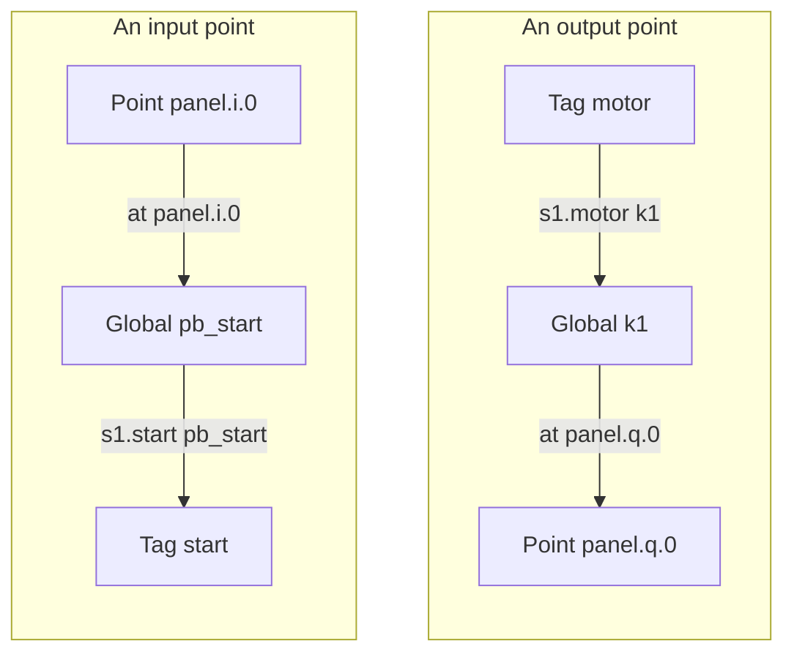
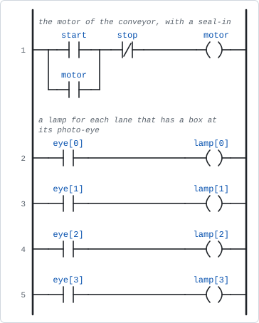

# Map tags to I/O points

This guide is for a reader who has a [program](../reference/glossary.md#program) and a
[configuration file](../reference/glossary.md#configuration-file). It shows how to give
a [point](../reference/glossary.md#point) of a [device](../reference/glossary.md#device)
to each [input](../reference/glossary.md#input) and each
[output](../reference/glossary.md#output) of the program.

A program does not name a point. In the configuration file, a
[located global](../reference/glossary.md#located-global) gives a name to each point. A
[connection](../reference/glossary.md#connection) joins that
[global](../reference/glossary.md#global) to a
[tag](../reference/glossary.md#tag) of the program.

> #### Warning {: .warning}
>
> Do not use logex for a safety function, for example an emergency stop. logex can stop
> at any time. Make each safety function with hardwired circuits or with a safety-rated
> controller. [Safety and limits](../explanation/safety-and-limits.md) gives the limits
> of logex.

## Before you start

You must have:

- a program that [compiles](../reference/glossary.md#compile)
  ([Your first program](../tutorials/first-program.md) shows how)
- a configuration file with a [task](../reference/glossary.md#task) and an
  [instance](../reference/glossary.md#instance) of the program
  ([Write a configuration file](write-a-configuration-file.md) shows how)
- an I/O list: the points of each device, with the direction and the
  [type](../reference/glossary.md#type) of each point
- a Mix project with logex
  ([Install logex and run a program](install-and-run.md) shows how)

> #### Note {: .info}
>
> logex has 1 [adapter](../reference/glossary.md#adapter): the
> [simulated device](../reference/glossary.md#simulated-device) `Logex.IO.Sim`. For a
> device with hardware, [write a device adapter](write-a-device-adapter.md) first.

## The example

This guide uses a conveyor with 4 lanes. The [plant](../reference/glossary.md#plant)
has 2 devices, `panel` and `card`. This table is the I/O list of the plant, with the
[location](../reference/glossary.md#location) of each point. In a location, `i` is an
input point and `q` is an output point.

| Point | Location | Global | Tag of `sorter.ld` |
|---|---|---|---|
| Start button | `panel.i.0` | `pb_start` | `start` |
| Stop button | `panel.i.1` | `pb_stop` | `stop` |
| Contactor | `panel.q.0` | `k1` | `motor` |
| Photo-eyes 0 to 3 | `card.i.0` to `card.i.3` | `lane_eye[0]` to `lane_eye[3]` | `eye[0]` to `eye[3]` |
| Lamps 0 to 3 | `card.q.0` to `card.q.3` | `lane_lamp[0]` to `lane_lamp[3]` | `lamp[0]` to `lamp[3]` |

This diagram shows the path of 2 values. The text on each arrow is the text that you
write in the configuration file.



Figure: the path of the value of the start button and of the contactor.

The program of the example is `sorter.ld`. To run the example, make the directory
`map-io-points` in the root of your Mix project. Put the file `sorter.ld` in it.

<!-- file: map-io-points/sorter.ld -->
```text
var_input  start bool
var_input  stop  bool
var_input  eye   bool[4]
var_output motor bool
var_output lamp  bool[4]

// the motor of the conveyor, with a seal-in
( xic start | xic motor ) xio stop ote motor
// a lamp for each lane that has a box at its photo-eye
xic eye[0] ote lamp[0]
xic eye[1] ote lamp[1]
xic eye[2] ote lamp[2]
xic eye[3] ote lamp[3]
```

<!-- rung: map-io-points/sorter.ld -->


## Steps

Do steps 1 to 3 in your configuration file. The configuration file of the example is
`map-io-points/sorter.logex`.

1. **Declare 1 located global for each point.** Write `at` and the location of the
   point after the type.

<!-- part of: map-io-points/sorter.logex -->
```text
var_global pb_start bool at panel.i.0
var_global pb_stop  bool at panel.i.1
var_global k1       bool at panel.q.0
```

A location has 3 parts, with a `.` between them:

| Part | Rule | Example |
|---|---|---|
| Device | A name that you select. The [host](../reference/glossary.md#host) gives an adapter to each name. | `panel` |
| Direction | `i` for an input point, `q` for an output point, in lowercase | `i` |
| Address | 1 or more whole numbers, with a `.` between them. Write `7`, not `07`. | `0`, or `2.4` in `rack.i.2.4` |

1 location holds 1 global. A located global takes no
[initial value](../reference/glossary.md#initial-value) and no `retain`
[qualifier](../reference/glossary.md#qualifier).

2. **For a row of points of 1 type, declare 1 [array](../reference/glossary.md#array).**
   Write the location of the first [element](../reference/glossary.md#element).

<!-- part of: map-io-points/sorter.logex -->
```text
var_global lane_eye  bool[4] at card.i.0
var_global lane_lamp bool[4] at card.q.0
```

Each element is 1 point. The name of the point is the name of the element, for example
`lane_eye[2]`. The last number of the address goes up by 1 for each element. Thus
`lane_eye[3]` is at `card.i.3`.

3. **Connect each input and each output of the instance to its global.** Write each
   connection after the `program` line of the instance.

Write the instance, a `.` and the tag, then the global. The sequence is the same for an
input and for an output. A connection of an array is 1 line.

<!-- part of: map-io-points/sorter.logex -->
```text
  s1.start pb_start
  s1.stop  pb_stop
  s1.eye   lane_eye
  s1.motor k1
  s1.lamp  lane_lamp
```

A connection can also name 1 element: `s1.lamp[0] lane_lamp[0]`.

The file `map-io-points/sorter.logex` is then complete:

<!-- file: map-io-points/sorter.logex -->
```text
// sorter.logex -- a conveyor with 4 lanes
task fast interval 10 priority 1

var_global pb_start bool at panel.i.0
var_global pb_stop  bool at panel.i.1
var_global k1       bool at panel.q.0

var_global lane_eye  bool[4] at card.i.0
var_global lane_lamp bool[4] at card.q.0

program s1 sorter with fast
  s1.start pb_start
  s1.stop  pb_stop
  s1.eye   lane_eye
  s1.motor k1
  s1.lamp  lane_lamp
```

4. **Make a script that prints the points and runs the plant on simulated devices.** In
   the example, the script is `map-io-points.exs`, in the root of the project.

```elixir
alias Logex.Runner
alias Logex.Runner.Clock.Manual
alias Logex.IO.Sim

{:ok, plant} = Logex.Configuration.compile_file("map-io-points/sorter.logex")
for warning <- plant.warnings, do: IO.puts(Logex.Diagnostic.format(warning))

# The I/O list: the points of each device.
for {device, points} <- Enum.sort(Logex.IO.points(plant)), point <- points do
  row = [device, point.name, point.type, point.direction]
  address = inspect(point.address, charlists: :as_lists)
  IO.puts(Enum.map_join(row, &String.pad_trailing("#{&1}", 14)) <> address)
end

# A simulated device for each device of the configuration.
{:ok, clock} = Manual.start_link()
{:ok, panel} = Sim.start_link()
{:ok, card} = Sim.start_link(inputs: 4, outputs: 4)

{:ok, runner} =
  Runner.start_link(
    configuration: plant,
    io: %{"panel" => {Sim, sim: panel}, "card" => {Sim, sim: card}},
    clock: {Manual, clock}
  )

# The start button, and a box at the photo-eye of lane 2.
Sim.set(panel, "panel.i.0", 1)
Sim.set(card, "card.i.2", 1)

# 10 ms on the manual clock: the task fast runs.
Manual.advance(clock, 10)

# The last value of each output point, and the global lane_lamp.
IO.inspect(Sim.outputs(panel), label: "panel")
IO.inspect(Sim.outputs(card), label: "card ")
IO.inspect(Runner.get!(runner, "lane_lamp"), label: "lane_lamp")
:ok = Runner.stop(runner)
```

| Part of the script | What it does |
|---|---|
| `plant.warnings` | The script prints each [warning](../reference/glossary.md#warning) of the configuration file before the points. |
| `Logex.IO.Sim.start_link/1` | It starts a simulated device. `inputs: 4` and `outputs: 4` give it 4 points of each direction. With no number, it has each point that the [configuration](../reference/glossary.md#configuration) puts on it. |
| `io:` | This option gives an adapter to each device, by the name of the device. |
| `Logex.IO.Sim.set/3` | After the [runner](../reference/glossary.md#runner) starts, it sets 1 input point by its location. |

5. **Run the script.** Compare the first lines with your I/O list.

```console
$ mix run map-io-points.exs
card          lane_eye[0]   bool          input         [0]
card          lane_eye[1]   bool          input         [1]
card          lane_eye[2]   bool          input         [2]
card          lane_eye[3]   bool          input         [3]
card          lane_lamp[0]  bool          output        [0]
card          lane_lamp[1]  bool          output        [1]
card          lane_lamp[2]  bool          output        [2]
card          lane_lamp[3]  bool          output        [3]
panel         pb_start      bool          input         [0]
panel         pb_stop       bool          input         [1]
panel         k1            bool          output        [0]
panel: %{"panel.q.0" => 1}
card : %{"card.q.0" => 0, "card.q.1" => 0, "card.q.2" => 1, "card.q.3" => 0}
lane_lamp: [0, 0, 1, 0]
```

## The result

The first 11 lines are the points of the configuration file. They agree with the I/O
list of [The example](#the-example).

The last 3 lines show a value on each path of the diagram:

| The script sets | The program writes | The device gets |
|---|---|---|
| `panel.i.0`, the start button | 1 to `motor` | 1 at `panel.q.0`, the contactor |
| `card.i.2`, the photo-eye of lane 2 | 1 to `lamp[2]` | 1 at `card.q.2`, the lamp of lane 2 |

### A device with hardware

> #### Warning {: .warning}
>
> Do a test of the plant on simulated devices before you use an adapter for hardware.
> With that adapter, the program writes to the outputs of the machine.

To use a device with hardware, give the module of your adapter in `io:`, alone or with a
keyword list of its options. In this example, the modules and the option `port:` are
yours.

<!-- fragment: the 2 forms of a value of io:, with adapters that the reader writes -->
```elixir
io = %{
  "panel" => MyApp.PanelIO,
  "card" => {MyApp.CardIO, port: "ttyS0"}
}
```

[Run a plant on the clock](run-on-the-clock.md) shows how to start the runner on the real
[clock](../reference/glossary.md#clock).

## If it does not work

### When you compile the configuration file

If the file has an error, the script stops with a `MatchError` that shows
`{:error, diagnostics}`. In each [diagnostic](../reference/glossary.md#diagnostic), the
field `message:` has the words of this table and the field `line:` gives the line of the
file. A warning does not stop the script.

| What you see | Cause | What to do |
|---|---|---|
| `unknown configuration line` | A connection has the global first. | Write the tag of the instance first, then the global. |
| `a location holds one global` | 2 globals are at 1 location. Each element of an array uses 1 location. | Give 1 of the globals a different location. |
| `is not a location` | The text after `at` is not a correct location. | Write the 3 parts, with `i` or `q` in lowercase and no leading 0: `panel.i.0`. |
| `takes no initial value`, `takes no initial list` or `after the declaration of` | A located global has an initial value. | Remove the initial value. |
| `` takes no `retain` `` | A located global has the qualifier `retain`. | Remove the qualifier. |
| `a var_output, cannot drive it` | A connection joins an output to an input point. | Connect the output to a global at a `q` location. |
| `is already driven by` | 2 connections write to 1 global. | Remove 1 of the connections. |
| `` is a location, written only after `at` `` | A connection names a location. | Write the name of the global. |
| `is a bool, but`, or the same words with a different type | The type of the global does not go into the type of the tag. For example, a `bool` tag cannot read an `int` point. | Give the global the type of the tag. |
| A warning with `but nothing drives` | Some elements of an array of output points have no connection. They stay at 0. | Connect the array, or each element. |
| A warning with `is declared but nothing uses it` | A located global has no connection. | Connect the global, or remove its line. |

### When you start the runner

`Logex.Runner.start_link/1` does a check of `io:` first. For each error, it raises an
`ArgumentError` with 1 line. The runner does not start, and logex opens no device.
`Logex.IO.bind!/2` does the same check and starts no runner.

| What you see | Cause | What to do |
|---|---|---|
| `Logex.Runner needs io:` | The option `io:` is not there. | Add `io:`. |
| `no adapter is bound to the device` | A device of the configuration has no adapter in `io:`. | Add the device and its adapter to `io:`. |
| `is bound, but no point is at it` | `io:` names a device that no location names. | Correct the name, or remove it from `io:`. |
| `io names each device by a string` | A key of `io:` is an atom. | Write a string: `"panel"`. |
| `past the sim's` | The simulated device has fewer points than the configuration puts on it. | Give more `inputs:` or `outputs:`, or correct the location. |
| A `MatchError` with `{:io_init, "panel", reason}` | The check found no error, but the adapter did not open the device `panel`. | Read `reason`. For `a sim is one device's`, start 1 simulated device for each device. |

### When the plant runs

The runner starts. After a [round](../reference/glossary.md#round),
`Logex.Runner.status/1` shows a [trip](../reference/glossary.md#trip).

| What you see | Cause | What to do |
|---|---|---|
| `:bad_value` in `trip:`, for example `{:io, "card", {:bad_value, "card.i.2", 5}}` | A device gave a value that does not fit the type of its point. | Correct the type of the global or the adapter. Then go to [Restart after a trip](restart-after-a-trip.md). |

## See also

- [Configuration file](../reference/configuration-file.md): the rules of a located
  global and of a connection.
- [I/O adapters](../reference/io-adapters.md): the rules of a point and of the
  simulated device.
- [Runner](../reference/runner.md): the option `io:`.
- `Logex.Runtime.cycle/3`: the I/O for a host that uses no runner.
- [Run a plant on the clock](run-on-the-clock.md): a runner on the real clock.
- [Use arrays](use-arrays.md): arrays in a program.
- [Read a diagnostic](read-diagnostics.md): how to print a diagnostic.
- [Share a global between programs](share-a-global.md): a `var_external` tag reads a
  point with no connection.
- [Force an input point](force-inputs.md): how to hold an input point at a value.
- [Write ExUnit tests on the manual clock](test-on-the-manual-clock.md): the
  simulated device in a test.
- [Glossary](../reference/glossary.md): the technical words.
