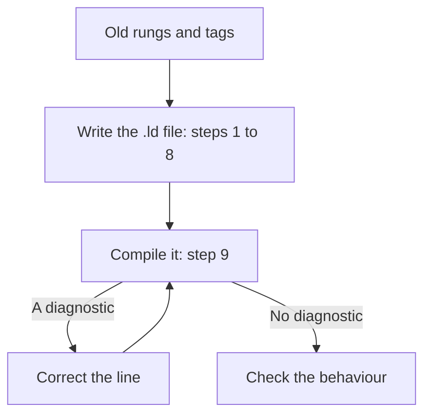

# Port a program from Logix or IEC 61131-3

This guide is for a controls engineer who has a ladder
[program](../reference/glossary.md#program) for a
[Logix](../reference/glossary.md#logix) controller or in
[IEC 61131-3](../reference/glossary.md#iec-61131-3). It gives the steps to write the
program again in the [dialect](../reference/glossary.md#dialect) of logex, until it
[compiles](../reference/glossary.md#compile) with no [diagnostic](../reference/glossary.md#diagnostic).

> #### Warning {: .warning}
>
> Do not port a safety function to logex. Put each of these functions in hardwired
> circuits or in a safety-rated controller:
>
> - an emergency stop
> - a guard interlock
> - a light curtain
> - a control that needs 2 hands
> - burner protection or pressure protection
>
> Design and validate these circuits and controllers to the functional-safety standards
> that apply. logex makes no claim against any of these standards. logex is not a safety
> controller. It is not hard real time, and it has no certificate for any industrial use.
> Wire the emergency stop so that it works when logex stops, has a crash or does not
> start.

## Before you start

You must have:

- a Mix project that can compile and run a program
  ([Your first program](../tutorials/first-program.md) shows how)
- the [rungs](../reference/glossary.md#rung) and the list of
  [tags](../reference/glossary.md#tag) of the old program, as text or on paper

logex does not read the export file of a different tool. You write each rung again.

Before you start, find each part of the old program that logex does not have. This table
gives the frequent parts. [What logex does not have](../reference/not-supported.md)
gives the full list.

| The old program has | What to do in logex |
|---|---|
| Structured Text, Function Block Diagram, Sequential Function Chart or Instruction List | Write the logic again as rungs. logex has ladder logic only |
| A subroutine and the instruction JSR | Write a [function block](../reference/glossary.md#function-block) and run it with `cal`. [Write a function block](write-a-function-block.md) shows how |
| A master control zone, MCR | Put the condition of the zone at the start of each rung of the zone |
| A [jump](../reference/glossary.md#jump) back, or a loop | Write the logic again. A jump goes forward only |
| A STRING, a structure, a UDT or an enumeration | Write the logic again. logex has `bool`, the integer types, the [bit strings](../reference/glossary.md#bit-string), `real`, `lreal`, the timers, the counters, function blocks, and arrays of all of these |
| An array of timers or counters, with a subscript that a tag holds | Run each [element](../reference/glossary.md#element) with its own instruction and a number as its subscript: `ton ts[0] 100` |
| A TIME tag or a [literal](../reference/glossary.md#literal) such as `T#5s` | Write a plain integer in the unit of the timer: `5000` for 5 s on a `ton` |
| An I/O address, such as `Local:1:I.Data.0` | Declare an [input](../reference/glossary.md#input) tag or an [output](../reference/glossary.md#output) tag. A [configuration](../reference/glossary.md#configuration) connects it to a [point](../reference/glossary.md#point): [Map tags to I/O points](map-io-points.md) |
| A tag that 2 programs share | Declare a [global](../reference/glossary.md#global) and `var_external`: [Share a global](share-a-global.md) |
| [Tasks](../reference/glossary.md#task) | Write a [configuration file](../reference/glossary.md#configuration-file): [Write a configuration file](write-a-configuration-file.md) |
| A [force](../reference/glossary.md#force) on an output | Nothing. logex forces inputs only |

## Steps



Figure: the steps of a port. The compile repeats until the program has no diagnostic.

1. **Make a file with the extension `.ld`.** The name of the file is the name of the
   program: `packer.ld` gives the program `packer`.

2. **Declare each tag on 1 line, before the first rung.** Each line is a
   [declaration](../reference/glossary.md#declaration). Choose the
   [section](../reference/glossary.md#section) from the source of the value:

   | The tag in the old program | Declaration in logex |
   |---|---|
   | An input from the [plant](../reference/glossary.md#plant) | `var_input start_pb bool` |
   | An output to the plant | `var_output motor bool` |
   | An internal tag, with an [initial value](../reference/glossary.md#initial-value) of 1 | `var need_reset bool 1` |
   | A timer | `var jam_t ton` |
   | A counter | `var boxes ctu` |
   | An [array](../reference/glossary.md#array) of 8 INT | `var weights int[8]` |

   logex reads a section word and a [type](../reference/glossary.md#type) word in any
   case: BOOL and `bool` are the same type. [Type words](../reference/glossary.md#type-words)
   gives each type. The first [subscript](../reference/glossary.md#subscript) of an array
   is 0. For `ARRAY[1..8] OF INT` of IEC 61131-3, declare `int[8]` and subtract 1 from
   each subscript.

   The name of a tag is case-sensitive. A rung that names `Start_PB` does not find the
   tag `start_pb`. logex refuses 2 declarations whose names differ only in case.

3. **Write each rung on 1 line.** A newline ends a rung. Remove the semicolons and the
   parentheses around each [operand](../reference/glossary.md#operand). Write each
   [branch](../reference/glossary.md#branch) `[A,B]` as `( A | B )`. Write BST, NXB and
   BND of the older text form as `(`, `|` and `)`.

   logex reads a [mnemonic](../reference/glossary.md#mnemonic) in any case: `XIC` is
   `xic`. A comment starts with `//`.

These are 2 old rungs in the text form of a Logix controller:

<!-- unchecked: 2 rungs in the text form of a Logix controller, which logex does not read -->
```text
[XIC(Start_PB),XIC(Motor)]XIO(Stop_PB)XIO(Need_Reset)OTE(Motor);
XIC(Motor)XIC(Box_Eye)TON(Jam_Timer,5000,0);
```

These are the same rungs in logex. The tags have shorter names in lowercase.

<!-- part of: port-a-program/packer.ld -->
```text
( xic start_pb | xic motor ) xio stop_pb xio need_reset ote motor
xic motor xic eye ton jam_t 5000
```

4. **Change the name of each [instruction](../reference/glossary.md#instruction) that
   logex names differently.**

   | Old name | logex |
   |---|---|
   | MOV | `move` |
   | EQU, NEQ, LES, GRT, LEQ, GEQ | `eq`, `ne`, `lt`, `gt`, `le`, `ge` |
   | SQR | `sqrt` |
   | RES on a CTU or on an RTO | A [coil](../reference/glossary.md#coil) on the member `r`: `xic reset_pb ote boxes.r` |
   | RES on a CTD | A `ctd` has no `r`. A coil on `ld` loads `pv` into `cv` |
   | RES on a TON | Nothing. A `ton` resets when its rung is false. A `tof` and a `tp` have no reset |
   | R_TRIG | `osr`, with the [storage bit](../reference/glossary.md#storage-bit) first: `xic clk osr clk_mem clk_pulse` |
   | SR and RS | `otl` and `otu`. The last rung that writes the tag sets its value for the scan. For SR, put the `otl` rung last. For RS, put the `otu` rung last |
   | A box with EN and ENO, such as ADD | The instruction on the rung. The power of the rung is EN. The power that the instruction passes on is ENO: `xic en add a b c ote eno` |

   [Instruction mnemonics](../reference/glossary.md#instruction-mnemonics) gives the name
   of each instruction in logex, in IEC 61131-3 and in the
   [conventional set](../reference/glossary.md#conventional-set).

5. **Change each [timer](../reference/glossary.md#timer).** Write the
   [preset](../reference/glossary.md#preset) on the instruction, as a whole number of
   milliseconds: `ton jam_t 5000`. If the old timer counts LTIME, declare `ton_ltime`.
   Write its preset in ns: 5 s is `5000000000`.

   > #### Warning {: .warning}
   >
   > Make sure that each preset and each number that you compare with `acc` or `pre` has
   > the unit of its timer. `ton t 2000000` is about 33 minutes on a `ton` and 2 ms on a
   > `ton_ltime`. If you change a declaration from 1 type to the other, the program still
   > compiles. logex gives a [warning](../reference/glossary.md#warning) only for a number
   > that is not a whole number of milliseconds. `2000000` gets no warning.

   | Old timer | logex |
   |---|---|
   | `T#5s` | `5000` on a `ton`, `5000000000` on a `ton_ltime` |
   | The output Q, or `.DN` | The [member](../reference/glossary.md#member) `dn` |
   | The elapsed time ET, or `.ACC` | The member `acc` |
   | The preset PT, or `.PRE` | The member `pre` |
   | A preset from a tag | `move sp jam_t.pre` on a rung before the timer |

   Write each member in lowercase: `jam_t.dn`, not `jam_t.DN`. A timer ends its rung or
   its [leg](../reference/glossary.md#leg). Read the timer on a later rung:
   `xic jam_t.dn ote jam_lamp`.

6. **Change each [counter](../reference/glossary.md#counter).** Use the members `pv`,
   `cv` and `q` for `.PRE`, `.ACC` and `.DN`. A `ctu` counts in a `dint`. For the CTU of
   IEC 61131-3, which counts in an INT, declare `ctu_int`. To count up and down
   1 count, declare a `ctud` and run it with a `ctu` and a `ctd`.

   A counter also ends its rung or its leg. Read it on a later rung:
   `xic boxes.q ote full_lamp`. Put the rung that writes `r` before the rung of the
   counter. Then the reset has its effect in the same
   [scan](../reference/glossary.md#scan).

7. **Change the rungs of the [first scan](../reference/glossary.md#first-scan).** logex
   has no first-scan bit. If a rung only sets a tag to a constant on the first scan,
   delete the rung. Give the tag that constant as its initial value. Do not mark the tag
   `retain`.

   If a rung must run on the first scan only, declare `var first bool 1`. Put
   `xic first` on the rung. Make `otu first` the last rung of the program. Do not mark
   `first` `retain`: after a [warm restart](../reference/glossary.md#warm-restart), a
   retained `first` is 0.

8. **Mark each value that the program must keep across a
   [restart](../reference/glossary.md#restart).** logex keeps a value only where its
   declaration has the [qualifier](../reference/glossary.md#qualifier) `retain`:
   `var retain boxes ctu`. At a restart, each other tag gets its initial value, but a
   `var_input` keeps its value. When the computer stops, only the
   [store](../reference/glossary.md#store) of a [runner](../reference/glossary.md#runner) keeps a retained value.
   [Keep values across a restart](keep-values-across-a-restart.md) shows how.

   > #### Warning {: .warning}
   >
   > Do not keep a safety record in a retained tag. For example, do not keep a burner
   > lockout, the [latch](../reference/glossary.md#latch) of an open guard or a count of
   > burner shutdowns there. A [cold restart](../reference/glossary.md#cold-restart) sets
   > each retained tag to its initial value. A person can edit the store. After a crash,
   > the store can hold an older value.

9. **Compile the file and correct each diagnostic.**
   [Correct the diagnostics of a ported program](correct-a-ported-program.md) gives a
   script that prints each diagnostic. It also gives the change for each frequent
   message.

When the file compiles, do the checks of
[Check the behaviour of a ported program](check-a-ported-program.md).

## The result

The old program is a conveyor with a jam timer and a box counter, in the text form of a
Logix controller:

<!-- unchecked: the rungs of the old program in the text form of a Logix controller, which logex does not read -->
```text
XIC(S:FS)OTL(Need_Reset);
XIC(Reset_PB)OTU(Need_Reset);
[XIC(Start_PB),XIC(Motor)]XIO(Stop_PB)XIO(Need_Reset)OTE(Motor);
XIC(Motor)XIC(Box_Eye)TON(Jam_Timer,5000,0);
XIC(Jam_Timer.DN)OTE(Jam_Lamp);
XIC(Box_Eye)CTU(Box_Count,12,0);
XIC(Box_Count.DN)OTE(Full_Lamp);
XIC(Reset_PB)RES(Box_Count);
```

The new program is the file `packer.ld`, in the directory `port-a-program` of your Mix
project:

<!-- file: port-a-program/packer.ld -->
```text
var_input start_pb bool
var_input stop_pb bool
var_input eye bool
var_input reset_pb bool
var_output motor bool
var_output jam_lamp bool
var_output full_lamp bool
var need_reset bool 1
var jam_t ton
var retain boxes ctu

xic reset_pb otu need_reset
( xic start_pb | xic motor ) xio stop_pb xio need_reset ote motor
xic motor xic eye ton jam_t 5000
xic jam_t.dn ote jam_lamp
xic reset_pb ote boxes.r
xic eye ctu boxes 12
xic boxes.q ote full_lamp
```

<!-- rung: port-a-program/packer.ld -->


The new program is different from the old program in 3 places:

- The rung of `S:FS` is not in the new program. `need_reset` has the initial value 1,
  thus it is 1 after each start and each restart.
- The rung of RES is rung 5, before the counter.
- `boxes` has the qualifier `retain`. Across a restart, logex keeps only the retained
  tags.

The script `port-a-program.exs` is in the root of the project. It runs 7 scans. The third
argument of `Logex.Runtime.scan/3` is the time in ms since the last scan. The last scan
comes after a warm restart.

```elixir
{:ok, packer} = Logex.compile_file("port-a-program/packer.ld")

scan = fn state, label, ms, inputs ->
  state = Logex.Runtime.put_inputs(packer, state, inputs)
  {outputs, state} = Logex.Runtime.scan(packer, state, ms)
  IO.puts("#{label}  #{inspect(outputs)}  boxes.cv=#{state.env["boxes"]["cv"]}")
  state
end

Logex.Runtime.instance(packer)
|> scan.("start, no reset", 0, %{"start_pb" => 1})
|> scan.("reset pressed  ", 10, %{"start_pb" => 0, "reset_pb" => 1})
|> scan.("start          ", 10, %{"start_pb" => 1, "reset_pb" => 0})
|> scan.("box on the eye ", 10, %{"start_pb" => 0, "eye" => 1})
|> scan.("box stays 5 s  ", 5000, %{})
|> scan.("box gone       ", 10, %{"eye" => 0})
|> then(&Logex.Runtime.restart(packer, &1, :warm))
|> scan.("warm restart   ", 10, %{"start_pb" => 1})
```

```console
$ mix run port-a-program.exs
start, no reset  %{"full_lamp" => 0, "jam_lamp" => 0, "motor" => 0}  boxes.cv=0
reset pressed    %{"full_lamp" => 0, "jam_lamp" => 0, "motor" => 0}  boxes.cv=0
start            %{"full_lamp" => 0, "jam_lamp" => 0, "motor" => 1}  boxes.cv=0
box on the eye   %{"full_lamp" => 0, "jam_lamp" => 0, "motor" => 1}  boxes.cv=1
box stays 5 s    %{"full_lamp" => 0, "jam_lamp" => 1, "motor" => 1}  boxes.cv=1
box gone         %{"full_lamp" => 0, "jam_lamp" => 0, "motor" => 1}  boxes.cv=1
warm restart     %{"full_lamp" => 0, "jam_lamp" => 0, "motor" => 0}  boxes.cv=1
```

The motor does not start before the operator presses reset. After the warm restart,
`boxes` keeps the count 1, and the motor waits for a reset again.

## If it does not work

| What you see | Cause | What to do |
|---|---|---|
| A diagnostic | A line that logex does not read | Find the message in [Correct the diagnostics of a ported program](correct-a-ported-program.md) |
| `(MatchError) no match of right hand side value` from `{:ok, packer} = Logex.compile_file(...)` | The file has a diagnostic | Do step 9 |

## See also

- [Correct the diagnostics of a ported program](correct-a-ported-program.md): the
  messages that a port often gives.
- [Check the behaviour of a ported program](check-a-ported-program.md): the behaviour that
  is different in logex.
- [How logex differs from Logix](../explanation/differences-from-logix.md) and
  [How logex differs from IEC 61131-3](../explanation/differences-from-iec.md): each
  difference of behaviour, with its source.
- [The dialect and IEC 61131-3](../explanation/the-dialect-and-iec.md): why logex has a
  dialect, and where its names come from.
- [Source syntax](../reference/source-syntax.md): the exact rules of the text of a
  program.
- [Timers and counters](../reference/instructions-timers-and-counters.md): the rules of
  each timer and of each counter.
- [Glossary](../reference/glossary.md): the technical words of logex.
