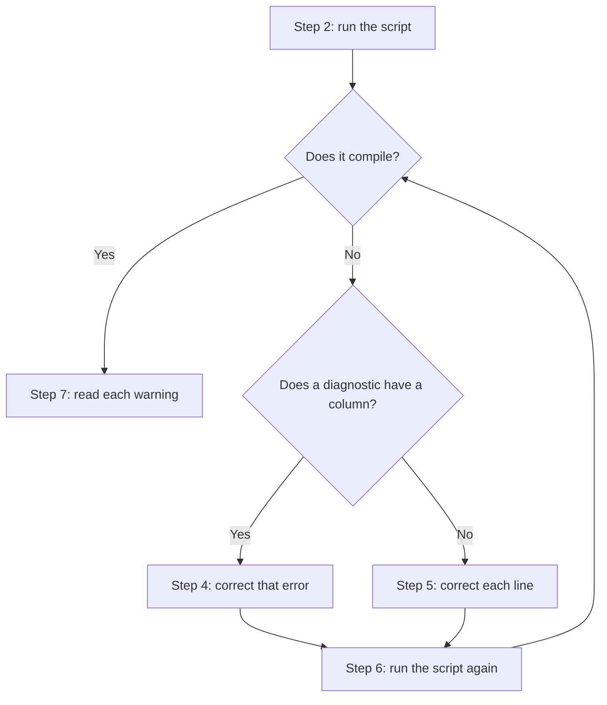
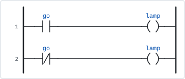

# Read a diagnostic

This guide is for a reader whose [program](../reference/glossary.md#program) or
[configuration file](../reference/glossary.md#configuration-file) does not
[compile](../reference/glossary.md#compile), or compiles with a
[warning](../reference/glossary.md#warning). It shows how to print each
[diagnostic](../reference/glossary.md#diagnostic), find the line of the error and correct
it.

A diagnostic is a report of 1 error in a source text. logex returns each diagnostic as
data. It does not raise an exception. A warning has the same form, but the program
compiles.

## Before you start

You must have:

- a Mix project that has logex. [Install logex and run a program](install-and-run.md)
  gives the steps.
- the program file, the program text or the configuration file that you want to check.

### The examples of this guide

The script of this guide compiles 4 examples. Use your files or texts in their place.

- 2 program texts with errors, in the script of step 1. The text `motor` is the motor
  starter of [Your first program](../tutorials/first-program.md), with errors on 4
  lines. The text `conveyor` has a [branch](../reference/glossary.md#branch) with no `)`.
- The program file `read-diagnostics/lamp.ld`. It compiles, but it has 2 warnings.
- The configuration file `broken.logex`, with errors on 4 lines.

Make the directory `read-diagnostics` in your project, and put the file `lamp.ld` in it,
with this text:

<!-- file: read-diagnostics/lamp.ld -->
```text
var_input go bool
var_output lamp bool
var spare bool

xic go ote lamp
xio go ote lamp
```

Put the file `broken.logex` in the root directory of your project, with this text. It
uses the [program type](../reference/glossary.md#program-type) `motor`, so put the file
[`motor.ld`](../tutorials/first-program.md) beside it.

<!-- file: broken.logex -->
```text
task fast interval 10 priority 1
var_global pb_start_1 bool at panel.i.0
var_global pb_stop_1  bool at panel.i.1
var_global k1         bool at panel.q.0
var_global sp_1       dint at drive.q.0
program m1 motor with fsat
  m1.start    pb_start_1
  m1.stop     pb_stop_1
  m1.motor    pb_stop_1
  m1.speed_sp k1
program m2 pump
```

## Steps

This diagram shows the steps. You run the script again after each correction, until
each example compiles.



Figure: steps 2 to 7. Correct a diagnostic with a column first. In a program, logex stops
at that error.

1. Make the file `read-diagnostics.exs` in the root directory of your project, with this
   text.

```elixir
motor = """
var_input start bool
var_input stop bool
var_input overtemp bool
var_input reset bool
var_output motor bool
var_output run_lamp bool
var_output speed_sp dint 1200
var fault bool

( xic start | xic motor ) xio stop ote motor
xic motor ote run_lmap
xic overtemp otl stop
xic reset otu Fault
xic Fault mov 0 speed_sp
"""

conveyor = """
var_input start bool
var_input stop bool
var_output motor bool

( xic start | xic motor xio stop ote motor
xic motor ote belt_lamp
"""

print = fn diagnostic -> IO.puts(Logex.Diagnostic.format(diagnostic)) end

report = fn
  name, {:ok, compiled} ->
    IO.puts("#{name} compiles")
    Enum.each(compiled.warnings, print)

  name, {:error, diagnostics} ->
    IO.puts("#{name} does not compile")
    Enum.each(diagnostics, print)
end

report.("motor", Logex.compile(motor, name: "motor"))
report.("conveyor", Logex.compile(conveyor, name: "conveyor"))
report.("read-diagnostics/lamp.ld", Logex.compile_file("read-diagnostics/lamp.ld"))
report.("broken.logex", Logex.Configuration.compile_file("broken.logex"))
```

The function `report` prints 1 line for each example, and then each diagnostic or each
warning. `Logex.Diagnostic.format/1` makes the text of each diagnostic. Give `report`
the result of the function for your file or text:

| What you compile | Function |
|---|---|
| A program file | `Logex.compile_file/1` |
| A program text | `Logex.compile/2` |
| A configuration file | `Logex.Configuration.compile_file/1` |

2. Run the script with Mix.

```console
$ mix run read-diagnostics.exs
motor does not compile
line 11: `run_lmap` is not declared — did you mean `run_lamp`?
line 12: `otl` writes `stop`, a var_input (declared on line 2): logic must not write an input
line 13: `Fault` is not declared — did you mean `fault`? (tags are case-sensitive)
line 14: unknown instruction `mov` — did you mean `move`? (renamed to its IEC name)
conveyor does not compile
line 5, column 43: expected `|` or `)`, found a newline
read-diagnostics/lamp.ld compiles
read-diagnostics/lamp.ld: line 3: warning: `spare` is declared but no rung uses it
read-diagnostics/lamp.ld: line 6: warning: `lamp` already has an `ote` on line 5: the last one in the scan decides it
broken.logex does not compile
broken.logex: line 6: no task `fsat` — did you mean `fast`?
broken.logex: line 6: `m1` leaves its var_inputs `overtemp` and `reset` unconnected: connect each to a global, a point or a constant, as in `m1.overtemp 0`
broken.logex: line 9: `pb_stop_1` is an input point (line 3): `m1.motor`, a var_output, cannot drive it
broken.logex: line 10: `m1.speed_sp` is a dint, but `k1` is a bool (line 4)
broken.logex: line 11: unknown program type `pump`: there is no `pump.ld` beside `broken.logex`
```

3. Find the place of each diagnostic. The start of each diagnostic gives the place. The
   message comes after the place.

| Part | What it tells you |
|---|---|
| `read-diagnostics/lamp.ld:` | The file that has the error, with the path that you gave. A text that `Logex.compile/2` compiles has no file. |
| `line 11` | The line in the file or in the text. The first line is line 1. Each line counts, also a [declaration](../reference/glossary.md#declaration), a comment and an empty line. |
| `column 43` | The place on the line where logex found the error. Only a diagnostic of the reading of the text has a column. |
| `warning:` | A possible error. The program compiles. |
| `` `run_lmap` is not declared `` | The message: what is wrong. |

In the script, line 1 of the text `motor` is the line after `motor = """`.

4. If a diagnostic has a column, correct that error first.

In a program, logex stops at the first text that it cannot read. That diagnostic is the
only one for the program. Line 5 of `conveyor` has no `)`, and logex finds the error at
the end of the line. The cause can be earlier on the line than the column.

In a configuration file, logex stops only at an illegal character, for example `@`. For a
different error with a column, logex reads the next lines and continues.

5. Correct each line that the other diagnostics name. These diagnostics have no column.

logex reports these errors together, in line order. A line can have more than 1
diagnostic. The text after `did you mean` is the nearest name that logex knows. The text
in parentheses gives more help.

> #### Note {: .info}
>
> Search the text for the name and correct each use. If no line declares a name, logex
> reports only its first use. Line 14 of `motor` also uses `Fault`, but no diagnostic
> names line 14 for it.

This diff shows the 4 corrections to the text `motor`. The result is the same as the
file `motor.ld`.

```diff
 ( xic start | xic motor ) xio stop ote motor
-xic motor ote run_lmap
-xic overtemp otl stop
-xic reset otu Fault
-xic Fault mov 0 speed_sp
+xic motor ote run_lamp
+xic overtemp otl fault
+xic reset otu fault
+xic fault move 0 speed_sp
```

This diff shows the corrections to `broken.logex`. This guide has no `pump.ld`, so the
diff removes the `program` line of `m2`.

```diff
-program m1 motor with fsat
+program m1 motor with fast
   m1.start    pb_start_1
   m1.stop     pb_stop_1
-  m1.motor    pb_stop_1
-  m1.speed_sp k1
-program m2 pump
+  m1.overtemp 0
+  m1.reset    0
+  m1.motor    k1
+  m1.speed_sp sp_1
```

If a program type of a [configuration](../reference/glossary.md#configuration) does not
compile, logex gives a diagnostic at the first `program` line that names it. The errors
of the `.ld` file come after the errors of the configuration. Each of them starts with
the path of the file, for example `./motor.ld:`.

6. Run the script again. Do steps 3 to 5 again until each example compiles.

After you correct an error with a column, logex reads the full text. Then it can report
more errors. If you add the `)` to line 5 of `conveyor`, the next run reports
`` `belt_lamp` is not declared `` on line 6. Declare it with the line
`var_output belt_lamp bool`.

> #### Caution {: .error}
>
> Do not run a program on a [plant](../reference/glossary.md#plant) before you read its
> warnings. A program with warnings compiles and runs, and a warning can show an error.

7. Read each warning, and correct the program if the warning shows an error.

logex gives the warnings of a program only when it compiles. This drawing shows the 2
[rungs](../reference/glossary.md#rung) of `lamp.ld`. Both rungs write `lamp`.

<!-- rung: read-diagnostics/lamp.ld -->


The last `ote` in the [scan](../reference/glossary.md#scan) decides `lamp`, so `lamp` is
on when `go` is off. This diff removes the second rung and the tag that no rung uses.

```diff
 var_input go bool
 var_output lamp bool
-var spare bool
 
 xic go ote lamp
-xio go ote lamp
```

The warnings of a program type do not come with the configuration. To read them, compile
the `.ld` file with `Logex.compile_file/1`.

## The result

Each example compiles with no warning. If you do not correct a warning, the script prints
it after the line of its example.

<!-- unchecked: the output after the corrections of steps 5 to 7, which the files of this page do not hold -->
```text
motor compiles
conveyor compiles
read-diagnostics/lamp.ld compiles
broken.logex compiles
```

## Print a diagnostic in a different form

A diagnostic is a `%Logex.Diagnostic{}` struct. logex gives a warning as a
`%Logex.Diagnostic{}` too, with `severity: :warning`. To print a diagnostic in a
different form, for example for an editor, read its fields.

| Field | Value |
|---|---|
| `file` | The path of the file. `nil` for a text. |
| `line` | The line, from 1. `nil` if no line has the error, for example if logex cannot read the file. |
| `column` | The column, from 1, for a diagnostic of the reading of the text. Else `nil`. |
| `severity` | `:error` or `:warning` |
| `stage` | The part of logex that found the error: `:file`, `:lex`, `:parse`, `:validate`, `:configure` or `:edit` |
| `message` | The text after the place |

This script prints the diagnostics of `broken.logex`, as this guide shows it before the
corrections, in the form `file:line: severity: message`.

```elixir
{:error, diagnostics} = Logex.Configuration.compile_file("broken.logex")

editor = fn d ->
  place = Enum.join(Enum.reject([d.file, d.line, d.column], &is_nil/1), ":")
  IO.puts("#{place}: #{d.severity}: #{d.message}")
end

Enum.each(diagnostics, editor)
```

```console
$ mix run read-diagnostics-editor.exs
broken.logex:6: error: no task `fsat` — did you mean `fast`?
broken.logex:6: error: `m1` leaves its var_inputs `overtemp` and `reset` unconnected: connect each to a global, a point or a constant, as in `m1.overtemp 0`
broken.logex:9: error: `pb_stop_1` is an input point (line 3): `m1.motor`, a var_output, cannot drive it
broken.logex:10: error: `m1.speed_sp` is a dint, but `k1` is a bool (line 4)
broken.logex:11: error: unknown program type `pump`: there is no `pump.ld` beside `broken.logex`
```

[Diagnostics](../reference/diagnostics.md) gives the rules of each field.

## If it does not work

| What you see | Cause | What to do |
|---|---|---|
| `cannot name a program` | The name of the file cannot be the name of a program. | Rename the file: a letter or `_`, then letters, digits or `_`. For example, `read_diagnostics.ld`. |
| `cannot be read: no such file or directory` | No file is at the path. | Correct the path. A relative path starts at the directory where you run Mix. |
| `is a configuration file` or `is not a configuration file` | The function does not read this kind of file. | Use the function of the table in step 1. |
| A diagnostic of a file that you did not give, for example `./seal.ld` | An error in a [function block](../reference/glossary.md#function-block) file. | Correct that file. logex stops the compile of the program at that error. |
| `` unknown type `bol`: logex has `bool`, `` | A wrong [type](../reference/glossary.md#type) word. | Correct the type word. The message ends with the nearest type. logex does not report the lines that use the [tag](../reference/glossary.md#tag). |
| `is not declared`, with no `did you mean` | No name is near it, or the text has more than 100 names that logex cannot find. | Declare the tag, or correct the name. After 100 names, logex gives no nearest name. |
| An `ArgumentError`, and no diagnostic | The [host](../reference/glossary.md#host) called logex with a wrong argument. | Correct the call. [Host contract](../reference/host-contract.md) gives the rules of each function. |

## See also

- [Diagnostics](../reference/diagnostics.md): the rules of a diagnostic and the
  families of message.
- [Warnings](../reference/warnings.md): each warning and its cause.
- [Your first program](../tutorials/first-program.md): the tutorial that writes
  `motor.ld`.
- [Write a configuration file](write-a-configuration-file.md): a plant in a
  configuration file.
- [Write a function block](write-a-function-block.md): a program that loads a function
  block from a different file.
- [Host contract](../reference/host-contract.md): the functions that compile a text and
  the `ArgumentError` of a wrong call.
- [Glossary](../reference/glossary.md): the technical words.
