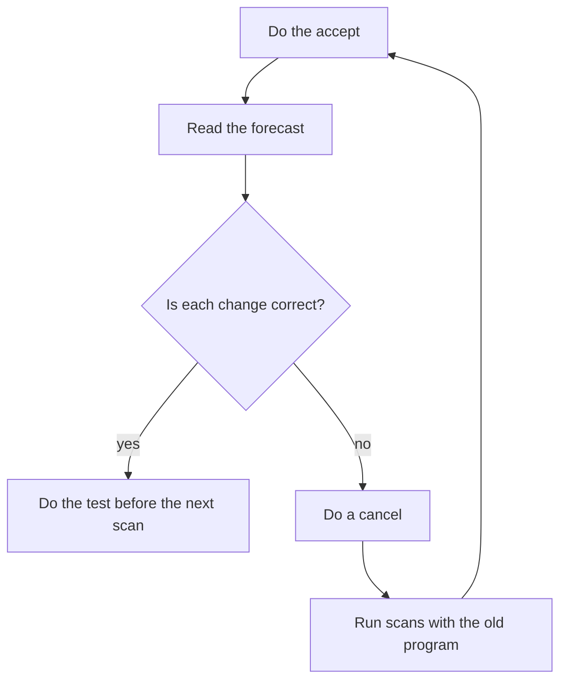

# Read the forecast of an edit

This guide is for a reader who does an
[online edit](../reference/glossary.md#online-edit) of 1
[instance](../reference/glossary.md#instance), as
[Edit a running program](edit-a-running-program.md) shows. It shows how to read the
forecast of the edit. With the forecast, you do the
[test](../reference/glossary.md#test) at a moment that is correct for the machine.

> #### Warning {: .warning}
>
> Do not use logex for a safety function, for example an emergency stop. logex can stop
> at any time. [Safety and limits](../explanation/safety-and-limits.md) gives the limits
> of logex.

## Before you start

You must know the steps of [Edit a running program](edit-a-running-program.md).

Get [`boxes.ld`](edit-a-running-program.md) and
[`boxes_v2.ld`](edit-a-running-program.md), and put them in the root of your Mix
project. The old [program](../reference/glossary.md#program) `boxes.ld` sets the lamp
`full_lamp` at 3 boxes. The new program `boxes_v2.ld` sets the lamp at 5 boxes.

A forecast is the list of entries that the [accept](../reference/glossary.md#accept)
returns. It is the report that the test returns if your
[host](../reference/glossary.md#host) does the test before the next
[scan](../reference/glossary.md#scan). The accept changes nothing.



Figure: the forecast and the decision. A cancel goes back to the accept.

The diagram shows that the test is not the only step after an accept. A cancel and a
second accept give a forecast of a later moment.

## Steps

1. **Bind the forecast that the accept returns, and print each entry.**

<!-- part of: read-the-forecast-of-an-edit.exs -->
```elixir
accept = fn state, label ->
  {:ok, edit, forecast} = Logex.Edit.accept(boxes, v2, state)
  IO.puts(label)
  Enum.each(forecast, &IO.puts("        #{inspect(&1)}"))
  edit
end
```

In the example, the lamp is on and box 3 is at the photo-eye. The forecast has 2
entries: `{:dn_drops, "boxes", {3, 5}}` and `{:preset, "boxes", {3, 5}}`.

2. **Find the kind of each entry in [The kinds of entry](#the-kinds-of-entry).** Each
   entry has a kind, a name and a value.

In the example, the `:dn_drops` entry tells you that `boxes.q` goes to 0 after the test.
The lamp then goes off before the operator takes the case away.

A forecast can be the empty list `[]`. The test then has nothing to report.

3. **If a change is not correct at this moment, do a
   [cancel](../reference/glossary.md#cancel).**

<!-- part of: read-the-forecast-of-an-edit.exs -->
```elixir
{_boxes, state, report} = Logex.Edit.cancel(edit, state)
```

A cancel of an accepted edit changes nothing. It returns the old program and the empty
report `[]`.

4. **Run scans with the old program until a later moment. Then do the accept again.**

<!-- part of: read-the-forecast-of-an-edit.exs -->
```elixir
state = Enum.reduce([%{"eye" => 0, "reset_pb" => 1}, %{"reset_pb" => 0}], state, scan)

edit = accept.(state, "forecast, after the reset")
```

In the example, the operator takes the case away and pushes the reset button. The count
is 0 and the lamp is off. The forecast has only the `:preset` entry.

5. **Do the test before the next scan.**

<!-- part of: read-the-forecast-of-an-edit.exs -->
```elixir
{_edit, _state, report} = Logex.Edit.test(edit, state)
```

The report of the test is then the same as the forecast. If your host runs scans between
the accept and the test, the report can be different.

### The complete script

Put `read-the-forecast-of-an-edit.exs` in the root of your Mix project, with the 2
program files.

```elixir
{:ok, boxes} = Logex.compile_file("boxes.ld")
{:ok, v2} = Logex.compile(File.read!("boxes_v2.ld"), name: "boxes")

scan = fn inputs, state ->
  state = Logex.Runtime.put_inputs(boxes, state, inputs)
  {outputs, state} = Logex.Runtime.scan(boxes, state, 10)
  IO.puts("scan    #{inspect(outputs)}")
  state
end

# The host does an accept and prints the forecast.
accept = fn state, label ->
  {:ok, edit, forecast} = Logex.Edit.accept(boxes, v2, state)
  IO.puts(label)
  Enum.each(forecast, &IO.puts("        #{inspect(&1)}"))
  edit
end

# 3 boxes go past the photo-eye. The lamp comes on.
state =
  [0, 1, 0, 1, 0, 1]
  |> Enum.map(&%{"eye" => &1})
  |> Enum.reduce(Logex.Runtime.instance(boxes), scan)

edit = accept.(state, "forecast, with the lamp on")

# The lamp must stay on. The cancel returns the old program.
{_boxes, state, report} = Logex.Edit.cancel(edit, state)
IO.puts("cancel  #{inspect(report)}")

# The operator takes the case away and pushes the reset button.
state = Enum.reduce([%{"eye" => 0, "reset_pb" => 1}, %{"reset_pb" => 0}], state, scan)

edit = accept.(state, "forecast, after the reset")
{_edit, _state, report} = Logex.Edit.test(edit, state)
IO.puts("test")
Enum.each(report, &IO.puts("        #{inspect(&1)}"))
```

```console
$ mix run read-the-forecast-of-an-edit.exs
scan    %{"count" => 0, "full_lamp" => 0}
scan    %{"count" => 1, "full_lamp" => 0}
scan    %{"count" => 1, "full_lamp" => 0}
scan    %{"count" => 2, "full_lamp" => 0}
scan    %{"count" => 2, "full_lamp" => 0}
scan    %{"count" => 3, "full_lamp" => 1}
forecast, with the lamp on
        {:dn_drops, "boxes", {3, 5}}
        {:preset, "boxes", {3, 5}}
cancel  []
scan    %{"count" => 0, "full_lamp" => 0}
scan    %{"count" => 0, "full_lamp" => 0}
forecast, after the reset
        {:preset, "boxes", {3, 5}}
test
        {:preset, "boxes", {3, 5}}
```

## The result

The test moves the [preset](../reference/glossary.md#preset) at a moment at which the
lamp does not change.

| Line of the output | What it shows |
|---|---|
| `forecast, with the lamp on` | A test at this moment moves the preset from 3 to 5, and the lamp goes off in a later scan. |
| `cancel  []` | The cancel changes nothing. |
| `forecast, after the reset` | A test at this moment moves the preset. No [output](../reference/glossary.md#output) changes. |
| `test` | The report of the test is the same as the last forecast. |

## The kinds of entry

A forecast and a report have the same kinds of entry.

| Kind of entry | What it tells you |
|---|---|
| `:added` | The test starts a [tag](../reference/glossary.md#tag) that the new program adds. The tag gets its [initial value](../reference/glossary.md#initial-value). |
| `:pruned` | An [assemble](../reference/glossary.md#assemble) or a cancel removes a tag that the program that stays does not declare. |
| `:preset`, `:preset_kept`, `:dn_drops`, `:dn_rises` | Read [A new preset](#a-new-preset). |
| `:ons_blocked` | Read [A blocked rising edge](#a-blocked-rising-edge). |
| `:input`, `:unread`, `:held` | Your host has a duty. Read [Edit the inputs and outputs of a running program](edit-inputs-and-outputs.md). |
| Each other kind | Read [Online edit](../reference/online-edit.md). |

### A new preset

A test moves the preset of a [counter](../reference/glossary.md#counter) or a
[timer](../reference/glossary.md#timer) to the preset of the new program. The `:preset`
entry gives the old preset and the new preset. A `:preset_kept` entry tells you that a
[rung](../reference/glossary.md#rung) wrote the preset. The test then keeps the value
that the rung wrote.

The move can change the done [member](../reference/glossary.md#member): `q` of a `ctu`
counter, `qu` of a `ctud` counter or `dn` of a timer. The forecast then has 1 more
entry. `:dn_drops` tells you that the member goes to 0 in a later scan. `:dn_rises`
tells you that it goes to 1. A `ctd` counter gets no such entry.

The value of this entry is the count or the time, then the new preset. The time is in
ms. For a long timer, for example `ton_ltime`, the time is in ns.

| Instance | When the done member changes |
|---|---|
| A counter | In the next scan that runs the counter |
| A `ton` or `rto` timer | In the next scan that runs the timer with a [true rung](../reference/glossary.md#true-rung) |
| A `tof` timer in its delay | `dn` goes to 0 in the next scan that runs the timer with a [false rung](../reference/glossary.md#false-rung). The delay ends early. |
| A `tof` timer with a true rung and the new preset 0 | `dn` goes to 0 in the scan in which the rung becomes false. |
| A `tp` timer in its pulse | `dn` goes to 1 and the pulse ends in the next scan that runs the timer. |

[Online edit](../reference/online-edit.md) gives the cases in which the change of an
entry does not occur.

### A blocked rising edge

An `:ons_blocked` entry names the edge memory of an
[instruction](../reference/glossary.md#instruction) that the new program adds or
changes. Examples are `horn_pulse.en` of a `tp` timer, `rejects.cu` of a counter and the
[storage bit](../reference/glossary.md#storage-bit) of a
[one-shot](../reference/glossary.md#one-shot).

That instruction does nothing in the first scan that runs it after the test: no pulse
and no count. This is true also if its rung becomes true in that scan. Thus a `tp` timer
that the edit adds while its rung is true gives no pulse at the test. It gives a pulse
at the next [rising edge](../reference/glossary.md#rising-edge) after that scan.

## If it does not work

| What you see | Cause | What to do |
|---|---|---|
| The report of the test is different from the forecast. | Your host ran scans between the accept and the test. | Do the test before the next scan. |
| The preset does not change. | The report has a `:preset_kept` entry. A rung wrote the preset. | Change the value that the rung writes. |
| A new counter does not count the first box, or a new one-shot gives no pulse. | The report has an `:ons_blocked` entry. | Do the test at a moment at which the rung of that instruction is false and stays false in the next scan. |
| The accept returns `{:error, diagnostics}`. | The new program changes the [type](../reference/glossary.md#type) of a tag. | Read [Edit a running program](edit-a-running-program.md#if-it-does-not-work). |

## See also

- [Edit a running program](edit-a-running-program.md): the steps of an online edit.
- [Edit the inputs and outputs of a running program](edit-inputs-and-outputs.md): the
  duties of a host for the `:input`, `:unread` and `:held` entries.
- [Online edit](../reference/online-edit.md): the rules of each kind of entry.
- [Use counters](use-counters.md) and [Use timers](use-timers.md): the counter and the
  timers.
- [Glossary](../reference/glossary.md): the technical words.
