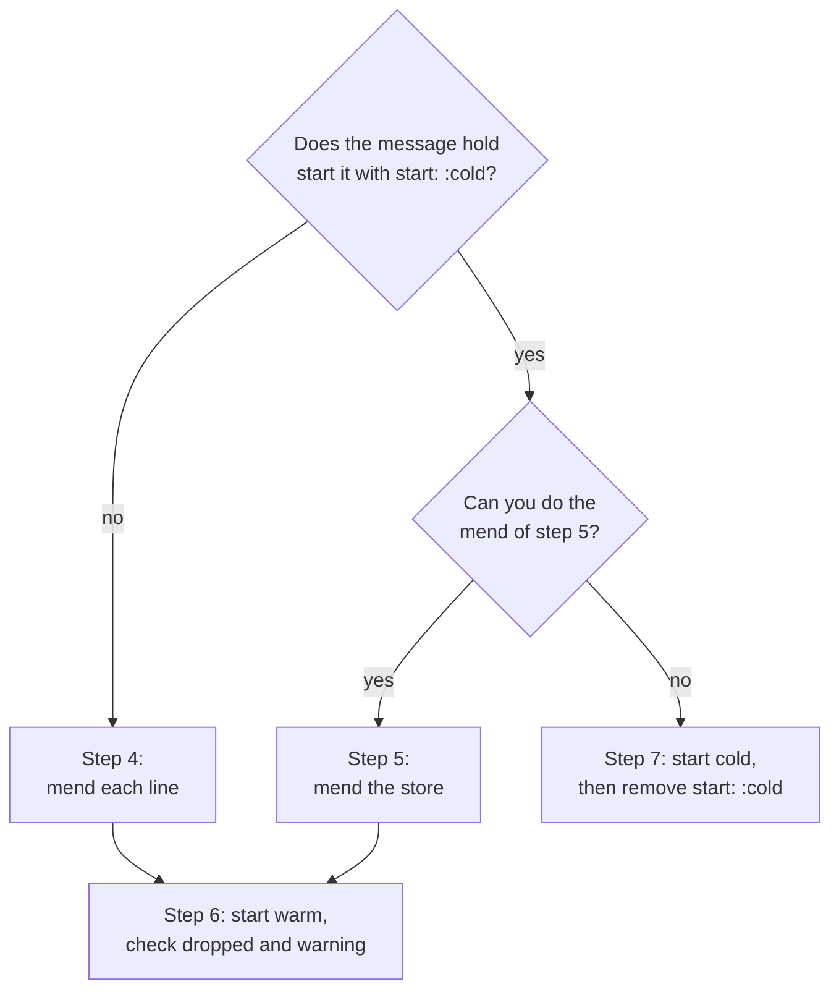

# Recover from a refused store

This guide is for a reader whose [runner](../reference/glossary.md#runner) does not start
because the start refuses its [store](../reference/glossary.md#store).
`Logex.Runner.start_link/1` then raises an `ArgumentError`, and its message names the
store. The guide shows how to read the message, mend the store by hand and start warm. If
you cannot mend the store, it shows how to start cold and keep the refused store in a
numbered copy.

> #### Warning {: .warning}
>
> Make sure that the machine is safe before you start the runner again. A warm start sets
> each retained value from the store. A [rung](../reference/glossary.md#rung) that reads
> such a value can set an output [point](../reference/glossary.md#point) in the first
> [round](../reference/glossary.md#round), with no person at the machine. logex does not
> check that a value in the store is correct for the machine. If the start drops a value,
> the runner runs with the initial value of that tag until you stop it.

> #### Caution {: .error}
>
> Do not start cold as your first action. A cold start sets each retained value, for
> example the count of boxes in a case, to its
> [initial value](../reference/glossary.md#initial-value). Mend the store by hand if you
> can. A cold start keeps the refused store only in a numbered copy.

## Before you start

You must have:

- a runner with a store, as in [Keep retained values on disk](keep-values-on-disk.md).
- the message of the refusal.
- a text editor that saves ASCII text with no byte-order mark.

A refused start does not start the runner and opens no
[device](../reference/glossary.md#device). It does not change the store and makes no
file. If a supervisor starts the runner, the error of the supervisor holds the message.
[Run a plant under a supervisor](run-under-a-supervisor.md) shows how to start the runner
again.

<!-- unchecked: the start of the error of a supervisor, from a run with the store of the example cut to 8 lines -->
```text
{:error,
 {:shutdown,
  {:failed_to_start_child, Logex.Runner,
   {:EXIT,
    {%ArgumentError{
       message: "tally.retain: line 8: `t1.boxes.cu bool 0` is the store's last line, and no end line: ...
```

This guide uses the store `tally.retain` of the
[configuration](../reference/glossary.md#configuration) `tally.logex`, which counts
boxes. Each example line comes from that store. A warm start and a cold start are the 2
kinds of [fresh start](../reference/glossary.md#fresh-start). The guide also uses these
words:

| Word | Meaning |
|---|---|
| The backup | The copy of the refused store that you make in step 2, `tally.retain.bak` |
| A numbered copy | A file `<store>.dropped.<n>` that the runner writes beside the store, for example `tally.retain.dropped.1`. It holds a store that a start did not read whole. [The numbered copies](../reference/store.md#the-numbered-copies) gives the rules. |
| The end line | The last line of the store, for example `end 16 lines`. Its count includes each line of the store, the end line also. |
| A digest | The 32 lowercase hexadecimal digits after `resource` or after `program <type>`. A warm start compares them with its configuration and [program](../reference/glossary.md#program). |

## Steps

1. Do not start the runner again until step 6. Do not delete the store. A start with no
   store writes the initial values.
2. Copy the store to the backup.

```console
$ cp tally.retain tally.retain.bak
```

3. Read the message. Most lines of the message give 1 problem, in this form:
   `<path>: line <n>: <problem>`. Some lines name an [instance](../reference/glossary.md#instance) in place of a line. A
   message shows the first 50 problems, and its last line counts the others. Open the
   store in the text editor, and find each line `<n>`.



Figure: the decisions of this guide, after step 3. A message that starts with
`the runner's retain:` or holds `the store cannot be read` is in
[If it does not work](#if-it-does-not-work).

4. If the message does not hold `start it with start: :cold`, find each problem in this
   table. Mend each line that the message names.

| Part of the message | Mend |
|---|---|
| `is a comment, and a store holds none` | Remove the line. |
| `holds a tab` | Put 1 space in place of the tab. |
| `holds the byte` | Remove the character. A store holds only printable ASCII. |
| `begins with a byte-order mark` | Save the file with no byte-order mark. |
| `an empty line, which a store never holds` | Remove the empty line after the end line. |
| `is no line of a store` | Write the line in a form that the message gives, or remove it. An empty line between 2 lines gets this message also. |
| `` comes before any `instance` line `` | Move the line under the line of its instance, or remove it. |
| `names what line <n> names already` | Remove 1 of the 2 lines. Keep the line with the correct value. |
| `the store's end line counts` | Find the line that is new, lost or doubled, and mend it. Then write the number of lines in the end line. |
| `is not the digest of the store's value lines` | A value line changed. If you know each value, write the digest that the message gives on the `digest` line. Else go to step 7. |
| `is no number` | Write the value as a decimal number, for example `3`. |
| `is no type of a retained value` | Write the [type](../reference/glossary.md#type) of the [tag](../reference/glossary.md#tag), as its [declaration](../reference/glossary.md#declaration) gives it, for example `dint`. |
| `is no digest` | Copy the line from an earlier store of the same files, for example a numbered copy. If you have none, go to step 7. |
| `is no store's header` | Line 1 has a typing error. Write `logex retain 4` on line 1, or `logex retain 3` for a store with no `digest` line. |
| `is an end line, which a store whose first line is` | Mend line 1, as for `is no store's header`. |
| `the store is of version` | A different version of logex wrote the store. Start the store with that version, or go to step 7. |
| `names no configuration` | Write line 2 as `configuration <name> written <time>`, for example `configuration tally written 2026-10-30T14:00:06Z`. |
| `is no time a store is written at` | Write the time in UTC, in the form that the message gives. |
| `` `kinds` does not hold `` | The message names an instance and a [member](../reference/glossary.md#member). Put back the line `<instance>.<member> <kind>` under the line of the instance, for example `t1.boxes ctu`. |

> #### Note {: .info}
>
> `wc -l tally.retain` prints `16 tally.retain` for a store of 16 lines. If the last line
> has no newline, it prints 1 less. The line numbers of the text editor are always
> correct.

5. If the message holds `start it with start: :cold`, the runner cannot read the store
   whole. Find the problem in this table. If you cannot do the mend, go to step 7.

> #### Caution {: .error}
>
> Do not add only an end line and a digest to a store that is cut short. The start then
> reads the store. Each lost value starts at its initial value, and `dropped` does not
> show it.
> [An example](#an-example-a-comment-and-a-store-cut-short) shows the refusal.

| Part of the message | Cause and mend |
|---|---|
| `is the store's last line, and no end line` | The store lost its last lines. The cut can be inside the last line, for example `t1.boxes.cv dint 1` from `dint 12`. Mend the last line, add each lost line, then add the end line. Do this only if you know each value. |
| `heads a store that names the program that wrote it, and the store names none` | A person removed the `resource` line and the `program` lines. Copy the lines from an earlier store of the same files, for example a numbered copy. |
| `names the resource of the store's writer, and the store names no program type` | A person removed the `program` lines. Copy them from an earlier store of the same files. |
| `names a program type of the store's writer, and the store names no resource` | A person removed the `resource` line. Copy it from an earlier store of the same files. |
| `the store is of configuration` | The configuration has a different name. A configuration has the name of its file. Give the file its old name again, for example `tally.logex`. |

   To keep the new name of the file, [compile](../reference/glossary.md#compile) the
   configuration with its old name:

<!-- fragment: a renamed configuration file compiled with the old name of the configuration -->
```elixir
{:ok, renamed} = Logex.Configuration.compile_file("line_2.logex")
source = File.read!("line_2.logex")
{:ok, plant} = Logex.Configuration.compile("tally", source, renamed.programs)
```

6. Start the runner with the options of the refused start. A start is warm unless the
   options give `start: :cold`. Make sure that `dropped` is `[]` and `warning` is `nil`:

<!-- fragment: the check of the warm start, with opts the options of the refused start -->
```elixir
{:ok, runner} = Logex.Runner.start_link(opts)
retain = Logex.Runner.status(runner).retain
IO.inspect(retain.dropped, label: "dropped")
IO.inspect(retain.warning, label: "warning")
```

   It prints `dropped: []` and `warning: nil`. If it prints a different value, do what
   this table says:

| What you see | What to do |
|---|---|
| `dropped` holds a name | For example, `dropped` is `[{"t1.boxes.vc", :undeclared}]`. The start did not read the line of that name. Here it is `t1.boxes.vc dint 3`, a wrong spelling of `t1.boxes.cv`. The tag `t1.boxes.cv` has its initial value, 0. The start copied the store to the next numbered copy. Stop the runner. Mend the line in the numbered copy. Put the numbered copy in place of the store, and start again. |
| `warning` holds `the store was written by another program than the one this start was given` | The files of this start are not the files that wrote the store, or a digest that you wrote is not correct. The start read each value of the store that has a tag of the same name and type. Make sure that each value is correct for the program. |

   To put a numbered copy in place of the store, stop the runner first:

```console
$ cp tally.retain.dropped.1 tally.retain
```

7. If you cannot mend the store, start cold:

<!-- fragment: a cold start, with opts the options of the refused start -->
```elixir
{:ok, runner} = Logex.Runner.start_link(Keyword.put(opts, :start, :cold))
```

   The cold start copies the refused store to the next numbered copy, for example
   `tally.retain.dropped.1`. Then it writes a new store of initial values.
   `Logex.Runner.status(runner).retain.copy` gives the name of the numbered copy.

   Then remove `start: :cold` from the options, and from the child spec if a supervisor
   starts the runner. If you do not, the next start writes the initial values over the
   store again, and makes no numbered copy.

## The result

The runner runs. After step 6, it has each retained value of the store. After step 7, it
has the initial values, and the numbered copy holds the refused store as it was.

You can mend the numbered copy later. Stop the runner, mend the numbered copy, and put it
in place of the store with `cp`, as in step 6. The next warm start then reads the values
of the numbered copy. The numbered copy does not hold the changes after the cold start.

## If it does not work

| What you see | Cause | What to do |
|---|---|---|
| A new problem after a mend | Some problems show only when other lines are correct, for example a removed `resource` line. | Mend the new line, then start again. |
| `and 6 more problems, not listed` | The message shows the first 50 problems only. | Mend them, then start again to see the others. |
| A mend that is not correct | The start refuses the store again, or reads a value that you did not expect. | Put the backup back: `cp tally.retain.bak tally.retain`. Then start from step 3 again. |
| `the store is empty` | The store has no lines. | Put an earlier store of the same files in place of the store, or go to step 7. |
| `the store cannot be read: illegal operation on a directory` | The path names a directory. | Give the path of a file. With `start: :cold`, `start_link/1` raises nothing and returns `{:error, {:retain, :eisdir}}`. |
| `the store cannot be read: the disk did not answer within the write limit` | The disk is slow, or the path names a FIFO. | Repair the disk, or give a longer `write_limit:`, as in [Keep retained values on disk](keep-values-on-disk.md). If the path names a FIFO, give the path of a file. With `start: :cold`, `start_link/1` returns `{:error, {:retain, :timeout}}`. |
| `is a symbolic link` | The path of the store is a link. The start refuses it, also with `start: :cold`. | Give the path of the file that the link names. |
| `names the store of another runner of this VM` | A different runner has the store. | Stop that runner, or give a different path. The start refuses `start: :cold` also. |
| Each value is 0 after a later start, and `copy` is `nil` | The options still give `start: :cold`. | Remove it, as in step 7. |

## An example: a comment and a store cut short

`recover-a-refused-store.exs` counts 3 boxes and stops the runner, which writes the store.
Then it changes the store in 2 ways, as a person or a failure can do:

- It adds a comment. The start refuses the store. The script removes the comment, as in
  step 4, and the start reads the store.
- It cuts the store short. Then it adds only an end line, against the caution of step 5.
  Last, it starts cold, as in step 7.

It uses the configuration of
[Keep the values of a plant](keep-values-across-a-restart.md#keep-the-values-of-a-plant).
Get [`tally.ld`](keep-values-across-a-restart.md#keep-the-values-of-a-plant) and
[`tally.logex`](keep-values-across-a-restart.md#keep-the-values-of-a-plant) and put them
in the root directory of your project. Save the script there as
`recover-a-refused-store.exs`. It deletes each file whose name starts with
`tally.retain`, a backup also.

```elixir
alias Logex.IO.Sim
alias Logex.Runner
alias Logex.Runner.Clock.Manual

{:ok, plant} = Logex.Configuration.compile_file("tally.logex")

# No store and no copy from an earlier run. This deletes tally.retain.bak also.
for file <- File.ls!(), String.starts_with?(file, "tally.retain"), do: File.rm!(file)

# The manual clock, its wall clock 2026-10-30T14:00:00Z.
{:ok, clock} = Manual.start_link(now: 1_793_368_800_000)
{:ok, panel} = Sim.start_link(clock: clock)

opts = [
  configuration: plant,
  io: %{"panel" => {Sim, sim: panel}},
  clock: {Manual, clock},
  retain: "tally.retain"
]

# Starts a runner, prints 2 values and the status of the store, and stops
# the runner. If the start refuses the store, it prints the message.
start = fn label, more ->
  IO.puts("-- #{label}")

  try do
    {:ok, runner} = Runner.start_link(opts ++ more)
    retain = Runner.status(runner).retain

    IO.puts(
      "t1.boxes.cv=#{Runner.get!(runner, "t1.boxes.cv")} " <>
        "total_boxes=#{Runner.get!(runner, "total_boxes")} " <>
        "dropped=#{inspect(retain.dropped)} copy=#{inspect(retain.copy)}"
    )

    :ok = Runner.stop(runner)
  rescue
    error in ArgumentError -> IO.puts(error.message)
  end
end

# 3 boxes fill the case. The stop writes the store.
{:ok, runner} = Runner.start_link(opts)

for eye <- [1, 0, 1, 0, 1, 0] do
  Sim.set(panel, "panel.i.0", eye)
  Manual.advance(clock, 1000)
end

:ok = Runner.stop(runner)
good = File.read!("tally.retain")

# Case 1: a person adds a comment to the store.
File.write!("tally.retain", String.replace(good, "instance t1", "# 3 boxes\ninstance t1"))
start.("a comment", [])

# The mend: remove the comment. The count of lines is correct again.
File.write!("tally.retain", String.replace(File.read!("tally.retain"), "# 3 boxes\n", ""))
start.("the comment removed", [])

# Case 2: the store loses its last 7 lines.
cut = good |> String.split("\n") |> Enum.take(8) |> Enum.join("\n")
File.write!("tally.retain", cut <> "\n")
start.("cut short", [])

# A wrong mend: an end line for the 8 lines that are left.
File.write!("tally.retain", cut <> "\nend 9 lines\n")
start.("an end line added", [])

# Or a cold start over the store that is cut short.
File.write!("tally.retain", cut <> "\n")
start.("start: :cold", start: :cold)
IO.puts("the copy holds the cut store: #{File.read!("tally.retain.dropped.1") == cut <> "\n"}")
```

```console
$ mix run recover-a-refused-store.exs
-- a comment
tally.retain: line 6: `# 3 boxes` is a comment, and a store holds none: the runner writes the store whole at every write, so no comment outlives the next
tally.retain: line 17: the store's end line counts 16 lines, and the store has 17: a line was lost or doubled, or a hand edit added or removed one without changing the count, which counts every line, the end line among them, and the store is not read
-- the comment removed
t1.boxes.cv=3 total_boxes=3 dropped=[] copy=nil
-- cut short
tally.retain: line 8: `t1.boxes.cu bool 0` is the store's last line, and no end line: a store of `logex retain 4` ends with `end <count> lines`, its count of lines, so this one was cut short, and a store cut short is not read: start it with start: :cold to start over it, which copies it first to the next `.dropped.<n>` beside it and then writes a new store over it
-- an end line added
tally.retain: line 1: `logex retain 4` heads a store that holds the digest of its value lines, and the store holds no `digest` line: its value lines' digest is `fcd3c375dd21450b0f788ac65c88c01a`, so to keep them write `digest fcd3c375dd21450b0f788ac65c88c01a` just before the end line, counted in it, and to start anyway: start it with start: :cold to start over it, which copies it first to the next `.dropped.<n>` beside it and then writes a new store over it
-- start: :cold
t1.boxes.cv=0 total_boxes=0 dropped=[] copy="tally.retain.dropped.1"
the copy holds the cut store: true
```

| Line | What it shows |
|---|---|
| `-- a comment` | 2 problems: the comment, and a count of 17 lines in place of 16 |
| `-- the comment removed` | The warm start reads the 3 boxes. |
| `-- cut short` | The last line is not an end line. The message holds `start it with start: :cold`. |
| `-- an end line added` | The start refuses the store: it has no `digest` line. With the digest of the message, the [counter](../reference/glossary.md#counter) `t1.boxes` loses its count of 3 with no report. |
| `-- start: :cold` | Each value is 0. The numbered copy holds the store as it was cut. |

## See also

- [The store](../reference/store.md): each
  line of the store and each refusal.
- [Keep retained values on disk](keep-values-on-disk.md): give a runner a store.
- [Run a plant under a supervisor](run-under-a-supervisor.md): start a runner from a child
  spec.
- [Edit the store by hand](edit-the-store-by-hand.md): change a value in the store.
- [Take back a deploy](take-back-a-deploy.md): start from a numbered copy of the store.
- [Warm and cold restarts](../explanation/warm-and-cold-restarts.md): what each start
  keeps, and why.
- [Glossary](../reference/glossary.md): the words of this guide.
