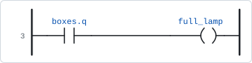
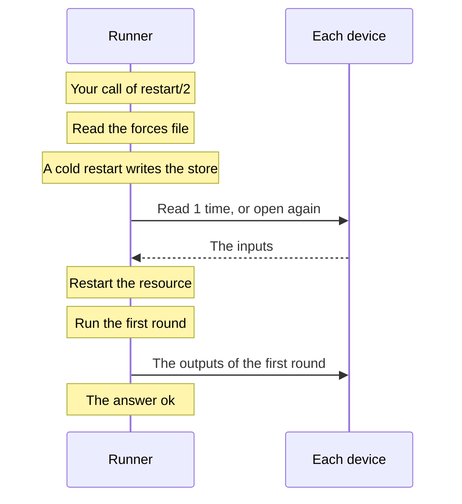

# Restart after a trip

This guide is for a reader whose [plant](../reference/glossary.md#plant)
[tripped](../reference/glossary.md#trip) on a [runner](../reference/glossary.md#runner).
It shows how to remove the cause of the trip. Then it shows how to start the plant
again with a [warm restart](../reference/glossary.md#warm-restart) or a
[cold restart](../reference/glossary.md#cold-restart).

> #### Warning {: .warning}
>
> Do not use logex for a safety function, for example an emergency stop. A trip writes 0
> only to the [devices](../reference/glossary.md#device) that answer. Make each safety
> function with hardwired circuits or with a safety-rated controller.
> [Safety and limits](../explanation/safety-and-limits.md) gives the limits of logex.

## Before you start

You must have:

- a plant that runs on `Logex.Runner`
  ([Run a plant on the clock](run-on-the-clock.md) shows how to start one)
- the pid or the name of the runner, in your Elixir code
- a Mix project that has logex as a dependency
  ([Install logex and run a program](install-and-run.md) shows how)
- access to the machine, to make it safe

## Steps

The blocks are parts of the script `restart-after-a-trip.exs`.
[An example](#an-example) gives the whole script and its output.

1. **Find the reason of the trip.** Also find each device whose outputs can still be on.
   [Find why a plant tripped](find-why-a-plant-tripped.md) shows how.

2. **Make the machine safe.** Use the procedures of your plant.

3. **Remove the cause that step 1 found.** Is the value of a `{:fault, ...}` in a
   retained [tag](../reference/glossary.md#tag)? Then, before the restart, do the actions of
   [A retained value trips the plant again](#a-retained-value-trips-the-plant-again).

4. **Remove each [force](../reference/glossary.md#force) that must not stay.** Read the
   field `forces` of `Logex.Runner.status/1`. Each force stays after a warm restart and after a cold
   restart. The restart also reads the [forces file](../reference/glossary.md#forces-file)
   again. Remove a force with `Logex.Runner.unforce/2`, or each force with
   `Logex.Runner.unforce_all/1`. [Force an input](force-inputs.md) shows how.

> #### Warning {: .warning}
>
> A forced input can switch on an output in the first
> [round](../reference/glossary.md#round) after the restart, with no action of an operator.

5. **Select a warm restart or a cold restart.**

| Value | Warm restart | Cold restart |
|---|---|---|
| A tag or a [global](../reference/glossary.md#global) with the [qualifier](../reference/glossary.md#qualifier) `retain` | Keeps its value | Gets its [initial value](../reference/glossary.md#initial-value) |
| A global at an input [point](../reference/glossary.md#point) | Gets the value that the restart reads, or its force | Gets the value that the restart reads, or its force |
| Each other tag and global | Gets its initial value | Gets its initial value |
| An output point | 0 until the first round writes it | 0 until the first round writes it |
| The [store](../reference/glossary.md#store), if the runner has one | Not written | Written with the initial values before the runner reads a device |
| The time of the [resource](../reference/glossary.md#resource) | Does not change | Does not change |

A retained global that an [output](../reference/glossary.md#output) drives gets the value
of that output in the first round, if the output has no qualifier `retain`.

> #### Warning {: .warning}
>
> A warm restart can switch on an output point in its first round, with no action of an
> operator. Before a warm restart, find each output point that a
> [rung](../reference/glossary.md#rung) writes from a retained value. If such an output
> point must stay off, do a cold restart.

To find these output points, search each program for the tags declared with `retain`.
Then find each rung that reads one of these tags and writes an output, or a
`var_external` global, that goes to an output point.

logex does not find each of them for you. When it compiles the configuration, logex gives
a [warning](../reference/glossary.md#warning) only for a retained `var_output` that a
connection sends straight to an output point. An example of this warning is
`` `b1.full_lamp` is retained and drives the output `case_full`: after a warm start it is written in the first round ``.

In [An example](#an-example), rung 3 of `warm/boxes.ld` writes the output `full_lamp`
from the retained [counter](../reference/glossary.md#counter) `boxes`. The configuration
connects `b1.full_lamp` to the global `case_full`, the lamp at `panel.q.4`. `boxes` is
not a `var_output`, thus the example gets no warning. The warm restart switches on the
lamp again.

<!-- rung: warm/boxes.ld 3 -->


> #### Caution {: .error}
>
> A cold restart discards each retained value, in memory and in the store. logex makes
> no copy of the store at a cold restart. If you can need the old values, copy the store
> file before a cold restart.

6. **Call `Logex.Runner.restart/2`** with `:warm` or `:cold`.

<!-- part of: restart-after-a-trip.exs -->
```elixir
:ok = Runner.restart(runner, :warm)
```



Figure: a restart that gives `:ok`.

The runner reads each device before the first round. The time of the resource does not
change.

If `restart/2` gives an error, see [If it does not work](#if-it-does-not-work). If an
edit is under test, the restart does not end it. To restart the old plant, do an
[untest](../reference/glossary.md#untest) before the restart.

## The result

The plant runs again. The field `status` is `:running`, the field `trip` is `nil` and
the field `unzeroed` is `[]`.

The first write to a device is the write of the first round, not the old outputs. In
the example, a [seal-in](../reference/glossary.md#seal-in) holds the conveyor `k1`.
After the restart, `k1` stays off until an operator presses start, if no force holds
start at 1.

## If it does not work

| What you see | What to do | Cause |
|---|---|---|
| `{:error, {:io_init, device, detail}}` from `restart/2` | Correct the device. Then call `restart/2` again. | The restart cannot open or read the device. A callback failed, did not answer in the time of the option `open:`, or gave a value that does not fit its point. |
| `{:error, {:clock, detail}}` from `restart/2` | Correct the clock. Then call `restart/2` again. | The clock still gives no time that the runner can use. |
| `{:error, {:retain, detail}}` from a cold restart | Correct the disk or the path of the store. Then do the restart again. | The runner cannot write its store. |
| `<path>: line <n>: ...` from `restart/2` | Correct the line, or remove it. Then call `restart/2` again. | The forces file has a line that the runner cannot use. |
| `the runner is running: restart/2 starts a runner again once it has tripped` | Call `restart/2` only after a trip. | The status was `:running` when the call arrived. |
| `a runner restarts :cold or :warm, got: :hot` | Give `:warm` or `:cold`. | The mode is not `:warm` or `:cold`. |
| `the runner #PID<0.155.0> is not running` | Start a new runner with `Logex.Runner.start_link/1`. | The runner stopped, or it crashed. A runner does not start again by itself. |
| `restart/2` gives `:ok`, then the status is `:tripped` again, with the same `{:fault, ...}` | Do 1 of the actions of [A retained value trips the plant again](#a-retained-value-trips-the-plant-again). | A retained value causes the fault again in the first round. |
| An output comes on immediately after a warm restart | Make the output safe at the machine. Remove each force that holds an input. Stop the runner with `Logex.Runner.stop/2`. Start a new runner. If it has a store, give the option `start: :cold`. | A rung writes the output from a retained value, or a force holds an input. |

The messages of the 4 rows that begin with a path or with `the runner` or `a runner`
come in an `ArgumentError`.

After an error from `restart/2`, the status stays `:tripped`, with the reason of the
first trip. After `{:io_init, ...}`, each device that answers gets the 0 again. After
`{:retain, ...}`, the runner reads no device, and the store does not change.

The runner examines the status when the call of `restart/2` arrives. A call that arrives
before the trip gets the error `the runner is running`. This is also true if the trip
occurs before the answer.

### A retained value trips the plant again

A retained tag can hold the value that caused the
[major fault](../reference/glossary.md#major-fault), for example a
[subscript](../reference/glossary.md#subscript) of 8 in an array of 8 elements. A warm restart keeps the value. A new runner that starts
from the store also keeps it. Thus the plant trips again immediately.

> #### Caution {: .error}
>
> Stop the runner before you edit the store. A runner holds the values in memory, also
> while its status is `:tripped`. A warm restart uses those values, and a stop writes them
> over your edit.

Do 1 of these actions:

- Do a cold restart. Each retained value gets its initial value.
- Make an [online edit](../reference/glossary.md#online-edit) that writes a correct value
  before the rung that faults. [Accept](../reference/glossary.md#accept) the edit and do
  its [test](../reference/glossary.md#test) during the trip. Then do a warm restart. The
  restart does not end the edit, thus [assemble](../reference/glossary.md#assemble) it
  after the restart. [Edit a running plant](edit-a-running-plant.md) shows the steps.
- Stop the runner. In the store, the line of a value gives its path, its type and the value. Change the
  value on its line, for example `s1.slot int 8` to `s1.slot int 0`. Do not add or remove
  a line. Then start a new runner. [Edit the store by hand](edit-the-store-by-hand.md)
  shows the steps.

## An example

The example is the packing plant, with the qualifier `retain` on the counter `boxes`.
Put these 3 files in a directory `warm`:

<!-- file: warm/packing.logex -->
```text
// packing.logex -- a conveyor on a 10 ms task, and a box counter in the continuous task
task fast interval 10 priority 1 watchdog 50
task main continuous watchdog 200

var_global estop      bool at panel.i.7
var_global pb_start_1 bool at panel.i.0
var_global pb_reset   bool at panel.i.2
var_global eye        bool at panel.i.8
var_global k1         bool at panel.q.0
var_global case_full  bool at panel.q.4

program c1 conveyor with fast
  c1.start pb_start_1
  c1.stop  0
  c1.reset pb_reset
  c1.motor k1

program b1 boxes
  b1.eye       eye
  b1.reset_pb  pb_reset
  b1.full_lamp case_full
```

<!-- file: warm/conveyor.ld -->
```text
var_input start bool
var_input stop bool
var_input reset bool
var_output motor bool
var_external estop bool
var fault bool

xic estop otl fault
xic reset otu fault
( xic start | xic motor ) xio stop xio fault ote motor
```

<!-- file: warm/boxes.ld -->
```text
var_input eye bool
var_input reset_pb bool
var_output full_lamp bool
var_output count dint
var retain boxes ctu

xic reset_pb ote boxes.r
xic eye ctu boxes 3
xic boxes.q ote full_lamp
move boxes.cv count
```

Put the script `restart-after-a-trip.exs` beside the directory, and run it. The
[simulated device](../reference/glossary.md#simulated-device) fails 4 times: 3 reads and
1 write. The plant trips 2 times, and 1 restart fails.

```elixir
alias Logex.IO.Sim
alias Logex.Runner
alias Logex.Runner.Clock.Manual

{:ok, plant} = Logex.Configuration.compile_file("warm/packing.logex")
{:ok, clock} = Manual.start_link()
{:ok, panel} = Sim.start_link(reports: true, clock: clock)

{:ok, runner} =
  Runner.start_link(
    configuration: plant,
    io: %{"panel" => {Sim, sim: panel}},
    clock: {Manual, clock}
  )

show = fn label ->
  %{status: status, now: now} = Runner.status(runner)
  %{"panel.q.0" => k1, "panel.q.4" => case_full} = Sim.outputs(panel)
  boxes = Runner.get!(runner, "b1.boxes.cv")
  IO.puts("t=#{now}  #{label}  #{status}  k1=#{k1} case_full=#{case_full}  boxes=#{boxes}")
end

# The plant runs: start pressed, then 3 boxes.
Sim.set(panel, "panel.i.0", 1)
Manual.advance(clock, 10)
Sim.set(panel, "panel.i.0", 0)

for _box <- 1..3 do
  Sim.set(panel, "panel.i.8", 1)
  Manual.advance(clock, 2)
  Sim.set(panel, "panel.i.8", 0)
  Manual.advance(clock, 2)
end

show.("3 boxes      ")

# The next read of the panel fails, and the write of the trip's 0 fails too.
Sim.fail(panel, :read, {:error, :eio})
Sim.fail(panel, :write, {:error, :eio})
Manual.advance(clock, 10)

# The reason of the trip.
IO.inspect(Runner.status(runner).trip, label: "trip")

# The devices whose outputs can still be on.
IO.inspect(Runner.status(runner).unzeroed, label: "unzeroed")
show.("tripped      ")
Manual.advance(clock, 10)
IO.inspect(Runner.status(runner).unzeroed, label: "unzeroed")
show.("1 poll later ")

# A value of the resource.
IO.inspect(Runner.get!(runner, "k1"), label: "k1 in the resource")

# A restart before the cause is removed, then a warm restart.
Sim.fail(panel, :read, {:error, :eio})
IO.inspect(Runner.restart(runner, :warm), label: "restart")
show.("no restart   ")
:ok = Runner.restart(runner, :warm)
show.("warm restart ")

# A second trip, and a cold restart.
Sim.fail(panel, :read, {:error, :eio})
Manual.advance(clock, 10)
:ok = Runner.restart(runner, :cold)
show.("cold restart ")
:ok = Runner.stop(runner)
```

```console
$ mix run restart-after-a-trip.exs
t=22  3 boxes        running  k1=1 case_full=1  boxes=3
trip: {:io, "panel", {:error, :eio}}
unzeroed: ["panel"]
t=29  tripped        tripped  k1=1 case_full=1  boxes=3
unzeroed: []
t=29  1 poll later   tripped  k1=0 case_full=0  boxes=3
k1 in the resource: 1
restart: {:error, {:io_init, "panel", {:error, :eio}}}
t=29  no restart     tripped  k1=0 case_full=0  boxes=3
t=29  warm restart   running  k1=0 case_full=1  boxes=3
t=36  cold restart   running  k1=0 case_full=0  boxes=0
```

On the line `tripped`, the panel still has its outputs at 1, because the write of the 0
failed. While the status is `:tripped`, the time of the resource stays at 29. The first
restart fails, because the read of the panel fails again. The warm restart keeps the
count 3, and `case_full` comes on. The cold restart sets the count to 0.

## See also

- [Find why a plant tripped](find-why-a-plant-tripped.md): the reason of a trip, and the
  devices whose outputs can still be on.
- [Runner](../reference/runner.md): the reasons of a trip, the status and the restart.
- [Trips and watchdogs](../explanation/trips-and-watchdogs.md): why the runner trips.
- [Warm and cold restarts](../explanation/warm-and-cold-restarts.md): why each restart
  keeps what it keeps.
- [Keep values across a restart](keep-values-across-a-restart.md): how to retain a tag.
- [Force an input](force-inputs.md): how to see and remove a force.
- [Set watchdogs](set-watchdogs.md): the watchdogs of a task and of the runner.
- [Glossary](../reference/glossary.md): the technical words.
