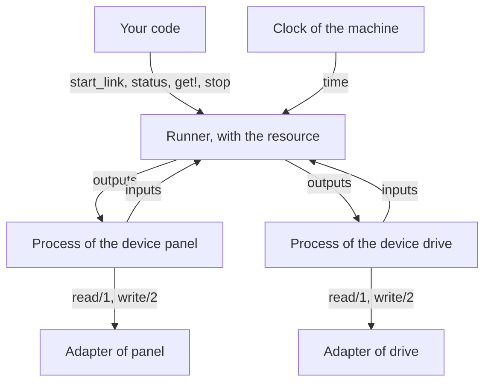

# Run a plant on the clock

This guide is for an Elixir developer who has a
[configuration](../reference/glossary.md#configuration) that compiles. It shows how to
start a [runner](../reference/glossary.md#runner) on the
[clock](../reference/glossary.md#clock) of the machine, with an
[adapter](../reference/glossary.md#adapter) for each
[device](../reference/glossary.md#device). It also shows how to stop the runner.

The runner, `Logex.Runner`, reads the inputs, runs the
[tasks](../reference/glossary.md#task) that are due and writes the outputs, again and
again. Each of these steps is a [round](../reference/glossary.md#round).
[Runner](../reference/runner.md) gives the rules of a round.

> #### Warning {: .warning}
>
> Do not use logex for a safety function, for example an emergency stop. If the Erlang
> VM stops, no part of logex sets an output [point](../reference/glossary.md#point) to 0.
> If a device hangs, the runner stops the process of that device. Then the outputs of
> the device do what the hardware does when it loses its master. Wire each emergency stop
> so that it works when logex stops, crashes or does not start.
> [Safety and limits](../explanation/safety-and-limits.md) gives the limits of logex.

> #### Caution {: .error}
>
> Do not expect a round at an exact time. logex runs on the Erlang VM, on an operating
> system that is not a real-time system. The load of the machine can make a round late,
> and logex gives no limit for the lateness.
> [Timing and capacity](../explanation/timing-and-capacity.md) gives the times that 1
> machine measured.

This diagram shows the parts of a [plant](../reference/glossary.md#plant) that runs, with
2 devices.



Figure: the parts of a plant that runs. Each device has a separate process, which calls
its adapter. The runner holds the [resource](../reference/glossary.md#resource) and
reads the clock.

## Before you start

- You must have a Mix project that has logex.
  [Install logex and run a program](install-and-run.md) gives the steps.
- You must have a configuration that compiles. This guide uses the packing line of the
  tutorial [Your first plant](../tutorials/first-plant.md). Get
  [`conveyor.ld`](../tutorials/first-plant.md#step-1-write-the-conveyor-program) and
  [`packing.logex`](../tutorials/first-plant.md#step-2-write-the-configuration-file) from
  that tutorial. Get
  [`boxes.ld`](../tutorials/timers-and-counters.md#step-3-write-the-counter-program) from
  the tutorial A timer and a counter. Put the 3 files in the root directory of your
  project.
- You must have an adapter for each device of the configuration. The name of a device is
  the first part of an address after `at`: `panel` in `panel.i.7`. This guide uses
  `Logex.IO.Sim`, the adapter of a
  [simulated device](../reference/glossary.md#simulated-device). For hardware,
  [Write a device adapter](write-a-device-adapter.md) gives the steps.

If you use your own configuration, give the names of your devices in place of `"panel"`
in steps 2 to 4. Give your own [globals](../reference/glossary.md#global) in step 7.

## Steps

1. Make the file `on_the_real_clock.exs` in the root directory of your project. Put
   these lines at its top. `Logex.Configuration.compile_file/1` gives `{:ok, plant}`.

<!-- part of: on_the_real_clock.exs -->
```elixir
alias Logex.Runner
alias Logex.IO.Sim

{:ok, plant} = Logex.Configuration.compile_file("packing.logex")
```

   If the configuration has an error, the script stops with a `MatchError`. The error
   holds `{:error, diagnostics}`. [Read a diagnostic](read-diagnostics.md) shows how to
   read each [diagnostic](../reference/glossary.md#diagnostic).

2. Add this line, which starts a process for the simulated device. With
   `reports: true`, the simulated device tells the runner about each change of an input
   point immediately. Without it, the runner gets the change at the next read of the device.

<!-- part of: on_the_real_clock.exs -->
```elixir
{:ok, panel} = Sim.start_link(reports: true)
```

   An adapter for hardware can open the hardware itself, in its function `init/3`. Then
   your code starts no process for that device.

3. Write the map of the devices, which you give as `io:` in step 4. Each key is the name
   of a device, as the configuration writes it. Each value is `{adapter, options}`.

   | Device | Value in the map |
   |---|---|
   | A simulated device | `{Logex.IO.Sim, sim: panel}`, with the process from step 2 |
   | A device of your adapter | `{YourAdapter, options}`, with the options that your adapter takes |

> #### Caution {: .error}
>
> Start the runner from a process that runs as long as the plant. `start_link/1` links
> the runner to your process. If your process stops with an error, the runner stops
> also, and each device writes 0 to its output points.

4. Add these lines, which start the runner with `configuration:` and `io:`. Do not give
   `clock:`. Then the runner reads the clock of the machine,
   `Logex.Runner.Clock.Monotonic`. `Logex.Runner.start_link/1` opens each device and
   reads it 1 time. Then it runs the first round and returns `{:ok, pid}`.

<!-- part of: on_the_real_clock.exs -->
```elixir
# No clock: the machine's, Logex.Runner.Clock.Monotonic.
{:ok, runner} = Runner.start_link(configuration: plant, io: %{"panel" => {Sim, sim: panel}})
```

5. Give more options if your devices need them. The script of this guide gives none.
   Each option has a default.

   | Option | What it sets |
   |---|---|
   | `poll:` | The time between 2 reads of each device, 10 ms by default. At each read, the process of the device writes the last outputs to the device again. |
   | `open:` | The longest time to open a device, 5000 ms by default. Give 1 number for all devices, or a map by name, for example `%{"panel" => 2000}`. |
   | `idle:` | The idle [watchdog](../reference/glossary.md#watchdog): the longest time for 1 piece of the work of the runner, for example a call from your code. It is 500 ms by default. If a piece takes longer, the runner [trips](../reference/glossary.md#trip). [Set watchdogs](set-watchdogs.md) shows how to choose it. |
   | `name:` | A name for the runner, as `GenServer.start_link/3` takes it. Your code can then call the runner by that name. By default, the runner has no name. |

   [Runner](../reference/runner.md) gives each other option, for example `retain:` and
   `forces:`.

6. Add these lines, which change the inputs of the simulated device. They press the
   start button for 100 ms. Then they move 3 boxes past the photo-eye and wait for 1 s.
   With hardware, the inputs come from the hardware.

<!-- part of: on_the_real_clock.exs -->
```elixir
Sim.set(panel, "panel.i.0", 1)              # start pressed for 100 ms
Process.sleep(100)
Sim.set(panel, "panel.i.0", 0)

for _box <- 1..3 do
  Sim.set(panel, "panel.i.8", 1)            # a box on the eye for 20 ms, then 20 ms clear
  Process.sleep(20)
  Sim.set(panel, "panel.i.8", 0)
  Process.sleep(20)
end

Process.sleep(1_000)
```

7. Add these lines, which read the plant while it runs. `Logex.Runner.status/1` returns
   a map. Its key `status` is `:running` or `:tripped`. `Logex.Runner.get!/2` reads 1
   value by its name. `"k1"` is a global, and `"b1.count"` is the
   [tag](../reference/glossary.md#tag) `count` of the
   [instance](../reference/glossary.md#instance) `b1`.

<!-- part of: on_the_real_clock.exs -->
```elixir
status = Runner.status(runner)

IO.inspect(
  status: status.status,
  trip: status.trip,
  k1: Runner.get!(runner, "k1"),
  boxes: Runner.get!(runner, "b1.count"),
  case_full: Runner.get!(runner, "case_full"),
  no_more_rounds_than_milliseconds: status.rounds <= status.now + 1
)

IO.puts("this run's figures: now=#{status.now} rounds=#{status.rounds} " <>
  "runs=#{inspect(status.runs)} overlaps=#{inspect(status.overlaps)} latest_wake=#{status.latest_wake}")
```

8. Add these lines, which stop the runner. `Logex.Runner.stop/1` writes 0 to each output
   point 1 time and closes each device. Then it returns `:ok`. To stop the runner with
   your application, put it under a supervisor.
   [Run a plant under a supervisor](run-under-a-supervisor.md) gives the steps.

<!-- part of: on_the_real_clock.exs -->
```elixir
:ok = Runner.stop(runner)
IO.inspect(List.last(Sim.writes(panel)), label: "the last write")
IO.inspect(Sim.closed?(panel), label: "closed")
```

   With `retain:` or `forces:`, `Logex.Runner.stop/1` can return `{:error, reason}` if
   the write of a file failed. The runner stops all the same. A runner that tripped
   writes no 0 again, except to each device that the status key `unzeroed` names.

9. Make sure that the file has this text.

```elixir
alias Logex.Runner
alias Logex.IO.Sim

{:ok, plant} = Logex.Configuration.compile_file("packing.logex")
{:ok, panel} = Sim.start_link(reports: true)

# No clock: the machine's, Logex.Runner.Clock.Monotonic.
{:ok, runner} = Runner.start_link(configuration: plant, io: %{"panel" => {Sim, sim: panel}})

Sim.set(panel, "panel.i.0", 1)              # start pressed for 100 ms
Process.sleep(100)
Sim.set(panel, "panel.i.0", 0)

for _box <- 1..3 do
  Sim.set(panel, "panel.i.8", 1)            # a box on the eye for 20 ms, then 20 ms clear
  Process.sleep(20)
  Sim.set(panel, "panel.i.8", 0)
  Process.sleep(20)
end

Process.sleep(1_000)
status = Runner.status(runner)

IO.inspect(
  status: status.status,
  trip: status.trip,
  k1: Runner.get!(runner, "k1"),
  boxes: Runner.get!(runner, "b1.count"),
  case_full: Runner.get!(runner, "case_full"),
  no_more_rounds_than_milliseconds: status.rounds <= status.now + 1
)

IO.puts("this run's figures: now=#{status.now} rounds=#{status.rounds} " <>
  "runs=#{inspect(status.runs)} overlaps=#{inspect(status.overlaps)} latest_wake=#{status.latest_wake}")

:ok = Runner.stop(runner)
IO.inspect(List.last(Sim.writes(panel)), label: "the last write")
IO.inspect(Sim.closed?(panel), label: "closed")
```

10. Run the script. It runs for about 1.3 s.

```console
$ mix run on_the_real_clock.exs
[
  status: :running,
  trip: nil,
  k1: 1,
  boxes: 3,
  case_full: 1,
  no_more_rounds_than_milliseconds: true
]
this run's figures: now=1230 rounds=1209 runs=%{"fast" => {0, 50}, "main" => {1, 200}} overlaps=%{"fast" => 0, "main" => 0} latest_wake=2
the last write: %{"panel.q.0" => 0, "panel.q.4" => 0}
closed: true
```

## The result

The plant ran on the clock of the machine, and `Logex.Runner.stop/1` stopped it. The
keyword list is the same at each run. The line `this run's figures` is different at each
run and on each machine.

Each line of the output tells you 1 thing:

- `status: :running` and `trip: nil`: the runner did not trip.
- `k1: 1`: the conveyor runs. The [seal-in](../reference/glossary.md#seal-in) kept it on
  after the start button went back to 0.
- `boxes: 3` and `case_full: 1`: the [counter](../reference/glossary.md#counter) counted
  the 3 boxes, and the lamp is on.
- `no_more_rounds_than_milliseconds: true`: the number of rounds is not more than the
  time of the run in ms, plus 1. The check compares totals for the whole run. It does
  not show the time of each round.
- `the last write` and `closed: true`: `Logex.Runner.stop/1` wrote 0 to each output
  point and closed the device.

The line `this run's figures` gives these values of the status:

| Key | What it holds | In this run |
|---|---|---|
| `now` | The time of the plant in ms from the start of the runner | `1230` |
| `rounds` | The number of rounds | `1209` |
| `runs` | For each task, `{longest run in ms, watchdog in ms}` | `"fast" => {0, 50}` |
| `overlaps` | For each task, the number of periods that it missed | `"fast" => 0` |
| `latest_wake` | The most ms that the runner woke late | `2` |

The runner runs the [continuous task](../reference/glossary.md#continuous-task) `main`
again after each round. It starts 1 round each ms at most. [Set watchdogs](set-watchdogs.md)
shows how to use `runs`, `overlaps` and `latest_wake`.

The output does not tell when each run of the task `fast` came. To see each run,
subscribe to the `:ran` events of the runner. [Watch a runner](watch-a-runner.md) gives
the steps. To get the same rounds at each run, use the manual clock.
[Do a test of a plant on the manual clock](test-on-the-manual-clock.md) gives the steps.

## If it does not work

### The runner does not start

`Logex.Runner.start_link/1` returns these values:

| What you see | Cause and what to do |
|---|---|
| `{:error, {:io_init, "panel", reason}}` | The runner cannot open the device, or its first read failed. `reason` is the error that `init/3` gave, for example `:econnrefused`. Or it is the result of the first read that failed, for example `{:error, :eio}`. Correct the device, and start the runner again. |
| `{:error, {:io_init, "panel", :timeout}}` | The device did not open in the time of `open:`. Give the device more time, for example `open: %{"panel" => 10_000}`. |
| `{:error, {:already_started, pid}}` | A different process has the name of `name:`. Give a different name, or stop the other runner. |

`Logex.Runner.start_link/1` raises an `ArgumentError` in your process with a message that
has these words:

| What you see | Cause and what to do |
|---|---|
| `Logex.Runner needs io:` | Give `io:`. For a configuration with no point, give `io: %{}`. |
| ``no adapter is bound to the device `panel` `` | The map of `io:` has no key `"panel"`. Add it, with the name as the configuration writes it. |
| ``the device `drive` is bound, but no point is at it`` | The map of `io:` has a device that the configuration does not name. Remove it, or correct its name. |
| `which does not implement Logex.IO` | The value of the device is not an adapter. Give a module that implements `Logex.IO`. |
| ``the device `panel`'s adapter options:`` | The adapter refused its options. The rest of the message is from the adapter, for example `Logex.IO.Sim is bound with its sim`. Give the options that the adapter takes. |
| `the runner's clock: is {module, clock}` | `clock:` has a wrong value. To use the clock of the machine, remove `clock:`. |
| `the runner's poll: is`, `the runner's open:` and so on | An option has a wrong value. The message gives the values that the option takes. |

With `retain:`, a start that fails can write the [store](../reference/glossary.md#store).
[Keep retained values on disk](keep-values-on-disk.md) gives the rule.

### The runner stops or trips

| What you see | Cause and what to do |
|---|---|
| `status` is `:tripped` | The runner wrote 0 to each output point and runs no rounds. `trip` gives the reason. [Restart after a trip](restart-after-a-trip.md) gives the steps. |
| `the runner #PID<0.161.0> is not running` | `Logex.Runner.status/1`, `Logex.Runner.get!/2` or `Logex.Runner.stop/1` called a runner that stopped or crashed. After a crash, each device wrote 0 to each output point 1 time and closed. Start a new runner. |
| `no runner is running under the name Packing` | The same, for a runner that your code calls by its `name:`. |

## See also

- [Runner](../reference/runner.md): each option, each key of the status, the trip and the
  stop.
- [I/O adapters](../reference/io-adapters.md): what an adapter must do.
- [Run a plant under a supervisor](run-under-a-supervisor.md): the child spec, and what
  occurs after a crash.
- [Set watchdogs](set-watchdogs.md): choose `watchdog` and `idle:` from the figures of a
  long run.
- [Watch a runner](watch-a-runner.md): subscribe to the events of a runner.
- [Keep retained values on disk](keep-values-on-disk.md): the store, which keeps
  retained values across a crash.
- [Timing and capacity](../explanation/timing-and-capacity.md): how late a round can be.
- [Safety and limits](../explanation/safety-and-limits.md): what logex is not.
- [Glossary](../reference/glossary.md): the words of this guide.
