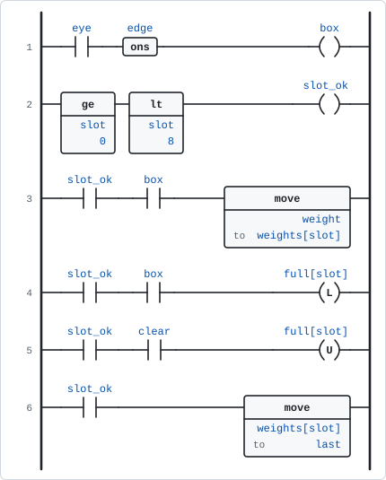

# Select an array element with a tag

This guide is for a reader who writes a ladder [program](../reference/glossary.md#program)
with an [array](../reference/glossary.md#array). It shows how to select an
[element](../reference/glossary.md#element) with a
[subscript](../reference/glossary.md#subscript) that a [tag](../reference/glossary.md#tag)
holds, and how to keep that subscript in the range. An example is a scale that puts each
box into 1 of 8 slots, and the operator selects the slot.

> #### Caution {: .error}
>
> Keep a subscript in a tag in the range of the array. An
> [instruction](../reference/glossary.md#instruction) can read or write an element
> through a subscript that is out of the range. Then the
> [scan](../reference/glossary.md#scan) gets a major fault, and the instruction writes
> nothing.
>
> Make a `bool` tag that is true only while the subscript is in the range. Put a contact
> of that tag first on each rung that names an element through the subscript. The steps
> make this tag, `slot_ok`.
>
> An `ote` writes its element on a [false rung](../reference/glossary.md#false-rung)
> also. Thus a false contact before an `ote` does not stop the fault. To write a `bool`
> element that a tag selects, use `otl` and `otu` on 2 rungs, as in steps 8 and 9.
>
> If a [runner](../reference/glossary.md#runner) runs the program, a major fault causes a
> [trip](../reference/glossary.md#trip). The runner writes 0 to each output 1 time. It
> runs no [round](../reference/glossary.md#round) until a
> [restart](../reference/glossary.md#restart).

## Before you start

- You must know how to declare an array and name an element with a literal subscript.
  [Use arrays](use-arrays.md) gives the steps.
- The steps use `move` and the comparisons `ge` and `lt`.
  [Do arithmetic and compare values](do-arithmetic.md) gives them.
- The steps use the [one-shot](../reference/glossary.md#one-shot) `ons`.
  [Use one-shots and pulse coils](use-one-shots-and-pulse-coils.md) gives it.

## Steps

The steps make the file `use-arrays/scales.ld`. The operator selects 1 of 8 slots with
the input `slot`. Slot n is the elements `weights[n]` and `full[n]`. Each box goes into
the slot that `slot` selects, and the lamp of that slot comes on. The output `last` shows
the weight in the selected slot.

1. Make the file `scales.ld` in the directory `use-arrays`.
2. Declare the inputs `eye bool`, `weight int`, `slot int` and `clear bool` with
   `var_input`, 1 on each line.
3. Declare the outputs `slot_ok bool`, `last int` and `full bool[8]` with `var_output`.
4. Declare `var weights int[8]`, `var edge bool` and `var box bool`. Put 1 empty line
   after the declarations.
5. Make `box` true for 1 scan for each box: `xic eye ons edge ote box`.
6. Make `slot_ok` true only while `slot` is 0 to 7: `ge slot 0 lt slot 8 ote slot_ok`.
7. Put the weight into the selected slot:
   `xic slot_ok xic box move weight weights[slot]`.
8. [Latch](../reference/glossary.md#latch) the lamp of the slot with `otl`:
   `xic slot_ok xic box otl full[slot]`. Do not use `ote` here. An `ote` writes its
   element on a false rung also, and a `slot` of 8 then causes a fault.
9. [Unlatch](../reference/glossary.md#unlatch) the lamp with `otu`:
   `xic slot_ok xic clear otu full[slot]`.
10. Show the weight in the selected slot: `xic slot_ok move weights[slot] last`.

Make sure that your file is the same as this text:

<!-- file: use-arrays/scales.ld -->
```text
var_input eye bool
var_input weight int
var_input slot int
var_input clear bool
var_output slot_ok bool
var_output last int
var_output full bool[8]
var weights int[8]
var edge bool
var box bool

xic eye ons edge ote box
ge slot 0 lt slot 8 ote slot_ok
xic slot_ok xic box move weight weights[slot]
xic slot_ok xic box otl full[slot]
xic slot_ok xic clear otu full[slot]
xic slot_ok move weights[slot] last
```

<!-- rung: use-arrays/scales.ld -->


The drawing shows the 6 rungs. Each rung that names an element through `slot` starts
with the contact `slot_ok`.

11. Make the file `use-arrays-scales.exs` in the root directory of your project. Each
    line `scan.(n, inputs)` gives the inputs that change, then runs scan `n`. The script
    prints the outputs and the number of faults of each scan.

```elixir
{:ok, scales} = Logex.compile_file("use-arrays/scales.ld")

scan = fn state, number, inputs ->
  state = Logex.Runtime.put_inputs(scales, state, inputs)
  {outputs, state} = Logex.Runtime.scan(scales, state)
  values = Enum.map_join(["slot_ok", "last", "full"], "  ", &"#{&1} #{inspect(outputs[&1])}")
  IO.puts("#{number}  #{values}  faults #{length(state.faults)}")
  state
end

Logex.Runtime.instance(scales)
|> scan.(1, %{"eye" => 0, "weight" => 0, "slot" => 2, "clear" => 0})
|> scan.(2, %{"eye" => 1, "weight" => 620})
|> scan.(3, %{"eye" => 0, "slot" => 5})
|> scan.(4, %{"eye" => 1, "weight" => 410})
|> scan.(5, %{"eye" => 0, "slot" => 2})
|> scan.(6, %{"clear" => 1})
|> scan.(7, %{"clear" => 0, "slot" => 8, "eye" => 1, "weight" => 700})
```

12. Run the script:

```console
$ mix run use-arrays-scales.exs
1  slot_ok 1  last 0  full [0, 0, 0, 0, 0, 0, 0, 0]  faults 0
2  slot_ok 1  last 620  full [0, 0, 1, 0, 0, 0, 0, 0]  faults 0
3  slot_ok 1  last 0  full [0, 0, 1, 0, 0, 0, 0, 0]  faults 0
4  slot_ok 1  last 410  full [0, 0, 1, 0, 0, 1, 0, 0]  faults 0
5  slot_ok 1  last 620  full [0, 0, 1, 0, 0, 1, 0, 0]  faults 0
6  slot_ok 1  last 620  full [0, 0, 0, 0, 0, 1, 0, 0]  faults 0
7  slot_ok 0  last 620  full [0, 0, 0, 0, 0, 1, 0, 0]  faults 0
```

## The result

| Scan | What the scan shows |
|---|---|
| 2 | The box of 620 goes into `weights[2]`, and `full[2]` comes on. |
| 4 | The box of 410 goes into `weights[5]`, and `full[5]` comes on. |
| 5 | `slot` is 2 again, so `last` shows 620. |
| 6 | `otu` clears `full[2]`. |
| 7 | `slot` is 8. `slot_ok` is 0, so no instruction reads or writes an element. The box of 700 goes into no slot, and the scan has no fault. `last` keeps 620, because rung 6 does not do its `move` on a false rung. |

## If it does not work

### When you compile

Each entry in the column **What you see** is a part of the diagnostic.
[Diagnostics](../reference/diagnostics.md) gives each
[diagnostic](../reference/glossary.md#diagnostic).

| What you see | Cause | What to do |
|---|---|---|
| `` which is no integer `` | The subscript tag is a `bool`, a real or a [bit string](../reference/glossary.md#bit-string). | Use an integer tag. For a bit string, use the [conversion](../reference/glossary.md#conversion) that the message names. |
| `` so that it is one bit `` | The storage bit of a one-shot, or the [pulse bit](../reference/glossary.md#pulse-bit) of `osr` or `osf`, is in an element that a tag selects. | Use literal subscripts, as in `edge[0]`. |
| `` the last one in the scan decides it `` | A [warning](../reference/glossary.md#warning): 2 instructions can write 1 element in 1 scan, and 1 of the 2 is an `ote`. A subscript in a tag can select the element, or 2 `ote` instructions name it. | Use no `ote` on that array. Write each element with `otl` on the condition and `otu` on the opposite condition, as in `xic i otl a[s]` and `xio i otu a[s]`. |

### When you run the scans

After a scan, the field `faults` of the state holds the
[faults](../reference/glossary.md#fault) of that scan. A fault of the kind
`:index_out_of_range` comes from a subscript in a tag that is out of the range. The
field `read` holds the subscripts that the instruction read. Without `slot_ok` in rung 6
of `scales.ld`, a `slot` of 8 gives this fault:

<!-- unchecked: a fault that a run printed, from scales.ld with the contact slot_ok taken out of rung 6 -->
```text
%Logex.Fault{
  severity: :major,
  kind: :index_out_of_range,
  instruction: :move,
  path: nil,
  file: "use-arrays/scales.ld",
  line: 17,
  read: {8}
}
```

| What you see | Cause | What to do |
|---|---|---|
| A fault from an `ote` that has a false contact before it | An `ote` writes its element on a false rung also. | Use `otl` and `otu`, as in steps 8 and 9. |
| The first box does not go into the array | A one-shot gives no pulse on the first scan. | Run 1 scan with `eye` at 0 first. |

A subscript tag with the [qualifier](../reference/glossary.md#qualifier) `retain` keeps
its value across a [warm restart](../reference/glossary.md#warm-restart), also a value
out of the range. Then the first scan after the warm restart gets the same fault again.
[Restart after a trip](restart-after-a-trip.md) gives the steps.

## See also

- [Use arrays](use-arrays.md): declare an array, and name an element with a literal
  subscript.
- [Declarations and types](../reference/declarations-and-types.md#arrays): each rule of an
  array.
- [Faults](../reference/faults.md): the fields of a fault, and what a major fault does.
- [Restart after a trip](restart-after-a-trip.md): the steps after a major fault trips a
  runner.
- [Use bit strings](use-bit-strings.md): a bit that a tag selects.
- [Glossary](../reference/glossary.md): the words of this guide.
