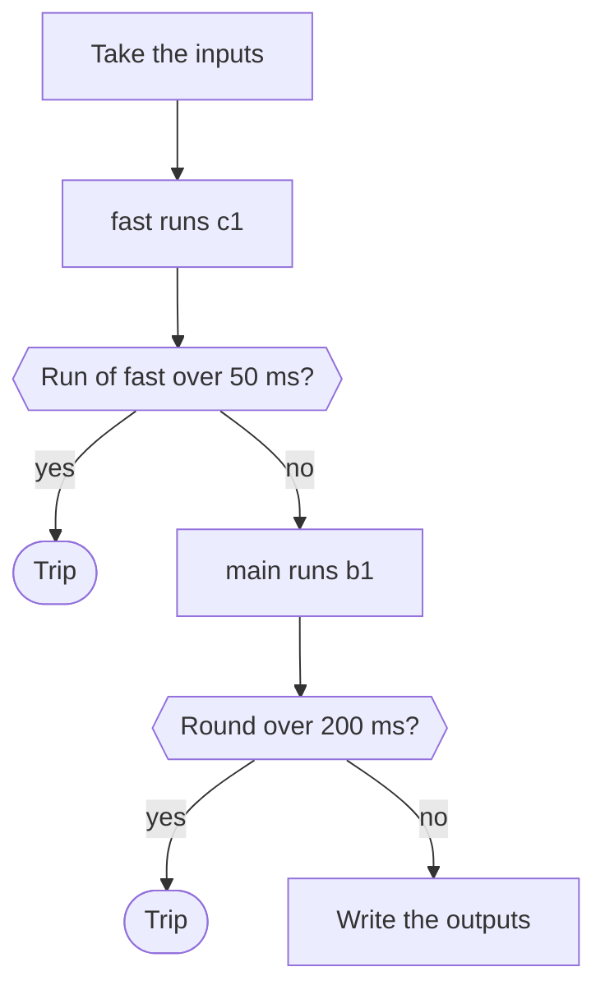

# Set watchdogs

This guide is for a reader who runs a [configuration](../reference/glossary.md#configuration)
on the [runner](../reference/glossary.md#runner). It shows how to give each
[task](../reference/glossary.md#task) a [watchdog](../reference/glossary.md#watchdog) and
how to put a [program](../reference/glossary.md#program) in the
[continuous task](../reference/glossary.md#continuous-task). It also shows how to find the
right watchdogs for your machine.

The example is the packing line of `packing.logex`. A conveyor runs each 10 ms on the
task `fast`. A box [counter](../reference/glossary.md#counter) runs in the continuous task
`main`.

A watchdog limits 1 run of a task, or 1 [round](../reference/glossary.md#round) for the
continuous task. If a run takes longer, the runner [trips](../reference/glossary.md#trip)
the [plant](../reference/glossary.md#plant).

> #### Warning {: .warning}
>
> Do not use logex for a safety function, for example an emergency stop. A watchdog
> trips the plant after a task runs too long. It does not make sure that a task never
> runs too long, and it does not stop a run. If the Erlang VM stops, no part of logex
> sets an output [point](../reference/glossary.md#point) to 0. Make each safety function
> with hardwired circuits or with a safety-rated controller.
> [Safety and limits](../explanation/safety-and-limits.md) gives the limits of logex.

## Before you start

- You must have a Mix project that has logex.
  [Install logex and run a program](install-and-run.md) gives the steps.
- You must know how to write a [configuration file](../reference/glossary.md#configuration-file).
  [Write a configuration file](write-a-configuration-file.md) gives the steps.
- Get [`conveyor.ld`](../tutorials/first-plant.md#step-1-write-the-conveyor-program) from
  the tutorial Your first plant. Get
  [`boxes.ld`](../tutorials/timers-and-counters.md#step-3-write-the-counter-program) from
  the tutorial A timer and a counter. Put the 2 files in the root directory of your Mix
  project.

> #### Caution {: .error}
>
> Use the runner, `Logex.Runner`, if you need watchdogs. `Logex.Runtime` reads no
> [clock](../reference/glossary.md#clock). If your code calls `Logex.Runtime.cycle/3`
> itself, no watchdog times the runs, and nothing trips.

## Steps

1. Choose a task for each program.

   | The program must run | What to write |
   |---|---|
   | At a fixed interval, for example each 10 ms | A line for a [periodic task](../reference/glossary.md#periodic-task). Write `with` and its name in the `program` line. |
   | When a `bool` [global](../reference/glossary.md#global) goes from 0 to 1 | A line for an [event task](../reference/glossary.md#event-task). Write `with` and its name in the `program` line. |
   | 1 time in each [cycle](../reference/glossary.md#cycle), after the due tasks | A line for the continuous task. Write no `with` in the `program` line. |

   [Use an event task](use-an-event-task.md) gives the steps for an event task.

2. Make the file `packing.logex` in the root directory of your Mix project, with this
   text:

<!-- file: packing.logex -->
```text
// packing.logex -- a conveyor on a 10 ms task, and a box counter in the continuous task
task fast interval 10 priority 1 watchdog 50
task main continuous watchdog 200

var_global estop      bool at panel.i.7
var_global pb_start_1 bool at panel.i.0
var_global pb_reset   bool at panel.i.2
var_global eye        bool at panel.i.8
var_global k1         bool at panel.q.0
var_global case_full  bool at panel.q.4

program c1 conveyor with fast
  c1.start pb_start_1
  c1.stop  0
  c1.reset pb_reset
  c1.motor k1

program b1 boxes
  b1.eye       eye
  b1.reset_pb  pb_reset
  b1.full_lamp case_full
```

3. Check each task line against these rules.

   - Put `watchdog` and its number at the end of the line, after `priority`.
   - Give a number of ms from 1 to 2147483647. A task line with no `watchdog` gets 500 ms.
   - Put `continuous` straight after the name of the task.
   - Do not give `interval`, `single` or `priority` to the continuous task.
   - Declare 1 continuous task at most.

   In `packing.logex`, 1 run of `fast` can take 50 ms, and 1 round of `main` can take
   200 ms.

   The line `program b1 boxes` has no `with`. Thus `b1` runs in the continuous task. The
   line `program b1 boxes with main` gives the same result. If more than 1 program runs in
   the continuous task, they run in the sequence of their `program` lines.

This diagram shows what the 2 watchdogs of `packing.logex` time in 1 round.



Figure: 1 round in which `fast` is due, from top to bottom. The watchdog of `main` times
the whole round, and the run of `fast` is part of it.

The runner measures a run when the run ends. It does not stop a long run. If `fast` trips,
`main` does not run in that round. A round that trips writes nothing to the devices.

4. Make the file `set-watchdogs.exs` in the same directory, with this text. The script
   prints the watchdog of each task. Then it runs 3 cycles, 5 ms apart, and prints which
   task ran each [instance](../reference/glossary.md#instance). The script uses
   `Logex.Runtime` only to show this. It times nothing.

```elixir
{:ok, plant} = Logex.Configuration.compile_file("packing.logex")

for task <- plant.tasks do
  IO.puts("#{task.name}: watchdog #{Logex.Configuration.watchdog(task)} ms")
end

# 3 cycles, 5 ms apart. Each :ran event names the task and the instance.
Enum.reduce([0, 5, 5], {Logex.Runtime.start(plant), 0}, fn ms, {resource, time} ->
  {resource, _outputs, events} = Logex.Runtime.cycle(resource, ms, %{})
  ran = for {:ran, task, instance, _time} <- events, do: "#{instance} in #{task}"
  IO.puts("t=#{time + ms} ms: #{Enum.join(ran, ", ")}")
  {resource, time + ms}
end)
```

5. Run the script. `b1` runs in `main` in each cycle, after `c1`. `c1` runs only when
   `fast` is due, each 10 ms.

```console
$ mix run set-watchdogs.exs
fast: watchdog 50 ms
main: watchdog 200 ms
t=0 ms: c1 in fast, b1 in main
t=5 ms: b1 in main
t=10 ms: c1 in fast, b1 in main
```

6. Make the file `on_the_real_clock.exs` in the same directory, with this text. The
   script starts the runner on the clock of the computer. It runs the plant for about 1 s
   on a [simulated device](../reference/glossary.md#simulated-device). Then it prints the
   figures of `Logex.Runner.status/1`.

```elixir
alias Logex.Runner
alias Logex.IO.Sim

{:ok, plant} = Logex.Configuration.compile_file("packing.logex")
{:ok, panel} = Sim.start_link(reports: true)

# No clock: the machine's, Logex.Runner.Clock.Monotonic.
{:ok, runner} = Runner.start_link(configuration: plant, io: %{"panel" => {Sim, sim: panel}})

Sim.set(panel, "panel.i.0", 1)              # start pressed for 100 ms
Process.sleep(100)
Sim.set(panel, "panel.i.0", 0)

for _box <- 1..3 do
  Sim.set(panel, "panel.i.8", 1)            # a box on the eye for 20 ms, then 20 ms clear
  Process.sleep(20)
  Sim.set(panel, "panel.i.8", 0)
  Process.sleep(20)
end

Process.sleep(1_000)
status = Runner.status(runner)

IO.inspect(
  status: status.status,
  trip: status.trip,
  k1: Runner.get!(runner, "k1"),
  boxes: Runner.get!(runner, "b1.count"),
  case_full: Runner.get!(runner, "case_full"),
  no_more_rounds_than_milliseconds: status.rounds <= status.now + 1
)

IO.puts("this run's figures: now=#{status.now} rounds=#{status.rounds} " <>
  "runs=#{inspect(status.runs)} overlaps=#{inspect(status.overlaps)} latest_wake=#{status.latest_wake}")

:ok = Runner.stop(runner)
IO.inspect(List.last(Sim.writes(panel)), label: "the last write")
IO.inspect(Sim.closed?(panel), label: "closed")
```

7. Run the script. Look at the line `this run's figures`. It is different at each run and
   on each machine. [Run a plant on the clock](run-on-the-clock.md) gives the other lines.

```console
$ mix run on_the_real_clock.exs
[
  status: :running,
  trip: nil,
  k1: 1,
  boxes: 3,
  case_full: 1,
  no_more_rounds_than_milliseconds: true
]
this run's figures: now=1230 rounds=1205 runs=%{"fast" => {0, 50}, "main" => {3, 200}} overlaps=%{"fast" => 0, "main" => 0} latest_wake=5
the last write: %{"panel.q.0" => 0, "panel.q.4" => 0}
closed: true
```

8. Start your plant with `Logex.Runner.start_link/1` and its real
   [devices](../reference/glossary.md#device). Let it run for some hours at the normal
   load of the machine.

9. While the plant runs, read the figures from your code:

<!-- fragment: reads the figures of a runner that runs; runner is its pid -->
```elixir
status = Logex.Runner.status(runner)
IO.inspect(runs: status.runs, overlaps: status.overlaps, latest_wake: status.latest_wake)
```

10. Set each watchdog from the figures. Each value of `runs` is `{ms, watchdog}`.

    | Figure | What to do |
    |---|---|
    | `runs` of a periodic task or an event task | `ms` is the longest run of the task, in whole ms. Set its `watchdog` to more than `ms`. |
    | `runs` of the continuous task | `ms` is the longest round, with the runs of the other tasks in it. Set its `watchdog` to more than `ms`. |
    | `overlaps` | The periods that each task missed, because a run was longer than the interval. This does not trip. If your plant must not miss a period, give the task a watchdog that is not larger than its interval. |
    | `latest_wake` | The most ms that the runner woke later than the time that it set. If it comes near 4 times `idle:`, the runner can trip. Give `idle:` more. |

    `idle:` is the watchdog of the runner, an option of `Logex.Runner.start_link/1`, 500 ms
    by default. It limits the work of the runner between rounds, for example a call from
    your code or a step of an [online edit](../reference/glossary.md#online-edit).

    A busy machine makes each run longer.
    [Timing and capacity](../explanation/timing-and-capacity.md) gives how much it adds. A
    smaller watchdog sets each output point to 0 sooner when a run does not end.

## The result

Each task has a watchdog that is more than its longest run on your machine. In `runs`,
each `ms` is less than its watchdog. The program `b1` runs in the continuous task in each
cycle, after the due tasks.

An online edit can change a watchdog while the plant runs. Its report gives
`{:watchdog, "fast", {50, 30}}` for a watchdog that goes from 50 ms to 30 ms.
[Edit a running plant](edit-a-running-plant.md) gives the steps.

## Another example: 6 cycles and 4 wrong task lines

The script `packing.exs` prints the watchdog of each task. Then it starts the conveyor
and passes 3 boxes, 5 ms apart. Last, it loads `wrong_packing.logex`, which has an error
on each of its task lines.

<!-- file: wrong_packing.logex -->
```text
task fast interval 10 priority 1 watchdog 0
task main continuous priority 2
task more continuous
task fast2 interval 10 watchdog 50 priority 1
var_global eye bool at panel.i.8
program b1 boxes
  b1.eye eye
  b1.reset_pb 0
```

```elixir
{:ok, plant} = Logex.Configuration.compile_file("packing.logex")
IO.puts(Enum.map_join(plant.tasks, ", ", &"#{&1.name} #{Logex.Configuration.watchdog(&1)} ms"))

steps = [
  {"started      ", 0, %{"pb_start_1" => 1}},
  {"a box        ", 5, %{"pb_start_1" => 0, "eye" => 1}},
  {"gone         ", 5, %{"eye" => 0}},
  {"a box        ", 5, %{"eye" => 1}},
  {"gone         ", 5, %{"eye" => 0}},
  {"the third box", 5, %{"eye" => 1}}
]

Enum.reduce(steps, {Logex.Runtime.start(plant), 0}, fn {label, elapsed, inputs}, {rt, now} ->
  {rt, out, events} = Logex.Runtime.cycle(rt, elapsed, inputs)
  ran = for {:ran, task, instance, _now} <- events, do: "#{task}:#{instance}"
  IO.puts("t=#{String.pad_leading("#{now + elapsed}", 2)}  #{label}  k1=#{out["k1"]} case_full=#{out["case_full"]}  ran #{Enum.join(ran, ", ")}")
  {rt, now + elapsed}
end)

IO.inspect(Logex.Runtime.next_due_in(Logex.Runtime.start(plant)), label: "next_due_in after start")
IO.inspect(Logex.Runtime.overlaps(Logex.Runtime.start(plant)), label: "overlaps")

{:error, diagnostics} = Logex.Configuration.compile_file("wrong_packing.logex")
Enum.each(diagnostics, &IO.puts(Logex.Diagnostic.format(&1)))
```

```console
$ mix run packing.exs
fast 50 ms, main 200 ms
t= 0  started        k1=1 case_full=0  ran fast:c1, main:b1
t= 5  a box          k1=1 case_full=0  ran main:b1
t=10  gone           k1=1 case_full=0  ran fast:c1, main:b1
t=15  a box          k1=1 case_full=0  ran main:b1
t=20  gone           k1=1 case_full=0  ran fast:c1, main:b1
t=25  the third box  k1=1 case_full=1  ran main:b1
next_due_in after start: 0
overlaps: %{"fast" => 0, "main" => 0}
wrong_packing.logex: line 1: the watchdog of `fast` is 0: a watchdog is at least 1 ms, and a task that sets none has 500
wrong_packing.logex: line 2: `main` is the continuous task, which takes no `priority`: it runs every program instance with no timed task, after the due tasks, as in `task main continuous watchdog 200`
wrong_packing.logex: line 3: `more` is a second continuous task: a configuration has one at most, and `main` (line 2) is its continuous task
wrong_packing.logex: line 4, column 36: `priority` goes before `watchdog`, as in `task fast interval 10 priority 1 watchdog 50`
```

The continuous task `main` runs `b1` in each cycle, after the due tasks. It is never
due. Thus `next_due_in/1` counts only `fast`, and `overlaps/1` gives `main` at 0.

## If it does not work

Each row gives a part of the message. The full message of a
[diagnostic](../reference/glossary.md#diagnostic) also gives the file and the line.
[Read a diagnostic](read-diagnostics.md) shows how to read a message.

### The configuration does not compile

| What you see | Cause | What to do |
|---|---|---|
| ``a watchdog is at least 1 ms`` or ``a watchdog is 1 to 2147483647 ms`` | The number is out of the range. | Give a number from 1 to 2147483647. |
| `` `watchdog` takes a number of milliseconds, as in `watchdog 50` `` | No whole number follows `watchdog`, for example `1.5`. | Give a whole number. |
| `` `watchdog` is given twice `` | The line has 2 watchdogs. | Remove 1. |
| `` `priority` goes before `watchdog` ``, or `interval` or `continuous` | A word is after the watchdog. | Put `watchdog` and its number at the end of the line. |
| `` unexpected `ms` on the line of task `fast` `` | The number has a unit. | Remove the unit. |
| ``is the continuous task, which takes no `priority` `` (or `interval`, or `single`) | The line of the continuous task has a word that only a periodic task or an event task takes. | Remove the word from the continuous task line. |
| ``is a second continuous task: a configuration has one at most`` | 2 task lines with no `interval` and no `single`. | Remove the second line, and `with` and its name from each `program` line that names it. |
| `` `task` needs a name before `Continuous` `` | You gave a task the name `continuous`, in any case. In a configuration file, it is a [reserved word](../reference/glossary.md#reserved-word). | Give the task a different name. |

### The runner does not start

| What you see | Cause | What to do |
|---|---|---|
| `the runner's idle: is a whole number of milliseconds, 1 to 2147483647` | `idle:` is not a whole number in this range. | Give `idle:` a whole number from 1 to 2147483647. |

### logex refuses an online edit

| What you see | Cause | What to do |
|---|---|---|
| `a task is added only with a restart`, `a task is removed only with a restart`, `a task's kind changes only with a restart` or `an instance moves to another task only with a restart` | An online edit cannot do these changes, also to the continuous task. | Stop the runner with `Logex.Runner.stop/2`. Then start it with the new configuration. |

### The plant trips, or a figure is not as you expect

`Logex.Runner.status/1` gives the reason of a trip in `trip`. Each subscriber gets the
message `{Logex.Runner, runner, {:trip, reason}}`.
[Restart after a trip](restart-after-a-trip.md) gives the steps after a trip.
[Runner](../reference/runner.md) gives each reason.

| What you see | Cause | What to do |
|---|---|---|
| `{:watchdog, {:task, task, ms, watchdog}}` or `{:watchdog, {:round, task, ms, watchdog, steps}}` in a normal run | A run or a round took more than its watchdog. `steps` gives the time of each task. | Make the run shorter, or give a larger watchdog. A large [array](../reference/glossary.md#array) makes a run long. On 1 machine, an array of 65,536 counters took 487 ms, and 542 ms in a run that tripped at 500 ms. Keep a plant to about 32,768 [elements](../reference/glossary.md#element) of arrays. |
| `{:watchdog, {:round, :none, ms, 500, steps}}` | A program has no `with`, and no line declares a continuous task. The runner times its rounds against 500 ms. | To change it, add a continuous task line. Then stop the runner and start it with the new configuration. |
| `{:watchdog, {:idle, ms, work}}` | The work of the runner, `work`, took more than `idle:`. | Give `idle:` a larger number. |
| `{:watchdog, {:device, device, ms}}` | The device got no message from the runner for the watchdog of the step and 1 poll period. It wrote 0 to its output points by itself. A run did not end, or the machine did not run the runner. | Read [Find why a plant tripped](find-why-a-plant-tripped.md). |
| `{:watchdog, {:late, ms}}` | The runner was late. It did not look at its devices for more than 4 times `idle:` and 1 poll period. | Give `idle:` more, or reduce the load of the machine. |
| `overlaps` is more than 0 | A run was longer than the interval of its task, and the task missed periods. | Make the run shorter, or give the task a larger interval. |
| `runs` gives a task at `{0, ...}` | Each run took less than 1 ms. Or, for the continuous task, each `program` line has `with` and another task. Then its watchdog times nothing. | Nothing. The figure is correct in these 2 cases. |
| `runs` gives `{0, ...}` on the manual clock | No time passes in a run on the manual clock. | Start the runner with no `clock:` option, as in step 6. |

## See also

- [Configuration file](../reference/configuration-file.md): each word of a task line.
- [Runner](../reference/runner.md): each watchdog, each reason of a trip and each key of
  the status.
- [Trips and watchdogs](../explanation/trips-and-watchdogs.md): what a watchdog is for,
  and what a trip cannot do.
- [Timing and capacity](../explanation/timing-and-capacity.md): how late a round can be,
  and how large a plant can be.
- [Run a plant on the clock](run-on-the-clock.md): the runner and its devices.
- [Restart after a trip](restart-after-a-trip.md): find the cause and restart.
- [Glossary](../reference/glossary.md): the words of this guide.
