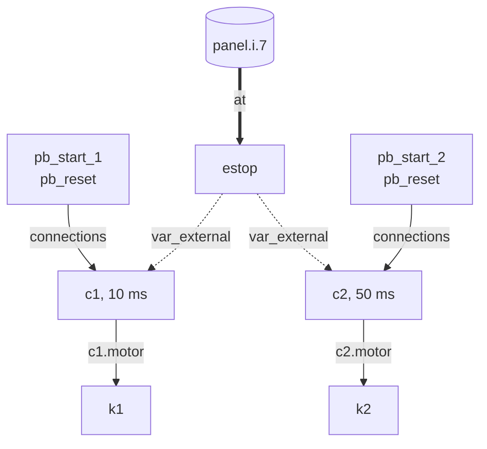

# Share a global between programs

This guide is for a reader who has a
[configuration file](../reference/glossary.md#configuration-file) with 2 or more
[programs](../reference/glossary.md#program). It shows how each program reads 1
[global](../reference/glossary.md#global) by its name, through a `var_external`
[declaration](../reference/glossary.md#declaration). The configuration file then has no
[connection](../reference/glossary.md#connection) line for the global. The example is
the global `estop`, which 2 conveyors read.

> #### Warning {: .warning}
>
> Do not use logex for a safety function, for example an emergency stop. logex can stop
> at any time, and then no part of logex sets an output to 0. The global `estop` of this
> guide is a signal that a program reads. It is not the emergency stop of a machine.
> Make the emergency stop with hardwired circuits or with a safety-rated controller, so
> that it works when logex stops, crashes or does not start.
> [Safety and limits](../explanation/safety-and-limits.md) gives the limits of logex.

## Before you start

- You must have a Mix project that has logex.
  [Install logex and run a program](install-and-run.md) gives the steps.
- You must know how to write a configuration file.
  [Write a configuration file](write-a-configuration-file.md) gives the steps.

The [plant](../reference/glossary.md#plant) of this guide has 2 conveyors. The
[instance](../reference/glossary.md#instance) `c1` runs on a 10 ms
[task](../reference/glossary.md#task), and `c2` runs on a 50 ms task. Both read the
global `estop`, which is a [located global](../reference/glossary.md#located-global) at
the input [point](../reference/glossary.md#point) `panel.i.7`.



Figure: the plant of this guide. Each box with a name is a global, and each box with a
time is an instance. The thick arrow is the `at` of the global `estop`. A solid arrow is
a connection line. A dotted arrow is a read by name through `var_external`, and the
configuration file has no line for it.

> #### Caution {: .error}
>
> Hold a shared global at 1 for at least the interval of the slowest task that reads it.
> An instance reads a global only when its task runs. If the global goes to 1 and back
> to 0 between 2 runs of the task, the instance does not see it. Use a switch that stays
> at 1 until a person resets it. On the [runner](../reference/glossary.md#runner), the
> signal must also stay at 1 until the runner reads its
> [device](../reference/glossary.md#device). Step 4 shows a signal that `c2` does not
> see.

## Steps

1. Make the file `conveyor.ld` in the root directory of your Mix project, with this text:

<!-- file: conveyor.ld -->
```text
var_input start bool
var_input stop bool
var_input reset bool
var_output motor bool
var_external estop bool
var fault bool

xic estop otl fault
xic reset otu fault
( xic start | xic motor ) xio stop xio fault ote motor
```

   The line `var_external estop bool` declares the
   [tag](../reference/glossary.md#tag) `estop`. The tag has the name of the global, with
   the same case, and exactly the [type](../reference/glossary.md#type) of the global. It
   has no [initial value](../reference/glossary.md#initial-value), because the global
   gives the value. [Declarations and types](../reference/declarations-and-types.md)
   gives the other rules.

   [Rung](../reference/glossary.md#rung) 1 [latches](../reference/glossary.md#latch)
   `fault` when `estop` is 1. Rung 3 stops the motor while `fault` is 1.

2. Make the file `line.logex` in the same directory, with this text:

<!-- file: line.logex -->
```text
// line.logex -- two conveyors, one e-stop
task fast interval 10 priority 1
task slow interval 50 priority 2

var_global estop      bool at panel.i.7
var_global pb_start_1 bool at panel.i.0
var_global pb_start_2 bool at panel.i.1
var_global pb_reset   bool at panel.i.2
var_global k1         bool at panel.q.0
var_global k2         bool at panel.q.1

program c1 conveyor with fast
  c1.start pb_start_1
  c1.stop  0
  c1.reset pb_reset
  c1.motor k1

program c2 conveyor with slow
  c2.start pb_start_2
  c2.stop  0
  c2.reset pb_reset
  c2.motor k2
```

   - The line `var_global estop bool at panel.i.7` declares the global 1 time.
   - The word `conveyor` on each `program` line is the name of the file `conveyor.ld`
     without `.ld`.
   - Each instance connects each `var_input` tag, and each `var_output` tag that drives
     an output.
   - The instances `c1` and `c2` have no line for `estop`. Each instance reads the
     global `estop` by its name.

   A global with no `at` can also have an initial value and a
   [qualifier](../reference/glossary.md#qualifier), for example
   `var_global retain total_boxes dint 0`. A located global cannot have them.

3. Make the file `share-a-global.exs` in the same directory, with this text. The script
   runs the plant 2 times, with 1 [cycle](../reference/glossary.md#cycle) each 10 ms. The
   first time, `estop` goes to 1 at 50 ms and stays at 1. The second time, `estop` is 1
   only from 20 ms to 30 ms.

```elixir
{:ok, line} = Logex.Configuration.compile_file("line.logex")

start = %{"pb_start_1" => 1, "pb_start_2" => 1}
release = %{"pb_start_1" => 0, "pb_start_2" => 0}

# Each entry gives the ms since the last cycle, and the globals at input points that
# change before the cycle. After the last cycle, print estop and the tags of each instance.
run = fn title, entries ->
  IO.puts(title)
  IO.puts("  time  k1  k2  ran")

  {resource, _time} =
    Enum.reduce(entries, {Logex.Runtime.start(line), 0}, fn {ms, changes}, {resource, time} ->
      {resource, out, events} = Logex.Runtime.cycle(resource, ms, changes)
      ran = for {:ran, _task, instance, _time} <- events, do: instance
      cells = Enum.map_join([time + ms, out["k1"], out["k2"]], &String.pad_leading("#{&1}", 4))
      IO.puts("  #{cells}  #{Enum.join(ran, " ")}")
      {resource, time + ms}
    end)

  paths = ~w(estop c1.estop c2.estop c1.fault c2.fault)
  IO.puts("  " <> Enum.map_join(paths, "  ", &"#{&1}=#{Logex.Runtime.get!(resource, &1)}"))
end

run.("estop is 1 from 50 ms:", [
  {0, start},
  {10, release},
  {10, %{}},
  {10, %{}},
  {10, %{}},
  {10, %{"estop" => 1}},
  {10, %{}}
])

run.("estop is 1 from 20 ms to 30 ms:", [
  {0, start},
  {10, release},
  {10, %{"estop" => 1}},
  {10, %{"estop" => 0}},
  {10, %{}},
  {10, %{}}
])
```

   - `Logex.Runtime.cycle/3` runs 1 cycle. It returns a `:ran` event for each instance
     that ran.
   - `Logex.Runtime.get!/2` reads a global by its name, for example `estop`. It reads a
     tag of an instance by the names of the instance and the tag, for example
     `c1.fault`.

4. Run the script.

```console
$ mix run share-a-global.exs
estop is 1 from 50 ms:
  time  k1  k2  ran
     0   1   1  c1 c2
    10   1   1  c1
    20   1   1  c1
    30   1   1  c1
    40   1   1  c1
    50   0   0  c1 c2
    60   0   0  c1
  estop=1  c1.estop=1  c2.estop=1  c1.fault=1  c2.fault=1
estop is 1 from 20 ms to 30 ms:
  time  k1  k2  ran
     0   1   1  c1 c2
    10   1   1  c1
    20   0   1  c1
    30   0   1  c1
    40   0   1  c1
    50   0   1  c1 c2
  estop=0  c1.estop=0  c2.estop=0  c1.fault=1  c2.fault=0
```

   If `line.logex` or `conveyor.ld` has an error, the first line of the script raises a
   `MatchError`. The text after `message:` is the
   [diagnostic](../reference/glossary.md#diagnostic).
   [If it does not work](#if-it-does-not-work) gives the frequent diagnostics.

## The result

The 2 programs read 1 global, and the configuration file has no connection for it. This
table explains the output:

| Lines | What they show |
|---|---|
| `estop is 1 from 50 ms`, time 50 | Both tasks run in the cycle at 50 ms. Both instances read `estop` and latch `fault`. `k1` and `k2` go to 0 in the same cycle. |
| `estop=1  c1.estop=1  c2.estop=1` | `c1.estop` and `c2.estop` are not copies. Each is the global `estop`. |
| `estop is 1 from 20 ms to 30 ms`, time 20 | `c1` runs at 20 ms, reads 1 and stops its motor. |
| The same run, time 50 | `c2` runs at 0 ms and at 50 ms only. `estop` is 0 at both times. Thus `k2` stays 1, and `c2.fault` is 0. |

## Write a global from a program

An [instruction](../reference/glossary.md#instruction) can also write a `var_external`
tag. The write goes to the global. For example, `tally.ld` adds 1 to the global
`total_boxes` for each box.

The declaration:

<!-- part of: tally.ld -->
```text
var_external total_boxes dint
```

The rung:

<!-- part of: tally.ld -->
```text
xic eye ons e add total_boxes 1 total_boxes
```

[Keep values across a restart](keep-values-across-a-restart.md) shows the whole file
`tally.ld`. Obey these rules when a program writes a global:

- Let only 1 instance write a global. For a global
  [array](../reference/glossary.md#array), let only 1 instance write each
  [element](../reference/glossary.md#element).
- Do not write a global at an input point. logex then does not
  [compile](../reference/glossary.md#compile) the
  [configuration](../reference/glossary.md#configuration).
- Do not connect a `var_output` tag to a global that an instance writes through
  `var_external`. logex then gives a [warning](../reference/glossary.md#warning).

An instance that runs later in the same cycle reads the new value. A write to a global
at an output point sets that output point.
[If it does not work](#if-it-does-not-work) gives the message when a program does not
obey a rule.

## Run a program alone

If you compile `conveyor.ld` alone with `Logex.compile_file/1`, no global gives `estop`
a value. `estop` is then a tag of the instance, and it starts at 0.
`Logex.Runtime.put_inputs/3` cannot set it: it raises an `ArgumentError`. To give
`estop` a value, run the program in a configuration, as in [Steps](#steps).

## Another example: an e-stop held and an e-stop pressed

The script `shared.exs` runs the line 2 times. In the first run, the e-stop is held from
50 ms. In the second run, the e-stop is pressed for 10 ms at 20 ms. Then the script loads
`wrong.logex`. This file has a wrong name of a global, and a connection to a
`var_external`.

<!-- file: wrong.logex -->
```text
var_global estp       bool at panel.i.7
var_global pb_start_1 bool at panel.i.0
var_global k1         bool at panel.q.0
program c1 conveyor
  c1.start pb_start_1
  c1.stop  0
  c1.reset 0
  c1.motor k1
  c1.estop estp
```

```elixir
{:ok, line} = Logex.Configuration.compile_file("line.logex")

run = fn label, steps ->
  IO.puts(label)

  Enum.reduce(steps, Logex.Runtime.start(line), fn {now, inputs}, rt ->
    {rt, out, events} = Logex.Runtime.cycle(rt, min(now, 10), inputs)
    ran = for {:ran, _task, instance, _now} <- events, do: instance
    IO.puts("  t=#{String.pad_leading("#{now}", 2)}  k1=#{out["k1"]} k2=#{out["k2"]}  ran #{Enum.join(ran, ", ")}")
    rt
  end)
end

start = %{"pb_start_1" => 1, "pb_start_2" => 1}
release = %{"pb_start_1" => 0, "pb_start_2" => 0}

rt =
  run.("e-stop held from 50 ms:", [
    {0, start}, {10, release}, {20, %{}}, {30, %{}}, {40, %{}}, {50, %{"estop" => 1}}, {60, %{}}
  ])

IO.inspect(for(path <- ~w(estop c1.estop c2.estop c2.fault), do: Logex.Runtime.get!(rt, path)),
  label: "estop c1.estop c2.estop c2.fault"
)

run.("e-stop pressed for 10 ms at 20 ms:", [
  {0, start}, {10, release}, {20, %{"estop" => 1}}, {30, %{"estop" => 0}}, {40, %{}}, {50, %{}}
])

{:error, diagnostics} = Logex.Configuration.compile_file("wrong.logex")
Enum.each(diagnostics, &IO.puts(Logex.Diagnostic.format(&1)))
```

```console
$ mix run shared.exs
e-stop held from 50 ms:
  t= 0  k1=1 k2=1  ran c1, c2
  t=10  k1=1 k2=1  ran c1
  t=20  k1=1 k2=1  ran c1
  t=30  k1=1 k2=1  ran c1
  t=40  k1=1 k2=1  ran c1
  t=50  k1=0 k2=0  ran c1, c2
  t=60  k1=0 k2=0  ran c1
estop c1.estop c2.estop c2.fault: [1, 1, 1, 1]
e-stop pressed for 10 ms at 20 ms:
  t= 0  k1=1 k2=1  ran c1, c2
  t=10  k1=1 k2=1  ran c1
  t=20  k1=0 k2=1  ran c1
  t=30  k1=0 k2=1  ran c1
  t=40  k1=0 k2=1  ran c1
  t=50  k1=0 k2=1  ran c1, c2
wrong.logex: line 4: `conveyor` declares `var_external estop bool` on line 5 of `conveyor.ld`, but there is no global `estop` — did you mean `estp`?
wrong.logex: line 9: `c1.estop` is a var_external of `conveyor`, which reaches the global `estop` itself: only a var_input or var_output connects
```

The e-stop held from 50 ms stops the 2 conveyors in the same cycle. `c2` runs every
50 ms, and thus it does not see the press of 10 ms. Hold an e-stop for at least the
longest interval of a task that reads it.

## If it does not work

Each row gives a part of the message. The full message also gives the file and the
line. [Read a diagnostic](read-diagnostics.md) shows how to read a message.

### The configuration does not compile

Most of these diagnostics are at the first `program` line that names the
[program type](../reference/glossary.md#program-type) `conveyor`. A diagnostic of the
`var_external` tag also gives its line in `conveyor.ld`. A diagnostic of a connection
line is at that line.

| What you see | Cause | What to do |
|---|---|---|
| `` there is no global `estop`: declare it `` | No `var_global` line for the tag. | Add the line that the message gives. |
| `` did you mean `estp`? `` | A spelling error. | Give the global and the tag the same name. |
| `(names are case-sensitive)` | The tag has a different case. | Write the name as the global has it. |
| `` but `estop` is an int `` | The global has a different type, for example `int` for a `bool` tag. | Give the tag the type of the global. |
| `never widened` | 2 different number or bit-string types, for example `sint` and `int`. | Give the tag the type of the global. |
| `every dimension included` | An array of a different type or size. | Give the tag the type and the sizes of the global. |
| `not a global` | The name of a task or an instance. | Give the global and the tag a different name. |
| `` reaches the global `estop` itself `` | A connection line for the `var_external` tag. | Remove the line. |
| `nothing writes an input point` | An instruction writes a global at an input point. | Remove the write, or use a global with no `at`. |
| `` there is no `conveyor.ld` beside `` | No `conveyor.ld` in the directory of `line.logex`. | Put the file there. |
| `` leaves its var_input `stop` unconnected `` | No connection for a `var_input` tag. | Connect it, for example `c1.stop 0`. |

### The program type does not compile

If the error is in the file of a program or of a block, the first message is
``program type `conveyor` does not compile``. It names the file of the error. The next
message gives the error and its line in that file.

| What you see | Cause | What to do |
|---|---|---|
| `` `estop` is a var_external: `` and `takes no initial value` | An initial value on the `var_external` line. | Remove it. A global with no `at` can have one. |
| `cannot be a var_external in a function block's file` | A `var_external` in a [function block](../reference/glossary.md#function-block). | Declare a `var_input` in the block. Give it the global as an [operand](../reference/glossary.md#operand) of the `cal`. |
| `is a keyword of a configuration file` | The name of the tag is a word of the configuration file, for example `task`. | Give the tag and the global a different name. |
| `an instance is the program's own` | A [timer](../reference/glossary.md#timer), a [counter](../reference/glossary.md#counter) or a block declared with `var_external`. | Declare it with `var`. |

[Write a function block](write-a-function-block.md) shows the operands of a `cal`.

### Elixir raises an error

`Logex.Runtime.put_inputs/3` and `Logex.Runtime.cycle/3` raise these errors as an
`ArgumentError`.

| What you see | Cause | What to do |
|---|---|---|
| `` input `estop` is a var_external `` | Your code sets a `var_external` tag. | Read [Run a program alone](#run-a-program-alone). |
| `is a global with no location` | Your code sets a global with no `at`. | Set only the globals at input points. |

### The configuration compiles with a warning

In these rows, `t1` and `t2` are 2 instances of `tally.ld`, and `s1.n` is a `var_output`
tag of a different instance.

| What you see | Cause | What to do |
|---|---|---|
| `` writes `total_boxes` through its var_external, as `t1` does `` | 2 instances write 1 global, or 1 element of a global array. | Let only 1 instance write it. |
| `` and `s1.n` drives it `` | A connection of a different instance writes the global also. | Remove the connection or the write. |
| `its own copy-out, after the scan, stands` | The instance writes the global, and a connection joins its own `var_output` tag to the global. | Remove the connection. |
| `` is the storage bit of an `ons` `` | A second instance or a connection writes the [storage bit](../reference/glossary.md#storage-bit) of a [one-shot](../reference/glossary.md#one-shot): `ons`, `osr` or `osf`. | Declare the storage bit as a `var` tag. |

## See also

- [Configuration file](../reference/configuration-file.md): each rule of a global and of
  a `var_external` tag in a configuration.
- [Declarations and types](../reference/declarations-and-types.md): the rules of the
  [section](../reference/glossary.md#section) `var_external`.
- [Tasks and the schedule](../explanation/tasks-and-scheduling.md): when each instance
  runs, and why a slow task misses a short signal.
- [Use an event task](use-an-event-task.md): run an instance in the cycle where its
  [trigger](../reference/glossary.md#trigger) goes from 0 to 1.
- [Write a configuration file](write-a-configuration-file.md): the tasks, the globals and
  the connections of a plant.
- [Glossary](../reference/glossary.md): the words of this guide.
