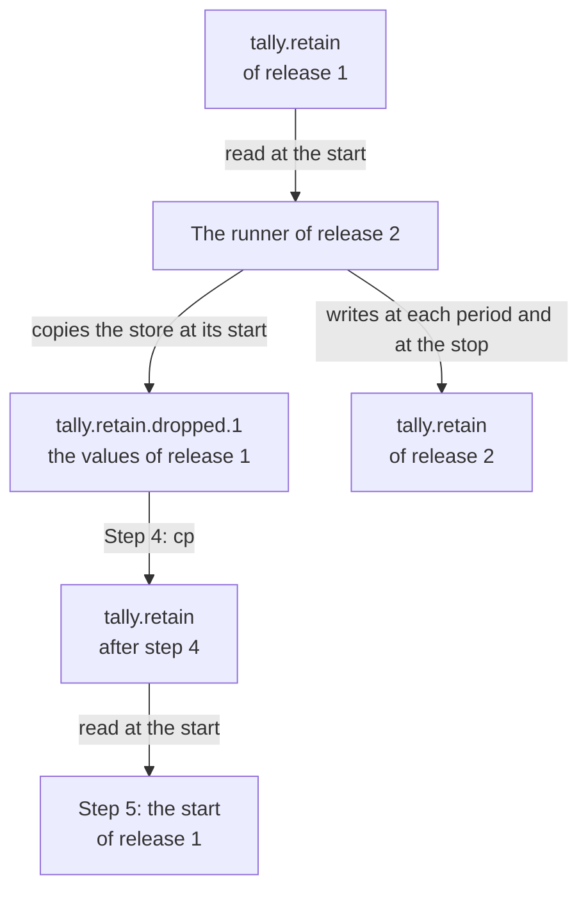

# Take back a deploy

This guide is for a reader who runs a [plant](../reference/glossary.md#plant) with a
[runner](../reference/glossary.md#runner) and a [store](../reference/glossary.md#store),
and who made a [deploy](../reference/glossary.md#deploy) that is wrong. You go back to the
earlier program files and to the retained values that they wrote.

This guide uses these words:

| Word | Meaning |
|---|---|
| Release 1 | The earlier files: the [program](../reference/glossary.md#program) files and the [configuration file](../reference/glossary.md#configuration-file) that ran before the deploy |
| Release 2 | The files of the deploy that is wrong |
| A numbered copy | A file `<store>.dropped.<n>` beside the store, for example `tally.retain.dropped.1`. A [fresh start](../reference/glossary.md#fresh-start) writes this file if the start drops a value from the store. A cold start writes it if it cannot read the store. The file holds the store as the start read it. |

> #### Warning {: .warning}
>
> Make sure that the machine is safe before you start release 1 again. The start sets
> each retained value from the store. A value in the store can be wrong for the machine.
> A [rung](../reference/glossary.md#rung) that reads such a value can set an
> [output](../reference/glossary.md#output) [point](../reference/glossary.md#point) in the
> first [round](../reference/glossary.md#round). logex does not check that a value is
> correct for the machine.

> #### Caution {: .error}
>
> Do not put the copy back if you must keep the changes after the deploy. When you put
> the copy of the store back, you lose each change that release 2 made to a retained
> value. For example, a box that release 2 counted goes out of the total.

## Before you start

You must have:

- A runner with a store, as in [Keep retained values on disk](keep-values-on-disk.md).
- The files of release 1. logex keeps no copy of a program file or a configuration file.
  The store does not hold the text of a file.
- The options that you gave to `Logex.Runner.start_link/1`, for example
  `retain: "tally.retain"`.

If release 1 ran an [online edit](../reference/glossary.md#online-edit) that you tested or
assembled, write the edit to the files of release 1 first. The copy holds the values of
the edited program.

If the change is an online edit under [test](../reference/glossary.md#test), do not use
this guide. Do an [untest](../reference/glossary.md#untest) or a
[cancel](../reference/glossary.md#cancel), as in
[Edit a running plant](edit-a-running-plant.md).

> #### Caution {: .error}
>
> Make the machine safe before step 2. The stop of the runner writes 0 to each
> output, and the plant stops.

## How the copy keeps the values of release 1

The start of release 2 reads the store. If release 2 does not retain a value with the same
name and [type](../reference/glossary.md#type), the start drops that value. Before the
runner writes the store, it copies the store to a numbered copy.



Figure: the store and its numbered copy during a deploy and its take-back. The copy keeps
the values of release 1 after release 2 writes over the store. Step 4 puts the copy in
place of the store, and step 5 reads it.

## Steps

1. Before you stop the runner, read the status of the store and the list of the numbered
   copies. The code under this step reads them. After the stop, `Logex.Runner.status/1`
   raises `the runner ... is not running`. Then find what to do in step 4 in the table.

<!-- fragment: the status of the store, with runner the pid or the name of the runner of release 2 -->
```elixir
retain = Logex.Runner.status(runner).retain
IO.inspect(retain.copy, label: "copy")
IO.inspect(retain.dropped, label: "dropped")
IO.inspect(retain.failed, label: "failed")
IO.inspect(Path.wildcard("tally.retain.dropped.*"), label: "copies")
```

| What step 1 shows | What to do in step 4 |
|---|---|
| `copy` names a file | Put that copy in place of the store. |
| `copy` is `nil`, `dropped` is `[]` and `copies` is `[]` | Keep the store. Release 2 dropped no value. |
| `copy` is `nil`, and `dropped` or `copies` is not `[]` | Look in [Step 1 gives no copy](#step-1-gives-no-copy). |

2. Stop the runner with the line for your case. The stop writes 0 to each output, then it
   writes the store. The numbered copy does not change.

<!-- fragment: the stop of release 2, with runner its pid, supervisor its supervisor and my_app the application that starts it -->
```elixir
# A runner with no supervisor:
:ok = Logex.Runner.stop(runner)

# A runner under a supervisor:
:ok = Supervisor.terminate_child(supervisor, Logex.Runner)

# A runner that your application starts:
:ok = Application.stop(:my_app)
```

3. Put the files of release 1 back in the place that your application reads them from.
   If your application compiles the files at its start, do only that. Else
   [compile](../reference/glossary.md#compile) the
   [configuration](../reference/glossary.md#configuration) again, and put it in the
   options:

<!-- fragment: the configuration of release 1 compiled again, with opts the options of release 2 -->
```elixir
{:ok, configuration} = Logex.Configuration.compile_file("tally.logex")
opts = Keyword.put(opts, :configuration, configuration)
```

4. If step 1 gave a file name in `copy`, copy the store of release 2 aside. Then put the
   copy of step 1 in place of the store. If you keep the store, do not do this step. For
   example:

```console
$ cp tally.retain tally.retain.release-2
$ cp tally.retain.dropped.1 tally.retain
```

5. Start the runner with the options of step 3, with the line for your case. Do not give
   `start: :cold`. A cold start writes the
   [initial values](../reference/glossary.md#initial-value) over the store. Under a
   supervisor, `spec` is the child spec of release 1 with the options of step 3. Give it
   the same `restart:` as before.

<!-- fragment: the start of release 1, with opts the options of step 3 and spec its child spec -->
```elixir
# A runner with no supervisor:
{:ok, runner} = Logex.Runner.start_link(opts)

# A supervisor, with restart: :temporary, the default:
{:ok, runner} = Supervisor.start_child(supervisor, spec)

# A supervisor, with restart: :permanent or :transient. Do not use
# Supervisor.restart_child/2: it starts the child spec of release 2 again.
:ok = Supervisor.delete_child(supervisor, Logex.Runner)
{:ok, runner} = Supervisor.start_child(supervisor, spec)

# A runner that your application starts:
{:ok, _applications} = Application.ensure_all_started(:my_app)
```

6. Read the keys `dropped` and `warning` of the status, and compare each retained value with the
   machine. If you put the copy back, compare it also with `tally.retain.release-2`.
   [The result](#the-result) gives what you see.

<!-- fragment: the check after the start, with runner the pid of the new runner -->
```elixir
retain = Logex.Runner.status(runner).retain
IO.inspect(retain.dropped, label: "dropped")
IO.inspect(retain.warning, label: "warning")
IO.inspect(Logex.Runner.get!(runner, "total_boxes"), label: "total_boxes")
```

## The result

The runner runs release 1. Step 6 shows one of these results:

- You put the copy back. `dropped` is `[]`, and `warning` is `nil`. Each retained value is
  the value of the last write of the store by release 1. If release 1 stopped in order,
  that is the write of its stop.
- You kept the store. Each retained value is the value that release 2 wrote. `warning` is
  a message that starts `tally.retain: the store was written by another program`. It
  stays in the status of this runner.
- You kept the store, and release 2 retains a value that release 1 does not have.
  `dropped` names that value, for example `[{"t1.extra", :undeclared}]`. The start copied
  the store of release 2 to a new numbered copy. You can delete that copy.

The numbered copies stay beside the store until you delete them. If a value is not correct
for the machine, stop the runner and correct the value, as in
[Edit the store by hand](edit-the-store-by-hand.md).

> #### Tip {: .tip}
>
> Copy the store before each deploy, for example to `tally.retain.bak`. A deploy that
> starts with `start: :cold` makes no numbered copy of a store that it can read.

## An example

The example uses the configuration of
[Keep the values of a plant](keep-values-across-a-restart.md#keep-the-values-of-a-plant).
Get [`tally.ld`](keep-values-across-a-restart.md#keep-the-values-of-a-plant) and
[`tally.logex`](keep-values-across-a-restart.md#keep-the-values-of-a-plant) and put them
in the root directory of your project. They are release 1.

Make the directory `take-back-a-deploy/release-2`. Save the configuration file of release
2 in it as `tally.logex`. It is the same as the configuration file of release 1:

<!-- file: take-back-a-deploy/release-2/tally.logex -->
```text
// tally.logex -- a box counter whose count and total survive a warm restart
var_global eye_1              bool at panel.i.0
var_global retain total_boxes dint 0
var_global case_full          bool

program t1 tally
  t1.eye  eye_1
  t1.full case_full
```

Save the program of release 2 in the same directory as `tally.ld`. Its
[counter](../reference/glossary.md#counter) `boxes` has no
[`retain`](../reference/glossary.md#retain), because a person removed it in error:

<!-- file: take-back-a-deploy/release-2/tally.ld -->
```text
var_input eye bool
var_output retain full bool
var_external total_boxes dint
var boxes ctu
var e bool

xic eye ctu boxes 3
xic eye ons e add total_boxes 1 total_boxes
xic boxes.q otl full
```

The difference from release 1:

```diff
 var_external total_boxes dint
-var retain boxes ctu
+var boxes ctu
 var e bool
```

> #### Caution {: .error}
>
> Run the example in a project that has no store of a plant. The script deletes each file
> whose name starts with `tally.retain`.

Save this script as `take-back-a-deploy.exs` in the root directory of your project. It
counts 2 boxes with release 1. Then it does the deploy of release 2 and counts 1 more box.
Last, it does steps 1, 2, 4 and 5. It compiles release 1 at its top, which is step 3.

```elixir
alias Logex.IO.Sim
alias Logex.Runner
alias Logex.Runner.Clock.Manual

{:ok, release_1} = Logex.Configuration.compile_file("tally.logex")
{:ok, release_2} = Logex.Configuration.compile_file("take-back-a-deploy/release-2/tally.logex")

# No store and no copy from an earlier run.
for file <- File.ls!(), String.starts_with?(file, "tally.retain"), do: File.rm!(file)

# The manual clock, its wall clock 2026-10-30T14:00:00Z.
{:ok, clock} = Manual.start_link(now: 1_793_368_800_000)
{:ok, panel} = Sim.start_link(clock: clock)

start = fn configuration ->
  {:ok, runner} =
    Runner.start_link(
      configuration: configuration,
      io: %{"panel" => {Sim, sim: panel}},
      clock: {Manual, clock},
      retain: "tally.retain"
    )

  runner
end

# Prints the count of the case, the total and what the start dropped.
show = fn label, runner ->
  retain = Runner.status(runner).retain

  IO.puts(
    "#{label}: t1.boxes.cv=#{Runner.get!(runner, "t1.boxes.cv")} " <>
      "total_boxes=#{Runner.get!(runner, "total_boxes")} " <>
      "dropped=#{inspect(retain.dropped)} copy=#{inspect(retain.copy)}"
  )
end

# The eye sees n boxes, 1 box each 2 s.
boxes = fn n ->
  for _box <- 1..n, eye <- [1, 0] do
    Sim.set(panel, "panel.i.0", eye)
    Manual.advance(clock, 1000)
  end
end

# Release 1 counts 2 boxes. The stop writes the store.
runner = start.(release_1)
boxes.(2)
show.("release 1", runner)
:ok = Runner.stop(runner)

# The deploy: release 2 starts from the store and counts 1 box.
runner = start.(release_2)
show.("release 2 starts", runner)
boxes.(1)
show.("release 2 runs", runner)

# Step 1: read the status before the stop.
%{copy: copy, warning: warning} = Runner.status(runner).retain
IO.puts(warning)

# Step 2: stop the runner. The stop writes the store.
:ok = Runner.stop(runner)

# Step 4: copy the store of release 2 aside, and put the copy in place of the store.
File.cp!("tally.retain", "tally.retain.release-2")
File.cp!(copy, "tally.retain")

# Step 5: start release 1 again.
runner = start.(release_1)
show.("release 1 again", runner)
IO.puts("warning: #{inspect(Runner.status(runner).retain.warning)}")
:ok = Runner.stop(runner)

# The copies stay beside the store.
files = File.ls!() |> Enum.filter(&String.starts_with?(&1, "tally.retain")) |> Enum.sort()
IO.puts(Enum.join(files, " "))
```

```console
$ mix run take-back-a-deploy.exs
release 1: t1.boxes.cv=2 total_boxes=2 dropped=[] copy=nil
release 2 starts: t1.boxes.cv=0 total_boxes=2 dropped=[{"t1.boxes", :unretained}] copy="tally.retain.dropped.1"
release 2 runs: t1.boxes.cv=1 total_boxes=3 dropped=[{"t1.boxes", :unretained}] copy="tally.retain.dropped.1"
tally.retain: the store was written by another program than the one this start was given: `tally`'s text differs; whether by a deploy of changed files, or an edit tested or assembled online that never reached the files, this start runs the program it was given, with the store's retained values laid over it by name and type
release 1 again: t1.boxes.cv=2 total_boxes=2 dropped=[] copy=nil
warning: nil
tally.retain tally.retain.dropped.1 tally.retain.release-2
```

Each line of the output shows this:

- `release 1`: release 1 counts 2 boxes.
- `release 2 starts`: the start drops the counter, which release 2 does not retain. The
  count of the case is 0, but the case holds 2 boxes. The start copies the store to
  `tally.retain.dropped.1`.
- `release 2 runs`: release 2 counts 1 more box. `total_boxes` is 3.
- `tally.retain: the store was written by another program`: the message of the start of
  release 2. The program text of `tally` is different.
- `release 1 again`: the start reads the copy. The count of the case is 2 again, and the
  start drops nothing. `total_boxes` is 2, because the copy does not hold the box of
  release 2.
- `warning: nil`: release 1 wrote the copy, so `warning` is `nil`.
- The last line: the copy and the store of release 2 stay beside the store.

## If it does not work

### Step 1 gives no copy

| What you see | Cause | What to do |
|---|---|---|
| `copy` is `nil` and `dropped` is `[]`, but `copies` is not `[]` | Release 2 started more than 1 time, for example from a supervisor, and only its first start made a copy. Or an earlier deploy made the copies. | Read line 2 of each copy, for example with `head -n 2`. A copy of this deploy has on line 2 the time of the last write of release 1, a short time before the deploy. Use that copy in step 4. If no copy has that time, keep the store. |
| `copy` is `nil`, `dropped` is not `[]`, and `failed` or `unknown` is not `nil` | The runner did not make the copy, for example because a directory has the name of the `.tmp` file of the copy. Until the runner makes the copy, it does not write over the store. | Remove the cause, and do step 2. If the stop returns `:ok`, the stop made the copy: use the copy with the highest number. If it returns `{:error, {:retain, reason}}`, keep the store. |

### After step 5

| What you see | Cause | What to do |
|---|---|---|
| `dropped` is not `[]`, and the values are the values of release 2 | You started release 1 before step 4. That start dropped values again, and it copied the store of release 2 to a new numbered copy. | Stop the runner. Put the copy of step 1, not the new copy, in place of the store. Do step 5 again. |
| `dropped` names a value of the edited program, for example a [preset](../reference/glossary.md#preset), and `warning` is not `nil` | Release 1 ran an online edit that never reached its files. The copy holds the values of the edited program. | Stop the runner. Write the edit to the files of release 1. Do step 3, put the copy of step 1 in place of the store again, and do step 5. |
| `warning` is not `nil`, `dropped` is `[]`, and you put the copy back | The files of step 3 are not the files of release 1. A change to a comment, an empty line or a space keeps `warning` `nil`. So does a word in a different case, such as `XIC`, or a number spelled another way, such as `16#3`. | Stop the runner. Put the files of release 1 back. Do step 3, put the copy of step 1 in place of the store again, and do step 5. |
| The runner runs release 2 again | A supervisor started the child spec of release 2, for example after it started the child again. That runner wrote the store of release 2 again. | Stop the runner. Put the copy of step 1 in place of the store again, and do step 5. |

### Release 2 started in a different way

| What you see | Cause | What to do |
|---|---|---|
| Release 2 started with `start: :cold`, and `copy` is `nil` | A cold start makes no numbered copy of a store that it can read. No file that logex writes holds the values of release 1. | Put your own copy of the store in place of the store, if you have one. |
| Release 2 renamed the configuration, and logex refused its warm start with a message that names the 2 configurations | logex refuses a warm start of a configuration with a name that is different from the name in the store. A cold start copies the store to a numbered copy first. | Follow the steps with that copy and the files of release 1. |

## See also

- [Retained values and the store](../reference/retained-values-and-store.md): what a start
  keeps and what it drops.
- [Keep retained values on disk](keep-values-on-disk.md): give a runner a store.
- [Recover from a refused store](recover-a-refused-store.md): when the start does not
  read the store.
- [Edit the store by hand](edit-the-store-by-hand.md): correct 1 value in the store.
- [Run a plant under a supervisor](run-under-a-supervisor.md): the child spec of a
  runner.
- [Warm and cold restarts](../explanation/warm-and-cold-restarts.md): what each start
  keeps, and why.
- [Glossary](../reference/glossary.md): the words of this guide.
