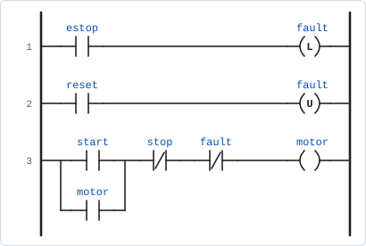
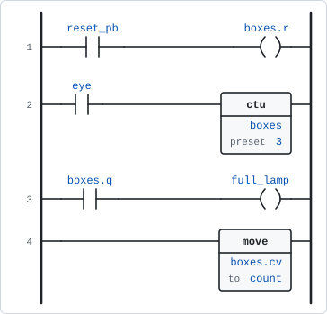

# Check a device adapter

This guide is for a reader who has an [adapter](../reference/glossary.md#adapter) for a
[device](../reference/glossary.md#device) with hardware. It shows how to check
the adapter with a card program, before you connect the hardware.
[Write a device adapter](write-a-device-adapter.md) shows how to write the adapter.

> #### Warning {: .warning}
>
> Do the checks of this guide before you connect the adapter to the hardware. With the
> hardware, the program of the plant controls the machine through the output
> [points](../reference/glossary.md#point).

> #### Warning {: .warning}
>
> Do not use logex for a safety function, for example an emergency stop. logex can stop
> at any time. Make each safety function with hardwired circuits or with a safety-rated
> controller. [Safety and limits](../explanation/safety-and-limits.md) gives the limits
> of logex.

## Before you start

You must have:

- an adapter: the example uses the module `LineDevice` of
  [Write a device adapter](write-a-device-adapter.md)
- the protocol of your device
- a Mix project with logex
  ([Install logex and run a program](install-and-run.md) shows how)

## The example

The example is the script `line_device.exs`. It has 3 parts.

| Lines | Part | What it is |
|---|---|---|
| 1 to 96 | The module `LineDevice` | The adapter: a client of a card that answers lines of text on a TCP socket. |
| 98 to 172 | The module `Card` | The card program: a TCP server on this computer with the protocol of the card. It is not a part of logex. |
| 174 to 214 | The run | The [plant](../reference/glossary.md#plant) runs with the adapter and the card program, on the manual [clock](../reference/glossary.md#clock). |

The run controls the card program with these functions.

| Function | What it does |
|---|---|
| `Card.set/3` | It sets 1 of the 16 input channels of the card. |
| `Card.outputs/1` | It gives the last values that the adapter wrote. |
| `Card.drop/1` | It closes the socket. |
| `Card.garble/1` | It makes the card answer `huh` to the next `read`. |
| `Card.left?/1` | It tells if the adapter sent `quit`. |

The plant is a conveyor and a box counter. Its
[configuration file](../reference/glossary.md#configuration-file) puts 4 input
points and 2 output points on the device `panel`.

## Steps

1. **Put the configuration file of the plant in the root of your Mix project.**

<!-- file: packing.logex -->
```text
// packing.logex -- a conveyor on a 10 ms task, and a box counter in the continuous task
task fast interval 10 priority 1 watchdog 50
task main continuous watchdog 200

var_global estop      bool at panel.i.7
var_global pb_start_1 bool at panel.i.0
var_global pb_reset   bool at panel.i.2
var_global eye        bool at panel.i.8
var_global k1         bool at panel.q.0
var_global case_full  bool at panel.q.4

program c1 conveyor with fast
  c1.start pb_start_1
  c1.stop  0
  c1.reset pb_reset
  c1.motor k1

program b1 boxes
  b1.eye       eye
  b1.reset_pb  pb_reset
  b1.full_lamp case_full
```

2. **Put the 2 [programs](../reference/glossary.md#program) of the plant in the same
   directory.**

<!-- file: conveyor.ld -->
```text
var_input start bool
var_input stop bool
var_input reset bool
var_output motor bool
var_external estop bool
var fault bool

xic estop otl fault
xic reset otu fault
( xic start | xic motor ) xio stop xio fault ote motor
```

<!-- rung: conveyor.ld -->


<!-- file: boxes.ld -->
```text
var_input eye bool
var_input reset_pb bool
var_output full_lamp bool
var_output count dint
var boxes ctu

xic reset_pb ote boxes.r
xic eye ctu boxes 3
xic boxes.q ote full_lamp
move boxes.cv count
```

<!-- rung: boxes.ld -->


3. **Put the script `line_device.exs` in the same directory, and run it.**

```elixir
# LineDevice: an adapter for a card on a TCP socket that speaks lines, `read` answered by
# its inputs, `0=1 2=0`, `write 0=1 4=0` answered `ok`, and `quit` answered `bye`.
defmodule LineDevice do
  @behaviour Logex.IO

  @connect [:binary, packet: :line, active: false]

  # In the host's process, as the runner starts: the options' mistakes, a line each.
  @impl true
  def check(_device, _points, opts), do: Enum.flat_map([:host, :port], &given(&1, opts[&1]))

  defp given(key, nil), do: ["LineDevice needs #{key}:, the card's address"]
  defp given(_key, _value), do: []

  # In the device's process, from here on: the connection, made at once, and the inputs
  # the configuration wires, which are all a read gives.
  @impl true
  def init(_device, points, opts) do
    inputs = for %Logex.IO.Point{direction: :input, address: at} <- points, do: at
    opened(connected(%{host: opts[:host], port: opts[:port], socket: nil, inputs: inputs}))
  end

  defp opened({:ok, state}), do: {:ok, state}
  defp opened({:error, reason, _state}), do: {:error, reason}

  # The wired inputs, by address, the card's other channels left out; a failure is given
  # back, never raised, and the call after a lost line, or an answer that is no answer,
  # connects again.
  @impl true
  def read(state), do: asked(connected(state), "read", &values(&1, state.inputs))

  # Every output, by address, at each write: a snapshot.
  @impl true
  def write(values, state), do: asked(connected(state), "write " <> line(values), &ok/1)

  # After the last write of zeros: the card told the controller is leaving, so that it
  # frees its line at once, and the socket closed.
  @impl true
  def close(%{socket: nil}), do: :ok

  def close(%{socket: socket}) do
    _ = :gen_tcp.send(socket, "quit\n")
    _ = :gen_tcp.recv(socket, 0, 1000)
    :gen_tcp.close(socket)
  end

  defp connected(%{socket: nil} = state),
    do: socket(:gen_tcp.connect(state.host, state.port, @connect, 1000), state)

  defp connected(state), do: {:ok, state}

  defp socket({:ok, socket}, state), do: {:ok, %{state | socket: socket}}
  defp socket({:error, reason}, state), do: {:error, reason, state}

  defp asked({:ok, state}, line, answer),
    do: answered(sent(:gen_tcp.send(state.socket, line <> "\n"), state.socket), answer, state)

  defp asked(error, _line, _answer), do: error

  defp sent(:ok, socket), do: :gen_tcp.recv(socket, 0, 1000)
  defp sent(error, _socket), do: error

  defp answered({:ok, text}, answer, state), do: given_back(answer.(text), state)
  defp answered({:error, reason}, _answer, state), do: lost(reason, state)

  defp given_back({:ok, values}, state), do: {:ok, values, state}
  defp given_back(:ok, state), do: {:ok, state}
  defp given_back({:garbled, text}, state), do: lost({:garbled, text}, state)
  defp given_back({:error, reason}, state), do: {:error, reason, state}

  defp lost(reason, state) do
    :gen_tcp.close(state.socket)
    {:error, reason, %{state | socket: nil}}
  end

  # `0=1 2.1=7` is %{[0] => 1, [2, 1] => 7}: an address is its location's fields. Only the
  # wired inputs are given, since an address that is no point of the device is an I/O
  # fault; any other line is no answer.
  @answer ~r/\A(\d+(\.\d+)*=-?\d+( \d+(\.\d+)*=-?\d+)*)?\n\z/

  defp values(text, inputs), do: parsed(Regex.match?(@answer, text), text, inputs)

  defp parsed(true, text, inputs), do: {:ok, Map.take(Map.new(String.split(text), &value/1), inputs)}
  defp parsed(false, text, _inputs), do: {:garbled, text}

  defp value(pair) do
    [at, value] = String.split(pair, "=")
    {Enum.map(String.split(at, "."), &String.to_integer/1), String.to_integer(value)}
  end

  defp ok("ok\n"), do: :ok
  defp ok(other), do: {:error, {:refused, other}}

  defp line(values),
    do: Enum.map_join(Enum.sort(values), " ", fn {at, v} -> "#{Enum.join(at, ".")}=#{v}" end)
end

# The card, sixteen inputs of which the plant wires four, played by the script on the
# loopback interface: its inputs set, its outputs read, its line dropped, an answer
# garbled and its leaving controller told by calls.
defmodule Card do
  use GenServer

  def start_link, do: GenServer.start_link(__MODULE__, nil)
  def port(card), do: GenServer.call(card, :port)
  def set(card, at, value), do: GenServer.call(card, {:set, at, value})
  def outputs(card), do: GenServer.call(card, :outputs)
  def drop(card), do: GenServer.call(card, :drop)
  def garble(card), do: GenServer.call(card, :garble)
  def left?(card), do: GenServer.call(card, :left)

  @impl true
  def init(nil) do
    {:ok, listen} = :gen_tcp.listen(0, [:binary, packet: :line, active: false, ip: {127, 0, 0, 1}])
    card = self()
    spawn_link(fn -> accepting(listen, card) end)
    inputs = Map.new(0..15, &{&1, 0})
    {:ok, %{listen: listen, socket: nil, inputs: inputs, outputs: %{}, garbled: false, left: false}}
  end

  defp accepting(listen, card) do
    {:ok, socket} = :gen_tcp.accept(listen)
    :ok = :gen_tcp.controlling_process(socket, card)
    send(card, {:accepted, socket})
    accepting(listen, card)
  end

  @impl true
  def handle_call(:port, _from, state), do: {:reply, elem(:inet.port(state.listen), 1), state}
  def handle_call({:set, at, value}, _from, state), do: {:reply, :ok, put_in(state.inputs[at], value)}
  def handle_call(:outputs, _from, state), do: {:reply, state.outputs, state}
  def handle_call(:garble, _from, state), do: {:reply, :ok, %{state | garbled: true}}
  def handle_call(:left, _from, state), do: {:reply, state.left, state}

  def handle_call(:drop, _from, state) do
    :gen_tcp.close(state.socket)
    {:reply, :ok, %{state | socket: nil}}
  end

  @impl true
  def handle_info({:accepted, socket}, state) do
    :ok = :inet.setopts(socket, active: true)
    {:noreply, %{state | socket: socket, left: false}}
  end

  def handle_info({:tcp, socket, "read\n"}, %{garbled: true} = state) do
    :gen_tcp.send(socket, "huh\n")
    {:noreply, %{state | garbled: false}}
  end

  def handle_info({:tcp, socket, "read\n"}, state) do
    :gen_tcp.send(socket, Enum.map_join(state.inputs, " ", fn {at, v} -> "#{at}=#{v}" end) <> "\n")
    {:noreply, state}
  end

  def handle_info({:tcp, socket, "write " <> line}, state) do
    :gen_tcp.send(socket, "ok\n")
    {:noreply, %{state | outputs: Map.new(String.split(line), &output/1)}}
  end

  def handle_info({:tcp, socket, "quit\n"}, state) do
    :gen_tcp.send(socket, "bye\n")
    {:noreply, %{state | left: true}}
  end

  def handle_info({:tcp_closed, _socket}, state), do: {:noreply, state}

  defp output(pair) do
    [at, value] = String.split(pair, "=")
    {String.to_integer(at), String.to_integer(value)}
  end
end

alias Logex.Runner
alias Logex.Runner.Clock.Manual

{:ok, plant} = Logex.Configuration.compile_file("packing.logex")
{:ok, card} = Card.start_link()
{:ok, clock} = Manual.start_link()

opts = fn options ->
  [configuration: plant, io: %{"panel" => {LineDevice, options}}, clock: {Manual, clock}]
end

try do
  Runner.start_link(opts.(port: Card.port(card)))
rescue
  error in ArgumentError -> IO.puts(Exception.message(error))
end

{:ok, runner} = Runner.start_link(opts.(host: {127, 0, 0, 1}, port: Card.port(card)))
Card.set(card, 0, 1)                        # start pressed, read at the next poll, at 10
Card.set(card, 12, 1)                       # a channel the plant does not wire, left out
Manual.advance(clock, 10)
IO.inspect(Card.outputs(card), label: "the card's outputs")
Card.set(card, 0, 0)

Card.drop(card)                             # the line lost: the next read fails
Manual.advance(clock, 10)
IO.inspect(Map.take(Runner.status(runner), [:status, :trip]))
IO.inspect(Card.outputs(card), label: "the card's outputs")

:ok = Runner.restart(runner, :cold)         # the adapter connects again for the restart's read
IO.inspect(Map.take(Runner.status(runner), [:status, :trip]))

Card.garble(card)                           # the next read answered with no answer
Manual.advance(clock, 10)
IO.inspect(Map.take(Runner.status(runner), [:status, :trip]))
:ok = Runner.restart(runner, :cold)
IO.inspect(Map.take(Runner.status(runner), [:status, :trip]))

:ok = Runner.stop(runner)                   # the last zeros, then close/1's quit
IO.inspect(Card.outputs(card), label: "the card's outputs")
IO.inspect(Card.left?(card), label: "the card told the controller left")
```

```console
$ mix run line_device.exs
the device `panel`'s adapter options: LineDevice needs host:, the card's address
the card's outputs: %{0 => 1, 4 => 0}
%{status: :tripped, trip: {:io, "panel", {:error, :closed}}}
the card's outputs: %{0 => 0, 4 => 0}
%{status: :running, trip: nil}
%{status: :tripped, trip: {:io, "panel", {:error, {:garbled, "huh\n"}}}}
%{status: :running, trip: nil}
the card's outputs: %{0 => 0, 4 => 0}
the card told the controller left: true
```

## The result

The run does 5 checks of the adapter. Each line of the output is 1 result.

| Check | Line | What the run does | What the line shows |
|---|---|---|---|
| A wrong option | 1 | It starts a [runner](../reference/glossary.md#runner) with no option `host:`. | `check/3` returns 1 message, and `start_link/1` raises an `ArgumentError`. logex opens no device. |
| A read and a write | 2 | It starts a runner. It sets the channels 0 and 12 of the card to 1, and moves the clock by 10 ms. | `read/1` returns the 4 input points, and not channel 12. The program sets `k1`, and `write/2` sends `0=1 4=0`. |
| A closed socket | 3 | It makes the card close the socket, and moves the clock by 10 ms. | `read/1` returns `{:error, :closed, state}`, and the runner [trips](../reference/glossary.md#trip). |
| | 4 | | The trip writes 0 to each output point. For this write, `write/2` opens a new socket. |
| | 5 | It does a [cold restart](../reference/glossary.md#cold-restart). | `read/1` reads the card through the new socket, and the plant runs again. |
| A wrong answer | 6 | It makes the card answer `huh`, and moves the clock by 10 ms. | `read/1` returns `{:error, {:garbled, "huh\n"}, state}`, and the runner trips. |
| | 7 | It does a cold restart. | The plant runs again. |
| A stop | 8 | It stops the runner. | The last `write/2` has 0 for each output point. |
| | 9 | | `close/1` sends `quit`, and the card knows that the adapter stops. |

For your device, change `LineDevice` to your adapter and `Card` to a card program with
the protocol of your device. Then do the same 5 checks.

> #### Caution {: .error}
>
> Do a separate check of a card that does not answer, on the clock of the computer. The
> run of this guide uses the manual clock, which does not move while a callback waits.
> Thus the run does not show a callback that is too slow for the runner.
> [Write a device adapter](write-a-device-adapter.md#the-time-limit-of-a-callback) gives
> the time limit of a callback.

## If it does not work

### In the output of the script

| What you see | Cause | What to do |
|---|---|---|
| A `MatchError` with `{:error, {:io_init, "panel", :econnrefused}}` | No card program listens at the address in the options of the adapter. | Start the card program before the runner, and give its port to the adapter. |
| No line 1 | The adapter has no `check/3`, or `check/3` does not find the wrong option. | Correct `check/3`. |
| A different `trip:` in line 3 or in line 6 | The adapter does not return that failure as `{:error, reason, state}`. | Find the `trip:` that you see in [When the plant runs](#when-the-plant-runs). |
| `0 => 1` in line 4, then a `MatchError` with `{:error, {:io_init, "panel", {:error, :closed}}}` | The adapter did not connect again. The card did not get the 0 of the trip. | Put into `state` that the socket is closed, and connect again in the next call. |
| `false` in line 9 | `close/1` did not tell the card that the adapter stops. | Correct `close/1`. |

### When you start the runner

The first 6 rows are parts of the message of an `ArgumentError` that
`Logex.Runner.start_link/1` raises. The last row is the value that it returns.
[Map tags to I/O points](map-io-points.md#when-you-start-the-runner) gives the other
errors of the option `io:`.

| What you see | Cause | What to do |
|---|---|---|
| `which is no module` | Elixir cannot load the module. | Correct the name of the module in `io:`. |
| `an adapter is a module that implements Logex.IO, or {module, options}` | The value in `io:` is not a module or a tuple of 2 items. | Give the module, or the module and its options. |
| `adapter options are a keyword list` | The options are a map or a different value. | Give a keyword list. |
| `which does not implement Logex.IO: it has no` | A necessary callback is missing. | Write the callback that the message names. |
| `whose check/3 gives a list of messages` | `check/3` returned a value that is not a list of strings. | Return `[]` for no error. |
| `adapter options:`, then a message of your `check/3` | `check/3` found a wrong option. | Correct the option in `io:`. |
| `{:error, {:io_init, "panel", reason}}`, in a `MatchError` if the script has `{:ok, runner} =` | `init/3` returned `{:error, reason}`, or the first `read/1` returned a failure. For `:timeout`, the 2 callbacks took more time than `open:`. | Read `reason`. [When the plant runs](#when-the-plant-runs) gives its other forms. |

### When the plant runs

The runner trips. `Logex.Runner.status/1` shows the cause in the field `trip:`, as
`{:io, "panel", detail}`. The table gives each `detail`.

| What you see | Cause | What to do |
|---|---|---|
| `{:error, reason}` | A callback returned `{:error, reason, state}`. | Correct the device, its cable or its address. |
| `{:unknown_address, "panel.i.12"}` | `read/1` or `report/2` returned an address that is not an input point of the device. | Return only the addresses of the input points that `init/3` gets. |
| `{:bad_value, "panel.i.0", 5}` | A value does not fit the [type](../reference/glossary.md#type) of its point. | Return a value of the type of the point. |
| `{:raised, message}`, `{:thrown, term}` or `{:exited, term}` | A callback raised an exception, did a throw or did an exit. | Return `{:error, reason, state}` for a failure. |
| `{:raised, message}` with `which is none of Logex.IO's results` | A callback returned a wrong form. | Return only the forms that the [steps](write-a-device-adapter.md#steps) give. |
| `{:down, reason}` | A process that the adapter linked to the process of the device stopped. | Correct that process, or monitor it and do not link it. |
| `:timeout` | A callback did not return before its time limit. logex killed the process of the device. | Make the sum of the waits of the callback less than [its time limit](write-a-device-adapter.md#the-time-limit-of-a-callback). |

If the field `unzeroed:` of the status names the device, logex does not know that its
output points are 0. This occurs after `:timeout`, after `{:down, reason}` and after a
failure of `write/2`.

Correct the cause. Then go to [Restart after a trip](restart-after-a-trip.md). After
`:timeout` and after `{:down, reason}`, the restart calls `init/3` again.

## See also

- [Write a device adapter](write-a-device-adapter.md): the callbacks of an adapter.
- [Restart after a trip](restart-after-a-trip.md): how to find the cause of a trip and
  start the plant again.
- [Write ExUnit tests on the manual clock](test-on-the-manual-clock.md): the manual
  clock and the simulated device in an ExUnit test.
- [Run a plant on the clock](run-on-the-clock.md): a runner on the clock of the computer.
- [I/O adapters](../reference/io-adapters.md): the rules of each callback.
- [Glossary](../reference/glossary.md): the technical words.
