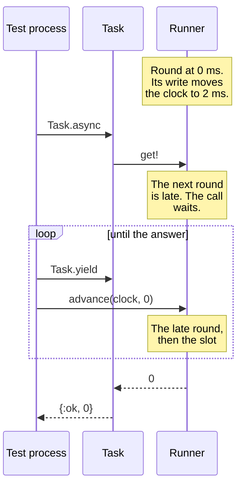

# Write ExUnit tests on the manual clock

This guide is for an Elixir developer who has a
[configuration](../reference/glossary.md#configuration) that compiles. It shows how to
write [ExUnit tests](../reference/glossary.md#exunit-test) of the
[plant](../reference/glossary.md#plant). Each ExUnit test runs a
[runner](../reference/glossary.md#runner) on the manual
[clock](../reference/glossary.md#clock), with a
[simulated device](../reference/glossary.md#simulated-device) in place of the hardware.

The manual clock, `Logex.Runner.Clock.Manual`, moves only when your code moves it. An
ExUnit test that moves the clock by 5 s does not wait 5 s. The runner does the same
[rounds](../reference/glossary.md#round) at each run, and gives the same values.

> #### Warning {: .warning}
>
> Do not use these ExUnit tests to prove a safety function. The simulated device shows
> what the programs do with the inputs that you give. It does not show what the hardware
> does, or what occurs when the Erlang VM stops. logex is not a safety controller.
> [Safety and limits](../explanation/safety-and-limits.md) gives the limits of logex.

> #### Caution {: .error}
>
> Do not use the manual clock to choose the watchdogs. On the manual clock, a program
> takes no time. The key `runs` of `Logex.Runner.status/1` gives
> `%{"fast" => {0, 50}, "main" => {0, 200}}`, and a slow program trips no
> [watchdog](../reference/glossary.md#watchdog). [Set watchdogs](set-watchdogs.md) shows
> how to measure on the clock of the machine.

## Before you start

- You must have a Mix project that has logex.
  [Install logex and run a program](install-and-run.md) gives the steps.
- This guide uses the packing line of the tutorial
  [Your first plant](../tutorials/first-plant.md). Get
  [`conveyor.ld`](../tutorials/first-plant.md#step-1-write-the-conveyor-program) and
  [`packing.logex`](../tutorials/first-plant.md#step-2-write-the-configuration-file) from
  that tutorial. Get
  [`boxes.ld`](../tutorials/timers-and-counters.md#step-3-write-the-counter-program) from
  the tutorial A timer and a counter.
- Put the 3 files in the root directory of your project, and run `mix test` from that
  directory.

The ExUnit tests use these [points](../reference/glossary.md#point) of the
[device](../reference/glossary.md#device) `panel`. `packing.logex` declares 1
[global](../reference/glossary.md#global) at each point.

| Point | Global | What it is |
|---|---|---|
| `panel.i.0` | `pb_start_1` | The start button of the conveyor |
| `panel.i.7` | `estop` | A stop signal. When it is 1, `c1` latches its fault and stops the motor. |
| `panel.i.8` | `eye` | The photo-eye. It is 1 while a box is in front of it. |
| `panel.q.0` | `k1` | The contactor of the motor of the conveyor |
| `panel.q.4` | `case_full` | The lamp for a full case of 3 boxes |

For your own plant, use the names of your devices and the addresses that follow `at` in
your [configuration file](../reference/glossary.md#configuration-file).

## Steps

1. Make the file `test/packing_test.exs` with this text. The function `start_plant`
   starts a manual clock, a simulated device and a runner.

<!-- fragment: the test module after step 1; step 7 gives the whole file, which the suite holds -->
```elixir
defmodule PackingTest do
  use ExUnit.Case, async: true

  alias Logex.IO.Sim
  alias Logex.Runner
  alias Logex.Runner.Clock.Manual

  # Starts a manual clock, a simulated panel and a runner for 1 test.
  # The panel gets each failure of the list before the runner opens it.
  defp start_plant(failures) do
    {:ok, plant} = Logex.Configuration.compile_file("packing.logex")
    clock = start_supervised!(Manual)
    panel = start_supervised!({Sim, reports: true, clock: clock})
    for {callback, how} <- failures, do: Sim.fail(panel, callback, how)
    io = %{"panel" => {Sim, sim: panel}}
    runner = start_supervised!({Runner, configuration: plant, io: io, clock: {Manual, clock}})
    %{clock: clock, panel: panel, runner: runner}
  end

  describe "the packing line" do
    setup do: start_plant([])
  end
end
```

   Run `mix test test/packing_test.exs`. The last line of the output is
   `Result: 0 tests`.

   ExUnit stops the 3 processes at the end of each ExUnit test. Thus each ExUnit test
   has its own plant, and ExUnit can run them at the same time, with `async: true`. The
   options do these things:

   | Option | What it does |
   |---|---|
   | `reports: true` | The simulated device tells the runner about each change of an input immediately. |
   | `clock: clock` of the simulated device | A failure `{:delay, ms}` moves the manual clock. Without it, the delay is a sleep in real time. |
   | `clock: {Manual, clock}` of the runner | The runner reads the manual clock. Without it, the runner reads the clock of the machine. |

2. Put this ExUnit test in the describe block, before its `end`. It presses the start
   button and moves the clock by 10 ms.

<!-- part of: test/packing_test.exs -->
```elixir
    test "the start button starts the conveyor", %{clock: clock, panel: panel} do
      Sim.set(panel, "panel.i.0", 1)
      Manual.advance(clock, 10)
      assert %{"panel.q.0" => 1} = Sim.outputs(panel)
    end
```

   Run `mix test test/packing_test.exs`. The last line is `Result: 1 passed`.

   The code has no `Process.sleep/1`, because each call returns after it ends its work:

   - `Logex.IO.Sim.set/3` sets the input point. It returns after the runner took the
     change.
   - `Logex.Runner.Clock.Manual.advance/2` moves the clock. It returns after the runner
     did each round of that time. The plant has a
     [continuous task](../reference/glossary.md#continuous-task), so the runner does 1
     round for each ms.
   - `c1` runs in the [task](../reference/glossary.md#task) `fast`, in the round at 10 ms.
     It writes the motor `k1`, at `panel.q.0`.
   - `Logex.IO.Sim.outputs/1` returns the last value that the runner wrote to each output
     point.

3. Put an ExUnit test that counts 3 boxes after the first one. `Logex.Runner.get!/2`
   reads a [tag](../reference/glossary.md#tag) of an
   [instance](../reference/glossary.md#instance) by its name.

<!-- part of: test/packing_test.exs -->
```elixir
    test "3 boxes fill the case", %{clock: clock, panel: panel, runner: runner} do
      for _box <- 1..3 do
        Sim.set(panel, "panel.i.8", 1)
        Manual.advance(clock, 2)
        Sim.set(panel, "panel.i.8", 0)
        Manual.advance(clock, 2)
      end

      assert Runner.get!(runner, "b1.count") == 3
      assert %{"panel.q.4" => 1} = Sim.outputs(panel)
    end
```

   Run `mix test test/packing_test.exs`. The last line is `Result: 2 passed`.

   After the runner opens the simulated device, give the address that the configuration
   file gives the point. Before that, give the place of the point as a list. In
   `start_plant`, that is after the start of the panel:

   | When | Example |
   |---|---|
   | Before the runner opens the device | `Sim.set(panel, [8], 1)` |
   | After the runner opens the device | `Sim.set(panel, "panel.i.8", 1)` |

   `Logex.IO.Sim.writes/1` gives the newest writes in their sequence, 100,000 by default.
   The option `writes:` of the simulated device sets the number.

4. Put an ExUnit test of a time after the second one. The instance `c1` reads `estop`
   only when its task `fast` runs, each 10 ms.

<!-- part of: test/packing_test.exs -->
```elixir
    test "c1 reads estop when its task runs at 20 ms", %{clock: clock, panel: panel} do
      Sim.set(panel, "panel.i.0", 1)
      Manual.advance(clock, 10)
      Sim.set(panel, "panel.i.0", 0)
      Manual.advance(clock, 2)
      Sim.set(panel, "panel.i.7", 1)
      Manual.advance(clock, 7)
      assert %{"panel.q.0" => 1} = Sim.outputs(panel)
      Manual.advance(clock, 1)
      assert %{"panel.q.0" => 0} = Sim.outputs(panel)
    end
```

   Run `mix test test/packing_test.exs`. The last line is `Result: 3 passed`.

   The ExUnit test sets `estop` at 12 ms. The motor stays on at 19 ms, and goes off in
   the round at 20 ms. On the manual clock, you can assert the value at each ms. Hold an input until the task that reads it runs. If the start button is 1 for
   only 2 ms, `c1` does not see it.

5. Put an ExUnit test of a failure of the device after the third one.
   `Logex.IO.Sim.fail/3` makes the next call of 1 callback of the adapter fail: `:init`,
   `:read`, `:write`, `:report` or `:close`. Here the next read gives an error.

<!-- part of: test/packing_test.exs -->
```elixir
    test "a failed read trips the runner", %{clock: clock, panel: panel, runner: runner} do
      Sim.set(panel, "panel.i.0", 1)
      Manual.advance(clock, 10)
      Sim.fail(panel, :read, {:error, :eio})
      Manual.advance(clock, 10)
      assert %{status: :tripped, trip: trip} = Runner.status(runner)
      assert trip == {:io, "panel", {:error, :eio}}
      assert Sim.outputs(panel) == %{"panel.q.0" => 0, "panel.q.4" => 0}
    end
```

   Run `mix test test/packing_test.exs`. The last line is `Result: 4 passed`.

   The runner reads the device at each [poll period](../reference/glossary.md#poll-period),
   10 ms. The read at 20 ms fails. The runner [trips](../reference/glossary.md#trip) and
   writes 0 to each output point. A failure `{:delay, ms}` gives no trip: it moves the
   manual clock by `ms`. [I/O adapters](../reference/io-adapters.md) gives each failure
   and the trip that it causes.

6. Put a second describe block after the `end` of the first, before the last `end` of
   the file. In it, the first write of the device takes 2 ms of the manual clock.

   If no round moves the manual clock, the runner answers a call before the next round.
   Thus steps 2 to 5 call the runner from the test process.

> #### Caution {: .error}
>
> If a round moves the manual clock, do not call the runner from the test process. The
> call waits for ever, and after 60 s ExUnit gives `ExUnit.TimeoutError`. Call the runner
> from a task, and move the clock by 0 ms until the task has the answer.

<!-- part of: test/packing_test.exs -->
```elixir
  describe "a panel whose first write takes 2 ms" do
    setup do: start_plant(write: {:delay, 2})

    test "a call from a task gets its answer", %{clock: clock, runner: runner} do
      task = Task.async(fn -> Runner.get!(runner, "b1.count") end)
      assert answer(task, clock) == 0
    end
  end

  # Moves the clock by 0 ms until the task has its answer.
  defp answer(task, clock), do: answered(Task.yield(task, 10), task, clock)

  defp answered({:ok, value}, _task, _clock), do: value

  defp answered(nil, task, clock) do
    Manual.advance(clock, 0)
    answer(task, clock)
  end
```

   Run `mix test test/packing_test.exs`. The last line is `Result: 5 passed`.

   Here, the first round runs at 0 ms, when the runner starts. Its write moves the clock
   to 2 ms. The next round is then late. It runs in the next call of `advance`,
   `advance(clock, 0)` included.

   The call of `get!` waits for its [slot](../reference/glossary.md#slot) after that
   round. With the default
   [share](../reference/glossary.md#share), 4 calls of `advance(clock, 0)` or fewer give
   the call its answer. [Runner](../reference/runner.md) gives the rules of a slot.



Figure: a call from a task while a round is late. The test process moves the clock until
the task has the answer.

7. Make sure that the file `test/packing_test.exs` has this text.

<!-- file: test/packing_test.exs -->
```elixir
defmodule PackingTest do
  use ExUnit.Case, async: true

  alias Logex.IO.Sim
  alias Logex.Runner
  alias Logex.Runner.Clock.Manual

  # Starts a manual clock, a simulated panel and a runner for 1 test.
  # The panel gets each failure of the list before the runner opens it.
  defp start_plant(failures) do
    {:ok, plant} = Logex.Configuration.compile_file("packing.logex")
    clock = start_supervised!(Manual)
    panel = start_supervised!({Sim, reports: true, clock: clock})
    for {callback, how} <- failures, do: Sim.fail(panel, callback, how)
    io = %{"panel" => {Sim, sim: panel}}
    runner = start_supervised!({Runner, configuration: plant, io: io, clock: {Manual, clock}})
    %{clock: clock, panel: panel, runner: runner}
  end

  describe "the packing line" do
    setup do: start_plant([])

    test "the start button starts the conveyor", %{clock: clock, panel: panel} do
      Sim.set(panel, "panel.i.0", 1)
      Manual.advance(clock, 10)
      assert %{"panel.q.0" => 1} = Sim.outputs(panel)
    end

    test "3 boxes fill the case", %{clock: clock, panel: panel, runner: runner} do
      for _box <- 1..3 do
        Sim.set(panel, "panel.i.8", 1)
        Manual.advance(clock, 2)
        Sim.set(panel, "panel.i.8", 0)
        Manual.advance(clock, 2)
      end

      assert Runner.get!(runner, "b1.count") == 3
      assert %{"panel.q.4" => 1} = Sim.outputs(panel)
    end

    test "c1 reads estop when its task runs at 20 ms", %{clock: clock, panel: panel} do
      Sim.set(panel, "panel.i.0", 1)
      Manual.advance(clock, 10)
      Sim.set(panel, "panel.i.0", 0)
      Manual.advance(clock, 2)
      Sim.set(panel, "panel.i.7", 1)
      Manual.advance(clock, 7)
      assert %{"panel.q.0" => 1} = Sim.outputs(panel)
      Manual.advance(clock, 1)
      assert %{"panel.q.0" => 0} = Sim.outputs(panel)
    end

    test "a failed read trips the runner", %{clock: clock, panel: panel, runner: runner} do
      Sim.set(panel, "panel.i.0", 1)
      Manual.advance(clock, 10)
      Sim.fail(panel, :read, {:error, :eio})
      Manual.advance(clock, 10)
      assert %{status: :tripped, trip: trip} = Runner.status(runner)
      assert trip == {:io, "panel", {:error, :eio}}
      assert Sim.outputs(panel) == %{"panel.q.0" => 0, "panel.q.4" => 0}
    end
  end

  describe "a panel whose first write takes 2 ms" do
    setup do: start_plant(write: {:delay, 2})

    test "a call from a task gets its answer", %{clock: clock, runner: runner} do
      task = Task.async(fn -> Runner.get!(runner, "b1.count") end)
      assert answer(task, clock) == 0
    end
  end

  # Moves the clock by 0 ms until the task has its answer.
  defp answer(task, clock), do: answered(Task.yield(task, 10), task, clock)

  defp answered({:ok, value}, _task, _clock), do: value

  defp answered(nil, task, clock) do
    Manual.advance(clock, 0)
    answer(task, clock)
  end
end
```

## The result

You have 5 ExUnit tests of the plant. Each starts its own manual clock, simulated device
and runner, and gives the same result at each run.

A script can also run the ExUnit tests and print the totals. Make the file
`test-on-the-manual-clock.exs` in the root directory of your project:

```elixir
ExUnit.start(autorun: false, formatters: [])
Code.require_file("test/packing_test.exs")
%{total: total, failures: failures} = ExUnit.run()
IO.puts("#{total} tests, #{failures} failures")
```

```console
$ mix run test-on-the-manual-clock.exs
5 tests, 0 failures
```

If the script gives more than 0 failures, run `mix test` to see each failure.

## If it does not work

### An ExUnit test fails or stops

| What you see | Cause and what to do |
|---|---|
| `test timed out after 60000ms` | A call from the test process waits for a slot. Make the call from a task, as in step 6. |
| `MatchError` and `unknown program type` | A file is not in the root directory of the project. Put the 3 files there. |
| `MatchError` and `cannot be read` | Run `mix test` from the root directory of the project. |
| An output does not change, and no error | No point reads the address. Compare it with the `at` of the global. |
| An output does not change after a short press | The task did not run while the input was 1. Hold the input until the task runs. |
| A count is less than the number of pulses | The simulated device has no `reports: true`. Give the option. |
| An output changes at a different time at each run | The runner has no `clock: {Manual, clock}`. Give the option. |
| `the manual clock waited 5000 ms for` | A process did not do its work in 5 s, for example after `Sim.fail(panel, :read, :hang)`. Do not use `:hang` on the manual clock. |

### Names and addresses that logex refuses

Each message is an `ArgumentError`.

| What you see | Cause and what to do |
|---|---|
| `which declares no` | `Logex.Runner.get!/2` got a tag that the program does not declare. Give the name of a tag of the program. |
| `no runner has opened the simulated device` | Give the list form, for example `[8]`. |
| `a runner has opened the simulated device` | Give the address of the configuration file, for example `"panel.i.8"`. |
| `is an output of the device` | `Logex.IO.Sim.set/3` sets only inputs. Read an output with `Logex.IO.Sim.outputs/1`. |
| `is no address as the configuration writes one` | Write `i` or `q` in lowercase, and each number with no leading 0. The message ends with the correct address. |
| `is the device` | The address names a different device, or the name of the device in a different case. Write the name as the configuration file writes it. |

### More than 1 device or 1 file

| What you see | Cause and what to do |
|---|---|
| `:already_started` | 2 simulated devices have the same child id. Give each its own id, as in the first example under this table. |
| `of another runner of this VM` | 2 ExUnit tests that run at the same time give the same `retain:` or `forces:` path. Give each its own directory, as in the second example. |

To start a second simulated device, give it its own id:

<!-- fragment: a second simulated device in start_plant -->
```elixir
drive = start_supervised!(Supervisor.child_spec({Sim, reports: true, clock: clock}, id: :drive))
```

To give each ExUnit test its own [store](../reference/glossary.md#store), tag the ExUnit
test with `@tag :tmp_dir` and put the store in the directory that ExUnit gives it:

<!-- fragment: a store in the directory that ExUnit gives each test -->
```elixir
  @tag :tmp_dir
  test "each test has its own store", %{tmp_dir: tmp_dir} do
    {:ok, plant} = Logex.Configuration.compile_file("packing.logex")
    clock = start_supervised!(Manual)
    panel = start_supervised!({Sim, reports: true, clock: clock})
    io = %{"panel" => {Sim, sim: panel}}
    store = Path.join(tmp_dir, "plant.retain")
    options = [configuration: plant, io: io, clock: {Manual, clock}, retain: store]
    runner = start_supervised!({Runner, options})
    assert %{status: :running} = Runner.status(runner)
  end
```

## See also

- [Runner](../reference/runner.md): the rules of a round, of a slot and of a trip.
- [I/O adapters](../reference/io-adapters.md): the simulated device, each failure of
  `Logex.IO.Sim.fail/3` and the trip that it causes.
- [Run a plant on the clock](run-on-the-clock.md): the same plant on the clock of the
  machine.
- [Set watchdogs](set-watchdogs.md): a long run, which the manual clock cannot replace.
- [Restart after a trip](restart-after-a-trip.md): what to do after a trip.
- [The scan, the cycle and time](../explanation/scan-cycle-and-time.md): why the host
  gives the time.
- [Glossary](../reference/glossary.md): the words of this guide.
