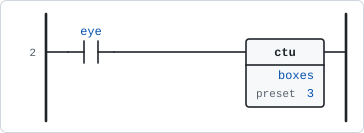

# Try an edit of a plant on a simulated device

This guide is for a reader who wants to see an
[online edit](../reference/glossary.md#online-edit) of a
[plant](../reference/glossary.md#plant) before the edit of a machine. It shows how to do
the edit with a [runner](../reference/glossary.md#runner) on the manual
[clock](../reference/glossary.md#clock) and a
[simulated device](../reference/glossary.md#simulated-device). A script prints the
report of each step, and no machine moves.

[Edit a running plant](edit-a-running-plant.md) gives the steps of the edit for a runner
that controls a machine.

> #### Warning {: .warning}
>
> Do not use logex for a safety function, for example an emergency stop. logex can stop
> at any time. A simulated device has no machine. This guide does not show that an edit
> is safe for your machine.
> [Safety and limits](../explanation/safety-and-limits.md) gives the limits of logex.

## Before you start

You must have a Mix project with logex
([Install logex and run a program](install-and-run.md) shows how).

You must know the steps of an edit through the runner.
[Edit a running plant](edit-a-running-plant.md#the-steps-of-an-edit) gives them.

## The example

The old plant is the plant of [Your first plant](../tutorials/first-plant.md). The
[instance](../reference/glossary.md#instance) `c1` controls the motor of a conveyor in
the [task](../reference/glossary.md#task) `fast`. The instance `b1` counts the boxes on
the conveyor. At 3 boxes, the lamp `case_full` comes on.

The new plant puts 5 boxes in a case. It also runs the task `fast` at a shorter
interval, with a smaller [watchdog](../reference/glossary.md#watchdog).

| File | Change in the new plant |
|---|---|
| `packing.logex` | `interval 10` becomes `interval 5`, and `watchdog 50` becomes `watchdog 30`. The comment has the new interval. |
| `boxes.ld` | On [rung](../reference/glossary.md#rung) 2, the [preset](../reference/glossary.md#preset) of the [counter](../reference/glossary.md#counter) `boxes` goes from 3 to 5. |
| `conveyor.ld` | No change |

<!-- rung: boxes.ld 2 -->


Figure: rung 2 of the old `boxes.ld`.

<!-- rung: edit-a-running-plant/boxes.ld 2 -->


Figure: rung 2 of the new `boxes.ld`.

> #### Warning {: .warning}
>
> The signal `estop` of this example is an input that a program reads. It is not the
> emergency stop of a machine.

## Steps

1. **Put the 3 files of the old plant in the root of your Mix project.**

The [configuration file](../reference/glossary.md#configuration-file) `packing.logex`:

<!-- file: packing.logex -->
```text
// packing.logex -- a conveyor on a 10 ms task, and a box counter in the continuous task
task fast interval 10 priority 1 watchdog 50
task main continuous watchdog 200

var_global estop      bool at panel.i.7
var_global pb_start_1 bool at panel.i.0
var_global pb_reset   bool at panel.i.2
var_global eye        bool at panel.i.8
var_global k1         bool at panel.q.0
var_global case_full  bool at panel.q.4

program c1 conveyor with fast
  c1.start pb_start_1
  c1.stop  0
  c1.reset pb_reset
  c1.motor k1

program b1 boxes
  b1.eye       eye
  b1.reset_pb  pb_reset
  b1.full_lamp case_full
```

The [program](../reference/glossary.md#program) `conveyor.ld`:

<!-- file: conveyor.ld -->
```text
var_input start bool
var_input stop bool
var_input reset bool
var_output motor bool
var_external estop bool
var fault bool

xic estop otl fault
xic reset otu fault
( xic start | xic motor ) xio stop xio fault ote motor
```

The program `boxes.ld`:

<!-- file: boxes.ld -->
```text
var_input eye bool
var_input reset_pb bool
var_output full_lamp bool
var_output count dint
var boxes ctu

xic reset_pb ote boxes.r
xic eye ctu boxes 3
xic boxes.q ote full_lamp
move boxes.cv count
```

2. **Put the 3 files of the new plant in the directory `edit-a-running-plant`.** Give
   each file the name of the file that it replaces.

The new configuration file `edit-a-running-plant/packing.logex`:

<!-- file: edit-a-running-plant/packing.logex -->
```text
// packing.logex -- a conveyor on a 5 ms task, and a box counter in the continuous task
task fast interval 5 priority 1 watchdog 30
task main continuous watchdog 200

var_global estop      bool at panel.i.7
var_global pb_start_1 bool at panel.i.0
var_global pb_reset   bool at panel.i.2
var_global eye        bool at panel.i.8
var_global k1         bool at panel.q.0
var_global case_full  bool at panel.q.4

program c1 conveyor with fast
  c1.start pb_start_1
  c1.stop  0
  c1.reset pb_reset
  c1.motor k1

program b1 boxes
  b1.eye       eye
  b1.reset_pb  pb_reset
  b1.full_lamp case_full
```

The new program `edit-a-running-plant/boxes.ld`:

<!-- file: edit-a-running-plant/boxes.ld -->
```text
var_input eye bool
var_input reset_pb bool
var_output full_lamp bool
var_output count dint
var boxes ctu

xic reset_pb ote boxes.r
xic eye ctu boxes 5
xic boxes.q ote full_lamp
move boxes.cv count
```

The file `edit-a-running-plant/conveyor.ld` is a copy of `conveyor.ld`. logex reads
each program from the directory of the configuration file.

<!-- file: edit-a-running-plant/conveyor.ld -->
```text
var_input start bool
var_input stop bool
var_input reset bool
var_output motor bool
var_external estop bool
var fault bool

xic estop otl fault
xic reset otu fault
( xic start | xic motor ) xio stop xio fault ote motor
```

3. **Put the script `edit-a-running-plant.exs` in the root of your Mix project.**

```elixir
alias Logex.IO.Sim
alias Logex.Runner
alias Logex.Runner.Clock.Manual

{:ok, plant} = Logex.Configuration.compile_file("packing.logex")
{:ok, clock} = Manual.start_link()
{:ok, panel} = Sim.start_link(reports: true)

{:ok, runner} =
  Runner.start_link(
    configuration: plant,
    io: %{"panel" => {Sim, sim: panel}},
    clock: {Manual, clock}
  )

:ok = Runner.subscribe(runner, [:ran])

show = fn label ->
  %{now: now, edit: stage, runs: %{"fast" => {_longest, watchdog}}} = Runner.status(runner)
  %{"panel.q.4" => case_full} = Sim.outputs(panel)
  boxes = Runner.get!(runner, "b1.count")
  values = "boxes=#{boxes}  case_full=#{case_full}  watchdog=#{watchdog}"
  IO.puts("t=#{now}  #{values}  stage=#{inspect(stage)}  #{label}")
end

print = fn report, label ->
  IO.puts(label)
  Enum.each(report, &IO.puts("        #{inspect(&1)}"))
end

box = fn ->
  Sim.set(panel, "panel.i.8", 1)
  Manual.advance(clock, 1)
  Sim.set(panel, "panel.i.8", 0)
  Manual.advance(clock, 1)
end

# The old plant runs, and 2 boxes go past the photo-eye.
Manual.advance(clock, 10)
box.()
box.()
show.("the old plant, box 2")

# The edit: the new plant goes in the place of the old plant.
{:ok, new_plant} = Logex.Configuration.compile_file("edit-a-running-plant/packing.logex")
{:ok, forecast} = Runner.accept(runner, new_plant)
print.(forecast, "forecast")
show.("accepted")
{:ok, report} = Runner.test(runner)
print.(report, "test")
box.()
show.("under test, box 3")
{:ok, report} = Runner.assemble(runner)
print.(report, "assemble")
box.()
box.()
Manual.advance(clock, 10)
show.("the new plant, box 5")

{:messages, messages} = Process.info(self(), :messages)
IO.inspect(for({Runner, _, {:ran, "fast", "c1", at}} <- messages, do: at), label: "c1 ran at")
:ok = Runner.stop(runner)
```

The script does these things:

- It starts a runner with the old plant.
- The function `box` sends 1 box past the photo-eye, which is the
  [point](../reference/glossary.md#point) `panel.i.8`. It moves the clock by 2 ms.
- The function `show` prints the time, the count, the lamp, the watchdog of `fast` and
  the stage of the edit.
- It does the [accept](../reference/glossary.md#accept), the
  [test](../reference/glossary.md#test) and the
  [assemble](../reference/glossary.md#assemble), and it prints each report.
- It prints the times at which the instance `c1` ran.

4. **Run the script.**

```console
$ mix run edit-a-running-plant.exs
t=14  boxes=2  case_full=0  watchdog=50  stage=nil  the old plant, box 2
forecast
        {:interval, "fast", {10, 5}}
        {:next_due, "fast", {20, 19}}
        {:preset, "b1.boxes", {3, 5}}
        {:watchdog, "fast", {50, 30}}
t=14  boxes=2  case_full=0  watchdog=50  stage=:accepted  accepted
test
        {:interval, "fast", {10, 5}}
        {:next_due, "fast", {20, 19}}
        {:preset, "b1.boxes", {3, 5}}
        {:watchdog, "fast", {50, 30}}
t=16  boxes=3  case_full=0  watchdog=30  stage=:testing  under test, box 3
assemble
t=30  boxes=5  case_full=1  watchdog=30  stage=nil  the new plant, box 5
c1 ran at: [10, 19, 24, 29]
```

## The result

The runner runs the new plant, and the instance `b1` keeps its count.

| Line of the output | What it shows |
|---|---|
| `{:interval, "fast", {10, 5}}` and `{:watchdog, "fast", {50, 30}}` | Each entry gives the old value and the new value for the task `fast`, in ms. |
| `{:next_due, "fast", {20, 19}}` | The task was due at 20 ms. After the test at 14 ms, it is due at 19 ms. |
| `{:preset, "b1.boxes", {3, 5}}` | The preset of the counter `boxes` of `b1` goes from 3 to 5. The count stays at 2. |
| `under test, box 3` | The lamp is off at 3 boxes. The [rounds](../reference/glossary.md#round) run the new plant. |
| `assemble` | The report is the empty list `[]`. The lamp comes on at 5 boxes. |
| `c1 ran at: [10, 19, 24, 29]` | The instance `c1` runs at 10 ms, and then each 5 ms from 19 ms. |

To see the way back, put the 2 functions of
[Go back to the old plant](edit-a-running-plant.md#go-back-to-the-old-plant) in the
place of the assemble. Print each report.

## If it does not work

| What you see | What to do |
|---|---|
| A `MatchError` with the words `cannot be read` | Put each configuration file at the path that the script gives. Do step 1 and step 2 again. |
| A `MatchError` with the words `unknown program type` | Copy `conveyor.ld` to the directory `edit-a-running-plant`. |
| An output that is different from the output of step 4 | Compare each file with its block on this page. |

## See also

- [Edit a running plant](edit-a-running-plant.md): the steps for a runner that controls
  a machine, the changes that need a restart and the way back.
- [Read the forecast of an edit](read-the-forecast-of-an-edit.md): the kinds of entry.
- [Online edit](../reference/online-edit.md) and [Runner](../reference/runner.md): the
  rules.
- [Glossary](../reference/glossary.md): the technical words.
