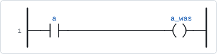
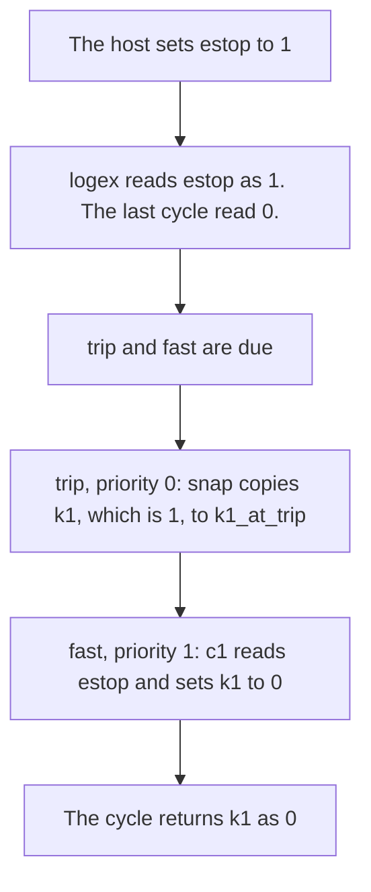

# Use an event task

This guide is for a reader who has a
[configuration file](../reference/glossary.md#configuration-file). It shows how to run a
[program](../reference/glossary.md#program) [instance](../reference/glossary.md#instance)
1 time when a `bool` [global](../reference/glossary.md#global) goes from 0 to 1. The
example records the value of `k1`, the contactor of a motor, when the global `estop` goes
to 1.

An [event task](../reference/glossary.md#event-task) does this. Its
[trigger](../reference/glossary.md#trigger) is the `bool` global. logex reads the trigger
1 time in each [cycle](../reference/glossary.md#cycle). The task is due in a cycle that
reads 1 after a cycle that read 0.

> #### Warning {: .warning}
>
> Do not use logex for a safety function, for example an emergency stop. logex can stop
> at any time, for example when the Erlang VM stops. Then no part of logex sets an
> [output point](../reference/glossary.md#point) to 0.
>
> The global `estop` of this guide is a signal that a program reads. It is not the
> emergency stop of a machine. Make the emergency stop with hardwired circuits or with a
> safety-rated controller.
> [Safety and limits](../explanation/safety-and-limits.md) gives the limits of logex.

## Before you start

- You must have a Mix project that has logex.
  [Install logex and run a program](install-and-run.md) gives the steps.
- You must know how to write a configuration file.
  [Write a configuration file](write-a-configuration-file.md) gives the steps.
- Get [`conveyor.ld`](share-a-global.md#steps) from step 1 of Share a global between
  programs. Put it in the root directory of your Mix project. When `estop` is 1, the conveyor stops its motor and
  [latches](../reference/glossary.md#latch) its [tag](../reference/glossary.md#tag)
  `fault`.

> #### Caution {: .error}
>
> Hold the trigger at 1 until a cycle reads it. If the trigger goes to 1 and back to 0
> between 2 cycles, the task does not run.
>
> The [runner](../reference/glossary.md#runner) reads each
> [device](../reference/glossary.md#device) 1 time in each poll period, 10 ms if you do
> not set the option `poll:` of `Logex.Runner`. A pulse between 2 reads does not get to
> logex. A device whose [adapter](../reference/glossary.md#adapter) has the callback
> `report/2` of `Logex.IO` gives each change immediately. Then the runner runs a
> [round](../reference/glossary.md#round) immediately, and the task runs.

## Steps

1. Make the file `snapshot.ld` in the root directory of your Mix project, with this
   text:

<!-- file: snapshot.ld -->
```text
var_input a bool
var_output a_was bool

xic a ote a_was
```

<!-- rung: snapshot.ld -->


   The [rung](../reference/glossary.md#rung) has 1 [contact](../reference/glossary.md#contact), `a`, and 1 [coil](../reference/glossary.md#coil), `a_was`.
   It copies `a` to `a_was` each time the program runs. Under an event task, `a_was`
   then keeps the value of `a` at the last run.

2. Make the file `trip.logex` in the same directory, with this text:

<!-- file: trip.logex -->
```text
// trip.logex -- a conveyor, and a snapshot of its contactor when the e-stop rises
task fast interval 10 priority 1
task trip single estop priority 0

var_global estop      bool at panel.i.7
var_global pb_start_1 bool at panel.i.0
var_global pb_reset   bool at panel.i.2
var_global k1         bool at panel.q.0
var_global k1_at_trip bool

program c1 conveyor with fast
  c1.start pb_start_1
  c1.stop  0
  c1.reset pb_reset
  c1.motor k1

program snap snapshot with trip
  snap.a     k1
  snap.a_was k1_at_trip
```

   The line `task trip single estop priority 0` declares the event task:

   | Word | What it gives |
   |---|---|
   | `trip` | The name of the task |
   | `single estop` | The trigger: a `bool` global, at a point or not |
   | `priority 0` | The [priority](../reference/glossary.md#priority). 0 is the highest. |

   The line `program snap snapshot with trip` puts the instance `snap` on the
   [task](../reference/glossary.md#task) `trip`. `fast` is a
   [periodic task](../reference/glossary.md#periodic-task) with the priority 1.
   The priority 0 of `trip` is higher than the priority 1 of `fast`. Thus `snap` runs
   before `c1` in a cycle where both tasks are due. `snap` then records `k1` before `c1`
   changes it. With `priority 1` or `priority 2`, `snap` runs after `c1` and records 0.

   Do not put a timer, a counter or a one-shot in a program on an event task.
   [Keep timers, counters and one-shots out of the program](#keep-timers-counters-and-one-shots-out-of-the-program)
   gives the reason.

3. Make the file `use-an-event-task.exs` in the same directory, with this text. The
   script runs 6 cycles, 10 ms apart. `estop` goes to 1 at 20 ms, while the motor runs.
   It goes to 1 again at 50 ms, while the motor is off.

```elixir
{:ok, plant} = Logex.Configuration.compile_file("trip.logex")

# Each entry gives the ms since the last cycle, and the globals at input points that
# change before the cycle.
entries = [
  {0, %{"pb_start_1" => 1}},
  {10, %{"pb_start_1" => 0}},
  {10, %{"estop" => 1}},
  {10, %{}},
  {10, %{"estop" => 0}},
  {10, %{"estop" => 1}}
]

IO.puts("time  estop  k1  k1_at_trip  ran")

Enum.reduce(entries, {Logex.Runtime.start(plant), 0}, fn {ms, changes}, {resource, time} ->
  {resource, out, events} = Logex.Runtime.cycle(resource, ms, changes)
  ran = for {:ran, _task, instance, _time} <- events, do: instance
  values = [time + ms, Logex.Runtime.get!(resource, "estop"), out["k1"]]
  cells = Enum.zip_with(values, [4, 7, 4], &String.pad_leading("#{&1}", &2))
  at_trip = String.pad_leading("#{Logex.Runtime.get!(resource, "k1_at_trip")}", 12)
  IO.puts("#{cells}#{at_trip}  #{Enum.join(ran, " ")}")
  {resource, time + ms}
end)
```

   `Logex.Runtime.cycle/3` runs 1 cycle. It returns a `:ran` event for each instance
   that ran, in the sequence of the runs.

4. Run the script.

```console
$ mix run use-an-event-task.exs
time  estop  k1  k1_at_trip  ran
   0      0   1           0  c1
  10      0   1           0  c1
  20      1   0           1  snap c1
  30      1   0           1  c1
  40      0   0           1  c1
  50      1   0           0  snap c1
```

   If `trip.logex`, `snapshot.ld` or `conveyor.ld` has an error, the first line of the
   script raises a `MatchError`. The text after `message:` is the
   [diagnostic](../reference/glossary.md#diagnostic).
   [If it does not work](#if-it-does-not-work) gives the frequent messages.

## The result

The instance `snap` runs only in the cycles where `estop` goes from 0 to 1.

| Time (ms) | What occurs |
|---|---|
| 0 | `c1` starts the motor. `snap` does not run: `estop` is 0. |
| 20 | `estop` goes to 1. `snap` runs first and records `k1` as 1. Then `c1` stops the motor. |
| 30 | `estop` stays 1. `snap` does not run. |
| 40 | `estop` goes to 0. |
| 50 | `estop` goes to 1 again. `snap` records `k1` as 0, because the motor is off. |

This diagram shows the cycle at 20 ms.



Figure: the cycle at 20 ms, from top to bottom. The task with the higher priority runs
first, so `snap` reads `k1` before `c1` writes it.

## Run the task at an interval also

Add `interval` and a number of ms between the trigger and the priority, for example
`task trip single estop interval 30 priority 0`. The task then also runs at each due time
of the interval while the trigger is 0. It runs at most 1 time in a cycle. A run when the
trigger goes from 0 to 1 does not move the due times.
[Execution model](../reference/execution-model.md) gives each rule.

## Call the cycles from your code

> #### Caution {: .error}
>
> Call `Logex.Runtime.cycle/3` when the trigger changes. Also call it immediately after
> `Logex.Runtime.start/1` and after `Logex.Runtime.restart/2`. If your code waits only
> for `Logex.Runtime.next_due_in/1`, the task runs late or does not run.

`Logex.Runtime.next_due_in/1` gives the ms to the next due time of an interval. It does
not count a change of a trigger. If each task of the configuration is an event task with
no interval, it gives `:infinity`. The runner calls the cycles for you.

## Keep timers, counters and one-shots out of the program

> #### Caution {: .error}
>
> Do not put a [timer](../reference/glossary.md#timer), a
> [counter](../reference/glossary.md#counter), a
> [one-shot](../reference/glossary.md#one-shot) or a
> [pulse coil](../reference/glossary.md#pulse-coil) in a program that an event task
> runs. These instructions measure the time or the changes between 2 runs, and an event
> task runs at irregular times.

logex [compiles](../reference/glossary.md#compile) such a
[configuration](../reference/glossary.md#configuration). It gives 1
[warning](../reference/glossary.md#warning) for each timer, counter and one-shot that the
program runs, and for each element of an [array](../reference/glossary.md#array) of them.
This includes a [long timer](../reference/glossary.md#long-timer) and a
[typed counter](../reference/glossary.md#typed-counter), and an event task with an
interval. The warning names the instance, the task, the
[instruction](../reference/glossary.md#instruction) and its line. For a timer in a
[function block](../reference/glossary.md#function-block), it gives the path, for
example `c1.jam_t` in [Write a function block](write-a-function-block.md).

If the task has no interval, a rung that only reads the trigger is true at each run of
the task. Then `tp`, a counter, `ons`, `osr` and `osf` on that rung never see a change.
For example, the rung `xic estop osr s1 pressed` never sets `pressed` under the task of
`estop`.

## Another example: 7 cycles, a warning and 3 wrong task lines

The script `trip.exs` presses the start button and raises the e-stop. It holds the
e-stop, then releases it and resets the fault. Then it starts the conveyor again and
raises the e-stop again. Last, it loads 2 more files. `timed.logex` runs the program
`debounce.ld`, which has a timer, under an event task:

<!-- file: debounce.ld -->
```text
var_input in bool
var_output out bool
var t1 ton

xic in ton t1 20
xic t1.dn ote out
```

<!-- file: timed.logex -->
```text
task trip single pb priority 0
var_global pb bool at panel.i.0
program d debounce with trip
  d.in pb
```

`wrong_trip.logex` has an error on each of its task lines:

<!-- file: wrong_trip.logex -->
```text
task trip single sp priority 0
task tick priority 1
task late single pb interval 0 priority 2
var_global sp dint
var_global pb bool at panel.i.0
program d debounce with late
  d.in pb
```

```elixir
{:ok, line} = Logex.Configuration.compile_file("trip.logex")

steps = [
  {"started             ", 0, %{"pb_start_1" => 1}},
  {"released            ", 10, %{"pb_start_1" => 0}},
  {"e-stop rises        ", 10, %{"estop" => 1}},
  {"held                ", 10, %{}},
  {"released, reset     ", 10, %{"estop" => 0, "pb_reset" => 1}},
  {"restarted           ", 10, %{"pb_reset" => 0, "pb_start_1" => 1}},
  {"e-stop rises again  ", 10, %{"estop" => 1, "pb_start_1" => 0}}
]

Enum.reduce(steps, {Logex.Runtime.start(line), 0}, fn {label, elapsed, inputs}, {rt, now} ->
  {rt, out, events} = Logex.Runtime.cycle(rt, elapsed, inputs)
  ran = for {:ran, task, instance, _now} <- events, do: "#{task}:#{instance}"
  at_trip = Logex.Runtime.get!(rt, "k1_at_trip")
  IO.puts("t=#{String.pad_leading("#{now + elapsed}", 2)}  #{label}k1=#{out["k1"]} k1_at_trip=#{at_trip}  ran #{Enum.join(ran, ", ")}")
  {rt, now + elapsed}
end)

{:ok, timed} = Logex.Configuration.compile_file("timed.logex")
Enum.each(timed.warnings, &IO.puts(Logex.Diagnostic.format(&1)))

{:error, diagnostics} = Logex.Configuration.compile_file("wrong_trip.logex")
Enum.each(diagnostics, &IO.puts(Logex.Diagnostic.format(&1)))
```

```console
$ mix run trip.exs
t= 0  started             k1=1 k1_at_trip=0  ran fast:c1
t=10  released            k1=1 k1_at_trip=0  ran fast:c1
t=20  e-stop rises        k1=0 k1_at_trip=1  ran trip:snap, fast:c1
t=30  held                k1=0 k1_at_trip=1  ran fast:c1
t=40  released, reset     k1=0 k1_at_trip=1  ran fast:c1
t=50  restarted           k1=1 k1_at_trip=1  ran fast:c1
t=60  e-stop rises again  k1=0 k1_at_trip=1  ran trip:snap, fast:c1
timed.logex: line 3: warning: `d` runs under the event task `trip`, and `debounce` runs the timer `t1` on line 5 of `debounce.ld`: a ton times across the task's runs, and one whose rung is true on two runs in a row counts the whole time between them
wrong_trip.logex: line 1: the single of `trip`, `sp`, is a dint (line 4): a single is a bool global
wrong_trip.logex: line 2: task `tick` needs an interval or a single, as in `task tick interval 10 priority 1` or `task tick single estop priority 0`
wrong_trip.logex: line 3: the interval of `late` is 0: an interval is at least 1 ms, and a task that runs only on the rising edges of its single is declared without one
```

The task `trip` runs at 20 ms and at 60 ms, at each rising edge of the e-stop. It does
not run while the e-stop is held. At priority 0, it runs before `c1`. Thus the snapshot
keeps the value of `k1` from the cycle before.

## If it does not work

Each row gives a part of the diagnostic or of the warning. The full message also gives
the file and the line. [Read a diagnostic](read-diagnostics.md) shows how to read a
message.

### The configuration does not compile

| What you see | What to do |
|---|---|
| ``the single of `trip`, `sp`, is a dint``, `is an array of 2 bools` or `names an element of` | The trigger is not a `bool` global, or it is an array or an [element](../reference/glossary.md#element). Use a `bool` global that is not an array. |
| `` no global `estp` `` | No global has this name. Use the name after `did you mean`, or declare the global with `var_global`. |
| `is a location`, `is a task`, `is an instance`, `is an instance's member` or `names a member of` | The trigger is not the name of a global. Use the name of a `bool` global. For a point, the message gives the name of its global. |
| `` `single` takes a bool global's name `` or `` `single` is given twice `` | Write `single` 1 time, with the name of the global after it. |
| ``task `trip` needs an interval or a single`` | The line has no `single`. Add `single` and the trigger. |
| ``the interval of `trip` is 0`` | Remove `interval 0`. An event task needs no interval. |
| ``task `trip` needs a priority`` or `a priority is 0 to 65535` | Add `priority` and a number from 0 to 65535. |
| `goes before` | Write the words in this sequence: `single`, `interval`, `priority`, then `watchdog` if you give one. |
| ``no task `trp` `` | The `with` of a `program` line names no task. Use the name after `did you mean`. |

### The configuration compiles with a warning

| What you see | What to do |
|---|---|
| `` runs under the event task `trip` `` | Move the timer, counter or one-shot to a program on a periodic task. Read [Keep timers, counters and one-shots out of the program](#keep-timers-counters-and-one-shots-out-of-the-program). |
| ``task `trip` runs no instance`` | No `program` line has `with trip`, and the instance runs in each cycle. Add `with trip` to its `program` line. |

### The task does not run, or runs at an unexpected time

| What you see | What to do |
|---|---|
| No `:ran` event for the instance | The trigger did not go from 0 to 1 between 2 cycles. Make sure that a cycle reads 0 before a cycle reads 1. |
| No run while your code waits for `next_due_in/1` | Read [Call the cycles from your code](#call-the-cycles-from-your-code). |
| The instance runs in the first cycle after a start or a [restart](../reference/glossary.md#restart) | Before this cycle, logex sets the last value of the trigger to 0. Thus a trigger at 1 runs the task. |
| After a [warm restart](../reference/glossary.md#warm-restart), a trigger with `retain` at 1 does not run the task | A warm restart keeps the last value that a cycle read of a trigger with `retain`. If this value is 1, the task runs when the trigger goes to 0 and then to 1. |
| The instance runs 1 cycle after a program writes 1 to the trigger | logex reads the trigger 1 time, before the programs of the cycle run. Nothing to do. |
| The instance records a value that a different instance writes in the same cycle | Give the event task a higher priority than the task of the other instance. |
| On the runner, no run for a short pulse | Use a device that gives each change immediately. Or hold the signal at 1 for more than the poll period. |
| On the runner, a change at the device does not run the task | The trigger has a [force](../reference/glossary.md#force). A force or an unforce that changes the trigger runs the task immediately. Read [Force an input point](force-inputs.md). |

## See also

- [Configuration file](../reference/configuration-file.md): each rule of a task line.
- [Execution model](../reference/execution-model.md): each rule of a cycle and of a
  trigger.
- [Tasks and the schedule](../explanation/tasks-and-scheduling.md): why logex runs tasks
  in this sequence.
- [Share a global between programs](share-a-global.md): read a global by its name.
- [Use one-shots and pulse coils](use-one-shots-and-pulse-coils.md): the one-shots on a
  periodic task.
- [Run a plant on the clock](run-on-the-clock.md): the runner and its devices.
- [Write a device adapter](write-a-device-adapter.md): an adapter with `report/2`.
- [Glossary](../reference/glossary.md): the words of this guide.
