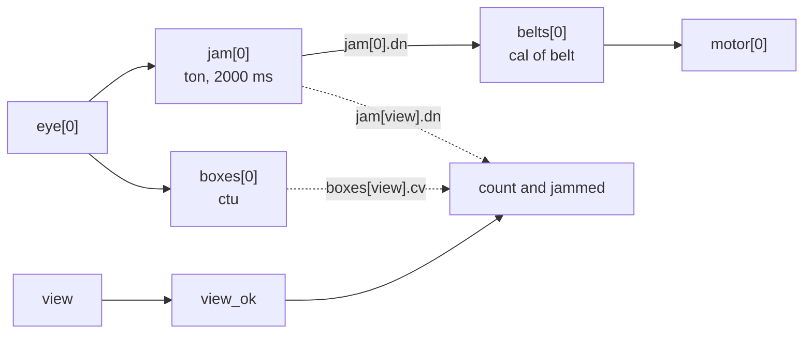

# Use arrays of timers, counters and function blocks

This guide is for a reader who writes a ladder [program](../reference/glossary.md#program)
for a machine with some parts that are the same, for example 3 conveyors. Each conveyor
needs its own [timer](../reference/glossary.md#timer), its own
[counter](../reference/glossary.md#counter) and its own
[instance](../reference/glossary.md#instance) of a
[function block](../reference/glossary.md#function-block). The guide shows how to put
them in arrays, run each [element](../reference/glossary.md#element) and read the
[members](../reference/glossary.md#member) of an element.

An array of instances is an [array](../reference/glossary.md#array) whose elements are
timers, counters or instances of a function block. Each element is a separate instance,
with its own [preset](../reference/glossary.md#preset) and its own members.

## Before you start

- You must have a Mix project that has logex.
  [Install logex and run a program](install-and-run.md) gives the steps.
- You must know how to run a timer and a counter.
  [Use timers](use-timers.md) and [Use counters](use-counters.md) give them.
- You must know how to write a function block and run it with `cal`.
  [Write a function block](write-a-function-block.md) gives the steps.
- You must know how to use an array and a
  [subscript](../reference/glossary.md#subscript) in a
  [tag](../reference/glossary.md#tag). [Use arrays](use-arrays.md) gives them.

## Declare an array of instances

In the [declaration](../reference/glossary.md#declaration), write the
[type](../reference/glossary.md#type) of the instance, then the sizes of the array in
brackets.

| Declaration | The elements |
|---|---|
| `var jam ton[3]` | 3 `ton` timers, `jam[0]` to `jam[2]` |
| `var boxes ctu[3]` | 3 `ctu` counters, `boxes[0]` to `boxes[2]` |
| `var stock ctud_int[2,4]` | 8 [typed counters](../reference/glossary.md#typed-counter), `stock[0,0]` to `stock[1,3]` |
| `var cure ton_ltime[3]` | 3 [long timers](../reference/glossary.md#long-timer) |
| `var belts belt[3]` | 3 instances of the function block `belt` |

Obey these rules:

- Declare an array of instances with the [section](../reference/glossary.md#section) `var`
  only. It cannot be an [input](../reference/glossary.md#input), an
  [output](../reference/glossary.md#output), a `var_external` tag or a
  [global](../reference/glossary.md#global). No
  [connection](../reference/glossary.md#connection) names it, and it is not at a
  [point](../reference/glossary.md#point).
- Do not give an initial list. The [instruction](../reference/glossary.md#instruction) that
  runs an element gives its preset.
- Put the file of the function block beside the program. For `var belts belt[3]`,
  `Logex.compile_file/1` reads `belt.ld` from the directory of the program.
- 1 declaration holds 65,536 elements at most. A timer or a counter counts 1, so
  `var jam ton[65536]` is correct. An element of `belts` counts 5: the instance and its
  4 tags.
- Run an element of a `ctud` type, such as `stock[0,0]`, with 1 `ctu` and 1 `ctd`. Give
  both the same literal subscript and the same preset.

[Function blocks](../reference/function-blocks.md) gives each rule.

## Run 1 timer, 1 counter and 1 function block for each conveyor

The steps make 2 files in the directory `use-arrays-of-instances`. The function block
`belt` runs the motor of 1 conveyor. The program `conveyors.ld` controls 3 conveyors.

At the end of each conveyor, a photo-eye sees each box: `eye[0]`, `eye[1]` and `eye[2]`.
The counters `boxes[0]` to `boxes[2]` count the boxes. If a box stays at the eye for
2000 ms, the timer of that conveyor gets to its preset. Then its `belt` instance stops
its motor. The other conveyors continue.

The operator selects 1 conveyor with the input `view`. The panel shows its count and its
jam.



Figure: conveyor 0 and the panel. Conveyors 1 and 2 are the same. A dotted arrow is a
read through the subscript `view`.

1. Make the directory `use-arrays-of-instances` in your project, and in it the file
   `belt.ld`. Write this function block in it:

<!-- file: use-arrays-of-instances/belt.ld -->
```text
function_block belt
var_input  start bool
var_input  stop  bool
var_input  jam   bool
var_output run   bool

( xic start | xic run ) xio stop xio jam ote run
```

   The output `run` stays on from `start` until `stop` or `jam` comes on.

2. Make the file `conveyors.ld` in the same directory. Declare the inputs
   `start bool`, `stop bool`, `eye bool[3]` and `view int` with `var_input`.
3. Declare the outputs `motor bool[3]`, `view_ok bool`, `count dint` and `jammed bool`
   with `var_output`.
4. Declare the arrays of instances: `var jam ton[3]`, `var boxes ctu[3]` and
   `var belts belt[3]`. An empty line after the declarations makes the file easier to
   read.
5. Run 1 timer for each conveyor: `xic eye[0] ton jam[0] 2000`. Write the same
   [rung](../reference/glossary.md#rung) for `[1]` and `[2]`. Each rung names its element
   with a [literal](../reference/glossary.md#literal) subscript.
6. Count the boxes of each conveyor: `xic eye[0] ctu boxes[0] 1000`. Write the same rung
   for `[1]` and `[2]`. The preset 1000 is the number of boxes in 1 shift.
7. Run 1 instance of `belt` for each conveyor:
   `cal belts[0] start stop jam[0].dn motor[0]`. Write the same rung for `[1]` and `[2]`.
   The [operands](../reference/glossary.md#operand) are the element, then the inputs and
   the output of `belt`. Give them in the order of `belt.ld`: `start`, `stop`, `jam` and
   `run`.

> #### Caution {: .error}
>
> Keep a subscript in a tag in the range of the array. A rung can read or write an
> element or a member through a subscript that is out of the range. Then the
> [scan](../reference/glossary.md#scan) gets a
> [major fault](../reference/glossary.md#major-fault). The instruction does nothing. A
> [runner](../reference/glossary.md#runner) then causes a
> [trip](../reference/glossary.md#trip), and the [plant](../reference/glossary.md#plant)
> stops.
>
> Put a [contact](../reference/glossary.md#contact) of a `bool` tag first on each such rung.
> Make the tag true only while the subscript is in the range. Step 8 makes this tag,
> `view_ok`, and steps 9 and 10 use it.
>
> An `ote` writes on a [false rung](../reference/glossary.md#false-rung) also. Thus a
> contact of `view_ok` before an `ote` does not stop the fault. For example,
> `xic view_ok ote boxes[view].r` faults when `view` is 3. To write a member that a tag
> selects, use `otl` and `otu` on 2 rungs, or `move`.

8. Make `view_ok` true only while `view` is 0 to 2: `ge view 0 lt view 3 ote view_ok`.
9. Show the count of the selected conveyor: `xic view_ok move boxes[view].cv count`.
10. Show a jam of the selected conveyor: `xic view_ok xic jam[view].dn ote jammed`.

Make sure that your file is the same as this text. The spaces between words can be
different.

<!-- file: use-arrays-of-instances/conveyors.ld -->
```text
var_input  start   bool
var_input  stop    bool
var_input  eye     bool[3]
var_input  view    int
var_output motor   bool[3]
var_output view_ok bool
var_output count   dint
var_output jammed  bool
var jam   ton[3]
var boxes ctu[3]
var belts belt[3]

xic eye[0] ton jam[0] 2000
xic eye[1] ton jam[1] 2000
xic eye[2] ton jam[2] 2000
xic eye[0] ctu boxes[0] 1000
xic eye[1] ctu boxes[1] 1000
xic eye[2] ctu boxes[2] 1000
cal belts[0] start stop jam[0].dn motor[0]
cal belts[1] start stop jam[1].dn motor[1]
cal belts[2] start stop jam[2].dn motor[2]
ge view 0 lt view 3 ote view_ok
xic view_ok move boxes[view].cv count
xic view_ok xic jam[view].dn ote jammed
```

<!-- rung: use-arrays-of-instances/conveyors.ld 1 4 7 10 11 12 -->


The drawing shows the 3 rungs of conveyor 0 and the 3 rungs of the panel. The rungs of
conveyors 1 and 2 are the same, with the subscripts `[1]` and `[2]`.

11. Make the file `use-arrays-of-instances.exs` in the root directory of your project.
    Each line `scan.(n, inputs, ms)` gives the inputs that change, then runs scan `n`.
    `ms` is the time since the last scan, in ms. A list, such as `"eye" => [0, 0, 0]`,
    sets each element. A key such as `"eye[0]"` sets 1 element.

```elixir
{:ok, conveyors} = Logex.compile_file("use-arrays-of-instances/conveyors.ld")

scan = fn state, number, inputs, ms ->
  state = Logex.Runtime.put_inputs(conveyors, state, inputs)
  {outputs, state} = Logex.Runtime.scan(conveyors, state, ms)

  values =
    Enum.map_join(["motor", "view_ok", "count", "jammed"], "  ", fn name ->
      "#{name} #{inspect(outputs[name])}"
    end)

  IO.puts("#{number}  #{values}  faults #{length(state.faults)}")
  state
end

Logex.Runtime.instance(conveyors)
|> scan.(1, %{"start" => 1, "stop" => 0, "eye" => [0, 0, 0], "view" => 0}, 0)
|> scan.(2, %{"start" => 0, "eye[0]" => 1}, 500)
|> scan.(3, %{"eye[0]" => 0}, 500)
|> scan.(4, %{"eye[0]" => 1}, 500)
|> scan.(5, %{"eye[0]" => 0, "view" => 2}, 500)
|> scan.(6, %{"eye[2]" => 1}, 1000)
|> scan.(7, %{}, 1000)
|> scan.(8, %{}, 1000)
|> scan.(9, %{"view" => 3}, 100)
|> scan.(10, %{"eye[2]" => 0, "view" => 2, "start" => 1}, 100)
```

12. Run the script:

```console
$ mix run use-arrays-of-instances.exs
1  motor [1, 1, 1]  view_ok 1  count 0  jammed 0  faults 0
2  motor [1, 1, 1]  view_ok 1  count 1  jammed 0  faults 0
3  motor [1, 1, 1]  view_ok 1  count 1  jammed 0  faults 0
4  motor [1, 1, 1]  view_ok 1  count 2  jammed 0  faults 0
5  motor [1, 1, 1]  view_ok 1  count 0  jammed 0  faults 0
6  motor [1, 1, 1]  view_ok 1  count 1  jammed 0  faults 0
7  motor [1, 1, 1]  view_ok 1  count 1  jammed 0  faults 0
8  motor [1, 1, 0]  view_ok 1  count 1  jammed 1  faults 0
9  motor [1, 1, 0]  view_ok 0  count 1  jammed 0  faults 0
10  motor [1, 1, 1]  view_ok 1  count 1  jammed 0  faults 0
```

### The result: 1 timer, 1 counter and 1 belt for each conveyor

| Scan | What the scan shows |
|---|---|
| 1 | `start` starts the 3 instances of `belt`, and the 3 motors run. |
| 2 to 4 | 2 boxes pass the eye of conveyor 0. `boxes[0]` counts 2. |
| 5 | `view` selects conveyor 2. Its counter `boxes[2]` has no boxes, so `count` is 0. |
| 6 | A box stops at the eye of conveyor 2. `boxes[2]` counts it, and `jam[2]` starts. The scan in which the rung of a timer becomes true adds no time. |
| 7 | `jam[2].acc` is 1000 ms. |
| 8 | `jam[2]` gets to 2000 ms. `belts[2]` stops `motor[2]`. Conveyors 0 and 1 continue. |
| 9 | `view` is 3, so `view_ok` is 0. No rung reads an element through `view`, and the scan has no fault. `count` keeps 1, because a `move` on a false rung writes nothing. `jammed` is 0, because an `ote` on a false rung writes 0. Conveyor 2 is still jammed. |
| 10 | The box goes, `jam[2]` stops, and `start` starts conveyor 2 again. |

## Read a member from a configuration

In a lone instance, put the member into a `var_output`, as rung 11 does with
`move boxes[view].cv count`.

In a [configuration](../reference/glossary.md#configuration), `Logex.Runtime.get/2` reads
1 member of 1 element by its access path, for example `m1.jam[1].acc`. The path is the
program instance, the element with literal subscripts and the member, with a dot
between them.

1. Make the file `use-arrays-of-instances-plant.exs` in the root directory of your
   project. It runs `conveyors.ld` as the instance `m1` for 4
   [cycles](../reference/glossary.md#cycle). A box is at the eye of conveyor 1. The first
   2 lines of `text` make the [task](../reference/glossary.md#task) `fast` and the
   instance `m1` on it. The task runs every 10 ms. Each line `m1.<input> <value>`
   connects an input of `m1` to a constant.

```elixir
{:ok, conveyors} = Logex.compile_file("use-arrays-of-instances/conveyors.ld")

text = """
task fast interval 10 priority 1
program m1 conveyors with fast
  m1.start 1
  m1.stop 0
  m1.eye[0] 0
  m1.eye[1] 1
  m1.eye[2] 0
  m1.view 1
"""

{:ok, plant} = Logex.Configuration.compile("plant", text, %{"conveyors" => conveyors})

runtime =
  Enum.reduce([0, 10, 10, 10], Logex.Runtime.start(plant), fn ms, runtime ->
    {runtime, _outputs, _events} = Logex.Runtime.cycle(runtime, ms, %{})
    runtime
  end)

for path <- ["m1.jam[1].acc", "m1.belts[1].run", "m1.jam[1]", "m1.jam[view].acc"] do
  IO.puts(path)
  IO.puts("  #{inspect(Logex.Runtime.get(runtime, path))}")
end
```

2. Run the script:

```console
$ mix run use-arrays-of-instances-plant.exs
m1.jam[1].acc
  {:ok, 30}
m1.belts[1].run
  {:ok, 1}
m1.jam[1]
  {:error, "`m1.jam[1]` is a ton: an access path names one of its members, as in `m1.jam[1].acc`"}
m1.jam[view].acc
  {:error, "`m1.jam[view]`'s subscript `view` is a tag's name: an access path names an element by literal subscripts, as in `m1.jam[0]`"}
```

`jam[1].acc` is 30. The cycle in which the rung of the timer becomes true adds no time,
and each later cycle adds 10 ms. An access path cannot name a full element, a full array
or a subscript in a tag. [Write a configuration file](write-a-configuration-file.md)
gives the lines of `text`.

## Change an array of instances

| To do this | Do this | Guide |
|---|---|---|
| Change the preset of 1 element in a running program | Change the number on its instruction, as in `ton jam[1] 3000`. The report of the [online edit](../reference/glossary.md#online-edit) names the element, `"jam[1]"`. | [Edit a running program](edit-a-running-program.md) |
| Change the size or the type of the elements | Do a [restart](../reference/glossary.md#restart). An online edit refuses it with `a tag's type changes only with a restart`. | [Edit a running program](edit-a-running-program.md) |
| Keep the counts across a [warm restart](../reference/glossary.md#warm-restart) | Write `var retain boxes ctu[3]`. A warm restart keeps each element with all its members. | [Keep values across a restart](keep-values-across-a-restart.md) |

## If it does not work

[Diagnostics](../reference/diagnostics.md) gives each
[diagnostic](../reference/glossary.md#diagnostic), and
[Warnings](../reference/warnings.md) gives each
[warning](../reference/glossary.md#warning).

### When you compile

Each entry in the column **What you see** is a part of the diagnostic.

| What you see | Cause | What to do |
|---|---|---|
| `` whose subscript `i` holds `` | An instruction runs an element through a subscript in a tag, as in `ton jam[i] 2000`. | Write 1 rung for each element, with a literal subscript. |
| `` is already run by the `` | 2 instructions run 1 element, also with a different spelling, such as `jam[00]`. | Run each element with 1 instruction only. |
| `` only an instance of a function block has members `` | A member of the full array, such as `jam.dn`. | Name 1 element, as in `jam[0].dn`. |
| `` is outside the elements of `` | A literal subscript is out of the range, such as `jam[3]` in an array of 3. | Use a subscript from 0 to the size less 1. |
| `` whose members only its body writes `` | A rung writes a member of an element of `belts`, such as its input `start`. | Give an input as an operand of the `cal`. Read an output from its operand, such as `motor[0]`. |
| `` declared with `var`, as in `` | The array has a section other than `var`. | Declare it with `var`. |
| `` which takes no initial values `` | The declaration has an initial list. | Remove the list. Give the preset on the instruction. |
| `` 65536 at most `` | The elements, with the tags of their function block, are more than 65,536. | Make the array or the function block smaller. |
| `` unknown type `belt` `` | logex did not find `belt.ld` beside the program, or a call of `compile/2` does not give the type. | Put `belt.ld` in the directory of the program. With `compile/2`, give the type in the list `types:`. |
| `` but no `ton` runs `jam[2]` `` | A warning: no instruction runs 1 or more elements. They never time, count or run. | Write the rung of each element. |
| `MatchError` on the first line of the script | logex did not [compile](../reference/glossary.md#compile) the program. | Print the diagnostics. [Read a diagnostic](read-diagnostics.md) gives the steps. |
| `` the last one in the scan decides it `` | A warning: 2 instructions can write 1 member of an element in 1 scan, and 1 of the 2 is an `ote`. A subscript in a tag can select the element. | Write each member from 1 rung only, or use `otl` and `otu`. |

### When you give the inputs

The [host](../reference/glossary.md#host) cannot set an element or a member of an array
of instances. `Logex.Runtime.put_inputs/3` raises an `ArgumentError`. Each entry in the
column **What you see** is a part of its message.

| What you see | Cause | What to do |
|---|---|---|
| `` only a var_input is set from outside `` | An input key names an element, such as `jam[0]`. | Give the value to a `var_input` tag, and use that tag in the program. |
| `` is not declared `` | An input key names a member, such as `jam[0].pre`. | Give the value to a `var_input` tag, or give the preset on the instruction. |

### When you run the scans

If rungs 11 and 12 do not start with `view_ok`, a `view` of 3 gives 2
[faults](../reference/glossary.md#fault). The field `faults` of the
[state](../reference/glossary.md#state) holds them. This is the first. Line 23 of the
file is rung 11.

<!-- unchecked: a fault that a run printed, from conveyors.ld with the contact view_ok taken out of rungs 11 and 12 -->
```text
%Logex.Fault{
  severity: :major,
  kind: :index_out_of_range,
  instruction: :move,
  path: nil,
  file: "use-arrays-of-instances/conveyors.ld",
  line: 23,
  read: {3}
}
```

The second fault is the same, with `instruction: :xic` and `line: 24`.

| What you see | Cause | What to do |
|---|---|---|
| A fault in the field `faults` | A subscript in a tag is out of the range. The field `read` holds the subscripts. | Put the contact `view_ok` first on the rung, as in steps 9 and 10. |
| The counter does not count a box that is at the eye on the [first scan](../reference/glossary.md#first-scan) | A counter counts a [rising edge](../reference/glossary.md#rising-edge). The first scan has none. | Start with the eye at 0, as scan 1 of the script does. |

## See also

- [Function blocks](../reference/function-blocks.md): every rule of an array of
  instances.
- [Declarations and types](../reference/declarations-and-types.md): the limit of 65,536.
- [Instructions: timers and counters](../reference/instructions-timers-and-counters.md)
  and [Instructions: jump and call](../reference/instructions-jump-and-call.md): the
  operands of each instruction.
- [Host contract](../reference/host-contract.md): `Logex.Runtime.get/2`.
- [Online edits](../reference/online-edit.md): the reports of an edit.
- [How logex differs from Logix](../explanation/differences-from-logix.md) and
  [How logex differs from IEC 61131-3](../explanation/differences-from-iec.md): each
  difference of behaviour, with its source.
- [The dialect and IEC 61131-3](../explanation/the-dialect-and-iec.md): how logex
  differs from IEC 61131-3.
