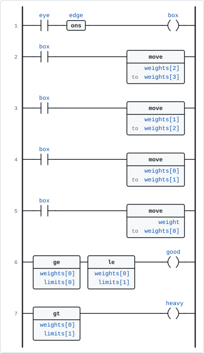

# Use arrays

This guide is for a reader who writes a ladder [program](../reference/glossary.md#program)
that keeps many values of 1 [type](../reference/glossary.md#type). An example is the
last 4 weights of a scale. The guide shows how to declare an
[array](../reference/glossary.md#array) and use its
[elements](../reference/glossary.md#element). You use
[literal](../reference/glossary.md#literal) [subscripts](../reference/glossary.md#subscript)
first. [Select an array element with a tag](select-an-array-element-with-a-tag.md) gives a
subscript that a [tag](../reference/glossary.md#tag) holds.

## Before you start

- You must have a Mix project that has logex.
  [Install logex and run a program](install-and-run.md) gives the steps.
- You must know how to write a [rung](../reference/glossary.md#rung) and run scans.
  [Your first program](../tutorials/first-program.md) teaches this.
- The steps use `move` and the comparisons `ge`, `le`, `lt` and `gt`.
  [Do arithmetic and compare values](do-arithmetic.md) gives them.
- The steps use the [one-shot](../reference/glossary.md#one-shot) `ons`.
  [Use one-shots and pulse coils](use-one-shots-and-pulse-coils.md) gives it.

## Declare an array

In the [declaration](../reference/glossary.md#declaration), write the sizes of the array
in brackets after the type. Write 1 size for each dimension, with a `,` and no space
between 2 sizes.

| Declaration | The elements |
|---|---|
| `var weights int[4]` | `weights[0]` to `weights[3]` |
| `var grid int[2,8]` | `grid[0,0]` to `grid[1,7]`: 16 elements |
| `var cube real[2,3,4]` | `cube[0,0,0]` to `cube[1,2,3]`: 24 elements |
| `var limits int[2] 100 500` | `limits[0]` is 100 and `limits[1]` is 500 |

The first subscript of each dimension is 0, and each element starts at 0. An initial
list after the type gives the first values, 1 literal for each element. The last
subscript counts up first. Thus `var a int[2,3] 1 2 3 4 5 6` gives `a[0,2]` the value 3
and `a[1,0]` the value 4.

[Arrays](../reference/declarations-and-types.md#arrays) gives each rule and each limit of
an array.

## Name an element

Use an element where you use a tag of the type of the array, for example in a
[contact](../reference/glossary.md#contact), a [coil](../reference/glossary.md#coil) or a
`move`.

| Name | The element |
|---|---|
| `weights[3]` | The element with the literal subscript 3 |
| `grid[1,7]` | 1 subscript for each dimension |
| `weights[slot]` | The element whose subscript the integer tag `slot` holds when the instruction runs |
| `grid[1,c]` | A literal subscript and a subscript in a tag |
| `faults[2].3` | [Bit](../reference/glossary.md#bit) 3 of the element `faults[2]` of a `word` array |
| `faults[2].[n]` | The bit of `faults[2]` whose number the tag `n` holds |

An instruction takes 1 element, not a full array. To copy or fill an array, write 1
`move` for each element. A subscript cannot be a calculation, such as `weights[slot+1]`.
Write the result of `add` into a tag, and use that tag as the subscript.

## Keep the last 4 weights

The steps make the file `use-arrays/weigh.ld`. A scale under the conveyor weighs each
box. When the photo-eye `eye` sees a box, the weight goes into `weights[0]`. The older
weights move 1 element along, and the oldest weight goes out. The lamp `good` shows a
weight of 100 to 500, and `heavy` a weight of more than 500.

1. Make the directory `use-arrays` in your project, and in it the file `weigh.ld`.
2. Declare the [inputs](../reference/glossary.md#input) `eye bool` and `weight int` with
   `var_input`, 1 on each line.
3. Declare the [outputs](../reference/glossary.md#output) `good bool`, `heavy bool` and
   `weights int[4]` with `var_output`.
4. Declare the limits with an initial list: `var limits int[2] 100 500`.
5. Declare `var edge bool`, the [storage bit](../reference/glossary.md#storage-bit) of the
   one-shot, and `var box bool`, which is true for 1 scan. Put 1 empty line after the
   declarations.
6. Make `box` true for 1 scan when a box comes: `xic eye ons edge ote box`.
7. Move each weight 1 element along, from the last element down:
   `xic box move weights[2] weights[3]`, then `[1]` to `[2]`, then `[0]` to `[1]`.
   Each `move` thus reads its element before the next `move` writes it.
8. Put the new weight into the first element: `xic box move weight weights[0]`.
9. Compare the newest weight with the limits:
   `ge weights[0] limits[0] le weights[0] limits[1] ote good`.
10. Show a heavy box: `gt weights[0] limits[1] ote heavy`.

Make sure that your file is the same as this text:

<!-- file: use-arrays/weigh.ld -->
```text
var_input eye bool
var_input weight int
var_output good bool
var_output heavy bool
var_output weights int[4]
var limits int[2] 100 500
var edge bool
var box bool

xic eye ons edge ote box
xic box move weights[2] weights[3]
xic box move weights[1] weights[2]
xic box move weights[0] weights[1]
xic box move weight weights[0]
ge weights[0] limits[0] le weights[0] limits[1] ote good
gt weights[0] limits[1] ote heavy
```

<!-- rung: use-arrays/weigh.ld -->


The drawing shows the 7 rungs. Rungs 2 to 5 move `weights[2]` to `weights[3]`, then
`weights[1]` to `weights[2]`, then `weights[0]` to `weights[1]`, then `weight` to
`weights[0]`.

11. Make the file `use-arrays.exs` in the root directory of your project. A one-shot
    gives no pulse on the [first scan](../reference/glossary.md#first-scan). Thus the
    script runs 1 scan with `eye` at 0 first. Then it runs 2 scans for each box.

```elixir
{:ok, weigh} = Logex.compile_file("use-arrays/weigh.ld")

scan = fn state, inputs ->
  state = Logex.Runtime.put_inputs(weigh, state, inputs)
  Logex.Runtime.scan(weigh, state)
end

{_outputs, state} = scan.(Logex.Runtime.instance(weigh), %{"eye" => 0, "weight" => 0})

Enum.reduce([620, 80, 300, 450, 510], state, fn weight, state ->
  {outputs, state} = scan.(state, %{"eye" => 1, "weight" => weight})
  IO.puts("box #{weight}  weights #{inspect(outputs["weights"])}  good #{outputs["good"]}  heavy #{outputs["heavy"]}")
  {_outputs, state} = scan.(state, %{"eye" => 0})
  state
end)
```

12. Run the script:

```console
$ mix run use-arrays.exs
box 620  weights [620, 0, 0, 0]  good 0  heavy 1
box 80  weights [80, 620, 0, 0]  good 0  heavy 0
box 300  weights [300, 80, 620, 0]  good 1  heavy 0
box 450  weights [450, 300, 80, 620]  good 1  heavy 0
box 510  weights [510, 450, 300, 80]  good 0  heavy 1
```

If logex does not [compile](../reference/glossary.md#compile) `weigh.ld`, the first line
of the script raises a `MatchError`. [Read a diagnostic](read-diagnostics.md) gives the
steps.

### The result: the last 4 weights

The host gets an array output as a list, with the element 0 first. This table shows
`weights` before and after the box of 510:

| | `[0]` | `[1]` | `[2]` | `[3]` |
|---|---|---|---|---|
| Before | 450 | 300 | 80 | 620 |
| After | **510** | 450 | 300 | 80 |

Each weight moves 1 element along, and 620 goes out of the array. 510 is more than the
limit 500, so `heavy` is 1.

## Use a subscript in a tag

A [tag](../reference/glossary.md#tag) can hold a subscript: `weights[slot]`. A subscript
out of the range causes a [major fault](../reference/glossary.md#major-fault).
[Select an array element with a tag](select-an-array-element-with-a-tag.md) gives the
steps, and the way to keep the subscript in the range.

## Give an array from Elixir

The [host](../reference/glossary.md#host) gives an array input in the map of
`Logex.Runtime.put_inputs/3`. In this table, `w` is a `var_input` of the type `int[3]`,
and `g` is a `var_input` of the type `int[2,2]`.

| To do this | Inputs | Result |
|---|---|---|
| Set an array | `%{"w" => [1, 2, 3]}` | 1 value for each element, the element 0 first |
| Set an array of 2 dimensions | `%{"g" => [[1, 2], [3, 4]]}` | 1 list for each first subscript: `g[1,0]` is 3 |
| Set 1 element | `%{"w[1]" => 20}` | The other elements keep their values. |

Read an array output from the map that `Logex.Runtime.scan/2` gives, as a list. Do not
read it from the field `env` of the [state](../reference/glossary.md#state). There it is
a tuple, such as `{1, 20, 3}`, or a tuple of tuples, such as `{{1, 2}, {3, 4}}`.

## Other uses of arrays

| To do this | Guide |
|---|---|
| Run an array of [timers](../reference/glossary.md#timer), [counters](../reference/glossary.md#counter) or [function blocks](../reference/glossary.md#function-block) | [Use arrays of timers, counters and function blocks](use-arrays-of-instances.md) |
| Share an array between programs as a [global](../reference/glossary.md#global) | [Share a global](share-a-global.md) |
| Put an array at the [points](../reference/glossary.md#point) of a [device](../reference/glossary.md#device) | [Map tags to I/O points](map-io-points.md) |

## If it does not work

[Diagnostics](../reference/diagnostics.md) gives each
[diagnostic](../reference/glossary.md#diagnostic).

### When you compile

Each entry in the column **What you see** is a part of the diagnostic. A diagnostic of
a declaration that breaks a limit names the limit, as in `each dimension of an array
holds 1 element or more`.

| What you see | Cause | What to do |
|---|---|---|
| `` is no name `` | A space, a calculation, a real or an element in the brackets, or bounds such as `int[1..8]` | Write integer sizes, and integer literals or tags as subscripts. |
| `` its initial list holds `` | The initial list does not have 1 literal for each element. | Give 1 literal for each element. |
| `` is outside the `` | A literal subscript is less than 0 or more than the last subscript of its dimension. The compiler also checks a literal beside a subscript in a tag, as in `grid[c,8]`. | Use a subscript in the range. |
| `` , where it takes `` | The element has more or fewer subscripts than the array has dimensions. | Give 1 subscript for each dimension. |
| `` an instruction takes one of its elements `` | An [operand](../reference/glossary.md#operand) names the full array. | Name 1 element. |

### When you give the inputs

`Logex.Runtime.put_inputs/3` raises an `ArgumentError` before the scan. Each entry in the
column **What you see** is a part of its message.

| What you see | Cause | What to do |
|---|---|---|
| `` its value must be a list of `` | The list does not have the shape of the array. | Give 1 value for each element, and 1 list for each first subscript. |
| `` is outside the `` | An input key names an element out of the array, such as `w[3]`. | Use a subscript in the range. |
| `` , where it takes `` | An input key has more or fewer subscripts than the array has dimensions, such as `g[1]`. | Give 1 subscript for each dimension. |
| `` not both `` | 1 call sets the array as a list and by an element. | Use 1 form in each call. |
| `` a call sets each element once `` | 2 keys name 1 element, such as `w[1]` and `w[01]`. | Give each element 1 time. |
| `` is outside `` and the range of the type, as in `` is outside -32768 to 32767 `` for an `int` | A value is out of the range of the type. | Check the value first, or use a wider type. |

### When you run the scans

| What you see | Cause | What to do |
|---|---|---|
| The first box does not go into the array | A one-shot gives no pulse on the first scan. | Run 1 scan with `eye` at 0 first. |
| A fault of the kind `:index_out_of_range` | A subscript in a tag is out of the range. | Read [Select an array element with a tag](select-an-array-element-with-a-tag.md#if-it-does-not-work). |

## See also

- [Declarations and types](../reference/declarations-and-types.md): each rule of an
  array and of its initial list.
- [Source syntax](../reference/source-syntax.md): the names of an element and of its
  bits.
- [Faults](../reference/faults.md): the fields of a fault, and what a major fault does.
- [Host contract](../reference/host-contract.md): how the host gives and reads arrays.
- [Use bit strings](use-bit-strings.md): a bit that a tag selects.
- [Glossary](../reference/glossary.md): the words of this guide.
