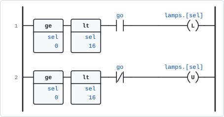

# Use bit strings

This guide is for a reader who reads or writes the register of a
[device](../reference/glossary.md#device), for example the status word of a drive. It
shows how to use the [bit string](../reference/glossary.md#bit-string)
[types](../reference/glossary.md#type) `byte`, `word`, `dword` and `lword`. You read
and write 1 [bit](../reference/glossary.md#bit), use a mask and a shift, and convert the
bits to a number. Last, you write a bit that a number in a
[tag](../reference/glossary.md#tag) selects.

> #### Caution {: .error}
>
> Keep the bit number that a tag holds in the range of the word. Put 2 comparisons
> before the bit, as step 10 shows. If the number is out of the range when an
> [instruction](../reference/glossary.md#instruction) reads or writes the bit, the
> [scan](../reference/glossary.md#scan) gets a
> [major fault](../reference/glossary.md#major-fault). The instruction writes nothing.
> Its power out, the [power flow](../reference/glossary.md#power-flow) that it gives to
> the next instruction, is false.
>
> If a [runner](../reference/glossary.md#runner) runs the
> [program](../reference/glossary.md#program), a major fault causes a
> [trip](../reference/glossary.md#trip). The runner writes 0 1 time to each output
> [point](../reference/glossary.md#point) of each device. It runs no
> [round](../reference/glossary.md#round) until a
> [restart](../reference/glossary.md#restart).

## Before you start

- You must have a Mix project that has logex.
  [Install logex and run a program](install-and-run.md) gives the steps.
- You must know how to write a [rung](../reference/glossary.md#rung) with `xic` and `ote`.
  [Your first program](../tutorials/first-program.md) teaches this.
- Step 10 uses the comparisons `ge` and `lt`.
  [Do arithmetic and compare values](do-arithmetic.md) gives them.

## Choose the type

Choose the type with the number of bits of the register.

| Type | Bits | Range |
|---|---|---|
| `byte` | 8 | 0 to 255 |
| `word` | 16 | 0 to 65535 |
| `dword` | 32 | 0 to 4294967295 |
| `lword` | 64 | 0 to 18446744073709551615 |

A bit string is a pattern of bits, not a number. Thus an arithmetic instruction, such
as `add`, does not take a bit string, and `move` does not copy a bit string into an
integer type. Use a [conversion](../reference/glossary.md#conversion) first, for
example `word_to_uint`.
[Elementary types](../reference/declarations-and-types.md#elementary-types) gives the
rules of each type.

## Choose the instruction

A [mask](../reference/glossary.md#mask) is a
[literal](../reference/glossary.md#literal) with a 1 for each bit that the instruction
keeps, sets or changes. In this table, `status`, `command` and `d` are `word` tags.
`ready` is a `bool` tag. `n` has the integer type of the conversion.

| To do this | Rung | Example |
|---|---|---|
| Read 1 bit | `xic status.3 ote at_speed` | `at_speed` is 1 while bit 3 of `status` is 1. |
| Write 1 bit | `xic run ote command.0` | Bit 0 of `command` gets the value of `run`. The other bits do not change. |
| Keep the bits of a mask | `and status 16#00ff d` | `16#2a01` gives `16#0001`. |
| Set the bits of a mask | `or status 16#8000 d` | `16#0008` gives `16#8008`. |
| Set bit 0 from a `bool` | `or status ready d` | `16#0008` and a `ready` of 1 give `16#0009`. |
| Clear the bits of a mask | `and status 16#fff7 d` | `16#fff7` is the mask `16#0008` with each bit changed. `16#000f` gives `16#0007`. |
| Change the bits of a mask | `xor status 16#00ff d` | `16#0f0f` gives `16#0ff0`. |
| Change each bit | `not status d` | `16#0f0f` gives `16#f0f0`. |
| Shift the bits | `shr status 8 d` | 8 is the count, the number of bit positions. `16#2a01` gives `16#002a`. `shl` shifts to the left. |
| Rotate the bits | `rol status 1 d` | `16#8001` gives `16#0003`. A count of 17 rotates a `word` by 1. `ror` rotates to the right. |
| Read the bits as a number | `word_to_uint status n` | `16#fff7` gives 65527. `word_to_int` gives -9. |
| Write a number as bits | `int_to_word n d` | -1 gives `16#ffff`. |
| Compare the bits | `eq status 16#0008 ote ready` | `ready` is 1 while `status` is `16#0008`. |

A rung cannot name 1 byte of a word, such as `status.%B1`. Use a shift and a mask, as
steps 6 and 7 do. [Instructions: bitwise](../reference/instructions-bitwise.md) gives
the rules of each instruction.

## Steps

The steps make the file `use-bit-strings/status.ld`. The drive of the conveyor motor
gives a 16-bit status word. Bits 0 to 7 are flags, and bit 3 is 1 while the motor is at
speed. Bits 8 to 15 are an error code. The program sends a command word to the drive. A
lamp shows the bit of the status word that the operator selects.

1. Make the directory `use-bit-strings` in your project, and in it the file `status.ld`.
2. [Declare](../reference/glossary.md#declaration) the [inputs](../reference/glossary.md#input), 1 on each line:
   `var_input status word`, `var_input run bool` and `var_input sel int`.
3. Declare the [outputs](../reference/glossary.md#output), 1 on each line: `var_output at_speed bool`,
   `var_output flags word`, `var_output error word`, `var_output code uint`,
   `var_output command word` and `var_output lamp bool`.
4. Put 1 empty line after the declarations.
5. Read bit 3 with a [contact](../reference/glossary.md#contact):
   `xic status.3 ote at_speed`.
6. Keep the flags, bits 0 to 7, with a mask: `and status 16#00ff flags`.
7. Shift the error code into bits 0 to 7 of `error`: `shr status 8 error`.
8. Convert the error code to a number: `word_to_uint error code`.
9. Write bit 0 of the command word with a [coil](../reference/glossary.md#coil):
   `xic run ote command.0`.
10. Show the bit that `sel` selects, only while `sel` is 0 to 15:
    `ge sel 0 lt sel 16 xic status.[sel] ote lamp`. For a `dword`, write `lt sel 32`.

Make sure that your file is the same as this text. Step 12 shows the result of steps 1
to 10.

<!-- file: use-bit-strings/status.ld -->
```text
var_input status word
var_input run bool
var_input sel int
var_output at_speed bool
var_output flags word
var_output error word
var_output code uint
var_output command word
var_output lamp bool

xic status.3 ote at_speed
and status 16#00ff flags
shr status 8 error
word_to_uint error code
xic run ote command.0
ge sel 0 lt sel 16 xic status.[sel] ote lamp
```

This drawing shows the 6 rungs:

<!-- rung: use-bit-strings/status.ld -->


11. Make the file `use-bit-strings.exs` in the root directory of your project, with this
    text. It runs 3 scans. Each line `scan.(n, inputs)` puts the inputs that change into
    the [instance](../reference/glossary.md#instance), then runs scan `n`. In Elixir, a hexadecimal value is `0x2A01`. The
    script prints the words in hexadecimal.

```elixir
{:ok, drive} = Logex.compile_file("use-bit-strings/status.ld")

hex = fn value ->
  "16#" <> String.pad_leading(String.downcase(Integer.to_string(value, 16)), 4, "0")
end

scan = fn state, number, inputs ->
  state = Logex.Runtime.put_inputs(drive, state, inputs)
  {outputs, state} = Logex.Runtime.scan(drive, state)
  bits = Enum.map_join(["at_speed", "lamp"], "  ", &"#{&1} #{outputs[&1]}")
  words = Enum.map_join(["flags", "error", "command"], "  ", &"#{&1} #{hex.(outputs[&1])}")
  IO.puts("#{number}  #{bits}  #{words}  code #{outputs["code"]}  faults #{length(state.faults)}")
  state
end

Logex.Runtime.instance(drive)
|> scan.(1, %{"status" => 0x0009, "run" => 1, "sel" => 3})
|> scan.(2, %{"status" => 0x2A01, "run" => 0, "sel" => 13})
|> scan.(3, %{"sel" => 16})
```

12. Run the script:

```console
$ mix run use-bit-strings.exs
1  at_speed 1  lamp 1  flags 16#0009  error 16#0000  command 16#0001  code 0  faults 0
2  at_speed 0  lamp 1  flags 16#0001  error 16#002a  command 16#0000  code 42  faults 0
3  at_speed 0  lamp 0  flags 16#0001  error 16#002a  command 16#0000  code 42  faults 0
```

If logex does not [compile](../reference/glossary.md#compile) `status.ld`, the first
line of the script raises a `MatchError`.
[Read a diagnostic](read-diagnostics.md) gives the steps.

## The result

| Scan | What the scan shows |
|---|---|
| 1 | `status` is `16#0009`. Bit 3 is 1, so `at_speed` is 1. The error code is 0. `run` is 1, so bit 0 of `command` is 1. `sel` is 3, so `lamp` shows bit 3. |
| 2 | `status` is `16#2a01`. The mask keeps the flags, `16#0001`. The shift gives the error code `16#002a`, and `code` is 42. `sel` is 13, and bit 13 is 1. |
| 3 | `sel` is 16. The comparisons make the rung false before the contact, so the contact does not read the bit. `lamp` is 0, and the scan has no [fault](../reference/glossary.md#fault). |

These 2 tables show the bits of `16#2a01` in scan 2. Each column is 1 bit: its number,
then its value. Bits 15 to 8 are the error code 42:

| 15 | 14 | 13 | 12 | 11 | 10 | 9 | 8 |
|---|---|---|---|---|---|---|---|
| 0 | 0 | **1** | 0 | 1 | 0 | 1 | 0 |

Bits 7 to 0 are the flags:

| 7 | 6 | 5 | 4 | 3 | 2 | 1 | 0 |
|---|---|---|---|---|---|---|---|
| 0 | 0 | 0 | 0 | **0** | 0 | 0 | 1 |

Bit 13 is 1, so `lamp` is 1 in scan 2. Bit 3 is 0, so `at_speed` is 0.

## Write a bit that a tag selects

Write the bit with `otl` and `otu`, after the 2 comparisons. An `ote` writes its bit on
a [false rung](../reference/glossary.md#false-rung) also, so the comparisons do not stop
its fault.

Use a word that no other rung writes. If an `ote` writes a bit of the same word, logex
gives a [warning](../reference/glossary.md#warning).

> #### A bit selected before keeps its value {: .info}
>
> When `sel` changes, the bit that `sel` selected before keeps its value. To light 1
> lamp at a time, put the rung `move 0 lamps` before the `otl` rung.

1. Make the file `lamps.ld` in the directory `use-bit-strings`, with the declarations
   `var_input sel int`, `var_input go bool` and `var_output lamps word`, and 1 empty
   line.
2. Put the comparisons and `otl` on the first rung:
   `ge sel 0 lt sel 16 xic go otl lamps.[sel]`.
3. Put the comparisons and `otu` on the next rung:
   `ge sel 0 lt sel 16 xio go otu lamps.[sel]`.

<!-- file: use-bit-strings/lamps.ld -->
```text
var_input sel int
var_input go bool
var_output lamps word

ge sel 0 lt sel 16 xic go otl lamps.[sel]
ge sel 0 lt sel 16 xio go otu lamps.[sel]
```

This drawing shows the 2 rungs:

<!-- rung: use-bit-strings/lamps.ld -->


4. Make the file `use-bit-strings-lamps.exs` in the root directory of your project. It
   runs 4 scans and prints `lamps` in base 2, bit 15 first.

```elixir
{:ok, panel} = Logex.compile_file("use-bit-strings/lamps.ld")

scan = fn state, inputs ->
  state = Logex.Runtime.put_inputs(panel, state, inputs)
  {outputs, state} = Logex.Runtime.scan(panel, state)
  lamps = String.pad_leading(Integer.to_string(outputs["lamps"], 2), 16, "0")
  IO.puts("sel #{inputs["sel"]}  go #{inputs["go"]}  lamps 2##{lamps}  faults #{length(state.faults)}")
  state
end

Logex.Runtime.instance(panel)
|> scan.(%{"sel" => 3, "go" => 1})
|> scan.(%{"sel" => 5, "go" => 1})
|> scan.(%{"sel" => 5, "go" => 0})
|> scan.(%{"sel" => 16, "go" => 1})
```

5. Run the script:

```console
$ mix run use-bit-strings-lamps.exs
sel 3  go 1  lamps 2#0000000000001000  faults 0
sel 5  go 1  lamps 2#0000000000101000  faults 0
sel 5  go 0  lamps 2#0000000000001000  faults 0
sel 16  go 1  lamps 2#0000000000001000  faults 0
```

Bit 5 follows `go`. Bit 3 stays 1 after `sel` changes. When `sel` is 16, no instruction
writes a bit, and the scan has no fault.

## If it does not work

Each entry in the column **What you see** is a part of the message.
[Diagnostics](../reference/diagnostics.md) gives each
[diagnostic](../reference/glossary.md#diagnostic).

### When you compile

| What you see | Cause | What to do |
|---|---|---|
| `` is a bit string, not a number `` | An arithmetic instruction has a bit string [operand](../reference/glossary.md#operand). | Use the conversion that the message names. |
| `` does not widen into `` | The operands are a bit string and an integer type, a `word` and a `byte`, or a `bool` and an integer type. | Use the conversion that the message names. For a `bool`, use a bit string destination, or a coil. |
| `` compares only with a bit string `` | A comparison reads a bit string and an integer tag. | Convert 1 of the 2 tags. |
| `` is outside 0 to `` | A literal is out of the range of the type. | Use a literal in the range. |
| `` which has bits 0 to 15 `` | A literal bit number is after the last bit. | Use a number in the range. |
| `` which has no bits `` | The tag is a `bool` or a real. | Use an integer or bit string tag. |
| `` which is no integer `` | A bit string tag holds the bit number. | Convert the tag to an integer type. |
| `` so that it is one bit `` | A [one-shot](../reference/glossary.md#one-shot) keeps its [storage bit](../reference/glossary.md#storage-bit), or an `osr` or `osf` sets its [pulse bit](../reference/glossary.md#pulse-bit), in a bit that a tag numbers. | Use a literal bit number. |
| `` a count is never negative `` | The count of a shift is a negative literal. | Use a count of 0 or more. |
| `` illegal character "." `` | The rung names 1 byte of a word, such as `status.%B1`. | Use a shift and a mask. |
| `` the last one in the scan decides it `` | A warning: 2 `ote` write 1 bit, or an `ote` writes a bit of a word that a different instruction writes whole. An `otl` or `otu` gives no warning. | Write the bit or the word at 1 place only. |

### When you run the scans

If the faults of a scan hold the kind `:bit_out_of_range`, a bit number in a tag is out
of the range. Put the comparisons of step 10 before the bit, and write the bit with
`otl` and `otu`.

| What you see | Cause | What to do |
|---|---|---|
| `` 65536 is outside 0 to 65535 `` | The [host](../reference/glossary.md#host) gives an input a value out of the range. | Check the value first, or use a wider type. |
| `not` of a `bool` into a `word` gives `16#0001` | `not` works in the type of the source. | Use `xio`, or a `word` source. |
| `rol` of a `byte` into a `word` rotates 8 bits | A shift or a rotate works in the type of the source. | `move` the `byte` into a `word` first. |
| `shr` of the `int` -2 by 1 gives 32767 | A shift does not keep the sign. | Shift a bit string or an unsigned type. |
| A shift writes 0 | The count is the number of bits of the source, or more. | Use a smaller count. |
| A shift or a rotate writes its source, and its power out is false | The count tag is negative. The scan gets no fault. | Use the result only while the power out is 1. |
| A conversion gives a wrong value, and its power out is true | A conversion to or from a bit string keeps the low bits. | Compare the source with the limits before the conversion. |

For example, `shl status n d ote shifted` writes the power out of the shift to
`shifted`. `ge big 0 le big 65535 dint_to_word big d` converts the `dint` tag `big` only
while it fits in a `word`. Without the comparisons, 70000 gives 4464.

## See also

- [Instructions: bitwise](../reference/instructions-bitwise.md): the rules of each
  bitwise instruction, of a bit and of a bit number in a tag.
- [Conversions](../reference/conversions.md): each conversion between a bit string and
  an integer type.
- [Faults](../reference/faults.md): the fields of a fault, and what a major fault does.
- [Choose an integer type and convert values](choose-integer-widths-and-convert.md): the
  integer types and their conversions.
- [Types and overflow](../explanation/types-and-overflow.md): why a bit string is not a
  number.
- [Glossary](../reference/glossary.md): the words of this guide.
