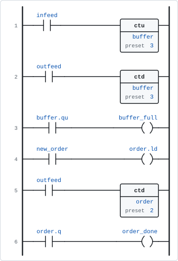

# Use counters

This guide is for a reader who writes a ladder [program](../reference/glossary.md#program).
It shows how to put a [counter](../reference/glossary.md#counter) on a
[rung](../reference/glossary.md#rung), read it, reset it and give it its
[preset](../reference/glossary.md#preset). It also shows the
[typed counters](../reference/glossary.md#typed-counter).

> #### Caution {: .error}
>
> Make sure that the rung of a counter is false in at least 1 scan between 2 boxes. A
> counter counts a change of its rung from false to true. If 2 boxes pass with no false
> scan between them, the counter counts 1 box. If a box comes and goes between 2 scans,
> the counter does not count it.

## Before you start

You must have:

- a Mix project that has logex. [Install logex and run a program](install-and-run.md)
  gives the steps.
- a rung that you can write with `xic` and `ote`, as in
  [Your first program](../tutorials/first-program.md).

## Choose the counter

| You want | Use |
|---|---|
| To count up to a number, for example 3 boxes in a case | `ctu`, an up counter |
| To count down from a number, for example the boxes that an order still needs | `ctd`, a down counter |
| To count up and down, for example the boxes on a buffer conveyor | `ctud`, an up-down counter |

A counter counts each [rising edge](../reference/glossary.md#rising-edge) of its rung. It
does not count while its rung stays true, and it does not count on the
[first scan](../reference/glossary.md#first-scan).

Each counter has these [members](../reference/glossary.md#member). A rung can read each
member, but it can write only some of them:

| Counter | Its members | A rung can write |
|---|---|---|
| `ctu` | `cu`, `r`, `pv`, `q`, `cv`, `ov` | `r`, `pv` |
| `ctd` | `cd`, `ld`, `pv`, `q`, `cv`, `un` | `ld`, `pv` |
| `ctud` | `cu`, `cd`, `r`, `ld`, `pv`, `qu`, `qd`, `cv`, `ov`, `un` | `r`, `ld`, `pv` |

- `cv` holds the count. `pv` starts at the preset.
- `q` of a `ctu`, and `qu`, are 1 when `cv` is equal to `pv` or more.
- `q` of a `ctd`, and `qd`, are 1 when `cv` is 0 or less.
- `ov` and `un` show the limits of the count. See
  [Count in a different integer type](#count-in-a-different-integer-type).

## Steps

The steps make the file `use-counters/buffer.ld`. In it, a buffer conveyor holds up to 3
boxes. A photo-eye at each end gives the [input](../reference/glossary.md#input) `infeed`
or `outfeed`. A second counter counts down the boxes of an order.

1. Make the directory `use-counters` in your project, and in it the file `buffer.ld`.
2. [Declare](../reference/glossary.md#declaration) the inputs `infeed`, `outfeed` and
   `new_order`, 1 on each line, with the [section](../reference/glossary.md#section)
   `var_input`: `var_input infeed bool`.
3. Declare the [outputs](../reference/glossary.md#output) `buffer_full` and `order_done`
   with the section `var_output`: `var_output buffer_full bool`.
4. Declare each counter with the section `var` and its
   [type](../reference/glossary.md#type) word: `var buffer ctud` and `var order ctd`. A
   new `ctd` has `cv` at 0, so its `q` is 1 until its first load.
5. Write the 2 rungs of the `ctud`: `xic infeed ctu buffer 3` and
   `xic outfeed ctd buffer 3`. Give the 2 [instructions](../reference/glossary.md#instruction)
   the same preset. Put no instruction after a counter.
6. Read the count with a [contact](../reference/glossary.md#contact) on a member:
   `xic buffer.qu ote buffer_full`.
7. Load the `ctd` on a rung before it: `xic new_order ote order.ld`. The load sets `cv`
   to `pv`.
8. Write the rung of the `ctd`: `xic outfeed ctd order 2`.
9. Read the result of the `ctd`: `xic order.q ote order_done`.

`use-counters/buffer.ld` then has this text:

<!-- file: use-counters/buffer.ld -->
```text
var_input infeed bool
var_input outfeed bool
var_input new_order bool
var_output buffer_full bool
var_output order_done bool
var buffer ctud
var order ctd

xic infeed ctu buffer 3
xic outfeed ctd buffer 3
xic buffer.qu ote buffer_full
xic new_order ote order.ld
xic outfeed ctd order 2
xic order.q ote order_done
```

This drawing shows the 6 rungs:

<!-- rung: use-counters/buffer.ld -->


10. Make the file `use-counters.exs` in the root directory of your project, with this
    text. It runs 11 [scans](../reference/glossary.md#scan) and prints `cv` of each
    counter. The last argument of `Logex.Runtime.scan/3`, 10, is the time of the scan in
    ms. A counter does not use it.

```elixir
{:ok, buffer} = Logex.compile_file("use-counters/buffer.ld")

scan = fn state, label, inputs ->
  state = Logex.Runtime.put_inputs(buffer, state, inputs)
  {outputs, state} = Logex.Runtime.scan(buffer, state, 10)
  counts = "buffer.cv #{state.env["buffer"]["cv"]}  order.cv #{state.env["order"]["cv"]}"
  IO.puts("#{label}  #{counts}  #{inspect(outputs)}")
  state
end

Logex.Runtime.instance(buffer)
|> scan.("start                ", %{})
|> scan.("new order of 2 boxes ", %{"new_order" => 1})
|> scan.("box 1 in             ", %{"new_order" => 0, "infeed" => 1})
|> scan.("infeed eye clear     ", %{"infeed" => 0})
|> scan.("box 2 in             ", %{"infeed" => 1})
|> scan.("box 2 stays on eye   ", %{})
|> scan.("infeed eye clear     ", %{"infeed" => 0})
|> scan.("box 3 in: full       ", %{"infeed" => 1})
|> scan.("box 1 out            ", %{"infeed" => 0, "outfeed" => 1})
|> scan.("outfeed eye clear    ", %{"outfeed" => 0})
|> scan.("box 2 out: order done", %{"outfeed" => 1})
```

11. Run the script:

```console
$ mix run use-counters.exs
start                  buffer.cv 0  order.cv 0  %{"buffer_full" => 0, "order_done" => 1}
new order of 2 boxes   buffer.cv 0  order.cv 2  %{"buffer_full" => 0, "order_done" => 0}
box 1 in               buffer.cv 1  order.cv 2  %{"buffer_full" => 0, "order_done" => 0}
infeed eye clear       buffer.cv 1  order.cv 2  %{"buffer_full" => 0, "order_done" => 0}
box 2 in               buffer.cv 2  order.cv 2  %{"buffer_full" => 0, "order_done" => 0}
box 2 stays on eye     buffer.cv 2  order.cv 2  %{"buffer_full" => 0, "order_done" => 0}
infeed eye clear       buffer.cv 2  order.cv 2  %{"buffer_full" => 0, "order_done" => 0}
box 3 in: full         buffer.cv 3  order.cv 2  %{"buffer_full" => 1, "order_done" => 0}
box 1 out              buffer.cv 2  order.cv 1  %{"buffer_full" => 0, "order_done" => 0}
outfeed eye clear      buffer.cv 2  order.cv 1  %{"buffer_full" => 0, "order_done" => 0}
box 2 out: order done  buffer.cv 1  order.cv 0  %{"buffer_full" => 0, "order_done" => 1}
```

If `buffer.ld` has an error, the script stops at its first line with a `MatchError`.
[Read a diagnostic](read-diagnostics.md) gives the steps.

## The result

The buffer counts each box in and each box out. The order counts down from 2 to 0. This
timing diagram shows the run:

<!-- timing: use-counters-buffer.timing.exs -->


| Counter | What the run shows |
|---|---|
| `ctud buffer` | Each box in adds 1, and each box out subtracts 1. Box 2 stays on the eye in scan 6, and the count does not change. `qu` is 1 while `cv` is 3 or more. |
| `ctd order` | A new `ctd` has `cv` at 0, so `q` is 1 in scan 1. The load of scan 2 sets `cv` to 2. In scan 11, `cv` is 0 and `q` is 1 again. |

## Set the count to 0 or to the preset

1. Write `r` with a [coil](../reference/glossary.md#coil) to set `cv` to 0:
   `xic reset_pb ote boxes.r`. On a `ctd` or a `ctud`, write `ld` to set `cv` to `pv`.
   logex has no `res` instruction.
2. Put this rung before the rung of the counter. The counter then sets `cv` in the same
   scan. If the rung is after the counter, the counter sets `cv` in the next scan.

If `r` and `ld` are both 1, `r` applies. While `r` or `ld` is 1, the counter does not
count. A reset or a load does not change `cu` or `cd`, the value of the rung in the last
scan. So the counter does not count again a box that stays on the eye through a reset.

## Set the preset from a tag

> #### Caution {: .error}
>
> Give the tag a value before the first scan. Until the
> [host](../reference/glossary.md#host) gives it, the tag is 0, `pv` is 0 and `q` is 1.

1. Write a number on the rung of the counter: `xic eye ctu boxes 3`. The rung must have a
   number.
2. Declare the [tag](../reference/glossary.md#tag) that holds the number:
   `var_input size dint`.
3. Move the tag into `pv` on a rung before the counter: `move size boxes.pv`. The counter
   uses the new `pv` in the same scan.
4. Give `size` with `Logex.Runtime.put_inputs/3` before the first scan.

## Count in a different integer type

A `ctu`, a `ctd` and a `ctud` count in a `dint`. To count in a different integer type, use
a typed counter.

1. Declare the counter with a type word that is `ctu_`, `ctd_` or `ctud_` and the integer
   type: `var stock ctud_int`. Run it with the same instructions, `ctu` and `ctd`.
2. Give a preset in the range of the type, from this table:

| Type | The range of the preset and of the count |
|---|---|
| `int` | -32768 to 32767 |
| `dint` | -2147483648 to 2147483647 |
| `lint` | -9223372036854775808 to 9223372036854775807 |
| `udint` | 0 to 4294967295 |
| `ulint` | 0 to 18446744073709551615 |

3. Read `ov` and `un`. At the largest value, a count up adds nothing and sets `ov` to 1. At
   the smallest value, a count down subtracts nothing and sets `un` to 1. A reset or a
   load sets them to 0. For a larger range, use a different type.

> #### Note {: .info}
>
> The CTUD of the [conventional set](../reference/glossary.md#conventional-set) goes from
> the largest value to the smallest value. A logex counter stops at the limit and sets
> `ov` or `un`.

In this example, a `ctud_int` counts the boxes in stock. The input `refill` loads 32766,
1 less than the largest `int`.

1. Make the file `use-counters/limit.ld` with this text:

<!-- file: use-counters/limit.ld -->
```text
var_input refill bool
var_input infeed bool
var_input outfeed bool
var_output over bool
var stock ctud_int

xic refill ote stock.ld
xic infeed ctu stock 32766
xic outfeed ctd stock 32766
xic stock.ov ote over
```

2. Make the file `use-counters-limit.exs` in the root directory of your project, with
   this text:

```elixir
{:ok, limit} = Logex.compile_file("use-counters/limit.ld")

scan = fn state, label, inputs ->
  state = Logex.Runtime.put_inputs(limit, state, inputs)
  {outputs, state} = Logex.Runtime.scan(limit, state, 10)
  IO.puts("#{label}  stock.cv #{state.env["stock"]["cv"]}  #{inspect(outputs)}")
  state
end

Logex.Runtime.instance(limit)
|> scan.("load        ", %{"refill" => 1})
|> scan.("box in      ", %{"refill" => 0, "infeed" => 1})
|> scan.("eye clear   ", %{"infeed" => 0})
|> scan.("box in      ", %{"infeed" => 1})
|> scan.("eye clear   ", %{"infeed" => 0})
|> scan.("box out     ", %{"outfeed" => 1})
|> scan.("load again  ", %{"outfeed" => 0, "refill" => 1})
```

3. Run the script:

```console
$ mix run use-counters-limit.exs
load          stock.cv 32766  %{"over" => 0}
box in        stock.cv 32767  %{"over" => 0}
eye clear     stock.cv 32767  %{"over" => 0}
box in        stock.cv 32767  %{"over" => 1}
eye clear     stock.cv 32767  %{"over" => 1}
box out       stock.cv 32766  %{"over" => 1}
load again    stock.cv 32766  %{"over" => 0}
```

In scan 4, the count stops at 32767 and `over` comes on. A count down still subtracts 1.
The load of scan 7 sets `ov` to 0.

## Keep the count across a restart

To keep the count across a [restart](../reference/glossary.md#restart):

1. Declare the counter with the [qualifier](../reference/glossary.md#qualifier) `retain`:
   `var retain boxes ctu`.
2. Do a [warm restart](../reference/glossary.md#warm-restart) with
   `Logex.Runtime.restart(program, state, :warm)`. After the restart, `boxes.cv` has the
   value from before the restart.

| Start | `cv` | `pv` |
|---|---|---|
| A warm restart | Kept | Kept |
| A new [instance](../reference/glossary.md#instance) from the [retained image](../reference/glossary.md#retained-image) | Kept | The number on the rung |
| A [cold restart](../reference/glossary.md#cold-restart) | 0 | The number on the rung |

[Keep values across a restart](keep-values-across-a-restart.md) gives the steps for a
whole program.

## If it does not work

Each entry in the column **What you see** is a part of the message.
[Instructions: timers and counters](../reference/instructions-timers-and-counters.md)
gives each diagnostic of a counter. [Read a diagnostic](read-diagnostics.md) shows how to
print the warnings.

### When you compile

| What you see | Cause | What to do |
|---|---|---|
| `` only counts up; declare it `` or `` only counts down; declare it `` | A `ctd` instruction names a `ctu` counter, or the opposite. | Declare a `ctud`. |
| `` unknown instruction `ctud` `` or `` `res` `` | logex has no `ctud` instruction and no `res` instruction. | Run a `ctud` with a `ctu` and a `ctd`. Write 1 to `r` or `ld` to reset. |
| `` follows `ctu boxes` on its path `` | An instruction comes after the counter. | Move it to a new rung that starts with `xic boxes.q`. |
| `` takes a preset of -32768 to 32767 for a counter of ints `` | The preset is out of the range of the count. | Use the range of the message, or declare a typed counter with a larger range. |
| `` takes its preset as a number, a count `` | The preset is a tag. | Do the steps of [Set the preset from a tag](#set-the-preset-from-a-tag). |
| `` is already run by the `ctu` on line `` | 2 `ctu` instructions run 1 counter. | Declare a second counter. |
| `` already has the preset 3 from the `ctu` on line `` | The `ctd` of a `ctud` has a different preset. | Give the 2 instructions the same preset. |
| `` but logic may write only `.r` and `.pv` of a ctu `` | A rung writes a member that only the counter writes. | See the column **A rung can write** of [Choose the counter](#choose-the-counter). |
| `` is not a member of `` | The counter does not have this member. A `ctud` has no `q`. | Use a member that the message names, or declare a `ctud`. |
| `` `xic` reads a bool, but `boxes` is a ctu `` | A contact names the counter, not a member. | Write `xic boxes.q`. |
| `` no `ctu` runs it: it never counts `` | A [warning](../reference/glossary.md#warning): the program [compiles](../reference/glossary.md#compile), but no instruction runs the counter. | Add the rung of the counter. |
| `` a counter sees its rung only at the task's runs `` | A warning: the program runs under an [event task](../reference/glossary.md#event-task). | Run it under a [periodic task](../reference/glossary.md#periodic-task). |

### When you run the scans

| What you see | Cause | What to do |
|---|---|---|
| The count is less than the number of boxes | No scan saw the rung false between 2 boxes, or no scan saw a box. | Scan more often. Each box must be on the eye in at least 1 scan, and off it in at least 1 scan. |
| The counter does not count the first box | The box was on the eye on the first scan. | Start the scans before the first box comes. |
| `q` of a `ctd` is 1 at the start | A new `ctd` has `cv` at 0. | Load it with `ld` before the first count. |
| A reset comes 1 scan late | The rung that writes `r` is after the counter. | Move that rung before the counter. |
| The count goes past the preset, or to less than 0 | The preset does not stop a count. | Read `q`, then write `r` or `ld`. |

## See also

- [Instructions: timers and counters](../reference/instructions-timers-and-counters.md):
  each rule of the counters, also a negative preset and the second names `ctu_dint`,
  `ctd_dint` and `ctud_dint`.
- [A timer and a counter](../tutorials/timers-and-counters.md): a `ctu` with a reset,
  step by step.
- [Types and overflow](../explanation/types-and-overflow.md): why a count stops at the
  limit of its type.
- [Use an event task](use-an-event-task.md): a counter under an event task.
- [Glossary](../reference/glossary.md): the words of this guide.
