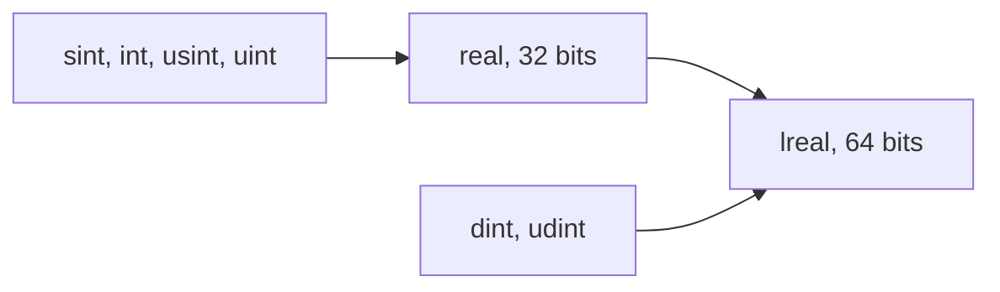

# Use real numbers

This guide is for a reader who writes a ladder [program](../reference/glossary.md#program)
that calculates with fractions, for example a speed from a frequency. It shows how to
declare a real [tag](../reference/glossary.md#tag), write a real
[literal](../reference/glossary.md#literal), calculate and take a square root. It also
shows how to put a real value into an integer tag, and how to get the next integer up or
down.

logex has 2 real [types](../reference/glossary.md#type). A `real` holds a floating-point
number of 32 bits. An `lreal` holds a floating-point number of 64 bits.

The power out of an [instruction](../reference/glossary.md#instruction) is the
[power flow](../reference/glossary.md#power-flow) that it gives to the next instruction
on the [rung](../reference/glossary.md#rung).

> #### Warning {: .warning}
>
> If a value that you calculate from a real can move a machine, write the power out of
> the instruction to a `bool` tag. Use the value only while that tag is 1, as steps 8
> and 9 show. A result that does not fit its type becomes a different value, and logex
> gives no [fault](../reference/glossary.md#fault). Thus `real_to_int` of 36000.0
> writes -29536.
>
> The power out stays true when a result goes to 0.0 or loses digits. For example,
> `mul` of 1.0e-20 and 1.0e-30 writes 0.0 into a `real`. If such a result can move a
> machine, compare it with a limit.

## Before you start

- You must have a Mix project that has logex.
  [Install logex and run a program](install-and-run.md) gives the steps.
- You must know how to write a rung and run [scans](../reference/glossary.md#scan).
  [Your first program](../tutorials/first-program.md) teaches this.
- [Do arithmetic and compare values](do-arithmetic.md) gives the arithmetic instructions.
  This guide gives only the rules that are different for a real type.

## Choose `real` or `lreal`

Use an `lreal` if a value:

- needs more than 6 significant digits,
- holds an integer out of the range -16777216 to 16777216,
- or can go beyond about 3.4e38.

Otherwise a `real` is sufficient.

| Item | `real` | `lreal` |
|---|---|---|
| Bits | 32 | 64 |
| Significant digits that it keeps | 6 or more | 15 or more |
| Largest value | About 3.4e38 | About 1.8e308 |

If a calculation needs an `lreal`, use `lreal` tags from the
[input](../reference/glossary.md#input) to the result. A `real` value keeps its
difference from the exact value when it goes into an `lreal`. Thus 0.1 in a `real` is
0.10000000149011612 in an `lreal`.

> #### A literal in a comparison {: .info}
>
> `move 37.1 sp` writes 37.099998474121094 into the `real` tag `sp`. Elixir shows that
> value with all its digits. logex reads a literal in a comparison in the type of the
> tag, so `eq sp 37.1` passes power.

Each value that goes into a real tag becomes the nearest value of its type. This
includes a value from the [host](../reference/glossary.md#host), a
[device](../reference/glossary.md#device) or a [force](../reference/glossary.md#force). A
real tag starts at 0.0. It never holds an infinity, a NaN (a value that is not a number)
or `-0.0`. You cannot read 1 [bit](../reference/glossary.md#bit) of a real tag: `speed.3`
is an error. [Declarations and types](../reference/declarations-and-types.md) gives the
exact limits and each rule of the real types.

## Write a real literal

A real literal has an optional `-`, digits, a `.` and digits, for example `60.0` or
`-0.25`. An exponent can follow: `1.5e3` is 1500.0. In the place of a real type, an
integer literal such as `60` is also correct if the type holds it exactly.

logex holds a literal at the nearest value of the type of its place. If the type does
not keep each digit of the literal, logex gives a
[warning](../reference/glossary.md#warning) with the value that it holds. Thus
`16777217.0` gets the warning for a `real`, and `0.1` does not. The
[initial value](../reference/glossary.md#initial-value) of a declaration gets the same
rules. [Literals](../reference/literals.md) gives each form and each limit.

## Steps

The steps make the file `use-reals/fan.ld`. The drive of a fan gives its frequency in
hertz as the real input `hz`. The program calculates the speed in revolutions a minute,
in a `real` and in an `lreal`. It puts the speed into 2 `int` tags for a display, and it
takes the square root of the frequency.

1. Make the directory `use-reals` in your project, and in it the file `fan.ld`.
2. [Declare](../reference/glossary.md#declaration) the input: `var_input hz real`.
3. Declare the [outputs](../reference/glossary.md#output) `speed` as `real`, `precise`
   as `lreal`, `root` as `real` and `root_ok` as `bool`, 1 on each line.
4. Declare the outputs `rpm` as `int`, `rpm_ok` as `bool`, `whole` as `int` and
   `whole_ok` as `bool`.
5. Multiply the frequency by 60 in the `real`: `mul hz 60.0 speed`.
6. Multiply it in the `lreal`: `mul hz 60.0 precise`. A `real`
   [widens](../reference/glossary.md#widen) into an `lreal`, so `hz` needs no
   [conversion](../reference/glossary.md#conversion).
7. Take the square root, and write the power out to the [coil](../reference/glossary.md#coil)
   `root_ok`: `sqrt hz root ote root_ok`.
8. Convert the speed to the nearest integer, and write the power out to `rpm_ok`:
   `real_to_int speed rpm ote rpm_ok`.
9. Remove the fraction of the speed, and write the power out to `whole_ok`:
   `real_trunc_int speed whole ote whole_ok`.

Make sure that your file is the same as this text:

<!-- file: use-reals/fan.ld -->
```text
var_input hz real
var_output speed real
var_output precise lreal
var_output root real
var_output root_ok bool
var_output rpm int
var_output rpm_ok bool
var_output whole int
var_output whole_ok bool

mul hz 60.0 speed
mul hz 60.0 precise
sqrt hz root ote root_ok
real_to_int speed rpm ote rpm_ok
real_trunc_int speed whole ote whole_ok
```

This drawing shows the 5 rungs:

<!-- rung: use-reals/fan.ld -->


10. Make the file `use-reals.exs` in the root directory of your project, with this text.
   It runs 5 scans with 5 frequencies, and prints 8 outputs of each scan. Then it gives
   a frequency that a `real` cannot hold.

```elixir
{:ok, fan} = Logex.compile_file("use-reals/fan.ld")

show = fn outputs, names -> Enum.map_join(names, "  ", &"#{&1} #{inspect(outputs[&1])}") end

scan = fn state, hz ->
  state = Logex.Runtime.put_inputs(fan, state, %{"hz" => hz})
  {outputs, state} = Logex.Runtime.scan(fan, state)
  IO.puts("hz #{inspect(hz)}")
  IO.puts("  " <> show.(outputs, ["speed", "precise", "root", "root_ok"]))
  IO.puts("  " <> show.(outputs, ["rpm", "rpm_ok", "whole", "whole_ok"]))

  for fault <- state.faults,
      do: IO.puts("  fault #{inspect(fault.kind)} on line #{fault.line}, read #{fault.read}")

  state
end

state =
  Logex.Runtime.instance(fan)
  |> scan.(0.1)
  |> scan.(0.125)
  |> scan.(0.375)
  |> scan.(-0.25)
  |> scan.(600)

try do
  Logex.Runtime.put_inputs(fan, state, %{"hz" => 1.0e39})
rescue
  error in ArgumentError -> IO.puts(Exception.message(error))
end
```

If logex refuses `fan.ld`, the first line of the script raises a `MatchError`.
[Read a diagnostic](read-diagnostics.md) gives the steps.

11. Run the script:

```console
$ mix run use-reals.exs
hz 0.1
  speed 6.0  precise 6.000000089406967  root 0.3162277638912201  root_ok 1
  rpm 6  rpm_ok 1  whole 6  whole_ok 1
hz 0.125
  speed 7.5  precise 7.5  root 0.3535533845424652  root_ok 1
  rpm 8  rpm_ok 1  whole 7  whole_ok 1
hz 0.375
  speed 22.5  precise 22.5  root 0.6123724579811096  root_ok 1
  rpm 22  rpm_ok 1  whole 22  whole_ok 1
hz -0.25
  speed -15.0  precise -15.0  root 0.0  root_ok 0
  rpm -15  rpm_ok 1  whole -15  whole_ok 1
  fault :negative_sqrt on line 13, read -0.25
hz 600
  speed 36000.0  precise 36000.0  root 24.494897842407227  root_ok 1
  rpm -29536  rpm_ok 0  whole -29536  whole_ok 0
input `hz` is a real: 1.0e39 is beyond a real's range, -3.4028234663852886e38 to 3.4028234663852886e38
```

## The result

| `hz` | What the scan shows |
|---|---|
| 0.1 | `hz` holds 0.10000000149011612. In the `real`, 60 times that value is 6.0. The `lreal` keeps the difference: 6.000000089406967. |
| 0.125 | 7.5 is halfway between 7 and 8. `real_to_int` takes the even integer, 8. `real_trunc_int` removes the fraction and writes 7. |
| 0.375 | 22.5 is halfway between 22 and 23. `real_to_int` takes the even integer, 22. |
| -0.25 | `sqrt` of a negative value writes 0.0, and `root_ok` is 0. The scan gets the [minor fault](../reference/glossary.md#minor-fault) `:negative_sqrt` from line 13. Its field `read` holds the source. |
| 600 | The host gives the integer 600, and logex holds 600.0. An `int` cannot hold 36000, so `rpm` and `whole` [wrap](../reference/glossary.md#wrap) to -29536. `rpm_ok` and `whole_ok` are 0. |

`Logex.Runtime.put_inputs/3` raises an `ArgumentError` for 1.0e39, because a `real`
cannot hold it. The [state](../reference/glossary.md#state) does not change.

A [Logix](../reference/glossary.md#logix) controller takes the root of the absolute
value of a negative source. logex does not: the root of -0.25 is never 0.5.
[Instructions: arithmetic and comparison](../reference/instructions-arithmetic-and-comparison.md)
gives what each instruction writes for a result that its type cannot hold, and its power
out.

## Put a value of another type into a real tag

A type that [widens](../reference/glossary.md#widen) into the real type needs no
conversion. Use `move`, or name the tag as an [operand](../reference/glossary.md#operand).



Figure: the integer types and the real types. An arrow goes from a type to a type that
it widens into.

`lint` and `ulint` widen into no real type. For each pair that no arrow joins, use a
conversion:

| From | Conversion |
|---|---|
| `dint` or `udint` into `real` | `dint_to_real`, `udint_to_real` |
| `lint` or `ulint` into `real` | `lint_to_real`, `ulint_to_real` |
| `lint` or `ulint` into `lreal` | `lint_to_lreal`, `ulint_to_lreal` |
| `lreal` into `real` | `lreal_to_real` |
| `bool` or a [bit string](../reference/glossary.md#bit-string) type into a real type | No instruction |

For a bit string, convert it to an integer type first. For example, `word_to_uint w u`
then `move u r` puts the `word` tag `w` into the `real` tag `r`.

For example, an `int` register gives the frequency in units of 0.1 Hz. In `fan.ld`,
declare `var_input raw int` and change `var_input hz real` to `var hz real`. Then add
the rung `mul raw 0.1 hz` before the other rungs. For 125, `hz` is 12.5 and `speed` is
750.0.

If the register is a `dint`, logex refuses that rung. Declare `var_input raw dint` and
`var raw_hz real`, and use 2 rungs: `dint_to_real raw raw_hz`, then
`mul raw_hz 0.1 hz`.

A conversion into a real type writes the nearest value of the type. Thus `dint_to_real`
of 16777217 writes 16777216.0, and its power out is true. For a value beyond the range
of a `real`, `lreal_to_real` writes the end of the range, and its power out is false.

## Put a real value into an integer tag

A conversion such as `real_to_int` or `lreal_to_dint` writes the nearest integer. A
conversion such as `real_trunc_int` or `lreal_trunc_dint`, a truncation, removes the
fraction toward 0.

| Source | `real_to_int` | `real_trunc_int` |
|---|---|---|
| 2.5 | 2 | 2 |
| 3.5 | 4 | 3 |
| -2.5 | -2 | -2 |
| -2.7 | -3 | -2 |

For a value halfway between 2 integers, `real_to_int` takes the even integer. If the
integer does not fit the destination, both instructions write its low bits, and the
power out is false. [Conversions](../reference/conversions.md) gives each conversion.

## Get the next integer up or down

logex has no instruction that gives the next integer up or the next integer down. Use a
truncation and a comparison.

1. Make the file `round.ld` in the directory `use-reals`, with this text:

<!-- file: use-reals/round.ld -->
```text
var_input x real
var_output up int
var_output down int

real_trunc_int x up
lt up x add up 1 up
real_trunc_int x down
gt down x sub down 1 down
```

2. Make the file `use-reals-round.exs` in the root directory of your project, with this
   text. It gives the program 5 values:

```elixir
{:ok, round} = Logex.compile_file("use-reals/round.ld")

for x <- [2.3, 2.0, -2.3, 0.7, -0.7] do
  state = Logex.Runtime.put_inputs(round, Logex.Runtime.instance(round), %{"x" => x})
  {outputs, _state} = Logex.Runtime.scan(round, state)
  IO.puts("x #{x}  up #{outputs["up"]}  down #{outputs["down"]}")
end
```

3. Run the script:

```console
$ mix run use-reals-round.exs
x 2.3  up 3  down 2
x 2.0  up 2  down 2
x -2.3  up -2  down -3
x 0.7  up 1  down 0
x -0.7  up 0  down -1
```

Rung 2 adds 1 if `up` is less than `x`. Rung 4 subtracts 1 if `down` is more than `x`.
The rungs give the correct values for an `x` from -32768.0 to 32767.0. Out of that
range, the truncation, `add` or `sub` wraps and passes no power. For a larger `x`, use
`real_trunc_dint` and `dint` tags.

## If it does not work

Each entry in the column **What you see** is a part of the message.
[Diagnostics](../reference/diagnostics.md) gives each
[diagnostic](../reference/glossary.md#diagnostic).

### When you compile

| What you see | Cause | What to do |
|---|---|---|
| `` digits on both sides ``, `` logex takes no `+` `` or `` is neither a number nor a tag `` | A form that logex does not have: `1.`, `.5`, `1e5`, `1.5e+3` or `1.5L`. | Write `1.0`, `0.5`, `1.0e5`, `1.5e3` or `1.5`. |
| `` holds integers exactly only to 2^24 `` or `` is more precise than a real keeps `` | A literal that a `real` does not hold exactly. `16777217` is an error. `16777217.0` gets a warning, and the program [compiles](../reference/glossary.md#compile). | Write the value that the message gives, or use an `lreal`. |
| `` is beyond a real's range `` or `` is too near 0.0 `` | A literal out of the range of the type. | For a value beyond the range, use an `lreal`. For a value too near 0.0, write `0.0`. |
| `` logex has no conversion between `` | A `bool` or a bit string with a real. | For a `bool` tag `b`, use 2 rungs: `xic b move 1.0 r` and `xio b move 0.0 r`. Convert a bit string to an integer type first, as [Put a value of another type into a real tag](#put-a-value-of-another-type-into-a-real-tag) shows. |
| `` does not widen into `` | A `dint` into a `real`, or a `real` into an `int`. | Use the conversion that the message names, or a truncation. |
| `` holds only integers `` | A real literal for an integer tag, even `1.0`. | Write an integer literal. |
| `` divides by the literal `` or `` takes the root of the literal `` | A literal divisor of 0, or a negative literal source of `sqrt`. | Use a tag, and compare it with 0.0 before the instruction. |
| `` a square root is a real's `` or `` a truncation writes an integer `` | The destination is of a different type. | Declare the destination with the type that the message names. |
| `` `mod` reads an integer `` or `` which has no bits `` | `mod`, or a bit, of a real. | Convert the real to an integer type first. |
| `` cannot name a tag `` | A tag named `real`, `sqrt` or a conversion, in uppercase or lowercase. | Choose a different name. |
| `` unknown instruction `` | An instruction such as `round`, `ceil` or `floor`, which logex does not have. | Do the steps of [Get the next integer up or down](#get-the-next-integer-up-or-down). |
| `` reads a literal `` | A warning: a conversion of a literal always writes the same value. | Write that value as a literal. |

### When you run the scans

If the faults of a scan hold the kind `:negative_sqrt` or `:divide_by_zero`, a source of
`sqrt` is negative or a divisor is 0.0. Put a comparison before the instruction:
`ge hz 0.0 sqrt hz root ote root_ok`, or `ne d 0.0 div n d q`. Then the destination
keeps its last value, and the power out is false.

| What you see | Cause | What to do |
|---|---|---|
| `` (MatchError) no match of right hand side value `` | logex refused `fan.ld`. | Do the steps of [Read a diagnostic](read-diagnostics.md). |
| `` is beyond a real's range `` or `` must be a number `` | The host gives a value out of the range, a bool or a string. | Give only a number in the range of the table in [Choose `real` or `lreal`](#choose-real-or-lreal). |
| An integer goes to the other end of its range | A conversion wraps the value. | Use the value only while the power out is true, as steps 8 and 9 do. |

## See also

- [Conversions](../reference/conversions.md): each conversion and truncation, and its
  rules.
- [Literals](../reference/literals.md): each form of a real literal and its limits.
- [Instructions: arithmetic and comparison](../reference/instructions-arithmetic-and-comparison.md):
  the arithmetic instructions, `sqrt` and the comparisons in a real type.
- [Declarations and types](../reference/declarations-and-types.md): each type, its range
  and the types that it widens into.
- [Forcing](../reference/forcing.md): how to write a real value in a
  [forces file](../reference/glossary.md#forces-file).
- [Configuration file](../reference/configuration-file.md): how to write a real value in
  a [configuration file](../reference/glossary.md#configuration-file).
- [Types and overflow](../explanation/types-and-overflow.md): why a real stops at the end
  of its range and an integer wraps.
- [Glossary](../reference/glossary.md): the words of this guide.
