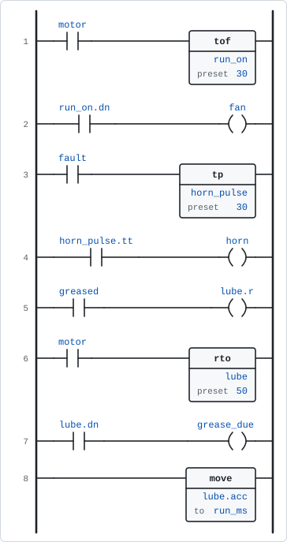
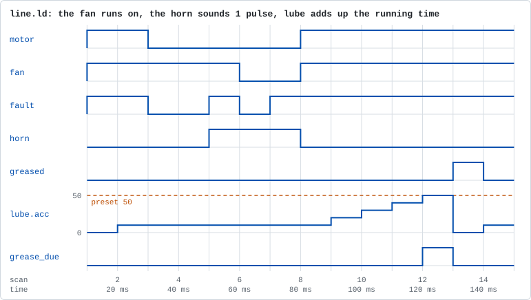

# Use timers

This guide is for a reader who writes a ladder
[program](../reference/glossary.md#program). It shows how to choose a
[timer](../reference/glossary.md#timer), put it on a [rung](../reference/glossary.md#rung),
read its result and give the scans their time. It also shows the
[long timers](../reference/glossary.md#long-timer), which measure time in nanoseconds
(ns).

> #### Warning {: .warning}
>
> Do not use a logex timer for a safety function, for example the delay of a guard lock.
> logex is not hard real-time. A scan can be late, and the timer then acts late.
> [Safety and limits](../explanation/safety-and-limits.md) gives the limits of logex.

## Before you start

You must have:

- a Mix project that has logex. [Install logex and run a program](install-and-run.md)
  gives the steps.
- a script that runs scans with `Logex.Runtime.scan/3`, as in
  [A timer and a counter](../tutorials/timers-and-counters.md).

## Choose the timer

| You want | Use | The timer rung, then the rung that reads it |
|---|---|---|
| An [output](../reference/glossary.md#output) that comes on when a rung stays true for a time | `ton`, an on-delay timer | `xic go ton t1 3000`, then `xic t1.dn` |
| An output that stays on for a time after a rung goes false | `tof`, an off-delay timer | `xic motor tof run_on 30`, then `xic run_on.dn` |
| A pulse of fixed length at a [rising edge](../reference/glossary.md#rising-edge) of a rung | `tp`, a pulse timer | `xic fault tp horn_pulse 30`, then `xic horn_pulse.tt` |
| The sum of the times that a rung is true | `rto`, a retentive timer | `xic motor rto lube 50`, then `xic lube.dn` |

The number on the rung is the [preset](../reference/glossary.md#preset): a time in ms,
from 0 to 2147483647, about 24 days and 20 hours. For a longer time, use a
[long timer](#measure-a-long-time).

## Steps

The steps make 2 files in the root directory of your project: `line.ld` and `line.exs`.
In `line.ld`, a fan runs on after the motor stops, and a horn sounds 1 pulse when the
[input](../reference/glossary.md#input) `fault` comes on. A third timer adds up the
running time of the motor.

1. Make the file `line.ld`. [Declare](../reference/glossary.md#declaration) each timer
   with the [section](../reference/glossary.md#section) `var`, its
   [type](../reference/glossary.md#type) word and no
   [initial value](../reference/glossary.md#initial-value): `var run_on tof`.
2. Write a rung that ends with the [instruction](../reference/glossary.md#instruction),
   the name of the timer and the preset: `xic motor tof run_on 30`. Put no instruction
   after the timer, on its rung or in its [leg](../reference/glossary.md#leg) of a
   [branch](../reference/glossary.md#branch).
3. Read the result on a different rung after the timer, with a
   [contact](../reference/glossary.md#contact) on a
   [member](../reference/glossary.md#member): `xic run_on.dn ote fan`. For a `tp`, read
   the pulse on `tt`.
4. To reset an `rto`, write its member `r` on a rung before the `rto`:
   `xic greased ote lube.r`. While `r` is 1, the `rto` keeps `acc`, `dn` and `tt` at 0.

`line.ld` then has this text:

<!-- file: line.ld -->
```text
var_input motor bool
var_input fault bool
var_input greased bool
var_output fan bool
var_output horn bool
var_output grease_due bool
var_output run_ms dint
var run_on tof
var horn_pulse tp
var lube rto

xic motor tof run_on 30
xic run_on.dn ote fan
xic fault tp horn_pulse 30
xic horn_pulse.tt ote horn
xic greased ote lube.r
xic motor rto lube 50
xic lube.dn ote grease_due
move lube.acc run_ms
```

This drawing shows the 8 rungs:

<!-- rung: line.ld -->


5. Make the file `line.exs` with this text. It runs 14
   [scans](../reference/glossary.md#scan) of 10 ms. The time is the third argument of
   `Logex.Runtime.scan/3`.

```elixir
{:ok, line} = Logex.compile_file("line.ld")

scan = fn state, label, inputs ->
  state = Logex.Runtime.put_inputs(line, state, inputs)
  {outputs, state} = Logex.Runtime.scan(line, state, 10)
  IO.puts("#{label}  #{inspect(outputs)}")
  state
end

Logex.Runtime.instance(line)
|> scan.("fault at start, motor on", %{"fault" => 1, "motor" => 1})
|> scan.("motor runs              ", %{})
|> scan.("motor stops, fault clear", %{"motor" => 0, "fault" => 0})
|> scan.("run-on                  ", %{})
|> scan.("fault                   ", %{"fault" => 1})
|> scan.("run-on over, fault clear", %{"fault" => 0})
|> scan.("fault again, ignored    ", %{"fault" => 1})
|> scan.("pulse over, motor on    ", %{"motor" => 1})
|> scan.("motor runs              ", %{})
|> scan.("motor runs              ", %{})
|> scan.("motor runs              ", %{})
|> scan.("motor runs: greasing due", %{})
|> scan.("greased                 ", %{"greased" => 1})
|> scan.("greased let go          ", %{"greased" => 0})
```

6. Run the script:

```console
$ mix run line.exs
fault at start, motor on  %{"fan" => 1, "grease_due" => 0, "horn" => 0, "run_ms" => 0}
motor runs                %{"fan" => 1, "grease_due" => 0, "horn" => 0, "run_ms" => 10}
motor stops, fault clear  %{"fan" => 1, "grease_due" => 0, "horn" => 0, "run_ms" => 10}
run-on                    %{"fan" => 1, "grease_due" => 0, "horn" => 0, "run_ms" => 10}
fault                     %{"fan" => 1, "grease_due" => 0, "horn" => 1, "run_ms" => 10}
run-on over, fault clear  %{"fan" => 0, "grease_due" => 0, "horn" => 1, "run_ms" => 10}
fault again, ignored      %{"fan" => 0, "grease_due" => 0, "horn" => 1, "run_ms" => 10}
pulse over, motor on      %{"fan" => 1, "grease_due" => 0, "horn" => 0, "run_ms" => 10}
motor runs                %{"fan" => 1, "grease_due" => 0, "horn" => 0, "run_ms" => 20}
motor runs                %{"fan" => 1, "grease_due" => 0, "horn" => 0, "run_ms" => 30}
motor runs                %{"fan" => 1, "grease_due" => 0, "horn" => 0, "run_ms" => 40}
motor runs: greasing due  %{"fan" => 1, "grease_due" => 1, "horn" => 0, "run_ms" => 50}
greased                   %{"fan" => 1, "grease_due" => 0, "horn" => 0, "run_ms" => 0}
greased let go            %{"fan" => 1, "grease_due" => 0, "horn" => 0, "run_ms" => 10}
```

If `line.ld` has an error, the script stops at its first line
with a `MatchError`. [Read a diagnostic](read-diagnostics.md) gives the steps.

A timer adds the time that each scan gets. The scan that starts a timer adds no time, so
`dn` can come on up to 1 scan late. For example, a `ton` of 30 ms with scans of 20 ms
sets `dn` after 40 ms.

`Logex.Runtime.scan/2` gives 0 ms. In a [resource](../reference/glossary.md#resource),
`Logex.Runtime.cycle/3` gives the time, and a [runner](../reference/glossary.md#runner)
reads its clock.

## The result

The fan runs on for 30 ms, the horn sounds 1 pulse of 30 ms, and `grease_due` comes on
after 50 ms of running time. This timing diagram shows the run:

<!-- timing: use-timers-line.timing.exs -->


| Timer | What the run shows |
|---|---|
| `tof run_on` | The motor stops in scan 3. The fan goes off 30 ms later, in scan 6. |
| `tp horn_pulse` | No pulse starts on the [first scan](../reference/glossary.md#first-scan). The pulse of scan 5 holds `horn` on in scans 5 to 7. The rising edge of scan 7 starts nothing. |
| `rto lube` | `lube.acc` keeps 10 ms while the motor is off. In scan 12, `lube.acc` gets to 50 and `grease_due` comes on. In scan 13, rung 5 writes 1 to `lube.r`, and the `rto` sets `lube.acc` to 0. |

## Set the preset from a tag

To set the preset from a [tag](../reference/glossary.md#tag), write the tag to `pre`.

1. Keep a number on the rung of the timer: `xic motor tof run_on 30`. It is the first
   value of `pre`.
2. Declare the tag that holds the time: `var_input wait_ms dint`.
3. Move the tag into `pre` on a rung before the timer: `move wait_ms run_on.pre`.

The timer uses the new `pre` from its next run. With `wait_ms` at 50, the fan stays on
for 50 ms. A restart sets `pre` to the number on the rung again, except a warm restart of
a timer with `retain`.

## Keep the time of an `rto` across a restart

1. Declare the timer with the [qualifier](../reference/glossary.md#qualifier) `retain`:
   `var retain lube rto`.
2. Do a [warm restart](../reference/glossary.md#warm-restart) of the
   [instance](../reference/glossary.md#instance) with
   `Logex.Runtime.restart(line, state, :warm)`.

`lube.acc` and `lube.dn` keep their values. The timer does not add the time from its last
scan to the restart. It adds the time of each scan after the restart.

| Restart | A timer without `retain` | A timer with `retain` |
|---|---|---|
| [Cold](../reference/glossary.md#cold-restart) | `pre` is the number on the rung. Each other member is 0. | The same |
| Warm | The same as cold | Each member keeps its value, but a `tof` whose rung was true is at rest. |

[Keep values across a restart](keep-values-across-a-restart.md) gives the steps for a
whole program.

## Measure a long time

> #### Warning {: .warning}
>
> If you change a timer between `ton` and `ton_ltime`, change each preset of it also.
> Only the declaration shows the unit. The program compiles, and each time is then
> 1000000 times too long or too short.

| Rung | `var t ton` | `var t ton_ltime` |
|---|---|---|
| `xic eye ton t 2000000` | `t.dn` comes on after 2000000 ms, about 33 minutes | `t.dn` comes on after 2 ms |

1. Declare the timer with `ton_ltime`, `tof_ltime`, `tp_ltime` or `rto_ltime`.
2. Give the preset in ns, from 0 to 9223372036854775807, about 292 years. Make it a
   multiple of 1000000, because 1 ms is 1000000 ns.
3. Run it with the same instruction: `ton` runs a `ton_ltime`.
4. Copy `pre` or `acc` only into a `lint` tag. Move a `lint`, or an integer of fewer
   bits, into them.

For example, 36 h is 129600000000000 ns. You can write it as `129_600_000_000_000`.

In `cure.ld`, an oven cures a load for 36 h while its door is shut. A fan runs on for
90 s after the door opens.

<!-- file: cure.ld -->
```text
var_input door_shut bool
var_output cured bool
var_output fan bool
var_output cure_ns lint
var cure ton_ltime
var run_on tof_ltime

xic door_shut ton cure 129600000000000
xic cure.dn ote cured
xic door_shut tof run_on 90000000000
xic run_on.dn ote fan
move cure.acc cure_ns
```

The script `cure.exs` runs 7 scans. Then it compiles a copy of `cure.ld` with 2 times
that are not whole ms, to show their [warnings](../reference/glossary.md#warning).

```elixir
{:ok, cure} = Logex.compile_file("cure.ld")

scan = fn state, label, ms, inputs ->
  state = Logex.Runtime.put_inputs(cure, state, inputs)
  {outputs, state} = Logex.Runtime.scan(cure, state, ms)
  IO.puts("#{label}  #{inspect(outputs)}")
  state
end

hour = 3_600_000

Logex.Runtime.instance(cure)
|> scan.("door shut          ", 0, %{"door_shut" => 1})
|> scan.("1 h on             ", hour, %{})
|> scan.("36 h less 1 ms on  ", 35 * hour - 1, %{})
|> scan.("36 h on: cured     ", 1, %{})
|> scan.("door opened        ", 10, %{"door_shut" => 0})
|> scan.("60 s later         ", 60_000, %{})
|> scan.("90 s later: fan off", 30_000, %{})

{:ok, short} =
  Logex.compile(
    File.read!("cure.ld")
    |> String.replace("90000000000", "1500000")
    |> String.replace("xic cure.dn ote cured", "ge cure.acc 3000 ote cured"),
    name: "short"
  )

Enum.each(short.warnings, &IO.puts(Logex.Diagnostic.format(&1)))
```

```console
$ mix run cure.exs
door shut            %{"cure_ns" => 0, "cured" => 0, "fan" => 1}
1 h on               %{"cure_ns" => 3600000000000, "cured" => 0, "fan" => 1}
36 h less 1 ms on    %{"cure_ns" => 129599999000000, "cured" => 0, "fan" => 1}
36 h on: cured       %{"cure_ns" => 129600000000000, "cured" => 1, "fan" => 1}
door opened          %{"cure_ns" => 0, "cured" => 0, "fan" => 1}
60 s later           %{"cure_ns" => 0, "cured" => 0, "fan" => 1}
90 s later: fan off  %{"cure_ns" => 0, "cured" => 0, "fan" => 0}
line 9: warning: `ge` compares `cure.acc` with `3000`, where `cure.acc` is a ton_ltime's time in nanoseconds: 3000 ns is no whole number of milliseconds, and a ton_ltime counts whole milliseconds
line 10: warning: `tof` gives `run_on` a preset of 1500000 ns, which is no whole number of milliseconds: a tof_ltime counts whole milliseconds, so it times as the next whole millisecond, 2 ms
```

`cured` comes on at 36 h, not 1 ms before. A long timer counts whole ms, and logex gives a
warning for a time that is not a whole number of ms.

## If it does not work

Each entry in the column What you see is a part of the message.
[Instructions: timers and counters](../reference/instructions-timers-and-counters.md)
gives each diagnostic of a timer.

### When you compile

| What you see | Cause | What to do |
|---|---|---|
| `` follows `tof run_on` on its path `` | An instruction comes after the timer. | Move it to a new rung that starts with `xic run_on.dn`. |
| `` takes a preset of 0 to `` | The preset is out of range, or not an integer. | Use the range of the message, or a long timer. |
| `` takes its preset as a number of milliseconds `` | The preset is a tag. | Do the steps of [Set the preset from a tag](#set-the-preset-from-a-tag). |
| `` runs a ton or ton_ltime, but `run_on` is a tof `` | The instruction is not of the type of the timer. | Use `tof` for a `tof`. |
| `` is already run by the `tof` `` | 2 instructions run 1 timer. | Declare a second timer. |
| `` logic may write only `.pre` and `.acc` `` | A rung writes a result of the timer. | Only read `run_on.dn`. |
| `` `t1.r` is not a member of `t1`, a ton `` | Only an `rto` has `r`. | To reset a `ton`, make its rung false. |
| `` `xic` reads a bool, but `run_on` is a tof `` | A contact names the timer, not a member. | Write `xic run_on.dn`. |
| `` an lint does not widen into a dint `` | A `move` copies `pre` or `acc` of a long timer into a `dint`. | Use a `lint` tag. |
| `` unknown instruction `res` `` | logex has no `res`. | Write 1 to `r` of the `rto`. |
| `` no `tof` runs it: it never times `` | No instruction runs the timer. | Add the rung of the timer. |
| `` no whole number of milliseconds `` | A time of a long timer is not a whole number of ms. | Use a multiple of 1000000 ns. |

### When you run the scans

| What you see | Cause | What to do |
|---|---|---|
| `dn` does not come on | Each scan gets 0 ms. | Give each scan its time with `Logex.Runtime.scan/3`. |
| `` elapsed_ms must be a non-negative integer `` | The time of a scan is not a whole number of ms. | Give an integer, for example `10`. |
| The reset of an `rto` comes 1 scan late | The rung that writes `r` is after the `rto`. | Move that rung before the `rto`. |
| The output of a `tp` comes on after the pulse | The rung reads `dn`. | Read the pulse on `tt`. |

## See also

- [Instructions: timers and counters](../reference/instructions-timers-and-counters.md):
  each rule of `ton`, `tof`, `tp` and `rto`, and of the long timers.
- [Execution model](../reference/execution-model.md): the time of each scan.
- [How a timer counts time](../explanation/how-a-timer-counts-time.md): how a timer gets
  its time from the scans.
- [The scan, the cycle and time](../explanation/scan-cycle-and-time.md): the time of a
  scan and of a cycle.
- [Use an event task](use-an-event-task.md): a timer in a program that runs only on an
  event.
- [Glossary](../reference/glossary.md): the words of this guide.
