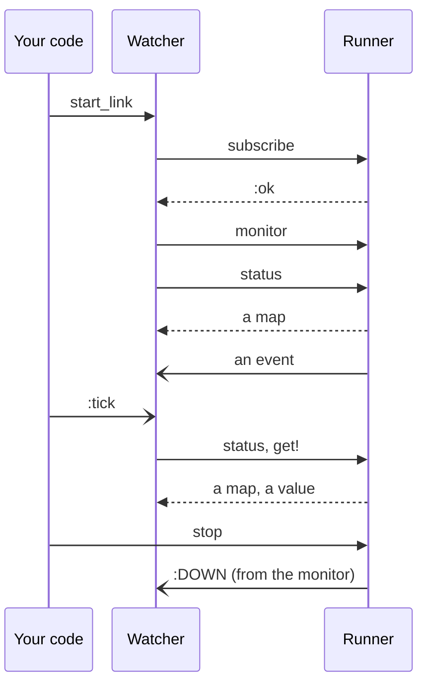

# Watch a runner

This guide is for an Elixir developer who runs a [plant](../reference/glossary.md#plant)
with a [runner](../reference/glossary.md#runner). It shows how to follow the runner from
a separate process, a watcher. The watcher gets the
[events](../reference/glossary.md#event) of the runner, and reads its status map and its
values. Use a watcher for an operator panel, a log or an alarm.

> #### Warning {: .warning}
>
> Do not use a watcher for a safety function, for example to stop a machine after a
> trip. The runner sends each event and does not wait for it. If the runner, the watcher
> or the Erlang VM stops, no event comes. Wire each emergency stop so that it works when
> logex stops. [Safety and limits](../explanation/safety-and-limits.md) gives the limits
> of logex.

> #### Caution {: .error}
>
> Do not subscribe to the kinds `:ran` and `:round` if you do not need each
> [round](../reference/glossary.md#round). A program in the
> [continuous task](../reference/glossary.md#continuous-task) or with no task makes the
> runner run up to 1 round each ms. Then a
> [subscriber](../reference/glossary.md#subscriber) gets up to 1,000 `:round` events
> each second, and 1 `:ran` event for each run of an instance. The runner does not wait
> for a subscriber. If the subscriber is slow, the events wait in its mailbox and use
> memory.

This diagram shows the messages between your code, the watcher and the runner.



Figure: the messages of a watcher. Each event is a message
`{Logex.Runner, runner, event}`. The runner sends it and does not wait. The runner sends
no event to say that it stopped. The monitor of the watcher gives the `:DOWN` message.

## Before you start

- You must have a Mix project that has logex.
  [Install logex and run a program](install-and-run.md) gives the steps.
- You must know how to start and stop a runner.
  [Run a plant on the clock](run-on-the-clock.md) gives the steps.
- You must know how to write a `GenServer`.
- The example of this guide runs the packing line of the tutorial
  [Your first plant](../tutorials/first-plant.md) on the manual
  [clock](../reference/glossary.md#clock). Thus the script prints the same lines at each
  run. Get
  [`conveyor.ld`](../tutorials/first-plant.md#step-1-write-the-conveyor-program) and
  [`packing.logex`](../tutorials/first-plant.md#step-2-write-the-configuration-file) from
  that tutorial. Get
  [`boxes.ld`](../tutorials/timers-and-counters.md#step-3-write-the-counter-program) from
  the tutorial A timer and a counter. Put the 3 files in the root directory of your
  project.

## Steps

1. Choose the kinds of events that the watcher needs. The kind of an event is the first
   atom of its tuple. With no list, `Logex.Runner.subscribe/1` subscribes to each kind
   of this table except `:ran` and `:round`. To get those 2 kinds, name them in the list
   of `Logex.Runner.subscribe/2`.

   | The event | When the runner sends it |
   |---|---|
   | `{:trip, reason}` | At a [trip](../reference/glossary.md#trip) |
   | `{:restart, mode}` | At a [restart](../reference/glossary.md#restart) that succeeds, before its first round |
   | `{:fault, task, instance, fault}` | When a [scan](../reference/glossary.md#scan) meets a [fault](../reference/glossary.md#fault) |
   | `{:overlap, task, missed}` | When a [periodic task](../reference/glossary.md#periodic-task) misses periods |
   | `{:edit, step, report}` | At each step of an [online edit](../reference/glossary.md#online-edit) |
   | `{:retain, {:error, reason}}` | When a write of the [store](../reference/glossary.md#store) fails, or takes longer than `write_limit:` |
   | `{:retain, {:warning, message}}` | When the watcher subscribes, if a different [program](../reference/glossary.md#program) wrote the store that the start read |
   | `{:forces, {:error, reason}}` | At a stop or a shutdown, if the write of the [forces file](../reference/glossary.md#forces-file) fails or takes longer than `write_limit:`. It comes only if the runner did not read the file at its start. |
   | `{:ran, task, instance, now}` | At each run of each [instance](../reference/glossary.md#instance) |
   | `{:round, now, outputs}` | After each round, with the output [points](../reference/glossary.md#point) by the names of their [globals](../reference/glossary.md#global). A round that stops during its writes gives only the outputs of the [devices](../reference/glossary.md#device) that it reached. |

   [Events](../reference/runner.md#events) gives the rules of each event.

2. Make the file `watch-a-runner.exs` in the root directory of your project. Write the
   start of the watcher, a `GenServer`. Its `init/1` subscribes, monitors the runner and
   reads the status map 1 time.

<!-- part of: watch-a-runner.exs -->
```elixir
alias Logex.Runner
alias Logex.Runner.Clock.Manual
alias Logex.IO.Sim

defmodule Watcher do
  # A process that follows a runner. It prints the events, the status and the end of the runner.
  use GenServer

  # The kinds that subscribe/1 takes, and :ran.
  @kinds [:overlap, :fault, :trip, :restart, :edit, :retain, :forces, :ran]

  def start_link(runner), do: GenServer.start_link(__MODULE__, runner)

  @impl true
  def init(runner) do
    :ok = Runner.subscribe(runner, @kinds)
    ref = Process.monitor(runner)
    show(runner)
    {:ok, %{runner: runner, ref: ref}}
  end
```

   This example takes `:ran` to show each run of the task `fast` on the manual clock. On
   your plant, remove `:ran` from `@kinds`.

   The runner sends the events to the process that calls `subscribe/2`. Thus the
   watcher must call it, in `init/1`. The watcher does not get an event that the runner
   sent before the call. Thus `init/1` reads the status map after it subscribes. Step 5
   gives `show/1`.

3. Add a `handle_info/2` clause for the events. Each event is a message
   `{Logex.Runner, runner, event}`. `runner` is the pid of the runner.

<!-- part of: watch-a-runner.exs -->
```elixir
  @impl true
  def handle_info({Runner, runner, {:ran, "fast", instance, now}}, %{runner: runner} = state) do
    IO.puts("t=#{now}  the task fast ran #{instance}")
    {:noreply, state}
  end

  def handle_info({Runner, runner, {:ran, _task, _instance, _now}}, %{runner: runner} = state),
    do: {:noreply, state}

  def handle_info({Runner, runner, event}, %{runner: runner} = state) do
    IO.puts("event  #{inspect(event)}")
    {:noreply, state}
  end
```

   The first clause prints each run of the task `fast`. The second clause ignores the
   runs of the other [tasks](../reference/glossary.md#task). The third clause prints
   each other event.

4. Add a clause for the end of the runner. No event says that the runner ended. The
   `:DOWN` message from the monitor of step 2 says it.

<!-- part of: watch-a-runner.exs -->
```elixir
  def handle_info({:DOWN, ref, :process, _pid, reason}, %{ref: ref} = state) do
    IO.puts("the runner ended: #{inspect(reason)}")
    {:stop, :normal, state}
  end
```

   The reason is `:normal` after `Logex.Runner.stop/1`. No event tells of the stop. If
   the write of the store or of the forces file fails at the stop, the runner sends a
   `:retain` or a `:forces` event. A tripped runner does not end. It stays, and waits for
   a restart.

5. Add a clause that reads the status map and 2 values at each `:tick`.
   `Logex.Runner.status/1` gives the status map. `Logex.Runner.get!/2` reads a value of
   the [resource](../reference/glossary.md#resource) by its name.

> #### Caution {: .error}
>
> Show `status` and `trip` beside each value on an operator panel. After a trip,
> `get!/2` gives the value of the last round, not the value at the output point. For
> example, `k1` can be 1 while the runner wrote 0 to its output point.

<!-- part of: watch-a-runner.exs -->
```elixir
  def handle_info(:tick, state) do
    show(state.runner)
    {:noreply, state}
  end

  defp show(runner) do
    %{status: status, trip: trip, now: now, rounds: rounds} = Runner.status(runner)
    k1 = Runner.get!(runner, "k1")
    boxes = Runner.get!(runner, "b1.count")
    IO.puts("t=#{now}  status=#{status} trip=#{inspect(trip)} rounds=#{rounds} k1=#{k1} boxes=#{boxes}")
  end
```

   Each call waits for the runner between 2 rounds. The runner serves the calls in its
   [share](../reference/glossary.md#share) of the time. A loop of calls does not stop the
   rounds. It holds back a due round by 1 call or 1 [slot](../reference/glossary.md#slot)
   at most. Read the status map no more often than a person can read it, for example
   each 500 ms.

6. Add the function `sync/1`, and close the module. The script of step 7 sends each
   `:tick` and waits for its line with `sync/1`. Thus the script prints the same lines at
   each run. A watcher on a plant does not need `sync/1`.

<!-- part of: watch-a-runner.exs -->
```elixir
  # Returns when the watcher has handled each message that came before this call.
  def sync(watcher), do: GenServer.call(watcher, :sync)

  @impl true
  def handle_call(:sync, _from, state), do: {:reply, :ok, state}
end
```

7. Add the lines that start the plant and the watcher. They press the start button, pass
   3 boxes and make the next read of the panel fail. Then they restart the runner cold
   and stop it. Make sure that the file has this text.

```elixir
alias Logex.Runner
alias Logex.Runner.Clock.Manual
alias Logex.IO.Sim

defmodule Watcher do
  # A process that follows a runner. It prints the events, the status and the end of the runner.
  use GenServer

  # The kinds that subscribe/1 takes, and :ran.
  @kinds [:overlap, :fault, :trip, :restart, :edit, :retain, :forces, :ran]

  def start_link(runner), do: GenServer.start_link(__MODULE__, runner)

  @impl true
  def init(runner) do
    :ok = Runner.subscribe(runner, @kinds)
    ref = Process.monitor(runner)
    show(runner)
    {:ok, %{runner: runner, ref: ref}}
  end

  @impl true
  def handle_info({Runner, runner, {:ran, "fast", instance, now}}, %{runner: runner} = state) do
    IO.puts("t=#{now}  the task fast ran #{instance}")
    {:noreply, state}
  end

  def handle_info({Runner, runner, {:ran, _task, _instance, _now}}, %{runner: runner} = state),
    do: {:noreply, state}

  def handle_info({Runner, runner, event}, %{runner: runner} = state) do
    IO.puts("event  #{inspect(event)}")
    {:noreply, state}
  end

  def handle_info({:DOWN, ref, :process, _pid, reason}, %{ref: ref} = state) do
    IO.puts("the runner ended: #{inspect(reason)}")
    {:stop, :normal, state}
  end

  def handle_info(:tick, state) do
    show(state.runner)
    {:noreply, state}
  end

  defp show(runner) do
    %{status: status, trip: trip, now: now, rounds: rounds} = Runner.status(runner)
    k1 = Runner.get!(runner, "k1")
    boxes = Runner.get!(runner, "b1.count")
    IO.puts("t=#{now}  status=#{status} trip=#{inspect(trip)} rounds=#{rounds} k1=#{k1} boxes=#{boxes}")
  end

  # Returns when the watcher has handled each message that came before this call.
  def sync(watcher), do: GenServer.call(watcher, :sync)

  @impl true
  def handle_call(:sync, _from, state), do: {:reply, :ok, state}
end

{:ok, plant} = Logex.Configuration.compile_file("packing.logex")
{:ok, clock} = Manual.start_link()
{:ok, panel} = Sim.start_link(reports: true, clock: clock)

{:ok, runner} =
  Runner.start_link(configuration: plant, io: %{"panel" => {Sim, sim: panel}}, clock: {Manual, clock})

{:ok, watcher} = Watcher.start_link(runner)

# On a plant, :timer.send_interval/2 sends :tick. Here the script sends it and waits for the line.
tick = fn ->
  send(watcher, :tick)
  :ok = Watcher.sync(watcher)
end

Sim.set(panel, "panel.i.0", 1)              # start pressed
Manual.advance(clock, 10)
Sim.set(panel, "panel.i.0", 0)

for _box <- 1..3 do
  Sim.set(panel, "panel.i.8", 1)            # a box on the eye, then past it
  Manual.advance(clock, 2)
  Sim.set(panel, "panel.i.8", 0)
  Manual.advance(clock, 2)
end

tick.()
Sim.fail(panel, :read, {:error, :eio})      # the next read of the panel fails
Manual.advance(clock, 10)
tick.()
:ok = Runner.restart(runner, :cold)
tick.()

ref = Process.monitor(watcher)
:ok = Runner.stop(runner)
receive do: ({:DOWN, ^ref, :process, ^watcher, :normal} -> :ok)
```

8. Run the script.

```console
$ mix run watch-a-runner.exs
t=0  status=running trip=nil rounds=1 k1=0 boxes=0
t=10  the task fast ran c1
t=20  the task fast ran c1
t=22  status=running trip=nil rounds=23 k1=1 boxes=3
event  {:trip, {:io, "panel", {:error, :eio}}}
t=29  status=tripped trip={:io, "panel", {:error, :eio}} rounds=30 k1=1 boxes=3
event  {:restart, :cold}
t=29  the task fast ran c1
t=29  status=running trip=nil rounds=31 k1=0 boxes=0
the runner ended: :normal
```

## The result

The watcher followed the runner from its start to its stop. `t=` gives `now`, the time
of the resource. It is the time of the last round. The time from a trip to its restart
does not count. Each line that the script prints tells you 1 thing:

| Line | What it shows |
|---|---|
| `t=0  status=running` | The status map that `init/1` read. The first round ran before `start_link/1` returned. No event came for it. |
| `t=10` and `t=20  the task fast ran c1` | The `:ran` events of the task `fast`, 1 each 10 ms. The watcher ignored the runs of `main`. |
| `t=22  status=running` | The first `:tick`. The conveyor runs, and the [counter](../reference/glossary.md#counter) counted 3 boxes. |
| `event  {:trip, ...}` | The read of the panel at its poll at 30 ms failed. The runner tripped at that read, before a round at 30 ms. |
| `t=29  status=tripped` | `trip` gives the reason. `now` is 29, the time of the last round. `rounds` is 30: the rounds from 0 ms to 29 ms. `k1` is 1, the value of the last round. |
| `event  {:restart, :cold}` | The runner sends it before the first round of the restart. |
| `t=29  the task fast ran c1` | The first round of the restart ran the task `fast`. `now` stays 29, because the time while tripped does not count. |
| `t=29  status=running ... k1=0 boxes=0` | The [cold restart](../reference/glossary.md#cold-restart) started each [tag](../reference/glossary.md#tag) at its [initial value](../reference/glossary.md#initial-value). |
| `the runner ended: :normal` | `Logex.Runner.stop/1` stopped the runner. The monitor gave the reason. |

## On your plant

On your plant, start the watcher under the supervisor of the runner, after the runner.
[Run a plant under a supervisor](run-under-a-supervisor.md) gives the child spec of the
runner. Make these changes to the watcher:

<!-- fragment: the changes for a plant, run in scratch with a runner named Packing under a supervisor -->
```elixir
defmodule Watcher do
  use GenServer, restart: :transient

  @kinds [:overlap, :fault, :trip, :restart, :edit, :retain, :forces]

  def start_link(name), do: GenServer.start_link(__MODULE__, name)

  @impl true
  def init(name) do
    runner = GenServer.whereis(name)
    :ok = Runner.subscribe(runner, @kinds)
    ref = Process.monitor(runner)
    {:ok, _timer} = :timer.send_interval(500, :tick)
    show(runner)
    {:ok, %{runner: runner, ref: ref}}
  end

  # The clauses of handle_info/2 and show/1, as in the steps
end
```

- `restart: :transient`: the supervisor does not start the watcher again when it stops
  with `:normal`, at the end of the runner. The child spec of the runner has
  `restart: :temporary`.
- After the runner stops or crashes, the watcher stops also. When you start a new runner
  with `Supervisor.start_child/2`, start the watcher again with
  `Supervisor.restart_child(supervisor, Watcher)`.
- `GenServer.whereis/1`: an event holds the pid of the runner, also when you start the
  runner with `name:`. The clauses of step 3 compare that pid with the pid that
  `init/1` keeps.
- `:timer.send_interval/2` sends `:tick` to the watcher each 500 ms.
- `@kinds` has no `:ran`. Add `:ran` or `:round` only for a short time, when you must see
  each round.

## If it does not work

| What you see | Cause | What to do |
|---|---|---|
| The watcher gets no event | A different process called `subscribe/2`, for example your script. | Call it in `init/1` of the watcher. |
| The watcher gets no `:ran` and no `:round` event | `subscribe/1` does not subscribe to these kinds. | Name them in the list of `subscribe/2`. |
| The events of a kind stop after a second `subscribe/2` | The second call replaces the kinds of the first. | Give each kind in 1 call. |
| The watcher gets no trip event, but `status` is `:tripped` | The trip came before the watcher subscribed. | Read the status map in `init/1`, after `subscribe/2`. |
| The watcher stops at the first event, and the log has `no function clause matching` and `handle_info` | You gave the runner by its `name:`. The watcher compares the event with the name, but the event holds the pid. | Get the pid with `GenServer.whereis/1`. |
| The mailbox of the watcher gets longer, and the memory goes up | The watcher subscribed to `:ran` or `:round`, or it is slower than the events. | Remove those kinds, or make each clause shorter. |
| `{:retain, {:warning, message}}` when the watcher subscribes | A different program wrote the store that the start read. The runner sends it 1 time to each subscriber whose kinds include `:retain`. | [Take back a deploy](take-back-a-deploy.md) gives the steps. |
| `{:forces, {:error, reason}}` at a stop | The runner did not read its forces file at its start, and its write at the stop failed. The next start can bring back an old [force](../reference/glossary.md#force). | [Force an input point](force-inputs.md) gives the forces file. |
| `k1` is 1 after a trip | `get!/2` gives the value of the last round. The runner wrote 0 to the output points of each device that answered. | Read `status` and `unzeroed`: `unzeroed` lists each device whose outputs can still be on. |

`Logex.Runner.subscribe/2` and `Logex.Runner.get!/2` raise an `ArgumentError` with the
messages of this table. In this guide, the calls are in `init/1`, and `start_link/1`
links the watcher to the script. Thus the script stops, and its error starts with
`** (EXIT from`. The next line gives the message.

| What you see | Cause | What to do |
|---|---|---|
| `a runner's events are subscribed by a list of their kinds, among :overlap, :fault, :trip, :restart, :edit, :retain, :forces, :ran and :round, got: [:rounds]` | A kind has a wrong name, or the kinds are not in a list, for example `:trip`. | Give a list of the kinds of step 1. |
| `the runner #PID<0.155.0> is not running` | The runner stopped or crashed before the call. | Start the watcher after the runner. |
| `no runner is running under the name Nope` | No runner has this `name:`. | Give the name of the runner. |
| `no runner is running under the name nil` | `GenServer.whereis/1` gave `nil`, because no runner had this name when the watcher started. | Start the watcher after the runner. |
| `` `b1` is a program instance of `boxes`, which declares no `cont` — did you mean `count`? `` | The program of the instance has no tag of this name. | Give `instance.tag` with a tag of the program. |
| `` `k2` is neither a global nor a program instance `` | The name is not the name of a global or of an instance. | Give the name of a global, or `instance.tag`. |

## See also

- [Runner](../reference/runner.md): each key of the [status map](../reference/runner.md#status),
  each [event](../reference/runner.md#events) and the rules of a call.
- [Run a plant on the clock](run-on-the-clock.md): start and stop a runner.
- [Run a plant under a supervisor](run-under-a-supervisor.md): the child spec of the
  runner.
- [Set watchdogs](set-watchdogs.md): use `runs`, `overlaps` and `latest_wake` of the
  status map.
- [Restart after a trip](restart-after-a-trip.md): what to do after a trip event.
- [Write ExUnit tests on the manual clock](test-on-the-manual-clock.md): calls from a
  different process on the manual clock.
- [Glossary](../reference/glossary.md): the technical words of logex.
