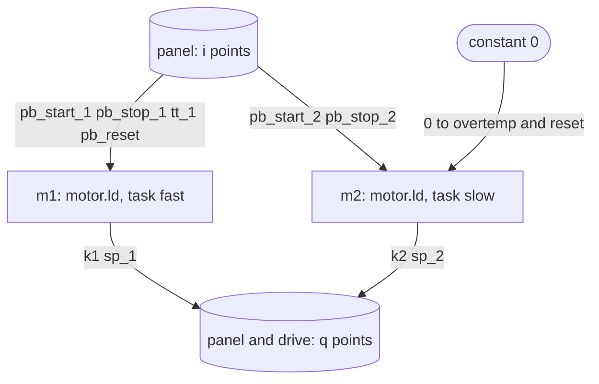

# Write a configuration file

This guide is for a reader who has 1 or more ladder
[programs](../reference/glossary.md#program) and must run them together as 1
[plant](../reference/glossary.md#plant). It shows how to write a
[configuration file](../reference/glossary.md#configuration-file): the
[tasks](../reference/glossary.md#task), the [globals](../reference/glossary.md#global),
the [instances](../reference/glossary.md#instance) and the
[connections](../reference/glossary.md#connection). Then a script
[compiles](../reference/glossary.md#compile) the file and runs 7 cycles of the plant,
from 0 ms to 60 ms.

> #### Warning {: .warning}
>
> Do not use logex for a safety function, for example an emergency stop. logex can stop
> at any time. Make each safety function with hardwired circuits or with a safety-rated
> controller. [Safety and limits](../explanation/safety-and-limits.md) gives the limits of
> logex.

## Before you start

- You must have a Mix project that has logex.
  [Install logex and run a program](install-and-run.md) gives the steps.
- You must know what a [cycle](../reference/glossary.md#cycle) is.
- You must have the file of each program of the plant. This guide uses
  [`motor.ld`](../tutorials/first-program.md). Put it in the root directory of your
  project.

The plant of this guide has 2 conveyors. Conveyor 1 has a start button, a stop button, a
reset button, a thermal switch, a motor contactor and a speed drive. Conveyor 2 has a
start button, a stop button, a motor contactor and a speed drive. The program `motor.ld`
runs 1 conveyor. The configuration makes 2 instances of it: `m1` on a 10 ms task and `m2`
on a 50 ms task. These are the `var_input` and `var_output`
[declarations](../reference/glossary.md#declaration) of `motor.ld`:

<!-- part of: motor.ld -->
```text
var_input start bool
var_input stop bool
var_input overtemp bool
var_input reset bool
var_output motor bool
var_output run_lamp bool
var_output speed_sp dint 1200
```



Figure: the plant of this guide, from the device or instance that writes each global to
the one that reads it. The constant 0 goes to 2 tags of `m2`, and the tag `run_lamp` has
no connection.

## Steps

1. In the root directory of your project, make the file `plant.logex`. The name of the
   file without `.logex` is the name of the
   [configuration](../reference/glossary.md#configuration). Use only letters, digits and
   `_`, and start with a letter or `_`.

> #### Caution {: .error}
>
> Give a task an interval that is shorter than the shortest signal that its instances
> must see. An instance reads its [inputs](../reference/glossary.md#input) only when its
> task runs. If a button goes to 1 and back to 0 between 2 runs, the instance does not
> see it. Step 8 shows this for `m2`.

2. Write 1 task line for each interval at which instances must run. Give each task a
   [priority](../reference/glossary.md#priority) from 0 to 65535. If 2 tasks are due in
   the same cycle, the task with the higher priority runs first.

<!-- part of: plant.logex -->
```text
task fast interval 10 priority 1
task slow interval 50 priority 2
```

   Each line declares a [periodic task](../reference/glossary.md#periodic-task): its
   name, its interval in ms and its priority. The priority 0 is the highest. This table
   gives the 3 kinds of task and the words that follow the name of each.

   | Kind | When it runs its instances |
   |---|---|
   | Periodic: `interval 10 priority 1` | In the first cycle, then each 10 ms |
   | [Continuous](../reference/glossary.md#continuous-task): `continuous` | In each cycle, after the other tasks |
   | [Event](../reference/glossary.md#event-task): `single estop priority 0` | When its [trigger](../reference/glossary.md#trigger) `estop`, a bool global, goes from 0 to 1, and in the first cycle if `estop` is 1 |

   An event task can also have an interval. [Use an event task](use-an-event-task.md)
   gives the rules.

3. Write 1 `var_global` line for each [point](../reference/glossary.md#point) of each
   [device](../reference/glossary.md#device). Write `at` and the place of the point
   after the [type](../reference/glossary.md#type).

<!-- part of: plant.logex -->
```text
var_global pb_start_1 bool at panel.i.0
var_global pb_stop_1  bool at panel.i.1
var_global tt_1       bool at panel.i.2
var_global pb_start_2 bool at panel.i.3
var_global pb_stop_2  bool at panel.i.4
var_global pb_reset   bool at panel.i.5
var_global k1         bool at panel.q.0
var_global k2         bool at panel.q.1
var_global sp_1       dint at drive.q.0
var_global sp_2       dint at drive.q.1
```

   These lines are the I/O list of the plant. A global with `at` is a
   [located global](../reference/glossary.md#located-global). Give it the type of the tags
   that it connects to, or a type that widens. Step 5 gives the rule. The text after
   `at` has 3 parts:

   | Part | In `panel.i.0` | Rule |
   |---|---|---|
   | The device | `panel` | A name. The [runner](../reference/glossary.md#runner) finds the [adapter](../reference/glossary.md#adapter) of the device by this name. |
   | The direction | `i` | `i` for an input of the device, an input point. `q` for an output of the device, an output point. Lowercase only. |
   | The address | `0` | An integer with no leading 0, or integers with a `.` between them, such as `2.4` |

   A located global takes no [initial value](../reference/glossary.md#initial-value). For
   a value that no device holds, write a line with no `at`, such as
   `var_global hold bool 1`. The last word is the initial value.

4. Write 1 `program` line for each instance. Give the name of the instance, then its
   [program type](../reference/glossary.md#program-type): the name of the program file
   without `.ld`. Then write `with` and the task.

<!-- part of: plant.logex -->
```text
program m1 motor with fast
```

   The instances of 1 task run in the sequence of their `program` lines. An instance
   sees in the same cycle a value that an earlier instance of its task writes. It sees a
   value that a later instance writes only in the next cycle.

5. After each `program` line, write 1 connection line for each `var_input`
   [tag](../reference/glossary.md#tag) of the program. Then connect each `var_output`
   tag whose value a device or a different instance must read.

<!-- part of: plant.logex -->
```text
program m2 motor with slow
  m2.start    pb_start_2
  m2.stop     pb_stop_2
  m2.overtemp 0
  m2.reset    0
  m2.motor    k2
  m2.speed_sp sp_2
```

   A connection line has no arrow. The [section](../reference/glossary.md#section) of the
   tag gives the direction. Conveyor 2 has no thermal switch and no reset button. Thus
   `m2.overtemp` and `m2.reset` get the constant `0`.

   | Tag | Its connections |
   |---|---|
   | `var_input` | Exactly 1, to a global or to a constant that the type of the tag holds. logex copies the value into the tag before each [scan](../reference/glossary.md#scan) of the instance. |
   | `var_output` | 0, 1 or more, each to a global that is not at an input point. logex copies the tag into the global after each scan of the instance. |

   For a `var_input`, the type of the global must be the type of the tag, or
   [widen](../reference/glossary.md#widen) into it. For a `var_output`, the type of the
   tag must be the type of the global, or widen into it. Only 1 `var_output` tag can
   write a global.

6. Compare your file with this text. Except for the `program` lines of 1 task, the
   sequence of the lines is free.

<!-- file: plant.logex -->
```text
// plant.logex -- two conveyors, one program type (motor.ld)
task fast interval 10 priority 1
task slow interval 50 priority 2

var_global pb_start_1 bool at panel.i.0
var_global pb_stop_1  bool at panel.i.1
var_global tt_1       bool at panel.i.2
var_global pb_start_2 bool at panel.i.3
var_global pb_stop_2  bool at panel.i.4
var_global pb_reset   bool at panel.i.5
var_global k1         bool at panel.q.0
var_global k2         bool at panel.q.1
var_global sp_1       dint at drive.q.0
var_global sp_2       dint at drive.q.1

program m1 motor with fast
  m1.start    pb_start_1
  m1.stop     pb_stop_1
  m1.overtemp tt_1
  m1.reset    pb_reset
  m1.motor    k1
  m1.speed_sp sp_1

program m2 motor with slow
  m2.start    pb_start_2
  m2.stop     pb_stop_2
  m2.overtemp 0
  m2.reset    0
  m2.motor    k2
  m2.speed_sp sp_2
```

   A line that starts with `//` is a comment.

7. In the root directory of your project, make the file `write-a-configuration-file.exs`
   with this text. Part 1 compiles the file. Part 2 runs 7 cycles, 10 ms apart, with no
   [clock](../reference/glossary.md#clock) and no device.

```elixir
# Part 1: compile plant.logex. Print each warning, each global and its point, and the
# task of each instance. If the files have an error, print each diagnostic and stop.
check = fn
  {:ok, plant} ->
    Enum.each(plant.warnings, &IO.puts(Logex.Diagnostic.format(&1)))
    for global <- plant.globals, do: IO.puts("#{global.at}  #{global.name}")
    for instance <- plant.instances, do: IO.puts("#{instance.name} on task #{instance.task}")
    plant

  {:error, diagnostics} ->
    Enum.each(diagnostics, &IO.puts(Logex.Diagnostic.format(&1)))
    System.halt(1)
end

plant = check.(Logex.Configuration.compile_file("plant.logex"))

# Part 2: run 7 cycles. Each line gives the ms since the last cycle, and the input
# points that change before the cycle. An input point keeps its value until it changes.
steps = [
  {0, %{}},
  {10, %{"pb_start_1" => 1, "pb_start_2" => 1}},
  {10, %{"pb_start_1" => 0, "pb_start_2" => 0}},
  {10, %{"tt_1" => 1}},
  {10, %{}},
  {10, %{"pb_start_2" => 1}},
  {10, %{"pb_start_2" => 0}}
]

row = fn cells, ran ->
  IO.puts(Enum.map_join(cells, &String.pad_leading("#{&1}", 6)) <> "  " <> ran)
end

row.(["time", "k1", "k2", "sp_1", "sp_2"], "ran")

Enum.reduce(steps, {Logex.Runtime.start(plant), 0}, fn {ms, changes}, {resource, time} ->
  {resource, out, events} = Logex.Runtime.cycle(resource, ms, changes)
  ran = for {:ran, _task, instance, _time} <- events, do: instance
  row.([time + ms, out["k1"], out["k2"], out["sp_1"], out["sp_2"]], Enum.join(ran, " "))
  {resource, time + ms}
end)
```

   `Logex.Configuration.compile_file/1` reads `plant.logex` and compiles `motor.ld` from
   the same directory. `Logex.Runtime.start/1` makes the
   [resource](../reference/glossary.md#resource). `Logex.Runtime.cycle/3` runs 1 cycle.
   It returns the value of each global at an output point, and a `:ran` event for each
   instance that ran.

8. Run the script.

```console
$ mix run write-a-configuration-file.exs
panel.i.0  pb_start_1
panel.i.1  pb_stop_1
panel.i.2  tt_1
panel.i.3  pb_start_2
panel.i.4  pb_stop_2
panel.i.5  pb_reset
panel.q.0  k1
panel.q.1  k2
drive.q.0  sp_1
drive.q.1  sp_2
m1 on task fast
m2 on task slow
  time    k1    k2  sp_1  sp_2  ran
     0     0     0  1200  1200  m1 m2
    10     1     0  1200  1200  m1
    20     1     0  1200  1200  m1
    30     1     0     0  1200  m1
    40     1     0     0  1200  m1
    50     1     1     0  1200  m1 m2
    60     1     1     0  1200  m1
```

   The first run also prints the lines of the compile of logex and of your project.

   If a file has an error, the script prints 1
   [diagnostic](../reference/glossary.md#diagnostic) for each error, and no table.
   Correct each line that a diagnostic names, and run the script again. If the file has a
   [warning](../reference/glossary.md#warning), the script prints it first and runs the
   plant.

## The result

You have a configuration file that logex compiles. The first 10 lines of the output are
the I/O list. The last 8 lines are a table of the cycles. This table explains its rows:

| Time | What the cycle shows |
|---|---|
| 0 ms | Each periodic task runs in the first cycle. `sp_1` and `sp_2` get 1200, the initial value of `speed_sp`. |
| 10 ms | Both start buttons are 1. `m1` runs and `k1` goes to 1. `m2` does not run. |
| 20 ms | Both buttons are 0. The [seal-in](../reference/glossary.md#seal-in) of `m1` keeps `k1` at 1. |
| 30 ms | The thermal switch `tt_1` is 1. `m1` sets `sp_1` to 0. `motor.ld` does not stop the motor for `overtemp`. |
| 50 ms | `m2` runs for the first time after 0 ms. It did not see the button from 10 ms to 20 ms. The button is 1 again, and `k2` goes to 1. |

## Other lines that a plant can need

| To do this | Write this | Read |
|---|---|---|
| Run an instance in each cycle, after the other tasks | `task main continuous`, and a `program` line with no `with` | [Your first plant](../tutorials/first-plant.md) |
| Limit the time of 1 run of a task | A [watchdog](../reference/glossary.md#watchdog): `watchdog 50` at the end of the task line | [Set watchdogs](set-watchdogs.md) |
| Let a program read a global by its name | `var_external estop bool` in the program | [Share a global](share-a-global.md) |
| Keep a value across a [warm restart](../reference/glossary.md#warm-restart) | `var_global retain total dint 0` | [Keep values across a restart](keep-values-across-a-restart.md) |
| Put an [array](../reference/glossary.md#array) at consecutive points | `var_global zone_t real[8] at card.i.0` | [Map I/O points](map-io-points.md) |

## If it does not work

The column **What you see** shows part of a diagnostic or a warning. The full message
also gives the file, and the line if there is one.
[Read a diagnostic](read-diagnostics.md) shows how to read it, and
[Configuration file](../reference/configuration-file.md) gives each rule.
[Configuration file: messages](../reference/configuration-file-messages.md) gives each
message of a configuration from a run.

### The task lines

| What you see | Cause | What to do |
|---|---|---|
| `` task `fast` needs a priority `` | A periodic task or an event task with no `priority` | Add `priority` and a number. |
| `` `interval` goes before `priority` `` | The words of a task line in a wrong sequence | Write `interval`, then `priority`. |
| `` "10ms" is neither a number nor a tag `` | A unit after a number | Write the number of ms only. |
| `` warning: task `slow` runs no instance `` | No `program` line names the task. | Add `with slow` to a `program` line, or remove the task line. |

### The globals and the points

| What you see | Cause | What to do |
|---|---|---|
| `` `panel.I.0` is not a location as written `` | An uppercase `I` or `Q`, or an address with a leading 0 | Write the form that the message gives. |
| `` `k1` is an output point: it takes no initial value `` | An initial value before `at` | Remove the value. |
| `` unexpected `1` after the declaration of `k1` `` | An initial value after `at` | Remove the value. |
| `` warning: `spare` is declared but nothing uses it `` | A global that no connection, task or program uses | Connect the global, or remove its line. |

### The program lines and the connections

| What you see | Cause | What to do |
|---|---|---|
| `` no task `fsat` — did you mean `fast`? `` | A spelling error in the name of a task or a global. The message has the same form for each. | Write the name that the message gives. |
| `` `m1` runs `motor`, which declares no `strat` — did you mean `start`? `` | A spelling error in the name of a tag of an instance, on a connection line | Write the name that the message gives. |
| `` unknown program type `pump`: there is no `pump.ld` beside `` | No program file of that name beside the `.logex` file | Put the file there, or correct the `program` line. |
| `` `m1` leaves its var_inputs `overtemp` and `reset` unconnected `` | A tag with no connection, or a spelling error in the name of the tag. The message is on the `program` line. | Connect each tag that the message names. |
| `` `k1` is already driven by `m1.motor` `` | 2 tags that write 1 global | Give each tag its own global. |
| `` `m1.motor`, a var_output, cannot drive it `` | A tag that writes a global at an input point | Connect it to an output point, or to a global with no `at`. |
| `` `m1.speed_sp` is a dint, but `k1` is a bool `` | A global of a type that does not agree with the tag | Give the global the type of the tag. |
| `` no global `button`: declare it `` | A global that the file does not declare | Declare the global as the message shows. |
| `` illegal character "-" `` | An arrow, `->`, on a connection line | Remove the arrow. |

## See also

- [Configuration file](../reference/configuration-file.md): each line, word and rule of
  a `.logex` file.
- [Tasks and the schedule](../explanation/tasks-and-scheduling.md): when each task runs,
  and why.
- [Your first plant](../tutorials/first-plant.md): a lesson with a configuration file, a
  continuous task and the runner.
- [Run a plant on the clock](run-on-the-clock.md): the runner, the clock and the devices.
- [Build a configuration from Elixir](build-a-configuration-from-elixir.md): the same
  configuration from Elixir data.
- [Glossary](../reference/glossary.md): the words of this guide.
