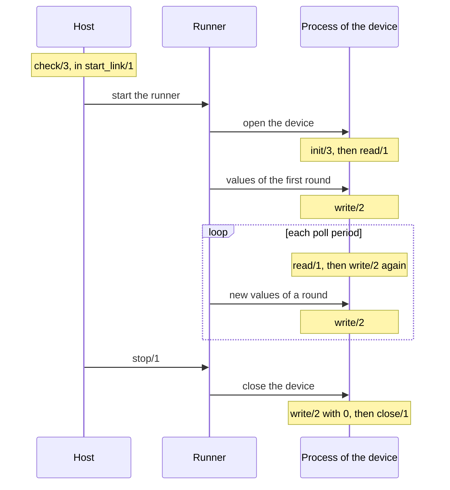

# Write a device adapter

This guide is for a reader who has a [plant](../reference/glossary.md#plant) that runs
on [simulated devices](../reference/glossary.md#simulated-device). It shows how to
write an [adapter](../reference/glossary.md#adapter) for a
[device](../reference/glossary.md#device) with hardware, for example an I/O card or a
device on a fieldbus.

An adapter is a module with the behaviour `Logex.IO`. It reads and writes 1 kind of
device for the [runner](../reference/glossary.md#runner). logex has only 1 adapter,
`Logex.IO.Sim`, for the simulated device. You write each other adapter in the
[host](../reference/glossary.md#host), which is your application.

> #### Warning {: .warning}
>
> Do not use logex for a safety function, for example an emergency stop. logex can stop
> at any time. Make each safety function with hardwired circuits or with a safety-rated
> controller. [Safety and limits](../explanation/safety-and-limits.md) gives the limits
> of logex.

> #### Warning {: .warning}
>
> Make sure that the hardware of your device sets its output
> [points](../reference/glossary.md#point) to safe values when it gets no write. logex
> cannot write 0 to the output points in these 4 cases:
>
> - the computer or the Erlang VM stops
> - the cable breaks
> - a callback of your adapter does not return before its time limit
> - the callback `write/2` of your adapter has a failure

## Before you start

You must know the behaviours and the processes of Elixir. You must have:

- a [configuration file](../reference/glossary.md#configuration-file) with a
  [located global](../reference/glossary.md#located-global) for each point of the
  device ([Map tags to I/O points](map-io-points.md) shows how)
- the protocol of your device: how a computer reads and writes its points
- a Mix project with logex
  ([Install logex and run a program](install-and-run.md) shows how)

## The example

The example is the module `LineDevice`, an adapter for an I/O card. It is the first
part of the script `line_device.exs`, in the directory `examples/` of the repository.
[Check a device adapter](test-a-device-adapter.md) shows the complete script and
runs it.

> #### Caution {: .error}
>
> Do not use the module `LineDevice` for a device with hardware before you change it.
> It is an example to copy, not an adapter of logex. You must write 3 things for your
> device: its protocol, the time limit of each wait, and the code that connects again.

The adapter and the card send lines of text on a TCP socket. The card has 16 input
channels, and it has output channels. A point of the plant is 1 channel of the card.

| The adapter sends | The card answers |
|---|---|
| `read` | The value of each input channel: `0=1 1=0 2=0` and 13 more |
| `write 0=1 4=0` | `ok` |
| `quit` | `bye` |

[Check a device adapter](test-a-device-adapter.md) also shows the plant of the
example. Its configuration file puts 6 points on the device `panel`. `init/3` gets each
point as a `%Logex.IO.Point{}`.

| `name` | Location | `address` |
|---|---|---|
| `"estop"` | `panel.i.7` | `[7]` |
| `"pb_start_1"` | `panel.i.0` | `[0]` |
| `"pb_reset"` | `panel.i.2` | `[2]` |
| `"eye"` | `panel.i.8` | `[8]` |
| `"k1"` | `panel.q.0` | `[0]` |
| `"case_full"` | `panel.q.4` | `[4]` |

The field `direction` is `:input` for the letter `i` and `:output` for the letter `q`.
The field `type` is `:bool` for each point of the example. The field `address` is the
list of the numbers of the [location](../reference/glossary.md#location): `[2, 4]` for
`rack.i.2.4`. Elixir prints the list `[7]` as `~c"\a"`. To print the numbers, use
`inspect(address, charlists: :as_lists)`.

## The callbacks

The runner starts 1 process for each device. It reads each device 1 time in each
[poll period](../reference/glossary.md#poll-period), which is its option `poll:`,
10 ms by default. This diagram shows when logex calls each callback, and in which
process.



Figure: the callbacks of an adapter, from the start of the runner to its stop.

A box on the line of a process shows the callbacks that run in that process.

| Callback | Necessary | Process | logex calls it |
|---|---|---|---|
| `check/3` | No | Of the host | In `Logex.Runner.start_link/1`, before the runner starts |
| `init/3` | Yes | Of the device | When the runner opens the device: at its start, and at a restart if the process stopped |
| `read/1` | Yes | Of the device | After `init/3`, then in each poll period |
| `write/2` | Yes | Of the device | With the new values of a [round](../reference/glossary.md#round), and again in each poll period while the plant runs |
| `report/2` | No | Of the device | For each message that the process gets |
| `close/1` | No | Of the device | After the last `write/2`, when the runner stops |

### The time limit of a callback

| Callback | Time limit | Default |
|---|---|---|
| `init/3` and the `read/1` after it, together | The option `open:` | 5000 ms |
| The `read/1` of a restart | The option `open:` | 5000 ms |
| Each other call of `read/1`, `write/2`, `report/2` and `close/1` | The option `idle:`, the [watchdog](../reference/glossary.md#watchdog) of the runner, plus the option `poll:` | 510 ms |

`check/3` has no time limit.

> #### Caution {: .error}
>
> Make each callback return before its time limit. The time limit is for all the waits
> of 1 callback together. If a callback does not return before its time limit, the
> runner [trips](../reference/glossary.md#trip) with `:timeout`, and logex kills the
> process of the device. Then logex writes no 0 to the output points of the device, and
> `close/1` does not run.

`LineDevice` obeys this rule. It waits at most 200 ms to connect and 250 ms for each
answer. Thus a call that connects again waits at most 450 ms, less than 510 ms. A card that
does not answer thus gives `{:error, :timeout, state}` before the time limit. The runner
then trips with that reason, writes 0 to the output points of the card, and calls
`close/1`. In your adapter, make the sum of the waits of each callback less than its
time limit.

## Steps

The blocks of steps 1 to 7 are the complete module `LineDevice`, without its comments.
Their sequence is not the sequence of the script.

1. **Make a module with the behaviour `Logex.IO`.**

<!-- part of: line_device.exs -->
```elixir
defmodule LineDevice do
  @behaviour Logex.IO

  @connect [:binary, packet: :line, active: false]
```

The attribute `@connect` has the options of the TCP socket.

<!-- part of: line_device.exs -->
```elixir
  @connect_ms 200
  @answer_ms 250
```

The attributes `@connect_ms` and `@answer_ms` are the waits in ms, to connect and for
each answer. Their sum is less than the time limit of a callback.

2. **Write `init/3`.** Open the device, and return `{:ok, state}`. The value `state`
   is the data that each later callback gets.

<!-- part of: line_device.exs -->
```elixir
  @impl true
  def init(_device, points, opts) do
    inputs = for %Logex.IO.Point{direction: :input, address: at} <- points, do: at
    opened(connected(%{host: opts[:host], port: opts[:port], socket: nil, inputs: inputs}))
  end

  defp opened({:ok, state}), do: {:ok, state}
  defp opened({:error, reason, _state}), do: {:error, reason}
```

<!-- part of: line_device.exs -->
```elixir
  defp connected(%{socket: nil} = state),
    do: socket(:gen_tcp.connect(state.host, state.port, @connect, @connect_ms), state)

  defp connected(state), do: {:ok, state}

  defp socket({:ok, socket}, state), do: {:ok, %{state | socket: socket}}
  defp socket({:error, reason}, state), do: {:error, reason, state}
```

`init/3` gets the name of the device, its points and the options of the adapter.
`LineDevice` keeps the address of each input point for `read/1`, and opens the socket
in `connected/1`.

- If `init/3` returns `{:error, reason}`, `Logex.Runner.start_link/1` returns
  `{:error, {:io_init, "panel", reason}}`.
- If `init/3` starts a process with a link, the end of that process trips the runner.
  An end with the reason `:normal` does not.

3. **Write `read/1`.** Return `{:ok, values, state}`. The map `values` has the
   address and the value of each input point, for example `%{[7] => 0, [0] => 1}`.

<!-- part of: line_device.exs -->
```elixir
  @impl true
  def read(state), do: asked(connected(state), "read", &values(&1, state.inputs))
```

<!-- part of: line_device.exs -->
```elixir
  @answer ~r/\A(\d+(\.\d+)*=-?\d+( \d+(\.\d+)*=-?\d+)*)?\n\z/

  defp values(text, inputs), do: parsed(Regex.match?(@answer, text), text, inputs)

  defp parsed(true, text, inputs), do: {:ok, Map.take(Map.new(String.split(text), &value/1), inputs)}
  defp parsed(false, text, _inputs), do: {:garbled, text}

  defp value(pair) do
    [at, value] = String.split(pair, "=")
    {Enum.map(String.split(at, "."), &String.to_integer/1), String.to_integer(value)}
  end
```

- Return some or all input points of the device. logex keeps the last value of each
  point that the map does not have.
- Return no other address, or the runner trips. The card answers with 16 channels, thus
  `Map.take/2` keeps only the 4 input points.
- Return an integer for each value: 0 or 1 for a `bool` point. For a `real` or an
  `lreal` point, a float is also correct.

4. **Write `write/2`.** Send the value of each output point to the device, and
   return `{:ok, state}`.

<!-- part of: line_device.exs -->
```elixir
  @impl true
  def write(values, state), do: asked(connected(state), "write " <> line(values), &ok/1)
```

<!-- part of: line_device.exs -->
```elixir
  defp ok("ok\n"), do: :ok
  defp ok(other), do: {:error, {:refused, other}}

  defp line(values),
    do: Enum.map_join(Enum.sort(values), " ", fn {at, v} -> "#{Enum.join(at, ".")}=#{v}" end)
```

- The argument `values` has each output point of the device, not only the changes:
  `%{[0] => 1, [4] => 0}`. A device with no output point gets no call of `write/2`.
- Each value is an integer. For a `real` or an `lreal` point it is a float, but the 0
  of a trip and of a stop is the integer 0.
- While the plant runs, logex calls `write/2` again in each poll period: by default,
  100 calls in 1 s. Thus make `write/2` fast, and make it safe to send the same values
  again.
- After a trip, logex writes 0 one time. Then it calls only `read/1` until a restart.

5. **Return each failure as `{:error, reason, state}`. Do not raise an exception.**

<!-- part of: line_device.exs -->
```elixir
  defp asked({:ok, state}, line, answer),
    do: answered(sent(:gen_tcp.send(state.socket, line <> "\n"), state.socket), answer, state)

  defp asked(error, _line, _answer), do: error

  defp sent(:ok, socket), do: :gen_tcp.recv(socket, 0, @answer_ms)
  defp sent(error, _socket), do: error

  defp answered({:ok, text}, answer, state), do: given_back(answer.(text), state)
  defp answered({:error, reason}, _answer, state), do: lost(reason, state)

  defp given_back({:ok, values}, state), do: {:ok, values, state}
  defp given_back(:ok, state), do: {:ok, state}
  defp given_back({:garbled, text}, state), do: lost({:garbled, text}, state)
  defp given_back({:error, reason}, state), do: {:error, reason, state}

  defp lost(reason, state) do
    :gen_tcp.close(state.socket)
    {:error, reason, %{state | socket: nil}}
  end
```

For a failure, the runner trips, and `Logex.Runner.status/1` shows `reason`. After an
exception, the runner also trips, but logex does not get the new `state`.

After a failure, logex does not call `init/3` again. It calls `write/2` with 0, then
`read/1` in each poll period. Thus put into `state` that the socket is closed.
`LineDevice` sets `socket` to `nil`, and `connected/1` opens a new socket in the next
call.

Write `end` after the last function, and compile the project. The compiler prints no
warning.

6. **To release the device when the runner stops, write `close/1`.** Return `:ok`.

<!-- part of: line_device.exs -->
```elixir
  @impl true
  def close(%{socket: nil}), do: :ok

  def close(%{socket: socket}) do
    _ = :gen_tcp.send(socket, "quit\n")
    _ = :gen_tcp.recv(socket, 0, @answer_ms)
    :gen_tcp.close(socket)
  end
```

logex calls `close/1` after the last `write/2`, which has 0 for each output point.
`LineDevice` tells the card that the adapter stops, then closes the socket. logex does
not call `close/1` for a process that it killed.

7. **To find a wrong option before the runner starts, write `check/3`.** Return a
   list of messages, or `[]`.

<!-- part of: line_device.exs -->
```elixir
  @impl true
  def check(_device, _points, opts), do: Enum.flat_map([:host, :port], &given(&1, opts[&1]))

  defp given(key, nil), do: ["LineDevice needs #{key}:, the card's address"]
  defp given(_key, _value), do: []
```

`check/3` gets the arguments of `init/3`. Do not open the device in it. If it returns
a message, `start_link/1` raises an `ArgumentError`, and the runner does not start.
With no option `host:`, the message is:

<!-- unchecked: the message of the ArgumentError, which the run on test-a-device-adapter.md prints as its line 1 -->
```text
the device `panel`'s adapter options: LineDevice needs host:, the card's address
```

8. **If your device sends a message when an input point changes, write `report/2`.**
   The card of the example sends no message, thus `LineDevice` has no `report/2`.

<!-- fragment: the form of report/2 for a device that sends a tuple for each change -->
```elixir
def report({:changed, address, value}, state), do: {:ok, %{address => value}, state}
def report(_message, state), do: {:ok, %{}, state}
```

In `init/3`, make the device send its messages to `self()`. Return the input points
that changed, or `%{}` for a message that you do not know. The runner uses the new
values in its next round. `read/1` stays necessary, and can return `{:ok, %{}, state}`.

9. **Do the checks of [Check a device adapter](test-a-device-adapter.md).** They
   use a card program, not the hardware.

> #### Warning {: .warning}
>
> Do those checks before you connect the adapter to the hardware. With the hardware, the
> program of the plant controls the machine through the output points.

10. **Give the adapter and its options to the device in the option `io:`.**

<!-- fragment: the start of a runner with the adapter, at an address that the reader gives -->
```elixir
{:ok, plant} = Logex.Configuration.compile_file("packing.logex")

{:ok, runner} =
  Logex.Runner.start_link(
    configuration: plant,
    io: %{"panel" => {LineDevice, host: {192, 168, 0, 20}, port: 4000}}
  )

Map.take(Logex.Runner.status(runner), [:status, :trip])
```

The key `"panel"` is the name of the device in the configuration file. The last line
gives `%{status: :running, trip: nil}`. The complete script also gives the option
`clock:`, because it runs on the manual clock.

## The result

The runner uses your adapter for the device, and the program of the plant controls
the hardware. Then go to [Run a plant on the clock](run-on-the-clock.md).

## If it does not work

| What you see | Cause | What to do |
|---|---|---|
| The warning `required by behaviour Logex.IO is not implemented`, when you compile | A necessary callback is missing. | Write the callback that the warning names. |
| An `ArgumentError`, or `{:error, {:io_init, "panel", reason}}`, when you start the runner | The adapter or its options are wrong, or the device did not open. | Go to [When you start the runner](test-a-device-adapter.md#when-you-start-the-runner). |
| `status: :tripped` in the status of the runner | A callback had a failure, or it did not return before its time limit. | Go to [When the plant runs](test-a-device-adapter.md#when-the-plant-runs). |

## See also

- [Check a device adapter](test-a-device-adapter.md): the complete script and
  its run with a card program.
- [I/O adapters](../reference/io-adapters.md): the rules of each callback.
- `Logex.IO`: the behaviour, with the type of each callback.
- [Runner](../reference/runner.md): the options `io:`, `poll:`, `idle:` and `open:`.
- [Trips and watchdogs](../explanation/trips-and-watchdogs.md): why logex writes the
  output points again in each poll period.
- [Safety and limits](../explanation/safety-and-limits.md): what logex cannot do for
  the output points of a device.
- [Glossary](../reference/glossary.md): the technical words.
