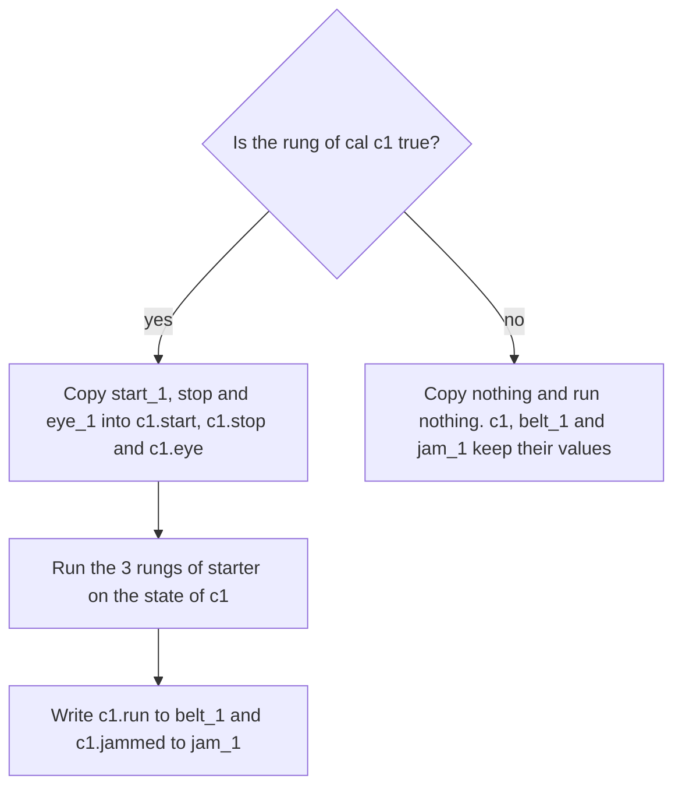

# Write a function block

This guide is for a reader who writes a ladder [program](../reference/glossary.md#program)
and has the same [rungs](../reference/glossary.md#rung) for 2 or more machines. It shows
how to write the rungs 1 time, as a [function block](../reference/glossary.md#function-block)
in a separate file, and run them for each machine with `cal`. The example is a starter
for 2 conveyors. Each conveyor gets a separate [instance](../reference/glossary.md#instance)
of the function block, with its own [state](../reference/glossary.md#state).

> #### Warning {: .warning}
>
> If a `cal` gives a stop to its function block, do not put a
> [contact](../reference/glossary.md#contact) before that `cal`. While the rung of the
> `cal` is false, the `cal` does not copy `stop` into the instance, and the body does not
> run. The [output](../reference/glossary.md#output) of the instance keeps its value, and
> the conveyor continues to run. If `stop` goes to 1 and back to 0 in that time, the
> conveyor does not stop. Do not use logex for a safety function.

## Before you start

- You must have a Mix project that has logex.
  [Install logex and run a program](install-and-run.md) gives the steps.
- You must know how a script sets [inputs](../reference/glossary.md#input) and runs
  [scans](../reference/glossary.md#scan). [Your first program](../tutorials/first-program.md)
  shows this.
- The function block has a `ton` [timer](../reference/glossary.md#timer).
  [Use timers](use-timers.md) shows how a `ton` counts.

## Steps

The function block `starter` runs 1 conveyor. Its output `run` goes to 1 when `start` is
1, and stays 1 as a [seal-in](../reference/glossary.md#seal-in). It goes to 0 when `stop`
is 1. If a carton blocks the photo-eye `eye` for 2 s, `jammed` goes to 1. Then `run` goes
to 0.

1. In the root directory of your project, make the directory `write-a-function-block`.
2. In it, make the file `starter.ld` with this text. The name of the file is the name of
   the function block and `.ld`.

<!-- file: write-a-function-block/starter.ld -->
```text
// A conveyor starter: `run` holds itself in from `start` until `stop`,
// or until the photo-eye `eye` stays blocked for 2 s.
function_block starter
var_input  start  bool
var_input  stop   bool
var_input  eye    bool
var_output run    bool
var_output jammed bool
var        jam_t  ton

xic eye ton jam_t 2000
xic jam_t.dn ote jammed
( xic start | xic run ) xio stop xio jammed ote run
```

<!-- rung: write-a-function-block/starter.ld -->


This table gives each part of the file.

| Line | What it does |
|---|---|
| `function_block starter` | Starts the function block. It must be the first line that is not a comment or a blank line. The name must be the name of the file, in the same case. |
| `var_input` | Declares an input of the function block. A `cal` gives it a value. The body reads it and cannot write it. |
| `var_output` | Declares an output of the function block. The body writes it, and a `cal` copies it out. |
| `var` | Declares a [tag](../reference/glossary.md#tag) that only the body uses, here the timer `jam_t`. |
| The 3 rungs | The body of the function block. The body names only the tags of its file. |

3. In the directory `write-a-function-block`, make the file `conveyors.ld` with this text.

<!-- file: write-a-function-block/conveyors.ld -->
```text
var_input  start_1  bool
var_input  start_2  bool
var_input  stop     bool
var_input  eye_1    bool
var_input  eye_2    bool
var_output belt_1   bool
var_output belt_2   bool
var_output jam_1    bool
var_output jam_2    bool
var_output jam_lamp bool
var        c1       starter
var        c2       starter

cal c1 start_1 stop eye_1 belt_1 jam_1
cal c2 start_2 stop eye_2 belt_2 jam_2
( xic c1.jammed | xic c2.jammed ) ote jam_lamp
```

<!-- rung: write-a-function-block/conveyors.ld -->


The line `var c1 starter` declares an instance. Its type word is the name of the function
block. Declare an instance with `var` only.

The last rung reads the output `jammed` of each instance: `c1.jammed`. This table gives
the [members](../reference/glossary.md#member) that a rung of the program can use.

| Member | A rung reads it | A rung writes it |
|---|---|---|
| `var_input` or `var_output`, for example `c1.jammed` | Yes | No |
| `var`, for example `c1.jam_t` | No | No |

The table is for rungs. A script reads each member in the state, `c2.jam_t.acc` too.

Put each `cal` on a rung with no contact before it. The warning at the start of this
guide gives the danger. This diagram shows what 1 `cal` does in a scan.



Figure: 1 `cal` in a scan. On a [false rung](../reference/glossary.md#false-rung), the
instance does not read its inputs.

4. Check each `cal` against this table. The sequence of the
   [operands](../reference/glossary.md#operand) comes from the
   [declarations](../reference/glossary.md#declaration) of `starter.ld`.

   | Position | Operand | In `cal c1` |
   |---|---|---|
   | 1 | The instance | `c1` |
   | 2 to 4 | 1 value for each `var_input`, in the sequence of `starter.ld` | `start_1`, `stop`, `eye_1` |
   | 5 and 6 | 1 operand for each `var_output`, in the sequence of `starter.ld` | `belt_1`, `jam_1` |

   A value for a `var_input` is a tag, a member, an
   [element](../reference/glossary.md#element), a [bit](../reference/glossary.md#bit) or a
   [literal](../reference/glossary.md#literal) that fits the member. The operand for a
   `var_output` is a tag, an element or a bit that the program can write. It cannot be a
   literal, a `var_input` of the program or a member of an instance.

   Give each operand the [type](../reference/glossary.md#type) of its member, or a type
   that [widens](../reference/glossary.md#widen) into it. For an output, the member can
   widen into the type of the operand. [Function blocks](../reference/function-blocks.md)
   gives each rule. For what a [coil](../reference/glossary.md#coil) after a `cal` gets,
   [Instructions: jump and call](../reference/instructions-jump-and-call.md) gives the
   rule.

5. In the root directory of your project, make the file `write-a-function-block.exs` with
   this text. It runs 8 scans of 1000 ms and prints the values after each scan.

```elixir
{:ok, conveyors} = Logex.compile_file("write-a-function-block/conveyors.ld")
names = ~w(start_1 start_2 stop eye_2 c2.jam_t.acc belt_1 belt_2 jam_2 jam_lamp)

row = fn cells ->
  ["scan" | names]
  |> Enum.zip(cells)
  |> Enum.map_join("  ", fn {name, cell} ->
    String.pad_leading("#{cell}", String.length(name))
  end)
  |> IO.puts()
end

scan = fn inputs, {number, state} ->
  state = Logex.Runtime.put_inputs(conveyors, state, inputs)
  {_outputs, state} = Logex.Runtime.scan(conveyors, state, 1000)
  row.([number | Enum.map(names, &get_in(state.env, String.split(&1, ".")))])
  {number + 1, state}
end

row.(["scan" | names])

# An input keeps its value until a map of a later scan gives it a new value.
[
  %{"start_1" => 1},
  %{"start_1" => 0, "start_2" => 1},
  %{"start_2" => 0, "eye_2" => 1},
  %{},
  %{},
  %{"eye_2" => 0},
  %{"stop" => 1},
  %{"stop" => 0}
]
|> Enum.reduce({1, Logex.Runtime.instance(conveyors)}, scan)
```

Because `starter` is not a built-in type, `Logex.compile_file/1` looks for `starter.ld`
in the directory of `conveyors.ld` and [compiles](../reference/glossary.md#compile) it
first. In `state.env`, the state of
each instance is a map under the name of the instance. The script reads `c2.jam_t.acc`
with `get_in/2`.

6. Run the script. The first time, Mix prints some lines while it compiles logex and your
   project. The table comes after those lines.

```console
$ mix run write-a-function-block.exs
scan  start_1  start_2  stop  eye_2  c2.jam_t.acc  belt_1  belt_2  jam_2  jam_lamp
   1        1        0     0      0             0       1       0      0         0
   2        0        1     0      0             0       1       1      0         0
   3        0        0     0      1             0       1       1      0         0
   4        0        0     0      1          1000       1       1      0         0
   5        0        0     0      1          2000       1       0      1         1
   6        0        0     0      0             0       1       0      0         0
   7        0        0     1      0             0       0       0      0         0
   8        0        0     0      0             0       0       0      0         0
```

If logex cannot compile a file, the first line of the script stops with a `MatchError`.
The error shows each [diagnostic](../reference/glossary.md#diagnostic), with the file
that has the error. [Read a diagnostic](read-diagnostics.md) gives the steps.

## The result

You have 1 function block and 2 instances of it. Each instance has its own seal-in and
its own timer. The jam of conveyor 2 stops conveyor 2 only.

| Scans | What the table shows |
|---|---|
| 1 and 2 | `start_1` starts conveyor 1, then `start_2` starts conveyor 2. Each `run` stays on when its start goes to 0. |
| 3 to 5 | A carton blocks `eye_2`. The timer `jam_t` of `c2` gets to 2000 ms in scan 5. `jammed` of `c2` goes to 1, and conveyor 2 stops in the same scan. |
| 6 | The carton moves off the photo-eye, and `eye_2` goes to 0. `jammed` goes to 0, but conveyor 2 does not start again. The operator must push `start_2`. |
| 7 | `stop` goes to 1. Both instances get it, and conveyor 1 stops. |

This timing diagram shows the same 8 scans.

<!-- timing: write-a-function-block-conveyors.timing.exs -->


## Compile a program whose text is not in a file

Use this way if the text of your program does not come from a file, for example from a
database. `Logex.compile/2` does not read files. Give it the
[function block type](../reference/glossary.md#function-block-type) in its option `types:`.

1. In the root directory of your project, make the file
   `write-a-function-block-types.exs` with this text.

```elixir
block = File.read!("write-a-function-block/starter.ld")
{:ok, starter} = Logex.compile(block, name: "starter")
source = File.read!("write-a-function-block/conveyors.ld")
{:ok, conveyors} = Logex.compile(source, name: "conveyors", types: [starter])

state = Logex.Runtime.instance(conveyors)
state = Logex.Runtime.put_inputs(conveyors, state, %{"start_1" => 1})
{outputs, _state} = Logex.Runtime.scan(conveyors, state, 1000)
IO.puts("#{conveyors.name} uses #{starter.name}: belt_1 = #{outputs["belt_1"]}")
```

For the text of a function block, `Logex.compile/2` returns `{:ok, type}`. `type` is a
`%Logex.FbType{}`. The option `name:` must be the name on the line `function_block`.

2. Run the script.

```console
$ mix run write-a-function-block-types.exs
conveyors uses starter: belt_1 = 1
```

`Logex.compile/2` returns only the [warnings](../reference/glossary.md#warning) of the
program. To see the warnings of a function block, compile the program with
`Logex.compile_file/1`. It returns the warnings of the program, then the warnings of each
function block. A warning of a function block names its file.

## If it does not work

In the first 2 tables, the column **What you see** shows part of the message. The full
message also gives the file and the line.
[Function blocks](../reference/function-blocks.md) gives each diagnostic of a function
block.

### Diagnostics when you compile

| What you see | Cause | What to do |
|---|---|---|
| `` unknown type `starter`: logex has `` and a list of types, 1 time for each instance | `starter.ld` is not beside `conveyors.ld`, or not in `types:`. | Put `starter.ld` in the directory of `conveyors.ld`. With `Logex.compile/2`, give the type in `types:`. |
| `` unknown type `strater` `` and `` did you mean `starter`? `` | The type word has a spelling error. | Spell the type word as the name of the function block. |
| `` this function block is `start_block`, but it is compiled as `starter` `` | The name on the line `function_block` is not the name of the file or of `name:`. | Make the 2 names the same, in the same case. |
| `` is a program (starter.ld), not a function block `` | The file has no line `function_block`, or a line comes before it. | Write `function_block starter` as the first line that is not a comment or a blank line. |
| `` `cal c1` expects 5 operands after its instance `` | The `cal` has too few operands. The message gives each member in sequence. | Give 1 operand for each `var_input` and each `var_output`, as step 4 shows. |
| `` unknown instruction `jam_2` `` or `` expected an instruction `` on the line of a `cal` | The `cal` has too many operands. logex reads the extra operand as the next instruction. | Give 1 operand for each `var_input` and each `var_output`, as step 4 shows. |
| `` operand 3 of `cal c1` is `eye` (var_input bool), but `eye_1` is an int `` | The type of the operand does not widen into the type of its member. | Use a tag of the type of the member. |
| `` operand 2 of `cal c1` is `stop` (var_input bool): only 0 or 1 fit `` | The literal does not fit the member. | Give a literal that the type of the member holds. |
| `` operand 5 of `cal c1` is `jammed` (var_output bool), which it writes `` | The operand is a literal, a `var_input` of the program or a member of an instance. | Give a tag that the program can write. |
| `` is already run by the `cal` on line `` | 2 `cal` [instructions](../reference/glossary.md#instruction) run the same instance. | Write 1 `cal` for each instance. Declare a second instance for a second machine. |
| `` whose members only its body writes `` | A rung writes a member of an instance, for example `ote c1.run`. | Give the value to the function block as a `var_input`. |
| `` is not a member of `c1` `` | A rung names a `var` of the function block, for example `c1.jam_t.dn`. | Declare a `var_output` for the value, and write it in the body. |
| `` `strt` is not declared `` | The message names `starter.ld`. The body names a tag that its file does not declare, for example a tag of the program. | Correct the name. For a value of the program, declare a `var_input` and give it in the `cal`. |
| `` cannot hold an instance of `starter` `` | The function block holds an instance of itself, directly or through a different function block. | Remove the declaration that closes the loop. The message names the loop. |

### Warnings when you compile

| What you see | Cause | What to do |
|---|---|---|
| `` is an instance of `starter`, but no `cal` runs it `` | A rung reads a member of the instance, for example `xic c3.run`, but no `cal` names the instance. Its members stay at their [initial values](../reference/glossary.md#initial-value). | Write a `cal` for the instance. |
| `` is declared but no rung uses it `` | No rung names the tag or the instance. With the name of `starter.ld`, the body does not use a tag of its file. | Use the tag, or remove the declaration. |

### When you run the scans

| What you see | Cause | What to do |
|---|---|---|
| A conveyor continues to run after `stop` goes to 1 and back to 0 | A contact before the `cal` makes the rung false. The instance does not read `stop`. | Remove the contact. Give the condition to the function block as a `var_input`, and use it in the body. |
| A timer in the function block gets to its [preset](../reference/glossary.md#preset) in the scan in which its `cal` is true again | While the rung of the `cal` is false, the timer does not run. When it runs again, it adds the time since its last run. | Write each `cal` on a rung with no contact before it. |

## See also

- [Function blocks](../reference/function-blocks.md): the rules of the file, the members,
  the state of an instance and each diagnostic.
- [Instructions: jump and call](../reference/instructions-jump-and-call.md): each rule of
  `cal`.
- [Host contract](../reference/host-contract.md): how a host reads a member, in a program
  instance and in a configuration.
- [The scan, the cycle and time](../explanation/scan-cycle-and-time.md): why an instance
  keeps its values while its `cal` is on a false rung.
- [Use arrays of timers, counters and function blocks](use-arrays-of-instances.md): an
  array of instances of a function block.
- [Glossary](../reference/glossary.md): the words of this guide.
