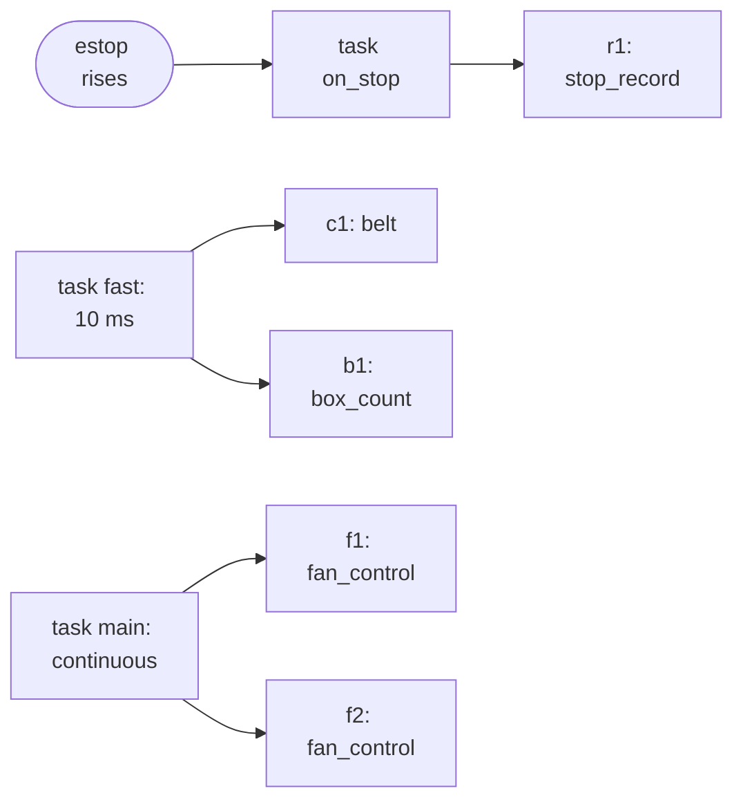
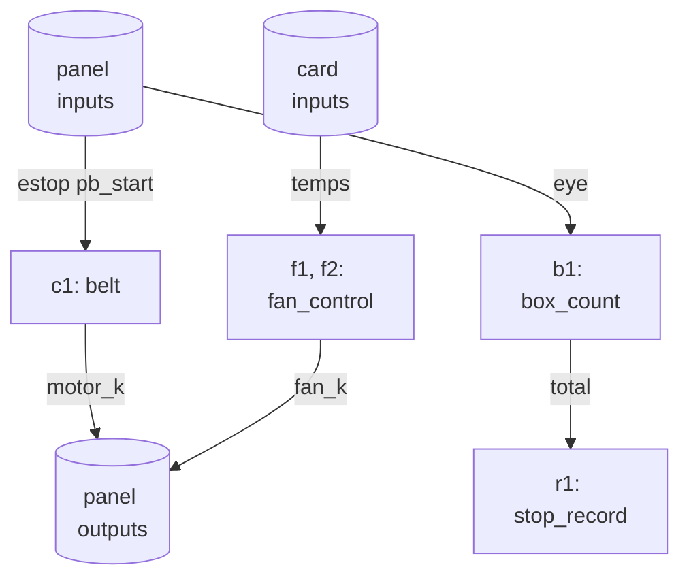

# Configuration file

This page is for a reader who writes or reads a
[configuration file](glossary.md#configuration-file) and looks for an exact rule. It
defines each line of a `.logex` file: its words, its grammar and its rules. It also
defines the same [configuration](glossary.md#configuration) as Elixir data.
[Configuration file: messages](configuration-file-messages.md) gives each message of a
wrong text, and each [warning](glossary.md#warning), from a run.

> #### Warning {: .warning}
>
> Do not use logex for a [safety function](glossary.md#safety-function). An emergency
> stop is a safety function.

A file describes 1 configuration, and the configuration runs as 1
[resource](glossary.md#resource). The file has no `configuration` line and no
`resource` line. A configuration file has 4 kinds of line, and a comment. This table
gives an example of each.

| Line | Example | Declares |
|---|---|---|
| [A task line](#task-lines) | `task fast interval 10 priority 1` | A [task](glossary.md#task): when its instances run |
| [A `var_global` line](#var_global-lines) | `var_global estop bool at panel.i.7` | A [global](glossary.md#global), and its [point](glossary.md#point) if it has one |
| [A `program` line](#program-lines) | `program c1 belt with fast` | An [instance](glossary.md#instance) of a [program type](glossary.md#program-type), and its task |
| [A connection line](#connection-lines) | `c1.start pb_start` | A [connection](glossary.md#connection) of an [input](glossary.md#input) or an [output](glossary.md#output) of an instance |
| A comment | `// the conveyor` | Nothing. logex ignores the text from `//` to the end of the line. |

| To find | Go to |
|---|---|
| A complete file, and what logex reads from each line | [The example `line_1.logex`](#the-example-line_1logex) |
| Case, comments, line ends and the sequence of the lines | [The text of a file](#the-text-of-a-file) |
| The text after `at`, and the points of an array | [Locations and points](#locations-and-points) |
| What a `var_external` tag of a program needs from the file | [Globals that a program declares `var_external`](#globals-that-a-program-declares-var_external) |
| The names that a file can use, and the keywords | [Names and reserved words](#names-and-reserved-words) |
| How logex finds the `.ld` file of each program type | [The functions that compile a configuration](#the-functions-that-compile-a-configuration) |
| The same configuration from Elixir, and its structs | [A configuration from Elixir data](#a-configuration-from-elixir-data) |
| The words of a message | [Words in the messages](#words-in-the-messages) |
| The message of a wrong text, or a warning | [Configuration file: messages](configuration-file-messages.md) |

If a text breaks a rule of this page, logex does not make a configuration. It returns a
[diagnostic](glossary.md#diagnostic) for each error. For some configurations that break
no rule, logex gives a warning, and logex makes the configuration.

## The words of this page

| Word | Meaning |
|---|---|
| A line | A line of the file. A line that is not blank and is not only a comment declares 1 item: a task, a global, an instance or a connection. |
| A timed task | A [periodic task](glossary.md#periodic-task) or an [event task](glossary.md#event-task). Each task that is not the [continuous task](glossary.md#continuous-task) is a timed task. |
| The [trigger](glossary.md#trigger) | The global after the word `single` on the line of an event task |
| A [location](glossary.md#location) | The text after `at` on a `var_global` line, for example `panel.i.7` |
| An input point | A [located global](glossary.md#located-global) with `i` in its location. The [host](glossary.md#host) gives its value. |
| An output point | A located global with `q` in its location. logex gives its value to the host after each [cycle](glossary.md#cycle). |
| An input, an output | A `var_input` [tag](glossary.md#tag) or a `var_output` tag of a [program](glossary.md#program), for example `start` of `belt.ld`. A connection line names it after the name of the instance and a dot: `c1.start`. |
| A constant | A number on a connection line in place of a global, for example `0` in `c1.stop 0` |
| A driver | The output that a connection joins to a global. The driver writes the global. |
| [Widen](glossary.md#widen) | A value of 1 [type](glossary.md#type) goes into a different type with no loss, for example an `int` into a `dint` |

### Words in the messages

The messages of logex use some words that this page does not use. This table gives the
word of this page for each of them.

| Word in a message | Meaning |
|---|---|
| `member`, `var_input`, `var_output` | An input or an output of an instance, for example `c1.start`. In the glossary, a [member](glossary.md#member) is a part of an instance of a [function block type](glossary.md#function-block-type). |
| `path` | The name of an input or an output after the name of the instance and a dot, for example `m1.start` |
| `drives`, `driven` | Writes. A driver drives a global, and a program drives a global through a `var_external` tag. |
| `single` | The trigger of an event task |
| `input image` | The values of the input points that the host gives for a cycle |
| `logic` | The [rungs](glossary.md#rung) of a program |
| `keyword` | A [reserved word](glossary.md#reserved-word) of a configuration file |
| `warm start` | A [warm restart](glossary.md#warm-restart) |
| `round` | A [round](glossary.md#round) of the runner. With `Logex.Runtime` and no runner, the first round is the first cycle. |

## The example `line_1.logex`

The file `line_1.logex` runs a conveyor, a box counter, 2 fans and a record of each
stop. It uses each kind of line and each kind of task.

<!-- file: configuration-file/line_1.logex -->
```text
// line_1.logex -- a conveyor, a box counter, 2 fans and a record of each stop
task fast    interval 10 priority 1 watchdog 50
task on_stop single estop priority 0
task main    continuous watchdog 200

var_global estop         bool    at panel.i.7
var_global pb_start      bool    at panel.i.0
var_global eye           bool    at panel.i.2
var_global motor_k       bool    at panel.q.0
var_global fan_k         bool[2] at panel.q.1
var_global temps         real[2] at card.i.0
var_global limits        real[2] 40.0 45.0
var_global retain total  dint    0
var_global total_at_stop dint

program c1 belt with fast
  c1.start pb_start
  c1.stop  0
  c1.motor motor_k

program b1 box_count with fast
  b1.eye eye

program f1 fan_control
  f1.temp  temps[0]
  f1.limit limits[0]
  f1.fan   fan_k[0]

program f2 fan_control
  f2.temp  temps[1]
  f2.limit limits[1]
  f2.fan   fan_k[1]

program r1 stop_record with on_stop
  r1.count         total
  r1.count_at_stop total_at_stop
```



Figure 1: the 3 tasks of `line_1.logex` and the instances that each task runs. A rise of
the global `estop` makes the task `on_stop` due.



Figure 2: the globals between the 2 devices and the instances. Each arrow is a global,
from the item that writes it to the items that read it.

The task `fast` runs `c1` and `b1` every 10 ms. The task `on_stop` runs `r1` when
`estop` rises. The continuous task `main` runs `f1` and `f2` in each cycle. The
[device](glossary.md#device) `panel` holds 3 input points and 3 output points. The
device `card` holds 2 input points.

The 4 program types are files beside `line_1.logex`. `belt.ld` reads the global `estop`
through a `var_external` tag. `box_count.ld` adds 1 to the global `total` for each box.

<!-- file: configuration-file/belt.ld -->
```text
var_input    start bool
var_input    stop  bool
var_output   motor bool
var_external estop bool

( xic start | xic motor ) xio stop xio estop ote motor
```

<!-- file: configuration-file/box_count.ld -->
```text
var_input    eye   bool
var_external total dint
var          seen  bool

xic eye ons seen add total 1 total
```

<!-- file: configuration-file/fan_control.ld -->
```text
var_input  temp  real
var_input  limit real
var_output fan   bool

gt temp limit ote fan
```

<!-- file: configuration-file/stop_record.ld -->
```text
var_input  count         dint
var_output count_at_stop dint

move count count_at_stop
```

The script loads the file and prints what logex reads from each line. Then it runs the
[plant](glossary.md#plant) 2 times. For each cycle, it prints the output point `motor_k`,
the global `total` and each instance that runs, as `task:instance`.

```elixir
# The script loads line_1.logex and prints what logex reads from each line: each field
# that has a value. Then it runs the plant 2 times. For each cycle, it prints the instances
# that the cycle runs, as task:instance.
{:ok, plant} = Logex.Configuration.compile_file("configuration-file/line_1.logex")

fields = fn item, keys ->
  pairs = for key <- keys, value = Map.get(item, key), do: "#{key} #{inspect(value)}"
  Enum.join(pairs, ", ")
end

types = Enum.join(Map.keys(plant.programs), ", ")
IO.puts("configuration #{plant.name}: program types #{types}")

task_keys = [:continuous, :single, :interval, :priority, :watchdog]
for t <- plant.tasks, do: IO.puts("line #{t.line}: task #{t.name}: #{fields.(t, task_keys)}")

global_keys = [:retain, :type, :initial, :at]

for g <- plant.globals,
    do: IO.puts("line #{g.line}: global #{g.name}: #{fields.(g, global_keys)}")

for i <- plant.instances,
    do: IO.puts("line #{i.line}: instance #{i.name}: #{fields.(i, [:type, :task])}")

for c <- plant.connections,
    do: IO.puts("line #{c.line}: #{c.instance}.#{c.member} to #{inspect(c.to)}")

IO.puts("warnings: #{length(plant.warnings)}")

run = fn label, steps ->
  IO.puts(label)

  Enum.reduce(steps, {Logex.Runtime.start(plant), 0}, fn {step, ms, inputs}, {rt, now} ->
    {rt, out, events} = Logex.Runtime.cycle(rt, ms, inputs)
    ran = for {:ran, task, instance, _now} <- events, do: "#{task}:#{instance}"
    values = "motor_k=#{out["motor_k"]} total=#{Logex.Runtime.get!(rt, "total")}"

    IO.puts(
      "  t=#{String.pad_leading("#{now + ms}", 2)} #{step} #{values}  ran #{Enum.join(ran, " ")}"
    )

    {rt, now + ms}
  end)
end

run.("estop rises at 15 ms:", [
  {"start      ", 0, %{"pb_start" => 1, "temps" => [41.5, 41.5]}},
  {"           ", 5, %{"pb_start" => 0}},
  {"a box      ", 5, %{"eye" => 1}},
  {"estop rises", 5, %{"estop" => 1}},
  {"           ", 5, %{}}
])

run.("estop is 1 from 12 ms to 15 ms:", [
  {"start      ", 0, %{"pb_start" => 1}},
  {"           ", 5, %{"pb_start" => 0}},
  {"           ", 5, %{}},
  {"estop rises", 2, %{"estop" => 1}},
  {"estop falls", 3, %{"estop" => 0}},
  {"           ", 5, %{}}
])
```

```console
$ mix run configuration-file-line.exs
configuration line_1: program types belt, box_count, fan_control, stop_record
line 2: task fast: interval 10, priority 1, watchdog 50
line 3: task on_stop: single "estop", priority 0
line 4: task main: continuous true, watchdog 200
line 6: global estop: type :bool, at "panel.i.7"
line 7: global pb_start: type :bool, at "panel.i.0"
line 8: global eye: type :bool, at "panel.i.2"
line 9: global motor_k: type :bool, at "panel.q.0"
line 10: global fan_k: type {:array, :bool, [2]}, at "panel.q.1"
line 11: global temps: type {:array, :real, [2]}, at "card.i.0"
line 12: global limits: type {:array, :real, [2]}, initial [40.0, 45.0]
line 13: global total: retain :retain, type :dint, initial 0
line 14: global total_at_stop: type :dint
line 16: instance c1: type "belt", task "fast"
line 21: instance b1: type "box_count", task "fast"
line 24: instance f1: type "fan_control"
line 29: instance f2: type "fan_control"
line 34: instance r1: type "stop_record", task "on_stop"
line 17: c1.start to "pb_start"
line 18: c1.stop to 0
line 19: c1.motor to "motor_k"
line 22: b1.eye to "eye"
line 25: f1.temp to "temps[0]"
line 26: f1.limit to "limits[0]"
line 27: f1.fan to "fan_k[0]"
line 30: f2.temp to "temps[1]"
line 31: f2.limit to "limits[1]"
line 32: f2.fan to "fan_k[1]"
line 35: r1.count to "total"
line 36: r1.count_at_stop to "total_at_stop"
warnings: 0
estop rises at 15 ms:
  t= 0 start       motor_k=1 total=0  ran fast:c1 fast:b1 main:f1 main:f2
  t= 5             motor_k=1 total=0  ran main:f1 main:f2
  t=10 a box       motor_k=1 total=1  ran fast:c1 fast:b1 main:f1 main:f2
  t=15 estop rises motor_k=1 total=1  ran on_stop:r1 main:f1 main:f2
  t=20             motor_k=0 total=1  ran fast:c1 fast:b1 main:f1 main:f2
estop is 1 from 12 ms to 15 ms:
  t= 0 start       motor_k=1 total=0  ran fast:c1 fast:b1 main:f1 main:f2
  t= 5             motor_k=1 total=0  ran main:f1 main:f2
  t=10             motor_k=1 total=0  ran fast:c1 fast:b1 main:f1 main:f2
  t=12 estop rises motor_k=1 total=0  ran on_stop:r1 main:f1 main:f2
  t=15 estop falls motor_k=1 total=0  ran main:f1 main:f2
  t=20             motor_k=1 total=0  ran fast:c1 fast:b1 main:f1 main:f2
```

| Output | What it shows |
|---|---|
| `line 2` to `line 4` | Each word of a task line fills 1 field of the task. A word that the line does not give leaves its field at nil, and `continuous` at false. The script prints only the fields that have a value. |
| `line 6` to `line 14` | The word `retain` puts `:retain` in the field `retain`. An [array](glossary.md#array) has its type and its sizes, for example `{:array, :bool, [2]}`. |
| `line 16` to `line 34` | An instance with no `with` has the task nil. The continuous task `main` runs it. |
| `line 17` to `line 36` | A connection holds the name of a global, an [element](glossary.md#element) of a global array or a constant. A comment and a blank line declare nothing. |
| First run, `t=0` | Each task with an interval is [due](glossary.md#due) in the first cycle. The event task `on_stop` is not due, because `estop` is 0. |
| First run, `t=5` | Only the continuous task runs, because `fast` is due at 10 ms. |
| First run, `t=15` | `estop` rises, and `on_stop` runs `r1`. `motor_k` stays 1, because `c1` does not run. |
| First run, `t=20` | `c1` runs, reads `estop` and writes 0 to `motor_k`. |
| Second run | `estop` is 1 from 12 ms to 15 ms. `on_stop` runs at 12 ms. `c1` runs at 10 ms and at 20 ms, and reads 0 each time. `motor_k` stays 1. |

[A configuration from Elixir data](#a-configuration-from-elixir-data) builds the same
configuration with Elixir structs.

## The text of a file

| Item | Rule |
|---|---|
| Lines | 1 item on each line. A line ends at LF, at CRLF or at CR alone. logex ignores a blank line. |
| Comments | `//` starts a comment. The comment ends at the end of the line. |
| Spaces | 1 space or more between 2 words. The indent of a line has no meaning. |
| Case of a keyword | A keyword can be uppercase, lowercase or a mix: `TASK`, `Task` and `task` are the same word. |
| Case of a name | A name keeps its case. `Eye` and `eye` are 2 names, and the file cannot declare both. [Names and reserved words](#names-and-reserved-words) gives the rules. |
| Sequence of the lines | Free. A line can name a task, a global or an instance that a later line declares. Only 2 sequences have a meaning. A task runs its instances in the sequence of their `program` lines. 2 due tasks with the same priority and the same due time run in the sequence of their task lines. |
| Connection lines | A connection line can be anywhere in the file. In the examples, each connection line comes after its `program` line, with an indent of 2 spaces. |
| Numbers | The forms of a number of a program: `10`, `16#a`, `2#1010`, `1_000`, `-1`, `0.5`, `1.0e3`. [Literals](literals.md) gives each form and its limits. A task line takes only an integer. A message quotes a number as the file writes it, for example `16#ffff_ffff`. |
| Arrows and branches | A line cannot hold `(`, `|` or `)`. A connection has no arrow. |
| A file with an error | logex reads each line that it can. Each line with an error of grammar gives 1 diagnostic, and logex ignores the rest of that line. |
| A lex error | A character that is not a part of a word or a number stops the read, for example `@`, or the `-` of `->`. That diagnostic is the only diagnostic. |
| The sequence of the diagnostics | In the sequence of the lines. A diagnostic with no line comes last. |
| The line of a diagnostic | Each diagnostic of a line gives its line. A diagnostic of the file as a whole, for example no `program` line, gives no line. A diagnostic of grammar also gives the column. |

[Cases 1 to 10](configuration-file-messages.md#the-text-of-a-file-cases-1-to-10) show
these rules.

## Task lines

<!-- unchecked: the form of a task line, with its optional parts in brackets -->
```text
task <name> [continuous] [single <global>] [interval <ms>] [priority <p>] [watchdog <ms>]
```

The words after the name come in this sequence, and each word comes 1 time at most.
logex refuses each other sequence.

> #### Warning {: .warning}
>
> Do not use a short pulse of an input point to stop a machine. An instance sees an
> input point only if the point holds its value until the next run of the task of the
> instance. In the [second run of the example](#the-example-line_1logex), `estop` is 1
> from 12 ms to 15 ms. `c1` runs at 10 ms and at 20 ms and does not see it, and
> `motor_k` stays 1.

### The kinds of task

| Kind | When the task is due |
|---|---|
| A periodic task: `interval`, no `single` | In the first cycle, then at each interval |
| An event task: `single`, no `interval` | In a cycle in which its trigger is 1 and was 0 at the last sample. The last sample starts at 0, so a trigger that is 1 in the first cycle makes the task due. |
| An event task with an interval: `single` and `interval` | On a [rising edge](glossary.md#rising-edge) of its trigger. Also in the first cycle and at each interval while its trigger is 0. It runs 1 time in a cycle at most. |
| The continuous task: `continuous` | Never due. It runs each instance that has no timed task, after the due tasks, 1 time in each cycle. |

The due tasks of a cycle run in the sequence of their
[priority](glossary.md#priority), 0 first. 2 tasks with the same priority run in the
sequence of their due times, then of their task lines. A file declares 1 continuous
task at most (case 33). A file can have no task line.
[`program` lines](#program-lines) gives when an instance with no `with` runs.
[Tasks and the schedule](../explanation/tasks-and-scheduling.md) explains the schedule,
and [Execution model](execution-model.md) gives the rules of a cycle.

### The words of a task line

> #### Caution {: .error}
>
> Do not expect a [watchdog](glossary.md#watchdog) to stop a long cycle without the
> [runner](glossary.md#runner). `Logex.Runtime` reads no [clock](glossary.md#clock). It
> runs each cycle to its end, and the time of a cycle has no limit. Only `Logex.Runner`
> compares the time of a task with its watchdog.

| Word | Value | Default |
|---|---|---|
| `continuous` | No value | A timed task |
| `single` | The name of the trigger: a bool global, whole, with or without a location. Not an element of an array, and not an input or an output of an instance. | No trigger |
| `interval` | 1 to 2147483647, in ms | No interval |
| `priority` | 0 to 65535. 0 is the highest priority. | Error for a timed task |
| `watchdog` | 1 to 2147483647, in ms | 500 ms |

A timed task needs `priority`, and `interval` or `single`. The continuous task takes no `priority`, `single` or
`interval`. Each kind of task can take `watchdog`.

A number is in ms, with no unit: `10ms` and `t#10ms` are errors. An interval of 0 is an
error (case 19).

The runner compares the time of each run of a timed task with its watchdog. It also
compares each [round](glossary.md#round) of the continuous task with the watchdog of
that task. `Logex.Configuration.watchdog/1` gives the watchdog of a task: its value, or
500. [Set watchdogs](../howto/set-watchdogs.md) shows how to use a watchdog.

[Cases 11 to 34](configuration-file-messages.md#task-lines-cases-11-to-34) show the
diagnostics of a task line.

## `var_global` lines

<!-- unchecked: the 2 forms of a var_global line, with the optional parts in brackets -->
```text
var_global [retain | non_retain] <name> <type> [<initial value>] [at <location>]
var_global [retain | non_retain] <name> <type>[<sizes>] [<initial list>] [at <location>]
```

| Part | Rule |
|---|---|
| `retain` or `non_retain` | Optional. It comes straight after `var_global`. [`retain`](glossary.md#retain) keeps the value of the global across a warm restart. `non_retain` gives the default: no value kept. |
| A qualifier in a wrong place | If the line has the word 2 times, has both words, or has the word in a different place, logex gives 1 diagnostic. It still declares the global, with no qualifier. A line that uses that global then gets no second diagnostic (cases 49 to 51). |
| `retain` on a located global | An error. logex gives 1 diagnostic and still declares the global (case 52). [Rules of the points](#rules-of-the-points) gives the reason. `non_retain` is correct. |
| The name | A name of the file. [Names and reserved words](#names-and-reserved-words) gives the rules. |
| The type | 1 of the 15 [elementary types](glossary.md#elementary-type) of the table of types. A [timer](glossary.md#timer), a [counter](glossary.md#counter) and a [function block](glossary.md#function-block) are not types of a global. |
| The sizes | For an array: the sizes in brackets straight after the type, with no space, for example `real[2]` or `bool[2,3]`. Each size is 1 or more, and an array holds 65536 elements at most. |
| The [initial value](glossary.md#initial-value) | Optional. A number that the type holds. With no initial value, the global starts at 0. |
| The initial list | Optional, for an array. 1 number for each element, in the sequence of the elements. |
| `at` and the location | Optional. The global is then an input point or an output point. [Locations and points](#locations-and-points) gives the rules. |

| Types | Words |
|---|---|
| Bool | `bool` |
| Signed integers | `sint`, `int`, `dint`, `lint` |
| Unsigned integers | `usint`, `uint`, `udint`, `ulint` |
| Reals | `real`, `lreal` |
| [Bit strings](glossary.md#bit-string) | `byte`, `word`, `dword`, `lword` |

The type word can be uppercase, lowercase or a mix.
[Declarations and types](declarations-and-types.md) gives the range of each type and
the rules of an array.

### Initial values

| Global | Initial value |
|---|---|
| `bool` | 0 or 1 |
| An integer or a bit string | An integer in the range of the type, in each form of an integer [literal](glossary.md#literal) |
| `real` or `lreal` | A real or an integer in the range of the type. A real that is not 0.0 and is nearer to 0.0 than the smallest real of the type is an error. An example is `1.0e-40` in a `real` (case 44). |
| A `real` with more digits than a `real` keeps | Correct, with a warning. The global holds the nearest `real`. |
| An array | A list of 1 value for each element, or no list |
| An input point or an output point | None. An input point gets its value from the host. An output point starts at 0. |
| No initial value | 0, or 0.0 for a real |

`Logex.Configuration.initial/1` gives the first value of a global. It gives an array as
a tuple.

### Who writes a global

| Global | Who writes it |
|---|---|
| An input point | The host, before a cycle. No connection and no `var_external` tag can write it. |
| An output point | 1 driver at most, and any number of programs through `var_external` tags. The host reads it after each cycle. |
| A global with no location | 1 driver at most, and any number of programs through `var_external` tags. The host cannot set it, and `Logex.Runtime.cycle/3` refuses it as an input. |

2 writers of 1 global, or of 1 element of a global array, get a warning. A write of a
[bit](glossary.md#bit) of a global is a write of the global.
[Globals that a program declares `var_external`](#globals-that-a-program-declares-var_external)
gives each case.

[Cases 35 to 52](configuration-file-messages.md#var_global-lines-cases-35-to-52) show
the diagnostics of a `var_global` line.
[Keep values across a restart](../howto/keep-values-across-a-restart.md) shows how to use
`retain`.

## Locations and points

<!-- unchecked: the 2 forms of a location -->
```text
<device>.i.<address>
<device>.q.<address>
```

| Part | Rule |
|---|---|
| The device | A name. It is not a keyword of a configuration file, in uppercase, lowercase or a mix. 2 devices cannot have names that differ only in case. |
| `i` or `q` | `i` for an input point, `q` for an output point. Lowercase only. |
| The address | 1 integer or more, with a `.` between 2 integers. The first integer is the highest level. No integer has a leading 0. |

| Location | What it is |
|---|---|
| `panel.i.7` | The input point at the address 7 of the device `panel` |
| `panel.q.0` | The output point at the address 0 of the device `panel` |
| `rack.i.2.4` | The input point at the address 2.4 of the device `rack`, for example the point 4 of the slot 2. `rack.i.2` is a different point. |
| `panel.I.7`, `panel.i.07` | An error. The message gives the correct form, `panel.i.7`. |

The text has 1 correct form for each location. `Logex.Configuration.location/1` gives
the parts of a location, for example `{:ok, {"panel", "q", [0]}}` for `panel.q.0`. It
gives `:error` for a text that is not a location in its correct form.

### Points of an array

A located array has 1 point for each element. The points have consecutive addresses.
The last integer of the address counts up. In an array of 2 dimensions, the right
[subscript](glossary.md#subscript) changes first.

| Line | The elements and their points |
|---|---|
| `var_global temps real[2] at card.i.0` | `temps[0]` at `card.i.0`, `temps[1]` at `card.i.1` |
| `var_global grid bool[2,3] at rack.q.2.4` | `grid[0,0]` at `rack.q.2.4`, `grid[0,1]` at `rack.q.2.5` and so on, to `grid[1,2]` at `rack.q.2.9` |

The outputs of a cycle name each point by its element, for example `fan_k[1]`. The host
sets an array of input points whole, as a list, `"temps" => [41.5, 41.5]`, or by its
elements, `"temps[1]" => 50.0`. 1 call cannot do both.
[Host contract](host-contract.md) gives the rules of a call.

### Rules of the points

| Rule | Example of an error |
|---|---|
| 1 location holds 1 global. An input point and an output point with the same address are at 2 locations. | `var_global eye bool at panel.i.7` when `estop` is at `panel.i.7` |
| The points of an array do not overlap a different point. | `var_global door bool at card.i.1` when `temps real[2]` is at `card.i.0` |
| A located global takes no initial value, and a located array takes no initial list. | `var_global motor_k bool 1 at panel.q.0` |
| A located global takes no `retain`. An input point gets its value again at each start. An output point starts at 0 until a program writes it. `non_retain` is correct. | `var_global retain estop bool at panel.i.7` |

[Cases 53 to 66](configuration-file-messages.md#locations-cases-53-to-66) show the
diagnostics of a location. [Map tags to I/O points](../howto/map-io-points.md) shows how to put
globals at points, and [I/O adapters](io-adapters.md) gives the rules of an
[adapter](glossary.md#adapter) and its device.

## `program` lines

<!-- unchecked: the form of a program line, with its optional part in brackets -->
```text
program <instance> <type> [with <task>]
```

| Part | Rule |
|---|---|
| The instance | A name of the file. It can be the name of its program type: `program lamp lamp` is correct. |
| The type | The name of a program type. A name of a program type keeps its case. A file gives the program type `belt` in `belt.ld` beside it. A function block is not a program type. |
| `with` and the task | Optional. The task that runs the instance. It can be the continuous task. |
| No `with` | The instance runs 1 time in each cycle, after the due tasks. If the file declares a continuous task, the instance runs in that task. |

| Rule | Detail |
|---|---|
| The sequence | A task runs its instances in the sequence of their `program` lines. |
| 1 program type, many instances | Each instance has a separate [state](glossary.md#state). logex [compiles](glossary.md#compile) the `.ld` file of a program type 1 time. |
| At least 1 instance | A configuration with no `program` line is an error. |
| No `retain` on the line | A `program` line takes no [qualifier](glossary.md#qualifier). The program declares what it keeps, for example `var retain count dint`. |
| Each input connected | Each input of the instance needs 1 connection line. [Connection lines](#connection-lines) gives the rules. |

[Cases 67 to 79](configuration-file-messages.md#program-lines-cases-67-to-79) show the
diagnostics of a `program` line.

## Connection lines

<!-- unchecked: the forms of a connection line -->
```text
<instance>.<input or output> <global>
<instance>.<input or output> <global>[<subscripts>]
<instance>.<input> <constant>
<instance>.<input or output>[<subscripts>] <global, element or constant>
```

A connection line has no arrow. The [section](glossary.md#section) of the tag gives the
direction:

- Before each [scan](glossary.md#scan) of the instance, logex copies the global or the
  constant into each `var_input` tag.
- After each scan of the instance, logex copies each `var_output` tag into its global.

### What a tag can connect to

In this table, a global is a global or an element of a global array.

| Tag | Global | Constant |
|---|---|---|
| `var_input` | Yes | Yes |
| `var_output` | Yes, but not an input point | No |
| Each other tag | No | No |

### The types of a connection

A connection does no [conversion](glossary.md#conversion). The global has the type of
the tag, or a type that widens as this table gives.

| Tag | Rule | Example |
|---|---|---|
| `var_input` | The type of the global widens into the type of the input. | An `int` global into a `dint` input |
| `var_output` | The type of the output widens into the type of the global. | A `dint` output into a `lint` global |

[Declarations and types](declarations-and-types.md) gives each pair of types that
widens.

### Rules of a connection

| Rule | Detail |
|---|---|
| 1 source for each input | Connect each input 1 time. If an input has no connection, the diagnostic is at the `program` line of the instance. If 2 or more inputs have no connection, 1 diagnostic names all of them. |
| 1 driver for each global | 1 connection at most writes a global, or an element of a global array. A connection that writes the full array writes each element. |
| An output needs no connection | An output with no connection is correct. |
| A constant | A number that fits the type of the input. An integer constant fits a real. A real constant with more digits than a `real` keeps gives a warning. |
| An array input or output | Connect it whole to a global array of the same sizes, or connect each element. Each element follows the rule of [The types of a connection](#the-types-of-a-connection). A constant fills 1 element only. |
| Subscripts | Integers only, in the range of the array. A tag is not a subscript on a connection line. |
| The instance | A connection line names the instance whole. `l1[1].on` is an error. |
| The input or the output | A connection line names 1 input or 1 output of the instance, after 1 dot. `r1.x.y` is an error. |
| The far end | A global, an element of a global array or a constant. A location and an input or an output of an instance are errors. Instances share a value only through a global. |

[Cases 80 to 111](configuration-file-messages.md#connection-lines-cases-80-to-111) show
the diagnostics of a connection line.

## Globals that a program declares `var_external`

A program reads and writes a global directly through a `var_external` tag. Its
[declaration](glossary.md#declaration) `var_external estop bool` needs the global
`estop` in the configuration. Each instance of the program then reads and writes the
same global. A connection line cannot name a `var_external` tag.

| Rule | Detail |
|---|---|
| The name | The global has the name of the `var_external` tag. |
| The type | The global has exactly the type of the tag. It does not widen. An array global has the same type and the same size in each dimension. |
| An input point | A program cannot write through a `var_external` tag to an input point. Reading an input point is correct. |
| Where logex reports an error | At the first `program` line of the program type. The message gives a line of the `.ld` file. For a write to an input point, it is the line of the first write. For each other error, it is the line of the declaration. logex checks each program type 1 time. |
| The name of the tag | A `var_external` tag cannot have the name of a keyword of a configuration file. logex refuses `var_external task bool` when it compiles the program. |
| A write to 1 element | `ote lamps[2]` through a `var_external` tag writes only the element `lamps[2]`. logex counts a write with a tag as the subscript, `ote lamps[z]`, as a write of each element. Thus no element of an array of output points stays without a writer (case 172). |
| 2 writers of 1 array | 2 instances that write different elements of 1 global array get no warning (case 173). 2 instances that write the same element get a warning (case 174). An instance that writes `lamps[2]` and an instance with `ote lamps[z]` get a warning with the words `may write` (case 175). |
| 2 writers of 1 global | 2 instances that write 1 global get a warning (case 161). 2 instances that write different bits of 1 global also get it (case 163). A write of a bit is a write of the global. |

[Cases 112 to 116](configuration-file-messages.md#var_external-tags-cases-112-to-116)
show these diagnostics.
[Warnings: cases 154 to 176](configuration-file-messages.md#warnings-cases-154-to-176)
shows the warnings. [Share a global](../howto/share-a-global.md) shows how to use a
`var_external` tag.

## Names and reserved words

A name is a letter or `_`, then letters, digits or `_`. Tasks, globals and instances have
1 set of names.

| Rule | Example of an error |
|---|---|
| A file declares a name 1 time, as 1 kind of item. | A task `l1` and an instance `l1` |
| 2 names cannot differ only in case. | The globals `eye` and `Eye` |
| A name has no `.`. A `.` is for an input or an output of an instance, and for a location. | `var_global pb.start bool` |
| A name is not a keyword of a configuration file, in uppercase, lowercase or a mix. | `var_global Task bool` |
| A device is not a keyword, in uppercase, lowercase or a mix. | `at task.i.7` |
| The name of a program type is a separate set. | `program lamp lamp` is correct. |

### The keywords

| Keyword | Where it goes |
|---|---|
| `task`, `var_global`, `program` | At the start of a line |
| `continuous`, `single`, `interval`, `priority`, `watchdog` | On a task line, after the name |
| `retain`, `non_retain` | On a `var_global` line, straight after `var_global` |
| `bool`, `sint`, `int`, `dint`, `lint`, `usint`, `uint`, `udint`, `ulint`, `real`, `lreal`, `byte`, `word`, `dword`, `lword` | On a `var_global` line, as the type |
| `at` | On a `var_global` line, before the location |
| `with` | On a `program` line, before the task |

Each of these 27 words is a reserved word of a configuration file, in uppercase,
lowercase or a mix. Only `task`, `var_global` and `program` can start a line (cases 3
to 5).

| Word | `.logex` file | `.ld` file |
|---|---|---|
| `retain`, `non_retain` and the 15 type words | Reserved | Reserved |
| `task`, `var_global`, `program`, `continuous`, `single`, `interval`, `priority`, `watchdog`, `at`, `with` | Reserved | Correct as the name of a tag, but not as the name of a `var_external` tag |

[Source syntax](source-syntax.md) gives the reserved words of a `.ld` file.
[Cases 117 to 125](configuration-file-messages.md#names-cases-117-to-125) show the
diagnostics of a name.

## The functions that compile a configuration

### `Logex.Configuration.compile_file/1`

`Logex.Configuration.compile_file("line_1.logex")` returns `{:ok, configuration}` or
`{:error, diagnostics}`.

| Item | Rule |
|---|---|
| The name of the configuration | The name of the file without `.logex`: `line_1.logex` is `line_1`. The name is a letter or `_`, then letters, digits or `_` (case 131). It can be a keyword: `task.logex` is the configuration `task` (case 134). |
| The path | It ends in `.logex`. |
| The program types | For each type that a `program` line names, the file `<type>.ld` beside the configuration file. logex compiles each `.ld` file 1 time, in the sequence of the first `program` line of each type. |
| Function blocks of the program types | logex compiles each function block 1 time for the configuration. Its warnings come back 1 time, in the first program type that holds it. |
| A missing `.ld` file | 1 diagnostic, at the first `program` line of the type. It suggests a name of a `.ld` file beside the configuration file. |
| A `.ld` file of a function block | 1 diagnostic: a function block is not a program type. |
| A `.ld` file that does not compile | 1 diagnostic at the first `program` line of the type. The diagnostics of the `.ld` file come after the diagnostics of the configuration file, in the sequence of the types. Each diagnostic gives its file and its line. |
| A wrong name of the file | 1 diagnostic. logex still compiles the file and gives its diagnostics too. |
| The diagnostics | Each diagnostic holds the path of the file. |
| The warnings | The warnings of the configuration are in its field `warnings`. The warnings of a program type stay in that program. |

A path that is not a binary raises an `ArgumentError`.
[Cases 126 to 134](configuration-file-messages.md#files-cases-126-to-134) show the
diagnostics of a file.

### `Logex.Configuration.compile/3`

`Logex.Configuration.compile("line_1", text, %{"belt" => belt})` compiles a text with
the program types that the map gives. It reads no file.

| Argument | Rule |
|---|---|
| The name | The name of the configuration. The text does not give it. |
| The text | A binary. Each text gives `{:ok, configuration}` or `{:error, diagnostics}`. |
| The program types | A map of each name to a `%Logex.Program{}` from `Logex.compile/2`. The name of each program must be the same as its key (case 151). |

A wrong name, a text that is not a binary and a wrong map raise an `ArgumentError`.

## A configuration from Elixir data

`Logex.Configuration.new!/1` builds a configuration from Elixir structs. It checks the
configuration with the same rules and the same words as a file. This table gives the
struct of each line of `line_1.logex`, with these aliases:

<!-- fragment: the aliases of the tables of this part -->
```elixir
alias Logex.Configuration
alias Logex.Configuration.{Connection, Global, Instance, Task, Text}
```

| Line | Struct |
|---|---|
| `task fast interval 10 priority 1 watchdog 50` | `%Task{name: "fast", interval: 10, priority: 1, watchdog: 50}` |
| `task on_stop single estop priority 0` | `%Task{name: "on_stop", single: "estop", priority: 0}` |
| `task main continuous watchdog 200` | `%Task{name: "main", continuous: true, watchdog: 200}` |
| `var_global estop bool at panel.i.7` | `Global.new!("estop", :bool, at: "panel.i.7")` |
| `var_global limits real[2] 40.0 45.0` | `Global.new!("limits", {:array, :real, [2]}, initial: [40.0, 45.0])` |
| `var_global retain total dint 0` | `Global.new!("total", :dint, initial: 0, retain: true)` |
| `program c1 belt with fast` | `%Instance{name: "c1", type: "belt", task: "fast"}` |
| `program f1 fan_control` | `%Instance{name: "f1", type: "fan_control"}` |
| `c1.start pb_start` | `%Connection{instance: "c1", member: "start", to: "pb_start"}` |
| `c1.stop 0` | `%Connection{instance: "c1", member: "stop", to: 0}` |

### The structs

`Task`, `Global`, `Instance` and `Connection` also have the field `line`: the line of
the item in its file, or nil for an item from Elixir.

`Configuration` has these fields:

| Field | Value |
|---|---|
| `name` | The name of the configuration |
| `file` | The path of the file, or nil from Elixir |
| `programs` | A map of each name of a program type to its program. `new!/1` takes a list. |
| `tasks` | A list of `Task` structs, in the sequence of their lines |
| `globals` | A list of `Global` structs, in the sequence of their lines |
| `instances` | A list of `Instance` structs, in the sequence of their lines |
| `connections` | A list of `Connection` structs, in the sequence of their lines |
| `warnings` | A list of `%Logex.Diagnostic{}` structs |

`Task` has these fields:

| Field | Value |
|---|---|
| `name` | The name of the task |
| `single` | The name of the trigger, or nil |
| `interval` | An integer in ms, or nil |
| `priority` | An integer, or nil |
| `watchdog` | An integer in ms, or nil for 500 ms |
| `continuous` | `true` or `false`. The default is `false`. |

`Global` has these fields:

| Field | Value |
|---|---|
| `name` | The name of the global |
| `type` | An atom such as `:dint`, or `{:array, :int, [8]}` for an array |
| `initial` | A number, a list for an array, or nil |
| `at` | The location as text, or nil |
| `retain` | `:retain`, `:non_retain` or nil |

`Instance` has these fields:

| Field | Value |
|---|---|
| `name` | The name of the instance |
| `type` | The name of its program type |
| `task` | The name of the task, or nil |

`Connection` has these fields:

| Field | Value |
|---|---|
| `instance` | The name of the instance |
| `member` | The name of the input or the output, or of 1 of its elements, for example `"temps[0]"` |
| `to` | The name of a global, an element such as `"temps[0]"`, or a number |

`Global.new!/3` puts `:retain` in the field `retain` for `retain: true`, and
`:non_retain` for `non_retain: true`.

### The functions

The functions of `Logex.Configuration`:

| Function | What it does |
|---|---|
| `new!/1` | Takes a keyword list: `name:`, `programs:` (a list of `%Logex.Program{}`), `tasks:`, `globals:`, `instances:` and `connections:`. `name:` is necessary. A key that the list does not give is an empty list. Returns the configuration with its warnings, or raises 1 `ArgumentError` with each error on a line. |
| `check/1` | Returns each diagnostic of a configuration, or `[]`. It raises an `ArgumentError` for data that no file can hold. |
| `watchdog/1` | Returns the watchdog of a task in ms. |
| `initial/1` | Returns the first value of a global. |
| `location/1` | Returns the parts of a location. |

1 more function:

| Function | What it does |
|---|---|
| `Global.new!/3` | Takes the name, the type and the options `initial:`, `at:`, `retain: true` and `non_retain: true`. It refuses the errors of the 1 global: an option, the name, the type, the location and the initial value, in the words of `new!/1`. First it refuses each argument that no line can give, such as the name `"1x"`. Only if there is none does it refuse what a line can give wrong, such as the value 5 for a `bool`. `new!/1` also checks the global against the other globals and the devices. |

### Rules of the data

| Rule | Detail |
|---|---|
| The field `line` | An item from Elixir has no line. `new!/1` refuses an item with a line. |
| The field `file` | nil for a configuration from Elixir |
| The sequence of the errors | First each error that no file can hold, for example a priority of `1.5`. Then each diagnostic, in the words of the file. |
| A diagnostic | It has no line, because the data has no line. |

The script builds the configuration of `line_1.logex` with structs. It compares each
list of items with the list from the file.

```elixir
# The script builds the configuration of line_1.logex from Elixir data. It compares each
# list of items with the list that the file gives, with no line numbers.
alias Logex.Configuration
alias Logex.Configuration.{Connection, Global, Instance, Task}

programs =
  for name <- ~w(belt box_count fan_control stop_record) do
    {:ok, program} = Logex.compile_file("configuration-file/#{name}.ld")
    program
  end

wire = fn instance, pairs ->
  for {member, to} <- pairs, do: %Connection{instance: instance, member: member, to: to}
end

plant =
  Configuration.new!(
    name: "line_1",
    programs: programs,
    tasks: [
      %Task{name: "fast", interval: 10, priority: 1, watchdog: 50},
      %Task{name: "on_stop", single: "estop", priority: 0},
      %Task{name: "main", continuous: true, watchdog: 200}
    ],
    globals: [
      Global.new!("estop", :bool, at: "panel.i.7"),
      Global.new!("pb_start", :bool, at: "panel.i.0"),
      Global.new!("eye", :bool, at: "panel.i.2"),
      Global.new!("motor_k", :bool, at: "panel.q.0"),
      Global.new!("fan_k", {:array, :bool, [2]}, at: "panel.q.1"),
      Global.new!("temps", {:array, :real, [2]}, at: "card.i.0"),
      Global.new!("limits", {:array, :real, [2]}, initial: [40.0, 45.0]),
      Global.new!("total", :dint, initial: 0, retain: true),
      Global.new!("total_at_stop", :dint)
    ],
    instances: [
      %Instance{name: "c1", type: "belt", task: "fast"},
      %Instance{name: "b1", type: "box_count", task: "fast"},
      %Instance{name: "f1", type: "fan_control"},
      %Instance{name: "f2", type: "fan_control"},
      %Instance{name: "r1", type: "stop_record", task: "on_stop"}
    ],
    connections:
      wire.("c1", [{"start", "pb_start"}, {"stop", 0}, {"motor", "motor_k"}]) ++
        wire.("b1", [{"eye", "eye"}]) ++
        wire.("f1", [{"temp", "temps[0]"}, {"limit", "limits[0]"}, {"fan", "fan_k[0]"}]) ++
        wire.("f2", [{"temp", "temps[1]"}, {"limit", "limits[1]"}, {"fan", "fan_k[1]"}]) ++
        wire.("r1", [{"count", "total"}, {"count_at_stop", "total_at_stop"}])
  )

{:ok, file} = Configuration.compile_file("configuration-file/line_1.logex")
no_lines = fn elements -> Enum.map(elements, &%{&1 | line: nil}) end

for part <- [:tasks, :globals, :instances, :connections] do
  same = no_lines.(Map.fetch!(file, part)) == Map.fetch!(plant, part)
  IO.puts("#{part}: the same as the file: #{same}")
end

IO.puts("file: #{inspect(plant.file)}, warnings: #{length(plant.warnings)}")
```

```console
$ mix run configuration-file-elixir.exs
tasks: the same as the file: true
globals: the same as the file: true
instances: the same as the file: true
connections: the same as the file: true
file: nil, warnings: 0
```

The lists are the same, except the line numbers. [Build a configuration from Elixir](../howto/build-a-configuration-from-elixir.md)
shows how to build a configuration step by step.
[Cases 135 to 153](configuration-file-messages.md#elixir-data-cases-135-to-153) show
the errors of the data.

## See also

- [Configuration file: messages](configuration-file-messages.md) gives each diagnostic
  and each warning of a configuration, from a run.
- [Write a configuration file](../howto/write-a-configuration-file.md) shows how to
  write a configuration file step by step.
- [Build a configuration from Elixir](../howto/build-a-configuration-from-elixir.md)
  shows how to build the same configuration from Elixir data.
- [Tasks and the schedule](../explanation/tasks-and-scheduling.md) explains when each
  task runs.
- [Execution model](execution-model.md) gives the rules of a cycle.
- [Host contract](host-contract.md) gives the rules of `Logex.Runtime.start/1`,
  `cycle/3` and `get!/2`, which the example runs.
- [Runner](runner.md) gives the rules of the runner and its watchdogs.
- [Declarations and types](declarations-and-types.md) gives the types and the rules of
  `var_external`.
- [Map tags to I/O points](../howto/map-io-points.md) shows how to put globals at the points of
  a device.
- [Retained values](retained-values-and-store.md) and [The store](store.md) give the rules of
  `retain` and of the [store](glossary.md#store).
- [Glossary](glossary.md) gives the technical words of logex.
