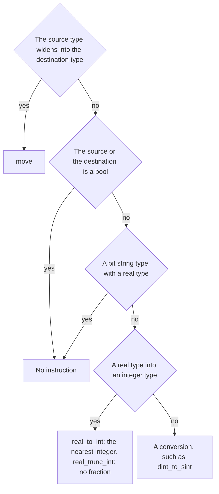

# Conversions

This page is for a reader who writes or reads a ladder [program](glossary.md#program)
and looks for an exact rule. It defines the 182 [conversions](glossary.md#conversion) of
logex. A conversion is an [instruction](glossary.md#instruction) that reads a value and
writes it in the [type](glossary.md#type) that its mnemonic names last.

| Group | Number | A value that does not fit |
|---|---|---|
| [Integer conversions](#integer-conversions) | 56 | It writes the low bits. The power out is false. |
| [Bit string conversions](#bit-string-conversions) | 76 | It writes the low bits. The power out is true. |
| [Real conversions](#real-conversions) | 34 | Into an integer type, it takes the nearest integer and writes its low bits. `lreal_to_real` of a value out of the range writes the largest `real`. The power out is false. |
| [Truncations](#truncations) | 16 | It removes the fraction. Then it writes the low bits. The power out is false. |

The 4 numbers make 182. The value does not fit if it is out of the range of the
destination type.

> #### Warning {: .warning}
>
> If a converted value can move a machine, stop the machine with the power out of an
> integer conversion, a real conversion or a truncation. A value that does not fit the
> destination becomes a different value, and logex gives no [fault](glossary.md#fault).
> Before a bit string conversion, compare the source with a limit. A bit string
> conversion passes power also when it changes the value: `dword_to_word` of
> `16#12345678` writes `16#5678`.

| To find | Go to |
|---|---|
| The instruction for a source type and a destination type | [Which instruction to use](#which-instruction-to-use) |
| A rule that is the same for the 182 conversions | [Rules that are the same for the 182 conversions](#rules-that-are-the-same-for-the-182-conversions) |
| The rules of 1 group | Its heading: [Integer conversions](#integer-conversions), [Bit string conversions](#bit-string-conversions), [Real conversions](#real-conversions) or [Truncations](#truncations) |
| A conversion that logex does not have | [What logex does not convert](#what-logex-does-not-convert) |
| The list of the 182 mnemonics | [The 182 conversions](#the-182-conversions) |
| The value that a conversion writes for a given source | [Examples](#examples) |
| The message of a wrong [rung](glossary.md#rung) | [Wrong rungs and their diagnostics](#wrong-rungs-and-their-diagnostics) |
| The message of a [warning](glossary.md#warning) | [Programs and their warnings](#programs-and-their-warnings) |
| A rule of a different subject | [See also](#see-also) |

If a rung breaks a rule of this page, logex does not [compile](glossary.md#compile) the
program. It returns a [diagnostic](glossary.md#diagnostic).

## Which instruction to use

The type of the source and the type of the destination select the instruction. This
diagram shows the selection.



Figure: the instruction for a source type and a destination type. The diagram shows
that a real type into an integer type has 2 instructions, and that each other pair has 1
instruction or none.

| Source | Destination | Instruction |
|---|---|---|
| A type that [widens](glossary.md#widen) into the destination type | The destination type | `move`. A conversion between the same 2 types writes the same value. |
| An integer type | A different integer type | An integer conversion, such as `dint_to_sint` |
| An integer type | A [bit string](glossary.md#bit-string) type | A bit string conversion, such as `int_to_word` |
| A bit string type | An integer type, or a different bit string type | A bit string conversion, such as `word_to_int` |
| An integer type | `real` or `lreal` | A real conversion, such as `dint_to_real` |
| `real` or `lreal` | An integer type | A real conversion, such as `real_to_int`, writes the nearest integer. A truncation removes the fraction. |
| `lreal` | `real` | `lreal_to_real` |
| `bool` | An integer type or a real type | None |
| Each type that is not `bool` | `bool` | None |
| A bit string type and a real type | The other of the 2 | None |

[Declarations and types](declarations-and-types.md#widening) gives each type that a type
widens into. `bool` widens into each bit string type, and thus `move` writes a bool into
a `word`. A [bit](glossary.md#bit), such as `status.3`, reads 1 bit of a bit string or of
an integer.

## Rules that are the same for the 182 conversions

Each part of this page uses these words.

| Word | Meaning |
|---|---|
| The source | The first [operand](glossary.md#operand): the value that the conversion reads |
| The destination | The second operand: the [tag](glossary.md#tag) that the conversion writes |
| The from type | The first type word of the [mnemonic](glossary.md#mnemonic): `dint` in `dint_to_sint` |
| The into type | The last type word of the mnemonic: `sint` in `dint_to_sint` |
| Fit | A value fits a type if the value is in the range of the type. |
| The power in | The [power flow](glossary.md#power-flow) that a conversion gets |
| The power out | The power flow that a conversion gives to the next instruction |

[The power in and the power out](instructions-contacts-and-coils.md#the-power-in-and-the-power-out)
gives the power in for each place on a rung.

### The mnemonic

| Item | Rule |
|---|---|
| The form | `<from>_to_<into>`, or `<from>_trunc_<into>` for a truncation. Each part is a type word: `dint_to_sint`, `real_trunc_int`. |
| Capital letters | logex reads a mnemonic in capital letters, small letters or both. `DINT_TO_INT` is `dint_to_int` (integer case 12). |
| 2 words of the same type | No conversion. `dint_to_dint` is an error (wrong rung 16). |
| A [reserved word](glossary.md#reserved-word) | Each of the 182 mnemonics is a reserved word in a program and in the file of a [function block](glossary.md#function-block). This rule is the same for capital letters and small letters. A tag named `dint_to_int` or `Word_To_Int` is an error (wrong rungs 14 and 15). |
| The file of a [configuration](glossary.md#configuration) | A mnemonic of a conversion is not a reserved word in a [configuration file](glossary.md#configuration-file). A [global](glossary.md#global) can have the name `dint_to_int`. |

> #### Note {: .info}
>
> [IEC 61131-3](glossary.md#iec-61131-3) names these conversions with the same words in
> capital letters, for example `DINT_TO_INT`, `REAL_TO_INT` and `REAL_TRUNC_INT`.

### What a conversion does on a true rung and on a false rung

| Power in | What the conversion does |
|---|---|
| A [true rung](glossary.md#true-rung) | It reads the source, converts the value to the into type, and writes the result to the destination. |
| A [false rung](glossary.md#false-rung) | It writes nothing. The power out is false. |

On a true rung, the power out is true, except in the cases of this table. After a fault
of an operand, the power out of each conversion is false. [Faults](#faults) gives the
rules.

| Conversion | The power out is false if |
|---|---|
| An integer conversion | The value does not fit the into type. |
| A bit string conversion | Only after a fault of an operand |
| A real conversion from an integer type, and `real_to_lreal` | Only after a fault of an operand |
| `lreal_to_real` | The nearest 32-bit value is beyond the largest `real`. [Real conversions](#real-conversions) gives the rule. |
| A real conversion into an integer type | The nearest integer does not fit the into type. |
| A truncation | The value with no fraction does not fit the into type. |

On a true rung, the conversion writes the destination also when the power out is false.
After a fault of an operand, it writes nothing. A value that does not fit is not a fault.

### The operands

This table shows the forms of an operand, with an example of each.
[Source syntax](source-syntax.md#names) gives each form of a name.

| Operand | Source | Destination |
|---|---|---|
| A tag: `a_dint` | Yes | Yes, but not an [input](glossary.md#input) |
| An [element](glossary.md#element): `d_array[2]`, `d_array[slot]` | Yes | Yes |
| A number [member](glossary.md#member) of a [timer](glossary.md#timer) or a [counter](glossary.md#counter): `delay.acc` | Yes | Only `pre` and `acc` of a timer, and `pv` of a counter. The into type must be the type of the member, as in `lint_to_dint a delay.pre`. That type is `dint` for `pre` and `acc` of a `ton`, and for `pv` of a `ctu`. |
| A member of a function block: `meter.count` | Yes | No. Only the body of the function block writes its members. |
| A [literal](glossary.md#literal): `129`, `16#ffff`, `2.5` | Yes | No |
| A bit, or a bool member: `status.3`, `delay.dn` | Only in a bit string conversion from a bit string type | No |
| An [array](glossary.md#array): `d_array` | No | No |
| An [instance](glossary.md#instance): `delay` | No | No |

[The members](instructions-timers-and-counters.md#the-members) gives the type of each
member, also of a [long timer](glossary.md#long-timer) and of a
[typed counter](glossary.md#typed-counter).
[Wrong rungs 1 to 15](#wrong-rungs-1-to-15-the-operands) show the diagnostics of an
operand.

### The type of the source and of the destination

| Operand | Rule |
|---|---|
| The source | Its type is the from type, or a type that widens into the from type. Thus `dint_to_int` reads an `sint` or a `usint` (integer cases 10 and 11). |
| The source, in a real conversion or a truncation | An integer type that widens into the real type is correct. Thus `real_to_int` reads an `int` (real case 19). `lreal_to_int` reads a `real` (real case 20). |
| The source, in a bit string conversion | A bool or a bit is correct if the from type is a bit string type, because `bool` widens into each bit string type. The conversion reads 0 or 1 (bit string cases 12, 13 and 16). |
| The destination | Its type is exactly the into type. A destination of a wider type is an error also. |

If the type of an operand breaks a rule, the diagnostic names the instruction to use, if
logex has one: a different conversion, or `move`.
[Wrong rungs 30 to 50](#wrong-rungs-30-to-50-the-types) show these diagnostics.

### A literal as the source

| Literal | Rule |
|---|---|
| An integer literal | It must be a value of the from type. `word_to_int -1 d` is an error, because a `word` holds 0 to 65535 (wrong rung 53). |
| A [based integer literal](literals.md#based-integer-literal) | It is a number, not a pattern of bits. `int_to_word 16#ffff d` is an error, because 65535 is not a value of an `int` (wrong rung 55). `int_to_word -1 d` writes `16#ffff`. |
| An integer literal for the from type `real` or `lreal` | It must be a value of the real type. `real_to_int 16777217 d` is an error, because a `real` does not hold 16777217 exactly (wrong rung 56). |
| A real literal for the from type `real` or `lreal` | A real literal out of the range, or nearer to 0.0 than the smallest positive value, is an error (wrong rungs 57 to 59). |
| A real literal that the real type does not hold exactly | Not an error. `real_to_int 16777217.0 d` reads the nearest value 16777216.0, and logex gives a warning (program 4). |
| A real literal for an integer from type | An error: `dint_to_int 1.5 d` (wrong rung 52) |
| A literal source that is correct | logex compiles the program and gives a warning: the result never changes (programs 1 to 4 and 7). |
| A value that does not fit | The conversion writes the low bits, as for a tag. `dint_to_sint 129 d` writes -127, and the power out is false (integer case 16). |

An operand is 1 name or 1 literal. logex calculates no expression in an operand:
`dint_to_int 5-3 d` is an error (wrong rung 60). [Literals](literals.md) gives each form
of a literal.

### The place of a conversion on a rung

| Item | Rule |
|---|---|
| The place | A conversion can be the first, a middle or the last instruction of a rung or of a [leg](glossary.md#leg). |
| After the conversion | Each instruction can come after it. `dint_to_sint a_dint d_sint ote ok` writes the power out of `dint_to_sint` to `ok` (integer case 1). |
| After a timer instruction or a counter instruction | An error. No instruction comes after a timer instruction or a counter instruction on its path. Examples are `ton`, `tof`, `ctu` and `ctd` (wrong rung 13). |
| 2 conversions on 1 rung | The second conversion reads the value that the first conversion wrote. Its power in is the power out of the first (integer case 17). |

### Faults

A conversion has a fault only from a [subscript](glossary.md#subscript) or a bit number
that a tag holds. logex reads that tag in the same [scan](glossary.md#scan), when the
conversion reads or writes the operand.

| Fault | Rule |
|---|---|
| `:index_out_of_range` | A [major fault](glossary.md#major-fault). The cause: in `d_array[slot]`, `slot` is less than 0, or more than the last subscript of `d_array`. The conversion writes nothing, and the power out is false (integer case 15). |
| `:bit_out_of_range` | A major fault, only for the source of a bit string conversion. The cause: in `status.[slot]`, `slot` is less than 0, or more than the last bit number of `status`. The conversion writes nothing, and the power out is false (bit string case 14). |

After a fault, the scan runs the next instruction. A conversion gives no
[minor fault](glossary.md#minor-fault). [Faults](faults.md) gives the fields of a fault,
and what logex does with a major fault.

### Values from one scan to the next

A conversion keeps no value from one scan to the next. A
[restart](glossary.md#restart) or an [online edit](glossary.md#online-edit) has no effect
on a conversion. The destination keeps its value by the rules of its tag.
[Retained values](retained-values-and-store.md) gives the rules of a tag
at a restart.

### Warnings

| Situation | Warning |
|---|---|
| The source is a literal. | Yes: the result never changes (programs 1 to 4 and 7). |
| A real literal that is more precise than the from type keeps | Yes (program 4). `16777217.0` gets the warning. `2.50` and `0.1` do not get it. [Literals](literals.md) gives the rule, for a `real` and for an `lreal`. |
| A conversion writes a literal into `pre` or `acc` of a long timer, and the literal is no whole number of milliseconds. | Yes (program 7). [Long timers](instructions-timers-and-counters.md#long-timers) gives the rule. |
| A conversion writes a whole tag, and an `ote`, `osr` or `osf` writes a bit of the same tag. | Yes, in each sequence (programs 5 and 6). The last write in the scan sets the bit. |
| A conversion writes a whole tag, and an `otl` or `otu` writes a bit of the same tag. | No (program 12) |
| The source is a tag. | No (programs 8, 9 and 11) |
| 2 conversions write the same tag. | No (program 10) |

## Integer conversions

An integer conversion writes a value of 1 integer type into a tag of a different integer
type. logex has 8 integer types: `sint`, `int`, `dint`, `lint`, `usint`, `uint`, `udint`
and `ulint`. Each integer type converts into each of the 7 other integer types.

| Part | Rule |
|---|---|
| Mnemonics | `<from>_to_<into>`, with 2 different integer types: 56 mnemonics, such as `dint_to_sint` and `int_to_uint` |
| Source | The from type, or a type that widens into it |
| Destination | A tag of the into type |
| On a true rung | If the value fits the into type, it writes the value. Else it writes the low bits of the value, in 2's complement for a signed type. The value [wraps](glossary.md#wrap). |
| On a false rung | It writes nothing. |
| Power out | True if the value fits the into type. False if the value wraps, or after a fault of an operand. |
| Faults | Only the faults of an operand |
| Examples | [Integer cases 1 to 17](#integer-cases-1-to-17), and [the bits of 8 conversions](#the-bits-of-8-conversions) 1 to 3 |

This table gives the wrap of some values. Each row is an integer case.

| Conversion | Writes | Power out |
|---|---|---|
| `dint_to_sint` of 129 | -127 | False |
| `dint_to_sint` of -129 | 127 | False |
| `int_to_uint` of -1 | 65535 | False |
| `uint_to_int` of 40000 | -25536 | False |
| `lint_to_dint` of 4294967297 | 1 | False |
| `sint_to_dint` of -5 | -5 | True |

A conversion into a wider signed type keeps the value. Thus `sint_to_dint` of -127
writes 1 to each new high bit ([the bits of 8 conversions](#the-bits-of-8-conversions), 2).
[Declarations and types](declarations-and-types.md#elementary-types) gives the range of
each type.

## Bit string conversions

A bit string conversion copies a pattern of bits. The number can change: `word_to_int` of
`16#ffff` writes -1. logex has 4 bit string types: `byte`, `word`, `dword` and `lword`.

| Part | Rule |
|---|---|
| Mnemonics | `<from>_to_<into>`, with 1 bit string type and 1 integer type, or with 2 different bit string types: 76 mnemonics, such as `word_to_int`, `int_to_word` and `byte_to_word` |
| Source | The from type, or a type that widens into it. If the from type is a bit string type, a bool or a bit is correct. `byte_to_int flag n` writes 0 or 1 (bit string cases 12, 13 and 16). |
| Destination | A tag of the into type |
| On a true rung | It takes the bits of the source in the width of the from type, in 2's complement for a signed type. It writes these bits to the low bits of the destination. |
| A wider destination | Each high bit is 0. A bit string conversion never copies the sign bit into the high bits. |
| A narrower destination | It keeps the low bits. |
| A signed destination | The top bit of the destination is the sign. |
| On a false rung | It writes nothing. |
| Power out | True, except after a fault of an operand |
| Faults | Only the faults of an operand |
| Examples | [Bit string cases 1 to 16](#bit-string-cases-1-to-16), and [the bits of 8 conversions](#the-bits-of-8-conversions) 4 to 8 |

| From type | Into types | Number |
|---|---|---|
| Each of the 8 integer types | `byte`, `word`, `dword`, `lword` | 32 |
| Each of the 4 bit string types | The 8 integer types, and the 3 other bit string types | 44 |

This table compares an integer conversion with a bit string conversion. Each row is a
case of this page.

| Conversion | Writes | Power out |
|---|---|---|
| `sint_to_dint` of -127 | -127 | True |
| `sint_to_word` of -1 | `16#00ff` | True |
| `int_to_dword` of -1 | `16#0000ffff` | True |
| `word_to_int` of `16#ffff` | -1 | True |
| `word_to_dint` of `16#8000` | 32768 | True |
| `word_to_uint` of `16#ffff` | 65535 | True |
| `dint_to_word` of 70000 | `16#1170` | True |
| `int_to_uint` of -1 | 65535 | False |

A bit string conversion from or into a bit string of the same width keeps each bit.
Thus `word_to_uint` and `uint_to_word` give the number of a `word`, and the `word` of a
number.

## Real conversions

A real conversion writes a value between a real type and an integer type, or between the
2 real types. logex has 2 real types: `real` and `lreal`.

| Part | Rule |
|---|---|
| Mnemonics | `<from>_to_<into>`, with 1 real type and 1 integer type, and `real_to_lreal` and `lreal_to_real`: 34 mnemonics, such as `real_to_int` and `dint_to_real` |
| Source | The from type, or a type that widens into it |
| Destination | A tag of the into type |
| On a true rung, into an integer type | It takes the nearest integer. For a value halfway between 2 integers, it takes the even integer. If that integer does not fit, it writes the low bits. |
| On a true rung, into a real type | It writes the nearest value of the into type. Each integer is in the range of a `real`, but a `real` does not hold each integer exactly. |
| `lreal_to_real`: the nearest 32-bit value | It first takes the nearest value of a 32-bit floating-point number. That value can be beyond the largest `real`, or nearer to 0.0 than the smallest positive `real`. |
| `lreal_to_real` out of the range | If the nearest 32-bit value is beyond the largest `real`, it writes the largest `real` with the sign of the source. 3.4028235e38 is more than the largest `real`, but its nearest 32-bit value is the largest `real` (real case 22). |
| `lreal_to_real` near 0.0 | If the nearest 32-bit value is nearer to 0.0 than the smallest positive `real`, it writes 0.0 (real cases 16 and 24). 1.1754943e-38 is less than the smallest positive `real`, but its nearest 32-bit value is that `real` (real case 23). |
| On a false rung | It writes nothing. |
| Power out | False if the nearest integer does not fit, or if the nearest 32-bit value of `lreal_to_real` is beyond the largest `real`. False after a fault of an operand. Else true. |
| Faults | Only the faults of an operand |
| Examples | [Real cases 1 to 24](#real-cases-1-to-24) |

| From type | Into types | Number |
|---|---|---|
| Each of the 8 integer types | `real`, `lreal` | 16 |
| `real` | The 8 integer types, and `lreal` | 9 |
| `lreal` | The 8 integer types, and `real` | 9 |

This table gives the value that a real conversion from an integer type, or
`real_to_lreal`, writes. The power out of each row is true.

| Conversion | What it writes |
|---|---|
| `dint_to_real` | 16777217 becomes 16777216.0. |
| `lint_to_lreal` | 9007199254740993 becomes 9007199254740992.0. |
| `real_to_lreal` | 0.1 in a `real` becomes 0.10000000149011612. |

This table gives the value that `lreal_to_real` writes. Each row is a real case. The
largest `real` is 3.4028234663852886e38. The smallest positive `real` is
1.1754943508222875e-38.

| Source | Writes | Power out |
|---|---|---|
| 1.0e300 | The largest `real` | False |
| 3.4028235e38 | The largest `real` | True |
| 1.1754943e-38 | The smallest positive `real` | True |
| 1.1754942e-38 | 0.0 | True |
| 1.0e-300 | 0.0 | True |

A tag of a real type never holds an infinity, `-0.0`, or a NaN (a value that is not a
number). It also never holds a value nearer to 0.0 than the smallest normal value of its
type (a subnormal value).
[Results that a type cannot hold](instructions-arithmetic-and-comparison.md#results-that-a-type-cannot-hold)
gives the same rules for arithmetic.

## Truncations

A truncation writes a real value into an integer type with no fraction. It removes the
fraction toward 0.

| Part | Rule |
|---|---|
| Mnemonics | `real_trunc_<into>` and `lreal_trunc_<into>`, with each of the 8 integer types: 16 mnemonics, such as `real_trunc_int` |
| Source | The real type of the mnemonic, or a type that widens into it. Thus `lreal_trunc_int` reads a `real`, and `real_trunc_int` reads an `int` (truncation cases 11 and 12). |
| Destination | A tag of the integer into type. A real destination is an error (wrong rungs 49 and 50). |
| On a true rung | It removes the fraction: 37.9 becomes 37, and -1.6 becomes -1. If the result does not fit, it writes the low bits. |
| On a false rung | It writes nothing. |
| Power out | True if the result fits the into type. False if the result wraps, or after a fault of an operand. |
| Faults | Only the faults of an operand |
| Examples | [Truncation cases 1 to 13](#truncation-cases-1-to-13) |

This table compares a real conversion with a truncation. Each value comes from
real cases 1 to 7 and truncation cases 1 to 7.

| Source | `real_to_int` | `real_trunc_int` |
|---|---|---|
| 2.5 | 2 | 2 |
| 3.5 | 4 | 3 |
| -2.5 | -2 | -2 |
| -2.7 | -3 | -2 |
| -1.6 | -2 | -1 |
| 37.9 | 38 | 37 |
| 40000.7 | -25535, power out false | -25536, power out false |

Near the end of a range, a real conversion and a truncation can give different results.
`lreal_to_dint` of 2147483647.5 takes the even integer 2147483648, which wraps to
-2147483648 (real case 10). `lreal_trunc_dint` of 2147483647.9 writes 2147483647
(truncation case 10).

## What logex does not convert

logex has no instruction for these conversions.

| Conversion | What logex has |
|---|---|
| A bool into a number | No conversion. A bit string conversion from `byte` reads a bool: `byte_to_int flag n` writes 0 or 1 (bit string case 16). `move` writes a bool into a bit string. |
| A number into a bool | No conversion. A comparison sets a [coil](glossary.md#coil): `ne n 0 ote flag`. |
| A bit string into a bool | No conversion. A [contact](glossary.md#contact) reads 1 bit, such as `status.3`. |
| A bit string into a real type, or a real type into a bit string | No conversion. A real has no bits: `speed.3` is an error (wrong rung 12). |
| A BCD value into a number, or a number into a BCD value | No conversion |
| An instruction that gives the nearest integer, the next integer up or the next integer down, as a real value | No instruction. A real conversion writes the nearest integer into an integer type, and a truncation removes the fraction. |
| A conversion with 1 type word, such as `trunc_int` | No instruction. The mnemonic names 2 types. |
| A conversion between 2 tags of the same type | No conversion. Use `move`. |

[Wrong rungs 16 to 29](#wrong-rungs-16-to-29-the-names) show the diagnostic of each
mnemonic that logex does not have. [What logex does not have](not-supported.md) gives each feature
that logex does not have.

## Examples

Each example is a program or a list of rungs, with a script that runs it. It is not
necessary to read a script, because the page shows each line that it prints. To run a
script, enter its command in the directory `examples` of the repository. Each script that
runs a scan uses `Logex.Runtime.scan/2`, which adds 0 ms to the time of the program at
each scan. A conversion does not read the time.

### The scripts that run the examples

The scripts of the cases read 2 files in the directory `examples/conversions` of the
repository.

| File | What it does |
|---|---|
| `cases.exs` | It runs the cases. Each case is 1 rung with 1 scan. It compiles a program for each case from the [declarations](glossary.md#declaration) of `tags.txt` and the rung. Then it runs 1 scan and prints the inputs, the [outputs](glossary.md#output) that the rung names and each fault. Each input that the case does not give is 0. |
| `tags.txt` | The declarations of the cases and of the wrong rungs |

<!-- file: conversions/cases.exs -->
```elixir
# cases.(first, cases) runs 1 scan of each case. A case is a rung and a map with the
# value of some inputs. Each other input is 0. The program of a case is the
# declarations of `tags.txt` and the rung. For each case, the script prints the number
# of the case and its rung. Then it prints the inputs, each output that the rung names
# with `ok` first, and each fault of the scan. It prints the value of a bit string tag
# as a based literal of 16, with a digit for each 4 bits.
tags = File.read!("conversions/tags.txt")
digits = %{byte: 2, word: 4, dword: 8, lword: 16}

value = fn
  list, _type when is_list(list) ->
    inspect(list)

  number, type when is_map_key(digits, type) ->
    text = String.downcase(Integer.to_string(number, 16))
    "16#" <> String.pad_leading(text, digits[type], "0")

  number, _type ->
    "#{number}"
end

pairs = fn
  [], _program ->
    "no input"

  list, program ->
    Enum.map_join(list, ", ", fn {name, number} ->
      "#{name} = #{value.(number, program.tags[name].type)}"
    end)
end

fault = fn fault ->
  "      fault  #{fault.severity}, #{inspect(fault.kind)}, read #{inspect(fault.read)}"
end

fn first, cases ->
  for {{rung, inputs}, number} <- Enum.with_index(cases, first) do
    {:ok, program} = Logex.compile(tags <> rung, name: "case")
    state = Logex.Runtime.put_inputs(program, Logex.Runtime.instance(program), inputs)
    {outputs, state} = Logex.Runtime.scan(program, state)
    named = Map.take(outputs, String.split(rung, [" ", "["]))
    named = Enum.sort_by(named, fn {name, _value} -> {name != "ok", name} end)
    head = String.pad_leading("#{number}", 2) <> "  " <> rung
    inputs = Enum.sort(inputs)

    lines = [
      head,
      "      in     " <> pairs.(inputs, program),
      "      out    " <> pairs.(named, program)
    ]

    IO.puts(Enum.join(lines ++ Enum.map(state.faults, fault), "\n"))
  end
end
```

The name of each tag gives its type. `a_dint` is a `dint` source, `d_word` is a `word`
destination, and `ok` gets the power out. `go` is a bool input: `xic go` with `go` at 0
makes a false rung. Each output starts at 0.

<!-- file: conversions/tags.txt -->
```text
var_input  go       bool
var_input  slot     dint
var_input  a_bool   bool
var_input  a_sint   sint
var_input  a_int    int
var_input  a_dint   dint
var_input  a_lint   lint
var_input  a_usint  usint
var_input  a_uint   uint
var_input  a_udint  udint
var_input  a_ulint  ulint
var_input  a_byte   byte
var_input  a_word   word
var_input  a_dword  dword
var_input  a_lword  lword
var_input  a_real   real
var_input  a_lreal  lreal
var_output d_bool   bool
var_output d_sint   sint
var_output d_int    int
var_output d_dint   dint
var_output d_lint   lint
var_output d_usint  usint
var_output d_uint   uint
var_output d_udint  udint
var_output d_ulint  ulint
var_output d_byte   byte
var_output d_word   word
var_output d_dword  dword
var_output d_lword  lword
var_output d_real   real
var_output d_lreal  lreal
var_output d_array  int[3]
var_output ok       bool
var        delay    ton
var        parts    ctu
```

`cases.exs` prints a real value as Elixir prints a floating-point number of 64 bits.
Thus the `real` value 0.1 prints as `0.10000000149011612`. The scripts print the power
out as 1 for true and 0 for false: `ok = 0` is a false power out.

### The program `fan_panel.ld`

A fan drive gives its frequency in Hz, a status word and a count of boxes. The program
converts each value for a panel. The program is in the directory `examples/conversions`
of the repository.

| Rung | What it does |
|---|---|
| 1 | `mul` calculates the speed of the fan in revolutions each minute. |
| 2 | `real_to_int` writes the nearest integer of the speed into the `int` tag `rpm`. `rpm_ok` is 0 if the speed does not fit. |
| 3 | `real_trunc_int` removes the fraction of the speed, into the `int` tag `whole`. |
| 4 | `word_to_int` copies the bits of the status word into the `int` tag `code`. |
| 5 | `dint_to_sint` writes the box count into the `sint` tag `shown`. `shown_ok` is 0 if the count does not fit. |

<!-- file: conversions/fan_panel.ld -->
```text
var_input  hz         real
var_input  status     word
var_input  boxes      dint
var_output rpm        int
var_output rpm_ok     bool
var_output whole      int
var_output code       int
var_output shown      sint
var_output shown_ok   bool
var        speed      real

// the fan's speed in revolutions a minute, in 2 int tags
mul hz 60.0 speed
real_to_int speed rpm ote rpm_ok
real_trunc_int speed whole
// the drive's status word as a number
word_to_int status code
// the box count in 8 bits, for the panel
dint_to_sint boxes shown ote shown_ok
```

<!-- rung: conversions/fan_panel.ld -->


The script reads the file
[`instructions-arithmetic-and-comparison/scans.exs`](instructions-arithmetic-and-comparison.md#the-scripts-that-run-the-examples),
which runs the scans of a program and prints a table of the tags after each scan. The
map `inputs` has 1 list for each input. The list holds the value of the input in each
scan.

```elixir
{scans, _} = Code.eval_file("instructions-arithmetic-and-comparison/scans.exs")

inputs = %{
  "hz" => [0.375, 0.625, -0.625, 600.0],
  "status" => [0x0008, 0xFFFF, 0x8000, 0x0000],
  "boxes" => [100, 129, -129, 200]
}

names = ["hz", "speed", "rpm", "rpm_ok", "whole", "status", "code", "boxes", "shown", "shown_ok"]
scans.("conversions/fan_panel.ld", inputs, names)
```

```console
$ mix run conversions-fan-panel.exs
scan      hz  speed     rpm  rpm_ok   whole  status    code  boxes  shown  shown_ok
   1   0.375   22.5      22       1      22       8       8    100    100         1
   2   0.625   37.5      38       1      37   65535      -1    129   -127         0
   3  -0.625  -37.5     -38       1     -37   32768  -32768   -129    127         0
   4   600.0  3.6e4  -29536       0  -29536       0       0    200    -56         0
```

The script prints the `word` tag `status` as a number, and the `real` value 36000.0 as
`3.6e4`.

| Scan | What the scan shows |
|---|---|
| 1 | The speed is 22.5. `real_to_int` writes the even integer 22. The status word 8 is the number 8. |
| 2 | The speed 37.5 gives 38, and the truncation writes 37. The status word `16#ffff` is -1 in an `int`. 129 does not fit an `sint`: `shown` is -127, and `shown_ok` is 0. |
| 3 | The speed -37.5 gives -38, and the truncation writes -37. The status word `16#8000` is -32768. -129 wraps to 127. |
| 4 | The speed 36000.0 does not fit an `int`. The 2 conversions write -29536, and `rpm_ok` is 0. 200 wraps to -56 in an `sint`. |

### The program `drive.ld`

A drive card gives its speed in a `uint` register. The program moves the speed into a
`dint`, and doubles it in a `uint`. It converts a `dint` level into an `sint`. The
program is the file `examples/drive.ld` of the repository.

<!-- file: drive.ld -->
```text
var_input  hz       uint
var_input  level    dint
var_output speed    dint
var_output twice    uint
var_output twice_ok bool
var_output trim     sint
var_output trim_ok  bool

move hz speed
add hz hz twice ote twice_ok
dint_to_sint level trim ote trim_ok
```

The script `drive.exs` runs 3 scans. Then it gives `hz` a value that a `uint` cannot
hold. Last, it compiles 6 wrong rungs and prints each diagnostic.

```elixir
{:ok, drive} = Logex.compile_file("drive.ld")

scan = fn state, label, inputs ->
  state = Logex.Runtime.put_inputs(drive, state, inputs)
  {outputs, state} = Logex.Runtime.scan(drive, state)
  IO.puts("#{label}  #{inspect(outputs)}")
  state
end

state =
  Logex.Runtime.instance(drive)
  |> scan.("a register of 1200, a level of 100", %{"hz" => 1200, "level" => 100})
  |> scan.("the register's top, a level of 129 ", %{"hz" => 65_535, "level" => 129})
  |> scan.("a level of -1                      ", %{"level" => -1})

try do
  Logex.Runtime.put_inputs(drive, state, %{"hz" => 65_536})
rescue
  error in ArgumentError -> IO.puts(Exception.message(error))
end

{:error, diagnostics} =
  Logex.compile(
    "var speed dint\nvar_output hz uint\nvar_output flag bool\n" <>
      "move speed hz\nmove 70000 hz\nmove flag speed\nadd speed 1 hz\nneg speed hz\n" <>
      "lt hz 70000 ote flag",
    name: "back"
  )

for diagnostic <- diagnostics, do: IO.puts(Logex.Diagnostic.format(diagnostic))
```

```console
$ mix run drive.exs
a register of 1200, a level of 100  %{"speed" => 1200, "trim" => 100, "trim_ok" => 1, "twice" => 2400, "twice_ok" => 1}
the register's top, a level of 129   %{"speed" => 65535, "trim" => -127, "trim_ok" => 0, "twice" => 65534, "twice_ok" => 0}
a level of -1                        %{"speed" => 65535, "trim" => -1, "trim_ok" => 1, "twice" => 65534, "twice_ok" => 0}
input `hz` is a uint: 65536 is outside 0 to 65535
line 4: `move` writes `speed`, a dint, into `hz`, a uint: a dint does not widen into a uint, so convert it with `dint_to_uint`
line 5: `move` writes `70000` into `hz`, a uint: it is outside 0 to 65535
line 6: `move` writes `flag`, a bool, into `speed`, a dint: a bool does not widen into a dint, and logex has no conversion between them
line 7: `add` computes in `hz`'s type, a uint, but `speed` is a dint (declared on line 1): a dint does not widen into a uint, so convert it first, with `dint_to_uint`
line 8: `neg` writes `hz`, a uint (declared on line 2), which holds no negative value: `neg` writes a signed type, so declare `hz` a dint
line 9: `lt` compares `70000` with `hz`, a uint (declared on line 2), which never holds it: `70000` is outside 0 to 65535
```

| Line | What the line shows |
|---|---|
| 2 | The double of 65535 wraps to 65534, and `twice_ok` is 0. 129 does not fit in an `sint`. `dint_to_sint` keeps the low 8 bits, -127, and `trim_ok` is 0. |
| 3 | -1 fits in an `sint`, and `trim_ok` is 1. |
| 4 | The host gives `hz` a value out of its range, and logex raises an `ArgumentError`. |
| 5 to 10 | The diagnostics of the 6 wrong rungs. |

### The program `fan.ld`

A fan drive gives its speed in Hz, in a `real`. The program calculates the speed in
revolutions a minute in a `real` and in an `lreal`. It rounds and truncates the speed into
`int` tags. It also calculates the square root of the frequency. The program is the file
`examples/fan.ld` of the repository.

<!-- file: fan.ld -->
```text
var_input  hz      real
var_output speed   real
var_output precise lreal
var_output rpm     int
var_output whole   int
var_output root    real
var_output root_ok bool

// the fan's speed in revolutions a minute, in a real and in an lreal
mul hz 60.0 speed
mul hz 60.0 precise
real_to_int speed rpm
real_trunc_int speed whole
sqrt hz root ote root_ok
```

The script `fan.exs` runs 5 scans. Then it gives `hz` a value that a `real` cannot hold.
Then it compiles a wrong literal and 12 wrong rungs, and prints each diagnostic. Last, it
compiles a program whose literals a `real` rounds, and prints the warnings.

```elixir
{:ok, fan} = Logex.compile_file("fan.ld")

scan = fn state, label, inputs ->
  state = Logex.Runtime.put_inputs(fan, state, inputs)
  {outputs, state} = Logex.Runtime.scan(fan, state)
  IO.puts("#{label}  #{inspect(outputs)}")
  for fault <- state.faults, do: IO.puts("    #{inspect(fault)}")
  state
end

state =
  Logex.Runtime.instance(fan)
  |> scan.("0.1 Hz      ", %{"hz" => 0.1})
  |> scan.("12.5 Hz     ", %{"hz" => 12.5})
  |> scan.("-0.25 Hz    ", %{"hz" => -0.25})
  |> scan.("600 Hz      ", %{"hz" => 600})
  |> scan.("16777217 Hz ", %{"hz" => 16_777_217})

try do
  Logex.Runtime.put_inputs(fan, state, %{"hz" => Integer.pow(2, 128)})
rescue
  error in ArgumentError -> IO.puts(Exception.message(error))
end

{:error, [lexed]} = Logex.compile("var x real\nmove 1.5e+3 x", name: "lexed")
IO.puts(Logex.Diagnostic.format(lexed))

{:error, diagnostics} =
  Logex.compile(
    "var speed real\nvar count dint\nvar rpm int\nvar on bool\nvar big lreal\n" <>
      "move 16777217 speed\nmove speed rpm\ngt speed count ote on\ndiv speed 0.0 speed\n" <>
      "mod speed 2 rpm\nsqrt -4.0 speed\nsqrt speed rpm\nxic speed.3 ote on\nmove 1.0e-40 speed\n" <>
      "move 1.0e-310 big\nmove 1.0e-400 big\ngt 1.0e-310 0.0 ote on",
    name: "wrong"
  )

for diagnostic <- diagnostics, do: IO.puts(Logex.Diagnostic.format(diagnostic))

{:ok, rounded} =
  Logex.compile(
    "var_output speed real\nvar_output set_point real 16777217.0\nmove 16777217.0 speed\n" <>
      "move 37.1 speed\nmove 37.1 set_point",
    name: "rounded"
  )

for warning <- rounded.warnings, do: IO.puts(Logex.Diagnostic.format(warning))
```

```console
$ mix run fan.exs
0.1 Hz        %{"precise" => 6.000000089406967, "root" => 0.3162277638912201, "root_ok" => 1, "rpm" => 6, "speed" => 6.0, "whole" => 6}
12.5 Hz       %{"precise" => 750.0, "root" => 3.535533905029297, "root_ok" => 1, "rpm" => 750, "speed" => 750.0, "whole" => 750}
-0.25 Hz      %{"precise" => -15.0, "root" => 0.0, "root_ok" => 0, "rpm" => -15, "speed" => -15.0, "whole" => -15}
    %Logex.Fault{severity: :minor, kind: :negative_sqrt, instruction: :sqrt, path: nil, file: "fan.ld", line: 14, read: -0.25}
600 Hz        %{"precise" => 36000.0, "root" => 24.494897842407227, "root_ok" => 1, "rpm" => -29536, "speed" => 36000.0, "whole" => -29536}
16777217 Hz   %{"precise" => 1006632960.0, "root" => 4096.0, "root_ok" => 1, "rpm" => 0, "speed" => 1006632960.0, "whole" => 0}
input `hz` is a real: 340282366920938463463374607431768211456 is beyond a real's range, -3.4028234663852886e38 to 3.4028234663852886e38
line 2, column 6: "1.5e+3" is no number: logex takes no `+`, so an exponent is `e3` or `e-3`
line 6: `move` writes `16777217` into `speed`, a real: it is no value of a real, which holds integers exactly only to 2^24: the nearest it holds is 16777216.0
line 7: `move` writes `speed`, a real, into `rpm`, an int: a real does not widen into an int, so convert it with `real_to_int`
line 8: `gt` compares `speed`, a real (declared on line 1), with `count`, a dint (declared on line 2): a dint does not widen into a real, so convert it first, with `dint_to_real`
line 9: `div` divides by the literal `0.0`: a zero divisor gives 0.0 and passes no power on every scan, so a literal one is refused
line 10: `mod` reads an integer, but `speed` is a real (declared on line 1)
line 11: `sqrt` takes the root of the literal `-4.0`: a negative source gives 0.0, passes no power and raises a minor fault on every scan, so a literal one is refused
line 12: `sqrt` writes a real, but `rpm` is an int (declared on line 3): a square root is a real's, so declare it a real or an lreal
line 13: `speed.3` names a bit of `speed`, a real, which has no bits
line 14: `move` writes `1.0e-40` into `speed`, a real: it is too near 0.0 for a real, whose smallest above 0.0 is 1.1754943508222875e-38: it would be written as 0.0
line 15: `move` writes `1.0e-310` into `big`, an lreal: it is too near 0.0 for an lreal, whose smallest above 0.0 is 2.2250738585072014e-308: it would be written as 0.0
line 16: `move` writes `1.0e-400` into `big`, an lreal: it is too near 0.0 for an lreal, whose smallest above 0.0 is 2.2250738585072014e-308: it would be written as 0.0
line 17: `gt` reads a number or a bit string, and compares two literals as lreals: `1.0e-310` is too near 0.0 for an lreal, whose smallest above 0.0 is 2.2250738585072014e-308: it would be read as 0.0
line 2: warning: `16777217.0` is more precise than a real keeps: it is held as 16777216.0
line 3: warning: `16777217.0` is more precise than a real keeps: it is held as 16777216.0
```

### The 182 conversions

The script tries the 2 forms of a mnemonic for each pair of type words. It prints each
mnemonic that compiles, in its group.

```elixir
# The script tries each mnemonic `<from>_to_<into>` and `<from>_trunc_<into>` for each
# pair of 2 different type words. It compiles a program with 1 rung of the mnemonic.
# The mnemonic is a conversion if the program compiles. The script prints the
# conversions in 4 groups, and for each type the types that it converts into.
integers = ["sint", "int", "dint", "lint", "usint", "uint", "udint", "ulint"]
bit_strings = ["byte", "word", "dword", "lword"]
reals = ["real", "lreal"]
types = ["bool" | integers ++ bit_strings ++ reals]

kind = fn type -> {type in reals, type in bit_strings} end

group = fn
  "trunc", _from, _into -> "truncations"
  "to", {true, _}, _into -> "real conversions"
  "to", _from, {true, _} -> "real conversions"
  "to", {_, true}, _into -> "bit string conversions"
  "to", _from, {_, true} -> "bit string conversions"
  "to", _from, _into -> "integer conversions"
end

conversion? = fn from, form, into ->
  text = "var_input a #{from}\nvar_output d #{into}\n#{from}_#{form}_#{into} a d\n"
  match?({:ok, _}, Logex.compile(text, name: "list"))
end

found =
  for form <- ["to", "trunc"],
      from <- types,
      into <- types,
      from != into,
      conversion?.(from, form, into),
      do: {group.(form, kind.(from), kind.(into)), from, into}

for name <- ["integer conversions", "bit string conversions", "real conversions", "truncations"] do
  pairs = for {^name, from, into} <- found, do: {from, into}
  IO.puts("#{name}: #{length(pairs)}")

  for from <- types, intos = for({^from, into} <- pairs, do: into), intos != [] do
    IO.puts("  " <> String.pad_trailing(from, 6) <> " into " <> Enum.join(intos, " "))
  end
end

IO.puts("all conversions: #{length(found)}")
```

```console
$ mix run conversions-list.exs
integer conversions: 56
  sint   into int dint lint usint uint udint ulint
  int    into sint dint lint usint uint udint ulint
  dint   into sint int lint usint uint udint ulint
  lint   into sint int dint usint uint udint ulint
  usint  into sint int dint lint uint udint ulint
  uint   into sint int dint lint usint udint ulint
  udint  into sint int dint lint usint uint ulint
  ulint  into sint int dint lint usint uint udint
bit string conversions: 76
  sint   into byte word dword lword
  int    into byte word dword lword
  dint   into byte word dword lword
  lint   into byte word dword lword
  usint  into byte word dword lword
  uint   into byte word dword lword
  udint  into byte word dword lword
  ulint  into byte word dword lword
  byte   into sint int dint lint usint uint udint ulint word dword lword
  word   into sint int dint lint usint uint udint ulint byte dword lword
  dword  into sint int dint lint usint uint udint ulint byte word lword
  lword  into sint int dint lint usint uint udint ulint byte word dword
real conversions: 34
  sint   into real lreal
  int    into real lreal
  dint   into real lreal
  lint   into real lreal
  usint  into real lreal
  uint   into real lreal
  udint  into real lreal
  ulint  into real lreal
  real   into sint int dint lint usint uint udint ulint lreal
  lreal  into sint int dint lint usint uint udint ulint real
truncations: 16
  real   into sint int dint lint usint uint udint ulint
  lreal  into sint int dint lint usint uint udint ulint
all conversions: 182
```

### The bits of 8 conversions

The script runs 8 conversions. For each conversion, it prints the source and its bits,
then the value that the conversion writes and its bits. It prints the bits in rows of
16 bits, with the low bit at the right.

| Conversion | What it shows |
|---|---|
| 1 | `dint_to_sint` keeps the low 8 bits. The top bit of an `sint` is the sign, and thus 129 becomes -127. |
| 2 | `sint_to_dint` copies the sign bit into each new high bit. The value stays -127. |
| 3 | `int_to_uint` keeps the 16 bits. -1 does not fit a `uint`, and the power out is false. |
| 4 and 5 | A bit string conversion writes 0 to each new high bit. |
| 6 | The top bit of `16#ffff` is the sign bit of an `int`. |
| 7 | `16#8000` is 32768 in a `dint`, because a `dint` has 32 bits. |
| 8 | `dword_to_word` keeps the low 16 bits, and the power out is true. |

```elixir
# For each conversion, the script compiles a program of 1 rung, gives the source to
# the input `a` and runs 1 scan. It prints the type and the value of the source, then
# its bits. Then it prints the same for the value that the conversion writes to `d`.
# It prints the bits in rows of 16, with the low bit at the right, and the value of a
# bit string as a based literal of 16.
widths = %{"sint" => 8, "int" => 16, "dint" => 32, "uint" => 16, "word" => 16, "dword" => 32}
power = %{0 => "false", 1 => "true"}

rows = fn value, width ->
  text = Integer.to_string(Bitwise.band(value, Bitwise.bsl(1, width) - 1), 2)
  groups = for <<group::binary-size(4) <- String.pad_leading(text, width, "0")>>, do: group

  for row <- Enum.chunk_every(groups, 4) do
    String.duplicate(" ", 10) <> String.pad_leading(Enum.join(row, " "), 19)
  end
end

shown = fn
  value, type when type in ["word", "dword"] ->
    digits = String.downcase(Integer.to_string(value, 16))
    "16#" <> String.pad_leading(digits, div(widths[type], 4), "0")

  value, _type ->
    "#{value}"
end

lines = fn type, value ->
  ["   " <> String.pad_trailing(type, 7) <> shown.(value, type) | rows.(value, widths[type])]
end

conversions = [
  {"dint", "sint", 129},
  {"sint", "dint", -127},
  {"int", "uint", -1},
  {"sint", "word", -1},
  {"int", "dword", -1},
  {"word", "int", 0xFFFF},
  {"word", "dint", 0x8000},
  {"dword", "word", 0x12345678}
]

for {{from, into, value}, number} <- Enum.with_index(conversions, 1) do
  mnemonic = "#{from}_to_#{into}"
  text = "var_input a #{from}\nvar_output d #{into}\nvar_output ok bool\n#{mnemonic} a d ote ok\n"
  {:ok, program} = Logex.compile(text, name: "bits")
  state = Logex.Runtime.put_inputs(program, Logex.Runtime.instance(program), %{"a" => value})
  {outputs, _state} = Logex.Runtime.scan(program, state)
  head = "#{number}  #{mnemonic}, power out #{power[outputs["ok"]]}"
  IO.puts(Enum.join([head | lines.(from, value)] ++ lines.(into, outputs["d"]), "\n"))
end
```

```console
$ mix run conversions-bits.exs
1  dint_to_sint, power out false
   dint   129
          0000 0000 0000 0000
          0000 0000 1000 0001
   sint   -127
                    1000 0001
2  sint_to_dint, power out true
   sint   -127
                    1000 0001
   dint   -127
          1111 1111 1111 1111
          1111 1111 1000 0001
3  int_to_uint, power out false
   int    -1
          1111 1111 1111 1111
   uint   65535
          1111 1111 1111 1111
4  sint_to_word, power out true
   sint   -1
                    1111 1111
   word   16#00ff
          0000 0000 1111 1111
5  int_to_dword, power out true
   int    -1
          1111 1111 1111 1111
   dword  16#0000ffff
          0000 0000 0000 0000
          1111 1111 1111 1111
6  word_to_int, power out true
   word   16#ffff
          1111 1111 1111 1111
   int    -1
          1111 1111 1111 1111
7  word_to_dint, power out true
   word   16#8000
          1000 0000 0000 0000
   dint   32768
          0000 0000 0000 0000
          1000 0000 0000 0000
8  dword_to_word, power out true
   dword  16#12345678
          0001 0010 0011 0100
          0101 0110 0111 1000
   word   16#5678
          0101 0110 0111 1000
```

### Integer cases 1 to 17

| Case | What the case shows |
|---|---|
| 1 | A value that fits |
| 2 to 8 | A value that does not fit. The conversion writes the low bits, and the power out is false. |
| 9 | A conversion into a wider type keeps the value. |
| 10 and 11 | A source of a type that widens into the from type |
| 12 | A mnemonic in capital letters |
| 13 | A false rung: the conversion writes nothing. `d_sint` keeps its [initial value](glossary.md#initial-value) 0. |
| 14 and 15 | An element as the destination. In case 15, the subscript is out of the array: the conversion writes nothing, and the power out is false. |
| 16 | A literal source that does not fit |
| 17 | 2 conversions on 1 rung. `dint_to_sint` reads the value 300 that `dint_to_int` wrote. 300 does not fit an `sint`, and the power out is false. |

The 4 scripts of the cases read the file [`cases.exs`](#the-scripts-that-run-the-examples).

```elixir
{cases, _} = Code.eval_file("conversions/cases.exs")

cases.(1, [
  {"dint_to_sint a_dint d_sint ote ok", %{"a_dint" => 100}},
  {"dint_to_sint a_dint d_sint ote ok", %{"a_dint" => 129}},
  {"dint_to_sint a_dint d_sint ote ok", %{"a_dint" => -129}},
  {"int_to_uint a_int d_uint ote ok", %{"a_int" => -1}},
  {"uint_to_int a_uint d_int ote ok", %{"a_uint" => 40000}},
  {"sint_to_usint a_sint d_usint ote ok", %{"a_sint" => -1}},
  {"lint_to_dint a_lint d_dint ote ok", %{"a_lint" => 4_294_967_297}},
  {"ulint_to_lint a_ulint d_lint ote ok", %{"a_ulint" => 18_446_744_073_709_551_615}},
  {"sint_to_dint a_sint d_dint ote ok", %{"a_sint" => -5}},
  {"dint_to_int a_sint d_int ote ok", %{"a_sint" => -5}},
  {"dint_to_int a_usint d_int ote ok", %{"a_usint" => 200}},
  {"DINT_TO_INT a_dint d_int ote ok", %{"a_dint" => 7}},
  {"xic go dint_to_sint a_dint d_sint ote ok", %{"a_dint" => 5, "go" => 0}},
  {"dint_to_int a_dint d_array[slot] ote ok", %{"a_dint" => 7, "slot" => 2}},
  {"dint_to_int a_dint d_array[slot] ote ok", %{"a_dint" => 7, "slot" => 3}},
  {"dint_to_sint 129 d_sint ote ok", %{}},
  {"dint_to_int a_dint d_int dint_to_sint d_int d_sint ote ok", %{"a_dint" => 300}}
])
```

```console
$ mix run conversions-integers.exs
 1  dint_to_sint a_dint d_sint ote ok
      in     a_dint = 100
      out    ok = 1, d_sint = 100
 2  dint_to_sint a_dint d_sint ote ok
      in     a_dint = 129
      out    ok = 0, d_sint = -127
 3  dint_to_sint a_dint d_sint ote ok
      in     a_dint = -129
      out    ok = 0, d_sint = 127
 4  int_to_uint a_int d_uint ote ok
      in     a_int = -1
      out    ok = 0, d_uint = 65535
 5  uint_to_int a_uint d_int ote ok
      in     a_uint = 40000
      out    ok = 0, d_int = -25536
 6  sint_to_usint a_sint d_usint ote ok
      in     a_sint = -1
      out    ok = 0, d_usint = 255
 7  lint_to_dint a_lint d_dint ote ok
      in     a_lint = 4294967297
      out    ok = 0, d_dint = 1
 8  ulint_to_lint a_ulint d_lint ote ok
      in     a_ulint = 18446744073709551615
      out    ok = 0, d_lint = -1
 9  sint_to_dint a_sint d_dint ote ok
      in     a_sint = -5
      out    ok = 1, d_dint = -5
10  dint_to_int a_sint d_int ote ok
      in     a_sint = -5
      out    ok = 1, d_int = -5
11  dint_to_int a_usint d_int ote ok
      in     a_usint = 200
      out    ok = 1, d_int = 200
12  DINT_TO_INT a_dint d_int ote ok
      in     a_dint = 7
      out    ok = 1, d_int = 7
13  xic go dint_to_sint a_dint d_sint ote ok
      in     a_dint = 5, go = 0
      out    ok = 0, d_sint = 0
14  dint_to_int a_dint d_array[slot] ote ok
      in     a_dint = 7, slot = 2
      out    ok = 1, d_array = [0, 0, 7]
15  dint_to_int a_dint d_array[slot] ote ok
      in     a_dint = 7, slot = 3
      out    ok = 0, d_array = [0, 0, 0]
      fault  major, :index_out_of_range, read {3}
16  dint_to_sint 129 d_sint ote ok
      in     no input
      out    ok = 0, d_sint = -127
17  dint_to_int a_dint d_int dint_to_sint d_int d_sint ote ok
      in     a_dint = 300
      out    ok = 0, d_int = 300, d_sint = 44
```

### Bit string cases 1 to 16

| Case | What the case shows |
|---|---|
| 1 and 2 | A `word` and an `int` of the same 16 bits |
| 3 and 4 | A wider destination gets 0 in each new high bit. |
| 5 | `word_to_uint` gives the number of a `word`. |
| 6, 7 and 10 | A narrower destination keeps the low bits, and the power out is true. |
| 8 | The top bit of an `sint` is the sign. |
| 9 | A conversion between 2 bit string types |
| 11 | An `sint` source widens into the from type `int`. -1 in an `int` is `16#ffff`. |
| 12 and 13 | A bool and a bit as the source |
| 14 | The bit number 16 is out of a `word`: the conversion writes nothing, and the power out is false. |
| 15 | A false rung |
| 16 | A bool into an `int`: `byte_to_int` writes 0 or 1. |

```elixir
{cases, _} = Code.eval_file("conversions/cases.exs")

cases.(1, [
  {"word_to_int a_word d_int ote ok", %{"a_word" => 0xFFFF}},
  {"int_to_word a_int d_word ote ok", %{"a_int" => -1}},
  {"int_to_dword a_int d_dword ote ok", %{"a_int" => -1}},
  {"word_to_dint a_word d_dint ote ok", %{"a_word" => 0x8000}},
  {"word_to_uint a_word d_uint ote ok", %{"a_word" => 0xFFFF}},
  {"dword_to_word a_dword d_word ote ok", %{"a_dword" => 0x12345678}},
  {"dint_to_word a_dint d_word ote ok", %{"a_dint" => 70000}},
  {"lword_to_sint a_lword d_sint ote ok", %{"a_lword" => 0x80}},
  {"byte_to_word a_byte d_word ote ok", %{"a_byte" => 0xFF}},
  {"word_to_byte a_word d_byte ote ok", %{"a_word" => 0x01FF}},
  {"int_to_word a_sint d_word ote ok", %{"a_sint" => -1}},
  {"byte_to_word a_bool d_word ote ok", %{"a_bool" => 1}},
  {"byte_to_word a_word.[slot] d_word ote ok", %{"a_word" => 0x0008, "slot" => 3}},
  {"byte_to_word a_word.[slot] d_word ote ok", %{"a_word" => 0x0008, "slot" => 16}},
  {"xic go word_to_int a_word d_int ote ok", %{"a_word" => 0x0005, "go" => 0}},
  {"byte_to_int a_bool d_int ote ok", %{"a_bool" => 1}}
])
```

```console
$ mix run conversions-bit-strings.exs
 1  word_to_int a_word d_int ote ok
      in     a_word = 16#ffff
      out    ok = 1, d_int = -1
 2  int_to_word a_int d_word ote ok
      in     a_int = -1
      out    ok = 1, d_word = 16#ffff
 3  int_to_dword a_int d_dword ote ok
      in     a_int = -1
      out    ok = 1, d_dword = 16#0000ffff
 4  word_to_dint a_word d_dint ote ok
      in     a_word = 16#8000
      out    ok = 1, d_dint = 32768
 5  word_to_uint a_word d_uint ote ok
      in     a_word = 16#ffff
      out    ok = 1, d_uint = 65535
 6  dword_to_word a_dword d_word ote ok
      in     a_dword = 16#12345678
      out    ok = 1, d_word = 16#5678
 7  dint_to_word a_dint d_word ote ok
      in     a_dint = 70000
      out    ok = 1, d_word = 16#1170
 8  lword_to_sint a_lword d_sint ote ok
      in     a_lword = 16#0000000000000080
      out    ok = 1, d_sint = -128
 9  byte_to_word a_byte d_word ote ok
      in     a_byte = 16#ff
      out    ok = 1, d_word = 16#00ff
10  word_to_byte a_word d_byte ote ok
      in     a_word = 16#01ff
      out    ok = 1, d_byte = 16#ff
11  int_to_word a_sint d_word ote ok
      in     a_sint = -1
      out    ok = 1, d_word = 16#ffff
12  byte_to_word a_bool d_word ote ok
      in     a_bool = 1
      out    ok = 1, d_word = 16#0001
13  byte_to_word a_word.[slot] d_word ote ok
      in     a_word = 16#0008, slot = 3
      out    ok = 1, d_word = 16#0001
14  byte_to_word a_word.[slot] d_word ote ok
      in     a_word = 16#0008, slot = 16
      out    ok = 0, d_word = 16#0000
      fault  major, :bit_out_of_range, read 16
15  xic go word_to_int a_word d_int ote ok
      in     a_word = 16#0005, go = 0
      out    ok = 0, d_int = 0
16  byte_to_int a_bool d_int ote ok
      in     a_bool = 1
      out    ok = 1, d_int = 1
```

### Real cases 1 to 24

| Case | What the case shows |
|---|---|
| 1 to 7 | `real_to_int` writes the nearest integer. 2.5 and -2.5 give the even integer. In case 7, 40000.7 gives 40001, which wraps to -25535. |
| 8 and 9 | -0.5 gives 0, which fits a `usint`. -1.0 wraps to 255. |
| 10 | 2147483647.5 gives the even integer 2147483648, which wraps. |
| 11 to 13 | An integer into a real type gets the nearest value of the real type. The power out is true. |
| 14 and 15 | `lreal_to_real` out of the range of a `real` writes the largest value with the sign. The power out is false. |
| 16 | A value too near to 0.0 for a `real` becomes 0.0. The power out is true. |
| 17 and 18 | 0.1 in a `real` is `0.10000000149011612`, also in an `lreal`. |
| 19 and 20 | A source of a type that widens into the from type |
| 21 | A false rung |
| 22 | 3.4028235e38 is more than the largest `real`, but its nearest 32-bit value is the largest `real`. The power out is true. |
| 23 | 1.1754943e-38 is less than the smallest positive `real`, but its nearest 32-bit value is that `real`. |
| 24 | The nearest 32-bit value of 1.1754942e-38 is nearer to 0.0 than the smallest positive `real`. The conversion writes 0.0. |

```elixir
{cases, _} = Code.eval_file("conversions/cases.exs")

cases.(1, [
  {"real_to_int a_real d_int ote ok", %{"a_real" => 2.5}},
  {"real_to_int a_real d_int ote ok", %{"a_real" => 3.5}},
  {"real_to_int a_real d_int ote ok", %{"a_real" => -2.5}},
  {"real_to_int a_real d_int ote ok", %{"a_real" => -2.7}},
  {"real_to_int a_real d_int ote ok", %{"a_real" => -1.6}},
  {"real_to_int a_real d_int ote ok", %{"a_real" => 37.9}},
  {"real_to_int a_real d_int ote ok", %{"a_real" => 40000.7}},
  {"real_to_usint a_real d_usint ote ok", %{"a_real" => -0.5}},
  {"real_to_usint a_real d_usint ote ok", %{"a_real" => -1.0}},
  {"lreal_to_dint a_lreal d_dint ote ok", %{"a_lreal" => 2_147_483_647.5}},
  {"dint_to_real a_dint d_real ote ok", %{"a_dint" => 16_777_217}},
  {"lint_to_lreal a_lint d_lreal ote ok", %{"a_lint" => 9_007_199_254_740_993}},
  {"ulint_to_real a_ulint d_real ote ok", %{"a_ulint" => 18_446_744_073_709_551_615}},
  {"lreal_to_real a_lreal d_real ote ok", %{"a_lreal" => 1.0e300}},
  {"lreal_to_real a_lreal d_real ote ok", %{"a_lreal" => -1.0e300}},
  {"lreal_to_real a_lreal d_real ote ok", %{"a_lreal" => 1.0e-300}},
  {"lreal_to_real a_lreal d_real ote ok", %{"a_lreal" => 0.1}},
  {"real_to_lreal a_real d_lreal ote ok", %{"a_real" => 0.1}},
  {"real_to_int a_int d_int ote ok", %{"a_int" => -5}},
  {"lreal_to_int a_real d_int ote ok", %{"a_real" => 2.5}},
  {"xic go real_to_int a_real d_int ote ok", %{"a_real" => 2.5, "go" => 0}},
  {"lreal_to_real a_lreal d_real ote ok", %{"a_lreal" => 3.4028235e38}},
  {"lreal_to_real a_lreal d_real ote ok", %{"a_lreal" => 1.1754943e-38}},
  {"lreal_to_real a_lreal d_real ote ok", %{"a_lreal" => 1.1754942e-38}}
])
```

```console
$ mix run conversions-reals.exs
 1  real_to_int a_real d_int ote ok
      in     a_real = 2.5
      out    ok = 1, d_int = 2
 2  real_to_int a_real d_int ote ok
      in     a_real = 3.5
      out    ok = 1, d_int = 4
 3  real_to_int a_real d_int ote ok
      in     a_real = -2.5
      out    ok = 1, d_int = -2
 4  real_to_int a_real d_int ote ok
      in     a_real = -2.7
      out    ok = 1, d_int = -3
 5  real_to_int a_real d_int ote ok
      in     a_real = -1.6
      out    ok = 1, d_int = -2
 6  real_to_int a_real d_int ote ok
      in     a_real = 37.9
      out    ok = 1, d_int = 38
 7  real_to_int a_real d_int ote ok
      in     a_real = 40000.7
      out    ok = 0, d_int = -25535
 8  real_to_usint a_real d_usint ote ok
      in     a_real = -0.5
      out    ok = 1, d_usint = 0
 9  real_to_usint a_real d_usint ote ok
      in     a_real = -1.0
      out    ok = 0, d_usint = 255
10  lreal_to_dint a_lreal d_dint ote ok
      in     a_lreal = 2147483647.5
      out    ok = 0, d_dint = -2147483648
11  dint_to_real a_dint d_real ote ok
      in     a_dint = 16777217
      out    ok = 1, d_real = 16777216.0
12  lint_to_lreal a_lint d_lreal ote ok
      in     a_lint = 9007199254740993
      out    ok = 1, d_lreal = 9.007199254740992e15
13  ulint_to_real a_ulint d_real ote ok
      in     a_ulint = 18446744073709551615
      out    ok = 1, d_real = 1.8446744073709552e19
14  lreal_to_real a_lreal d_real ote ok
      in     a_lreal = 1.0e300
      out    ok = 0, d_real = 3.4028234663852886e38
15  lreal_to_real a_lreal d_real ote ok
      in     a_lreal = -1.0e300
      out    ok = 0, d_real = -3.4028234663852886e38
16  lreal_to_real a_lreal d_real ote ok
      in     a_lreal = 1.0e-300
      out    ok = 1, d_real = 0.0
17  lreal_to_real a_lreal d_real ote ok
      in     a_lreal = 0.1
      out    ok = 1, d_real = 0.10000000149011612
18  real_to_lreal a_real d_lreal ote ok
      in     a_real = 0.1
      out    ok = 1, d_lreal = 0.10000000149011612
19  real_to_int a_int d_int ote ok
      in     a_int = -5
      out    ok = 1, d_int = -5
20  lreal_to_int a_real d_int ote ok
      in     a_real = 2.5
      out    ok = 1, d_int = 2
21  xic go real_to_int a_real d_int ote ok
      in     a_real = 2.5, go = 0
      out    ok = 0, d_int = 0
22  lreal_to_real a_lreal d_real ote ok
      in     a_lreal = 3.4028235e38
      out    ok = 1, d_real = 3.4028234663852886e38
23  lreal_to_real a_lreal d_real ote ok
      in     a_lreal = 1.1754943e-38
      out    ok = 1, d_real = 1.1754943508222875e-38
24  lreal_to_real a_lreal d_real ote ok
      in     a_lreal = 1.1754942e-38
      out    ok = 1, d_real = 0.0
```

### Truncation cases 1 to 13

| Case | What the case shows |
|---|---|
| 1 to 6 | The truncation removes the fraction toward 0. |
| 7 | 40000.7 becomes 40000, which wraps to -25536. The power out is false. |
| 8 and 9 | -0.9 becomes 0, which fits a `usint`. -1.5 becomes -1, which wraps to 255. |
| 10 | 2147483647.9 becomes 2147483647, which fits a `dint`. |
| 11 and 12 | A source of a type that widens into the from type |
| 13 | A false rung |

```elixir
{cases, _} = Code.eval_file("conversions/cases.exs")

cases.(1, [
  {"real_trunc_int a_real d_int ote ok", %{"a_real" => 2.5}},
  {"real_trunc_int a_real d_int ote ok", %{"a_real" => 3.5}},
  {"real_trunc_int a_real d_int ote ok", %{"a_real" => -2.5}},
  {"real_trunc_int a_real d_int ote ok", %{"a_real" => -2.7}},
  {"real_trunc_int a_real d_int ote ok", %{"a_real" => -1.6}},
  {"real_trunc_int a_real d_int ote ok", %{"a_real" => 37.9}},
  {"real_trunc_int a_real d_int ote ok", %{"a_real" => 40000.7}},
  {"real_trunc_usint a_real d_usint ote ok", %{"a_real" => -0.9}},
  {"real_trunc_usint a_real d_usint ote ok", %{"a_real" => -1.5}},
  {"lreal_trunc_dint a_lreal d_dint ote ok", %{"a_lreal" => 2_147_483_647.9}},
  {"lreal_trunc_int a_real d_int ote ok", %{"a_real" => 7.75}},
  {"real_trunc_int a_int d_int ote ok", %{"a_int" => 7}},
  {"xic go real_trunc_int a_real d_int ote ok", %{"a_real" => 5.0, "go" => 0}}
])
```

```console
$ mix run conversions-truncations.exs
 1  real_trunc_int a_real d_int ote ok
      in     a_real = 2.5
      out    ok = 1, d_int = 2
 2  real_trunc_int a_real d_int ote ok
      in     a_real = 3.5
      out    ok = 1, d_int = 3
 3  real_trunc_int a_real d_int ote ok
      in     a_real = -2.5
      out    ok = 1, d_int = -2
 4  real_trunc_int a_real d_int ote ok
      in     a_real = -2.7
      out    ok = 1, d_int = -2
 5  real_trunc_int a_real d_int ote ok
      in     a_real = -1.6
      out    ok = 1, d_int = -1
 6  real_trunc_int a_real d_int ote ok
      in     a_real = 37.9
      out    ok = 1, d_int = 37
 7  real_trunc_int a_real d_int ote ok
      in     a_real = 40000.7
      out    ok = 0, d_int = -25536
 8  real_trunc_usint a_real d_usint ote ok
      in     a_real = -0.9
      out    ok = 1, d_usint = 0
 9  real_trunc_usint a_real d_usint ote ok
      in     a_real = -1.5
      out    ok = 0, d_usint = 255
10  lreal_trunc_dint a_lreal d_dint ote ok
      in     a_lreal = 2147483647.9
      out    ok = 1, d_dint = 2147483647
11  lreal_trunc_int a_real d_int ote ok
      in     a_real = 7.75
      out    ok = 1, d_int = 7
12  real_trunc_int a_int d_int ote ok
      in     a_int = 7
      out    ok = 1, d_int = 7
13  xic go real_trunc_int a_real d_int ote ok
      in     a_real = 5.0, go = 0
      out    ok = 0, d_int = 0
```

## Wrong rungs and their diagnostics

This part shows 60 wrong rungs in 4 groups. For each group, a script compiles each wrong
rung and prints it after its number. After each rung, the script prints each diagnostic
that logex returns.

| Group | Rungs | Rules |
|---|---|---|
| [The operands](#wrong-rungs-1-to-15-the-operands) | 1 to 15 | [The operands](#the-operands), [The mnemonic](#the-mnemonic) and [The place of a conversion on a rung](#the-place-of-a-conversion-on-a-rung) |
| [The names](#wrong-rungs-16-to-29-the-names) | 16 to 29 | [What logex does not convert](#what-logex-does-not-convert) |
| [The types](#wrong-rungs-30-to-50-the-types) | 30 to 50 | [The type of the source and of the destination](#the-type-of-the-source-and-of-the-destination) |
| [The literals](#wrong-rungs-51-to-60-the-literals) | 51 to 60 | [A literal as the source](#a-literal-as-the-source) |

The page shows a long message on 2 lines or more. To find a message, search this page
for 3 or 4 words of the message.

Each wrong rung comes after the 36 declarations of the file `tags.txt`, and thus it is
line 37. [The scripts that run the examples](#the-scripts-that-run-the-examples) shows
the file. Each script of this part also reads the file
[`instructions-contacts-and-coils/report.exs`](instructions-contacts-and-coils.md#the-tags-of-the-wrong-rungs),
which prints each rung and each message in lines of 80 characters or fewer.

### Wrong rungs 1 to 15: the operands

Wrong rungs 14 and 15 are declarations, not rungs. They show that a mnemonic of a
conversion cannot be the name of a tag.

```elixir
{report, _} = Code.eval_file("instructions-contacts-and-coils/report.exs")
tags = File.read!("conversions/tags.txt")

rungs = [
  "dint_to_int a_dint",
  "real_trunc_int a_real",
  "dint_to_int a_dint 5",
  "dint_to_int a_dint a_int",
  "dint_to_int d_array d_int",
  "dint_to_int a_dint d_array",
  "dint_to_int delay d_int",
  "dint_to_int a_dint delay.dn",
  "lint_to_dint a_lint parts.cv",
  "dint_to_int a_dint.3 d_int",
  "dint_to_int a_dint d_int.3",
  "real_to_int a_real.3 d_int",
  "ton delay 100 dint_to_int a_dint d_int",
  "var dint_to_int bool",
  "var Word_To_Int bool"
]

report.(1, rungs, &Logex.compile(tags <> &1, name: "wrong"))
```

```console
$ mix run conversions-wrong-operands.exs
 1  dint_to_int a_dint
      line 37: `dint_to_int` expects 2 operands (a value, then a tag), found 1
 2  real_trunc_int a_real
      line 37: `real_trunc_int` expects 2 operands (a value, then a tag), found
      1
 3  dint_to_int a_dint 5
      line 37: `dint_to_int` expects a tag, found `5`
 4  dint_to_int a_dint a_int
      line 37: `dint_to_int` writes `a_int`, a var_input (declared on line 5):
      logic must not write an input
 5  dint_to_int d_array d_int
      line 37: `dint_to_int` reads one tag, but `d_array` is an array of 3 ints
      (declared on line 33): an instruction takes one of its elements, as in
      `d_array[0]`
 6  dint_to_int a_dint d_array
      line 37: `dint_to_int` writes one tag, but `d_array` is an array of 3 ints
      (declared on line 33): an instruction takes one of its elements, as in
      `d_array[0]`
 7  dint_to_int delay d_int
      line 37: `dint_to_int` reads a dint, but `delay` is a ton (declared on
      line 35): name one of its members, as in `delay.acc`
 8  dint_to_int a_dint delay.dn
      line 37: `dint_to_int` writes an int, but `delay.dn` is a bool
      line 37: `dint_to_int` writes `delay.dn`, but logic may write only `.pre`
      and `.acc` of a ton
 9  lint_to_dint a_lint parts.cv
      line 37: `lint_to_dint` writes `parts.cv`, but logic may write only `.r`
      and `.pv` of a ctu
10  dint_to_int a_dint.3 d_int
      line 37: `dint_to_int` reads a dint, but `a_dint.3` is a bool (declared on
      line 6)
11  dint_to_int a_dint d_int.3
      line 37: `dint_to_int` writes an int, but `d_int.3` is a bool (declared on
      line 20)
12  real_to_int a_real.3 d_int
      line 37: `a_real.3` names a bit of `a_real`, a real, which has no bits
13  ton delay 100 dint_to_int a_dint d_int
      line 37: `dint_to_int a_dint d_int` follows `ton delay` on its path: what
      passes on after a `ton` is not settled, so a `ton` ends its path; read the
      timer with `xic delay.dn` on a rung below
14  var dint_to_int bool
      line 37: `dint_to_int` is an instruction and cannot name a tag
15  var Word_To_Int bool
      line 37: `Word_To_Int` is an instruction and cannot name a tag
```

### Wrong rungs 16 to 29: the names

```elixir
{report, _} = Code.eval_file("instructions-contacts-and-coils/report.exs")
tags = File.read!("conversions/tags.txt")

rungs = [
  "dint_to_dint a_dint d_dint",
  "real_to_real a_real d_real",
  "bool_to_int a_bool d_int",
  "int_to_bool a_int d_bool",
  "bool_to_word a_bool d_word",
  "word_to_bool a_word d_bool",
  "dword_to_real a_dword d_real",
  "real_to_dword a_real d_dword",
  "int_to_bcd a_int d_word",
  "bcd_to_int a_word d_int",
  "real_trunc_real a_real d_real",
  "real_trunc_word a_real d_word",
  "trunc_int a_real d_int",
  "round a_real d_int"
]

report.(16, rungs, &Logex.compile(tags <> &1, name: "wrong"))
```

```console
$ mix run conversions-wrong-names.exs
16  dint_to_dint a_dint d_dint
      line 37: unknown instruction `dint_to_dint`
17  real_to_real a_real d_real
      line 37: unknown instruction `real_to_real`
18  bool_to_int a_bool d_int
      line 37: unknown instruction `bool_to_int`
19  int_to_bool a_int d_bool
      line 37: unknown instruction `int_to_bool`
20  bool_to_word a_bool d_word
      line 37: unknown instruction `bool_to_word`
21  word_to_bool a_word d_bool
      line 37: unknown instruction `word_to_bool`
22  dword_to_real a_dword d_real
      line 37: unknown instruction `dword_to_real`
23  real_to_dword a_real d_dword
      line 37: unknown instruction `real_to_dword`
24  int_to_bcd a_int d_word
      line 37: unknown instruction `int_to_bcd`
25  bcd_to_int a_word d_int
      line 37: unknown instruction `bcd_to_int`
26  real_trunc_real a_real d_real
      line 37: unknown instruction `real_trunc_real`
27  real_trunc_word a_real d_word
      line 37: unknown instruction `real_trunc_word`
28  trunc_int a_real d_int
      line 37: unknown instruction `trunc_int`
29  round a_real d_int
      line 37: unknown instruction `round`
```

### Wrong rungs 30 to 50: the types

Wrong rungs 30 to 40 have a source of a wrong type. Wrong rungs 41 to 50 have a
destination of a wrong type.

```elixir
{report, _} = Code.eval_file("instructions-contacts-and-coils/report.exs")
tags = File.read!("conversions/tags.txt")

rungs = [
  "dint_to_int a_lint d_int",
  "dint_to_int a_word d_int",
  "dint_to_int a_real d_int",
  "dint_to_int a_bool d_int",
  "word_to_int a_dword d_int",
  "word_to_int a_int d_int",
  "int_to_real a_word d_real",
  "real_to_int a_dint d_int",
  "real_to_int a_lreal d_int",
  "real_trunc_int a_dint d_int",
  "real_trunc_int a_lreal d_int",
  "dint_to_int a_dint d_dint",
  "dint_to_int a_dint d_word",
  "dint_to_int a_dint parts.pv",
  "dint_to_sint a_dint d_real",
  "real_to_int a_real d_dint",
  "real_to_int a_real d_real",
  "real_to_int a_real d_word",
  "real_trunc_int a_real d_dint",
  "real_trunc_int a_real d_real",
  "lreal_trunc_int a_lreal d_real"
]

report.(30, rungs, &Logex.compile(tags <> &1, name: "wrong"))
```

```console
$ mix run conversions-wrong-types.exs
30  dint_to_int a_lint d_int
      line 37: `dint_to_int` reads a dint, but `a_lint` is an lint (declared on
      line 7): use `lint_to_int`
31  dint_to_int a_word d_int
      line 37: `dint_to_int` reads a dint, but `a_word` is a word (declared on
      line 13): use `word_to_int`
32  dint_to_int a_real d_int
      line 37: `dint_to_int` reads a dint, but `a_real` is a real (declared on
      line 16): use `real_to_int`
33  dint_to_int a_bool d_int
      line 37: `dint_to_int` reads a dint, but `a_bool` is a bool (declared on
      line 3)
34  word_to_int a_dword d_int
      line 37: `word_to_int` reads a word, but `a_dword` is a dword (declared on
      line 14): use `dword_to_int`
35  word_to_int a_int d_int
      line 37: `word_to_int` reads a word, but `a_int` is an int (declared on
      line 5): use `move`
36  int_to_real a_word d_real
      line 37: `int_to_real` reads an int, but `a_word` is a word (declared on
      line 13)
37  real_to_int a_dint d_int
      line 37: `real_to_int` reads a real, but `a_dint` is a dint (declared on
      line 6): use `dint_to_int`
38  real_to_int a_lreal d_int
      line 37: `real_to_int` reads a real, but `a_lreal` is an lreal (declared
      on line 17): use `lreal_to_int`
39  real_trunc_int a_dint d_int
      line 37: `real_trunc_int` reads a real, but `a_dint` is a dint (declared
      on line 6): use `dint_to_int`
40  real_trunc_int a_lreal d_int
      line 37: `real_trunc_int` reads a real, but `a_lreal` is an lreal
      (declared on line 17): use `lreal_trunc_int`
41  dint_to_int a_dint d_dint
      line 37: `dint_to_int` writes an int, but `d_dint` is a dint (declared on
      line 21): use `move`
42  dint_to_int a_dint d_word
      line 37: `dint_to_int` writes an int, but `d_word` is a word (declared on
      line 28): use `dint_to_word`
43  dint_to_int a_dint parts.pv
      line 37: `dint_to_int` writes an int, but `parts.pv` is a dint: use `move`
44  dint_to_sint a_dint d_real
      line 37: `dint_to_sint` writes an sint, but `d_real` is a real (declared
      on line 31): use `dint_to_real`
45  real_to_int a_real d_dint
      line 37: `real_to_int` writes an int, but `d_dint` is a dint (declared on
      line 21): use `real_to_dint`
46  real_to_int a_real d_real
      line 37: `real_to_int` writes an int, but `d_real` is a real (declared on
      line 31): use `move`
47  real_to_int a_real d_word
      line 37: `real_to_int` writes an int, but `d_word` is a word (declared on
      line 28)
48  real_trunc_int a_real d_dint
      line 37: `real_trunc_int` writes an int, but `d_dint` is a dint (declared
      on line 21): use `real_trunc_dint`
49  real_trunc_int a_real d_real
      line 37: `real_trunc_int` writes an int, but `d_real` is a real (declared
      on line 31): a truncation writes an integer, so declare `d_real` an int,
      or use `move` to keep the real
50  lreal_trunc_int a_lreal d_real
      line 37: `lreal_trunc_int` writes an int, but `d_real` is a real (declared
      on line 31): a truncation writes an integer, so declare `d_real` an int,
      or use `lreal_to_real` to keep the real
```

### Wrong rungs 51 to 60: the literals

```elixir
{report, _} = Code.eval_file("instructions-contacts-and-coils/report.exs")
tags = File.read!("conversions/tags.txt")

rungs = [
  "dint_to_int 5000000000 d_int",
  "dint_to_int 1.5 d_int",
  "word_to_int -1 d_int",
  "word_to_int 70000 d_int",
  "int_to_word 16#ffff d_word",
  "real_to_int 16777217 d_int",
  "real_to_int 1.0e39 d_int",
  "real_to_int 1.0e-40 d_int",
  "lreal_to_real 1.0e-310 d_real",
  "dint_to_int 5-3 d_int"
]

report.(51, rungs, &Logex.compile(tags <> &1, name: "wrong"))
```

```console
$ mix run conversions-wrong-literals.exs
51  dint_to_int 5000000000 d_int
      line 37: `dint_to_int` reads a dint: `5000000000` is outside -2147483648
      to 2147483647
52  dint_to_int 1.5 d_int
      line 37: `dint_to_int` reads a dint: `1.5` is a real, and a dint holds
      only integers
53  word_to_int -1 d_int
      line 37: `word_to_int` reads a word: `-1` is outside 0 to 65535
54  word_to_int 70000 d_int
      line 37: `word_to_int` reads a word: `70000` is outside 0 to 65535
55  int_to_word 16#ffff d_word
      line 37: `int_to_word` reads an int: `16#ffff` is outside -32768 to 32767
56  real_to_int 16777217 d_int
      line 37: `real_to_int` reads a real: `16777217` is no value of a real,
      which holds integers exactly only to 2^24: the nearest it holds is
      16777216.0
57  real_to_int 1.0e39 d_int
      line 37: `real_to_int` reads a real: `1.0e39` is beyond a real's range,
      -3.4028234663852886e38 to 3.4028234663852886e38
58  real_to_int 1.0e-40 d_int
      line 37: `real_to_int` reads a real: `1.0e-40` is too near 0.0 for a real,
      whose smallest above 0.0 is 1.1754943508222875e-38: it would be written as
      0.0
59  lreal_to_real 1.0e-310 d_real
      line 37: `lreal_to_real` reads an lreal: `1.0e-310` is too near 0.0 for an
      lreal, whose smallest above 0.0 is 2.2250738585072014e-308: it would be
      written as 0.0
60  dint_to_int 5-3 d_int
      line 37, column 13: missing separator before `-`: "5-3" is neither a tag
      nor a number, and a sign begins a number
```

## Programs and their warnings

This part shows 12 programs in 2 groups. Each program compiles. For each group, a script
compiles each program and prints it after its number. After each program, the script
prints each warning that logex gives. [Warnings](#warnings) gives the rules.

### Programs 1 to 7: warnings

```elixir
{report, _} = Code.eval_file("instructions-contacts-and-coils/report.exs")

programs = [
  "var_output shown sint\ndint_to_sint 129 shown",
  "var_output code int\nword_to_int 16#ffff code",
  "var_output whole int\nreal_trunc_int -1.6 whole",
  "var_output rpm int\nreal_to_int 16777217.0 rpm",
  "var_input eye bool\nvar_input code int\nvar_output out word\n" <>
    "int_to_word code out\nxic eye ote out.3",
  "var_input eye bool\nvar_input code int\nvar_output out word\n" <>
    "xic eye ote out.3\nint_to_word code out",
  "var_input go bool\nvar t ton_ltime\nvar_output done bool\n" <>
    "xic go ton t 3000000000\nxic t.dn ote done\ndint_to_lint 1500000 t.pre"
]

report.(1, programs, &Logex.compile(&1, name: "warned"))
```

```console
$ mix run conversions-warnings.exs
 1  var_output shown sint
    dint_to_sint 129 shown
      line 2: warning: `dint_to_sint` reads a literal, `129`: its result never
      changes
 2  var_output code int
    word_to_int 16#ffff code
      line 2: warning: `word_to_int` reads a literal, `16#ffff`: its result
      never changes
 3  var_output whole int
    real_trunc_int -1.6 whole
      line 2: warning: `real_trunc_int` reads a literal, `-1.6`: its result
      never changes
 4  var_output rpm int
    real_to_int 16777217.0 rpm
      line 2: warning: `real_to_int` reads a literal, `16777217.0`: its result
      never changes
      line 2: warning: `16777217.0` is more precise than a real keeps: it is
      held as 16777216.0
 5  var_input eye bool
    var_input code int
    var_output out word
    int_to_word code out
    xic eye ote out.3
      line 5: warning: `out.3` is a bit of `out`, which the `int_to_word` on
      line 4 writes whole: the last one in the scan decides it
 6  var_input eye bool
    var_input code int
    var_output out word
    xic eye ote out.3
    int_to_word code out
      line 5: warning: `out.3` already has an `ote` on line 4: the last one in
      the scan decides it
 7  var_input go bool
    var t ton_ltime
    var_output done bool
    xic go ton t 3000000000
    xic t.dn ote done
    dint_to_lint 1500000 t.pre
      line 6: warning: `dint_to_lint` reads a literal, `1500000`: its result
      never changes
      line 6: warning: `dint_to_lint` writes `1500000` into `t.pre`, where
      `t.pre` is a ton_ltime's time in nanoseconds: 1500000 ns is no whole
      number of milliseconds, and a ton_ltime counts whole milliseconds
```

### Programs 8 to 12: no warning

```elixir
{report, _} = Code.eval_file("instructions-contacts-and-coils/report.exs")

programs = [
  "var_input boxes dint\nvar_output shown sint\ndint_to_sint boxes shown",
  "var_input hz lreal\nvar_output small real\nlreal_to_real hz small",
  "var_input a dint\nvar_input b int\nvar_output shown sint\n" <>
    "dint_to_sint a shown\nint_to_sint b shown",
  "var_input status word\nvar_output code int\nvar_output out word\n" <>
    "word_to_int status code\nint_to_word code out",
  "var_input eye bool\nvar_input code int\nvar_output out word\n" <>
    "int_to_word code out\nxic eye otl out.3\nxio eye otu out.3"
]

report.(8, programs, &Logex.compile(&1, name: "quiet"))
```

```console
$ mix run conversions-no-warning.exs
 8  var_input boxes dint
    var_output shown sint
    dint_to_sint boxes shown
      the text compiles, and logex gives no warning
 9  var_input hz lreal
    var_output small real
    lreal_to_real hz small
      the text compiles, and logex gives no warning
10  var_input a dint
    var_input b int
    var_output shown sint
    dint_to_sint a shown
    int_to_sint b shown
      the text compiles, and logex gives no warning
11  var_input status word
    var_output code int
    var_output out word
    word_to_int status code
    int_to_word code out
      the text compiles, and logex gives no warning
12  var_input eye bool
    var_input code int
    var_output out word
    int_to_word code out
    xic eye otl out.3
    xio eye otu out.3
      the text compiles, and logex gives no warning
```

## See also

These pages define the rules of a different subject:

| Subject | Page |
|---|---|
| The types, their ranges and the types that each type widens into | [Declarations and types](declarations-and-types.md) |
| The forms of a literal, and the values of each type | [Literals](literals.md) |
| `move`, the arithmetic and the comparisons | [Instructions: arithmetic and comparison](instructions-arithmetic-and-comparison.md) |
| The bit strings, the bits and the bitwise instructions | [Instructions: bitwise](instructions-bitwise.md) |
| Each instruction on 1 page | [Instruction cheatsheet](cheatsheet.cheatmd) |
| The fields of a fault | [Faults](faults.md) |
| Each warning of logex | [Warnings](warnings.md) |
| Each feature that logex does not have | [What logex does not have](not-supported.md) |

These pages use the rules:

| What you want | Page |
|---|---|
| Select an integer width, and convert between widths | [Choose an integer type and convert values](../howto/choose-integer-widths-and-convert.md) |
| Calculate with `real` and `lreal` | [Use real numbers](../howto/use-reals.md) |
| Read and write a status word | [Use bit strings](../howto/use-bit-strings.md) |
| Why a value wraps, and why logex calculates in the type of the destination | [Types and overflow](../explanation/types-and-overflow.md) |
| Each technical word | [Glossary](glossary.md) |
