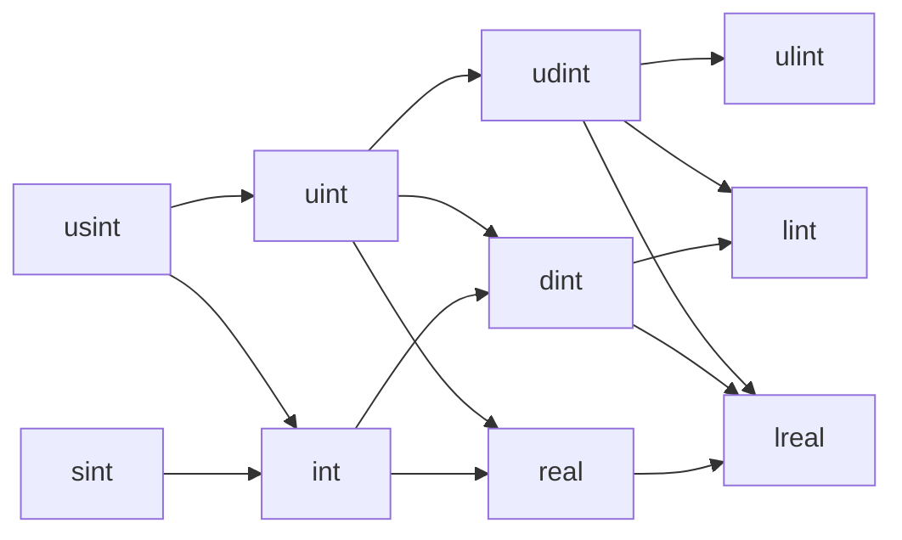

# Declarations and types

This page is for a reader who writes a ladder [program](glossary.md#program) and looks
for an exact rule of a [declaration](glossary.md#declaration). It defines the
[sections](glossary.md#section), the [qualifiers](glossary.md#qualifier), the
[types](glossary.md#type) and their ranges, the [arrays](glossary.md#array) and the
[initial values](glossary.md#initial-value). It also gives the types that each type
[widens](glossary.md#widen) into.

These pages define the other rules of a [tag](glossary.md#tag):

| Subject | Page |
|---|---|
| The characters of a name, the case of each word and the [reserved words](glossary.md#reserved-word) | [Source syntax](source-syntax.md) |
| The forms of a [literal](glossary.md#literal) | [Literals](literals.md) |
| The [members](glossary.md#member) of a [timer](glossary.md#timer), of a [counter](glossary.md#counter) and of a [function block](glossary.md#function-block) | [Function blocks](function-blocks.md) |
| The [restarts](glossary.md#restart) and the [store](glossary.md#store) | [Retained values](retained-values-and-store.md) and [The store](store.md) |
| A [global](glossary.md#global) and its `var_global` line | [Configuration file](configuration-file.md) |
| The typed conversions, for example `dint_to_int` | [Conversions](conversions.md) |

If a declaration breaks a rule of this page, logex returns a
[diagnostic](glossary.md#diagnostic).
[Wrong declarations and their diagnostics](#wrong-declarations-and-their-diagnostics)
shows 58 wrong texts. For each text, it shows each message that logex returns. Each part
of this page ends with the numbers of its wrong texts.

## The parts of a declaration

A declaration is 1 line. It declares 1 tag.

<!-- unchecked: the form of a declaration line, not a text that logex reads -->
```text
<section> [<qualifier>] <name> <type> [<initial value> ...]
```

The parts in brackets are optional. The 3 dots show that an array can have more than 1
initial value. This table shows each part in the declaration
`var_output retain cases udint 0`.

| Part | In the example | Necessary | Rules |
|---|---|---|---|
| Section | `var_output` | Yes | [Sections](#sections) |
| Qualifier | `retain` | No | [Qualifiers](#qualifiers) |
| Name | `cases` | Yes | [Rules of a declaration line](#rules-of-a-declaration-line) |
| Type | `udint` | Yes | [Elementary types](#elementary-types), [Function block types](#function-block-types-timers-counters-and-blocks), [Arrays](#arrays) |
| Initial value | `0` | No | [Initial values](#initial-values) |

The program `packer.ld` has each part that this page defines. It is the file
`examples/declarations-and-types/packer.ld` of the repository.

<!-- file: declarations-and-types/packer.ld -->
```text
var_input  eye      bool
var_input  weight   int
var_input  product  int
var_external estop  bool
var_output motor    bool
var_output heavy    bool
var_output speed_sp dint 1200
var_output retain cases udint 0
var        tare     int -120
var        net      int
var        limits   int[2,3] 300 500 800 400 600 900
var retain boxes    ctu
var non_retain edge bool

// the conveyor runs if the e-stop is not pressed
xio estop ote motor
xic estop move 0 speed_sp
// a box is heavy if its net weight is more than the middle limit of its product
add weight tare net
gt net limits[product,1] ote heavy
// 12 boxes fill 1 case
xic boxes.q ote boxes.r
xic eye ctu boxes 12
xic boxes.q ons edge add cases 1 cases
```

| Line | Declaration | What it shows |
|---|---|---|
| 1 | `var_input eye bool` | A section, a name and a type. Each declaration has these 3 parts. |
| 4 | `var_external estop bool` | A tag that is a global of a [configuration](glossary.md#configuration) |
| 7 | `var_output speed_sp dint 1200` | An initial value |
| 8 | `var_output retain cases udint 0` | The qualifier `retain`, straight after the section |
| 9 | `var tare int -120` | A negative initial value |
| 11 | `var limits int[2,3] 300 500 800 400 600 900` | An array of 2 by 3 [elements](glossary.md#element), with 1 initial value for each element |
| 12 | `var retain boxes ctu` | An [instance](glossary.md#instance) of the counter type `ctu` |
| 13 | `var non_retain edge bool` | The qualifier `non_retain` |

This drawing shows the 7 [rungs](glossary.md#rung) of `packer.ld`. The rungs use each tag
that the file declares. Rung 7 uses `edge` as the [storage bit](glossary.md#storage-bit)
of a [one-shot](glossary.md#one-shot).

<!-- rung: declarations-and-types/packer.ld -->


## Rules of a declaration line

| Item | Rule |
|---|---|
| The place | All declarations come before the first rung. [Source syntax](source-syntax.md#lines) gives the rules of a line. |
| 1 line, 1 tag | A declaration declares 1 tag. A line cannot declare 2 tags. |
| The words | 1 or more spaces or tabs separate 2 words. You can use more spaces to make columns, as `packer.ld` does. |
| A comment | A comment can come after a declaration, on the same line. |
| Each tag has a declaration | An [instruction](glossary.md#instruction) can name only a tag that the file declares. logex makes no tag from a rung. |
| The name | A letter or `_`, then letters, digits and `_`. The name has no dot and no brackets. [Names](source-syntax.md#names) gives the other rules. |
| A reserved word | The name of a tag cannot be a reserved word, for example `ote`, `bool` or `retain`. [Reserved words](source-syntax.md#reserved-words) gives the list. |
| 1 name, 1 declaration | A file cannot declare the same name 2 times. It cannot declare 2 names that are different only in case, such as `motor` and `Motor`. |
| The case of the words | A section word, a qualifier and a built-in type word are not case-sensitive: `VAR_INPUT eye BOOL` is correct. The name of a tag is case-sensitive. |
| A tag that no rung uses | The program [compiles](glossary.md#compile). logex gives a [warning](glossary.md#warning) for the tag. [Warnings](warnings.md) gives each warning. |
| A tag from Elixir | `Logex.Tag.new!/5` makes a tag with the rules of this page. It is a part of the [host contract](glossary.md#host-contract). If the tag breaks a rule, the function raises an `ArgumentError`. The message is the message of the diagnostic for the same declaration, with no line number. |
| Where a tag from Elixir goes | `Logex.compile/2` and `Logex.compile_file/1` take no tag. A program declares each tag in its text. |
| A qualifier on a `var_input` from Elixir | `Logex.Tag.new!/5` does not know if the tag is for a program. Thus it takes the qualifier. |

Wrong texts 1 to 13 show the [diagnostics](#the-diagnostics) of these rules.

## Sections

The section is the first word of a declaration. It tells where the value of the tag
comes from. This table gives the rules for the file of a program.

| Section | A rung can write the tag | Initial value | Qualifier |
|---|---|---|---|
| `var` | Yes | Yes | Yes |
| `var_input` | No | No | No |
| `var_output` | Yes | Yes | Yes |
| `var_external` | Yes | No | No |

A `var` tag can have all types. A tag of each other section has an
[elementary type](glossary.md#elementary-type) or is an array of an elementary type.

logex has these 4 sections only. A program has no `var_in_out` line, no `var_temp` line
and no `var_global` line. logex reads a line that starts with a different word as a rung,
and it returns the diagnostic `unknown instruction`.

That line is then the first rung of the file. Thus each declaration after it gets a
diagnostic that ends with `declarations come first`. A rung that uses the tag of the
wrong line gets a diagnostic that ends with `is not declared`. Correct the line that has
the diagnostic `unknown instruction` first. Wrong text 14 shows the 3 diagnostics.

### `var`

| Item | Rule |
|---|---|
| Use | A tag that only the program reads and writes |
| Type | All types. Each instance of a [function block type](glossary.md#function-block-type) is a `var` tag. |
| The host | A [scan](glossary.md#scan) does not return the tag. The [host](glossary.md#host) can read the tag in the [state](glossary.md#state), for example `state.env["net"]`. `Logex.Runtime.put_inputs/3` refuses the tag. |
| Instructions | An instruction can read the tag and write the tag. |
| Initial value | The declaration can give one. |
| Qualifier | The declaration can have one. |

### `var_input`

| Item | Rule |
|---|---|
| Use | An [input](glossary.md#input): a value that comes from outside the program |
| Type | An elementary type, or an array of an elementary type |
| The host | The host sets the tag with `Logex.Runtime.put_inputs/3`. The tag starts at 0, and it keeps its value until the host sets it again. In a configuration, a [connection](glossary.md#connection) can give the value. |
| Instructions | An instruction can read the tag. An instruction that writes the tag is an error. |
| Initial value | None. The declaration cannot give one. |
| Qualifier | None in a program. Each restart keeps the value that the host gave. |

### `var_output`

| Item | Rule |
|---|---|
| Use | An [output](glossary.md#output): a value that the program makes for outside the program |
| Type | An elementary type, or an array of an elementary type |
| The host | `Logex.Runtime.scan/2` returns the outputs and the new state. The outputs are a map with each `var_output` tag and its value. The value of an array of 1 dimension is a list. For 2 or 3 dimensions, it is a list of lists. |
| Instructions | An instruction can read the tag and write the tag. |
| Initial value | The declaration can give one. |
| Qualifier | The declaration can have one. |

### `var_external`

| Item | Rule |
|---|---|
| Use | The tag is a global of the configuration. The global has the same name as the tag. The configuration declares the global with `var_global`. |
| Type | An elementary type, or an array of an elementary type. The tag cannot be an instance. |
| The type of the global | The type is exactly the type of the global. For an array, each size is also the same. logex does not widen a `var_external`. |
| The host | `Logex.Runtime.put_inputs/3` refuses the tag. |
| Instructions | The instructions read and write the global itself. All instances that declare the tag use the same value. |
| Initial value | None. The `var_global` line gives the initial value. |
| Qualifier | None. The `var_global` line gives the qualifier. |
| The name | The name cannot be a word of a [configuration file](glossary.md#configuration-file): `task`, `single`, `interval`, `priority`, `continuous`, `watchdog`, `with`, `program`, `var_global` or `at`. This rule is not case-sensitive. |
| A function block | The file of a function block cannot have a `var_external`. A function block gets a global through a `var_input`, and the `cal` instruction gives the value. |
| A program with no configuration | If the host runs the program alone, the tag is a separate tag of the instance. It starts at 0, and each restart sets it to 0. The program can write it, but the host cannot set it. |
| No global with the name, or a global of a different type | The configuration is wrong. logex returns a diagnostic for the configuration. [Configuration file](configuration-file.md) gives the rule. |
| A write to an input point | If the global is at an input [point](glossary.md#point), no program can write the `var_external`. logex returns a diagnostic for the configuration. [Configuration file](configuration-file.md) gives the rule. |
| A connection | A connection cannot name a `var_external`. Only a `var_input` or a `var_output` has a connection. [Configuration file](configuration-file.md) gives the rule. |

Wrong texts 14 to 18 show the [diagnostics](#the-diagnostics) of the sections of a
program.

### Sections in the file of a function block

| Item | Rule |
|---|---|
| The sections | `var_input`, `var_output` and `var`. The file cannot have a `var_external`. |
| `var_input` | The `cal` instruction gives the value. The declaration has no initial value. |
| `var_input` and `var_output` | The type is an elementary type. It cannot be an array, and it cannot be an instance. |
| `var` | A `var` tag can have all types, as in a program. |
| Qualifier | Each of the 3 sections can have a qualifier. |

[Function blocks](function-blocks.md) gives the other rules of this kind of file. Wrong
texts 19 and 20 show the [diagnostics](#the-diagnostics) of these rules.

## Qualifiers

A qualifier tells what a [warm restart](glossary.md#warm-restart) does with the value of
the tag.

| Qualifier | What a warm restart does |
|---|---|
| `retain` | It keeps the value. logex [retains](glossary.md#retain) the tag. |
| `non_retain` | It sets the tag to its initial value. |
| No qualifier, in a program | It sets the tag to its initial value. |
| No qualifier, in a function block | The qualifier of the instance applies. If the instance has no qualifier, the tag gets its initial value. |

A qualifier has these rules of form.

| Item | Rule |
|---|---|
| The place | Straight after the section word: `var retain count dint`. A qualifier after the name, after the type or after the initial value is an error. |
| The number | A declaration has 1 qualifier or none. It cannot have `retain` and `non_retain`, and it cannot have the same qualifier 2 times. |
| The case | A qualifier is not case-sensitive. No tag can have the name `retain` or `non_retain`. |
| The sections of a program | A `var` tag and a `var_output` tag can have a qualifier. A `var_input` tag and a `var_external` tag cannot. [Sections](#sections) gives the reasons. |
| The sections of a function block | A tag of each section can have a qualifier. |

The qualifier of an array or of an instance applies to its parts. These are the rules.

| Item | Rule |
|---|---|
| An array | `retain` applies to each element. |
| A timer or a counter | `retain` applies to each member. This includes the members that hold the last state of the rung, such as `cu` of a counter and `en` of a timer. |
| An instance of a function block | `retain` applies to each tag of the instance that has no qualifier in the file of the function block. |
| A tag in a function block | The qualifier that is nearest to the tag applies. A qualifier in the file of the function block is nearer than the qualifier of the instance. |

This table gives the result for each case. The function block `stepper` is an example.
It declares `var non_retain step dint`, `var retain kept dint` and `var plain dint`.

| Declaration | Warm restart | [Cold restart](glossary.md#cold-restart) |
|---|---|---|
| `var retain count dint` | Keeps the value | Initial value |
| `var count dint` | Initial value | Initial value |
| `var non_retain count dint` | Initial value | Initial value |
| `var_input eye bool` | Keeps the value | Keeps the value |
| `var retain boxes ctu` | Keeps each member | Initial values |
| `var retain s1 stepper`: the tags `kept` and `plain` of `s1` | Keeps the value | Initial value |
| `var retain s1 stepper`: the tag `step` of `s1` | Initial value | Initial value |
| `var s2 stepper`: the tag `kept` of `s2` | Keeps the value | Initial value |
| `var s2 stepper`: the tags `step` and `plain` of `s2` | Initial value | Initial value |

A cold restart sets each `var` tag and each `var_output` tag to its initial value. The
qualifier `retain` does not prevent this.

[Retained values](retained-values-and-store.md) gives the functions that restart an
instance. [The store](store.md) tells where logex keeps the retained values. Wrong texts 21
to 27 show the [diagnostics](#the-diagnostics) of the rules of form.

## Elementary types

logex has 15 elementary types and no other elementary type.

| Type word | Smallest value | Largest value | Bits | Kind |
|---|---|---|---|---|
| `bool` | `0` | `1` | 1 | Bool |
| `sint` | `-128` | `127` | 8 | Signed integer |
| `int` | `-32768` | `32767` | 16 | Signed integer |
| `dint` | `-2147483648` | `2147483647` | 32 | Signed integer |
| `lint` | `-9223372036854775808` | `9223372036854775807` | 64 | Signed integer |
| `usint` | `0` | `255` | 8 | Unsigned integer |
| `uint` | `0` | `65535` | 16 | Unsigned integer |
| `udint` | `0` | `4294967295` | 32 | Unsigned integer |
| `ulint` | `0` | `18446744073709551615` | 64 | Unsigned integer |
| `byte` | `0` | `255` | 8 | [Bit string](glossary.md#bit-string) |
| `word` | `0` | `65535` | 16 | Bit string |
| `dword` | `0` | `4294967295` | 32 | Bit string |
| `lword` | `0` | `18446744073709551615` | 64 | Bit string |
| `real` | `-3.4028234663852886e38` | `3.4028234663852886e38` | 32 | Real |
| `lreal` | `-1.7976931348623157e308` | `1.7976931348623157e308` | 64 | Real |

| Item | Rule |
|---|---|
| Where you can use an elementary type | For a tag of each section, for a tag of a function block and for the elements of an array. Also for a global, which can be a [located global](glossary.md#located-global). |
| The type word | A type word is not case-sensitive, and it is a reserved word. |
| The value in Elixir | An integer for a `bool`, for an integer type and for a bit string type. A float for a real type. A `bool` is 0 or 1. It is not `false` or `true`. [Host contract](host-contract.md) gives the rules. |
| The [bits](glossary.md#bit) of a signed integer | The value has the 2's complement form. An `sint` with the value -2 has the same bits as a `byte` with the value 254. |
| A bit string | The value is a pattern of 8, 16, 32 or 64 bits. logex gives the pattern as an integer that is 0 or more. An instruction that calculates, such as `add`, refuses a bit string. |
| `real` | A floating-point number of 32 bits. A `real` tag holds only the values of this form, and logex changes each other value to the nearest of them. Thus 0.1 becomes `0.10000000149011612`. |
| `lreal` | A floating-point number of 64 bits. It holds 0.1 as `0.1`. |
| The smallest real value that is more than 0 | `1.1754943508222875e-38` for a `real`, and `2.2250738585072014e-308` for an `lreal` |
| The types that logex does not have | Examples are a time type, a date type, a string type and a structure. [What logex does not have](not-supported.md) gives the list. |

logex compares each value that comes from outside the program with the type of the tag.

| Where the value comes from | What logex does with a value that the type cannot hold |
|---|---|
| The host, with `Logex.Runtime.put_inputs/3` | It raises an `ArgumentError`. The message gives the range: ``input `a` is an sint: 128 is outside -128 to 127``. For the value `true`, the message is ``input `eye` is a bool: only 0 or 1 fit, found true``. |
| A [force](glossary.md#force) | It raises an `ArgumentError`. The message gives the range. |
| A [device](glossary.md#device) | The [runner](glossary.md#runner) [trips](glossary.md#trip). The trip names the device, the address and the value. |

[Host contract](host-contract.md), [Forcing](forcing.md) and [Runner](runner.md) give
these rules. Wrong text 28 shows the [diagnostic](#the-diagnostics) of a type word that
logex does not know.

## Function block types: timers, counters and blocks

A tag can have a function block type. The tag is then an instance: a timer, a counter or
an instance of a function block that you write.

| Type words | Kind | Counts in | [Preset](glossary.md#preset) |
|---|---|---|---|
| `ton`, `tof`, `tp`, `rto` | Timer | `dint`, ms | 0 to 2147483647 ms |
| `ton_ltime`, `tof_ltime`, `tp_ltime`, `rto_ltime` | Long timer | `lint`, ns | 0 to 9223372036854775807 ns |
| `ctu`, `ctd`, `ctud` | Counter | `dint` | Each `dint` value |
| `ctu_dint`, `ctd_dint`, `ctud_dint` | Counter | `dint` | Each `dint` value |
| `ctu_int`, `ctd_int`, `ctud_int` | Typed counter | `int` | Each `int` value |
| `ctu_lint`, `ctd_lint`, `ctud_lint` | Typed counter | `lint` | Each `lint` value |
| `ctu_udint`, `ctd_udint`, `ctud_udint` | Typed counter | `udint` | Each `udint` value |
| `ctu_ulint`, `ctd_ulint`, `ctud_ulint` | Typed counter | `ulint` | Each `ulint` value |
| The name of a function block, for example `seal` | Instance of a function block | Not applicable | Not applicable |

| Item | Rule |
|---|---|
| Section | `var` only. An instance cannot be a `var_input`, a `var_output` or a `var_external`. |
| Initial value | None. Each member starts at the value that the type gives. |
| The preset | The instruction on the rung gives the preset: `ton t1 5000`. The declaration cannot give it. |
| The unit of the preset | The preset has the unit of the type. `ton t1 5000` is 5000 ms for a `ton` timer and 5000 ns for a `ton_ltime` timer. |
| The longest time | The largest preset of a timer is about 24.9 days. The largest preset of a long timer is about 292 years. |
| The preset of a counter | The preset is a value of the type of the count. It can be negative for a signed type. [Elementary types](#elementary-types) gives the range of each type. |
| Qualifier | A declaration of an instance can have a qualifier. |
| The instruction | The [mnemonic](glossary.md#mnemonic) does not name the type of the time or of the count. `ton` runs a `ton` timer and a `ton_ltime` timer. `ctu` runs a `ctu` counter and a `ctu_int` counter. |
| `ctu_dint`, `ctd_dint` and `ctud_dint` | Each of these words is a second name of the type `ctu`, `ctd` or `ctud`. A tag that you declare with `ctu_dint` has the type `ctu`, and each message names it as a `ctu`. |
| The largest count | A counter does not count more than the largest value of the type of the count. A count up at that value sets the member `ov`. |
| The smallest count | A counter does not count less than the smallest value of the type of the count. A count down at that value sets the member `un`. |
| The type word of a built-in type | Not case-sensitive, and a reserved word |
| The name of a function block that you write | Case-sensitive, and not a reserved word |
| Where logex finds a function block | `Logex.compile_file/1` reads `seal.ld` from the directory of the program. `Logex.compile/2` gets the types with its option `types:`. |

[Function blocks](function-blocks.md) gives the members of each type.
[Instructions: timers and counters](instructions-timers-and-counters.md) gives the rules
of each instruction. Wrong texts 29 to 33 show the [diagnostics](#the-diagnostics) of
these rules.

## Arrays

An array type is a type word and the sizes of the array in brackets.

| Item | Rule |
|---|---|
| Form | The type word, then 1 pair of brackets with the sizes: `int[8]`, `int[4,8]`, `real[2,3,4]`. The line has no space before `[` and no space in the brackets. |
| Dimensions | 1, 2 or 3. A `,` separates 2 sizes. |
| A size | An integer literal that is 1 or more. A size cannot be the name of a tag. |
| The [subscripts](glossary.md#subscript) | The first element of each dimension has the subscript 0. The tag `weights` of the type `int[8]` has the elements `weights[0]` to `weights[7]`. |
| The type of the elements | An elementary type, or a function block type |
| The number of elements | 65,536 or fewer. For 2 or 3 dimensions, multiply the sizes. |
| The initial values | Each element starts at 0, or at 0.0 for a real type. An [initial list](#initial-list) gives different values. |
| Section | An array of an elementary type can be in each section of a program. An array of instances is a `var` tag only. |
| An element | An instruction uses an element as it uses a tag of the same type. A [contact](glossary.md#contact) reads an element of a `bool` array, and `move` writes an element. |
| The full array | An instruction does not take a full array. It takes 1 element. |
| A subscript on a rung | An integer literal, or a tag that has an integer type. A subscript cannot be a calculation. [Element](source-syntax.md#element) gives the rules. |
| A tag subscript that is not in the array | The scan reports a [major fault](glossary.md#major-fault). In `packer.ld`, the element `limits[product,1]` gives this [fault](glossary.md#fault) if `product` is not 0 or 1. [Faults](faults.md) gives the rule. |
| An array global | A global can be an array. It can be at points of a device that come one after the other. [Configuration file](configuration-file.md) gives the rules. |

### Initial list

| Item | Rule |
|---|---|
| Form | 1 literal for each element, after the type. Spaces separate the literals. |
| The number of literals | Exactly the number of elements. logex refuses a list that is shorter or longer. |
| The sequence | The last subscript counts up first. For the type `int[2,3]`, the sequence of the elements is `[0,0]`, `[0,1]`, `[0,2]`, `[1,0]`, `[1,1]`, `[1,2]`. |
| Each literal | The literal must be a value of the type of the elements. [Initial values](#initial-values) gives the rules. |
| An array of instances | No initial list |

Line 11 of `packer.ld` is `var limits int[2,3] 300 500 800 400 600 900`. The elements
get these values:

| Element | Second subscript 0 | Second subscript 1 | Second subscript 2 |
|---|---|---|---|
| First subscript 0 | `limits[0,0]` is 300 | `limits[0,1]` is 500 | `limits[0,2]` is 800 |
| First subscript 1 | `limits[1,0]` is 400 | `limits[1,1]` is 600 | `limits[1,2]` is 900 |

### Arrays of instances

The elements of an array can be timers, counters or instances of a function block. The
program `lanes.ld` declares 3 arrays of instances. The type `gate` is the function block
of the file `gate.ld`. The 2 files are in the directory `examples` of the repository.

<!-- part of: lanes.ld -->
```text
var lane_t ton[4]
var lane_c ctu_int[4]
var gates  gate[4]
```

| Item | Rule |
|---|---|
| The elements | `var lane_t ton[4]` declares 4 timers. Each element is a separate instance: `lane_t[2]` is a `ton` timer. |
| The type of the elements | Each timer type, each counter type, or a function block that you write |
| Section | `var` only. An array of instances cannot be a `var_input`, a `var_output` or a `var_external`. |
| Outside the program | An array of instances cannot be a global, cannot have a connection and cannot be at a point. |
| Initial list | None. The instruction that runs an element gives its preset: `ton lane_t[0] 30`. |
| The instruction that runs an element | It names the element with literal subscripts. [Names that must have literal numbers](source-syntax.md#names-that-must-have-literal-numbers) gives the rule. |
| A member of an element | An instruction can read or write a member through a literal subscript or a tag subscript: `lane_t[lane].dn`. |
| The state | The state holds the array as a tuple. Each part of the tuple is a map of the members of 1 instance. |

### The limit of 65,536

A declaration can hold 65,536 tags, elements and instances or fewer. logex counts them
with these rules:

| What the declaration declares | Count |
|---|---|
| A tag of an elementary type | 1 |
| An array of an elementary type | 1 for each element |
| A timer or a counter | 1. logex does not count the members. |
| An instance of a function block | 1 for the instance. Add the count of each declaration in the file of the function block. |
| An array of instances | The count of 1 instance, for each element |

| Declaration | Count | Result |
|---|---|---|
| `var a int[65536]` | 65,536 | Correct |
| `var a int[65537]` | 65,537 | An error |
| `var a int[256,257]` | 256 times 257 is 65,792. | An error |
| `var a ton[256,256]` | 256 times 256 is 65,536. | Correct |
| `var row cell[256]`, and the function block `cell` declares only `var t ton[256]` | Each `cell` counts 257: 1 for the instance and 256 for its timers. 256 times 257 is 65,792. | An error |
| `var x two`, and the function block `two` declares only 2 tags of the type `int[40000]` | 1 for the instance and 80,000 for its elements: 80,001 | An error |
| `var w wide[65536]`, and the function block `wide` declares only 200 timers | Each `wide` counts 201. 65,536 times 201 is 13,172,736. | An error |

logex counts each declaration alone. It does not add the counts of 2 declarations of the
same file. Thus a program can declare 2 tags of the type `int[40000]`, and the function
block `two` compiles. But the declaration `var x two` holds the 2 arrays of `two`. Its
count is 80,001, and logex refuses it.

Wrong texts 34 to 44 show the [diagnostics](#the-diagnostics) of the rules of an array.

## Initial values

| Item | Rule |
|---|---|
| Form | A literal after the type: `var_output speed_sp dint 1200`. [Literals](literals.md) gives the forms of a literal. |
| No initial value | The tag starts at 0. A tag of a real type starts at 0.0. |
| When a tag gets its initial value | When its instance starts, and at a cold restart. At a warm restart, each tag that logex does not retain gets its initial value. |
| A `bool` | `0` or `1`. The words `true` and `false` are not literals. |
| An integer type or a bit string type | An integer literal in the range of the type: `var tare int -120`, `var mask word 16#00ff` |
| A real type | A real literal in the range of the type: `var ratio real 0.5`. An integer literal is also correct: `var ratio real 1`. |
| An integer literal for a real type | The real type must hold the integer exactly. A `real` holds each integer from -16777216 to 16777216. An `lreal` holds each integer from -9007199254740992 to 9007199254740992. |
| A real literal that is too near 0 | logex changes the literal to the nearest value of the type. If the literal is not 0.0 and that value is nearer 0.0 than the smallest positive value of the type, the literal is an error. `1.0e-38` is an error for a `real`, and `1.1754943e-38` compiles as the smallest positive value. A negative literal has the same limit. [Literals](literals.md) gives each limit. |
| A real literal that is not exactly a value of the type | The program compiles, and the tag starts at the nearest value of the type. |
| The warning for such a literal | logex gives a warning if the literal is a different number from the shortest literal for the value of the tag. `var r real 0.1234567891` gives ``line 1: warning: `0.1234567891` is more precise than a real keeps: it is held as 0.12345679``. |
| No warning for such a literal | `var r real 0.1` and `var r real 0.10` give no warning. `0.1` is the shortest literal for the value `0.10000000149011612`, and `0.10` is the same number. |
| An array | An [initial list](#initial-list) |
| `var_input` and `var_external` | No initial value |
| An instance, or an array of instances | No initial value |

The script `declarations-and-types.exs` compiles `packer.ld`. It prints the value of each
tag in a new instance. The script is in the directory `examples` of the repository.

```elixir
{:ok, packer} = Logex.compile_file("declarations-and-types/packer.ld")
state = Logex.Runtime.instance(packer)

for {name, tag} <- Enum.sort_by(packer.tags, fn {_name, tag} -> tag.line end) do
  line = String.pad_leading("#{tag.line}", 2)
  IO.puts("line #{line}  #{String.pad_trailing(name, 9)} #{inspect(state.env[name])}")
end
```

```console
$ mix run declarations-and-types.exs
line  1  eye       0
line  2  weight    0
line  3  product   0
line  4  estop     0
line  5  motor     0
line  6  heavy     0
line  7  speed_sp  1200
line  8  cases     0
line  9  tare      -120
line 10  net       0
line 11  limits    {{300, 500, 800}, {400, 600, 900}}
line 12  boxes     %{"cu" => 0, "cv" => 0, "ov" => 0, "pv" => 12, "q" => 0, "r" => 0}
line 13  edge      0
```

| Line | What the output shows |
|---|---|
| 1 to 3, 5, 6, 10 and 13 | A tag with no initial value starts at 0. |
| 4 | The script runs the program with no configuration. Thus `estop` is a separate tag that starts at 0. |
| 7 and 9 | A tag starts at the initial value of its declaration. |
| 8 | The initial value of `cases` is 0. |
| 11 | The state holds an array of 2 dimensions as a tuple of tuples. The first 3 literals of the initial list are the elements `limits[0,0]` to `limits[0,2]`. |
| 12 | The state holds an instance as a map of its members. The member `pv` is the preset. It is 12, because rung 6 is `xic eye ctu boxes 12`. |

Wrong texts 45 to 52 show the [diagnostics](#the-diagnostics) of these rules.

## Widening

An instruction can put a value into a tag of a wider type with no conversion. logex then
widens the value. logex widens a type only into a type that holds each value of the first
type.

| Type | Widens into |
|---|---|
| `bool` | `byte`, `word`, `dword`, `lword` |
| `sint` | `int`, `dint`, `lint`, `real`, `lreal` |
| `int` | `dint`, `lint`, `real`, `lreal` |
| `dint` | `lint`, `lreal` |
| `lint` | No type |
| `usint` | `uint`, `udint`, `ulint`, `int`, `dint`, `lint`, `real`, `lreal` |
| `uint` | `udint`, `ulint`, `dint`, `lint`, `real`, `lreal` |
| `udint` | `ulint`, `lint`, `lreal` |
| `ulint` | No type |
| `real` | `lreal` |
| `lreal` | No type |
| `byte` | `word`, `dword`, `lword` |
| `word` | `dword`, `lword` |
| `dword` | `lword` |
| `lword` | No type |



Figure: the integer types and the real types. An arrow goes from a type to a wider type.

A type widens into each type that the arrows go to, through 1 arrow or more. The diagram
shows that no arrow goes into `sint` or `usint`, and that no arrow goes from `lint`,
`ulint` or `lreal`.

The diagram does not show `bool` and the bit string types. They are a separate group.
`bool` widens into each bit string type. A bit string type widens into each bit string
type of more bits. logex does not widen between this group and the types of the diagram.

| Pair of types | Rule |
|---|---|
| A signed integer into an unsigned integer | logex does not widen. |
| An unsigned integer into a signed integer of the same number of bits | logex does not widen. |
| A type into a type of fewer bits | logex does not widen. |
| `dint` or `udint` into `real` | logex does not widen. A `real` does not hold each integer of 32 bits exactly. |
| `lint` or `ulint` into a real type | logex does not widen. |
| A bit string and an integer | logex does not widen a bit string into an integer, and it does not widen an integer into a bit string. Use a conversion, for example `word_to_uint`. |
| `bool` and an integer, `bool` and a real, a bit string into `bool` | logex does not widen, and logex has no conversion between them. |
| A bit string and a real | logex does not widen, and logex has no conversion between them. |

logex applies these rules in these places:

| Place | Rule |
|---|---|
| `move` | The type of the tag that `move` reads must be the type of the tag that it writes, or widen into that type. |
| An arithmetic instruction such as `add`, the instructions `and`, `or` and `xor`, and `sqrt` | The instruction calculates in the type of the tag that it writes. The type of each tag that it reads must be that type, or widen into it. |
| `not`, a shift such as `shl` and a rotate such as `rol` | The instruction calculates in the type of the tag that it reads. Then it widens the result by its value into the type of the tag that it writes. |
| A typed conversion, such as `dint_to_int` | The tag that the instruction reads has the type `dint`, or a type that widens into `dint`. The tag that it writes has exactly the type `int`. |
| A comparison of an integer with a real | The integer type must widen into the real type. logex compares 2 integers of different types by their values, with no widening. |
| A comparison with a bit string | A bit string compares only with a bit string. The 2 bit strings can have different numbers of bits. |
| An [operand](glossary.md#operand) of `cal` | A tag can go into a `var_input` of a wider type. A `var_output` can go into a tag of a wider type. |
| A connection of a configuration | The same rule as for an operand of `cal`. A connection does no conversion. |
| A `var_external` | No widening. The type is exactly the type of the global. |

For each other pair of types, logex returns a diagnostic. If logex has a conversion for
the pair, the diagnostic names it. [Conversions](conversions.md) gives each conversion.
Wrong texts 53 to 58 show these [diagnostics](#the-diagnostics) for `move`.

## Example: arrays in a program

A checkweigher keeps the last 4 weights in an array, the newest first. At each pick, it
moves each weight 1 place along. It copies the fourth weight into a grid. A lamp is on
while the fourth weight is more than 500. The program is the file `examples/weigh.ld` of
the repository.

<!-- file: weigh.ld -->
```text
var_input  load    int
var_input  pick    bool
var_output heavy   bool
var_output fourth  int
var weights int[4]
var grid    int[2,8]
var edges   bool[1]
var shift   bool

// the last four weights, newest first, shifted along on each pick
xic pick ons edges[0] ote shift
xic shift move weights[2] weights[3]
xic shift move weights[1] weights[2]
xic shift move weights[0] weights[1]
xic shift move load weights[0]
xic shift move weights[3] grid[1,7]
gt weights[3] 500 ote heavy
move grid[1,7] fourth
```

The script `weigh.exs` picks 5 loads. Then it compiles 6 wrong lines and prints each
diagnostic. Then it gives an array input in 3 wrong forms and 1 correct form. Last, it
reads a bit of an element, by a literal number and by a tag.

```elixir
{:ok, weigh} = Logex.compile_file("weigh.ld")

scan = fn state, label, inputs ->
  state = Logex.Runtime.put_inputs(weigh, state, inputs)
  {outputs, state} = Logex.Runtime.scan(weigh, state)
  IO.puts("#{label}  #{inspect(outputs)}  weights #{inspect(Tuple.to_list(state.env["weights"]))}")
  state
end

state =
  Enum.reduce([620, 410, 730, 550, 90], Logex.Runtime.instance(weigh), fn load, state ->
    state
    |> scan.("pick #{load}", %{"load" => load, "pick" => 1})
    |> scan.("release ", %{"pick" => 0})
  end)

IO.inspect(state.env["grid"], label: "grid")

{:error, diagnostics} =
  Logex.compile(
    "var weights int[8]\nvar grid int[4,8]\nvar slot bool\nvar x int\n" <>
      "var cells int[2,2,2,2]\nvar short int[3] 1 2\n" <>
      "move weights[8] x\nmove grid[1] x\nmove weights[slot] x\nmove weights x",
    name: "wrong"
  )

for diagnostic <- diagnostics, do: IO.puts(Logex.Diagnostic.format(diagnostic))

{:ok, buffer} = Logex.compile("var_input w int[3]\nvar_output s int\nmove w[1] s", name: "buffer")

try do
  Logex.Runtime.put_inputs(buffer, Logex.Runtime.instance(buffer), %{"w" => [1, 2]})
rescue
  error in ArgumentError -> IO.puts(Exception.message(error))
end

state = Logex.Runtime.put_inputs(buffer, Logex.Runtime.instance(buffer), %{"w" => [1, 2, 3]})
state = Logex.Runtime.put_inputs(buffer, state, %{"w[1]" => 20})
IO.inspect(state.env["w"], label: "w[1] set alone")

for inputs <- [%{"w[3]" => 1}, %{"w" => [1, 2, 3], "w[1]" => 5}] do
  try do
    Logex.Runtime.put_inputs(buffer, state, inputs)
  rescue
    error in ArgumentError -> IO.puts(Exception.message(error))
  end
end

{:ok, lamp} =
  Logex.compile(
    "var_input faults word[4]\nvar_input n int\nvar_output lamp bool\nvar_output any bool\n" <>
      "xic faults[2].3 ote lamp\nxic faults[2].[n] ote any",
    name: "lamp"
  )

{outputs, _} =
  Logex.Runtime.call(
    lamp,
    Logex.Runtime.instance(lamp),
    %{"faults" => [0, 0, 0b1000, 0], "n" => 3},
    %Logex.Scan{now: 0, first: true}
  )

IO.inspect(outputs, label: "faults[2].3 and faults[2].[n]")

```

```console
$ mix run weigh.exs
pick 620  %{"fourth" => 0, "heavy" => 0}  weights [0, 0, 0, 0]
release   %{"fourth" => 0, "heavy" => 0}  weights [0, 0, 0, 0]
pick 410  %{"fourth" => 0, "heavy" => 0}  weights [410, 0, 0, 0]
release   %{"fourth" => 0, "heavy" => 0}  weights [410, 0, 0, 0]
pick 730  %{"fourth" => 0, "heavy" => 0}  weights [730, 410, 0, 0]
release   %{"fourth" => 0, "heavy" => 0}  weights [730, 410, 0, 0]
pick 550  %{"fourth" => 0, "heavy" => 0}  weights [550, 730, 410, 0]
release   %{"fourth" => 0, "heavy" => 0}  weights [550, 730, 410, 0]
pick 90  %{"fourth" => 410, "heavy" => 0}  weights [90, 550, 730, 410]
release   %{"fourth" => 410, "heavy" => 0}  weights [90, 550, 730, 410]
grid: {{0, 0, 0, 0, 0, 0, 0, 0}, {0, 0, 0, 0, 0, 0, 0, 410}}
line 5: `cells` is declared with 4 dimensions, `[2,2,2,2]`: an array has one to three, as in `int[8]`, `int[4,8]` or `int[2,3,4]`
line 6: `short` is an array of 3 ints: its initial list holds 2 values, and an array's holds one for every element, 3, in the elements' order
line 7: `weights[8]`'s subscript `8` is outside the elements of `weights`, 0 to 7: `weights` is an array of 8 ints (declared on line 1)
line 8: `grid[1]` names an element of `grid`, an array of 4 by 8 ints (declared on line 2), by 1 subscript, where it takes 2, one a dimension, as in `grid[0,0]`
line 9: `weights[slot]` takes a subscript from `slot`, a bool (declared on line 3), which is no integer: a subscript is a literal or a tag of an integer type
line 10: `move` reads one tag, but `weights` is an array of 8 ints (declared on line 1): an instruction takes one of its elements, as in `weights[0]`
input `w` is an array of 3 ints: its value must be a list of 3 elements, found [1, 2]
w[1] set alone: {1, 20, 3}
input `w[3]`'s subscript 3 is outside the elements of `w`, 0 to 2: `w` is an array of 3 ints (declared on line 1)
inputs `w` and `w[1]` each set `w`, an array of 3 ints (declared on line 1): a call sets an array whole or by its elements, not both
faults[2].3 and faults[2].[n]: %{"any" => 1, "lamp" => 1}
```

## Wrong declarations and their diagnostics

The script `declarations-and-types-wrong.exs` compiles 58 wrong texts. It prints each
text with its number. Under each text, it prints each diagnostic that logex returns.
[The diagnostics](#the-diagnostics) shows what the script prints.

The script prints the wrong texts in groups. Each group starts with a line that names its
subject. This table gives the part of this page that has the rules of each group.

| Group | Wrong texts | Rules |
|---|---|---|
| Declaration lines | 1 to 13 | [Rules of a declaration line](#rules-of-a-declaration-line) |
| Sections | 14 to 16 | [Sections](#sections) |
| var_external | 17 and 18 | [`var_external`](#var_external) |
| Sections in the file of a function block | 19 and 20 | [Sections in the file of a function block](#sections-in-the-file-of-a-function-block) |
| Qualifiers | 21 to 27 | [Qualifiers](#qualifiers) |
| Elementary types | 28 | [Elementary types](#elementary-types) |
| Function block types | 29 to 33 | [Function block types](#function-block-types-timers-counters-and-blocks) |
| Arrays | 34 to 44 | [Arrays](#arrays) |
| Initial values | 45 to 52 | [Initial values](#initial-values) |
| Widening | 53 to 58 | [Widening](#widening) |

Each wrong text is a full file, and thus its first line is line 1. Wrong texts 19 and 20
are files of a function block. Each other wrong text is a program.

Wrong texts 38 and 39 get a diagnostic with a column. logex stops at the first error of
this kind.
[Wrong texts and their diagnostics](source-syntax.md#wrong-texts-and-their-diagnostics)
on the page Source syntax gives the rule.

### The script

The script is the file `examples/declarations-and-types-wrong.exs` of the repository. It
is not necessary to read the script to use the diagnostics. A check of the repository runs each script of this page and compares its output with the page. Thus each
message on this page is a message that logex returns.

| Item | What the script does |
|---|---|
| The function block types | It gives the function block types `seal` and `cell` to each program. Thus the message of wrong text 28 names them. |
| A long message | It divides a long message into lines of 80 characters or fewer. logex returns each message as 1 line. |

```elixir
{:ok, seal} =
  Logex.compile(
    "function_block seal\nvar_input start bool\nvar_input stop bool\nvar_output run bool\n" <>
      "( xic start | xic run ) xio stop ote run",
    name: "seal"
  )

{:ok, cell} = Logex.compile("function_block cell\nvar t ton[256]\nton t[0] 30", name: "cell")

program = fn text -> Logex.compile(text, name: "wrong", types: [seal, cell]) end
block = fn text -> Logex.compile(text, name: "gate") end

groups = [
  {"Declaration lines", program,
   [
     "var",
     "var motor",
     "var 5 bool",
     "var motor.run bool",
     "var lanes[4] bool",
     "var motor bool 1 0",
     "var motor speed dint",
     "var ote bool",
     "var bool bool",
     "var motor bool\nvar motor dint",
     "var motor bool\nvar Motor bool",
     "var_output motor bool\nxic start ote motor",
     "var_input start bool\nvar_output motor bool\nxic start ote motor\nvar count dint"
   ]},
  {"Sections", program,
   [
     "var_input start bool\nvar_temp stop bool\nvar_output motor bool\n" <>
       "xic start xio stop ote motor",
     "var_input start bool 1",
     "var_input start bool\nvar_output motor bool\nxic motor ote start"
   ]},
  {"var_external", program,
   [
     "var_external estop bool 1",
     "var_external task bool"
   ]},
  {"Sections in the file of a function block", block,
   [
     "function_block gate\nvar_external estop bool\nvar_output kick bool\nxio estop ote kick",
     "function_block gate\nvar_input lanes bool[4]\nvar_output kick bool\nxic lanes[0] ote kick"
   ]},
  {"Qualifiers", program,
   [
     "var_input retain start bool",
     "var_external non_retain estop bool",
     "var retain non_retain count dint",
     "var retain retain count dint",
     "var count retain dint",
     "var retain dint",
     "var retian count dint"
   ]},
  {"Elementary types", program,
   [
     "var count dnt"
   ]},
  {"Function block types", program,
   [
     "var_input t1 ton",
     "var t1 ton 5000",
     "var s1 seal 1",
     "var_input go bool\nvar t1 ton\nxic go ton t1 -1",
     "var_input go bool\nvar c1 ctu_int\nxic go ctu c1 40000"
   ]},
  {"Arrays", program,
   [
     "var cube int[2,2,2,2]",
     "var weights int[0]",
     "var weights int[65537]",
     "var weights int[n]",
     "var grid int[2, 3]",
     "var limits int [3]",
     "var limits int[3] 10 20",
     "var limits int[3] 10 20 40000",
     "var lane_t ton[4] 30 30 30 30",
     "var_output lane_t ton[4]",
     "var row cell[256]"
   ]},
  {"Initial values", program,
   [
     "var run bool 2",
     "var run bool true",
     "var trim sint 128",
     "var mask word -1",
     "var count dint 0.5",
     "var ratio real 16777217",
     "var ratio real 3.5e38",
     "var ratio real 1.0e-46"
   ]},
  {"Widening", program,
   [
     "var_input weight int\nvar_output trim sint\nmove weight trim",
     "var_input level dint\nvar_output count udint\nmove level count",
     "var_input run bool\nvar_output code int\nmove run code",
     "var_input status word\nvar_output code uint\nmove status code",
     "var_input status word\nvar_output speed real\nmove status speed",
     "var_input level dint\nvar_output speed real\nmove level speed"
   ]}
]

wrap = fn message ->
  message
  |> String.split(" ")
  |> Enum.chunk_while(
    "     ",
    fn
      word, line when byte_size(line) + byte_size(word) < 80 -> {:cont, line <> " " <> word}
      word, line -> {:cont, line, "      " <> word}
    end,
    fn line -> {:cont, line, ""} end
  )
end

{shown, _next} =
  Enum.map_reduce(groups, 1, fn {section, compile, texts}, first ->
    lines =
      for {text, number} <- Enum.with_index(texts, first) do
        {:error, diagnostics} = compile.(text)
        head = String.pad_leading("#{number}", 2) <> "  " <> String.replace(text, "\n", "\n    ")
        [head | Enum.map(diagnostics, &wrap.(Logex.Diagnostic.format(&1)))]
      end

    {Enum.join(List.flatten([section | lines]), "\n"), first + length(texts)}
  end)

IO.puts(Enum.join(shown, "\n\n"))
```

### The diagnostics

```console
$ mix run declarations-and-types-wrong.exs
Declaration lines
 1  var
      line 1: `var` needs a tag name and a type, as in `var fault bool`
 2  var motor
      line 1: `motor` needs a type, as in `var motor bool` or `var motor dint`
 3  var 5 bool
      line 1: expected a tag name after `var`, found `5`
 4  var motor.run bool
      line 1: `motor.run` cannot name a tag: `.` is kept for a member, as in a
      timer's `t1.dn`
 5  var lanes[4] bool
      line 1: `lanes[4]` cannot name a tag: brackets are kept for an element's
      subscripts, as in `temps[3]`
 6  var motor bool 1 0
      line 1: unexpected `0` after the declaration of `motor`
 7  var motor speed dint
      line 1: `var` declares one tag: found `motor` and `speed` before the type
 8  var ote bool
      line 1: `ote` is an instruction and cannot name a tag
 9  var bool bool
      line 1: `bool` is a type and cannot name a tag
10  var motor bool
    var motor dint
      line 2: `motor` is declared twice: first on line 1
11  var motor bool
    var Motor bool
      line 2: `Motor` and `motor` (line 1) differ only in case: tags are
      case-sensitive, so these would be two tags
12  var_output motor bool
    xic start ote motor
      line 2: `start` is not declared
13  var_input start bool
    var_output motor bool
    xic start ote motor
    var count dint
      line 4: `var` after the first rung (line 3): declarations come first

Sections
14  var_input start bool
    var_temp stop bool
    var_output motor bool
    xic start xio stop ote motor
      line 2: unknown instruction `var_temp`
      line 3: `var_output` after the first rung (line 2): declarations come
      first
      line 4: `stop` is not declared
15  var_input start bool 1
      line 1: `start` is a var_input: its value comes from outside, so it takes
      no initial value
16  var_input start bool
    var_output motor bool
    xic motor ote start
      line 3: `ote` writes `start`, a var_input (declared on line 1): logic must
      not write an input

var_external
17  var_external estop bool 1
      line 1: `estop` is a var_external: its value is the configuration's global
      of that name, so it takes no initial value
18  var_external task bool
      line 1: `task` is a keyword of a configuration file, where a
      var_external's global is declared, so it cannot name a var_external

Sections in the file of a function block
19  function_block gate
    var_external estop bool
    var_output kick bool
    xio estop ote kick
      line 2: `estop` cannot be a var_external in a function block's file: a
      block reaches no global of a configuration, so it takes one through a
      var_input, which the `cal` that runs it fills
20  function_block gate
    var_input lanes bool[4]
    var_output kick bool
    xic lanes[0] ote kick
      line 2: `lanes` cannot be an array var_input of a function block: a `cal`
      fills each var_input and var_output with one value, so an array is the
      block's own `var`

Qualifiers
21  var_input retain start bool
      line 1: `start` is a program's var_input, which takes no `retain`: a
      var_input holds the host's value, which every restart keeps where it fits
22  var_external non_retain estop bool
      line 1: `estop` is a var_external, which takes no `non_retain`: its global
      carries it, as the configuration declares it
23  var retain non_retain count dint
      line 1: a declaration takes `retain` or `non_retain`, not both: found
      `retain` and `non_retain`
24  var retain retain count dint
      line 1: `retain` is given twice: a declaration takes `retain` once, as in
      `var retain count dint`
25  var count retain dint
      line 1: `retain` comes straight after the section word, as in `var retain
      count dint`
26  var retain dint
      line 1: `var retain` needs a tag name before the type `dint`, as in `var
      retain fault dint`
27  var retian count dint
      line 1: `var` declares one tag: found `retian` and `count` before the type

Elementary types
28  var count dnt
      line 1: unknown type `dnt`: logex has `bool`, `sint`, `int`, `dint`,
      `lint`, `usint`, `uint`, `udint`, `ulint`, `real`, `lreal`, `byte`,
      `word`, `dword`, `lword`, `ctd`, `ctd_dint`, `ctd_int`, `ctd_lint`,
      `ctd_udint`, `ctd_ulint`, `ctu`, `ctu_dint`, `ctu_int`, `ctu_lint`,
      `ctu_udint`, `ctu_ulint`, `ctud`, `ctud_dint`, `ctud_int`, `ctud_lint`,
      `ctud_udint`, `ctud_ulint`, `rto`, `rto_ltime`, `tof`, `tof_ltime`, `ton`,
      `ton_ltime`, `tp` and `tp_ltime`, and the function blocks `cell` and
      `seal` — did you mean `dint`?

Function block types
29  var_input t1 ton
      line 1: `t1` is a ton: an instance is the program's own, declared with
      `var`, as in `var t1 ton`, not with `var_input`
30  var t1 ton 5000
      line 1: `t1` is a ton: its preset is the number on its `ton` instruction,
      as in `ton t1 5000`, not an initial value on its declaration
31  var s1 seal 1
      line 1: `s1` is an instance of `seal`, which takes no initial value: its
      members start where its type says
32  var_input go bool
    var t1 ton
    xic go ton t1 -1
      line 3: `ton` takes a preset of 0 to 2147483647 ms, found `-1`
33  var_input go bool
    var c1 ctu_int
    xic go ctu c1 40000
      line 3: `ctu` takes a preset of -32768 to 32767 for a counter of ints,
      found `40000`

Arrays
34  var cube int[2,2,2,2]
      line 1: `cube` is declared with 4 dimensions, `[2,2,2,2]`: an array has
      one to three, as in `int[8]`, `int[4,8]` or `int[2,3,4]`
35  var weights int[0]
      line 1: `weights` is declared with a dimension of 0, `[0]`: each dimension
      of an array holds 1 element or more
36  var weights int[65537]
      line 1: `weights` would hold 65537 elements, `[65537]`: an array holds
      65536 at most
37  var weights int[n]
      line 1: `weights` is declared `int[n]`, sized by `n`: an array's sizes are
      literal numbers, as in `int[8]`, fixed when the program compiles
38  var grid int[2, 3]
      line 1, column 10: "int[2, 3]" is no name: an element's subscripts are one
      pair of brackets straight after its array's name, each a number or a tag's
      name, split by `,` with no space, as in `grid[1,7]`
39  var limits int [3]
      line 1, column 16: illegal character "["
40  var limits int[3] 10 20
      line 1: `limits` is an array of 3 ints: its initial list holds 2 values,
      and an array's holds one for every element, 3, in the elements' order
41  var limits int[3] 10 20 40000
      line 1: `limits[2]` is an int: `40000` is outside -32768 to 32767
42  var lane_t ton[4] 30 30 30 30
      line 1: `lane_t` is an array of 4 tons, which takes no initial values:
      each element's preset is the number on its `ton` instruction, as in `ton
      lane_t[0] 5000`
43  var_output lane_t ton[4]
      line 1: `lane_t` is an array of 4 tons: an array of instances is the
      program's own, declared with `var`, as in `var lane_t ton[4]`, not with
      `var_output`
44  var row cell[256]
      line 1: `row` would hold 65792 elements at every depth, 256 instances of
      `cell`, `[256]`, each counting itself and the 256 its type holds: a
      declaration holds 65536 at most, counting every tag, element and instance
      it holds at every depth

Initial values
45  var run bool 2
      line 1: `run` is a bool: its initial value must be 0 or 1, found `2`
46  var run bool true
      line 1: unexpected `true` after the declaration of `run`
47  var trim sint 128
      line 1: `trim` is an sint: `128` is outside -128 to 127
48  var mask word -1
      line 1: `mask` is a word: `-1` is outside 0 to 65535
49  var count dint 0.5
      line 1: the initial value of `count` must be an integer, found 0.5
50  var ratio real 16777217
      line 1: `ratio` is a real: `16777217` is no value of a real, which holds
      integers exactly only to 2^24: the nearest it holds is 16777216.0
51  var ratio real 3.5e38
      line 1: `ratio` is a real: `3.5e38` is beyond a real's range,
      -3.4028234663852886e38 to 3.4028234663852886e38
52  var ratio real 1.0e-46
      line 1: `ratio` is a real: `1.0e-46` is too near 0.0 for a real, whose
      smallest above 0.0 is 1.1754943508222875e-38: it would be written as 0.0

Widening
53  var_input weight int
    var_output trim sint
    move weight trim
      line 3: `move` writes `weight`, an int, into `trim`, an sint: an int does
      not widen into an sint, so convert it with `int_to_sint`
54  var_input level dint
    var_output count udint
    move level count
      line 3: `move` writes `level`, a dint, into `count`, a udint: a dint does
      not widen into a udint, so convert it with `dint_to_udint`
55  var_input run bool
    var_output code int
    move run code
      line 3: `move` writes `run`, a bool, into `code`, an int: a bool does not
      widen into an int, and logex has no conversion between them
56  var_input status word
    var_output code uint
    move status code
      line 3: `move` writes `status`, a word, into `code`, a uint: a word does
      not widen into a uint, so convert it with `word_to_uint`
57  var_input status word
    var_output speed real
    move status speed
      line 3: `move` writes `status`, a word, into `speed`, a real: a word does
      not widen into a real, and logex has no conversion between them
58  var_input level dint
    var_output speed real
    move level speed
      line 3: `move` writes `level`, a dint, into `speed`, a real: a dint does
      not widen into a real, so convert it with `dint_to_real`
```

## See also

- [Source syntax](source-syntax.md): the text of a `.ld` file, the names and the reserved
  words.
- [Literals](literals.md): the forms of a number in an initial value.
- [Function blocks](function-blocks.md): the members of the timers and of the counters,
  and the file of a function block.
- [Conversions](conversions.md): the instructions that change the type of a value.
- [Retained values](retained-values-and-store.md): what `retain` does at a
  restart.
- [Configuration file](configuration-file.md): the `var_global` line of a global.
- [Faults](faults.md): the fault of a subscript that is not in its array.
- [Diagnostics](diagnostics.md): the form of a diagnostic.
- [Warnings](warnings.md): each warning.
- [Use arrays](../howto/use-arrays.md): a how-to guide for arrays.
- [Choose an integer type and convert values](../howto/choose-integer-widths-and-convert.md):
  a how-to guide for the integer types.
- [Types and overflow](../explanation/types-and-overflow.md): the reasons for the rules of
  the types.
- [Glossary](glossary.md): the technical words of this page.
