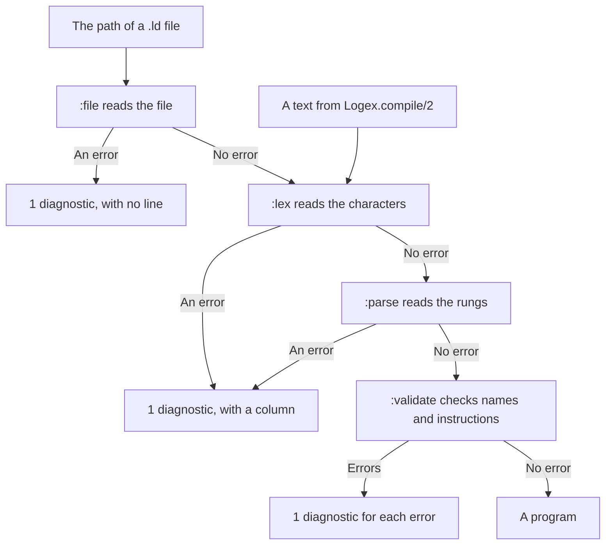

# Diagnostics

This page is for a controls engineer or an Elixir developer who has a message from logex
and looks up an exact rule. It gives the rules of a [diagnostic](glossary.md#diagnostic):
its fields, its printed form and the stage that finds it. It also gives the place of the
error, the errors that logex reports and the families of message.

A diagnostic is a report of 1 error. The error is in a source text, or in the file or the
path of the text. Or it is a change that an online edit cannot make. logex returns each
diagnostic as data, with the file and the line where logex knows them. It does not raise
an exception for such an error.

A misspelt [tag](glossary.md#tag) also gets a diagnostic. Thus a wrong name cannot make a
[rung](glossary.md#rung) that does nothing.

[Read a diagnostic](../howto/read-diagnostics.md) gives the steps to find and correct an
error. This page gives the rules.

| To find | Go to |
|---|---|
| The page that gives each message of a subject | [The families of message](#the-families-of-message) |
| A diagnostic, a warning, an `ArgumentError` and a fault | [Diagnostics and the other reports](#diagnostics-and-the-other-reports) |
| The functions that return diagnostics | [The functions that return diagnostics](#the-functions-that-return-diagnostics) |
| Each field of `%Logex.Diagnostic{}` | [The fields of a diagnostic](#the-fields-of-a-diagnostic) |
| The text that `Logex.Diagnostic.format/1` makes | [The printed form](#the-printed-form) |
| `:lex`, `:parse`, `:validate` and the other stages | [The stages](#the-stages) |
| The file, the line and the column | [The place of the error](#the-place-of-the-error) |
| Why logex shows only 1 error, or not each use of a name | [The errors that logex reports](#the-errors-that-logex-reports) |
| `did you mean` | [The nearest name](#the-nearest-name) |
| Where the warnings of a compile are | [Warnings](#warnings) |
| A message about a file or a path | [The messages of the stage `:file`](#the-messages-of-the-stage-file) |
| The scripts that show each rule | [Examples](#examples) |

Each rule cites the item of an example that shows it. The items of
[the errors that logex reports](#example-the-errors-that-logex-reports) have the numbers
1 to 16. The items of [the nearest name](#example-the-nearest-name) have the letters A
to R.

## Diagnostics and the other reports

logex has 4 kinds of report. A diagnostic is 1 of them.

| Report | Cause and result |
|---|---|
| Diagnostic | An error in a source text, at a [compile](glossary.md#compile). Or a change that an [online edit](glossary.md#online-edit) cannot make, at its [accept](glossary.md#accept). The [host](glossary.md#host) gets `{:error, diagnostics}`, a list of 1 diagnostic or more. |
| [Warning](warnings.md) | A possible error in a source text, at a compile that succeeds. The host gets a diagnostic with the severity `:warning`, in the field `warnings`. |
| [`ArgumentError`](host-contract.md) | A wrong argument from the host, for example a name that is not a binary. The function raises the exception when the host calls it. |
| [Fault](faults.md) | A bad value in a [scan](glossary.md#scan), for example a division by 0. The host gets a `%Logex.Fault{}` in the [state](glossary.md#state). |

> #### Note {: .info}
>
> A text that has a diagnostic does not compile. logex gives no
> [program](glossary.md#program) for it, and nothing runs. The accept of an online edit
> compares the candidate with the running program or configuration. The candidate is the
> new program or configuration of the edit. If the accept returns diagnostics, the edit
> changes nothing, and the running program continues.

## The functions that return diagnostics

The functions of `Logex` compile a program or a
[function block](glossary.md#function-block): `Logex.compile/2`, `Logex.compile_file/1`
and `Logex.compile_files/1`.

| Function | Result and stages |
|---|---|
| `compile/2` | `{:ok, program}`, `{:ok, function_block_type}` or `{:error, diagnostics}`. Stages: `:lex`, `:parse`, `:validate`. |
| `compile_file/1` | The same as `compile/2`. Stages: `:file`, `:lex`, `:parse`, `:validate`. |
| `compile_files/1` | A list with 1 result for each path, in the sequence of the paths. Stages: the same as `compile_file/1`. |

The functions of `Logex.Configuration` compile or check a
[configuration](glossary.md#configuration): `Logex.Configuration.compile/3`,
`Logex.Configuration.compile_file/1`, `Logex.Configuration.check/1` and
`Logex.Configuration.new!/1`.

| Function | Result and stages |
|---|---|
| `compile/3` | `{:ok, configuration}` or `{:error, diagnostics}`. Stages: `:lex`, `:configure`. |
| `compile_file/1` | `{:ok, configuration}` or `{:error, diagnostics}`. Stages: `:file`, `:lex`, `:configure`, and the stages of each [program type](glossary.md#program-type). |
| `check/1` | A list of diagnostics, `[]` if the configuration has no error. Stages: `:configure`. |
| `new!/1` | The configuration, or an `ArgumentError`. Stages: `:configure`. |

The accept of an online edit is `Logex.Edit.accept/3` for a program, and
`Logex.Configuration.Edit.accept/2` or `Logex.Configuration.Edit.accept/3` for a
configuration. Each returns `{:ok, edit, report}` or `{:error, diagnostics}`. Its
diagnostics have the stage `:edit`.

The list in `{:error, diagnostics}` always holds 1 diagnostic or more.

`Logex.Configuration.check/1` returns no warning. For a wrong argument of the host, it
raises an `ArgumentError`. The message of the `ArgumentError` of
`Logex.Configuration.new!/1` gives each wrong argument of the host first. Then it gives
the printed form of each diagnostic. Each one is on a separate line.

## The families of message

Each message belongs to a family. This table gives 1 whole message of each family, and
the page that gives each message of the family.

| Family | Message and page |
|---|---|
| The path and the file (`:file`) | `cannot be read: no such file or directory`. Each message: [The messages of the stage `:file`](#the-messages-of-the-stage-file). |
| Characters, numbers and names that logex cannot read (`:lex`) | `illegal character "@"`. Each message: [Source syntax](source-syntax.md#wrong-texts-and-their-diagnostics), [Literals](literals.md#wrong-literals-and-their-diagnostics). |
| Rungs and branches (`:parse`) | ``this `(` is never closed: the input ends before its `)` ``. Each message: [Source syntax](source-syntax.md#wrong-texts-and-their-diagnostics). |
| Declarations, [sections](glossary.md#section), [qualifiers](glossary.md#qualifier), types, [arrays](glossary.md#array) and [initial values](glossary.md#initial-value) (`:validate`) | `` `hot` is declared twice: first on line 2 ``. Each message: [Declarations and types](declarations-and-types.md#wrong-declarations-and-their-diagnostics). |
| Names, [elements](glossary.md#element), members and [bits](glossary.md#bit) (`:validate`) | `` `fna` is not declared ``. Each message: [Source syntax](source-syntax.md#wrong-texts-and-their-diagnostics), [Function blocks](function-blocks.md#wrong-texts-and-their-diagnostics). |
| [Literals](glossary.md#literal) in an operand (`:validate`) | `` `move` writes `70000` into `speed`, an int: it is outside -32768 to 32767 ``. Each message: [Literals](literals.md#wrong-literals-and-their-diagnostics). |
| Instructions and their operands (`:validate`) | `` `move` expects 2 operands (a value, then a tag), found 1 ``. Each message: the pages of the instructions, [contacts and coils](instructions-contacts-and-coils.md), [timers and counters](instructions-timers-and-counters.md), [arithmetic and comparison](instructions-arithmetic-and-comparison.md), [bitwise](instructions-bitwise.md), [jump and call](instructions-jump-and-call.md). |
| The type of an operand, and [conversions](glossary.md#conversion) (`:validate`) | `` `xic` reads a bool, but `speed` is an int (declared on line 4) ``. Each message: the page of each instruction, and [Conversions](conversions.md). |
| Rungs that write nothing, labels and [jumps](glossary.md#jump) (`:validate`) | `` `jmp skp` names no label: no rung of this program begins `lbl skp` ``. Each message: [Source syntax](source-syntax.md#a-rung-must-write-or-jump), [Instructions: jump and call](instructions-jump-and-call.md). |
| Function blocks and their files (`:validate`) | `` `seal` cannot hold an instance of `seal`: a function block never holds an instance of itself ``. Each message: [Function blocks](function-blocks.md#wrong-texts-and-their-diagnostics). |
| Configurations (`:lex`, `:configure`, `:file`) | `` no task `fsat` — did you mean `fast`? ``. Each message: [Configuration file: messages](configuration-file-messages.md). |
| Online edits (`:edit`) | `` `speed` is an int in the running program and a dint in the candidate: a tag's type changes only with a restart ``. Each message: [Online edit](online-edit.md). |

The message of the family of function blocks comes from the file of the function block
`seal`, which declares `var inner seal`.

## The fields of a diagnostic

A diagnostic is the struct `%Logex.Diagnostic{}`. A warning is the same struct.

| Field | Value | Rule |
|---|---|---|
| `stage` | `:file`, `:lex`, `:parse`, `:validate`, `:configure` or `:edit` | The part of logex that found the error. [The stages](#the-stages) gives each stage. |
| `line` | An integer from 1, or `nil` | The line of the error in the text. [The line](#the-line) gives each case of `nil`. |
| `column` | An integer from 1, or `nil` | The place on the line where logex found the error. Only some diagnostics have a column. [The column](#the-column) gives them. |
| `file` | A path, or `nil` | The file that holds the error. [The file](#the-file) gives each case. |
| `severity` | `:error` or `:warning` | `:error` for a diagnostic. `:warning` for a warning. |
| `message` | A string | What is wrong. The message does not hold the file, the line or the column. |

[The diagnostics of 1 file](#example-the-diagnostics-of-1-file) shows each field.

## The printed form

`Logex.Diagnostic.format/1` makes 1 line of text from a diagnostic. The line has these
parts, in this sequence. The function leaves out each part that the diagnostic does not
have.

| Part | Text | When |
|---|---|---|
| The file | The path, then `: ` | `file` is a path that is not `""` |
| The line | `line 11` | `line` is not `nil` |
| The column | `, column 5` | `line` and `column` are not `nil` |
| A separator | `: ` | `line` is not `nil` |
| The severity | `warning: ` | `severity` is `:warning`. A diagnostic with `severity: :error` has no such part. |
| The message | The message | Always |

`format/1` does not show a column without a line. If `severity` is not `:error` or
`:warning`, `format/1` raises an `ArgumentError`. [6 places for 1
message](#example-6-places-for-1-message) shows each part.

## The stages

Each diagnostic comes from 1 stage. A program goes through the stages `:file`, `:lex`,
`:parse` and `:validate`, in that sequence.



Figure 1: the stages of the compile of 1 program.

A stage gives the text to the next stage only if it finds no error.

| Stage | It reads | On an error |
|---|---|---|
| `:file` | The path and the file: its name, its extension and its kind | logex reads nothing more. But after a file name that cannot name a program, logex compiles the text, and gives its diagnostics too. |
| `:lex` | The characters, the numbers and the names of a text | logex stops. This diagnostic is the only one. |
| `:parse` | The rungs, the [branches](glossary.md#branch) and the place of each `(`, `\|` and `)` in a program | logex stops. This diagnostic is the only one. |
| `:validate` | The [declarations](glossary.md#declaration), the names, the [instructions](glossary.md#instruction), their [operands](glossary.md#operand) and the rungs of a program | logex continues and reports each error. |
| `:configure` | The lines of a configuration and its rules | logex continues and reports each error. It skips the rest of a line that it cannot read. |
| `:edit` | The candidate of an online edit, which logex compares with the running program or configuration | logex continues and reports each error. |

At the stage `:edit`, logex compares the type of each tag and member. For a
configuration, it also compares these parts:

- the tasks
- the type of each [global](glossary.md#global)
- the [located globals](glossary.md#located-global) and the other located I/O
- the task of each [instance](glossary.md#instance)
- the [connections](glossary.md#connection) that the edit holds

[Online edit](online-edit.md) gives each change that an online edit cannot make.

A [configuration file](glossary.md#configuration-file) has no stage `:parse`. If logex
cannot read a line of the file, the diagnostic has the stage `:configure` and a column.
logex skips the rest of that line and reads the next line. An error of the stage `:lex`
stops the compile of a configuration, as it stops the compile of a program. That
diagnostic is the only one.

[1 diagnostic of each stage](#example-1-diagnostic-of-each-stage) shows each stage.

## The place of the error

### The file

`Logex.compile/2` and `Logex.Configuration.compile/3` compile a text.
`Logex.compile_file/1` compiles a program file. `Logex.Configuration.compile_file/1`
compiles a configuration file.

| The error is in | `file` |
|---|---|
| A text | `nil` |
| A program file | The path that the host gives, as the host spells it, for example `wrong/conveyor.ld` |
| The file of a function block that a program file names | The path of that file, in the directory of the program file, for example `wrong/seal.ld`. For a program file in the working directory, the path starts with `./`, for example `./seal.ld`. |
| A configuration file | The path of the configuration file, as the host gives it |
| A program type of a configuration file | The path of its `.ld` file, in the directory of the configuration file, for example `wrong/conveyor.ld`. For a configuration file in the working directory, the path starts with `./`. |
| A configuration that `check/1` or `new!/1` checks | The field `file` of the configuration: `nil` for a configuration from Elixir data |
| The candidate of an online edit of a program | The field `file` of the candidate: its path if `Logex.compile_file/1` compiled it, else `nil` |
| The candidate of an online edit of a configuration | The field `file` of the candidate configuration. For a type change in a program type, the field `file` of that program type. |

The field `file` of a program type is the path of its `.ld` file if
`Logex.Configuration.compile_file/1` compiled the candidate. Else it is `nil`.

### The line

- The first line of a file or a text is line 1.
- Each line counts: a declaration, a rung, a comment and a blank line.
- A rung is 1 line, so the line of a diagnostic names its rung.
- A line can have 2 diagnostics or more.

`line` is `nil` in these cases only:

| Stage | When `line` is `nil` |
|---|---|
| `:file` | Always. The error is in the path or in the file as a whole. |
| `:configure` | The error is in the configuration as a whole, for example `` this configuration declares no `program`: it would run nothing ``. Or the configuration is Elixir data, which has no lines. |
| `:edit` | The tag of the error has no line, because the host declared it with `Logex.Tag.new!/5`. Or the error is in a part that only the running configuration has, for example a located global that the candidate removes. The message then gives the line of that part in the running configuration. |

### The column

- Only a diagnostic of the stage `:lex` or `:parse`, or of a line of a configuration file
  that logex cannot read, has a column. Each other diagnostic has the column `nil`.
- The first character of a line is column 1. A tab counts as 1 character.
- The column is the place where logex found the error. The cause can be earlier on the
  line.

| Text | Column of the diagnostic |
|---|---|
| A `(` with no `)` before the end of the text | The column of the `(`: ``this `(` is never closed: the input ends before its `)` `` |
| A `(` with no `)` before the end of the line, and more lines after it | The column after the last character of the line: ``expected `\|` or `)`, found a newline`` |
| A character that logex cannot read | The column of the character: `illegal character "@"` |

## The errors that logex reports

Each item of this table is an item of
[the errors that logex reports](#example-the-errors-that-logex-reports).

| Rule | Items |
|---|---|
| A program text or a function block text with an error of the stage `:lex` or `:parse` gets 1 diagnostic only: the first such error. logex does not check the declarations or the instructions of the text. | 1, 2 |
| A configuration text with an error of the stage `:lex` gets 1 diagnostic only: the first such error. | 15 |
| Each other error gets a diagnostic, in the sequence of the lines. | 3, 6 |
| logex returns each diagnostic. The list has no limit of length. | Q of [the nearest name](#example-the-nearest-name): 103 diagnostics |
| A name that no line declares gets 1 diagnostic, at its first use. logex does not report its other uses. | 4 |
| After an unknown instruction, logex skips the words up to the next instruction or branch on the rung. It does not report them. | 7 |
| A tag with a type that logex does not know gets 1 diagnostic, at its declaration. logex does not report the lines that use the tag. | 5 |
| A text with an error gets no warnings. logex gives the warnings of a text only when it compiles. | 6 |
| If a program file has an error of the stage `:lex` or `:parse`, logex reports only that error. It does not read the files of its function blocks. | 9 |
| If not, an error in the file of a function block stops the compile of the program file that names it. logex returns the diagnostics of the function block file only. | 8 |
| After a file name that cannot name a program, logex still compiles the text and gives its diagnostics. | 10 |
| In a configuration file, the diagnostics of the configuration come first, in line order. Then come the diagnostics of each program type that does not compile, each 1 time, with the path of its `.ld` file. | 11 |
| Among the diagnostics of a configuration, a diagnostic with no line comes after each diagnostic with a line. | The message of the configuration with no `program` line, in [The line](#the-line) |
| A program type that does not compile gets 1 diagnostic in the configuration, at the first `program` line that names it. | 11, line 6 |
| A configuration line that logex cannot read gets 1 diagnostic. If logex can read the name on that line, it takes the name as declared. Thus it does not report a use of that name as unknown. | 12: line 2 uses the task `fast` |
| In a configuration, the `var_input` tags of 1 instance that no line connects get 1 diagnostic, at the `program` line of the instance. | 13 |
| A configuration from Elixir data gets the same messages as the same configuration from a text, with no line. | 14 |
| An online edit of a configuration gets the diagnostics of the configuration first, in line order. Then come the diagnostics of the parts that only the running configuration has, with no line. Then come the type changes of each program type. | 16 |

## The nearest name

If logex does not know a name, the message can end with the nearest name: `did you
mean`, then the name. The nearest name is a name that the source text declares, or a
word of logex. It is not always the correct name.

2 names are different only in case if they have the same letters in the same sequence.
But a letter is uppercase in 1 name and lowercase in the other. For example, `Fan` and
`fan` are different only in case.

Each item of this table is an item of [the nearest name](#example-the-nearest-name).

| Rule | Items |
|---|---|
| A name that is different only in case is the nearest name. The message then adds a note in parentheses. [The notes](#the-notes) gives each note. | A, D, H, L, O |
| If not, logex gives the name with the highest Jaro similarity to the name, if the similarity is 0.8 or more. The similarity is from 0.0 to 1.0. A higher value means more alike. The function `String.jaro_distance/2` of Elixir gives it. | B, E, G, J |
| If no name has a similarity of 0.8 or more, the message gives no name. | C |
| This comparison counts an uppercase letter and its lowercase letter as different letters. A type word is correct in uppercase, lowercase or a mix. But `Dnt` gets no nearest name, and `dnt` gets `dint`. | J, K |
| For the label of a `jmp`, logex looks only at the labels after the `jmp`. A [jump](glossary.md#jump) goes forward only. | G, I |
| A [member](glossary.md#member) with no near name gets the list of the members of its type. | F |
| logex gives no nearest name for an [instruction](glossary.md#instruction), except for `mov`. `mov` is the [mnemonic](glossary.md#mnemonic) of the [conventional set](glossary.md#conventional-set). logex uses the [IEC 61131-3](glossary.md#iec-61131-3) name, `move`. | M |
| A program type that a configuration does not know, with no near name, gets a list. For a configuration text, the message gives the program types that the host gives. For a configuration file, the message names the `.ld` file that is not there. | P, and [Configuration file: messages](configuration-file-messages.md) |
| In 1 text, logex looks for a nearest name for the first 100 names that it cannot find, in the sequence of the lines. A name after the first 100 gets no nearest name. This rule applies also to a name that is different only in case. | Q, `Fan` |
| In a configuration, the first word of a line and the type of a `var_global` always get their nearest name. The limit of 100 names does not apply to them. | R, for the type |
| In a program, the message of an unknown type always gives the types of logex. | J, K, L |
| In a program, 2 lists can end a message: the members of a type, and the function blocks that the host gives. The message of each of the first 100 names gives its whole list. After the first 100 names, each list is in 1 message only: the first message that needs it. | Q, `run_t.et` and `run_t.xx` |
| In a configuration, each list is in the first message that needs it, and in no other message. | P |

logex looks for the nearest name of these names in a program:

- a tag
- a member
- a [label](glossary.md#label)
- a [type](glossary.md#type)
- a [function block type](glossary.md#function-block-type)

In a configuration, logex looks for the nearest name of these names:

- the first word of a line, for example `task` or `program`
- the type of a global
- a task
- a global
- an instance
- a member
- a program type

A name that logex cannot find gets 1 diagnostic only, at its first use. Thus each of the
first 100 names is a different name.

### The notes

| Name | Note |
|---|---|
| A tag | `(tags are case-sensitive)` |
| A member | `(members are case-sensitive)` |
| A label | `(labels are case-sensitive)` |
| A function block type | `(type names are case-sensitive)` |
| A task, a global or an instance of a configuration | `(names are case-sensitive)` |
| A program type of a configuration | `(program types are case-sensitive)` |
| The first name that is not declared, in a program that declares no tags | ``(this program declares no tags: each is now declared before the first rung, as in `var a bool` or `var a dint`)`` |

The last note comes with no nearest name. It is in item N.

## Warnings

A warning is a `%Logex.Diagnostic{}` with `severity: :warning`. It has the same fields
and the same printed form as a diagnostic. [Warnings](warnings.md) gives each warning
and its cause.

`Logex.compile/2` compiles a text, `Logex.compile_file/1` a file and
`Logex.compile_files/1` a list of files.

| Result | Warnings |
|---|---|
| A program from a text | The field `warnings` of the program. It holds the warnings of the program only. |
| A program from a file | The field `warnings` of the program. It holds the warnings of the program, in line order. Then it holds the warnings of each function block file that the compile loads. Each of those warnings has the path of its file. |
| A program from a list of files | The same as from a file. But the warnings of a function block file are only in the first program of the list that loads the file. |
| A function block type | The field `warnings` of its field `body`. The struct `%Logex.FbType{}` has no field `warnings`. |
| A configuration | The field `warnings` of the configuration. It holds the warnings of the configuration only. |
| A program type of a configuration | The field `warnings` of that program, in the field `programs` of the configuration |

A text with a diagnostic gets no warnings. A warning does not stop a compile. A warning
in the candidate does not stop the accept of an online edit.

## The messages of the stage `:file`

`Logex.compile_file/1` and `Logex.Configuration.compile_file/1` give these messages. Each
message comes with its cause. In the messages, `x` is the name of the file with its
extension, for example `seal.LD`. In the 2 messages `"x" cannot name`, `x` is the name
without its extension, for example `fan-2`. For a file named `.ld`, it is `""`.
`<reason>` is the reason that the operating system gives.

- `` `x` is not a `.ld` file: Logex.compile_file/1 compiles a program or a function block from its `.ld` file ``

  The path of `Logex.compile_file/1` does not end in `.ld`. The case of the extension
  counts: logex refuses `seal.LD`. logex reads nothing.

- `` `x` is a configuration file (`.logex`), which Logex.Configuration.compile_file/1 loads ``

  The path of `Logex.compile_file/1` ends in `.logex`. logex reads nothing.

- `` `x` is not a configuration file: Logex.Configuration.compile_file/1 loads a configuration from its `.logex` file ``

  The path of `Logex.Configuration.compile_file/1` does not end in `.logex`. logex reads
  nothing.

- `` "x" cannot name a program: a name is a letter or `_`, then letters, digits or `_` (rename the file) ``

  The name of the `.ld` file, before its extension, is not a name. logex compiles the
  text, and gives its diagnostics after this one.

- `` "x" cannot name a configuration: a name is a letter or `_`, then letters, digits or `_` (rename the file) ``

  The same for the name of a `.logex` file.

- `` `.logex` names no configuration: a configuration file is named after its configuration, as `plant.logex` is `plant` ``

  The name of the file is `.logex` and nothing more. logex reads nothing.

- `cannot be read: <reason>`

  logex cannot read the file. Examples of `<reason>`: `no such file or directory`,
  `illegal operation on a directory`, `too many levels of symbolic links`.

- `cannot be read: it is no regular file but a FIFO, a socket or another special file, and logex reads a file`

  The path names a FIFO, a socket or a different special file. logex does not open it.

- `cannot be read: it is no regular file but a device, and logex reads a file`

  The path names a special file for hardware, for example a link `null.ld` to
  `/dev/null`. logex does not open it.

- `cannot be located: the working directory cannot be read`

  The path is relative, and logex cannot read the working directory, for example if a
  program deleted the directory.

- ``cannot be located: no home directory is set (`HOME`)``

  The path starts with `~/`, and the environment has no `HOME`.

A link to a file that does not exist gets `cannot be read: no such file or directory`.

## Examples

Each example on this page is a script, with each line that it prints. Each `elixir` block
is the file under `examples/` that its `$ mix run` line names. To run a script, type its
command in the directory `examples` of the repository. That directory is a Mix project,
and logex is its dependency.

### The files of the examples

The program `fan.ld` has no error. It is in the directory `examples/diagnostics` of the
repository.

<!-- file: diagnostics/fan.ld -->
```text
// The fan: it runs while its switch is on and the motor is hot.
var_input fan_on bool
var_input hot bool
var_output fan bool
var_output speed int 900

xic fan_on xic hot ote fan
```

5 more files have errors. They are in the directory `examples/diagnostics/wrong`, and the
name of each file ends in `.txt`.

| File | Errors |
|---|---|
| `conveyor.ld.txt` | A program with errors on 4 lines |
| `seal.ld.txt` | A function block with an error on its last line |
| `belts.ld.txt` | A program that uses `seal`, with an error on line 11 |
| `fan-2.ld.txt` | A program with a file name that cannot name a program, and an error on line 5 |
| `line.logex.txt` | A configuration file that runs `conveyor`, and names a task that it does not declare |

The program `conveyor.ld` has errors on 4 lines. Its first line is a comment, and its
line 9 is blank.

<!-- file: diagnostics/wrong/conveyor.ld.txt -->
```text
// The conveyor: a seal-in, a lamp, a jam counter and a speed.
var_input start bool
var_input stop bool
var_input jam bool
var_output motor bool
var_output Lamp bool
var_output speed dint
var jams dint

( xic start | xic motor ) xio stop ote motor
xic motor ote lamp
xic jam ctu jams 3
xic jams.dn mov 0 speed
xic motor move speed
```

The function block `seal` has an error on its last line.

<!-- file: diagnostics/wrong/seal.ld.txt -->
```text
// A seal-in. Its last line names `stp`, which no line declares.
function_block seal
var_input start bool
var_input stop bool
var_output run bool

( xic start | xic run ) xio stp ote run
```

The program `belts.ld` declares 2 instances of `seal`. The program also has an error on
line 11.

<!-- file: diagnostics/wrong/belts.ld.txt -->
```text
// 2 conveyor belts. Each belt is an instance of the function block `seal`.
var_input start_1 bool
var_input start_2 bool
var_input stop bool
var_output belt_1 bool
var_output belt_2 bool
var s1 seal
var s2 seal

cal s1 start_1 stop belt_1
cal s2 start_2 stop belt_3
```

The name of the file `fan-2.ld` cannot name a program, because a name cannot hold `-`.
The file also has an error on line 5.

<!-- file: diagnostics/wrong/fan-2.ld.txt -->
```text
// A second fan. The name of this file cannot name a program.
var_input fan_on bool
var_output fan bool

xic fan_on ote fna
```

The configuration file `line.logex` runs 2 instances of `conveyor`, which does not
compile. Line 11 names a [task](glossary.md#task) that the file does not declare.

<!-- file: diagnostics/wrong/line.logex.txt -->
```text
task fast interval 10 priority 1
var_global start_1 bool at panel.i.0
var_global stop_1  bool at panel.i.1
var_global jam_1   bool at panel.i.2
var_global belt_1  bool at panel.q.0
program c1 conveyor with fast
  c1.start  start_1
  c1.stop   stop_1
  c1.jam    jam_1
  c1.motor  belt_1
program c2 conveyor with fsat
```

The script `diagnostics/wrong.exs` makes a new temporary directory. It copies the 5 files
into the directory `wrong` in it. Each copy gets the name of its file without `.txt`. The
script returns the path of the temporary directory. Each script that reads the files
compiles them from that directory, then deletes it.

<!-- file: diagnostics/wrong.exs -->
```elixir
# Copies the 5 wrong files of the page Diagnostics into the directory `wrong` of a new
# temporary directory. Each file gets its name without `.txt`. Returns the path of the
# new directory.
names = ["conveyor.ld", "seal.ld", "belts.ld", "fan-2.ld", "line.logex"]

dir = Path.join(System.tmp_dir!(), "diagnostics-#{System.pid()}")
File.rm_rf!(dir)
File.mkdir_p!(Path.join(dir, "wrong"))

for name <- names do
  File.cp!(Path.join("diagnostics/wrong", name <> ".txt"), Path.join([dir, "wrong", name]))
end

dir
```

### Example: the diagnostics of 1 file

The script `diagnostics-fields.exs` compiles the file `wrong/conveyor.ld`. It prints the
first diagnostic as a struct. Then it prints each diagnostic as
`Logex.Diagnostic.format/1` gives it.

```elixir
{dir, _binding} = Code.eval_file("diagnostics/wrong.exs")
{:error, diagnostics} = File.cd!(dir, fn -> Logex.compile_file("wrong/conveyor.ld") end)
File.rm_rf!(dir)

IO.puts("The first diagnostic:")
IO.inspect(hd(diagnostics))

IO.puts("Each diagnostic, as Logex.Diagnostic.format/1 gives it:")
Enum.each(diagnostics, &IO.puts(Logex.Diagnostic.format(&1)))
```

```console
$ mix run diagnostics-fields.exs
The first diagnostic:
%Logex.Diagnostic{
  stage: :validate,
  line: 11,
  message: "`lamp` is not declared — did you mean `Lamp`? (tags are case-sensitive)",
  file: "wrong/conveyor.ld",
  column: nil,
  severity: :error
}
Each diagnostic, as Logex.Diagnostic.format/1 gives it:
wrong/conveyor.ld: line 11: `lamp` is not declared — did you mean `Lamp`? (tags are case-sensitive)
wrong/conveyor.ld: line 12: `ctu` runs a ctu, ctud, ctu_int, ctud_int, ctu_lint, ctud_lint, ctu_udint, ctud_udint, ctu_ulint or ctud_ulint, but `jams` is a dint (declared on line 8)
wrong/conveyor.ld: line 13: `jams.dn` names a member of `jams`, but `jams` is a dint (declared on line 8): only an instance of a function block has members
wrong/conveyor.ld: line 13: unknown instruction `mov` — did you mean `move`? (renamed to its IEC name)
wrong/conveyor.ld: line 14: `move` expects 2 operands (a value, then a tag), found 1
```

The script shows these rules:

- logex returns each error of the file, in the sequence of the lines.
- Line 13 has 2 errors, and thus 2 diagnostics.
- A message can name a different line, as in `(declared on line 8)`.
- The file has a comment line and a blank line. Both count, so the rung of the motor is
  line 10.

### Example: 6 places for 1 message

The script `diagnostics-format.exs` writes 6 diagnostics by hand. Each one has the same
message, with a different place. Then it gives `format/1` a seventh diagnostic with the
severity `:info`.

```elixir
# 6 diagnostics, written by hand. Each one has the same message and a different place.
base = %Logex.Diagnostic{stage: :validate, line: 11, message: "`lamp` is not declared"}
file = "wrong/conveyor.ld"

diagnostics = [
  base,
  %{base | file: file},
  %{base | stage: :lex, file: file, column: 5},
  %{base | severity: :warning},
  %{base | stage: :file, file: file, line: nil},
  %{base | stage: :configure, file: "", line: nil, column: 5}
]

Enum.each(diagnostics, &IO.puts(Logex.Diagnostic.format(&1)))

try do
  Logex.Diagnostic.format(%{base | severity: :info})
rescue
  error in ArgumentError -> IO.puts("ArgumentError: " <> Exception.message(error))
end
```

```console
$ mix run diagnostics-format.exs
line 11: `lamp` is not declared
wrong/conveyor.ld: line 11: `lamp` is not declared
wrong/conveyor.ld: line 11, column 5: `lamp` is not declared
line 11: warning: `lamp` is not declared
wrong/conveyor.ld: `lamp` is not declared
`lamp` is not declared
ArgumentError: a diagnostic's severity is :error or :warning, got: :info
```

The fifth diagnostic has no line, so the printed text has no separator after the file.
The sixth diagnostic has a column but no line, and its file is `""`. Thus `format/1`
gives the message alone. It does not show a column without a line.

### Example: 1 diagnostic of each stage

The script `diagnostics-stages.exs` makes 1 error of each stage. It also makes a
[warning](glossary.md#warning). For each diagnostic, it prints 5 fields and then the
printed form.

```elixir
{:ok, fan} = Logex.compile_file("diagnostics/fan.ld")

declarations = "var_input fan_on bool\nvar_input hot bool\nvar_output fan bool\n"

configuration = """
task fast intervl 10 priority 1
var_global hot_1 bool at panel.i.0
var_global fan_1 bool at panel.q.0
program f1 fan with fsat
  f1.fan_on 1
  f1.hot    hot_1
  f1.fan    fan_1
"""

candidate = String.replace(fan.source, "speed int 900", "speed dint 900")
{:ok, candidate} = Logex.compile(candidate, name: "fan")

{:ok, unused} =
  Logex.compile(declarations <> "var spare bool\nxic fan_on xic hot ote fan", name: "fan")

results = [
  {"a file that is not there", Logex.compile_file("diagnostics/pump.ld")},
  {"a character that logex cannot read",
   Logex.compile(declarations <> "xic fan_on @ ote fan", name: "fan")},
  {"a branch with no )",
   Logex.compile(declarations <> "( xic fan_on xic hot ote fan", name: "fan")},
  {"a name that is not declared",
   Logex.compile(declarations <> "xic fan_on ote fna", name: "fan")},
  {"a configuration", Logex.Configuration.compile("line", configuration, %{"fan" => fan})},
  {"an online edit that changes a type",
   Logex.Edit.accept(fan, candidate, Logex.Runtime.instance(fan))},
  {"a warning", {:warnings, unused.warnings}}
]

fields = [:stage, :line, :column, :file, :severity]

for {label, {_result, diagnostics}} <- results do
  IO.puts(label)

  for diagnostic <- diagnostics do
    IO.puts("  " <> Enum.map_join(fields, "  ", &"#{&1}: #{inspect(Map.get(diagnostic, &1))}"))
    IO.puts("  " <> Logex.Diagnostic.format(diagnostic))
  end
end
```

```console
$ mix run diagnostics-stages.exs
a file that is not there
  stage: :file  line: nil  column: nil  file: "diagnostics/pump.ld"  severity: :error
  diagnostics/pump.ld: cannot be read: no such file or directory
a character that logex cannot read
  stage: :lex  line: 4  column: 12  file: nil  severity: :error
  line 4, column 12: illegal character "@"
a branch with no )
  stage: :parse  line: 4  column: 1  file: nil  severity: :error
  line 4, column 1: this `(` is never closed: the input ends before its `)`
a name that is not declared
  stage: :validate  line: 4  column: nil  file: nil  severity: :error
  line 4: `fna` is not declared
a configuration
  stage: :configure  line: 1  column: 11  file: nil  severity: :error
  line 1, column 11: unexpected `intervl` on the line of task `fast`: a task takes `continuous`, `single`, `interval`, `priority` and `watchdog`
  stage: :configure  line: 4  column: nil  file: nil  severity: :error
  line 4: no task `fsat` — did you mean `fast`?
an online edit that changes a type
  stage: :edit  line: 5  column: nil  file: nil  severity: :error
  line 5: `speed` is an int in the running program and a dint in the candidate: a tag's type changes only with a restart
a warning
  stage: :validate  line: 4  column: nil  file: nil  severity: :warning
  line 4: warning: `spare` is declared but no rung uses it
```

The texts of this script come from `Logex.compile/2` and
`Logex.Configuration.compile/3`, so their diagnostics have no file. The 3 lines of
`declarations` come first in each program text, so the first rung is line 4. The
diagnostic of the online edit gives line 5 of `fan.ld`, the declaration of `speed`. It
has no file, because `Logex.compile/2` compiled the candidate.

### Example: the errors that logex reports

The script `diagnostics-order.exs` compiles 16 items. It prints each item with its
number, and then each diagnostic of the item.

- Items 1 to 7 add lines to the same 3 declarations, so the first added line is line 4.
- Items 8 to 11 compile the wrong files. Item 9 adds a line with `@` to a copy of
  `belts.ld`.
- Items 12 to 15 are configurations that run the program type `fan` of `fan.ld`. Item 14
  is the configuration of item 13, as Elixir data.
- Item 16 starts a configuration. Then it calls `Logex.Configuration.Edit.accept/2` with
  a candidate configuration that has 3 changes.

The 3 changes of item 16 are these:

- Line 3 of the candidate adds the task `slow`.
- The candidate removes the located global `lamp_1`.
- The program type `fan` of the candidate declares `speed` as a `dint`.

```elixir
alias Logex.Configuration

declarations = "var_input fan_on bool\nvar_input hot bool\nvar_output fan bool\n"
program = fn rungs -> Logex.compile(declarations <> rungs, name: "fan") end

# Items 12 to 16 are configurations that run the program type `fan` of
# diagnostics/fan.ld.
{:ok, fan} = Logex.compile_file("diagnostics/fan.ld")
configure = fn text -> Configuration.compile("line", text, %{"fan" => fan}) end

# Item 14: the configuration of item 13, as Elixir data.
data = %Configuration{
  name: "line",
  programs: %{"fan" => fan},
  tasks: [%Configuration.Task{name: "fast", interval: 10, priority: 1}],
  instances: [%Configuration.Instance{name: "f1", type: "fan", task: "fast"}]
}

running = """
task fast interval 10 priority 1
var_global hot_1 bool at panel.i.0
var_global lamp_1 bool at panel.q.1
program f1 fan with fast
  f1.fan_on 1
  f1.hot    hot_1
"""

# Item 16: an online edit puts a task in place of the line of `lamp_1`, and its `fan`
# declares `speed` as a dint.
candidate =
  String.replace(
    running,
    "var_global lamp_1 bool at panel.q.1",
    "task slow interval 100 priority 2"
  )

{:ok, fan_dint} =
  Logex.compile(String.replace(fan.source, "speed int", "speed dint"), name: "fan")

{:ok, running} = configure.(running)
{:ok, candidate} = Configuration.compile("line", candidate, %{"fan" => fan_dint})

# Items 8 to 11 compile the wrong files that diagnostics/wrong.exs copies. Item 9 adds a
# line with `@` to a copy of belts.ld.
{dir, _binding} = Code.eval_file("diagnostics/wrong.exs")
belts = File.read!(Path.join(dir, "wrong/belts.ld"))
File.write!(Path.join(dir, "wrong/belts_2.ld"), belts <> "xic stop @ ote belt_1\n")

items = [
  {"2 characters that logex cannot read, and a name that is not declared",
   program.("xic fan_on @ ote fan\nxic fan_on $ ote fan\nxic hot ote fna")},
  {"a name that is not declared, then a branch with no )",
   program.("xic hot ote fna\n( xic fan_on ote fan")},
  {"2 errors on 1 line", program.("var src dint\nxic hot move src ote")},
  {"1 name that is not declared, on 3 lines",
   program.("xic fan_on ote fna\nxic hot ote fna\nxio hot ote fna")},
  {"a type that logex does not know, and 2 uses of the tag",
   program.("var run_t tonn\nxic fan_on ton run_t 500\nxic run_t.dn ote fan")},
  {"2 lines with errors, and 2 tags that no rung uses",
   Logex.compile(
     "var spare_1 bool\nvar spare_2 bool\n" <>
       declarations <> "xic fan_on ote fna\nxic hott ote fan",
     name: "fan"
   )},
  {"an unknown instruction, then a name that is not declared, on 2 lines",
   program.("xic hot otee fan fna\nxic hot ote fna")},
  {"a file whose function block has an error", {:file, "wrong/belts.ld"}},
  {"the same file, with a character that logex cannot read", {:file, "wrong/belts_2.ld"}},
  {"a file whose name cannot name a program", {:file, "wrong/fan-2.ld"}},
  {"a configuration file whose program type does not compile",
   {:configuration, "wrong/line.logex"}},
  {"a task line that logex cannot read",
   configure.(
     "task fast intervl 10 priority 1\nprogram f1 fan with fast\n  f1.fan_on 1\n  f1.hot 0"
   )},
  {"an instance with 2 var_inputs that no line connects",
   configure.("task fast interval 10 priority 1\nprogram f1 fan with fast")},
  {"the configuration of item 13, as Elixir data", {:error, Configuration.check(data)}},
  {"a character that logex cannot read, and 2 more errors",
   configure.("task fast intervl 10 priority 1\nprogram f1 fan with fsat @")},
  {"an online edit of a configuration",
   Configuration.Edit.accept(Logex.Runtime.start(running), candidate)}
]

compile = fn
  {:file, name} -> File.cd!(dir, fn -> Logex.compile_file(name) end)
  {:configuration, name} -> File.cd!(dir, fn -> Configuration.compile_file(name) end)
  result -> result
end

for {{label, result}, number} <- Enum.with_index(items, 1) do
  {:error, diagnostics} = compile.(result)
  IO.puts(String.pad_leading("#{number}", 2) <> "  #{label}")
  Enum.each(diagnostics, &IO.puts("    " <> Logex.Diagnostic.format(&1)))
end

File.rm_rf!(dir)
```

```console
$ mix run diagnostics-order.exs
 1  2 characters that logex cannot read, and a name that is not declared
    line 4, column 12: illegal character "@"
 2  a name that is not declared, then a branch with no )
    line 5, column 1: this `(` is never closed: the input ends before its `)`
 3  2 errors on 1 line
    line 5: `move` expects 2 operands (a value, then a tag), found 1 before the instruction `ote`
    line 5: `ote` expects 1 operand (a tag), found none
 4  1 name that is not declared, on 3 lines
    line 4: `fna` is not declared
 5  a type that logex does not know, and 2 uses of the tag
    line 4: unknown type `tonn`: logex has `bool`, `sint`, `int`, `dint`, `lint`, `usint`, `uint`, `udint`, `ulint`, `real`, `lreal`, `byte`, `word`, `dword`, `lword`, `ctd`, `ctd_dint`, `ctd_int`, `ctd_lint`, `ctd_udint`, `ctd_ulint`, `ctu`, `ctu_dint`, `ctu_int`, `ctu_lint`, `ctu_udint`, `ctu_ulint`, `ctud`, `ctud_dint`, `ctud_int`, `ctud_lint`, `ctud_udint`, `ctud_ulint`, `rto`, `rto_ltime`, `tof`, `tof_ltime`, `ton`, `ton_ltime`, `tp` and `tp_ltime` — did you mean `ton`?
 6  2 lines with errors, and 2 tags that no rung uses
    line 6: `fna` is not declared
    line 7: `hott` is not declared — did you mean `hot`?
 7  an unknown instruction, then a name that is not declared, on 2 lines
    line 4: unknown instruction `otee`
    line 5: `fna` is not declared
 8  a file whose function block has an error
    wrong/seal.ld: line 7: `stp` is not declared — did you mean `stop`?
 9  the same file, with a character that logex cannot read
    wrong/belts_2.ld: line 12, column 10: illegal character "@"
10  a file whose name cannot name a program
    wrong/fan-2.ld: "fan-2" cannot name a program: a name is a letter or `_`, then letters, digits or `_` (rename the file)
    wrong/fan-2.ld: line 5: `fna` is not declared
11  a configuration file whose program type does not compile
    wrong/line.logex: line 6: program type `conveyor` does not compile: its mistakes follow, cited in `conveyor.ld`
    wrong/line.logex: line 11: no task `fsat` — did you mean `fast`?
    wrong/conveyor.ld: line 11: `lamp` is not declared — did you mean `Lamp`? (tags are case-sensitive)
    wrong/conveyor.ld: line 12: `ctu` runs a ctu, ctud, ctu_int, ctud_int, ctu_lint, ctud_lint, ctu_udint, ctud_udint, ctu_ulint or ctud_ulint, but `jams` is a dint (declared on line 8)
    wrong/conveyor.ld: line 13: `jams.dn` names a member of `jams`, but `jams` is a dint (declared on line 8): only an instance of a function block has members
    wrong/conveyor.ld: line 13: unknown instruction `mov` — did you mean `move`? (renamed to its IEC name)
    wrong/conveyor.ld: line 14: `move` expects 2 operands (a value, then a tag), found 1
12  a task line that logex cannot read
    line 1, column 11: unexpected `intervl` on the line of task `fast`: a task takes `continuous`, `single`, `interval`, `priority` and `watchdog`
13  an instance with 2 var_inputs that no line connects
    line 2: `f1` leaves its var_inputs `fan_on` and `hot` unconnected: connect each to a global, a point or a constant, as in `f1.fan_on 0`
14  the configuration of item 13, as Elixir data
    `f1` leaves its var_inputs `fan_on` and `hot` unconnected: connect each to a global, a point or a constant, as in `f1.fan_on 0`
15  a character that logex cannot read, and 2 more errors
    line 2, column 26: illegal character "@"
16  an online edit of a configuration
    line 3: task `slow` is added: a task is added only with a restart
    `lamp_1` at `panel.q.1` (line 3 of the running configuration) is removed: located I/O changes only with a restart
    line 5: `speed` is an int in the running program and a dint in the candidate: a tag's type changes only with a restart
```

In item 8, the program `belts.ld` has an error on line 11, but logex does not report it.
In item 9, logex reports neither that error nor the error of `seal.ld`. In item 11, the
instance `c2` of line 11 also runs `conveyor`. logex gives the diagnostic of the program
type only at line 6, the first `program` line that names it.

In item 15, line 1 has an unknown word and line 2 names an unknown task. But logex
reports only the illegal character. In item 16, the type change gives line 5 of
`fan.ld`, the declaration of `speed`. It is not line 5 of the candidate configuration.
The diagnostic has no file, because `Logex.compile/2` compiled the program type.

### Example: the nearest name

The script `diagnostics-suggestions.exs` compiles 18 items, A to R. For each item, it
prints the number of diagnostics, then each diagnostic.

- Items A to M and item Q add lines to the same 4 declarations, so the first added line
  is line 5.
- Item L gives the compile the function block `seal`.
- Item N is a program with no declarations.
- Items O, P and R are configurations that run the program type `fan` of `fan.ld`.
- In items Q and R, the script prints only diagnostics 1, 2, 100 and the diagnostics
  after 100.

```elixir
declarations = """
var_input fan_on bool
var_input hot bool
var_output fan bool
var run_t ton
"""

program = fn rungs -> Logex.compile(declarations <> rungs, name: "fan") end

# The function block `seal`, given to the compile of item L.
{:ok, seal} =
  Logex.compile(
    "function_block seal\nvar_input start bool\nvar_output run bool\nxic start ote run",
    name: "seal"
  )

# The program type `fan` of the configurations of items O, P and R.
{:ok, fan} = Logex.compile_file("diagnostics/fan.ld")
configure = fn text -> Logex.Configuration.compile("line", text, %{"fan" => fan}) end

configuration = """
task fast interval 10 priority 1
var_global hot_1 bool at panel.i.0
program f1 Fan with Fast
program f2 fan with fsat
  f2.fan_on 1
  f2.hot    Hot_1
"""

# 100 names that are not declared, fan_1 to fan_100, then `Fan`, then 2 members that
# `run_t` does not have.
hundred =
  Enum.map_join(1..100, "\n", &"xic hot ote fan_#{&1}") <>
    "\nxic hot ote Fan\nxic run_t.et ote fan\nxic run_t.xx ote fan"

# 101 globals with the type `dnt`, in a configuration that runs `fan`.
globals =
  Enum.map_join(1..101, "\n", &"var_global g#{&1} dnt") <>
    "\ntask fast interval 10 priority 1\nprogram f1 fan with fast\n  f1.fan_on 1\n  f1.hot 0"

items = [
  {"Only the case is different", program.("xic Fan_on ote fan")},
  {"A near name", program.("xic fan_onn ote fan")},
  {"No near name", program.("xic fan_on ote blower")},
  {"A member: only the case is different", program.("xic run_t.DN ote fan")},
  {"A member: a near name", program.("xic run_t.dnn ote fan")},
  {"A member: no near name", program.("xic run_t.et ote fan")},
  {"A label", program.("xic hot jmp skp\nxic fan_on ote fan\nlbl skip xic hot ote fan")},
  {"A label: only the case is different",
   program.("xic hot jmp Skip\nxic fan_on ote fan\nlbl skip xic hot ote fan")},
  {"A label before the jmp",
   program.("lbl skip xic hot ote fan\nxic hot jmp skp\nxic fan_on ote fan")},
  {"A type", program.("var count dnt\nxic hot ote fan")},
  {"A type with an uppercase letter", program.("var count Dnt\nxic hot ote fan")},
  {"A function block: only the case is different",
   Logex.compile(declarations <> "var s1 Seal\nxic hot ote fan", name: "fan", types: [seal])},
  {"Instructions", program.("xic fan_on otee fan\nxic hot mov 1 fan")},
  {"A program that declares no tags", Logex.compile("xic a ote b", name: "p")},
  {"A configuration", configure.(configuration)},
  {"A configuration with 2 program types that the host does not give",
   configure.(
     "task fast interval 10 priority 1\nprogram f1 pmp with fast\nprogram f2 blwr with fast"
   )},
  {"101 names that are not declared, then 2 members", program.(hundred)},
  {"A configuration with 101 globals of the type dnt", configure.(globals)}
]

count = fn
  1 -> "1 diagnostic"
  n -> "#{n} diagnostics"
end

letters = Enum.map(?A..?Z, &<<&1>>)

for {{label, {:error, diagnostics}}, letter} <- Enum.zip(items, letters) do
  IO.puts(letter <> "  #{label}: " <> count.(length(diagnostics)))

  diagnostics
  |> Enum.with_index(1)
  |> Enum.filter(fn {_diagnostic, index} ->
    length(diagnostics) < 100 or index <= 2 or index >= 100
  end)
  |> Enum.each(fn {diagnostic, _index} ->
    IO.puts("   " <> Logex.Diagnostic.format(diagnostic))
  end)
end
```

```console
$ mix run diagnostics-suggestions.exs
A  Only the case is different: 1 diagnostic
   line 5: `Fan_on` is not declared — did you mean `fan_on`? (tags are case-sensitive)
B  A near name: 1 diagnostic
   line 5: `fan_onn` is not declared — did you mean `fan_on`?
C  No near name: 1 diagnostic
   line 5: `blower` is not declared
D  A member: only the case is different: 1 diagnostic
   line 5: `run_t.DN` is not a member of `run_t`, a ton — did you mean `run_t.dn`? (members are case-sensitive)
E  A member: a near name: 1 diagnostic
   line 5: `run_t.dnn` is not a member of `run_t`, a ton — did you mean `run_t.dn`?
F  A member: no near name: 1 diagnostic
   line 5: `run_t.et` is not a member of `run_t`, a ton: its members are `pre`, `acc`, `dn`, `tt` and `en`
G  A label: 1 diagnostic
   line 5: `jmp skp` names no label: no rung of this program begins `lbl skp` — did you mean `skip`?
H  A label: only the case is different: 1 diagnostic
   line 5: `jmp Skip` names no label: no rung of this program begins `lbl Skip` — did you mean `skip`? (labels are case-sensitive)
I  A label before the jmp: 1 diagnostic
   line 6: `jmp skp` names no label: no rung of this program begins `lbl skp`
J  A type: 1 diagnostic
   line 5: unknown type `dnt`: logex has `bool`, `sint`, `int`, `dint`, `lint`, `usint`, `uint`, `udint`, `ulint`, `real`, `lreal`, `byte`, `word`, `dword`, `lword`, `ctd`, `ctd_dint`, `ctd_int`, `ctd_lint`, `ctd_udint`, `ctd_ulint`, `ctu`, `ctu_dint`, `ctu_int`, `ctu_lint`, `ctu_udint`, `ctu_ulint`, `ctud`, `ctud_dint`, `ctud_int`, `ctud_lint`, `ctud_udint`, `ctud_ulint`, `rto`, `rto_ltime`, `tof`, `tof_ltime`, `ton`, `ton_ltime`, `tp` and `tp_ltime` — did you mean `dint`?
K  A type with an uppercase letter: 1 diagnostic
   line 5: unknown type `Dnt`: logex has `bool`, `sint`, `int`, `dint`, `lint`, `usint`, `uint`, `udint`, `ulint`, `real`, `lreal`, `byte`, `word`, `dword`, `lword`, `ctd`, `ctd_dint`, `ctd_int`, `ctd_lint`, `ctd_udint`, `ctd_ulint`, `ctu`, `ctu_dint`, `ctu_int`, `ctu_lint`, `ctu_udint`, `ctu_ulint`, `ctud`, `ctud_dint`, `ctud_int`, `ctud_lint`, `ctud_udint`, `ctud_ulint`, `rto`, `rto_ltime`, `tof`, `tof_ltime`, `ton`, `ton_ltime`, `tp` and `tp_ltime`
L  A function block: only the case is different: 1 diagnostic
   line 5: unknown type `Seal`: logex has `bool`, `sint`, `int`, `dint`, `lint`, `usint`, `uint`, `udint`, `ulint`, `real`, `lreal`, `byte`, `word`, `dword`, `lword`, `ctd`, `ctd_dint`, `ctd_int`, `ctd_lint`, `ctd_udint`, `ctd_ulint`, `ctu`, `ctu_dint`, `ctu_int`, `ctu_lint`, `ctu_udint`, `ctu_ulint`, `ctud`, `ctud_dint`, `ctud_int`, `ctud_lint`, `ctud_udint`, `ctud_ulint`, `rto`, `rto_ltime`, `tof`, `tof_ltime`, `ton`, `ton_ltime`, `tp` and `tp_ltime`, and the function block `seal` — did you mean `seal`? (type names are case-sensitive)
M  Instructions: 2 diagnostics
   line 5: unknown instruction `otee`
   line 6: unknown instruction `mov` — did you mean `move`? (renamed to its IEC name)
N  A program that declares no tags: 2 diagnostics
   line 1: `a` is not declared (this program declares no tags: each is now declared before the first rung, as in `var a bool` or `var a dint`)
   line 1: `b` is not declared
O  A configuration: 4 diagnostics
   line 3: unknown program type `Fan` — did you mean `fan`? (program types are case-sensitive)
   line 3: no task `Fast` — did you mean `fast`? (names are case-sensitive)
   line 4: no task `fsat` — did you mean `fast`?
   line 6: no global `Hot_1` — did you mean `hot_1`? (names are case-sensitive)
P  A configuration with 2 program types that the host does not give: 2 diagnostics
   line 2: unknown program type `pmp`: the types given are `fan`
   line 3: unknown program type `blwr`
Q  101 names that are not declared, then 2 members: 103 diagnostics
   line 5: `fan_1` is not declared — did you mean `fan`?
   line 6: `fan_2` is not declared — did you mean `fan`?
   line 104: `fan_100` is not declared — did you mean `fan`?
   line 105: `Fan` is not declared
   line 106: `run_t.et` is not a member of `run_t`, a ton: its members are `pre`, `acc`, `dn`, `tt` and `en`
   line 107: `run_t.xx` is not a member of `run_t`, a ton
R  A configuration with 101 globals of the type dnt: 101 diagnostics
   line 1, column 15: unknown type `dnt`: a global's type is `bool`, `sint`, `int`, `dint`, `lint`, `usint`, `uint`, `udint`, `ulint`, `real`, `lreal`, `byte`, `word`, `dword` or `lword` — did you mean `dint`?
   line 2, column 15: unknown type `dnt`: a global's type is `bool`, `sint`, `int`, `dint`, `lint`, `usint`, `uint`, `udint`, `ulint`, `real`, `lreal`, `byte`, `word`, `dword` or `lword` — did you mean `dint`?
   line 100, column 17: unknown type `dnt`: a global's type is `bool`, `sint`, `int`, `dint`, `lint`, `usint`, `uint`, `udint`, `ulint`, `real`, `lreal`, `byte`, `word`, `dword` or `lword` — did you mean `dint`?
   line 101, column 17: unknown type `dnt`: a global's type is `bool`, `sint`, `int`, `dint`, `lint`, `usint`, `uint`, `udint`, `ulint`, `real`, `lreal`, `byte`, `word`, `dword` or `lword` — did you mean `dint`?
```

In item Q, the name `Fan` is different from `fan` only in case. It is the 101st name that
logex cannot find, so its message gives no nearest name. `run_t.et` comes after the first
100 names, and its message is the first that gives the members of a `ton`. Thus it gives
the list. The message of `run_t.xx` does not give it again. In item R, the 101st global
still gets `did you mean`.

## See also

- [Read a diagnostic](../howto/read-diagnostics.md): how to print a diagnostic and correct
  the error.
- [Warnings](warnings.md): each warning and its cause.
- [Source syntax](source-syntax.md): the rules of a text, and the diagnostics of a wrong
  text.
- [Configuration file: messages](configuration-file-messages.md): each message of a
  configuration.
- [Online edit](online-edit.md): each change that an online edit cannot make.
- [Host contract](host-contract.md): the `ArgumentError` of a wrong call.
- [Faults](faults.md): the errors that a running program finds.
- [Glossary](glossary.md): the technical words of this page.
