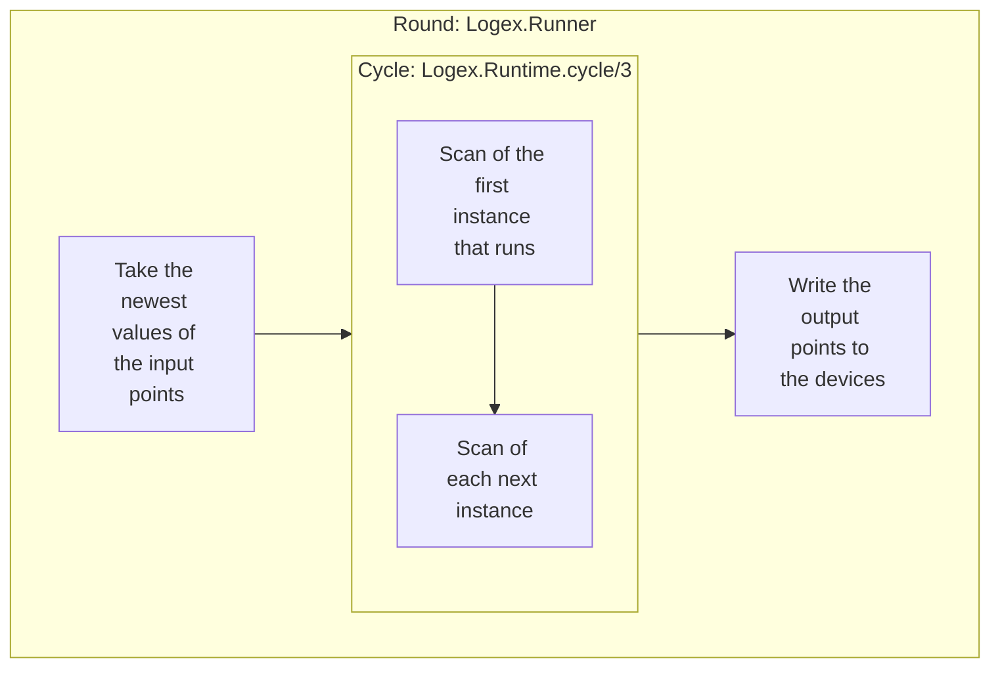
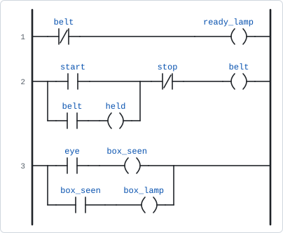
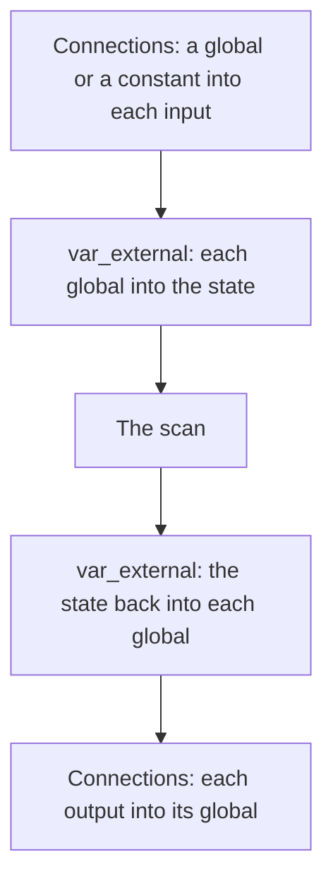
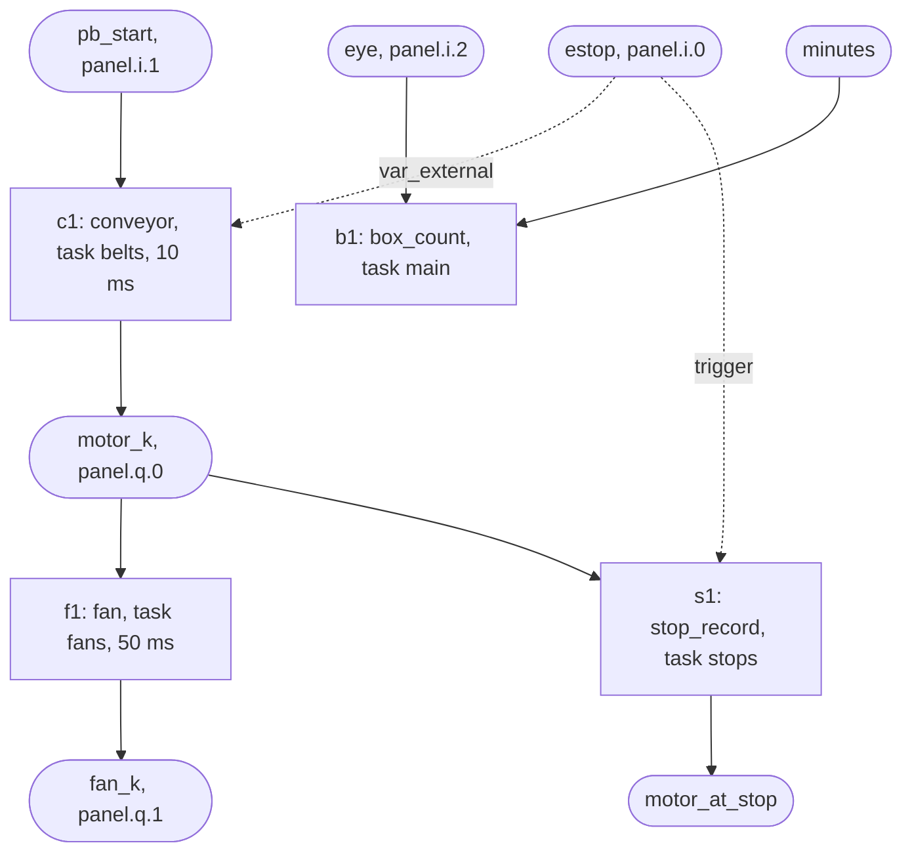

# Execution model

This page is for a reader who looks for an exact rule of how logex runs a
[program](glossary.md#program). The reader is a controls engineer who must know when a
[rung](glossary.md#rung) runs, or an Elixir developer who writes a
[host](glossary.md#host). The page defines a [scan](glossary.md#scan), the
[power flow](glossary.md#power-flow) in a rung, the time and the
[first scan](glossary.md#first-scan). It also defines a [cycle](glossary.md#cycle) of
the [tasks](glossary.md#task) and a [round](glossary.md#round) of the
[runner](glossary.md#runner).

> #### Warning {: .warning}
>
> Do not use logex for a [safety function](glossary.md#safety-function). logex is not
> hard real-time. It gives no maximum for the time that a scan, a cycle or a round is
> late. A [watchdog](glossary.md#watchdog) stops the [plant](glossary.md#plant) after a
> task runs too long. It cannot make a task run on time.

> #### Warning {: .warning}
>
> Do not use an input pulse that is shorter than the time between 2 rounds. The runner
> keeps only the newest value of each [input point](glossary.md#point). A program does
> not see a pulse that starts and stops between 2 rounds. A cycle of a host also reads
> only 1 value of each input point. The runner sees each change of a
> [trigger](glossary.md#trigger) only if the [device](glossary.md#device) of the trigger
> reports each change. [Inputs between rounds](#inputs-between-rounds) gives the rule.

| To find | Go to |
|---|---|
| The 3 levels of a run, and the function of each | [The 3 levels of a run](#the-3-levels-of-a-run) |
| The sequence of the rungs and of the legs of a branch | [A scan](#a-scan) |
| Where the time of a scan and of a timer comes from | [Time](#time) |
| What a counter, a one-shot and `tp` do after a start or a [restart](glossary.md#restart) | [The first scan](#the-first-scan) |
| When a task is due, and the sequence of the tasks | [A cycle](#a-cycle) |
| When the runner runs a round | [A round of the runner](#a-round-of-the-runner) |
| The model and the reasons | [The scan, the cycle and time](../explanation/scan-cycle-and-time.md) and [Tasks and the schedule](../explanation/tasks-and-scheduling.md) |
| What each [instruction](glossary.md#instruction) does on a [true rung](glossary.md#true-rung) and on a [false rung](glossary.md#false-rung) | [Instructions: contacts and coils](instructions-contacts-and-coils.md) and the other instruction pages |
| The rungs that a [jump](glossary.md#jump) passes, and `cal` | [Instructions: jump and call](instructions-jump-and-call.md) |
| Each [fault](glossary.md#fault) | [Faults](faults.md) |
| The words of a task line | [Configuration file](configuration-file.md) |
| The options of the runner, the watchdogs and the [trip](glossary.md#trip) | [Runner](runner.md) |
| Each function of logex and each `ArgumentError` | [Host contract](host-contract.md) |
| A [warm restart](glossary.md#warm-restart) and the [qualifier](glossary.md#qualifier) `retain` | [Retained values](retained-values-and-store.md) |

Each example on this page is a script, with each line that it prints. Each `elixir` block
is the file under `examples/` that its `$ mix run` line names. The directory `examples`
of the repository is a Mix project, and logex is its dependency. To run a script, enter
its command in that directory. [Your first program](../tutorials/first-program.md) shows
how to make a Mix project that has logex as a dependency.

## The 3 levels of a run

| Level | What runs | What starts it |
|---|---|---|
| Scan | The rungs of 1 [instance](glossary.md#instance), 1 time | The host, or a cycle |
| Cycle | 1 scan of each instance of each task that is [due](glossary.md#due), then 1 scan of each instance that has no [timed task](glossary.md#timed-task) | The host, or a round |
| Round | The runner takes the newest values of the input points, runs 1 cycle and writes the output points to the devices. | The runner |

| Level | Function | Where the time comes from |
|---|---|---|
| Scan | `Logex.Runtime.scan/2`, `Logex.Runtime.scan/3` and `Logex.Runtime.call/4` | The host gives it as an argument. |
| Cycle | `Logex.Runtime.cycle/3` | The host gives the time since the last cycle. |
| Round | `Logex.Runner` | The runner reads its [clock](glossary.md#clock). |



Figure 1: a round holds 1 cycle, and a cycle holds 1 scan for each instance that runs.
Only the runner reads a clock.

A host can run 1 instance with scans, and no [configuration](glossary.md#configuration).
A host can also run a configuration with cycles, and no runner. In each case, the host
gives the time.

## A scan

A scan runs the rungs of 1 instance 1 time, from the first rung to the last rung. A scan
never goes back to an earlier rung.

### The steps of a scan

1. `call/4` sets the inputs of its map in the [state](glossary.md#state) of the instance.
   `scan/2` and `scan/3` use the inputs that `put_inputs/3` set.
2. logex runs each rung in sequence, from the first rung to the last rung. A `jmp` can
   make the scan pass over the rungs between it and its label.
3. logex returns the value of each output, and the new state.

| Item | Rule |
|---|---|
| The [inputs](glossary.md#input) | An input does not change during a scan. `Logex.Runtime.put_inputs/3` and `call/4` change only the inputs that their map names. Each other input keeps its value. |
| The [outputs](glossary.md#output) | A scan returns the value of each `var_output` [tag](glossary.md#tag) after the last rung, also of an output that did not change. |
| Each other tag | The host reads it in the field `env` of the state, for example `state.env["fault"]`. |
| The first state | `Logex.Runtime.instance/1` gives each tag its [initial value](glossary.md#initial-value). A tag with no initial value in its [declaration](glossary.md#declaration) starts at 0. |
| The state between scans | The host keeps the state and gives it to the next scan. logex keeps no state between 2 calls. |
| A fault | The scan continues to the last rung. The field `faults` of the new state holds each fault of the scan, in sequence. It is `[]` if the scan found no fault. |

### Power flow in a rung

| Case | Rule |
|---|---|
| The start of a rung | The power flow is true at the left end of each rung. |
| An instruction in a series | It gets the power out of the instruction before it. |
| An instruction on a false rung | It runs. Each instruction has a rule for a true rung and a rule for a false rung. For example, `ote` writes 0 on a false rung. |
| The legs of a [branch](glossary.md#branch) | Each [leg](glossary.md#leg) starts with the power flow that comes into the branch. |
| The sequence of the legs | logex runs the legs in sequence, from the first leg to the last leg. |
| A leg after a true leg | logex runs it. A branch does not stop at the first leg that passes power. Thus an `ote` or a `move` in a later leg writes its tag. |
| A tag that an earlier leg wrote | A later leg of the same branch reads the new value. |
| The power out of a branch | True if 1 leg or more passes power. False if no leg passes power. |

[Instructions: contacts and coils](instructions-contacts-and-coils.md#the-power-in-and-the-power-out)
gives the power in of each place on a rung. Each instruction page gives the power out of
its instructions, and the instructions that must be last on a rung.

### The sequence of the reads and the writes

An instruction writes a tag when the scan runs the instruction. These rules follow:

- A rung reads the value that an earlier rung wrote in the same scan.
- A rung reads the value that a later rung wrote in the scan before.
- If 2 rungs write 1 tag, the host gets the value of the later rung.
- A host never sees a value that a later rung of the same scan replaced.

### Example: a scan of `belt.ld`

The program `belt.ld` runs a conveyor belt. Rung 1 lights `ready_lamp` while the belt does
not run. In rung 2, the second leg writes `held`. In rung 3, the second leg reads the
`box_seen` that the first leg wrote.

<!-- file: execution-model/belt.ld -->
```text
var_input  start      bool
var_input  stop       bool
var_input  eye        bool
var_output ready_lamp bool
var_output belt       bool
var_output held       bool
var_output box_seen   bool
var_output box_lamp   bool

xio belt ote ready_lamp
( xic start | xic belt ote held ) xio stop ote belt
( xic eye ote box_seen | xic box_seen ote box_lamp )
```

<!-- rung: execution-model/belt.ld -->


The script `execution-model-scan.exs` runs 6 scans. Before each scan, it changes only the
inputs that its map names. It prints 1 column for each scan.

```elixir
{:ok, belt} = Logex.compile_file("execution-model/belt.ld")

# The inputs that change before each scan. A scan keeps each other input.
changes = [
  %{"start" => 1},
  %{},
  %{"start" => 0},
  %{"eye" => 1},
  %{"stop" => 1, "eye" => 0},
  %{"stop" => 0}
]

scan = fn changed, state ->
  state = Logex.Runtime.put_inputs(belt, state, changed)
  {outputs, state} = Logex.Runtime.scan(belt, state)
  inputs = Map.take(state.env, ["start", "stop", "eye"])
  {Map.merge(inputs, outputs), state}
end

{scans, _state} = Enum.map_reduce(changes, Logex.Runtime.instance(belt), scan)

row = fn name, values ->
  IO.puts(String.pad_trailing(name, 12) <> Enum.join(values, "  "))
end

row.("scan", 1..6)

for tag <- ~w(start stop eye ready_lamp belt held box_seen box_lamp) do
  row.(tag, Enum.map(scans, & &1[tag]))
end
```

```console
$ mix run execution-model-scan.exs
scan        1  2  3  4  5  6
start       1  1  0  0  0  0
stop        0  0  0  0  1  0
eye         0  0  0  1  0  0
ready_lamp  1  0  0  0  0  1
belt        1  1  1  1  0  0
held        0  1  1  1  1  0
box_seen    0  0  0  1  0  0
box_lamp    0  0  0  1  0  0
```

| Scan | What the result shows | The rule |
|---|---|---|
| 1 | `ready_lamp` is 1 in the scan that starts the belt. | Rung 1 runs before rung 2. It reads the `belt` of the scan before, 0. |
| 1 | `held` is 0. | The second leg reads the `belt` of the scan before, 0. |
| 2 | `held` is 1, and `start` is also 1. | logex runs the second leg also when the first leg passes power. |
| 3 | The belt stays on after `start` goes to 0. | The second leg is a [seal-in](glossary.md#seal-in). |
| 4 | `box_lamp` comes on in the same scan as `box_seen`. | The second leg of rung 3 reads the value that the first leg wrote. |
| 5 | `ready_lamp` stays 0 in the scan that stops the belt. | Rung 1 reads the `belt` of scan 4, 1. |
| 5 | `held` is 1 in the scan that stops the belt. | The second leg reads the `belt` of scan 4, 1, because rung 2 writes `belt` after the leg. |
| 6 | `ready_lamp` is 1 again. | Rung 1 reads the `belt` of scan 5, 0. |

### Rungs that a scan does not run

A scan does not run a rung in 2 cases:

- The rung is between a `jmp` that jumps and the rung of its [label](glossary.md#label).
- The rung is in a [function block](glossary.md#function-block), and the `cal` that runs
  the instance is on a false rung.

An instruction on a rung that does not run writes nothing and reads nothing. It is not
the same as an instruction on a false rung.

| Instruction | On a rung that the scan does not run |
|---|---|
| `ote` and each other coil | The tag keeps its value. `ote` writes no 0. |
| A [timer](glossary.md#timer) | It keeps its [members](glossary.md#member). If the timer counted time at its last run, its next run adds all the time since then. |
| A [counter](glossary.md#counter) or a [one-shot](glossary.md#one-shot) | It keeps the power in of its last run. It does not see a change of its power in that comes and goes while its rung does not run. |
| `div` and `mod` with the divisor 0 | They do not run. The scan gets no fault. |

[Instructions: jump and call](instructions-jump-and-call.md#a-rung-that-the-scan-does-not-run)
gives each case and an example.

### Faults in a scan

A fault does not stop a scan. The scan runs to the last rung.

| Fault | Kind | What the instruction does |
|---|---|---|
| `:divide_by_zero` | [Minor](glossary.md#minor-fault) | `div` or `mod` writes 0, or 0.0 to a real, and passes no power. |
| `:negative_sqrt` | Minor | `sqrt` writes 0.0 and passes no power. |
| `:index_out_of_range` | [Major](glossary.md#major-fault) | It writes nothing and passes no power. |
| `:bit_out_of_range` | Major | It writes nothing and passes no power. |

After each fault, the scan continues. The rest of the rung runs with no power.

| Where the scan runs | Where the host finds each fault |
|---|---|
| A scan of 1 instance | `state.faults` after the scan |
| A scan in a cycle | The event `{:fault, task, instance, fault}`, after the event `{:ran, ...}` of the scan |
| A round of the runner | `Logex.Runner.subscribe/2` sends each `{:fault, ...}` event. A minor fault trips nothing. After a major fault, the runner completes the run of that task, runs no later task of the round, and then trips the plant. [Faults](faults.md) gives the rule. |

An instruction that does not read or write its [operand](glossary.md#operand) checks nothing. For example, a
contact on a false rung reads nothing, and thus finds no [subscript](glossary.md#subscript) out of the range. An
`ote` on a false rung writes 0, and thus checks its operand.

### The functions of a scan

| Function | What it does |
|---|---|
| `Logex.Runtime.instance/1` | It gives a new state: each tag at its initial value, the time 0 and the next scan a first scan. |
| `Logex.Runtime.instance/2` | The same, with the values of a [retained image](glossary.md#retained-image). The next scan is a first scan. |
| `Logex.Runtime.put_inputs/3` | It sets the inputs that its map names, for the next scan. |
| `Logex.Runtime.scan/2` | It runs 1 scan and gives the scan 0 ms. |
| `Logex.Runtime.scan/3` | It runs 1 scan. The third argument is the time since the last scan, in ms. |
| `Logex.Runtime.call/4` | It runs 1 scan with the inputs of its map, at the time that a `%Logex.Scan{}` gives. The field `first` of the `%Logex.Scan{}` must be the field `first` of the state. A cycle calls it for each instance that runs. |
| `Logex.Runtime.restart/3` | It starts the instance again, `:cold` or `:warm`. It keeps the time and each input. The next scan is a first scan. |

## Time

A scan and a cycle read no clock. The host gives the time to each scan and to each
cycle. In a round, the runner reads its clock and gives the time to the cycle.

| Item | Rule |
|---|---|
| The unit | A whole number of milliseconds, 0 or more |
| The time of an instance | The field `now` of the state. `Logex.Runtime.instance/1` sets it to 0. |
| `scan/3` | It adds its third argument to `now`. |
| `scan/2` | It adds 0 to `now`. |
| `call/4` | It sets `now` to the field `now` of its `%Logex.Scan{}`. That field is a time, not the time since the last scan. |
| The sequence of the times | The time of an instance never goes back. logex raises an `ArgumentError` for a scan at a time before the last scan. |
| A restart | `restart/3` keeps `now`. |
| A timer | It reads `now`, and no clock. It adds the time from its last run to this run. [Instructions: timers and counters](instructions-timers-and-counters.md) gives the rules. |
| The time of a [resource](glossary.md#resource) | `cycle/3` adds its second argument to the time of the resource. Each scan of the cycle runs at the time of the resource. `restart/2` keeps the time. |

### Example: the time of a scan

The program `fan_delay.ld` starts the fan when the belt runs for 500 ms.

<!-- file: execution-model/fan_delay.ld -->
```text
var_input  belt bool
var_output fan  bool
var t1 ton

xic belt ton t1 500
xic t1.dn ote fan
```

The script `execution-model-time.exs` runs scans with different times. Then it makes 6
calls with a wrong time, and prints the message of each `ArgumentError`.

```elixir
{:ok, fan} = Logex.compile_file("execution-model/fan_delay.ld")

# scan/3: the third argument is the time since the last scan, in ms.
show = fn state, label, out ->
  IO.puts("#{label}  now=#{state.now}  t1.acc=#{state.env["t1"]["acc"]}  fan=#{out["fan"]}")
  state
end

step = fn state, ms ->
  {out, state} = Logex.Runtime.scan(fan, state, ms)
  show.(state, "scan/3 #{String.pad_leading("#{ms}", 3)} ms", out)
end

state = Logex.Runtime.put_inputs(fan, Logex.Runtime.instance(fan), %{"belt" => 1})
state = Enum.reduce([0, 200, 200, 200], state, &step.(&2, &1))
{out, state} = Logex.Runtime.scan(fan, state)
state = show.(state, "scan/2       ", out)

# call/4: the scan gives the time of the instance, not the time since the last scan.
{out, state} =
  Logex.Runtime.call(fan, state, %{"belt" => 0}, %Logex.Scan{now: 1000, first: false})

state = show.(state, "call/4 1000  ", out)

# Each of these calls raises an ArgumentError. The script prints its message.
calls = [
  fn -> Logex.Runtime.scan(fan, state, -5) end,
  fn -> Logex.Runtime.scan(fan, state, 2.5) end,
  fn -> Logex.Runtime.call(fan, state, %{}, %Logex.Scan{now: 900, first: false}) end,
  fn -> Logex.Runtime.call(fan, state, %{}, %Logex.Scan{now: -1, first: false}) end,
  fn -> Logex.Runtime.call(fan, state, %{}, %Logex.Scan{now: 1000, first: true}) end,
  fn ->
    fresh = Logex.Runtime.instance(fan)
    Logex.Runtime.call(fan, fresh, %{}, %Logex.Scan{now: 0, first: false})
  end
]

for call <- calls do
  try do
    call.()
  rescue
    error in ArgumentError -> IO.puts(Exception.message(error))
  end
end
```

```console
$ mix run execution-model-time.exs
scan/3   0 ms  now=0  t1.acc=0  fan=0
scan/3 200 ms  now=200  t1.acc=200  fan=0
scan/3 200 ms  now=400  t1.acc=400  fan=0
scan/3 200 ms  now=600  t1.acc=500  fan=1
scan/2         now=600  t1.acc=500  fan=1
call/4 1000    now=1000  t1.acc=0  fan=0
elapsed_ms must be a non-negative integer of milliseconds, got: -5
elapsed_ms must be a non-negative integer of milliseconds, got: 2.5
time went backwards: this scan is at 900 ms, but the instance was last scanned at 1000 ms
scan.now must be a non-negative integer of milliseconds, got: -1
scan.first is true, but the instance has been scanned since it started or restarted
scan.first is false, but this is the instance's first scan since it started or restarted
```

- The timer adds 200 ms in each scan that gets 200 ms. `scan/2` adds no time.
- `call/4` at 1000 ms sets `now` to 1000. Its map sets `belt` to 0, and the timer
  resets.

Lines 7 to 12 are the messages of the 6 calls with a wrong time. Each call causes an
`ArgumentError`.

| Line | The cause of the `ArgumentError` |
|---|---|
| 7 | `scan/3` with a negative time |
| 8 | `scan/3` with a time that is not a whole number |
| 9 | `call/4` at a time before the last scan |
| 10 | `call/4` with a negative `now` |
| 11 | `call/4` with `first: true` after the first scan |
| 12 | `call/4` with `first: false` in the first scan |

`cycle/3` refuses a wrong time with the same message as `scan/3`.
[The example of a cycle](#example-a-cycle-of-linelogex) shows it.

## The first scan

The first scan is the scan of an instance that comes first after a start or a restart. The field
`first` of the state is `true` before the first scan. Each scan sets it to `false`.

### What makes the next scan a first scan

| Event | The next scan of each instance |
|---|---|
| `Logex.Runtime.instance/1` and `instance/2` | A first scan |
| `Logex.Runtime.restart/3`, `:warm` or `:cold` | A first scan |
| `Logex.Runtime.start/1` and `start/2` | A first scan |
| `Logex.Runtime.restart/2`, `:warm` or `:cold` | A first scan |
| A scan | Not a first scan |
| `Logex.Runtime.put_inputs/3` | No change |
| An [online edit](glossary.md#online-edit) | No change. An edit is not a restart. [Online edit](online-edit.md) gives what an edit does to a one-shot or a counter. |

### What changes in the first scan

| Instruction | In the first scan |
|---|---|
| `ons` | It passes no power. It writes its [storage bit](glossary.md#storage-bit). |
| `osr` and `osf` | They do not set the [pulse bit](glossary.md#pulse-bit). They write the storage bit. |
| `ctu` and `ctd`, also on a `ctud` counter | They do not count. They copy their power in into the member `cu` or `cd`. |
| `tp` | It does not start a pulse. |
| `tof` | No different rule. After a start and after a [cold restart](glossary.md#cold-restart), `en` is 0, so a false rung starts no delay. A warm restart puts a retained `tof` that is on and does not count time in its rest state. A start from a retained image does the same. In the rest state, `en`, `dn` and `tt` are 0, and `acc` keeps its value. [Instructions: timers and counters](instructions-timers-and-counters.md#restarts-and-online-edits) gives the rule. |
| `ton`, `rto` and each other instruction | The same as in each other scan |

- logex has no prescan. A prescan is a pass that prepares each instruction before the
  first scan. In logex, the first scan runs each rung.
- A warm restart and a cold restart are the same here. A
  [retained](glossary.md#retain) counter keeps its count, and it does not count in the
  first scan.
- logex has no first-scan bit. The tag `first` of `boxes.ld` is a first-scan bit that
  the program makes: its initial value is 1, and the last rung
  [unlatches](glossary.md#unlatch) it.

### Example: a box on the eye at the start

The program `boxes.ld` counts the boxes at a photo-eye. Its counter has the qualifier
`retain`. A box is on the eye when the program starts.

<!-- file: execution-model/boxes.ld -->
```text
var_input  eye       bool
var_output count     dint
var_output pulse     bool
var_output first_out bool
var retain boxes ctu
var edge  bool
var first bool 1

xic eye ctu boxes 100
xic eye ons edge ote pulse
move boxes.cv count
xic first ote first_out
otu first
```

<!-- timing: execution-model-first-scan.timing.exs -->


The diagram shows that the counter does not count the box that is on the eye in scan 1.
It counts the rising edge of `eye` in scan 4 and in scan 7.

The script `execution-model-first-scan.exs` runs the same program, with a warm restart
and a cold restart. Each line shows the field `first` of the state before the scan.

```elixir
{:ok, boxes} = Logex.compile_file("execution-model/boxes.ld")

# One scan: the inputs that change, then the scan. The line shows the field
# `first` of the state before the scan, the input eye and the outputs.
scan = fn state, label, changed ->
  state = Logex.Runtime.put_inputs(boxes, state, changed)
  first = String.pad_trailing("#{state.first}", 5)
  {out, state} = Logex.Runtime.scan(boxes, state, 10)

  IO.puts(
    "#{String.pad_trailing(label, 21)}  first=#{first}  eye=#{state.env["eye"]}  count=#{out["count"]}" <>
      "  pulse=#{out["pulse"]}  first_out=#{out["first_out"]}"
  )

  state
end

state =
  Logex.Runtime.instance(boxes)
  |> scan.("start, box on the eye", %{"eye" => 1})
  |> scan.("box stays           ", %{})
  |> scan.("box goes            ", %{"eye" => 0})
  |> scan.("next box            ", %{"eye" => 1})

state =
  Logex.Runtime.restart(boxes, state, :warm)
  |> scan.("warm restart        ", %{})
  |> scan.("box goes            ", %{"eye" => 0})
  |> scan.("next box            ", %{"eye" => 1})

Logex.Runtime.restart(boxes, state, :cold)
|> scan.("cold restart        ", %{})
```

```console
$ mix run execution-model-first-scan.exs
start, box on the eye  first=true   eye=1  count=0  pulse=0  first_out=1
box stays              first=false  eye=1  count=0  pulse=0  first_out=0
box goes               first=false  eye=0  count=0  pulse=0  first_out=0
next box               first=false  eye=1  count=1  pulse=1  first_out=0
warm restart           first=true   eye=1  count=1  pulse=0  first_out=1
box goes               first=false  eye=0  count=1  pulse=0  first_out=0
next box               first=false  eye=1  count=2  pulse=1  first_out=0
cold restart           first=true   eye=1  count=0  pulse=0  first_out=1
```

| Line | What the result shows |
|---|---|
| 1 | The counter does not count the box that is on the eye at the start. `ons` gives no pulse. |
| 4 | The next box is a [rising edge](glossary.md#rising-edge), and the counter counts it. |
| 5 | After the warm restart, `eye` stays 1 and the count stays 1. The counter does not count the box on the eye again. |
| 8 | After the cold restart, the count is 0. `eye` stays 1, because a restart keeps each input. |

## A cycle

A cycle is 1 step of a resource: `Logex.Runtime.cycle/3`. Its arguments are the
resource, the time since the last cycle in ms, and a map of the input
[points](glossary.md#point) that changed.

### The steps of a cycle

1. The time of the resource increases by the time that the host gives.
2. logex sets each input point of the map. Each other input point keeps its value.
3. logex reads the trigger of each [event task](glossary.md#event-task) 1 time.
4. logex finds the tasks that are due, and puts them in sequence.
5. For each due task, in sequence, logex reports the [overlaps](glossary.md#overlap) of
   the task. Then it scans each instance of the task.
6. logex scans each instance that has no timed task.
7. logex moves each due time that passed. The new due time is the first due time of the
   task after the time of the resource.
8. logex returns the new resource, the value of each output point and the events.

| Item | Rule |
|---|---|
| An input point during a cycle | It does not change. Each scan of the cycle reads the same value. |
| The first values of the input points | Each input point is 0, or 0.0 for a real, at the start, until a cycle sets it. A cycle sets only the input points of its map. |
| A value that does not fit | logex refuses the cycle with an `ArgumentError`. It lists each wrong key and each wrong value in 1 message. |
| An [array](glossary.md#array) of input points | A key can name 1 [element](glossary.md#element), for example `"eyes[1]"`. A key can also name the array, with a list, for example `"eyes" => [1, 0]`. [Configuration file](configuration-file.md) gives the rules. |
| The output points | A cycle returns each output point, also if no instance ran. Each element of an array of output points has a separate key, for example `"lamps[0]"`. |
| A new value of an input point | An instance reads it when its task next runs. |
| A cycle and a clock | A cycle reads no clock and no watchdog. A cycle that takes a long time runs as each other cycle. |
| The same arguments | The same resource, time and inputs always give the same outputs and events. |

### The trigger of an event task

The trigger is a `bool` [global](glossary.md#global). logex reads it 1 time in each cycle,
after it sets the input points and before the first scan. This value is the
[sample](glossary.md#sample). The task is due if the sample is 1 and the last sample is 0:
a [rising edge](glossary.md#rising-edge) of the trigger.

| Case | Rule | Example |
|---|---|---|
| A rising edge | The task runs 1 time. It does not run again while the trigger stays 1. | [Case 1](#task-cases-1-to-12) |
| The first cycle | The last sample starts at 0. A trigger that is 1 in the first cycle makes the task due. | [Case 2](#task-cases-1-to-12) |
| A trigger that a program writes | The task is due in the next cycle, not in the cycle of the write. | [Case 5](#task-cases-1-to-12) |
| A trigger that nothing writes | A global with no point and the initial value 1 makes the task due 1 time after each start and each restart. A warm restart of a trigger with `retain` does not. With the initial value 0, the task is never due. | [Case 3](#task-cases-1-to-12) |
| A pulse 0, 1, 0 between 2 cycles | The task does not run. A cycle reads only 1 value of the trigger. | None |
| `restart/2`, and the trigger has no `retain` | It sets the last sample to 0. A trigger that is 1 makes the task due in the next cycle. | Case 2 |
| A warm restart, and the trigger has `retain` | The restart keeps the last sample. The task runs only on a new rising edge. | [Case 4](#task-cases-1-to-12) |
| A cold restart, and the trigger has `retain` | It sets the last sample to 0. | Case 4 |
| `start/2`, and the trigger has `retain` | The last sample comes from the [retained image](glossary.md#retained-image). [Retained values](retained-values-and-store.md) gives the rule. | None |
| `next_due_in/1` | It counts no rising edge of a trigger. It counts only the due times of a task with an interval. A resource that has no task with an interval gives `:infinity`. | Case 1 and [case 6](#task-cases-1-to-12) |

### When a task is due

| Task | Example line | When it is due |
|---|---|---|
| A [periodic task](glossary.md#periodic-task) | `task belts interval 10 priority 1` | In the first cycle. Then each interval after the start or the last `restart/2`: 10, 20, 30 ms. |
| An event task | `task stops single estop priority 0` | In a cycle where its trigger is 1 and the last sample is 0 |
| An event task with an interval | `task stops single estop interval 20 priority 0` | On a rising edge of the trigger, as an event task. Also in the first cycle and then each interval, while the trigger is 0. |
| The [continuous task](glossary.md#continuous-task) | `task main continuous` | Never. Its instances run in each cycle, after the due tasks. |
| No task | `program b1 box_count` in a configuration with no continuous task | Never. The instance runs in each cycle, after the due tasks. |

If the configuration has a continuous task, a `program` line with no `with` puts its
instance in it. A `program` line with `with main` does the same, if `main` is the
continuous task. If the configuration has no continuous task, an instance with no `with`
has no task, and its events name the task `:none`.

| Rule of a periodic task | Example |
|---|---|
| The due times are a whole number of intervals after the start or the last `restart/2`. A late cycle does not move them. | [Case 9](#task-cases-1-to-12) |
| After `restart/2`, the task is due in the next cycle. Then it is due at each interval from the time of the restart. | [Case 12](#task-cases-1-to-12) |
| A task runs at most 1 time in a cycle. | [Case 9](#task-cases-1-to-12) |

| Rule of an event task with an interval | Example |
|---|---|
| It runs at most 1 time in a cycle. It runs on a rising edge of the trigger, or at a due time while the trigger is 0. | [Case 6](#task-cases-1-to-12), at 20 and 25 ms |
| If a due time comes while the trigger is 1, the task does not run. logex counts no overlap. | Case 6, at 45 ms |
| A run on a rising edge does not move the due times. | Case 6: due at 20, 40 and 60 ms |
| A late cycle that reads 0 runs the task 1 time. It counts each other due time that passed as an [overlap](glossary.md#overlap), as for a periodic task. | [Case 7](#task-cases-1-to-12), at 65 ms: 2 overlaps |
| If a late cycle reads 0, the task runs 1 time, also for a due time that passed while the trigger was 1. | Case 7, at 185 ms |
| A late cycle that reads a rising edge runs the task 1 time, and counts no overlap. | Case 7, at 130 ms |

Case 6, cycle by cycle (`task stops single estop interval 20 priority 0`):

| Time | `estop` | A due time since the last cycle | The task runs |
|---|---|---|---|
| 0 ms | 0 | The first cycle | Yes |
| 10 ms | 0 | None | No |
| 20 ms | 0 | 20 ms | Yes |
| 25 ms | 1 | None, but a rising edge | Yes |
| 35 ms | 1 | None | No |
| 45 ms | 1 | 40 ms | No: the trigger is 1 |
| 55 ms | 0 | None | No |
| 65 ms | 0 | 60 ms | Yes |

### The sequence of the runs in a cycle

If more than 1 task is due, logex uses these 3 rules, in this sequence:

1. The task with the higher [priority](glossary.md#priority) runs first. The priority 0
   is the highest, and 65535 is the lowest.
2. If 2 tasks have the same priority, the task with the earlier due time runs first. The
   due time of an event task is the time of the cycle.
3. If 2 tasks also have the same due time, the task whose line comes first runs first.

| Rule | Example |
|---|---|
| A task scans its instances in the sequence of their `program` lines. | [Case 8](#task-cases-1-to-12): `l2`, then `l5` |
| A periodic task that was due before the cycle runs before an event task of the same priority. | Case 8, at 15 ms |
| The instances in the continuous task, or with no task, run last, in the sequence of their `program` lines. | [Case 10](#task-cases-1-to-12) and [case 11](#task-cases-1-to-12) |
| A task does not interrupt a scan. The priority gives only the sequence in the cycle. | None |

### The copies around a scan

A resource holds 1 value for each global. In a cycle, logex copies the values of the
globals in and out of each instance around its scan.



Figure 2: the 5 steps around the scan of 1 instance, from top to bottom. A
[connection](glossary.md#connection) copies a value. A `var_external` tag reads and
writes the global itself.

| Rule | Example |
|---|---|
| An instance reads the value that an earlier instance of the same cycle wrote. | In [the example of a cycle](#example-a-cycle-of-linelogex), at 0 ms, `f1` reads the `motor_k` that `c1` wrote. |
| An instance does not read a value that a later instance writes. It reads that value in its next run. | At 20 ms, `s1` runs first and reads the `motor_k` of the cycle before. |
| If an instance writes a global through a `var_external` tag and through a connection, the value of the connection stays. logex gives a [warning](glossary.md#warning) for this configuration. | None |
| Between 2 cycles, a `var_external` tag has no separate value. `Logex.Runtime.get/2` reads it as its global. | `c1.estop` |

### A late cycle

A cycle is late if more than 1 due time of a task with an interval passed since the last
cycle.

| Rule | Example |
|---|---|
| The task runs 1 time. | In [the example of a cycle](#example-a-cycle-of-linelogex), at 75 ms |
| logex counts each other due time that passed as an overlap. | `belts` was due at 50, 60 and 70 ms: 2 overlaps |
| The event `{:overlap, task, missed}` comes before the scans of the task. | At 75 ms |
| `Logex.Runtime.overlaps/1` gives the total of each task since the start or the last `restart/2`. | `%{"belts" => 2, ...}` |
| The task is next due at its first due time after the time of the cycle. A task never runs early. | `belts` is next due at 80 ms. `next_due_in/1` gives 5. |
| The first cycle obeys the same rules. | [Case 9](#task-cases-1-to-12): a first cycle at 35 ms counts 3 overlaps. |
| An event task with no interval and the continuous task have no overlaps. | `stops` and `main`: 0 |

### The events of a cycle

`cycle/3` returns a list of events, in the sequence that they occur.

| Event | When | Where in the list |
|---|---|---|
| `{:ran, task, instance, now}` | The scan of 1 instance | In the sequence of the scans. `task` is the name of the task. For an instance with no timed task, it is the name of the continuous task, or `:none`. |
| `{:overlap, task, missed}` | A task with an interval has 1 overlap or more. | Directly before the first `{:ran, ...}` of the task |
| `{:fault, task, instance, fault}` | A scan found a fault, a `%Logex.Fault{}`. | Directly after the `{:ran, ...}` of its scan |

- logex gives no separate kind of event for an event task. The runs of an event task are
  its `{:ran, ...}` events.
- A fault does not stop a cycle. The cycle runs each due task.
- The list of kinds can grow. A host must not fail on a kind that it does not know.

### The functions of a resource

| Function | What it does |
|---|---|
| `Logex.Runtime.start/1` | It makes a resource at the time 0. Each global has its initial value, and each instance is as `instance/1` makes it. Each task with an interval is due, and each last sample is 0. |
| `Logex.Runtime.start/2` | The same, with the values of a retained image |
| `Logex.Runtime.cycle/3` | It runs 1 cycle. It returns `{resource, outputs, events}`. |
| `Logex.Runtime.next_due_in/1` | The time in ms until the next due time of a task with an interval. It is 0 after `start/1` if a task has an interval. It is `:infinity` if no task has an interval. |
| `Logex.Runtime.overlaps/1` | The number of overlaps of each task, by name |
| `Logex.Runtime.get/2` | The value of a global, of a tag of an instance or of a member: `{:ok, value}`, or `{:error, message}` for a path that names no value |
| `Logex.Runtime.get!/2` | The same value, or an `ArgumentError` with the message |
| `Logex.Runtime.restart/2` | It starts the resource again, `:cold` or `:warm`. It keeps the time and the values of the input points. |
| `Logex.Configuration.watchdog/1` | The watchdog of a task in ms: its `watchdog`, or 500 if its line gives none. A cycle does not read it. |

`next_due_in/1` counts no rising edge of a trigger. It does not show a trigger that is 1
at the start or after `restart/2`.

### Example: a cycle of `line.logex`

The configuration `line.logex` runs a conveyor, a fan, a record of each stop and a box
counter. It has 4 tasks.

<!-- file: execution-model/line.logex -->
```text
// line.logex -- a conveyor, a fan, a record of each stop and a box counter
task belts interval 10 priority 1
task fans  interval 50 priority 2
task stops single estop priority 0
task main  continuous

var_global estop   bool at panel.i.0
var_global pb_start bool at panel.i.1
var_global eye     bool at panel.i.2
var_global motor_k bool at panel.q.0
var_global fan_k   bool at panel.q.1
var_global minutes dint
var_global motor_at_stop bool

program c1 conveyor with belts
  c1.start pb_start
  c1.motor motor_k

program f1 fan with fans
  f1.belt motor_k
  f1.fan  fan_k

program s1 stop_record with stops
  s1.motor   motor_k
  s1.at_stop motor_at_stop

program b1 box_count
  b1.eye     eye
  b1.minutes minutes
```

<!-- file: execution-model/conveyor.ld -->
```text
var_input    start bool
var_output   motor bool
var_external estop bool

( xic start | xic motor ) xio estop ote motor
```

<!-- file: execution-model/fan.ld -->
```text
var_input  belt bool
var_output fan  bool

xic belt ote fan
```

<!-- file: execution-model/stop_record.ld -->
```text
var_input  motor   bool
var_output at_stop bool

xic motor ote at_stop
```

<!-- file: execution-model/box_count.ld -->
```text
var_input  eye     bool
var_input  minutes dint
var_output rate    dint
var boxes ctu

xic eye ctu boxes 1000
xic eye div boxes.cv minutes rate
```



Figure 3: the globals that pass between the instances of `line.logex`. A rounded box is
a global, and a rectangle is an instance with its task. A solid arrow is a connection.
`c1` reads `estop` through a `var_external` tag, and `estop` is the trigger of the task
`stops`.

The script `execution-model-cycle.exs` runs 6 cycles. The last cycle comes 35 ms after
the cycle before it. The script prints the inputs, the outputs and each event of each
cycle. Then it reads 5 paths with `get/2`, and it makes 2 cycles with wrong arguments.

```elixir
{:ok, line} = Logex.Configuration.compile_file("execution-model/line.logex")

# Each cycle: the time since the last cycle, and the input points that change.
steps = [
  {0, %{"pb_start" => 1}},
  {10, %{"pb_start" => 0}},
  {10, %{"estop" => 1}},
  {10, %{"eye" => 1}},
  {10, %{"estop" => 0, "eye" => 0}},
  {35, %{}}
]

cycle = fn {elapsed, inputs}, {resource, now} ->
  {resource, outputs, events} = Logex.Runtime.cycle(resource, elapsed, inputs)
  IO.puts("t=#{now + elapsed}  inputs #{inspect(inputs)}  outputs #{inspect(outputs)}")

  for event <- events do
    text = inspect(event, pretty: true, width: 76)
    IO.puts("  " <> String.replace(text, "\n", "\n  "))
  end

  {resource, now + elapsed}
end

{resource, _now} = Enum.reduce(steps, {Logex.Runtime.start(line), 0}, cycle)

IO.puts("overlaps/1: #{inspect(Logex.Runtime.overlaps(resource))}")
IO.puts("next_due_in/1: #{inspect(Logex.Runtime.next_due_in(resource))}")

# get/2 gives {:ok, value}, or {:error, message} for a path that names no value.
print = fn
  {:ok, value} -> "{:ok, #{inspect(value)}}"
  {:error, message} -> "{:error, message}\n  " <> message
end

for path <- ~w(motor_at_stop c1.estop b1.boxes.cv b1.boxes fans) do
  IO.puts("get/2 #{path}: " <> print.(Logex.Runtime.get(resource, path)))
end

# Each of these cycles raises an ArgumentError. The script prints its message.
calls = [
  fn -> Logex.Runtime.cycle(resource, -10, %{}) end,
  fn -> Logex.Runtime.cycle(resource, 10, %{"eye" => 2, "eyes" => 1, "motor_k" => 1}) end
]

for call <- calls do
  try do
    call.()
  rescue
    error in ArgumentError -> IO.puts(Exception.message(error))
  end
end
```

```console
$ mix run execution-model-cycle.exs
t=0  inputs %{"pb_start" => 1}  outputs %{"fan_k" => 1, "motor_k" => 1}
  {:ran, "belts", "c1", 0}
  {:ran, "fans", "f1", 0}
  {:ran, "main", "b1", 0}
t=10  inputs %{"pb_start" => 0}  outputs %{"fan_k" => 1, "motor_k" => 1}
  {:ran, "belts", "c1", 10}
  {:ran, "main", "b1", 10}
t=20  inputs %{"estop" => 1}  outputs %{"fan_k" => 1, "motor_k" => 0}
  {:ran, "stops", "s1", 20}
  {:ran, "belts", "c1", 20}
  {:ran, "main", "b1", 20}
t=30  inputs %{"eye" => 1}  outputs %{"fan_k" => 1, "motor_k" => 0}
  {:ran, "belts", "c1", 30}
  {:ran, "main", "b1", 30}
  {:fault, "main", "b1",
   %Logex.Fault{
     severity: :minor,
     kind: :divide_by_zero,
     instruction: :div,
     path: nil,
     file: "execution-model/box_count.ld",
     line: 7,
     read: nil
   }}
t=40  inputs %{"estop" => 0, "eye" => 0}  outputs %{"fan_k" => 1, "motor_k" => 0}
  {:ran, "belts", "c1", 40}
  {:ran, "main", "b1", 40}
t=75  inputs %{}  outputs %{"fan_k" => 0, "motor_k" => 0}
  {:overlap, "belts", 2}
  {:ran, "belts", "c1", 75}
  {:ran, "fans", "f1", 75}
  {:ran, "main", "b1", 75}
overlaps/1: %{"belts" => 2, "fans" => 0, "main" => 0, "stops" => 0}
next_due_in/1: 5
get/2 motor_at_stop: {:ok, 1}
get/2 c1.estop: {:ok, 0}
get/2 b1.boxes.cv: {:ok, 1}
get/2 b1.boxes: {:error, message}
  `b1.boxes` is a ctu: an access path names one of its members, as in `b1.boxes.q`
get/2 fans: {:error, message}
  `fans` is a task, not a global or a program instance: an access path starts at one of those, and overlaps/1 reads a task's overlap count
elapsed_ms must be a non-negative integer of milliseconds, got: -10
input `eye` is a bool: only 0 or 1 fit, found 2
input `eyes` is not an input point — did you mean `eye`?
input `motor_k` is an output point (at `panel.q.0`), not an input point: only an input point is set from outside
```

| Time | What the result shows |
|---|---|
| 0 ms | Each periodic task runs in the first cycle. `belts` runs before `fans`, because its priority is higher. `main` runs last. `f1` reads the `motor_k` that `c1` wrote in this cycle. |
| 10 ms | `fans` is not due. The cycle returns `fan_k` also. |
| 20 ms | `estop` goes to 1, and `stops` runs first. `s1` records the `motor_k` of the cycle before, 1. Then `c1` stops the belt. |
| 30 ms | `stops` does not run, because `estop` stays 1. The `div` of `b1` finds the divisor 0: `minutes` is 0, because nothing writes it. The fault event comes after the `{:ran, ...}` of `b1`. |
| 75 ms | `belts` runs 1 time and reports 2 overlaps first. `fans` was due at 50 ms and runs. |
| The last 4 lines | A negative time and wrong inputs each cause an `ArgumentError`. 1 message lists each wrong key. |

### Task cases 1 to 12

The script `execution-model-tasks.exs` runs 12 small configurations. Each instance is of
`lamp.ld` or of [`conveyor.ld`](#example-a-cycle-of-linelogex). Each line shows the time
of a cycle, its inputs, its runs and the time until the next due time.

| Case | What it shows | The rules |
|---|---|---|
| 1 | An event task runs on each rising edge of its trigger, and only then. | [The trigger of an event task](#the-trigger-of-an-event-task) |
| 2 | A trigger that is 1 makes the task due in the first cycle, and again after each `restart/2`. | [The trigger of an event task](#the-trigger-of-an-event-task) |
| 3 | A trigger with the initial value 1 makes the task due after the start and after a restart. | [The trigger of an event task](#the-trigger-of-an-event-task) |
| 4 | A warm restart keeps the last sample of a retained trigger. A cold restart does not. | [The trigger of an event task](#the-trigger-of-an-event-task) |
| 5 | A trigger that a program writes makes the task due in the next cycle. | [The trigger of an event task](#the-trigger-of-an-event-task) |
| 6 | An event task with an interval runs at its due times and on a rising edge. | [When a task is due](#when-a-task-is-due) |
| 7 | Late cycles of an event task with an interval, and its overlaps | [When a task is due](#when-a-task-is-due) |
| 8 | The sequence of the due tasks: priority, due time, then the task lines | [The sequence of the runs in a cycle](#the-sequence-of-the-runs-in-a-cycle) |
| 9 | A late first cycle counts overlaps, and the due times stay on their grid. | [A late cycle](#a-late-cycle) |
| 10 | The instances of the continuous task run after the timed tasks. | [The sequence of the runs in a cycle](#the-sequence-of-the-runs-in-a-cycle) |
| 11 | With no continuous task, an instance with no `with` runs last, under the task `:none`. | [When a task is due](#when-a-task-is-due) |
| 12 | After `restart/2`, a periodic task is due in the next cycle, and then each interval from the restart. | [When a task is due](#when-a-task-is-due) |

<!-- file: execution-model/lamp.ld -->
```text
var_output lamp bool

ote lamp
```

```elixir
# The program types of the cases, by name, for Logex.Configuration.compile/3.
programs =
  for name <- ~w(lamp conveyor), into: %{} do
    {:ok, program} = Logex.compile_file("execution-model/#{name}.ld")
    {name, program}
  end

cases = [
  {"An event task",
   """
   task stops single estop priority 0
   var_global estop bool at panel.i.0
   program l1 lamp with stops
   """,
   [{0, %{}}, {10, %{"estop" => 1}}, {10, %{}}, {10, %{"estop" => 0}}, {10, %{"estop" => 1}}]},
  {"A trigger that is 1 in the first cycle",
   """
   task stops single estop priority 0
   var_global estop bool at panel.i.0
   program l1 lamp with stops
   """,
   [{0, %{"estop" => 1}}, {10, %{}}, {:restart, :cold}, {10, %{}}, {:restart, :warm}, {10, %{}}]},
  {"A trigger with the initial value 1",
   """
   task stops single trip priority 0
   var_global trip bool 1
   program l1 lamp with stops
   """, [{0, %{}}, {10, %{}}, {:restart, :warm}, {10, %{}}]},
  {"A retained trigger",
   """
   task stops single trip priority 0
   var_global retain trip bool 1
   program l1 lamp with stops
   """, [{0, %{}}, {:restart, :warm}, {10, %{}}, {:restart, :cold}, {10, %{}}]},
  {"A trigger that a program writes",
   """
   task belts interval 10 priority 2
   task stops single running priority 1
   var_global estop bool at panel.i.0
   var_global pb_start bool at panel.i.1
   var_global running bool
   program c1 conveyor with belts
     c1.start pb_start
     c1.motor running
   program l1 lamp with stops
   """, [{0, %{}}, {10, %{"pb_start" => 1}}, {10, %{}}]},
  {"An event task with an interval",
   """
   task stops single estop interval 20 priority 0
   var_global estop bool at panel.i.0
   program l1 lamp with stops
   """,
   [
     {0, %{}},
     {10, %{}},
     {10, %{}},
     {5, %{"estop" => 1}},
     {10, %{}},
     {10, %{}},
     {10, %{"estop" => 0}},
     {10, %{}}
   ]},
  {"Late cycles of an event task with an interval",
   """
   task stops single estop interval 20 priority 0
   var_global estop bool at panel.i.0
   program l1 lamp with stops
   """, [{0, %{}}, {65, %{}}, {65, %{"estop" => 1}}, {10, %{}}, {45, %{"estop" => 0}}]},
  {"The sequence of the due tasks",
   """
   task stops single estop priority 1
   task belts interval 10 priority 1
   task fans  interval 10 priority 1
   task lamps interval 10 priority 0
   var_global estop bool at panel.i.0
   program l1 lamp with stops
   program l2 lamp with belts
   program l3 lamp with fans
   program l4 lamp with lamps
   program l5 lamp with belts
   """, [{0, %{}}, {15, %{"estop" => 1}}]},
  {"A late first cycle",
   """
   task belts interval 10 priority 1
   program l1 lamp with belts
   """, [{35, %{}}, {10, %{}}]},
  {"The continuous task",
   """
   task belts interval 10 priority 1
   task main continuous
   program l1 lamp with main
   program l2 lamp with belts
   program l3 lamp
   """, [{0, %{}}, {5, %{}}]},
  {"No continuous task",
   """
   task stops single estop priority 0
   var_global estop bool at panel.i.0
   program l1 lamp
   program l2 lamp with stops
   """, [{0, %{}}, {5, %{"estop" => 1}}]},
  {"A restart",
   """
   task belts interval 10 priority 1
   program l1 lamp with belts
   """, [{0, %{}}, {7, %{}}, {:restart, :cold}, {0, %{}}, {10, %{}}]}
]

event = fn
  {:ran, task, instance, _now} -> "ran #{task}:#{instance}"
  {:overlap, task, missed} -> "overlap #{task} #{missed}"
end

runs = fn
  [] -> "no run"
  events -> Enum.map_join(events, ", ", event)
end

step = fn
  {:restart, mode}, {resource, now} ->
    IO.puts("  restart/2 #{inspect(mode)}")
    {Logex.Runtime.restart(resource, mode), now}

  {elapsed, inputs}, {resource, now} ->
    {resource, _outputs, events} = Logex.Runtime.cycle(resource, elapsed, inputs)
    ran = runs.(events)
    due = inspect(Logex.Runtime.next_due_in(resource))
    IO.puts("  t=#{now + elapsed} #{inspect(inputs)}: #{ran} (next due in #{due})")
    {resource, now + elapsed}
end

for {{title, text, steps}, number} <- Enum.with_index(cases, 1) do
  {:ok, configuration} = Logex.Configuration.compile("line", text, programs)
  IO.puts("#{number}. #{title}")
  {resource, _now} = Enum.reduce(steps, {Logex.Runtime.start(configuration), 0}, step)
  IO.puts("  overlaps/1: #{inspect(Logex.Runtime.overlaps(resource))}")
end
```

```console
$ mix run execution-model-tasks.exs
1. An event task
  t=0 %{}: no run (next due in :infinity)
  t=10 %{"estop" => 1}: ran stops:l1 (next due in :infinity)
  t=20 %{}: no run (next due in :infinity)
  t=30 %{"estop" => 0}: no run (next due in :infinity)
  t=40 %{"estop" => 1}: ran stops:l1 (next due in :infinity)
  overlaps/1: %{"stops" => 0}
2. A trigger that is 1 in the first cycle
  t=0 %{"estop" => 1}: ran stops:l1 (next due in :infinity)
  t=10 %{}: no run (next due in :infinity)
  restart/2 :cold
  t=20 %{}: ran stops:l1 (next due in :infinity)
  restart/2 :warm
  t=30 %{}: ran stops:l1 (next due in :infinity)
  overlaps/1: %{"stops" => 0}
3. A trigger with the initial value 1
  t=0 %{}: ran stops:l1 (next due in :infinity)
  t=10 %{}: no run (next due in :infinity)
  restart/2 :warm
  t=20 %{}: ran stops:l1 (next due in :infinity)
  overlaps/1: %{"stops" => 0}
4. A retained trigger
  t=0 %{}: ran stops:l1 (next due in :infinity)
  restart/2 :warm
  t=10 %{}: no run (next due in :infinity)
  restart/2 :cold
  t=20 %{}: ran stops:l1 (next due in :infinity)
  overlaps/1: %{"stops" => 0}
5. A trigger that a program writes
  t=0 %{}: ran belts:c1 (next due in 10)
  t=10 %{"pb_start" => 1}: ran belts:c1 (next due in 10)
  t=20 %{}: ran stops:l1, ran belts:c1 (next due in 10)
  overlaps/1: %{"belts" => 0, "stops" => 0}
6. An event task with an interval
  t=0 %{}: ran stops:l1 (next due in 20)
  t=10 %{}: no run (next due in 10)
  t=20 %{}: ran stops:l1 (next due in 20)
  t=25 %{"estop" => 1}: ran stops:l1 (next due in 15)
  t=35 %{}: no run (next due in 5)
  t=45 %{}: no run (next due in 15)
  t=55 %{"estop" => 0}: no run (next due in 5)
  t=65 %{}: ran stops:l1 (next due in 15)
  overlaps/1: %{"stops" => 0}
7. Late cycles of an event task with an interval
  t=0 %{}: ran stops:l1 (next due in 20)
  t=65 %{}: overlap stops 2, ran stops:l1 (next due in 15)
  t=130 %{"estop" => 1}: ran stops:l1 (next due in 10)
  t=140 %{}: no run (next due in 20)
  t=185 %{"estop" => 0}: overlap stops 1, ran stops:l1 (next due in 15)
  overlaps/1: %{"stops" => 3}
8. The sequence of the due tasks
  t=0 %{}: ran lamps:l4, ran belts:l2, ran belts:l5, ran fans:l3 (next due in 10)
  t=15 %{"estop" => 1}: ran lamps:l4, ran belts:l2, ran belts:l5, ran fans:l3, ran stops:l1 (next due in 5)
  overlaps/1: %{"belts" => 0, "fans" => 0, "lamps" => 0, "stops" => 0}
9. A late first cycle
  t=35 %{}: overlap belts 3, ran belts:l1 (next due in 5)
  t=45 %{}: ran belts:l1 (next due in 5)
  overlaps/1: %{"belts" => 3}
10. The continuous task
  t=0 %{}: ran belts:l2, ran main:l1, ran main:l3 (next due in 10)
  t=5 %{}: ran main:l1, ran main:l3 (next due in 5)
  overlaps/1: %{"belts" => 0, "main" => 0}
11. No continuous task
  t=0 %{}: ran none:l1 (next due in :infinity)
  t=5 %{"estop" => 1}: ran stops:l2, ran none:l1 (next due in :infinity)
  overlaps/1: %{"stops" => 0}
12. A restart
  t=0 %{}: ran belts:l1 (next due in 10)
  t=7 %{}: no run (next due in 3)
  restart/2 :cold
  t=7 %{}: ran belts:l1 (next due in 10)
  t=17 %{}: ran belts:l1 (next due in 10)
  overlaps/1: %{"belts" => 0}
```

## A round of the runner

A round is 1 step of the runner. The runner takes the newest values of the input points
from the devices, runs 1 cycle and writes the output points to the devices. The runner
reads its clock and gives the cycle the time since the last round.

### When a round runs

| Case | Rule |
|---|---|
| The start | `Logex.Runner.start_link/1` opens each device, reads it 1 time and runs the first round immediately. |
| An instance with no timed task | The rounds follow each other with no wait, at most 1 round in each ms of the clock. |
| Each instance has a timed task | A round runs at a due time of a task with an interval. A round also runs when a device, a force or a round changes a trigger, as the next 4 rows give. |
| A device that reports each change changes a trigger | A round runs immediately, for each change. `Logex.IO.Sim.set/3` returns after that round. |
| A device that the runner reads at each poll changes a trigger | The runner sees the change at its next read of the device, and that read makes a round. The runner loses a pulse that starts and stops between 2 reads. |
| A [force](glossary.md#force) or an unforce changes a trigger | A round runs immediately, before the call returns. [Forcing](forcing.md) gives the rule. |
| A round writes a trigger | The next round runs at the next ms of the clock. |
| A device changes an input point that is not a trigger | No round. The next round takes the value. |
| A round is late | The next round runs each due task 1 time. A round never stops a scan. |
| The due times | The due times of a task are a whole number of intervals after the start or the last restart, on the clock of the runner. A late round does not move them. |

### Inputs between rounds

- A device that reports gives each change of an input point to the runner. The runner
  keeps only the newest value of each input point until the next round.
- Thus a program does not see a change that comes and goes between 2 rounds.
- A program sees a new value of an input point only when its task runs. For example, a
  device reports a change at 22 ms, and a task with an interval of 10 ms reads it at
  30 ms.
- A change of a trigger on a device that reports is different. It makes a round
  immediately, and the event task runs in that round.
- A device that does not report gives the runner only the values of its reads, 1 read in
  each poll period. The runner misses a pulse that is shorter than the time between 2
  reads, also a pulse of a trigger. [I/O adapters](io-adapters.md) gives the rules of a
  device.

### Watchdogs

- `Logex.Runtime` reads no clock. Thus it applies no watchdog.
- The runner compares the time of each run of a timed task with the watchdog of the
  task.
- The runner also compares the time of each round that runs the instances with no timed
  task with the watchdog of the continuous task. That time includes the runs of the timed
  tasks in the round. If the configuration has no continuous task, the watchdog is
  500 ms, and the trip names the task `:none`.
- The runner trips the plant when a run takes longer than its watchdog.
- A watchdog stops the plant after the event. It does not stop a scan, and it cannot
  make a round run on time.

[Runner](runner.md) gives the options, the watchdogs and the trip.

### Example: rounds on the manual clock

The configuration `timed.logex` is `line.logex` with no continuous task: `b1` runs on the
task `belts`. The script `execution-model-rounds.exs` runs `line.logex` and then
`timed.logex` on a manual clock, with 1 [simulated device](glossary.md#simulated-device)
that reports each change. The input point `panel.i.0` is `estop`, a trigger, and
`panel.i.2` is `eye`. On each line, `now` is the time of the last round, and `rounds` is
the number of rounds that ran.

<!-- file: execution-model/timed.logex -->
```text
// timed.logex -- line.logex with no continuous task: the box counter runs every 10 ms
task belts interval 10 priority 1
task fans  interval 50 priority 2
task stops single estop priority 0

var_global estop   bool at panel.i.0
var_global pb_start bool at panel.i.1
var_global eye     bool at panel.i.2
var_global motor_k bool at panel.q.0
var_global fan_k   bool at panel.q.1
var_global minutes dint
var_global motor_at_stop bool

program c1 conveyor with belts
  c1.start pb_start
  c1.motor motor_k

program f1 fan with fans
  f1.belt motor_k
  f1.fan  fan_k

program s1 stop_record with stops
  s1.motor   motor_k
  s1.at_stop motor_at_stop

program b1 box_count with belts
  b1.eye     eye
  b1.minutes minutes
```

```elixir
alias Logex.Runner
alias Logex.Runner.Clock.Manual
alias Logex.IO.Sim

# Starts a runner of the configuration on a manual clock, with 1 simulated panel.
start = fn file ->
  {:ok, plant} = Logex.Configuration.compile_file(file)
  {:ok, clock} = Manual.start_link()
  {:ok, panel} = Sim.start_link(reports: true, clock: clock)

  {:ok, runner} =
    Runner.start_link(
      configuration: plant,
      io: %{"panel" => {Sim, sim: panel}},
      clock: {Manual, clock}
    )

  {runner, clock, panel}
end

show = fn runner, label ->
  %{now: now, rounds: rounds} = Runner.status(runner)
  boxes = Runner.get!(runner, "b1.boxes.cv")
  IO.puts("#{String.pad_trailing(label, 22)}  now=#{now}  rounds=#{rounds}  boxes=#{boxes}")
end

IO.puts("line.logex: b1 is in the continuous task")
{runner, clock, panel} = start.("execution-model/line.logex")
show.(runner, "start")
Manual.advance(clock, 10)
show.(runner, "advance 10 ms")
Sim.set(panel, "panel.i.2", 1)
show.(runner, "eye 1")
Sim.set(panel, "panel.i.0", 1)
show.(runner, "estop 1")
:ok = Runner.stop(runner)

IO.puts("timed.logex: each program has a timed task")
{runner, clock, panel} = start.("execution-model/timed.logex")
show.(runner, "start")
Manual.advance(clock, 3)
show.(runner, "advance 3 ms")
Sim.set(panel, "panel.i.2", 1)
Sim.set(panel, "panel.i.2", 0)
show.(runner, "eye 1, then eye 0")
Manual.advance(clock, 7)
show.(runner, "advance 7 ms")
Sim.set(panel, "panel.i.2", 1)
show.(runner, "eye 1")
Manual.advance(clock, 10)
show.(runner, "advance 10 ms")
Sim.set(panel, "panel.i.0", 1)
show.(runner, "estop 1")
Sim.set(panel, "panel.i.0", 0)
show.(runner, "estop 0")
:ok = Runner.stop(runner)
```

```console
$ mix run execution-model-rounds.exs
line.logex: b1 is in the continuous task
start                   now=0  rounds=1  boxes=0
advance 10 ms           now=10  rounds=11  boxes=0
eye 1                   now=10  rounds=11  boxes=0
estop 1                 now=10  rounds=12  boxes=1
timed.logex: each program has a timed task
start                   now=0  rounds=1  boxes=0
advance 3 ms            now=0  rounds=1  boxes=0
eye 1, then eye 0       now=0  rounds=1  boxes=0
advance 7 ms            now=10  rounds=2  boxes=0
eye 1                   now=10  rounds=2  boxes=0
advance 10 ms           now=20  rounds=3  boxes=1
estop 1                 now=20  rounds=4  boxes=1
estop 0                 now=20  rounds=5  boxes=1
```

| Lines | What the result shows |
|---|---|
| 2 and 3 | With `b1` in the continuous task, in 10 ms of the clock, the runner runs 10 rounds. |
| 4 and 5 | A change of `eye` makes no round. A change of `estop` makes a round immediately, and that round counts the box. |
| 7 and 8 | With no continuous task, in 3 ms of the clock, the runner runs no round. |
| 9 and 10 | `eye` goes to 1 and to 0 before the next round. The round at 10 ms never sees the box. |
| 12 | The round at 20 ms sees `eye` at 1 and counts the box. |
| 13 and 14 | Each change of `estop`, to 1 and to 0, makes a round immediately. |

## See also

- [The scan, the cycle and time](../explanation/scan-cycle-and-time.md): the model and the
  reasons.
- [Tasks and the schedule](../explanation/tasks-and-scheduling.md): why logex runs the
  tasks in this sequence.
- [Use an event task](../howto/use-an-event-task.md): the steps to add an event task.
- [Write ExUnit tests on the manual clock](../howto/test-on-the-manual-clock.md): how to
  move the time of a runner.
- [Runner](runner.md): the options of the runner, the watchdogs and the trip.
- [Faults](faults.md): each fault and what logex does.
- [Glossary](glossary.md): the technical words of this page.
