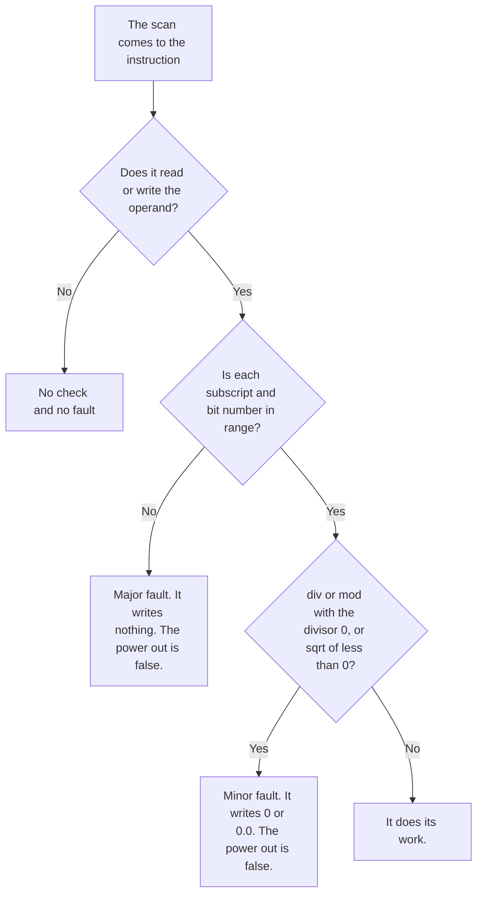
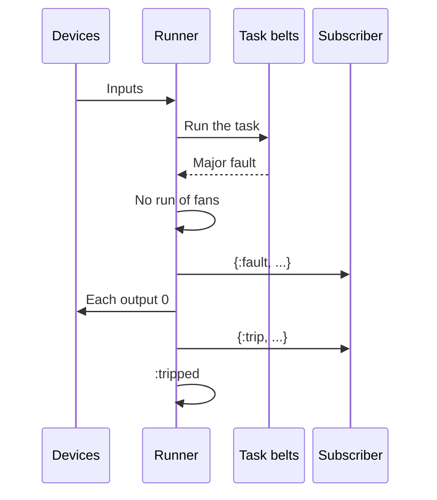

# Faults

This page is for a controls engineer or an Elixir developer. It is for the reader who
looks up what logex does when a running [program](glossary.md#program) meets a bad value.

The page defines these items:

- the 4 faults and the fields of a fault
- what a scan, a [cycle](glossary.md#cycle) and the runner do after each fault
- where the [host](glossary.md#host) finds each fault

A [fault](glossary.md#fault) is an error that a [scan](glossary.md#scan) finds while it
runs, for example a division by 0. It is not a [diagnostic](glossary.md#diagnostic). The
compiler finds a diagnostic in the source text, and that program does not run.

> #### Warning {: .warning}
>
> Do not use a fault or a [trip](glossary.md#trip) as a
> [safety function](glossary.md#safety-function). logex is not a safety controller, and it
> can stop at any time. A trip writes the value 0 to each [output](glossary.md#output)
> 1 time, if the device of the output can still take a write. If a device hangs, or if
> the Erlang VM stops, no part of logex writes the outputs.

[Trips and watchdogs](../explanation/trips-and-watchdogs.md) tells why a major fault trips
the plant.

Each example on this page is a script, with each line that it prints. Each `elixir` block
is the file under `examples/` that its `$ mix run` line names. To run a script, enter its
command in the directory `examples` of the repository. That directory is a Mix project,
and logex is its dependency. Each script reads its files from the directory `faults`
under the directory in which you run it. [Your first program](../tutorials/first-program.md)
shows how to make a new Mix project with logex as a dependency.

## The 4 faults

| Fault | Rule |
|---|---|
| `:divide_by_zero` | [Minor](glossary.md#minor-fault). The divisor of `div` or `mod` is 0. The instruction writes 0, or 0.0 to a real. |
| `:negative_sqrt` | Minor. The source of `sqrt` is less than 0. The instruction writes 0.0. |
| `:index_out_of_range` | [Major](glossary.md#major-fault). A [subscript](glossary.md#subscript) in a [tag](glossary.md#tag) is out of range. The instruction writes nothing. |
| `:bit_out_of_range` | Major. A [bit](glossary.md#bit) number in a tag is out of range. The instruction writes nothing. |

After each fault, the power out of the instruction is false.

| Severity | What logex does |
|---|---|
| Minor | The scan continues. A [runner](glossary.md#runner) does not trip. |
| Major | The scan continues. A runner trips the [plant](glossary.md#plant) at the end of the run of the [task](glossary.md#task). |

### Example: the 4 faults in 1 program

The program `panel.ld` has 1 [rung](glossary.md#rung) for each fault. Each rung ends with a
[coil](glossary.md#coil) that shows the power out of the [instruction](glossary.md#instruction) before it.

<!-- file: faults/panel.ld -->
```text
// The panel of the line. Each rung can find 1 of the 4 faults.
var_input  boxes      dint
var_input  minutes    dint
var_input  pressure   real
var_input  drive      word
var_input  sel        int
var_input  zone       int
var_output per_minute dint
var_output rate_ok    bool
var_output fan_speed  real
var_output fan_ok     bool
var_output lamp       bool
var_output belt_sp    int
var_output belt_ok    bool
var        speeds     int[4] 100 200 300 400

// the box counter: the boxes in each minute
div boxes minutes per_minute ote rate_ok
// the fan: its speed is the square root of the pressure
sqrt pressure fan_speed ote fan_ok
// the lamp: the bit of the status word of the drive that sel selects
xic drive.[sel] ote lamp
// the conveyor: the speed of its zone
move speeds[zone] belt_sp ote belt_ok
```

<!-- rung: faults/panel.ld -->


The script `faults-scan.exs` runs 6 scans. Before each scan, it changes 1 [input](glossary.md#input) or more.
After each scan, it prints the outputs. Then it prints 1 line for each fault: the kind,
the severity, the instruction, the line and the field `read`.

```elixir
{:ok, panel} = Logex.compile_file("faults/panel.ld")

columns = ["per_minute", "rate_ok", "fan_speed", "fan_ok", "lamp", "belt_sp", "belt_ok"]
IO.puts(Enum.join([String.pad_trailing("scan", 17) | columns], " "))

# Runs 1 scan, then prints the outputs and each fault of the scan.
scan = fn state, label, inputs ->
  state = Logex.Runtime.put_inputs(panel, state, inputs)
  {outputs, state} = Logex.Runtime.scan(panel, state)
  values = for name <- columns, do: String.pad_leading("#{outputs[name]}", String.length(name))
  IO.puts(Enum.join([String.pad_trailing(label, 17) | values], " "))

  for fault <- state.faults do
    what = Enum.map_join([fault.kind, fault.severity, fault.instruction], " ", &inspect/1)
    IO.puts("  #{what} line #{fault.line} read #{inspect(fault.read)}")
  end

  state
end

first = %{"drive" => 0x0010, "sel" => 4, "zone" => 1}

state =
  Logex.Runtime.put_inputs(panel, Logex.Runtime.instance(panel), first)
  |> scan.("1 in range", %{"boxes" => 120, "minutes" => 2, "pressure" => 4.0})
  |> scan.("2 minutes 0", %{"minutes" => 0})
  |> scan.("3 pressure -0.25", %{"minutes" => 2, "pressure" => -0.25})
  |> scan.("4 sel 16", %{"pressure" => 4.0, "sel" => 16})
  |> scan.("5 zone 4", %{"sel" => 4, "zone" => 4})
  |> scan.("6 all 4", %{"minutes" => 0, "pressure" => -1.0, "sel" => -1, "zone" => -1})

IO.puts("The first fault of scan 6:")
IO.inspect(hd(state.faults))
```

```console
$ mix run faults-scan.exs
scan              per_minute rate_ok fan_speed fan_ok lamp belt_sp belt_ok
1 in range                60       1       2.0      1    1     200       1
2 minutes 0                0       0       2.0      1    1     200       1
  :divide_by_zero :minor :div line 18 read nil
3 pressure -0.25          60       1       0.0      0    1     200       1
  :negative_sqrt :minor :sqrt line 20 read -0.25
4 sel 16                  60       1       2.0      1    0     200       1
  :bit_out_of_range :major :xic line 22 read 16
5 zone 4                  60       1       2.0      1    1     200       0
  :index_out_of_range :major :move line 24 read {4}
6 all 4                    0       0       0.0      0    0     200       0
  :divide_by_zero :minor :div line 18 read nil
  :negative_sqrt :minor :sqrt line 20 read -1.0
  :bit_out_of_range :major :xic line 22 read -1
  :index_out_of_range :major :move line 24 read {-1}
The first fault of scan 6:
%Logex.Fault{
  severity: :minor,
  kind: :divide_by_zero,
  instruction: :div,
  path: nil,
  file: "faults/panel.ld",
  line: 18,
  read: nil
}
```

| Scan | What the result shows |
|---|---|
| 1 | All values are in range. No fault. |
| 2 | `div` writes 0 to `per_minute`, and its power out is false: `rate_ok` is 0. The other rungs run. |
| 3 | `sqrt` writes 0.0 to `fan_speed`, and its power out is false. `read` holds the source, -0.25. |
| 4 | `drive` has bits 0 to 15. The contact reads nothing and passes no power. Thus `ote lamp` writes 0. |
| 5 | `speeds` has the subscripts 0 to 3. `move` writes nothing: `belt_sp` keeps 200. Its power out is false. |
| 6 | 4 faults in 1 scan, in the sequence of the rungs. -1 is also out of range. |

## The fields of a fault

A fault is the struct `%Logex.Fault{}`. The last lines of the output of
`faults-scan.exs` show 1 fault with all its fields.

| Field | Value |
|---|---|
| `severity` | `:minor` or `:major` |
| `kind` | The name of the fault: `:divide_by_zero`, `:negative_sqrt`, `:index_out_of_range` or `:bit_out_of_range` |
| `instruction` | The [mnemonic](glossary.md#mnemonic) of the instruction that found the fault, as an atom, for example `:div`, `:xic` or `:cal` |
| `path` | `nil` for a rung of the program. For a rung in the body of a [function block](glossary.md#function-block), the name of the block instance, for example `"f1"`. For a function block in the body of another, each instance name from the outer one, for example `"s1.i"` |
| `file` | The file of the program or of the function block, as the loader read it, for example `"faults/panel.ld"`. `nil` for a rung that `Logex.compile/2` [compiled](glossary.md#compile) from a string |
| `line` | The line of the instruction in that file, for example `18` |
| `read` | What the scan read. For `:bit_out_of_range`, the bit number. For `:index_out_of_range`, each subscript of the element, the literal ones included. For `:negative_sqrt`, the source. For `:divide_by_zero`, `nil` |

The set of values of `kind` is open. A later version of logex can add a value.

## The rules of each fault

### `:divide_by_zero`

| Part | Rule |
|---|---|
| Severity | `:minor` |
| Instructions | `div` and `mod` |
| Cause | The divisor is 0, or 0.0, when the instruction runs on a [true rung](glossary.md#true-rung). |
| What the instruction writes | 0 to an integer destination, 0.0 to a real destination |
| Power out | False |
| `read` | `nil` |
| On a [false rung](glossary.md#false-rung) | No fault. The instruction divides nothing. |
| The compiler refuses | A [literal](glossary.md#literal) 0 or 0.0 as the divisor |

### `:negative_sqrt`

| Part | Rule |
|---|---|
| Severity | `:minor` |
| Instructions | `sqrt` |
| Cause | The source is less than 0 when the instruction runs on a true rung. |
| What the instruction writes | 0.0 |
| Power out | False |
| `read` | The source, for example `-0.25` |
| On a false rung | No fault |
| The compiler refuses | A literal source that is less than 0, for example `-4` or `-4.0` |

### `:index_out_of_range`

| Part | Rule |
|---|---|
| Severity | `:major` |
| Instructions | Each instruction with an operand that is an [element](glossary.md#element) with a tag as a subscript, for example `speeds[zone]`, `grid[1,zone]` or the [member](glossary.md#member) `lane_c[lane].cv` |
| Cause | When the instruction reads or writes the element, a subscript is less than 0, or more than the last subscript of its dimension. |
| What the instruction writes | Nothing. It does not run. |
| Power out | False |
| `read` | A tuple with each subscript, 1 for each dimension, the literal ones included: `{4}` for `speeds[zone]`, `{1, 3}` for `grid[1,zone]` |
| On a false rung | It depends on the instruction. See [When logex checks an operand](#when-logex-checks-an-operand). |
| The compiler refuses | A literal subscript outside its dimension, for example `speeds[4]`. This includes an element with a tag as another subscript, for example `grid[zone,3]`. |

### `:bit_out_of_range`

| Part | Rule |
|---|---|
| Severity | `:major` |
| Instructions | Each instruction with an operand that is a bit with its number in a tag, for example `drive.[sel]` |
| Cause | When the instruction reads or writes the bit, the number is less than 0, or more than the last bit of the tag. The table under this one gives the bits of each type. |
| What the instruction writes | Nothing. It does not run. |
| Power out | False |
| `read` | The bit number, for example `16` |
| On a false rung | It depends on the instruction. See [When logex checks an operand](#when-logex-checks-an-operand). |
| The compiler refuses | A literal bit number outside the bits of the type: `drive.16` and `drive.[16]` for the `word` `drive` |

| Type of the tag | Bit numbers |
|---|---|
| `sint`, `usint`, `byte` | 0 to 7 |
| `int`, `uint`, `word` | 0 to 15 |
| `dint`, `udint`, `dword` | 0 to 31 |
| `lint`, `ulint`, `lword` | 0 to 63 |

A `bool` and a real have no bits. The compiler refuses a bit of them.

These operands take only literal subscripts and a literal bit number. Thus they cannot
cause these 2 faults:

- the [storage bit](glossary.md#storage-bit) of a [one-shot](glossary.md#one-shot) and the
  [pulse bit](glossary.md#pulse-bit) of a [pulse coil](glossary.md#pulse-coil)
- the [instance](glossary.md#instance) that `ton`, `ctu`, `cal` or another instruction
  runs, for example `ton t[0]`
- the [preset](glossary.md#preset) of a [timer](glossary.md#timer) or a [counter](glossary.md#counter), which is a number

### Example: the rungs that the compiler refuses

The script `faults-refused.exs` compiles 6 programs. Each has the same
[declarations](glossary.md#declaration) and 1 rung. It prints each rung and its [diagnostics](glossary.md#diagnostic).

```elixir
# The tags of each rung. Each rung is 1 program: these lines and the rung.
tags = """
var_input  boxes   dint
var_input  drive   word
var_output rate    dint
var_output fan_sp  real
var_output lamp    bool
var_output belt_sp int
var        speeds  int[4]
var        grid    int[2,3]
var        zone    int
"""

rungs = [
  "div boxes 0 rate",
  "mod boxes 0 rate",
  "sqrt -4.0 fan_sp",
  "move speeds[4] belt_sp",
  "move grid[zone,3] belt_sp",
  "xic drive.[16] ote lamp"
]

for rung <- rungs do
  {:error, diagnostics} = Logex.compile(tags <> rung, name: "wrong")
  IO.puts(rung)
  for diagnostic <- diagnostics, do: IO.puts("  " <> Logex.Diagnostic.format(diagnostic))
end
```

```console
$ mix run faults-refused.exs
div boxes 0 rate
  line 10: `div` divides by the literal `0`: a zero divisor gives 0 and passes no power on every scan, so a literal one is refused
mod boxes 0 rate
  line 10: `mod` divides by the literal `0`: a zero divisor gives 0 and passes no power on every scan, so a literal one is refused
sqrt -4.0 fan_sp
  line 10: `sqrt` takes the root of the literal `-4.0`: a negative source gives 0.0, passes no power and raises a minor fault on every scan, so a literal one is refused
move speeds[4] belt_sp
  line 10: `speeds[4]`'s subscript `4` is outside the elements of `speeds`, 0 to 3: `speeds` is an array of 4 ints (declared on line 7)
move grid[zone,3] belt_sp
  line 10: `grid[zone,3]`'s subscript `3` is outside the second dimension of `grid`, 0 to 2: `grid` is an array of 2 by 3 ints (declared on line 8)
xic drive.[16] ote lamp
  line 10: `drive.[16]` names bit 16 of `drive`, a word (declared on line 2), which has bits 0 to 15
```

## What a scan does after a fault

A fault does not stop a scan. The scan runs to the last rung.

| Rule | Example |
|---|---|
| The instruction that found the fault passes no power. The next instruction on the rung runs with no power. | In `panel.ld`, `ote lamp` writes 0 after the fault of `xic drive.[sel]`. |
| The next rungs run. | Scan 4 of `faults-scan.exs`: the other 3 rungs write their outputs. |
| 1 instruction finds 1 fault or none. logex checks the operands first. If an operand is out of range, the instruction does not run, and logex does not check the divisor or the source. | Cases 10 and 11 of `faults-checks.exs` |
| The faults are in the sequence in which the scan found them. | Scan 6 of `faults-scan.exs`, and case 12 of `faults-checks.exs` |
| The field `faults` of the [state](glossary.md#state) holds the faults of the last scan only. Each scan replaces the list. It is `[]` if the scan found no fault. In a new state from `Logex.Runtime.instance/1`, `faults` is `[]`. `put_inputs/3` and `restart/3` do not change the list. | Scan 1 of `faults-scan.exs` |

### When logex checks an operand

logex reads a tag that is a subscript or a bit number only when the instruction reads or
writes the element or the bit. An instruction that does not read or write its
[operand](glossary.md#operand) checks nothing, and thus finds no fault.

| Instruction | Does logex check the operand? |
|---|---|
| An instruction on a true rung | Yes |
| A [contact](glossary.md#contact) on a false rung | No. It reads nothing. |
| A comparison or `move` on a false rung | No. It reads nothing. |
| `otl` or `otu` on a false rung | No. It writes nothing. |
| `ote` on a false rung | Yes. It writes 0. |
| `div`, `mod` or `sqrt` on a false rung | No. It does not run. |
| `cal` on a false rung | No. The body does not run. |
| An instruction on a rung that a [jump](glossary.md#jump) passes | No. The rung does not run. |

In an element with a bit number in a tag, for example `words[zone].[sel]`, logex checks
the subscripts first. If a subscript is out of range, the fault is `:index_out_of_range`,
and logex does not check the bit number.



Figure 1: the checks of 1 instruction, from top to bottom. A major fault stops the
instruction before it runs. A minor fault comes from a value that the instruction reads:
a divisor of 0, or a source less than 0.

### Example: when logex checks an operand

The script `faults-checks.exs` compiles 12 programs. Each has the declarations of the
string `tags` and the rungs of 1 case. The script runs 1 scan of each program, with the
inputs that the case gives. Then it prints the faults of the scan. In case 6, a slash
separates the rungs.

```elixir
# The tags of each case. Each case is 1 program: these lines and its rungs.
tags = """
var_input  run     bool
var_input  zone    int
var_input  sel     int
var_input  boxes   dint
var_input  minutes dint
var_output lamp    bool
var_output rate    dint
var_output belt_sp int
var        lamps   bool[4]
var        status  word
var        words   word[4]
var        grid    int[2,3]
var        speeds  int[4]
var        rates   dint[4]
"""

cases = [
  {"xic run xic status.[sel] ote lamp", %{"run" => 0, "sel" => 16}},
  {"xic run xic status.[sel] ote lamp", %{"run" => 1, "sel" => 16}},
  {"xic run otl lamps[zone]", %{"run" => 0, "zone" => 9}},
  {"xic run ote lamps[zone]", %{"run" => 0, "zone" => 9}},
  {"xic run div boxes minutes rate", %{"run" => 0, "minutes" => 0}},
  {"xio run jmp skip\nxic lamps[zone] ote lamp\nlbl skip", %{"run" => 0, "zone" => 9}},
  {"xic words[zone].[sel] ote lamp", %{"zone" => 9, "sel" => 16}},
  {"xic words[zone].[sel] ote lamp", %{"zone" => 1, "sel" => 16}},
  {"move grid[1,zone] belt_sp", %{"zone" => 3}},
  {"move speeds[zone] speeds[sel]", %{"zone" => 9, "sel" => 16}},
  {"div boxes minutes rates[zone]", %{"minutes" => 0, "zone" => 9}},
  {"( xic lamps[zone] | xic status.[sel] ) ote lamp", %{"zone" => 9, "sel" => 16}}
]

# Prints each fault of a scan, or "no fault".
report = fn
  [] ->
    IO.puts("   no fault")

  faults ->
    for fault <- faults do
      IO.puts(
        "   #{inspect(fault.kind)} #{inspect(fault.instruction)} read #{inspect(fault.read)}"
      )
    end
end

for {{rungs, inputs}, number} <- Enum.with_index(cases, 1) do
  {:ok, program} = Logex.compile(tags <> rungs, name: "case")
  state = Logex.Runtime.put_inputs(program, Logex.Runtime.instance(program), inputs)
  {_outputs, state} = Logex.Runtime.scan(program, state)
  given = Enum.map_join(Enum.sort(inputs), " ", fn {name, value} -> "#{name}=#{value}" end)
  IO.puts("#{number}. #{String.replace(rungs, "\n", " / ")}   #{given}")
  report.(state.faults)
end
```

```console
$ mix run faults-checks.exs
1. xic run xic status.[sel] ote lamp   run=0 sel=16
   no fault
2. xic run xic status.[sel] ote lamp   run=1 sel=16
   :bit_out_of_range :xic read 16
3. xic run otl lamps[zone]   run=0 zone=9
   no fault
4. xic run ote lamps[zone]   run=0 zone=9
   :index_out_of_range :ote read {9}
5. xic run div boxes minutes rate   minutes=0 run=0
   no fault
6. xio run jmp skip / xic lamps[zone] ote lamp / lbl skip   run=0 zone=9
   no fault
7. xic words[zone].[sel] ote lamp   sel=16 zone=9
   :index_out_of_range :xic read {9}
8. xic words[zone].[sel] ote lamp   sel=16 zone=1
   :bit_out_of_range :xic read 16
9. move grid[1,zone] belt_sp   zone=3
   :index_out_of_range :move read {1, 3}
10. move speeds[zone] speeds[sel]   sel=16 zone=9
   :index_out_of_range :move read {9}
11. div boxes minutes rates[zone]   minutes=0 zone=9
   :index_out_of_range :div read {9}
12. ( xic lamps[zone] | xic status.[sel] ) ote lamp   sel=16 zone=9
   :index_out_of_range :xic read {9}
   :bit_out_of_range :xic read 16
```

| Case | What the result shows |
|---|---|
| 1 and 2 | The contact on `status.[sel]` checks the bit number only on a true rung. |
| 3 and 4 | On a false rung, `otl` writes nothing and checks nothing. `ote` writes 0, and thus checks the subscript. |
| 5 | On a false rung, `div` does not divide. No fault. |
| 6 | `jmp` passes the rung with `lamps[zone]`. No fault. |
| 7 and 8 | logex checks the subscript of `words[zone].[sel]` before the bit number. |
| 9 | `read` holds each subscript, the literal 1 included. |
| 10 | 2 operands are out of range. `move` gives 1 fault, for its first operand. |
| 11 | The destination is out of range, and the divisor is 0. `div` gives only `:index_out_of_range`. |
| 12 | Each [leg](glossary.md#leg) of a [branch](glossary.md#branch) runs. The 2 faults are in the sequence of the legs. |

## A fault in a function block

### A fault in the body

| Part | Rule |
|---|---|
| The fault | The fault of the instruction in the body |
| `path` | The name of the instance |
| `file` and `line` | The file of the function block, and the line in that file |
| What `cal` does | The rest of the body runs. Then `cal` writes the outputs of the block. |
| Power out of `cal` | True |

If a function block runs in the body of a function block, `path` names each instance,
from the outer one. For example, `"s1.i"` is the instance `i` in the body of `s1`.

### A fault of an operand of `cal`

| Part | Rule |
|---|---|
| Cause | An operand of `cal` has a tag as a subscript or as a bit number, and the value of the tag is out of range. |
| The fault | `:index_out_of_range` or `:bit_out_of_range`, with the instruction `:cal` |
| `path` | `nil` |
| `file` and `line` | The file of the program, and the line of the `cal` |
| What `cal` does | It copies nothing in, it does not run the body, and it writes no output. Each output tag keeps its value. |
| Power out of `cal` | False |

### Example: a fault in the body and a fault of `cal`

The function block `fan_speed` gives the speed of a fan from a pressure. The program
`fans.ld` runs 2 instances of it.

<!-- file: faults/fan_speed.ld -->
```text
// A fan speed: `speed` is the square root of `pressure`.
function_block fan_speed
var_input  pressure real
var_output speed    real
var_output ok       bool

sqrt pressure speed ote ok
```

<!-- file: faults/fans.ld -->
```text
// 2 fans. `f2` runs while `auto` is 1, and `fan` selects its pressure.
var_input  p_1     real
var_input  auto    bool
var_input  fan     int
var_input  ps      real[2]
var_output speed_1 real
var_output ok_1    bool
var_output ran_1   bool
var_output speed_2 real
var_output ok_2    bool
var_output ran_2   bool
var        f1      fan_speed
var        f2      fan_speed

cal f1 p_1 speed_1 ok_1 ote ran_1
xic auto cal f2 ps[fan] speed_2 ok_2 ote ran_2
```

The script `faults-blocks.exs` runs 4 scans of `fans.ld`. After each scan, it prints the
outputs and each fault.

```elixir
{:ok, fans} = Logex.compile_file("faults/fans.ld")

# Runs 1 scan, then prints the outputs and each fault of the scan.
scan = fn state, label, inputs ->
  state = Logex.Runtime.put_inputs(fans, state, inputs)
  {outputs, state} = Logex.Runtime.scan(fans, state)
  IO.puts("#{label}  #{inspect(outputs)}")
  for fault <- state.faults, do: IO.inspect(fault)
  state
end

Logex.Runtime.instance(fans)
|> scan.("1 in range ", %{"p_1" => 9.0, "auto" => 1, "fan" => 1, "ps" => [4.0, 16.0]})
|> scan.("2 p_1 -1.0 ", %{"p_1" => -1.0})
|> scan.("3 fan 2    ", %{"p_1" => 9.0, "fan" => 2})
|> scan.("4 auto 0   ", %{"auto" => 0})
```

```console
$ mix run faults-blocks.exs
1 in range   %{"ok_1" => 1, "ok_2" => 1, "ran_1" => 1, "ran_2" => 1, "speed_1" => 3.0, "speed_2" => 4.0}
2 p_1 -1.0   %{"ok_1" => 0, "ok_2" => 1, "ran_1" => 1, "ran_2" => 1, "speed_1" => 0.0, "speed_2" => 4.0}
%Logex.Fault{
  severity: :minor,
  kind: :negative_sqrt,
  instruction: :sqrt,
  path: "f1",
  file: "faults/fan_speed.ld",
  line: 7,
  read: -1.0
}
3 fan 2      %{"ok_1" => 1, "ok_2" => 1, "ran_1" => 1, "ran_2" => 0, "speed_1" => 3.0, "speed_2" => 4.0}
%Logex.Fault{
  severity: :major,
  kind: :index_out_of_range,
  instruction: :cal,
  path: nil,
  file: "faults/fans.ld",
  line: 16,
  read: {2}
}
4 auto 0     %{"ok_1" => 1, "ok_2" => 1, "ran_1" => 1, "ran_2" => 0, "speed_1" => 3.0, "speed_2" => 4.0}
```

| Scan | What the result shows |
|---|---|
| 2 | The `sqrt` in the body of `f1` finds the fault. `path` is `"f1"`, and `file` and `line` give the line in `fan_speed.ld`. `cal f1` writes the outputs: `speed_1` is 0.0 and `ok_1` is 0. The power out of `cal` is true: `ran_1` is 1. |
| 3 | `ps` has the subscripts 0 and 1. The operand `ps[fan]` of `cal f2` is out of range. The body does not run: `speed_2` keeps 4.0, and `ok_2` keeps 1. The power out of `cal` is false: `ran_2` is 0. |
| 4 | `cal f2` is on a false rung. The body does not run, and logex does not check `ps[fan]`. |

> #### Caution {: .error}
>
> Do not read an output of a block as a sign that its body ran. After a fault of an
> operand of `cal`, each output keeps the value of the last run. In scan 3, `ok_2` stays 1.

## Where the host finds a fault

An event is 1 item of the list that `Logex.Runtime.cycle/3` gives, and that a runner
sends to its subscribers. For example, `{:ran, task, instance, now}` is the event of 1
scan. A fault gives the event `{:fault, task, instance, fault}`.

| The host runs | Where the faults are |
|---|---|
| `scan/2`, `scan/3` or `call/4` on 1 [instance](glossary.md#instance) | The field `faults` of the state that the call gives |
| `cycle/3` on a [resource](glossary.md#resource) | An event `{:fault, ...}` in the list of events, directly after the event `{:ran, ...}` of its scan |
| A runner | The same event, sent as `{Logex.Runner, runner, event}` to each subscriber of the event kind `:fault`. `subscribe/1` subscribes to the `:fault` events by default. |

`scan/2`, `scan/3`, `call/4` and `cycle/3` are functions of `Logex.Runtime`.
`subscribe/1` is a function of `Logex.Runner`.

In an event `{:fault, task, instance, fault}`:

- `task` is the name of the task. For a program instance in the
  [continuous task](glossary.md#continuous-task), or with no task, it is the name of the
  continuous task. If the configuration has no continuous task, it is `:none`.
- `instance` is the name of the program instance. For a fault in a function block, join
  `instance` and `path` with a full stop to get the full name. For example, `"m1"` and
  `"s1.i"` give `m1.s1.i`.

A major fault does not stop a cycle. The cycle runs each task that is
[due](glossary.md#due). The host gets the events and decides what to do. Only the runner
trips.

### Example: faults in a cycle

The [configuration](glossary.md#configuration) `line.logex` runs the program
`conveyor.ld` on the task `belts` and the program `fan.ld` on the task `fans`. Both tasks
have an interval of 10 ms. The task `belts` has the [priority](glossary.md#priority) 1,
which is higher than 2, the priority of `fans`. Thus `belts` runs first.

The operator sets the zone of the conveyor with `sel`. While `set` is 1, the program
copies `sel` to the tag `zone`. The [qualifier](glossary.md#qualifier) `retain` keeps `zone` across a
[warm restart](glossary.md#warm-restart).

<!-- file: faults/line.logex -->
```text
// The conveyor and its fan on 1 panel
task belts interval 10 priority 1
task fans  interval 10 priority 2

var_global run     bool at panel.i.0
var_global sel     int  at panel.i.1
var_global set     bool at panel.i.2
var_global boxes   dint at panel.i.3
var_global minutes dint at panel.i.4
var_global motor_k bool at panel.q.0
var_global speed   int  at panel.q.1
var_global rate    dint at panel.q.2
var_global fan_k   bool at panel.q.3

program c1 conveyor with belts
  c1.run     run
  c1.sel     sel
  c1.set     set
  c1.boxes   boxes
  c1.minutes minutes
  c1.motor   motor_k
  c1.speed   speed
  c1.rate    rate

program f1 fan with fans
  f1.belt motor_k
  f1.fan  fan_k
```

<!-- file: faults/conveyor.ld -->
```text
// The conveyor runs at the speed of the zone that the operator sets.
var_input  run     bool
var_input  sel     int
var_input  set     bool
var_input  boxes   dint
var_input  minutes dint
var_output motor   bool
var_output speed   int
var_output rate    dint
var retain zone    int
var        speeds  int[4] 100 200 300 400

xic run ote motor
xic set move sel zone
move speeds[zone] speed
xic run div boxes minutes rate
```

<!-- file: faults/fan.ld -->
```text
// The fan runs while the conveyor runs. `runs` counts the scans.
var_input  belt bool
var_output fan  bool
var        runs dint

xic belt ote fan
add runs 1 runs
```

The script `faults-cycle.exs` runs 3 cycles of the resource, with no runner. It prints the
outputs of each cycle, and then each event.

```elixir
{:ok, line} = Logex.Configuration.compile_file("faults/line.logex")

# Runs 1 cycle, elapsed ms after the last, then prints the outputs and each event.
cycle = fn resource, label, elapsed, inputs ->
  {resource, outputs, events} = Logex.Runtime.cycle(resource, elapsed, inputs)
  IO.puts("#{label}: #{inspect(outputs)}")
  for event <- events, do: IO.inspect(event)
  resource
end

Logex.Runtime.start(line)
|> cycle.("cycle 1", 0, %{"run" => 1, "boxes" => 120, "minutes" => 0})
|> cycle.("cycle 2", 10, %{"minutes" => 2, "sel" => 4, "set" => 1})
|> cycle.("cycle 3", 10, %{"sel" => 2})
```

```console
$ mix run faults-cycle.exs
cycle 1: %{"fan_k" => 1, "motor_k" => 1, "rate" => 0, "speed" => 100}
{:ran, "belts", "c1", 0}
{:fault, "belts", "c1",
 %Logex.Fault{
   severity: :minor,
   kind: :divide_by_zero,
   instruction: :div,
   path: nil,
   file: "faults/conveyor.ld",
   line: 16,
   read: nil
 }}
{:ran, "fans", "f1", 0}
cycle 2: %{"fan_k" => 1, "motor_k" => 1, "rate" => 60, "speed" => 100}
{:ran, "belts", "c1", 10}
{:fault, "belts", "c1",
 %Logex.Fault{
   severity: :major,
   kind: :index_out_of_range,
   instruction: :move,
   path: nil,
   file: "faults/conveyor.ld",
   line: 15,
   read: {4}
 }}
{:ran, "fans", "f1", 10}
cycle 3: %{"fan_k" => 1, "motor_k" => 1, "rate" => 60, "speed" => 300}
{:ran, "belts", "c1", 20}
{:ran, "fans", "f1", 20}
```

| Cycle | What the result shows |
|---|---|
| 1 | `minutes` is 0. The minor fault comes after the event `{:ran, ...}` of `c1`. The task `fans` runs. |
| 2 | `zone` is 4. The major fault comes after the event `{:ran, ...}` of `c1`. The task `fans` runs also, and the cycle gives its outputs. `speed` keeps 100. |
| 3 | `sel` is 2, and `set` stays 1. Thus `zone` is 2 and `speed` is 300. The resource runs as before the fault. |

## What the runner does

### After a minor fault

The runner sends the event `{:fault, ...}` to each subscriber of the event kind `:fault`.
It does not trip. It writes the outputs of the round to the [devices](glossary.md#device), as
after a round with no fault.

### After a major fault

When a run of a task finds a major fault, the runner trips the plant. These are the
actions, in sequence:

| Order | What the runner does |
|---|---|
| 1 | The run of the task continues to its end. Each instance of the task scans, also after the fault. |
| 2 | The runner runs no later task of the [round](glossary.md#round). For a tag of a later task, `get/2` gives the value of the round before. |
| 3 | The runner does not write the outputs of the round to the devices. |
| 4 | It sends each event of the round to the subscribers. Each `{:fault, ...}` event is among them. |
| 5 | It writes the value 0 to each output 1 time, if the device of the output can still take a write. Then the runner writes nothing more to the devices until a restart. |
| 6 | It sends `{:trip, {:fault, task, instance, fault}}` to each subscriber of the event kind `:trip`. The reason names the first major fault of the round. It names `task` as an event does. If the run of the task also took longer than its [watchdog](glossary.md#watchdog), the reason still names the fault. |
| 7 | `Logex.Runner.status/1` gives the status `:tripped` and the reason in `trip`. `rounds` does not count the round that tripped. |
| 8 | The runner runs no round until `Logex.Runner.restart/2`. |



Figure 2: a round that finds a major fault in the task `belts`, from top to bottom. The
runner does not run the task `fans`. The devices never get the outputs of that round.
They get 0 for each output 1 time, and then the subscriber gets the trip. The status
stays `:tripped` until `restart/2`.

If the runner keeps a [store](glossary.md#store), the trip also writes the store, with the
retained values of the round that tripped.
[The store](store.md) gives the rules of the
store.

### After the trip

`Logex.Runner.restart/2` starts the plant again. This is a [restart](glossary.md#restart).

| Call | What it does |
|---|---|
| `restart(runner, :cold)` | Each tag gets its [initial value](glossary.md#initial-value). |
| `restart(runner, :warm)` | Each tag with the qualifier `retain` keeps its value, and each retained member of a function block instance also. Each other tag gets its initial value. |
| Both | The runner reads each device again. It sends `{:restart, :cold}` or `{:restart, :warm}` to the subscribers. Then it runs the first round before `restart/2` returns. If the cause of the fault is still there, that round trips the plant again, but `restart/2` still gives `:ok`. |

[Restart after a trip](../howto/restart-after-a-trip.md) gives the steps.
[Runner](runner.md) gives each reason of a trip and each error of `restart/2`.

### A retained value that trips the plant again

If a retained tag holds the value that caused a major fault, the plant trips again in
the first round after each of these starts:

- a warm restart, `restart(runner, :warm)`
- a new runner that starts warm from the store

3 changes stop the trip. The how-to guides give the steps.

| Change | What it does | The steps |
|---|---|---|
| A [cold restart](glossary.md#cold-restart) | Each tag gets its initial value. logex discards each retained value, the correct ones included. | [Restart after a trip](../howto/restart-after-a-trip.md) |
| An [online edit](glossary.md#online-edit), then a warm restart | The edit adds a rung that writes a correct value before the rung that faults. logex [accepts](glossary.md#accept) and [tests](glossary.md#test) an edit while the status is `:tripped`. The warm restart keeps the retained values, and the new rung corrects the bad one. The restart does not end the edit. The edit ends when you [assemble](glossary.md#assemble) it. | [Restart after a trip](../howto/restart-after-a-trip.md) |
| An edit of the store, with the runner stopped | The value on the line of the tag changes, for example from `c1.zone int 4` to `c1.zone int 1`. A new runner starts warm from the store. The last line of the store gives its number of lines, for example `end 8 lines`. A new runner refuses a store with a different number of lines. | [Edit the store by hand](../howto/edit-the-store-by-hand.md) |

> #### Caution {: .error}
>
> A stop of a runner writes the store. A runner holds the values in memory, also while
> its status is `:tripped`. If you edit the store while the runner runs, the stop writes
> the old values over your edit.

### Example: a trip on the manual clock

The script `faults-runner.exs` runs `line.logex` on a [runner](glossary.md#runner) with
the manual [clock](glossary.md#clock) and 1 [simulated device](glossary.md#simulated-device),
`panel`. It subscribes to the events of the runner. After each step, it prints the
status, the number of rounds, 2 tags, the outputs of the panel and the trip. Then it
prints each event that arrived. In an event and in the trip, the script prints only the
`kind` of a fault. In step 3, it prints the trip whole.

| [Point](glossary.md#point) | Tag |
|---|---|
| `panel.i.0` | `run` |
| `panel.i.1` | `sel` |
| `panel.i.2` | `set` |
| `panel.i.3` | `boxes` |
| `panel.i.4` | `minutes` |
| `panel.q.0` | `motor_k` |
| `panel.q.1` | `speed` |
| `panel.q.2` | `rate` |
| `panel.q.3` | `fan_k` |

The tag `runs` of `f1` counts the scans of `fan.ld`.

```elixir
alias Logex.Runner
alias Logex.Runner.Clock.Manual
alias Logex.IO.Sim

{:ok, line} = Logex.Configuration.compile_file("faults/line.logex")
{:ok, clock} = Manual.start_link()
{:ok, panel} = Sim.start_link(reports: true, clock: clock)

{:ok, runner} =
  Runner.start_link(
    configuration: line,
    io: %{"panel" => {Sim, sim: panel}},
    clock: {Manual, clock}
  )

:ok = Runner.subscribe(runner)

# Gives an event or a trip with the kind of its fault in place of the fault.
short = fn
  {:fault, task, instance, fault} -> {:fault, task, instance, fault.kind}
  {:trip, {:fault, task, instance, fault}} -> {:trip, {:fault, task, instance, fault.kind}}
  other -> other
end

# Prints the status, 2 tags, the outputs of the panel, the trip and each new event.
show = fn label ->
  %{status: status, rounds: rounds, trip: trip} = Runner.status(runner)
  zone = Runner.get!(runner, "c1.zone")
  runs = Runner.get!(runner, "f1.runs")
  IO.puts("#{label}: #{status}, rounds=#{rounds}, zone=#{zone}, runs=#{runs}")
  IO.puts("  outputs #{inspect(Sim.outputs(panel))}")
  IO.puts("  trip #{inspect(short.(trip))}")

  {:messages, messages} = Process.info(self(), :messages)
  for {Runner, ^runner, event} <- messages, do: IO.puts("  event #{inspect(short.(event))}")
  for {Runner, ^runner, _event} <- messages, do: receive(do: ({Runner, ^runner, _} -> :ok))
end

Sim.set(panel, "panel.i.0", 1)
Sim.set(panel, "panel.i.3", 120)
Manual.advance(clock, 10)
show.("1 run, minutes 0")

Sim.set(panel, "panel.i.4", 2)
Manual.advance(clock, 10)
show.("2 minutes 2")

Sim.set(panel, "panel.i.1", 4)
Sim.set(panel, "panel.i.2", 1)
Manual.advance(clock, 10)
show.("3 zone 4")
IO.puts("  last write #{inspect(List.last(Sim.writes(panel)))}")
IO.inspect(Runner.status(runner).trip)

writes = length(Sim.writes(panel))
Manual.advance(clock, 100)
show.("4 100 ms later")
IO.puts("  writes since step 3: #{length(Sim.writes(panel)) - writes}")

Sim.set(panel, "panel.i.2", 0)
:ok = Runner.restart(runner, :warm)
show.("5 warm restart")

:ok = Runner.restart(runner, :cold)
show.("6 cold restart")
:ok = Runner.stop(runner)
```

```console
$ mix run faults-runner.exs
1 run, minutes 0: running, rounds=2, zone=0, runs=2
  outputs %{"panel.q.0" => 1, "panel.q.1" => 100, "panel.q.2" => 0, "panel.q.3" => 1}
  trip nil
  event {:fault, "belts", "c1", :divide_by_zero}
2 minutes 2: running, rounds=3, zone=0, runs=3
  outputs %{"panel.q.0" => 1, "panel.q.1" => 100, "panel.q.2" => 60, "panel.q.3" => 1}
  trip nil
3 zone 4: tripped, rounds=3, zone=4, runs=3
  outputs %{"panel.q.0" => 0, "panel.q.1" => 0, "panel.q.2" => 0, "panel.q.3" => 0}
  trip {:fault, "belts", "c1", :index_out_of_range}
  event {:fault, "belts", "c1", :index_out_of_range}
  event {:trip, {:fault, "belts", "c1", :index_out_of_range}}
  last write %{"panel.q.0" => 0, "panel.q.1" => 0, "panel.q.2" => 0, "panel.q.3" => 0}
{:fault, "belts", "c1",
 %Logex.Fault{
   severity: :major,
   kind: :index_out_of_range,
   instruction: :move,
   path: nil,
   file: "faults/conveyor.ld",
   line: 15,
   read: {4}
 }}
4 100 ms later: tripped, rounds=3, zone=4, runs=3
  outputs %{"panel.q.0" => 0, "panel.q.1" => 0, "panel.q.2" => 0, "panel.q.3" => 0}
  trip {:fault, "belts", "c1", :index_out_of_range}
  writes since step 3: 0
5 warm restart: tripped, rounds=3, zone=4, runs=0
  outputs %{"panel.q.0" => 0, "panel.q.1" => 0, "panel.q.2" => 0, "panel.q.3" => 0}
  trip {:fault, "belts", "c1", :index_out_of_range}
  event {:restart, :warm}
  event {:fault, "belts", "c1", :index_out_of_range}
  event {:trip, {:fault, "belts", "c1", :index_out_of_range}}
6 cold restart: running, rounds=4, zone=0, runs=1
  outputs %{"panel.q.0" => 1, "panel.q.1" => 100, "panel.q.2" => 60, "panel.q.3" => 1}
  trip nil
  event {:restart, :cold}
```

| Step | What the result shows |
|---|---|
| 1 | The runner runs 1 round when it starts, before the script sets the inputs. In that round, `run` is 0, thus `div` does not run. After 10 ms, the second round runs with `minutes` at 0: a minor fault. The runner sends the event and does not trip. It writes the outputs, with `rate` at 0. `rounds` is 2. |
| 2 | `rate` is 60. |
| 3 | `zone` is 4: a major fault. The runner trips. It writes 0 to each output. `rounds` stays 3, and `runs` stays 3: the task `fans` did not run in the round that tripped. `get/2` gives `zone` at 4. |
| 4 | While the status is `:tripped`, the runner runs no round and writes nothing. |
| 5 | The script sets `set` to 0 first. Thus only the retained value of `zone` can cause the fault. The restart sends `{:restart, :warm}`. A warm restart keeps the retained `zone` at 4. The first round trips again. `runs` is 0, because a restart gives `runs` its initial value and the task `fans` did not run. |
| 6 | The restart sends `{:restart, :cold}`. A cold restart gives `zone` its initial value, 0. The plant runs. |

### Example: a subscript in a tag, in a scan and in a plant

A box counter weighs each box into the slot that the panel gives. The program is the
file `examples/scales.ld` of the repository.

<!-- file: scales.ld -->
```text
var_input  eye    bool
var_input  weight int
var_input  slot   int
var_output last   int
var_output heavy  bool
var weights int[8]
var edge    bool
var p       bool

xic eye ons edge ote p
xic p move weight weights[slot]
move weights[slot] last
gt weights[slot] 500 ote heavy
```

The script `scales.exs` runs scans with the slots 2, 5 and 8. Then it runs the program in
a plant on the manual clock, and moves the slot to 8. Then it reads a grid by a tag
subscript. Last, it compiles 4 wrong rungs and prints each diagnostic.

```elixir
{:ok, scales} = Logex.compile_file("scales.ld")

scan = fn state, label, inputs ->
  state = Logex.Runtime.put_inputs(scales, state, inputs)
  {outputs, state} = Logex.Runtime.scan(scales, state)
  IO.puts("#{label}  #{inspect(outputs)}  weights #{inspect(state.env["weights"])}")
  for fault <- state.faults, do: IO.puts("    #{inspect(fault)}")
  state
end

Logex.Runtime.instance(scales)
|> scan.("slot 2          ", %{"eye" => 0, "weight" => 0, "slot" => 2})
|> scan.("box 620, slot 2 ", %{"eye" => 1, "weight" => 620})
|> scan.("gone            ", %{"eye" => 0})
|> scan.("box 410, slot 5 ", %{"eye" => 1, "weight" => 410, "slot" => 5})
|> scan.("gone, slot 2    ", %{"eye" => 0, "slot" => 2})
|> scan.("slot 8          ", %{"slot" => 8})

{:ok, plant} =
  Logex.Configuration.compile(
    "plant",
    """
    task fast interval 10 priority 1
    var_global box_eye    bool at panel.i.0
    var_global box_slot   int  at panel.i.1
    var_global box_weight int  at drive.i.0
    var_global box_heavy  bool at panel.q.0
    program scales scales with fast
      scales.eye    box_eye
      scales.weight box_weight
      scales.slot   box_slot
      scales.heavy  box_heavy
    """,
    %{"scales" => scales}
  )

{:ok, clock} = Logex.Runner.Clock.Manual.start_link()
{:ok, panel} = Logex.IO.Sim.start_link(reports: true, clock: clock)
{:ok, drive} = Logex.IO.Sim.start_link(clock: clock)

{:ok, runner} =
  Logex.Runner.start_link(
    configuration: plant,
    io: %{"panel" => {Logex.IO.Sim, sim: panel}, "drive" => {Logex.IO.Sim, sim: drive}},
    clock: {Logex.Runner.Clock.Manual, clock}
  )

Logex.IO.Sim.set(drive, "drive.i.0", 730)
Logex.IO.Sim.set(panel, %{"panel.i.0" => 1, "panel.i.1" => 4})
Logex.Runner.Clock.Manual.advance(clock, 10)
IO.puts("box 730 in slot 4: the lamp #{inspect(Logex.IO.Sim.outputs(panel))}")
Logex.IO.Sim.set(panel, "panel.i.1", 8)
Logex.Runner.Clock.Manual.advance(clock, 10)
IO.puts("slot 8: the lamp #{inspect(Logex.IO.Sim.outputs(panel))}, #{inspect(Logex.Runner.status(runner).status)}")
IO.puts("    #{inspect(Logex.Runner.status(runner).trip)}")
Logex.Runner.stop(runner)

{:ok, grid} =
  Logex.compile("var_input c int\nvar grid int[4,8]\nvar_output x int\nmove grid[1,c] x", name: "grid")

{_outputs, state} =
  Logex.Runtime.scan(grid, Logex.Runtime.put_inputs(grid, Logex.Runtime.instance(grid), %{"c" => 9}))

IO.puts("grid[1,c] at c 9: #{inspect(state.faults)}")

{:error, diagnostics} =
  Logex.compile(
    "var weights int[8]\nvar grid int[4,8]\nvar edge bool[8]\nvar slot int\nvar code word\n" <>
      "var x int\nvar on bool\n" <>
      "move weights[code] x\nmove grid[slot,8] x\nxic on ons edge[slot] ote on\n" <>
      "move weights[sloot] x",
    name: "wrong"
  )

for diagnostic <- diagnostics, do: IO.puts(Logex.Diagnostic.format(diagnostic))
```

```console
$ mix run scales.exs
slot 2            %{"heavy" => 0, "last" => 0}  weights {0, 0, 0, 0, 0, 0, 0, 0}
box 620, slot 2   %{"heavy" => 1, "last" => 620}  weights {0, 0, 620, 0, 0, 0, 0, 0}
gone              %{"heavy" => 1, "last" => 620}  weights {0, 0, 620, 0, 0, 0, 0, 0}
box 410, slot 5   %{"heavy" => 0, "last" => 410}  weights {0, 0, 620, 0, 0, 410, 0, 0}
gone, slot 2      %{"heavy" => 1, "last" => 620}  weights {0, 0, 620, 0, 0, 410, 0, 0}
slot 8            %{"heavy" => 0, "last" => 620}  weights {0, 0, 620, 0, 0, 410, 0, 0}
    %Logex.Fault{severity: :major, kind: :index_out_of_range, instruction: :move, path: nil, file: "scales.ld", line: 12, read: {8}}
    %Logex.Fault{severity: :major, kind: :index_out_of_range, instruction: :gt, path: nil, file: "scales.ld", line: 13, read: {8}}
box 730 in slot 4: the lamp %{"panel.q.0" => 1}
slot 8: the lamp %{"panel.q.0" => 0}, :tripped
    {:fault, "fast", "scales", %Logex.Fault{severity: :major, kind: :index_out_of_range, instruction: :move, path: nil, file: "scales.ld", line: 12, read: {8}}}
grid[1,c] at c 9: [%Logex.Fault{severity: :major, kind: :index_out_of_range, instruction: :move, path: nil, file: nil, line: 4, read: {1, 9}}]
line 8: `weights[code]` takes a subscript from `code`, a word (declared on line 5), which is no integer: a subscript is a literal or a tag of an integer type, so convert it first, with `word_to_uint`
line 9: `grid[slot,8]`'s subscript `8` is outside the second dimension of `grid`, 0 to 7: `grid` is an array of 4 by 8 ints (declared on line 2)
line 10: `ons` keeps its storage bit in `edge[slot]`, whose subscript `slot` holds: a one-shot's storage bit is a bool, a bit with a literal number or an element with literal subscripts, as in `edge[0]`, so that it is one bit whatever the program does
line 11: `sloot` is not declared — did you mean `slot`?
```

| Line | What the line shows |
|---|---|
| 6 to 8 | The slot 8 is out of the range of `weights`. `move` and `gt` each get the major fault `:index_out_of_range`, with the subscript that they read. The scan continues. |
| 9 to 11 | In the plant, the major fault trips the runner. The runner writes 0 to the lamp. |
| 12 | The fault of `grid[1,c]` holds the 2 subscripts that it read, `{1, 9}`. |
| 13 to 16 | The diagnostics of the 4 wrong rungs. |

## What is not a fault

These bad values give no `%Logex.Fault{}`.

| Case | What logex does |
|---|---|
| An integer result that its [type](glossary.md#type) cannot hold ([arithmetic](instructions-arithmetic-and-comparison.md)) | It writes the low bits, a [wrap](glossary.md#wrap). The power out is false. |
| A real result past the range of its type ([arithmetic](instructions-arithmetic-and-comparison.md)) | It writes the largest value, with the sign of the result. The power out is false. |
| A real result too near 0.0 ([arithmetic](instructions-arithmetic-and-comparison.md)) | It writes 0.0. The power out is true. |
| A [conversion](glossary.md#conversion) to an integer type that cannot hold the value ([conversions](conversions.md)) | It writes the low bits. The power out is false. |
| A shift or a rotate with a count less than 0 ([bitwise](instructions-bitwise.md)) | It writes the source with no shift. The power out is false. |
| An error in the source text ([diagnostics](diagnostics.md)) | The compiler gives a diagnostic, and the program does not compile. |
| A value from the host that its input cannot hold ([host contract](host-contract.md)) | `put_inputs/3`, `call/4` and `cycle/3` raise `ArgumentError`. The message names the input. |
| A value from a device that its point cannot hold ([runner](runner.md)) | While the runner runs, it trips with the reason `{:io, device, {:bad_value, address, value}}`. At a start or a restart, `start_link/1` or `restart/2` gives `{:error, {:io_init, device, {:bad_value, ...}}}`. After a refused restart, the runner stays tripped. |

### Example: bad values with no fault

The script `faults-none.exs` runs 1 scan of 5 programs. Each program has 1 rung. The
script prints the rung, the inputs, the outputs and the faults. Then it gives the value
40000 to `zone`, an `int`, with `put_inputs/3` and with `call/4`, and prints each
`ArgumentError`.

```elixir
# Each case is 1 program: its declarations, its rung and the inputs of the scan.
cases = [
  {"var_input boxes dint\nvar_output total dint\nvar_output ok bool", "add boxes 1 total ote ok",
   %{"boxes" => 2_147_483_647}},
  {"var_input flow real\nvar_output sq real\nvar_output ok bool", "mul flow flow sq ote ok",
   %{"flow" => 3.0e38}},
  {"var_input flow real\nvar_output sq real\nvar_output ok bool", "mul flow flow sq ote ok",
   %{"flow" => 1.0e-30}},
  {"var_input boxes dint\nvar_output small sint\nvar_output ok bool",
   "dint_to_sint boxes small ote ok", %{"boxes" => 129}},
  {"var_input lamps word\nvar_input n int\nvar_output moved word\nvar_output ok bool",
   "shl lamps n moved ote ok", %{"lamps" => 9, "n" => -1}}
]

# Runs 1 scan of each case, then prints the rung, the inputs, the outputs and the faults.
for {declarations, rung, inputs} <- cases do
  {:ok, program} = Logex.compile(declarations <> "\n" <> rung, name: "none")
  state = Logex.Runtime.put_inputs(program, Logex.Runtime.instance(program), inputs)
  {outputs, state} = Logex.Runtime.scan(program, state)
  IO.puts("#{rung}  #{inspect(inputs)}")
  IO.puts("  #{inspect(outputs)}  faults=#{inspect(state.faults)}")
end

# A value from the host that the input cannot hold: an error of the host.
source = "var_input zone int\nvar_output speed int\nmove zone speed"
{:ok, program} = Logex.compile(source, name: "host")
state = Logex.Runtime.instance(program)
scan = %Logex.Scan{now: 0, first: true}

calls = [
  fn -> Logex.Runtime.put_inputs(program, state, %{"zone" => 40_000}) end,
  fn -> Logex.Runtime.call(program, state, %{"zone" => 40_000}, scan) end
]

for call <- calls do
  try do
    call.()
  rescue
    error in ArgumentError -> IO.puts("ArgumentError: #{Exception.message(error)}")
  end
end
```

```console
$ mix run faults-none.exs
add boxes 1 total ote ok  %{"boxes" => 2147483647}
  %{"ok" => 0, "total" => -2147483648}  faults=[]
mul flow flow sq ote ok  %{"flow" => 3.0e38}
  %{"ok" => 0, "sq" => 3.4028234663852886e38}  faults=[]
mul flow flow sq ote ok  %{"flow" => 1.0e-30}
  %{"ok" => 1, "sq" => 0.0}  faults=[]
dint_to_sint boxes small ote ok  %{"boxes" => 129}
  %{"ok" => 0, "small" => -127}  faults=[]
shl lamps n moved ote ok  %{"lamps" => 9, "n" => -1}
  %{"moved" => 9, "ok" => 0}  faults=[]
ArgumentError: input `zone` is an int: 40000 is outside -32768 to 32767
ArgumentError: input `zone` is an int: 40000 is outside -32768 to 32767
```

## See also

- [Trips and watchdogs](../explanation/trips-and-watchdogs.md): why a major fault trips
  the plant, and how logex differs from [Logix](glossary.md#logix).
- [Safety and limits](../explanation/safety-and-limits.md): what logex is not.
- [Restart after a trip](../howto/restart-after-a-trip.md): the steps after a trip.
- [Edit the store by hand](../howto/edit-the-store-by-hand.md): the steps to change a
  retained value.
- [Execution model](execution-model.md): the scan, the cycle and the round.
- [Runner](runner.md): each reason of a trip.
- [Instructions: arithmetic and comparison](instructions-arithmetic-and-comparison.md),
  [Instructions: bitwise](instructions-bitwise.md) and
  [Instructions: contacts and coils](instructions-contacts-and-coils.md): when each
  instruction reads and writes its operands.
- [Glossary](glossary.md): the technical words of this page.
