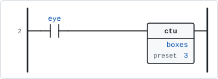
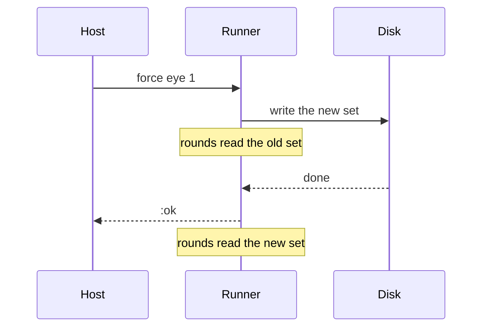
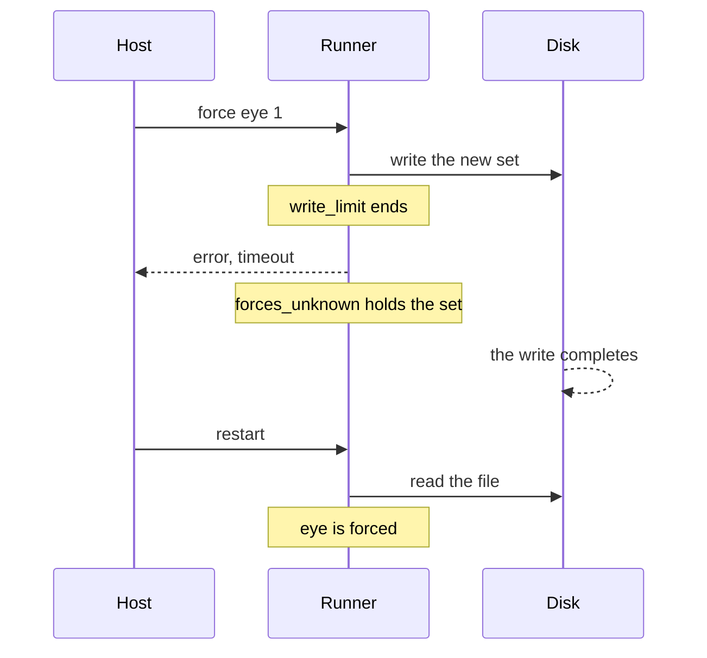
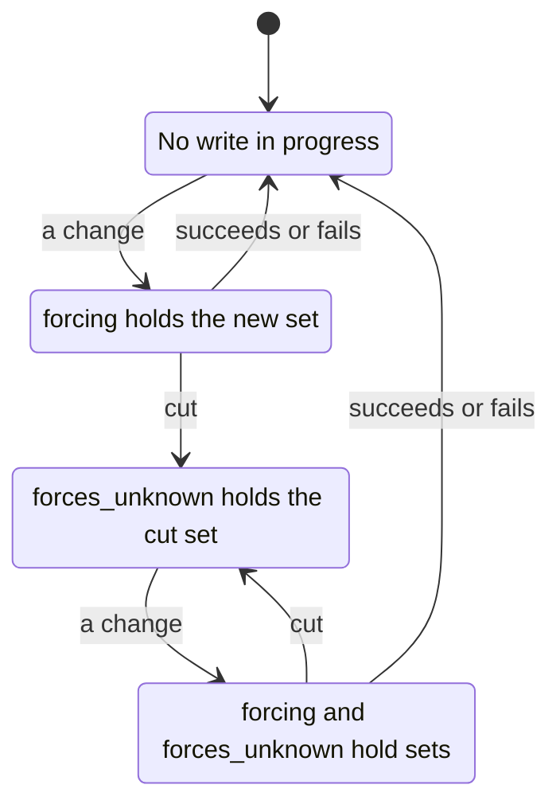

# Forcing

This page is for a reader who looks for an exact rule of input forcing in
`Logex.Runner`. The reader is an Elixir developer who writes a [host](glossary.md#host)
or an operator panel for a [runner](glossary.md#runner). The reader can also be a
controls engineer who commissions a [plant](glossary.md#plant). The page defines a
[force](glossary.md#force) and the 3 functions that add and remove a force. It also
defines the [forces file](glossary.md#forces-file) and the 4 keys of the status about
forces. Then it gives what a start, a restart and a stop do with the forces.

> #### Warning {: .warning}
>
> Make sure that the machine is safe before you force an input
> [point](glossary.md#point). While the force holds, the [program](glossary.md#program)
> reads the value of the force and not the value of the [device](glossary.md#device). A
> real sensor can change, and the program does not see the change. The force stays after
> a [restart](glossary.md#restart), a crash and a fresh start, until a host removes it.
> Do not use logex for a [safety function](glossary.md#safety-function). A force is not
> a bypass of a safety function.

> #### Note {: .info}
>
> logex forces input points only. It cannot force an output point. Only the runner
> forces: `Logex.Runtime` has no function for a force. The [store](glossary.md#store)
> keeps no force. Only the forces file keeps the forces.

| To find | Go to |
|---|---|
| The words of this page, such as a write in progress and a cut write | [Words of this page](#words-of-this-page) |
| The plant that the examples run | [The plant of the examples](#the-plant-of-the-examples) |
| `force/3`, `unforce/2` and `unforce_all/1` | [The functions](#the-functions) |
| A force, a crash and a fresh start, in 1 example | [Example: a force and a crash](#example-a-force-and-a-crash) |
| The points and values that a force takes | [Points and values](#points-and-values) |
| The text of the forces file, and how a start reads it | [The forces file](#the-forces-file) |
| What occurs while the disk writes the forces file | [The write and the rounds](#the-write-and-the-rounds) |
| The keys `forces`, `forcing`, `forces_unknown` and `forces_unread` | [Status](#status) |
| The forces at a start, a restart, a stop and a crash | [Start, restart and stop](#start-restart-and-stop) |
| A force of the [trigger](glossary.md#trigger) of an [event task](glossary.md#event-task) | [Forces and event tasks](#forces-and-event-tasks) |
| The other options and rules of the runner | [Runner](runner.md) |
| The steps to force an input | [Force an input point](../howto/force-inputs.md) |

Each example on this page is a script, with each line that it prints. Each `elixir` block
is the file under `examples/` that its `$ mix run` line names. The directory `examples`
of the repository is a Mix project, and logex is its dependency. To run a script, give
its command in that directory.

## Words of this page

| Word | Meaning |
|---|---|
| Input point | A [located global](glossary.md#located-global) at an input point of a device, or 1 [element](glossary.md#element) of a located [array](glossary.md#array) at input points |
| The set | All the forces of a runner, by the name of each input point |
| The last value of the device | The last value that the device of an input point gave the runner. Before the device gives a value, it is the value of the [global](glossary.md#global) in the [resource](glossary.md#resource). |
| A write | The runner writes the whole set to the forces file. Each call of `force/3`, `unforce/2` and `unforce_all/1` asks for a write. |
| A write in progress | A write that started and did not end |
| A write that succeeds | The new file is in the place of the old file. |
| A cut write | A write that did not end in `write_limit:` ms of real time. The runner stops its wait, and the caller gets `{:error, {:forces, :timeout}}`. The disk can still complete the write later. |
| A joined write | 1 write for all the changes that wait behind a write in progress |
| A fresh start | `start_link/1` of a new runner, for example after a crash |
| A shutdown | A process, for example the supervisor, ends the runner with the reason `:normal`, `:shutdown` or `{:shutdown, term}`. |
| A crash | The runner ends for a different reason, for example an error. |
| A kill | A process ends the runner with `Process.exit(runner, :kill)`. The runner runs no code at its end. |

## The plant of the examples

Most examples on this page run the plant `packing.logex`. The [task](glossary.md#task)
`fast` runs the conveyor `c1` each 10 ms. The box [counter](glossary.md#counter) `b1`
runs in the [continuous task](glossary.md#continuous-task). The input point `eye` is the
photo-eye of the box counter. 1 [simulated device](glossary.md#simulated-device),
`panel`, holds each point.

<!-- file: packing.logex -->
```text
// packing.logex -- a conveyor on a 10 ms task, and a box counter in the continuous task
task fast interval 10 priority 1 watchdog 50
task main continuous watchdog 200

var_global estop      bool at panel.i.7
var_global pb_start_1 bool at panel.i.0
var_global pb_reset   bool at panel.i.2
var_global eye        bool at panel.i.8
var_global k1         bool at panel.q.0
var_global case_full  bool at panel.q.4

program c1 conveyor with fast
  c1.start pb_start_1
  c1.stop  0
  c1.reset pb_reset
  c1.motor k1

program b1 boxes
  b1.eye       eye
  b1.reset_pb  pb_reset
  b1.full_lamp case_full
```

<!-- file: conveyor.ld -->
```text
var_input start bool
var_input stop bool
var_input reset bool
var_output motor bool
var_external estop bool
var fault bool

xic estop otl fault
xic reset otu fault
( xic start | xic motor ) xio stop xio fault ote motor
```

<!-- file: boxes.ld -->
```text
var_input eye bool
var_input reset_pb bool
var_output full_lamp bool
var_output count dint
var boxes ctu

xic reset_pb ote boxes.r
xic eye ctu boxes 3
xic boxes.q ote full_lamp
move boxes.cv count
```

This drawing shows [rung](glossary.md#rung) 2 of `boxes.ld`. The program reads `eye`
here. A force of `eye` gives this [contact](glossary.md#contact) its value.

<!-- rung: boxes.ld 2 -->


## The functions

Each function is a call to the runner. The runner serves each call between 2
[rounds](glossary.md#round), as it serves each other call of the host.

### `force/3`

`Logex.Runner.force/3` forces an input point to a value. Its arguments are the runner,
the point and the value.

| Part | Rule |
|---|---|
| Arguments | `point`: the name of the input point, a string. `value`: a value that the [type](glossary.md#type) of the point holds. For a located array named whole, a list of values. |
| What it does | It adds the force to the set, and writes the set to the forces file. |
| From when | The first round after the write succeeds. The program reads the value from that round. |
| Until when | Until `unforce/2` or `unforce_all/1` removes it. The force stays across a restart, a crash and a fresh start. |
| Answer | `:ok` after the write succeeds. `{:error, {:forces, reason}}` if the write fails, and the set does not change. `{:error, {:forces, :timeout}}` if the write is cut, and the set does not change. |
| Wrong arguments | An `ArgumentError` in the caller. [Points and values](#points-and-values) gives each message. |
| A trigger | If the force changes the value of a trigger, a round runs immediately, before the call returns. [Forces and event tasks](#forces-and-event-tasks) gives the rule. |

> #### Warning {: .warning}
>
> Do not think that a force is absent when `force/3` gives
> `{:error, {:forces, :timeout}}`. The disk can complete the cut write later. The next
> start or restart then reads the force from the file and puts it in effect. Look at
> `forces_unknown` in `status/1`. The next write that succeeds writes the set of the
> runner over the file again.

### `unforce/2`

`Logex.Runner.unforce/2` removes the force of an input point. Its arguments are the
runner and the point.

| Part | Rule |
|---|---|
| Arguments | `point`: the name of the input point, a string. For a located array named whole, `unforce/2` removes the force of each element. |
| What it does | It removes the force from the set, and writes the set to the forces file. |
| From when | The first round after the write succeeds. The program reads the last value of the device from that round. |
| A point with no force | `unforce/2` gives `:ok`, and writes the set again. |
| Answer | `:ok` after the write succeeds. `{:error, {:forces, reason}}` if the write fails or is cut, and the force stays. |
| Wrong arguments | An `ArgumentError` in the caller, as for `force/3` |
| A trigger | As for `force/3` |

### `unforce_all/1`

`Logex.Runner.unforce_all/1` removes each force. Its argument is the runner.

| Part | Rule |
|---|---|
| Arguments | None other than the runner |
| What it does | It empties the set, and writes an empty forces file. |
| From when | The first round after the write succeeds. Each input point reads the last value of its device from that round. |
| Answer | `:ok` after the write succeeds. `{:error, {:forces, reason}}` if the write fails or is cut, and each force stays. |
| Wrong arguments | An `ArgumentError` in the caller if the runner has no forces file |
| A trigger | 1 round for each trigger that changes, sorted by the name of the device, then by the address |

### A runner with no forces file

A runner that starts with no `forces:`, or with `forces: nil`, takes no force.
`force/3`, `unforce/2` and `unforce_all/1` each raise an `ArgumentError`.
`start_link/1` raises an `ArgumentError` for a `forces:` that is not a string.
[Example: a file written by hand](#example-a-file-written-by-hand) gives the 2 messages,
in the output lines 16 and 17.

## Example: a force and a crash

The script `forcing-eye.exs` forces the photo-eye of
[the plant of the examples](#the-plant-of-the-examples). Then it kills the runner and
starts a fresh runner from the same forces file.

```elixir
alias Logex.Runner
alias Logex.Runner.Clock.Manual
alias Logex.IO.Sim

{:ok, plant} = Logex.Configuration.compile_file("packing.logex")
File.rm("packing.forces")

# Starts a runner with a manual clock, a simulated panel and a forces file.
start = fn ->
  {:ok, clock} = Manual.start_link()
  {:ok, panel} = Sim.start_link(reports: true, clock: clock)

  {:ok, runner} =
    Runner.start_link(
      configuration: plant,
      io: %{"panel" => {Sim, sim: panel}},
      clock: {Manual, clock},
      forces: "packing.forces"
    )

  {runner, clock, panel}
end

show = fn runner, label ->
  %{now: now, forces: forces} = Runner.status(runner)
  eye = Runner.get!(runner, "eye")
  boxes = Runner.get!(runner, "b1.count")
  IO.puts("t=#{now} #{label}: eye=#{eye} boxes=#{boxes} forces=#{inspect(forces)}")
end

{runner, clock, panel} = start.()
show.(runner, "start")

# The photo-eye forced to 1. The counter counts 1 box.
:ok = Runner.force(runner, "eye", 1)
Manual.advance(clock, 2)
show.(runner, "eye forced")

# The real eye goes to 1 and back to 0. The program reads the force.
Sim.set(panel, "panel.i.8", 1)
Sim.set(panel, "panel.i.8", 0)
Manual.advance(clock, 2)
show.(runner, "eye moved")
IO.inspect(File.read!("packing.forces"), label: "packing.forces")

# A crash. A fresh runner reads the forces file.
Logger.configure(level: :none)
Process.flag(:trap_exit, true)
Process.exit(runner, :kill)
receive do: ({:EXIT, ^runner, :killed} -> :ok)
{runner, clock, _panel} = start.()
show.(runner, "fresh start")

:ok = Runner.unforce(runner, "eye")
Manual.advance(clock, 1)
show.(runner, "eye unforced")
IO.inspect(Runner.unforce(runner, "eye"), label: "unforce again")
IO.inspect(File.read!("packing.forces"), label: "packing.forces")

# Wrong arguments: each raises an ArgumentError in the caller.
for {point, value} <- [{"k1", 1}, {"eye", 2}, {"eye", 1.0}, {"eyes", 1}, {:eye, 1}] do
  try do
    Runner.force(runner, point, value)
  rescue
    error in ArgumentError -> IO.puts(error.message)
  end
end

:ok = Runner.stop(runner)
File.rm("packing.forces")
```

```console
$ mix run forcing-eye.exs
t=0 start: eye=0 boxes=0 forces=%{}
t=2 eye forced: eye=1 boxes=1 forces=%{"eye" => 1}
t=4 eye moved: eye=1 boxes=1 forces=%{"eye" => 1}
packing.forces: "eye 1\n"
t=0 fresh start: eye=1 boxes=0 forces=%{"eye" => 1}
t=1 eye unforced: eye=0 boxes=0 forces=%{}
unforce again: :ok
packing.forces: ""
`k1` is an output point, at `panel.q.0`: only an input point is forced
`eye` is a bool, forced to 0 or 1, got: 2
`eye` is a bool, forced to 0 or 1, got: 1.0
`eyes` is no input point of `packing` — did you mean `eye`?
a force names an input point by its name, a string, as in "eye_1", got: :eye
```

| Output line | What it shows |
|---|---|
| 2 | The force of `eye` to 1 is a [rising edge](glossary.md#rising-edge). The counter counts 1 box. |
| 3 | The real eye goes to 1 and back to 0. The program reads the force, and counts no box. |
| 4 | The forces file holds 1 line for each force. |
| 5 | The fresh runner reads the forces file, and its first round reads the force. The runner has no store, so `boxes` starts again at 0. No counter counts on the [first scan](glossary.md#first-scan). [Runs, scans and time](instructions-timers-and-counters.md#runs-scans-and-time) gives that rule. |
| 6 | After `unforce/2`, the program reads the last value of the device, 0. |
| 7 | `unforce/2` of a point with no force gives `:ok`. |
| 8 | With no force, the forces file is empty. |
| 9 to 13 | Wrong arguments. Each raises an `ArgumentError` in the caller. |

## Points and values

### The point

| Point | Rule |
|---|---|
| An input point | Named by its global, for example `"eye"`. Not by its address. |
| An element of a located array of input points | Named by the array and the values of its [subscripts](glossary.md#subscript), for example `"zone_t[3]"`. `"zone_t[03]"` and `"zone_t[16#3]"` name the same element. The runner keeps, writes and shows it as `"zone_t[3]"`. The other elements read their device. |
| A located array of input points, named whole | `force/3` takes a list of the shape of the array, in the order of the elements. Then it forces each element. `unforce/2` removes the force of each element. |
| An output point | Refused. The message gives the address, or the first and the last address of an array named whole. |
| A name that is no input point | Refused. If a name is near, the message gives it. |
| A name that is not a string | Refused |
| A [configuration](glossary.md#configuration) with no input point | Refused. The message says that the configuration has no input point. |

### The value

| Type of the point | Values that a force takes |
|---|---|
| `bool` | 0 or 1. The runner refuses `1.0` and `true`. |
| An integer type | An integer in the range of the type |
| `real` | An integer or a float in the range of the type. The runner keeps the nearest `real`: `0.1` becomes `0.10000000149011612`. An integer becomes a float: `37` becomes `37.0`. A value nearer to 0.0 than the smallest normal value becomes `0.0`. |
| `lreal` | As `real`, in the range of `lreal` |
| An array, named whole | A list with 1 value for each element. Each value follows the rule of the element type. |

- A wrong list forces no element.
- For a list with elements that do not fit, the message names the first 10 elements that
  do not fit. Then it gives the number of the others.

This message is for a list of 12 values that do not fit, on an array `t` of 12 reals. It
has 11 lines: 10 elements, then the number of the other 2.

<!-- unchecked: the whole message for 12 elements that do not fit, copied from a run on an array of 12 reals that no example on this page has -->
```text
`t[0]` is a real, forced to a number from -3.4028234663852886e38 to 3.4028234663852886e38, got: 1.0e40
`t[1]` is a real, forced to a number from -3.4028234663852886e38 to 3.4028234663852886e38, got: 1.0e40
`t[2]` is a real, forced to a number from -3.4028234663852886e38 to 3.4028234663852886e38, got: 1.0e40
`t[3]` is a real, forced to a number from -3.4028234663852886e38 to 3.4028234663852886e38, got: 1.0e40
`t[4]` is a real, forced to a number from -3.4028234663852886e38 to 3.4028234663852886e38, got: 1.0e40
`t[5]` is a real, forced to a number from -3.4028234663852886e38 to 3.4028234663852886e38, got: 1.0e40
`t[6]` is a real, forced to a number from -3.4028234663852886e38 to 3.4028234663852886e38, got: 1.0e40
`t[7]` is a real, forced to a number from -3.4028234663852886e38 to 3.4028234663852886e38, got: 1.0e40
`t[8]` is a real, forced to a number from -3.4028234663852886e38 to 3.4028234663852886e38, got: 1.0e40
`t[9]` is a real, forced to a number from -3.4028234663852886e38 to 3.4028234663852886e38, got: 1.0e40
`t` is an array of 12 reals, with 2 more elements outside its type, not listed
```

### Example: an array of temperatures

The script `forcing-oven.exs` forces the temperatures of an oven. The oven has 8 zones.
The array `zone_t` holds 8 `real` input points.

<!-- file: oven.logex -->
```text
// oven.logex -- eight zones, their temperatures from the oven card
task fast interval 10 priority 1

var_global zone_t   real[8] at card.i.0
var_global zone_hot bool[8] at card.q.0
var_global zone_sp  real    180.0

program oven zones with fast
  oven.t   zone_t
  oven.sp  zone_sp
  oven.hot zone_hot
```

<!-- file: zones.ld -->
```text
var_input  t   real[8]
var_input  sp  real
var_output hot bool[8]

// a lamp for each zone over its setpoint
gt t[0] sp ote hot[0]
gt t[1] sp ote hot[1]
gt t[2] sp ote hot[2]
gt t[3] sp ote hot[3]
gt t[4] sp ote hot[4]
gt t[5] sp ote hot[5]
gt t[6] sp ote hot[6]
gt t[7] sp ote hot[7]
```

```elixir
alias Logex.Runner
alias Logex.Runner.Clock.Manual
alias Logex.IO.Sim

{:ok, plant} = Logex.Configuration.compile_file("oven.logex")
{:ok, clock} = Manual.start_link()
{:ok, card} = Sim.start_link(inputs: 8, outputs: 8)
File.rm("oven.forces")

start = fn ->
  Runner.start_link(
    configuration: plant,
    io: %{"card" => {Sim, sim: card}},
    clock: {Manual, clock},
    forces: "oven.forces"
  )
end

listed = fn
  [] -> "none"
  list -> Enum.map_join(list, " ", fn {name, value} -> "#{name}=#{value}" end)
end

forces = fn runner -> listed.(Enum.sort(Runner.status(runner).forces)) end

attempt = fn fun ->
  try do
    fun.()
  rescue
    error in ArgumentError -> IO.puts(error.message)
  end
end

{:ok, runner} = start.()

# 1 element, named with its subscript in 2 other spellings. A real and an integer.
:ok = Runner.force(runner, "zone_t[03]", 0.1)
:ok = Runner.force(runner, "zone_t[16#2]", 37)
IO.puts("forces: " <> forces.(runner))
IO.write("oven.forces:\n" <> File.read!("oven.forces"))

attempt.(fn -> Runner.force(runner, "zone_t[1]", 1.0e40) end)
attempt.(fn -> Runner.force(runner, "zone_t[8]", 1.0) end)
attempt.(fn -> Runner.force(runner, "zone_hot[3]", 1) end)

# The array named whole: a list of 8 values, then an unforce of each element.
attempt.(fn -> Runner.force(runner, "zone_t", [170, 190]) end)
:ok = Runner.force(runner, "zone_t", [170, 170, 170, 170, 190, 190, 190, 190])
IO.puts("forces: " <> forces.(runner))
:ok = Runner.unforce(runner, "zone_t")
IO.puts("forces: " <> forces.(runner))
:ok = Runner.stop(runner)

# A file written by hand: the array whole on 1 line, and spellings of a real.
File.write!("oven.forces", "zone_t 1 2 3 4 5 6 7 8\n")
{:ok, runner} = start.()
IO.puts("forces: " <> forces.(runner))
:ok = Runner.stop(runner)

File.write!(
  "oven.forces",
  "zone_t[0] 1.0e-40\nzone_t[2] 37.50\nzone_t[3] 3.75e1\nzone_t[5] 16#10\n"
)

{:ok, runner} = start.()
IO.puts("forces: " <> forces.(runner))
:ok = Runner.force(runner, "zone_t[6]", 1)
IO.write("oven.forces:\n" <> File.read!("oven.forces"))
:ok = Runner.stop(runner)

File.write!("oven.forces", "zone_t 1 2 3\nzone_hot[0] 1\n")
attempt.(start)
File.rm("oven.forces")
```

```console
$ mix run forcing-oven.exs
forces: zone_t[2]=37.0 zone_t[3]=0.10000000149011612
oven.forces:
zone_t[2] 37.0
zone_t[3] 0.1
`zone_t[1]` is a real, forced to a number from -3.4028234663852886e38 to 3.4028234663852886e38, got: 1.0e40
`zone_t[8]` is no input point of `oven`: its array is one of input points, each element forced by its name as its subscripts' values, `zone_t[0]` to `zone_t[7]`
`zone_hot[3]` is an output point, at `card.q.3`: only an input point is forced
`zone_t` is an array of 8 reals, forced to a list of 8 elements in the elements' order, got: [170, 190]
forces: zone_t[0]=170.0 zone_t[1]=170.0 zone_t[2]=170.0 zone_t[3]=170.0 zone_t[4]=190.0 zone_t[5]=190.0 zone_t[6]=190.0 zone_t[7]=190.0
forces: none
forces: zone_t[0]=1.0 zone_t[1]=2.0 zone_t[2]=3.0 zone_t[3]=4.0 zone_t[4]=5.0 zone_t[5]=6.0 zone_t[6]=7.0 zone_t[7]=8.0
forces: zone_t[0]=0.0 zone_t[2]=37.5 zone_t[3]=37.5 zone_t[5]=16.0
oven.forces:
zone_t[0] 0.0
zone_t[2] 37.5
zone_t[3] 37.5
zone_t[5] 16.0
zone_t[6] 1.0
oven.forces: line 1: `zone_t` is an array of 8 reals, forced whole on one line, its name and then 8 values in the elements' order: the line holds 3
oven.forces: line 2: `zone_hot[0]` is an output point, at `card.q.0`: only an input point is forced
```

| Output line | What it shows |
|---|---|
| 1 | `zone_t[03]` and `zone_t[16#2]` name `zone_t[3]` and `zone_t[2]`. The runner keeps the value `0.1` as the nearest `real`, and the integer 37 as `37.0`. |
| 2 to 4 | The forces file holds the shortest text that gives the same `real`: `0.1`. |
| 5 to 8 | A value outside the range, an element that the array does not have, an output point and a list of the wrong length. Each raises an `ArgumentError`. |
| 9 | The array named whole: each element has a force. |
| 10 | `unforce/2` of the array removes the force of each element. |
| 11 | A line of the file that names the array whole forces each element. |
| 12 | Other spellings of a number in the file. `1.0e-40` is too near 0.0 for a `real`, and the runner keeps `0.0`. |
| 13 to 18 | The next write gives the file in the text of the runner, with 1 element on each line. |
| 19 and 20 | A start refuses a file with wrong lines. |

## The forces file

### The text that the runner writes

| Part | Rule |
|---|---|
| A line | 1 force: the name of the input point, 1 space and the value. Example: `eye 1`. |
| The order of the lines | The names sorted as text. Thus `t[11]` comes before `t[2]`. |
| An element of an array | 1 line for each element, by its name. Example: `zone_t[3] 150.0`. |
| A `real` or `lreal` value | The shortest text that gives the same value. Example: `fan_hz 0.1`, never `fan_hz 0.10000000149011612`. |
| An integer or `bool` value | Decimal digits, with `-` for a negative value |
| The end of a line | LF |
| No force | An empty file |

### How the runner writes it

- Each call of `force/3`, `unforce/2` and `unforce_all/1` asks for a write of the whole
  set. The caller waits for the answer of that write.
- The runner writes the text to a new file `<path>.tmp` beside the forces file. It
  flushes that file to the disk, and renames it over the forces file.
- Thus, after a crash at any time, the file holds the old set or the new set.
- A separate process makes each write, with the limit `write_limit:` of real time. The
  runner does not wait for the write. It runs its rounds while the write is in progress.
  [The write and the rounds](#the-write-and-the-rounds) gives the rules.

### How a start reads it

A fresh start and each restart read the forces file. The text must have the form that
the runner writes, with these differences:

| Part | Rule |
|---|---|
| A value | Each number that is 1 [literal](glossary.md#literal) of logex, if the type of the point holds it. Examples: `eye 01`, `level 16#ff`, `pb_reset 2#0`, `fan_hz 37.50`, `3.75e1` or `37` for a `real`. [Literals](literals.md) gives the spellings. |
| A value too near 0.0 | Read as `0.0` for a `real` or an `lreal`, for example `1.0e-40` for a `real` |
| An array, named whole | 1 line: the name, then 1 value for each element, in the order of the elements. Example: `zone_t 1 2 3 4 5 6 7 8`. The runner reads it as a force of each element. |
| The end of a line | LF, CRLF or a lone CR. The last line can have no end. |
| The order of the lines | Any order |
| The next write | The runner writes the whole file in its own text, with LF. |

The start refuses each of these lines:

- a comment, a blank line or a tab
- a space at the start or at the end of the line, or 2 spaces between the name and the
  value
- a line with no value, or with more than 1 value for a point that is not an array
- a name that is no input point of the configuration, or an output point
- a value that the type of the point does not hold
- a second line for the same point
- a number of more than 10,000 characters, or a real with an exponent outside -9999 to
  9999

A refusal is 1 `ArgumentError`, with 1 line for each wrong line of the file. Each line of
the message starts with the path and the number of the line. The runner does not start.
At a restart, the restart raises the error. The runner stays tripped and keeps its
forces.

| Part of a refusal | Rule |
|---|---|
| Problems | The first 50, then a line with the number of the others |
| A value that does not fit | The message quotes the value as the file gives it and as logex reads it, for example `got: 1_0, which is 10`. If the 2 texts are the same, it quotes the value 1 time, for example `got: 2`. |
| A text of the file in the message | 60 bytes or fewer, then `…`. This includes the name of a point and the spelling of a value. |
| A control byte, or a byte that is not ASCII | The message shows its escape, for example `\xFF`. The message shows a tab as it is. |
| The path | Shown with printable characters only |

This refusal is of a file of 62 lines with 61 problems. Line 1 holds the byte `\xFF`,
and line 2 holds a name of 100 characters. Lines 3 to 62 each force `eye`, so lines 4 to
62 are problems. The block shows the lines 1 to 3, 50 and 51 of the message. The lines 4
to 49 of the message are not in the block. Each is as line 3, for the lines 5 to 50 of
the file.

<!-- unchecked: lines 1 to 3, 50 and 51 of the message of a refusal of 61 problems, copied from a run -->
```text
packing.forces: line 1: `eye 1\xFF` is no force: a line holds an input point's name and its value, as `eye_1 1`
packing.forces: line 2: `zzzzzzzzzzzzzzzzzzzzzzzzzzzzzzzzzzzzzzzzzzzzzzzzzzzzzzzzzzzz…` is no input point of `packing`
packing.forces: line 4: `eye` is forced on line 3 already
packing.forces: line 51: `eye` is forced on line 3 already
packing.forces: and 11 more problems, not listed
```

### Example: a file written by hand

The script `forcing-file.exs` starts runners of
[the plant of the examples](#the-plant-of-the-examples) on forces files that it writes.

```elixir
alias Logex.Runner
alias Logex.Runner.Clock.Manual
alias Logex.IO.Sim

{:ok, plant} = Logex.Configuration.compile_file("packing.logex")

start = fn options ->
  {:ok, clock} = Manual.start_link()
  {:ok, panel} = Sim.start_link(clock: clock)

  Runner.start_link(
    [configuration: plant, io: %{"panel" => {Sim, sim: panel}}, clock: {Manual, clock}] ++
      options
  )
end

attempt = fn fun ->
  try do
    fun.()
  rescue
    error in ArgumentError -> IO.puts(error.message)
  end
end

# A file written by hand, with CRLF line ends and other spellings of a number.
File.write!("packing.forces", "eye 01\r\npb_reset 2#0")
{:ok, runner} = start.(forces: "packing.forces")
IO.inspect(Runner.status(runner).forces, label: "forces")
IO.inspect(File.read!("packing.forces"), label: "before")
:ok = Runner.force(runner, "pb_start_1", 1)
IO.inspect(File.read!("packing.forces"), label: "after ")
:ok = Runner.unforce_all(runner)
IO.inspect(File.read!("packing.forces"), label: "none  ")
:ok = Runner.stop(runner)

# A file that the start refuses: each line that is wrong.
File.write!(
  "packing.forces",
  "eye 1 // blocked\nk1 1\npb_reset 2\npb_start_1 1_0\n\nestop 1\nestop 0\nnosuch 1\n"
)

attempt.(fn -> start.(forces: "packing.forces") end)

# A directory in the place of the file.
File.rm!("packing.forces")
File.mkdir!("packing.forces")
{:ok, runner} = start.(forces: "packing.forces")
IO.inspect(Runner.status(runner).forces_unread, label: "forces_unread")
IO.inspect(Runner.force(runner, "eye", 1), label: "force")
File.rmdir!("packing.forces")
IO.inspect(Runner.force(runner, "eye", 1), label: "force")
IO.inspect(Runner.status(runner).forces_unread, label: "forces_unread")
:ok = Runner.stop(runner)

# No forces file.
File.rm!("packing.forces")
{:ok, runner} = start.([])
attempt.(fn -> Runner.force(runner, "eye", 1) end)
:ok = Runner.stop(runner)
attempt.(fn -> start.(forces: :packing) end)
```

```console
$ mix run forcing-file.exs
forces: %{"eye" => 1, "pb_reset" => 0}
before: "eye 01\r\npb_reset 2#0"
after : "eye 1\npb_reset 0\npb_start_1 1\n"
none  : ""
packing.forces: line 1: `eye 1 // blocked` is no force: a line holds an input point's name and its value, as `eye_1 1`
packing.forces: line 2: `k1` is an output point, at `panel.q.0`: only an input point is forced
packing.forces: line 3: `pb_reset` is a bool, forced to 0 or 1, got: 2
packing.forces: line 4: `pb_start_1` is a bool, forced to 0 or 1, got: 1_0, which is 10
packing.forces: line 5: `` is no force: a line holds an input point's name and its value, as `eye_1 1`
packing.forces: line 7: `estop` is forced on line 6 already
packing.forces: line 8: `nosuch` is no input point of `packing`
forces_unread: {"packing.forces", :eisdir}
force: {:error, {:forces, :eisdir}}
force: :ok
forces_unread: nil
the runner keeps no forces file, so a force would not survive a crash: start it with forces: a path
the runner's forces: is the path of the file its forces are kept in, a string, got: :packing
```

| Output line | What it shows |
|---|---|
| 1 | The start reads `eye 01` as 1 and `pb_reset 2#0` as 0. The lines end in CRLF, and the last line has no end. |
| 2 | The runner does not change the file at the start. |
| 3 | The next write gives the whole set in the text of the runner, with LF. |
| 4 | `unforce_all/1` writes an empty file. |
| 5 to 11 | The start refuses the file. Each output line names 1 wrong line of `packing.forces`. |
| 8 | Line 4 of `packing.forces` gives `1_0`. The message quotes it as the file gives it, and as logex reads it, 10. |
| 9 | Line 5 of `packing.forces` is blank. |
| 10 | Line 6 of `packing.forces` is correct, but line 7 forces `estop` again. |
| 12 to 15 | A directory in the place of the file. [A file that the runner cannot read](#a-file-that-the-runner-cannot-read) gives the rule. |
| 16 and 17 | A runner with no forces file, and a `forces:` that is not a string |

### The path

| Rule | What occurs |
|---|---|
| The host names the file | `forces:` gives the path. logex gives no default. |
| When the runner reads the path | The runner makes a relative path full 1 time, at the start, from the working directory of that time. A later `File.cd/1` does not move the file. `status/1` and the messages give the path as the host gave it. |
| A relative path | The start raises an `ArgumentError` if the working directory does not answer in `write_limit:`. It also raises it if the runner cannot read the working directory, for example after a process deleted it. A start with a full path does not read the working directory. |
| A symbolic link | The start refuses it. The message tells the host to name the file that the link names. |
| The store | `forces:` and `retain:` must name 2 files. Neither file can be the `.tmp` file of the other. The forces file cannot be a copy of the store, such as `<store>.dropped.3`. |
| 1 runner for each file | A start that names a file that a different runner of this virtual machine holds raises an `ArgumentError`. |
| No runner | With no runner, the host can delete the file. The next start then has no force. |

These are the 2 messages of a relative path. The first is from a run with the file server
of the virtual machine held. The second is from a run in a working directory that the
run deleted.

<!-- unchecked: the messages of 2 relative paths, copied from 2 runs: the file server of the virtual machine held, and the working directory deleted -->
```text
packing.forces: the forces file cannot be located: the working directory a relative path is read against did not answer within the write limit, 300 ms (write_limit:)
p5.forces: the forces file cannot be located: the working directory a relative path is read against cannot be read
```

[Files](runner.md#files) of the runner page gives the messages of 2 files, of a link and
of a file that a different runner holds.

> #### Caution {: .error}
>
> Do not give 1 forces file to 2 runners of different virtual machines, or to 2 runners
> through 2 paths of a linked directory. No check finds such runners. Each runner writes
> over the file of the other. After a crash, a runner can start with the forces of the
> other runner.

## The write and the rounds

The runner does not wait for the disk. A separate process writes the forces file. The
runner runs its rounds while the write is in progress.



Figure 1: a force on a slow disk. The rounds go on while the disk writes. The force is
in effect only after the write succeeds.

| Case | Rule |
|---|---|
| While a write is in progress | Each round reads the forces of the set before the write. `status/1` gives that set in `forces`, and the new set in `forcing`. |
| The write succeeds | The new set is in effect from the next round. A trigger that the write changes makes its round first. Then the caller gets `:ok`. |
| The write fails | The set does not change. The caller gets `{:error, {:forces, reason}}`. |
| The write is cut | The set does not change. The caller gets `{:error, {:forces, :timeout}}`. The disk can still complete the write later. The next start or restart then reads the set of the cut write. `status/1` gives that set in `forces_unknown`. |
| After a cut write | The next write that succeeds writes the set of the runner over the file, and clears `forces_unknown`. |
| A wrong argument while a write is in progress | The runner raises the `ArgumentError` in the caller immediately. It does not wait for the write. |
| A change while a write is in progress | It waits behind the write. |
| More changes while a write is in progress | The runner joins them into 1 write. It applies them in the order of the calls. If 2 calls change the same point, the point gets the value of the later call. Each caller gets the answer of that write, the same answer for each. |
| A trigger forced and unforced in 1 joined write | No round. After the write, the trigger has the value that it had before. |
| A [trip](glossary.md#trip) or a step of an [online edit](glossary.md#online-edit) while a write is in progress | The write goes on. Its set becomes the set of the runner when it succeeds. |

Examples of the time on a disk that takes 3 s for each write:

| Calls | Writes | Time |
|---|---|---|
| 10 forces from 10 processes, while 1 write is in progress | 2: the write in progress, and 1 joined write | 6 s |
| 10 forces from 1 process, 1 after the other | 10: the process waits for each answer | 30 s |

This figure shows a cut write that the disk completes later.



Figure 2: a cut write that completes later. The host gets an error, but the file holds
the force. The next restart reads the file and puts the force in effect.

This run held the file server of the virtual machine, as a stalled disk does. The limit
was `write_limit: 300`. Before the run, the host forced `pb_reset`, and that write
succeeded. The table after the block gives each event of the run.

<!-- unchecked: the status during 2 cut writes, copied from a run with the file server of the virtual machine held -->
```text
write out: %{forces: %{"pb_reset" => 1}, forcing: %{"eye" => 1, "pb_reset" => 1}, forces_unknown: nil}
eye in the round: 0
answer to eye: {:error, {:forces, :timeout}}
cut: %{forces: %{"pb_reset" => 1}, forcing: %{"estop" => 1, "pb_reset" => 1}, forces_unknown: %{"eye" => 1, "pb_reset" => 1}}
answer to estop: {:error, {:forces, :timeout}}
cut again: %{forces: %{"pb_reset" => 1}, forcing: nil, forces_unknown: %{"estop" => 1, "pb_reset" => 1}}
file: "eye 1\npb_reset 1\n"
next write: %{forces: %{"eye" => 1, "pb_reset" => 1}, forcing: nil, forces_unknown: nil}
file: "eye 1\npb_reset 1\n"
```

| Output line | What occurred |
|---|---|
| 1 | A process forces `eye`. The write waits for the disk, and `forcing` shows the new set. |
| 2 | A round reads `eye` as 0, from the old set. |
| 3 and 4 | A second process forces `estop`. Then the write of `eye` is cut, and `forces_unknown` shows its set. The force of `estop` is the next write, and `forcing` shows its set. That set does not hold `eye`, because the write of `eye` was cut. |
| 5 and 6 | The write of `estop` is cut. `forces_unknown` shows only the set of this second cut write. |
| 7 | The disk answers. The file holds `eye`, the set of the first cut write. `forces_unknown` does not show that set. |
| 8 and 9 | The host forces `eye` again, and the write succeeds. `forces_unknown` is `nil`, and the file holds the set of the runner. |

## Status

`Logex.Runner.status/1` gives 4 keys about forces. Each key is in the map at all times.

| Key | Value | Until |
|---|---|---|
| `forces` | `%{point => value}`: each force in effect | It changes when a write succeeds, and when a restart reads the file. |
| `forcing` | The set of the write in progress, or `nil` | The write ends |
| `forces_unknown` | The set of the last cut write, or `nil`. A later cut write replaces it. After 1 or more cut writes, the file can hold the set of any of those writes, or the set before them. | A later write of the forces file succeeds or fails. A restart does not clear it. |
| `forces_unread` | `{path, reason}`, or `nil`. The forces file that the last start or restart did not read. `reason` is `:timeout` or the error of the file system, for example `:eisdir`. | A write of a force or an unforce succeeds |

| Situation | The keys |
|---|---|
| No write in progress | `forces` gives the set. The 3 other keys are `nil`. |
| A write in progress | `forces` gives the old set, and `forcing` gives the new set. |
| A write was cut | `forces` gives the old set, and `forces_unknown` gives the set of the cut write. |
| A write was cut, then a restart | `forces` gives the set that the restart read from the file. `forces_unknown` gives the set of the cut write. |
| The next write succeeded | `forces` gives the new set. `forcing` and `forces_unknown` are `nil`. |
| A fresh start did not read the file | `forces` is `%{}`, and `forces_unread` gives `{path, reason}`. |
| A restart did not read the file | `forces` gives the set of the runner, and `forces_unread` gives `{path, reason}`. |



Figure 3: the keys `forcing` and `forces_unknown` across the writes. A write that
succeeds or fails sets the 2 keys to `nil`.

## Start, restart and stop

### A fresh start

`Logex.Runner.start_link/1` reads the forces file in the caller. It reads it after it
checks the configuration and the bindings, and before it reads the store.

| The forces file | The fresh start |
|---|---|
| Does not exist | Starts with no force |
| Correct | Starts with each force of the file. `status/1` lists them, and the first round reads them. |
| Holds a wrong line | Raises an `ArgumentError` that names each wrong line. The runner does not start, and opens no device. |
| The runner cannot read it | Starts with no force. `forces_unread` names the file. |
| Held for a runner that ended, while its cut write can still complete | Raises an `ArgumentError`. [After a runner ends](#after-a-runner-ends) gives the rule. |

### A restart

`Logex.Runner.restart/2` reads the forces file again, before it releases a device.

| The forces file | The restart |
|---|---|
| Does not exist | Takes no force. Each input point reads the last value of its device. |
| Correct | Takes the forces of the file. A point that the file does not force reads the last value of its device. |
| Holds a wrong line | Raises an `ArgumentError`. The runner stays tripped and keeps its forces. |
| The runner cannot read it | Keeps the forces of the runner and goes on. `forces_unread` names the file. |
| `forces_unread` names the file from an earlier start or restart | Keeps the forces of the runner and does not read the file. The next write of a force or an unforce writes the set of the runner over the file. |

- A force that the host gives while the runner is tripped is in the set. The first round
  of the restart reads it.
- A forced trigger makes no round while the runner is tripped.

A restart that comes while a write is in progress waits for that write, to its limit,
and then reads the file:

| While the restart waits | Rule |
|---|---|
| `status/1` and each other call | The runner answers immediately. The status shows the runner tripped, and the new set in `forcing`. |
| A force or an unforce | It joins the next write, after the restart. |
| A second restart, if the first restart succeeds | Refused, because the runner runs |
| A second restart, if the runner refuses the first restart | The runner does the second restart. |
| A second restart, if the first round after the first restart trips | Refused. The runner refuses each restart that the host asked for before a trip. |
| A step of an online edit | The runner serves it immediately. The restart then uses the resource that the step makes. |
| A trip | Changes nothing. The runner is tripped. |
| A stop | The restart raises the `ArgumentError` of a stopped runner. |
| The write is cut | The restart reads the file as it is. `forces_unknown` keeps the set of the cut write. |

### A file that the runner cannot read

The runner cannot read the file in these cases:

- The disk does not answer in `write_limit:` of real time.
- The file system refuses the read. Examples are a directory in the place of the file,
  and a file that the runner has no permission to read.
- A FIFO is in the place of the file, and nothing writes to it.

Then `forces_unread` gives `{path, reason}`, with the path as the host gave it. The
key stays until a write of a force or an unforce succeeds. While the key stays:

- A restart keeps the forces of the runner. It does not read the file.
- An orderly stop writes the set of the runner over the file.

Thus the runner never takes from the file a force that `status/1` did not show.

### A stop, a shutdown and a crash

| How the runner ends | The forces file |
|---|---|
| `stop/2` | The runner waits for a write in progress, to its limit, and answers the caller of that write. A call that waits behind the write raises the `ArgumentError` of a stopped runner. If `forces_unread` names the file, the runner writes its set over the file, before the store. |
| A shutdown | As `stop/2`. No caller gets an answer. A failure goes only to the subscribers. |
| A crash | The runner writes nothing. The file holds the set of the last write that ended. A cut write or a write in progress can still change the file. |
| A kill | As a crash |

`Logex.Runner.stop/2` gives 1 of these answers:

| Answer | When |
|---|---|
| `:ok` | Each write of the stop succeeded, or the stop had no write to make. |
| `{:error, {:forces, reason}}` | The write of the set over an unread file failed, or was cut (`:timeout`). |
| `{:error, {:retain, reason}}` | Only the write of the store failed. [Stop, shutdown and crash](runner.md#stop-shutdown-and-crash) gives the rule. |
| `{:error, [forces: reason, retain: reason]}` | That write and the write of the store both failed. |

At a stop or a shutdown, a failure of the write of the forces file also goes to each
subscriber as the event `{:forces, {:error, reason}}`. `Logex.Runner.subscribe/2` gives
the kind `:forces` when the host names no kinds.

### After a runner ends

A cut write can still change the file after the runner ends. Thus logex refuses a start
of a new runner on the file until each write that the old runner started ends.

| The end of the runner | The next start |
|---|---|
| A stop or a crash, with no cut write | The start can use the file immediately. |
| A stop or a crash, with a cut write that did not end | Refused until the cut write ends. The message names the file, the runner and the process that holds the file. |
| A kill | The start waits for the file server of the virtual machine to answer. On a healthy disk, that is immediate. On a stalled disk, the runner refuses the start after `write_limit:`. |
| The host kills the process that holds the file | As after a kill |
| A disk that never answers | The file stays held until the virtual machine stops. |

<!-- unchecked: the messages of 2 starts on a held file, copied from a run with the file server of the virtual machine held -->
```text
the runner's forces: "/tmp/plant/packing.forces" names the forces file of a runner of this VM that has stopped, #PID<0.104.0>, held by #PID<0.110.0> until a write of it that runner cut at its write limit has ended, which may yet land: two runners on one file write each over the other's
the runner's forces: "/tmp/plant/packing.forces" names the forces file of #PID<0.117.0>, a process of this VM that ended without giving it up: a write of it may still wait in the VM's file server, which has not answered a look behind it within the write limit, 300 ms (write_limit:), and may yet land
```

In this run, the cut write ended after the disk answered. The next start then read the
set of the cut write from the file. The force that the host saw fail was in effect.

## Forces and event tasks

The trigger of an event task can be an input point. A force can change the value that the
trigger reads.

| Case | Rule |
|---|---|
| A force or an unforce changes the value of a trigger | A round runs immediately, before the call returns. The event task runs in that round if its trigger rises. |
| A force that does not change the value | No round |
| `unforce_all/1` changes more than 1 trigger | 1 round for each trigger, sorted by the name of the device, then by the address |
| The device changes a trigger that has a force | No round. The program does not read the device. |
| The runner is tripped | No round |
| A trigger forced and unforced in 1 joined write | No round |

### Example: a forced trigger

The script `forcing-trigger.exs` runs `trip.logex`. The event task `trip` runs the
program `snapshot.ld` when the input point `estop` rises. The script prints the rounds
and the runs of the task `trip` after each call.

<!-- file: trip.logex -->
```text
// trip.logex -- a conveyor, and a snapshot of its contactor when the e-stop rises
task fast interval 10 priority 1
task trip single estop priority 0

var_global estop      bool at panel.i.7
var_global pb_start_1 bool at panel.i.0
var_global pb_reset   bool at panel.i.2
var_global k1         bool at panel.q.0
var_global k1_at_trip bool

program c1 conveyor with fast
  c1.start pb_start_1
  c1.stop  0
  c1.reset pb_reset
  c1.motor k1

program snap snapshot with trip
  snap.a     k1
  snap.a_was k1_at_trip
```

<!-- file: snapshot.ld -->
```text
var_input a bool
var_output a_was bool

xic a ote a_was
```

```elixir
alias Logex.Runner
alias Logex.Runner.Clock.Manual
alias Logex.IO.Sim

{:ok, plant} = Logex.Configuration.compile_file("trip.logex")
{:ok, clock} = Manual.start_link()
{:ok, panel} = Sim.start_link(reports: true, clock: clock)
File.rm("trip.forces")

{:ok, runner} =
  Runner.start_link(
    configuration: plant,
    io: %{"panel" => {Sim, sim: panel}},
    clock: {Manual, clock},
    forces: "trip.forces"
  )

:ok = Runner.subscribe(runner, [:ran, :round])

# Prints the rounds and the runs of the task trip since the last call, and removes them.
event = fn
  {:round, _now, _outputs} -> "round"
  {:ran, task, _instance, _now} -> "#{task} ran"
end

# Waits until the runner served the calls before, then reads the events in the mailbox.
events = fn label ->
  :sys.get_state(runner)
  {:messages, messages} = Process.info(self(), :messages)
  seen = for {Runner, ^runner, message} <- messages, do: event.(message)
  for {Runner, ^runner, _} <- messages, do: receive(do: ({Runner, ^runner, _} -> :ok))
  IO.puts("#{label}: #{inspect(seen)}")
end

:ok = Runner.force(runner, "estop", 1)
events.("force estop 1")
:ok = Runner.force(runner, "estop", 1)
events.("force estop 1 again")
:ok = Runner.force(runner, "estop", 0)
events.("force estop 0")
Sim.set(panel, "panel.i.7", 1)
events.("the device gives 1")
:ok = Runner.unforce(runner, "estop")
events.("unforce estop")
:ok = Runner.stop(runner)
File.rm("trip.forces")
```

```console
$ mix run forcing-trigger.exs
force estop 1: ["trip ran", "round"]
force estop 1 again: []
force estop 0: ["round"]
the device gives 1: []
unforce estop: ["trip ran", "round"]
```

| Output line | What it shows |
|---|---|
| 1 | The force makes `estop` rise. The task `trip` runs in a round before `force/3` returns. |
| 2 | The value does not change: no round. |
| 3 | The value falls: 1 round, and the task does not run. |
| 4 | The device changes `estop`, but the force holds: no round. |
| 5 | The unforce gives `estop` the value of the device, 1. It rises, and the task runs. |

## See also

- [Force an input point](../howto/force-inputs.md): the steps to force an input, see the force
  and remove it.
- [Runner](runner.md): the options of a runner, its status, its events and its files.
- [The store](store.md): the other file of a
  runner.
- [Execution model](execution-model.md): when a round runs, and when an event task is
  [due](glossary.md#due).
- [Literals](literals.md): the spellings of a number in the forces file.
- [Trips and watchdogs](../explanation/trips-and-watchdogs.md): why the disk does not stop
  the rounds.
- [Glossary](glossary.md): the technical words of this page.
