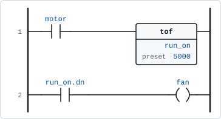
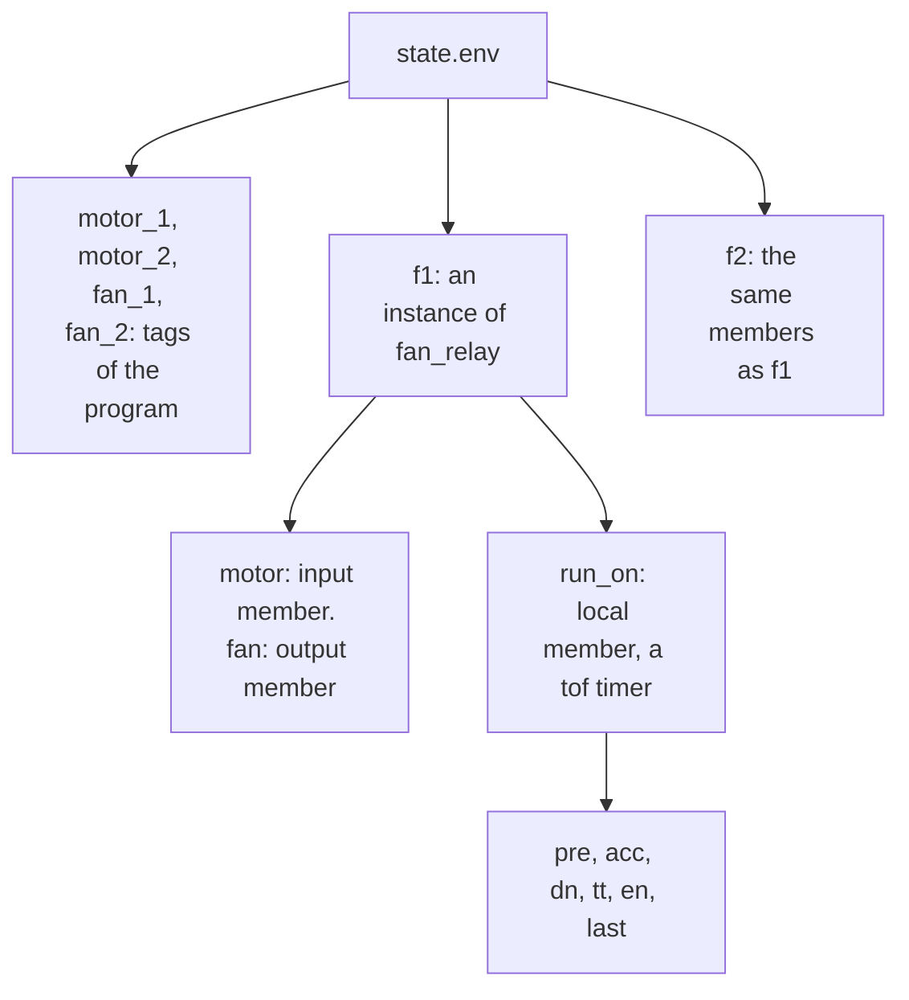
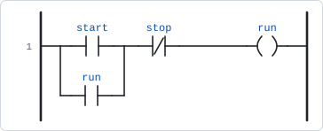
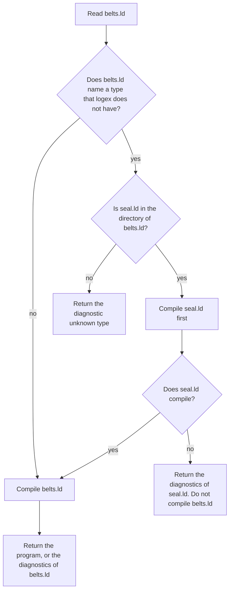
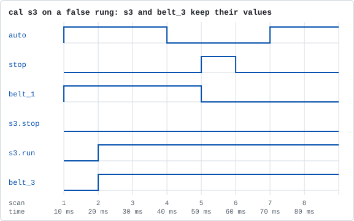

# Function blocks

This page is for a reader who writes or reads a ladder [program](glossary.md#program)
and looks for an exact rule. It defines the
[function block types](glossary.md#function-block-type) of logex: the built-in
[timers](glossary.md#timer) and [counters](glossary.md#counter), and each
[function block](glossary.md#function-block) that you write. It also gives the
[members](glossary.md#member) of each type, the file of a function block and the
[arrays](glossary.md#array) of [instances](glossary.md#instance).

> #### Warning {: .warning}
>
> Do not use logex for a safety function. A stop that protects a person is a safety
> function.
>
> If the [rung](glossary.md#rung) of a `cal` is false, the `cal` does not copy its
> [input operands](#the-words-of-this-page) into the instance. Each
> [output member](#the-words-of-this-page) of the instance keeps its value. A change of
> the stop while the rung is false has no effect.
>
> Put no [contact](glossary.md#contact) before a `cal` that receives a stop.
> [A stop with no effect](#the-program-beltsld-a-stop-with-no-effect) shows a belt that
> does not stop.

| Item | Example |
|---|---|
| A built-in type | `var delay ton`, `var boxes ctu` |
| A function block that you write | The file `seal.ld`. Its first line is `function_block seal`. |
| An instance | A `var` [tag](glossary.md#tag) of a function block type: `var s1 seal` |
| A member | A value of an instance: `delay.dn`, `s1.run` |
| An array of instances | `var gates gate[4]` |
| The [instruction](glossary.md#instruction) that runs an instance of a function block | `cal s1 start_1 stop belt_1` |

| To find | Go to |
|---|---|
| The type words, and the rules of each kind of type | [Function block types](#function-block-types) |
| The members of a timer, of a counter or of a function block | [Members](#members) |
| How the [state](glossary.md#state) holds an instance | [The state of an instance](#the-state-of-an-instance) |
| The lines of the file of a function block | [The file of a function block](#the-file-of-a-function-block) |
| How `Logex.compile_file/1` and `Logex.compile/2` find a function block | [How a program gets a function block type](#how-a-program-gets-a-function-block-type) |
| What `cal` does, and what an instance keeps while its `cal` is on a false rung | [What `cal` does to an instance](#what-cal-does-to-an-instance) |
| An array of timers, of counters or of instances of a function block | [Arrays of instances](#arrays-of-instances) |
| What a [restart](glossary.md#restart) or an [online edit](glossary.md#online-edit) does to an instance | [Restarts and online edits](#restarts-and-online-edits) |
| The values of the members in each [scan](glossary.md#scan) | [Examples](#examples) |
| The message of a wrong text | [Wrong texts and their diagnostics](#wrong-texts-and-their-diagnostics) |
| The message of a [warning](glossary.md#warning) | [Programs and their warnings](#programs-and-their-warnings) |

If a text breaks a rule of this page, logex does not [compile](glossary.md#compile) it.
It returns a [diagnostic](glossary.md#diagnostic). For some programs that break no
rule, logex gives a warning, and the program compiles.

## The words of this page

| Word | Meaning |
|---|---|
| A built-in type | A type of a timer or of a counter. logex has 26 type words for 23 built-in types. |
| A second name | A different type word for the same type: `ctu_dint` is the type `ctu`. |
| A function block | A function block type that you write in a file. The file `seal.ld` defines the function block `seal`. |
| The body | The rungs of a function block |
| The type word | The word after the name of the tag in a [declaration](glossary.md#declaration): `ton` in `var delay ton` |
| An input member | A member that takes a value into the instance: a `var_input` tag of a function block, or a member such as `pre` of a timer |
| An output member | A member that the instance writes: a `var_output` tag of a function block, or a member such as `dn` of a timer |
| A local member | A `var` tag of a function block |
| An internal member | A member of a timer that no name in a program reads: `last` |
| An input operand | An [operand](glossary.md#operand) of a `cal` that gives a value to an input member: `start_1` in `cal s1 start_1 stop belt_1` |
| An output operand | An operand of a `cal` that gets the value of an output member: `belt_1` in `cal s1 start_1 stop belt_1` |
| The power in | The [power flow](glossary.md#power-flow) that an instruction gets |

## Function block types

A tag that has a function block [type](glossary.md#type) is an instance. Each instance has a separate
state. This table gives the type words, and the instructions that run an instance of
each type.

| Type words | Instructions |
|---|---|
| Timers: `ton`, `tof`, `tp`, `rto` | The instruction of the same name: `ton` for `ton` |
| [Long timers](glossary.md#long-timer): `ton_ltime`, `tof_ltime`, `tp_ltime`, `rto_ltime` | The instruction of its plain timer: `ton` for `ton_ltime` |
| Counters that count up: `ctu`, `ctu_dint`, and the [typed counters](glossary.md#typed-counter) `ctu_int`, `ctu_lint`, `ctu_udint`, `ctu_ulint` | `ctu` |
| Counters that count down: `ctd`, `ctd_dint`, `ctd_int`, `ctd_lint`, `ctd_udint`, `ctd_ulint` | `ctd` |
| Counters that count up and down: `ctud`, `ctud_dint`, `ctud_int`, `ctud_lint`, `ctud_udint`, `ctud_ulint` | `ctu`, `ctd`, or both. Each runs it 1 time at most. |
| The name of a function block, for example `seal` | `cal` |

The 3 words `ctu_dint`, `ctd_dint` and `ctud_dint` are second names of `ctu`, `ctd` and
`ctud`. Thus the 26 type words make 23 types.
[Instructions: timers and counters](instructions-timers-and-counters.md) gives the rules
of each instruction that runs a timer or a counter.

| Item | Built-in type | Function block |
|---|---|---|
| Where the type comes from | logex | A file. [How a program gets a function block type](#how-a-program-gets-a-function-block-type) gives the rules. |
| Upper case and lower case in the type word | The same: `TON` is the type `ton`. | Different: `Seal` is not `seal`. |
| A [reserved word](glossary.md#reserved-word) | Yes. No tag can have the name `ton`. | No. A tag can have the name `seal`. |
| The declaration | `var` only, with no [initial value](glossary.md#initial-value) | The same |
| A [qualifier](glossary.md#qualifier) | Yes: `retain` | Yes: `retain` |
| An array | Yes: `ton[4]` | Yes: `gate[4]` |
| Second names | `ctu_dint` is the type `ctu`. Each message names it `ctu`. | None |

[Declarations and types](declarations-and-types.md) gives each rule of a declaration of
an instance.

## Members

An instance holds its values in members. A rung names a member with the name of the
instance, a dot and the name of the member: `delay.dn`.

### Who can use a member

Each member has 1 of 4 roles. The role tells who can read the member and who can write
it. In this table, a rung outside is a rung outside the instance. A host reads a member
of an instance in a configuration with `Logex.Runtime.get/2`.

| Role | A rung outside | A host |
|---|---|---|
| Input | Reads it. Writes it if its Write is Yes. | Reads it. |
| Output | Reads it. Writes it if its Write is Yes. | Reads it. |
| Local | Cannot name it. | Refuses it. |
| Internal | Cannot name it. | Refuses it. |

The column Write is in the member tables of the timers and of the counters. No rung
outside the instance writes a member of a function block. The state holds each member
of the 4 roles. `Logex.Runtime.put_inputs/3` writes no member.
[The state of an instance](#the-state-of-an-instance) gives the rules.

### The members of a timer

| Member | Write | Type | Role |
|---|---|---|---|
| `pre`: preset | Yes | `dint` | Input |
| `acc`: accumulated | Yes | `dint` | Output |
| `dn`: done | No | `bool` | Output |
| `tt`: timing | No | `bool` | Output |
| `en`: [enable](glossary.md#enable) | No | `bool` | Output |
| `r`: reset, only in `rto` | Yes | `bool` | Input |
| `last`: the time of the last run | No | `clock` | Internal |

| Type | Members, in their sequence |
|---|---|
| `ton`, `tof`, `tp` | `pre`, `acc`, `dn`, `tt`, `en`, `last` |
| `rto` | `pre`, `acc`, `dn`, `tt`, `en`, `r`, `last` |
| A long timer | The members of its plain timer. `pre` and `acc` are `lint`, a time in ns. |

| Item | Rule |
|---|---|
| The type `clock` | A time in ms, for a long timer too |
| The initial value of `pre` | The [preset](glossary.md#preset) on the instruction that runs the timer |
| A timer that no instruction runs | `pre` starts at 0. The program compiles, and logex gives a warning: `delay` is a ton, but no `ton` runs it. [Program 3](#programs-and-their-warnings) shows it. |
| The initial value of each other member | 0 |
| `last` | The timer writes the time of each run to `last`. No name in a program reads it. [Host contract](host-contract.md) gives the rules for a [host](glossary.md#host) that writes the state. |

[The members of a timer](instructions-timers-and-counters.md#the-members-of-a-timer)
gives the value of each member in each run.

### The members of a counter

| Member | Write | Type | Role |
|---|---|---|---|
| `cu`: count up | No | `bool` | Input |
| `cd`: count down | No | `bool` | Input |
| `r`: reset | Yes | `bool` | Input |
| `ld`: load | Yes | `bool` | Input |
| `pv`: preset value | Yes | Integer | Input |
| `q`: the result | No | `bool` | Output |
| `qu`: the result up | No | `bool` | Output |
| `qd`: the result down | No | `bool` | Output |
| `cv`: current value | No | Integer | Output |
| `ov`: overflow | No | `bool` | Output |
| `un`: underflow | No | `bool` | Output |

| Type | Members, in their sequence |
|---|---|
| `ctu` | `cu`, `r`, `pv`, `q`, `cv`, `ov` |
| `ctd` | `cd`, `ld`, `pv`, `q`, `cv`, `un` |
| `ctud` | `cu`, `cd`, `r`, `ld`, `pv`, `qu`, `qd`, `cv`, `ov`, `un` |
| A typed counter | The members of its plain counter. `pv` and `cv` have the type of the count. |

| Type word | The type of `pv` and `cv` |
|---|---|
| `ctu`, `ctd`, `ctud`, and the second names that end in `_dint` | `dint` |
| A word that ends in `_int` | `int` |
| A word that ends in `_lint` | `lint` |
| A word that ends in `_udint` | `udint` |
| A word that ends in `_ulint` | `ulint` |

| Item | Rule |
|---|---|
| The initial value of `pv` | The preset on the instruction that runs the counter |
| A counter that no instruction runs | `pv` starts at 0. The program compiles, and logex gives a warning: `boxes` is a ctu, but no `ctu` runs it. [Program 3](#programs-and-their-warnings) shows it. |
| The initial value of each other member | 0 |

[The members of a counter](instructions-timers-and-counters.md#the-members-of-a-counter)
gives the value of each member in each run.

### The members of a function block

The declarations of the file of a function block are its members. These are the 8 lines
of `fan_relay.ld`. Its local member `run_on` is a `tof` timer. The file is in the
directory `examples/function-blocks` of the repository.

<!-- file: function-blocks/fan_relay.ld -->
```text
// A fan relay: `fan` runs while `motor` runs, and for 5 s after it stops.
function_block fan_relay
var_input  motor  bool
var_output fan    bool
var        run_on tof

xic motor tof run_on 5000
xic run_on.dn ote fan
```

<!-- rung: function-blocks/fan_relay.ld -->


This table gives the members of the instance `f1` of `fan_relay`.

| Declaration in the file | Member of `f1` |
|---|---|
| `var_input motor bool` | `f1.motor`, an input member. A rung outside the instance reads it and cannot write it. |
| `var_output fan bool` | `f1.fan`, an output member. A rung outside the instance reads it and cannot write it. |
| `var run_on tof` | None. `run_on` is a local member. A rung outside the instance cannot name `run_on` or a member of `run_on`. |

| Item | Rule |
|---|---|
| A write from outside | No rung outside the instance writes a member of a function block. Only the `cal` writes the input members, and only the body writes the output members. |
| The type of a member | The type of its declaration. A local member can have any type: a timer, a counter, an array or an instance of a different function block. |
| The sequence of the members | The sequence of the declarations in the file |
| The initial value of a member | The initial value of its declaration, or 0 (0.0 for a real). A timer or a counter in the body gets its preset from its instruction. |

### Names of members

| Item | Rule |
|---|---|
| Form | An instance, a dot and the name of a member: `delay.dn`. Or an [element](glossary.md#element) of an array of instances, a dot and the name of a member: `lane_t[2].acc`, `gates[slot].kick`. |
| The case | A member is case-sensitive. Each member of a built-in type is in lower case. `s1.RUN` is an error. |
| A name that the type does not have | An error. The diagnostic gives the nearest member, or the list of the members. |
| The name of an instance alone | An instance is not a value. `xic s1` and `move s1 n` are errors. |
| A member of a local member | No rung outside the instance names it: `f1.run_on.dn` is an error. |
| A member of a full array | An error: `gates.kick`. Name 1 element: `gates[2].kick`. |
| A [bit](glossary.md#bit) of a member | An integer member has bits: `delay.acc.3`. A `bool` member has no bits: `s1.run.0` is an error. |
| The [storage bit](glossary.md#storage-bit) of a [one-shot](glossary.md#one-shot) | It cannot be a member of an instance or of an element of an array of instances. [Wrong rungs 26 to 33](instructions-contacts-and-coils.md#wrong-rungs-26-to-33-the-storage-bit) of the contacts and coils give the diagnostics. |
| In the body | The body names each tag of its file with no dot: `motor`, `run_on.dn`. The body names only the tags of its file. A tag of the program is not visible in the body. |

[Wrong texts 14 to 25](#wrong-texts-14-to-25-members) show the diagnostics of these
rules. [Instructions: timers and counters](instructions-timers-and-counters.md#the-members)
gives the diagnostics of the members of a timer and of a counter.

## The state of an instance

The state of a program instance holds each instance of a function block type that the
program declares.

| Item | Rule |
|---|---|
| The place | `state.env` holds the instance under its name: `state.env["f1"]`. |
| The value | A map. Each key is the name of a member, as a string. |
| The members in the map | Each member: input, output, local and internal |
| An instance in the body of a function block | A map in the map of the instance that holds it. The map of `f1` holds the map of its timer `run_on`. |
| An array of instances | A tuple. Each part of the tuple is the map of 1 element. An array of 2 or 3 dimensions is a tuple of tuples. |
| The [host contract](glossary.md#host-contract) | The host keeps the state and gives it to the next scan. |
| A write by the host | `Logex.Runtime.put_inputs/3` refuses a member. Only an [input](glossary.md#input) of the program, a `var_input` tag, gets a value from the host. |
| A read by the host | In a [configuration](glossary.md#configuration), `Logex.Runtime.get/2` takes an access path that names 1 input member or 1 output member: `m1.f1.fan`. [Access paths in a configuration](#access-paths-in-a-configuration) gives each case. |

This diagram shows the state of 1 instance of
[the program `fan_panel.ld`](#the-program-fan_panelld-an-instance-in-a-function-block).



Figure: the state of `fan_panel.ld`. A rung outside `f1` can read `f1.motor` and
`f1.fan` only.

## The file of a function block

### The form of the file

| Item | Rule |
|---|---|
| The name of the file | The name of the function block and `.ld`: `seal.ld`. [Kinds of file](source-syntax.md#kinds-of-file) gives the characters of the name. |
| The first line | `function_block`, a space and the name of the function block. Only comments and blank lines can come before it. |
| The word `function_block` | In upper case or lower case: `FUNCTION_BLOCK seal` is the same line. |
| The name on the first line | Exactly the name of the file, in the same case. With `Logex.compile/2`, exactly the option `name:`. |
| A reserved word as the name | An error: an instruction (`ton`), a keyword (`var`) or a type (`dint`) |
| After the first line | The declarations, then the rungs, as in a program |
| No declaration or no rung | The file compiles. logex gives a warning for each tag that no rung uses. |
| A second `function_block` line | An error |

These are the 7 lines of `seal.ld`, a [seal-in](glossary.md#seal-in) in a function
block:

<!-- file: seal.ld -->
```text
// A seal-in: `run` holds itself in from `start` until `stop`.
function_block seal
var_input start bool
var_input stop bool
var_output run bool

( xic start | xic run ) xio stop ote run
```

This drawing shows the body of `seal.ld`: a [branch](glossary.md#branch) of 2 contacts,
a closed contact and a [coil](glossary.md#coil).

<!-- rung: seal.ld -->


[The members of a function block](#the-members-of-a-function-block) shows a second file,
`fan_relay.ld`. [Wrong texts 1 to 13](#wrong-texts-1-to-13-the-file-of-a-function-block)
show the diagnostics of the form of the file.

### Sections in the file of a function block

The [section](glossary.md#section) of a declaration gives the role of its member.

| Section | Role | Type |
|---|---|---|
| `var_input` | Input | An [elementary type](glossary.md#elementary-type) |
| `var_output` | Output | An elementary type |
| `var` | Local | Any type |

| Section | An initial value | A qualifier |
|---|---|---|
| `var_input` | No | Yes |
| `var_output` | Yes | Yes |
| `var` | Yes | Yes |

| Item | Rule |
|---|---|
| A `var_input` or a `var_output` | It cannot be an array or an instance. A `cal` has 1 operand for each. |
| A `var_external` | An error. The file cannot have one. A function block gets a [global](glossary.md#global) through a `var_input`, and the `cal` gives the value. |
| `var_in_out` | Not a section. logex reads the word as an instruction, and gives the diagnostic `unknown instruction`. [Wrong text 10](#wrong-texts-1-to-13-the-file-of-a-function-block) shows it. |
| In the body | The body reads a `var_input` and does not write it, as in a program. The body writes a `var_output` and a `var` tag. |

[Sections in the file of a function block](declarations-and-types.md#sections-in-the-file-of-a-function-block)
gives the diagnostics of these rules.

### The sequence of the operands of `cal`

The operands of a `cal` come from the declarations of the file:

1. The instance.
2. 1 input operand for each `var_input`, in the sequence of the declarations.
3. 1 output operand for each `var_output`, in the sequence of the declarations.

If the file declares a `var_output` before a `var_input`, the input operands still come
first. A function block with no `var_input` and no `var_output` has the instance as its
only operand: `cal k`.

[The operands of `cal`](instructions-jump-and-call.md#the-operands-of-cal) gives the
types of the operands.

### What a function block can hold

| Item | Rule |
|---|---|
| Timers and counters | Yes: `var run_on tof` |
| Arrays | Yes: `var weights dint[4]`, `var lane_t ton[4]` |
| An instance of a different function block | Yes: `var inner seal`. logex gets the type of `seal` when it compiles the file that holds `var inner seal`. |
| An instance of itself | An error, at any depth. If `belt_a` holds a `belt_b`, `belt_b` cannot hold a `belt_a`. |
| Labels | The body is a separate [routine](glossary.md#routine). A [label](glossary.md#label) of the body and a [jump](glossary.md#jump) to it stay in the body. [A jump in a function block](instructions-jump-and-call.md#a-jump-in-a-function-block) gives the rules. |
| The word `function_block` | A reserved word in the file of a function block, in upper case or lower case. It cannot be a tag or a label there. A program can have a tag `function_block`. |
| The name of the function block as a tag | Yes. The name of a function block is not a reserved word. |

[Declarations and types](declarations-and-types.md#the-limit-of-65536) gives the limit
of 65,536 for a declaration that holds instances.

## How a program gets a function block type

A program declares an instance of a function block with the name of the function block
as its type word: `var s1 seal`. logex gets the type in 1 of 2 ways:

- `Logex.compile_file/1` reads the file of the function block from the directory of the
  program.
- `Logex.compile/2` gets the type from its option `types:`. It reads no file.

### `Logex.compile_file/1`

This diagram shows how `Logex.compile_file/1` compiles `belts.ld`, which declares
instances of `seal`.



Figure: `Logex.compile_file/1` and a function block. A function block in the file of a
function block follows the same path.

| Item | Rule |
|---|---|
| The file of a program | `{:ok, program}`, or `{:error, diagnostics}` |
| The file of a function block | `{:ok, type}`, a `%Logex.FbType{}`, as `Logex.compile/2` gives it. Or `{:error, diagnostics}`. |
| When it reads a file | A type word that is not an [elementary type](glossary.md#elementary-type) and not a built-in type: `var s1 seal`. It also reads the type word after a qualifier, `var retain s1 seal`, and in an array, `var gates gate[4]`. |
| Which file | The file with the name of the type word and `.ld`, in the directory of the file that names it. The name has the same case as the type word. |
| No such file | The diagnostic `unknown type`. It names each type that logex has, and the function blocks that it found. It does not name the file that logex looked for. Make sure that `seal.ld` is in the directory of the program. |
| A file that is a program | An error: `lamp_panel` is a program. Only the file of a function block gives a type. |
| A wrong file of a function block | logex returns its diagnostics, with the name of its file. It does not compile the file that names it. |
| 2 function blocks that hold each other | An error in the file that closes the circle. The diagnostic gives the path: `belt_b → belt_a → belt_b`. |
| 1 function block that 2 files name | logex reads and compiles it 1 time in a call. |
| The [warnings](glossary.md#warning) | The warnings of the program, then the warnings of each function block that logex read. Each warning names its file. |

The name of a file in a message is the path that the call gives. For a function block,
it is the directory of the program and the name of the file.

| Item | Path |
|---|---|
| The call gives | `function-blocks/lamp_panel.ld` |
| A message names the function block | `function-blocks/lamp_relay.ld` |
| The call gives | `belt_pair.ld` |
| A message names the function block | `./belt_b.ld` |

[Wrong texts 26 to 30](#wrong-texts-26-to-30-the-files-of-a-program) show the
diagnostics and the warnings.

### `Logex.compile/2` and the option `types:`

| Item | Rule |
|---|---|
| The text of a function block | `Logex.compile/2` returns `{:ok, type}`, a `%Logex.FbType{}`. The option `name:` must be the name on the first line. |
| The text of a program | The option `types:` is a list of the function block types that the program uses. The default is no types. |
| An example | `types: [seal]`. Here `seal` is the type that `Logex.compile_file/1` returns for `seal.ld`. |
| A type in `types:` | A type that `Logex.compile/2` or `Logex.compile_file/1` returned. logex compiles it again from its text. |
| A type that a script changed after logex returned it | An `ArgumentError`. [Wrong text 35](#wrong-texts-31-to-35-the-option-types) shows the message. |
| 2 types of 1 name in `types:` | An `ArgumentError` |
| A value that is not such a type | An `ArgumentError` |
| A function block in a function block | Give the inner type in `types:` when you compile the outer function block. Then give the outer type to the program. |
| A function block in a type and in `types:` | The 2 must be the same version. A different version is an `ArgumentError`. |
| A program that declares an inner type itself | Give that type in `types:` too. A type in `types:` that holds it does not give it to the program. |
| The warnings | Only the warnings of the program. The warnings of a function block in `types:` do not come back. `Logex.compile_file/1` of the program gives them. |

[Wrong texts 31 to 35](#wrong-texts-31-to-35-the-option-types) show the diagnostic and
the 4 messages of an `ArgumentError`.

### `Logex.compile_files/1`

`Logex.compile_files/1` compiles a list of files. It returns 1 result for each file, in
the sequence of the list. If 2 or more of the files hold the same function block, logex
reads and compiles it 1 time.

## What `cal` does to an instance

[`cal`](instructions-jump-and-call.md#cal) runs 1 instance of a function block. A timer
or a counter has its own instruction, and `cal` does not run it.

| Item | Rule |
|---|---|
| On a [true rung](glossary.md#true-rung) | It copies each input operand into its input member. It runs the body. It writes each output member to its output operand. |
| On a [false rung](glossary.md#false-rung) | It does nothing. It copies nothing in, it does not run the body, and it writes nothing out. |
| The power out | The same as the power in. After a [fault](glossary.md#fault) of an operand, the power out is false. [`cal`](instructions-jump-and-call.md#cal) gives each case. |
| 1 `cal` for 1 instance | Only 1 `cal` can run an instance, or an element of an array of instances. |
| An instance that no `cal` runs | The program compiles, and logex gives a warning. The members keep their initial values. |

> #### Caution {: .error}
>
> Do not let a one-shot or a [pulse coil](glossary.md#pulse-coil) in a function block
> drive a count if its `cal` can be on a false rung. A
> [pulse bit](glossary.md#pulse-bit) at 1 stays 1 until the next run of the body. A
> timer in the body adds all the time since its last run, and its `dn` can go to 1 at
> the first run.

While the `cal` is on a false rung, the body does not run. These 2 tables give what the
members do.

| Member | While the `cal` is on a false rung |
|---|---|
| An input member | It keeps its value. A change of the input operand has no effect. |
| An output member, and its output operand | Each keeps its value. |
| A timer | It keeps its members. |
| A counter | It keeps its count. It does not see a [rising edge](glossary.md#rising-edge). |
| A one-shot or a pulse coil | Its storage bit and its pulse bit keep their values. A pulse bit at 1 stays 1. |

| Member | At the next run of the body |
|---|---|
| An input member | The `cal` copies the input operand in. |
| An output member | The `cal` writes it to its output operand. |
| A timer | If it measured time at its last run, it adds all the time since that run. |
| A counter | It compares its power in with the power in at its last run. A rising edge that comes and goes while the `cal` is on a false rung has no effect. |
| A one-shot or a pulse coil | It compares its power in with its storage bit. |

[A rung that the scan does not run](instructions-jump-and-call.md#a-rung-that-the-scan-does-not-run)
gives the full rules, and the rules of the [first scan](glossary.md#first-scan) for a
one-shot in the body.

This timing diagram shows 8 scans of [`belts.ld`](#the-programs-sealld-and-beltsld). The
`cal` of the instance `s3` is on a false rung while `auto` is 0. The stop button is 1 in
scan 5 only. `s3` does not see it, and `belt_3` does not stop.

<!-- timing: function-blocks-belts.timing.exs -->


## Arrays of instances

The elements of an array can be timers, counters or instances of a function block. Each
element is a separate instance.

| Item | Rule |
|---|---|
| The declaration | `var` only, with no initial list: `var lane_t ton[4]`, `var gates gate[4]` |
| The type of the elements | Any timer type, any counter type, or a function block |
| The function block | `Logex.compile_file/1` reads `gate.ld` for `var gates gate[4]`. |
| The instruction that runs an element | It names the element with [literal](glossary.md#literal) [subscripts](glossary.md#subscript): `ton lane_t[2] 30`, `cal gates[2] lane_c[2].q kick[2]`. A tag as a subscript is an error. |
| 1 instruction for 1 element | 1 instruction runs each element and gives it its preset. For an element of a `ctud` type, 1 `ctu` and 1 `ctd` can run it, and they give it the same preset. |
| A member of an element | A rung reads a member through a literal subscript or a tag subscript: `xic lane_t[lane].dn`. It writes a member of a timer or of a counter in the same way: `move 0 lane_c[i].pv`. |
| A tag subscript out of the range | A [major fault](glossary.md#major-fault). The instruction does nothing and passes no power. |
| A member of a function block in an element | No rung outside writes it: `ote gates[slot].open` is an error. |
| The state | A tuple of maps. [The state of an instance](#the-state-of-an-instance) gives the rules. |
| An element that no instruction runs | The program compiles, and logex gives 1 warning for the array. It names each element that does not run. |
| Outside the program | An array of instances is not a `var_input`, a `var_output`, a global, a [connection](glossary.md#connection) or a [point](glossary.md#point). `Logex.Runtime.get/2` reads a member of 1 element: `m2.lane_t[2].acc`. |

The program `lanes.ld` sorts boxes into 4 lanes. Each lane has a photo-eye, a timer, a
counter and an instance of the function block `gate`. The file `gate.ld` is beside it.
The 2 files are in the directory `examples` of the repository.

<!-- file: lanes.ld -->
```text
var_input  eye    bool[4]
var_input  lane   int
var_output kick   bool[4]
var_output count  int
var_output held   bool
var lane_t ton[4]
var lane_c ctu_int[4]
var gates  gate[4]

xic eye[0] ton lane_t[0] 30
xic eye[1] ton lane_t[1] 30
xic eye[2] ton lane_t[2] 30
xic eye[3] ton lane_t[3] 30
xic lane_t[0].dn ctu lane_c[0] 3
xic lane_t[1].dn ctu lane_c[1] 3
xic lane_t[2].dn ctu lane_c[2] 3
xic lane_t[3].dn ctu lane_c[3] 3
cal gates[0] lane_c[0].q kick[0]
cal gates[1] lane_c[1].q kick[1]
cal gates[2] lane_c[2].q kick[2]
cal gates[3] lane_c[3].q kick[3]
move lane_c[lane].cv count
xic lane_t[lane].dn ote held
```

<!-- file: gate.ld -->
```text
function_block gate
var_input  open  bool
var_output kick  bool
var        edge  bool

xic open ons edge ote kick
```

This drawing shows the rungs of lane 0, rungs 1, 5 and 9. It also shows rungs 13 and
14, which read the lane that the tag `lane` selects.

<!-- rung: lanes.ld 1 5 9 13 14 -->


[The program `lanes.ld`](#the-program-lanesld-arrays-of-instances) runs it.
[Arrays of instances](declarations-and-types.md#arrays-of-instances) gives the rules of
the declaration. [Use arrays of timers, counters and function blocks](../howto/use-arrays-of-instances.md)
shows how to use them.

## Restarts and online edits

| Event | Rule |
|---|---|
| A [cold restart](glossary.md#cold-restart) | Each member gets its initial value again. |
| A [warm restart](glossary.md#warm-restart) | An instance with `retain` keeps each member. The nearest qualifier on the path of a member decides: a `var non_retain step dint` of the function block gets its initial value in an instance with `retain`. A `var retain total dint` of the function block keeps its value in each instance. |
| The [store](glossary.md#store) | A [runner](glossary.md#runner) with a store keeps the retained members of each instance on disk. |
| An online edit | It can change the body of a function block, and add or remove members. It refuses a change of the type of a member or of an instance. It names each element of an array by its path: `lane_t[2]`. |

[Retained values](retained-values-and-store.md) and
[Online edit](online-edit.md) give the full rules.

## Examples

Each example is a script, and most examples run a program. It is not necessary to read a
script, because the page shows each line that it prints. Each `elixir` block is the file
under `examples/` that its `$ mix run` line names. The directory `examples` of the
repository is a Mix project, and logex is its dependency. To run a script, enter its
command in that directory. [Your first program](../tutorials/first-program.md) shows how
to make a Mix project that has logex as a dependency.

Some scripts read the file
[`instructions-jump-and-call/scans.exs`](instructions-jump-and-call.md#the-scripts-that-run-the-examples).
It runs the scans of a program and prints a table. Each row gives the number of the scan
and the value of each name after the scan.

### The members of 7 built-in types and of `fan_relay`

The script declares 1 instance of each of 8 type words and prints the members of its
type. The types `tof` and `tp` have the members of `ton`, and `ctu_dint` is `ctu`. The
role `local` is a local member. The type `clock` is the time of `last` in ms.

The script reads fields of the compiled program that are not part of the host contract.
Do not use these fields in an application.

```elixir
# For each type word, the script declares 1 instance and prints the members of its type.
# For each member, it prints the name, the type and the role. It prints `write` if a rung
# outside the instance can write the member. The script reads the fields `tags`, `blocks`
# and `members`, which are not part of the host contract. Do not use them in a host.
{:ok, fan_relay} = Logex.compile_file("function-blocks/fan_relay.ld")
words = ~w(ton rto ton_ltime ctu ctd ctud ctu_int fan_relay)

type_of = fn
  program, {:block, name} -> program.blocks[name]
  _program, type -> type
end

word_of = fn
  %Logex.FbType{name: name} -> name
  type -> to_string(type)
end

write = fn
  true -> "write"
  false -> ""
end

row = fn cells ->
  cells
  |> Enum.zip([10, 8, 8, 10, 0])
  |> Enum.map_join(fn {cell, width} -> String.pad_trailing("#{cell}", width) end)
  |> String.trim_trailing()
  |> IO.puts()
end

row.(["type word", "member", "type", "role", "write"])

for word <- words do
  {:ok, program} = Logex.compile("var x #{word}", name: "members", types: [fan_relay])
  type = type_of.(program, program.tags["x"].type)

  for {member, index} <- Enum.with_index(type.members) do
    first = Enum.at([word], index, "")
    row.([first, member.name, word_of.(member.type), member.role, write.(member.write)])
  end
end
```

```console
$ mix run function-blocks-members.exs
type word member  type    role      write
ton       pre     dint    input     write
          acc     dint    output    write
          dn      bool    output
          tt      bool    output
          en      bool    output
          last    clock   internal
rto       pre     dint    input     write
          acc     dint    output    write
          dn      bool    output
          tt      bool    output
          en      bool    output
          r       bool    input     write
          last    clock   internal
ton_ltime pre     lint    input     write
          acc     lint    output    write
          dn      bool    output
          tt      bool    output
          en      bool    output
          last    clock   internal
ctu       cu      bool    input
          r       bool    input     write
          pv      dint    input     write
          q       bool    output
          cv      dint    output
          ov      bool    output
ctd       cd      bool    input
          ld      bool    input     write
          pv      dint    input     write
          q       bool    output
          cv      dint    output
          un      bool    output
ctud      cu      bool    input
          cd      bool    input
          r       bool    input     write
          ld      bool    input     write
          pv      dint    input     write
          qu      bool    output
          qd      bool    output
          cv      dint    output
          ov      bool    output
          un      bool    output
ctu_int   cu      bool    input
          r       bool    input     write
          pv      int     input     write
          q       bool    output
          cv      int     output
          ov      bool    output
fan_relay motor   bool    input
          fan     bool    output
          run_on  tof     local
```

### The program `fan_panel.ld`: an instance in a function block

`fan_panel.ld` runs 2 fans with 2 instances of
[`fan_relay`](#the-members-of-a-function-block). The file is in the directory
`examples/function-blocks` of the repository. The script gives 1000 ms to each scan.

<!-- file: function-blocks/fan_panel.ld -->
```text
var_input  motor_1 bool
var_input  motor_2 bool
var_output fan_1   bool
var_output fan_2   bool
var f1 fan_relay
var f2 fan_relay

cal f1 motor_1 fan_1
cal f2 motor_2 fan_2
```

```elixir
{scans, _} = Code.eval_file("instructions-jump-and-call/scans.exs")
{:ok, program} = Logex.compile_file("function-blocks/fan_panel.ld")

inputs = %{
  "motor_1" => [1, 1, 0, 0, 0, 0, 0, 0, 0],
  "motor_2" => [0, 0, 0, 0, 0, 0, 0, 0, 0]
}

names = ["motor_1", "fan_1", "f1.motor", "f1.fan", "f1.run_on.tt", "f1.run_on.acc", "fan_2"]
scans.(program, 1000, inputs, names)
```

```console
$ mix run function-blocks-fans.exs
scan  motor_1  fan_1  f1.motor  f1.fan  f1.run_on.tt  f1.run_on.acc  fan_2
   1        1      1         1       1             0              0      0
   2        1      1         1       1             0              0      0
   3        0      1         0       1             1              0      0
   4        0      1         0       1             1           1000      0
   5        0      1         0       1             1           2000      0
   6        0      1         0       1             1           3000      0
   7        0      1         0       1             1           4000      0
   8        0      0         0       0             0           5000      0
   9        0      0         0       0             0           5000      0
```

| Scans | What the table shows |
|---|---|
| 1 and 2 | `motor_1` is 1. The `cal` copies it into `f1.motor`, and the body sets `f1.fan`. The `cal` writes `f1.fan` to `fan_1`. |
| 3 to 7 | `motor_1` is 0. The timer `f1.run_on` measures the time. `fan_1` stays 1. |
| 8 | `f1.run_on.acc` gets to the preset 5000, and `fan_1` goes to 0. |
| 1 to 9 | `f2` is a separate instance. `fan_2` stays 0. |

### The programs `seal.ld` and `belts.ld`

`belts.ld` runs 3 belts with 3 instances of [`seal`](#the-form-of-the-file). The input
member `stop` of each instance gets the same stop button. The `cal` of `s3` comes after the
contact `auto`. The script prints the [outputs](glossary.md#output) and the map of `s3` after each scan.

<!-- file: belts.ld -->
```text
var_input start_1 bool
var_input start_2 bool
var_input start_3 bool
var_input stop bool
var_input auto bool
var_output belt_1 bool
var_output belt_2 bool
var_output belt_3 bool
var_output all_run bool
var s1 seal
var s2 seal
var s3 seal

cal s1 start_1 stop belt_1
cal s2 start_2 stop belt_2
xic auto cal s3 start_3 stop belt_3
xic s1.run xic s2.run xic s3.run ote all_run
```

```elixir
{:ok, belts} = Logex.compile_file("belts.ld")

scan = fn state, label, inputs ->
  state = Logex.Runtime.put_inputs(belts, state, inputs)
  {outputs, state} = Logex.Runtime.scan(belts, state, 10)
  IO.puts("#{label}  #{inspect(outputs)}  s3=#{inspect(state.env["s3"])}")
  state
end

Logex.Runtime.instance(belts)
|> scan.("start 1, auto  ", %{"start_1" => 1, "auto" => 1})
|> scan.("start 2 and 3  ", %{"start_1" => 0, "start_2" => 1, "start_3" => 1})
|> scan.("released       ", %{"start_2" => 0, "start_3" => 0})
|> scan.("auto off, stop ", %{"auto" => 0, "stop" => 1})
|> scan.("auto on        ", %{"auto" => 1})
```

```console
$ mix run belts.exs
start 1, auto    %{"all_run" => 0, "belt_1" => 1, "belt_2" => 0, "belt_3" => 0}  s3=%{"run" => 0, "start" => 0, "stop" => 0}
start 2 and 3    %{"all_run" => 1, "belt_1" => 1, "belt_2" => 1, "belt_3" => 1}  s3=%{"run" => 1, "start" => 1, "stop" => 0}
released         %{"all_run" => 1, "belt_1" => 1, "belt_2" => 1, "belt_3" => 1}  s3=%{"run" => 1, "start" => 0, "stop" => 0}
auto off, stop   %{"all_run" => 0, "belt_1" => 0, "belt_2" => 0, "belt_3" => 1}  s3=%{"run" => 1, "start" => 0, "stop" => 0}
auto on          %{"all_run" => 0, "belt_1" => 0, "belt_2" => 0, "belt_3" => 0}  s3=%{"run" => 0, "start" => 0, "stop" => 1}
```

| Line | What it shows |
|---|---|
| `start 2 and 3` | Each instance is a separate seal-in. `state.env["s3"]` holds the 3 members of `s3`. |
| `auto off, stop` | The `cal` of `s3` is on a false rung. `s3` does not read `stop`, and `belt_3` stays 1. `belt_1` and `belt_2` stop. |
| `auto on` | The `cal` runs `s3` again. It reads `stop`, which is still 1, and `belt_3` stops. |

### The program `belts.ld`: a stop with no effect

This script runs `belts.ld` again. The stop button is 1 in scan 5 only, while `auto` is
0. It is the run of the [timing diagram](#what-cal-does-to-an-instance).

```elixir
{scans, _} = Code.eval_file("instructions-jump-and-call/scans.exs")
{:ok, program} = Logex.compile_file("belts.ld")

inputs = %{
  "start_1" => [1, 0, 0, 0, 0, 0, 0, 0],
  "start_3" => [0, 1, 0, 0, 0, 0, 0, 0],
  "auto" => [1, 1, 1, 0, 0, 0, 1, 1],
  "stop" => [0, 0, 0, 0, 1, 0, 0, 0]
}

scans.(program, 10, inputs, ["auto", "stop", "belt_1", "s3.stop", "s3.run", "belt_3"])
```

```console
$ mix run function-blocks-belts.exs
scan  auto  stop  belt_1  s3.stop  s3.run  belt_3
   1     1     0       1        0       0       0
   2     1     0       1        0       1       1
   3     1     0       1        0       1       1
   4     0     0       1        0       1       1
   5     0     1       0        0       1       1
   6     0     0       0        0       1       1
   7     1     0       0        0       1       1
   8     1     0       0        0       1       1
```

| Scans | What the table shows |
|---|---|
| 4 to 6 | The `cal` of `s3` is on a false rung. `s3.stop` stays 0, and `belt_3` stays 1. |
| 5 | `stop` is 1. `belt_1` goes to 0. |
| 7 and 8 | `auto` is 1 again, but `stop` is 0. `s3` never sees the stop, and `belt_3` stays 1. |

### The program `lanes.ld`: arrays of instances

The script puts boxes in front of the eyes of lanes 2, 2, 1 and 2, in this sequence.
Then it sets `lane` to 4, which is out of the range of the arrays. It does an online
edit of the preset of `lane_t[2]`. It runs the program in a configuration and reads 2
members by their paths. Last, it compiles 3 wrong rungs.

```elixir
{:ok, lanes} = Logex.compile_file("lanes.ld")

scan = fn state, label, inputs, ms ->
  state = Logex.Runtime.put_inputs(lanes, state, inputs)
  {outputs, state} = Logex.Runtime.scan(lanes, state, ms)
  counts = for c <- Tuple.to_list(state.env["lane_c"]), do: c["cv"]
  IO.puts("#{label}  #{inspect(outputs)}  counts #{inspect(counts)}")
  for fault <- state.faults, do: IO.puts("    #{inspect(fault)}")
  state
end

box = fn state, lane ->
  eye = List.replace_at([0, 0, 0, 0], lane, 1)

  state
  |> scan.("box in lane #{lane}", %{"eye" => eye, "lane" => lane}, 10)
  |> scan.("40 ms later  ", %{}, 40)
  |> scan.("gone         ", %{"eye" => [0, 0, 0, 0]}, 10)
end

state =
  Logex.Runtime.instance(lanes)
  |> box.(2)
  |> box.(2)
  |> box.(1)
  |> box.(2)
  |> scan.("lane 4       ", %{"lane" => 4}, 10)

{:ok, slower} =
  "lanes.ld"
  |> File.read!()
  |> String.replace("xic eye[2] ton lane_t[2] 30", "xic eye[2] ton lane_t[2] 50")
  |> Logex.compile(name: "lanes", types: [elem(Logex.compile_file("gate.ld"), 1)])

{:ok, edit, _forecast} = Logex.Edit.accept(lanes, slower, state)
{_edit, _state, report} = Logex.Edit.test(edit, state)
IO.puts("edit: #{inspect(report)}")

{:ok, plant} =
  Logex.Configuration.compile(
    "plant",
    "task fast interval 10 priority 1\nprogram m1 lanes with fast\n  m1.eye[0] 0\n  m1.eye[1] 0\n  m1.eye[2] 1\n  m1.eye[3] 0\n  m1.lane 2",
    %{"lanes" => lanes}
  )

runtime =
  Enum.reduce([0, 10, 10, 10], Logex.Runtime.start(plant), fn ms, runtime ->
    {runtime, _outputs, _events} = Logex.Runtime.cycle(runtime, ms, %{})
    runtime
  end)

IO.puts("m1.lane_t[2].acc #{Logex.Runtime.get!(runtime, "m1.lane_t[2].acc")}, " <>
  "m1.lane_c[2].cv #{Logex.Runtime.get!(runtime, "m1.lane_c[2].cv")}")

{:error, diagnostics} =
  Logex.compile(
    "var lane_t ton[4]\nvar lane_c ctu[4]\nvar i int\nvar on bool\n" <>
      "xic on ton lane_t[i] 30\nxic on ctu lane_c[1] 3\nxic on ctu lane_c[1] 5\n" <>
      "xic lane_t.dn ote on",
    name: "wrong"
  )

for diagnostic <- diagnostics, do: IO.puts(Logex.Diagnostic.format(diagnostic))
```

```console
$ mix run lanes.exs
box in lane 2  %{"count" => 0, "held" => 0, "kick" => [0, 0, 0, 0]}  counts [0, 0, 0, 0]
40 ms later    %{"count" => 1, "held" => 1, "kick" => [0, 0, 0, 0]}  counts [0, 0, 1, 0]
gone           %{"count" => 1, "held" => 0, "kick" => [0, 0, 0, 0]}  counts [0, 0, 1, 0]
box in lane 2  %{"count" => 1, "held" => 0, "kick" => [0, 0, 0, 0]}  counts [0, 0, 1, 0]
40 ms later    %{"count" => 2, "held" => 1, "kick" => [0, 0, 0, 0]}  counts [0, 0, 2, 0]
gone           %{"count" => 2, "held" => 0, "kick" => [0, 0, 0, 0]}  counts [0, 0, 2, 0]
box in lane 1  %{"count" => 0, "held" => 0, "kick" => [0, 0, 0, 0]}  counts [0, 0, 2, 0]
40 ms later    %{"count" => 1, "held" => 1, "kick" => [0, 0, 0, 0]}  counts [0, 1, 2, 0]
gone           %{"count" => 1, "held" => 0, "kick" => [0, 0, 0, 0]}  counts [0, 1, 2, 0]
box in lane 2  %{"count" => 2, "held" => 0, "kick" => [0, 0, 0, 0]}  counts [0, 1, 2, 0]
40 ms later    %{"count" => 3, "held" => 1, "kick" => [0, 0, 1, 0]}  counts [0, 1, 3, 0]
gone           %{"count" => 3, "held" => 0, "kick" => [0, 0, 0, 0]}  counts [0, 1, 3, 0]
lane 4         %{"count" => 3, "held" => 0, "kick" => [0, 0, 0, 0]}  counts [0, 1, 3, 0]
    %Logex.Fault{severity: :major, kind: :index_out_of_range, instruction: :move, path: nil, file: "lanes.ld", line: 22, read: {4}}
    %Logex.Fault{severity: :major, kind: :index_out_of_range, instruction: :xic, path: nil, file: "lanes.ld", line: 23, read: {4}}
edit: [{:preset, "lane_t[2]", {30, 50}}]
m1.lane_t[2].acc 30, m1.lane_c[2].cv 1
line 5: `ton` runs `lane_t[i]`, whose subscript `i` holds: an instruction that runs an instance takes an element of an array of instances by literal subscripts, as in `ton lane_t[0]`, so that each element is one instance, run by one instruction whatever the program does
line 7: `lane_c[1]` is already run by the `ctu` on line 6: one `ctu` runs a counter's count up
line 8: `lane_t.dn` names a member of `lane_t`, but `lane_t` is an array of 4 tons (declared on line 1): only an instance of a function block has members
```

| Line | What it shows |
|---|---|
| `count` | The count of the lane that `lane` selects. In `box in lane 1`, `lane` is 1, and `count` shows `lane_c[1].cv`. |
| `40 ms later` | `lane_t[2]` gets to its preset 30, and `lane_c[2]` counts 1 box. |
| The third box in lane 2 | `lane_c[2].q` goes to 1. The `cal` of `gates[2]` copies it in, and its one-shot sets `kick[2]` for 1 scan. |
| `lane 4` | `lane_c[lane].cv` and `lane_t[lane].dn` are out of the range. Each instruction gets the fault `:index_out_of_range`. |
| `edit:` | The edit names the element `lane_t[2]` and its old and new preset. |
| `m1.lane_t[2].acc` | In the configuration, the eye of lane 2 is 1. After 4 [cycles](glossary.md#cycle), 30 ms in all, `lane_t[2]` gets to its preset 30, and `lane_c[2]` counts 1 box. |
| `line 5` | `ton lane_t[i]` is an error: a tag subscript. |
| `line 7` | A second `ctu` on `lane_c[1]` is an error. |
| `line 8` | `lane_t.dn` is an error: a member of a full array. |

### Access paths in a configuration

The script runs `fan_panel.ld` as the instance `m1` and `lanes.ld` as the instance `m2`
of a configuration. Then it reads each access path with `Logex.Runtime.get/2`. It prints
the value, or the message of the error.

```elixir
# The script runs fan_panel.ld as m1 and lanes.ld as m2 in a configuration, for 3
# cycles of 10 ms. Then it reads each access path with Logex.Runtime.get/2. It prints
# the value, or the message of the error in lines of 80 characters or fewer.
{:ok, fan_panel} = Logex.compile_file("function-blocks/fan_panel.ld")
{:ok, lanes} = Logex.compile_file("lanes.ld")

text = """
task fast interval 10 priority 1
program m1 fan_panel with fast
  m1.motor_1 1
  m1.motor_2 0
program m2 lanes with fast
  m2.eye[0] 0
  m2.eye[1] 0
  m2.eye[2] 1
  m2.eye[3] 0
  m2.lane 2
"""

{:ok, plant} =
  Logex.Configuration.compile("plant", text, %{"fan_panel" => fan_panel, "lanes" => lanes})

runtime =
  Enum.reduce([0, 10, 10], Logex.Runtime.start(plant), fn ms, runtime ->
    {runtime, _outputs, _events} = Logex.Runtime.cycle(runtime, ms, %{})
    runtime
  end)

wrap = fn message ->
  message
  |> String.split(" ")
  |> Enum.chunk_while(
    "     ",
    fn
      word, line when byte_size(line) + byte_size(word) < 80 -> {:cont, line <> " " <> word}
      word, line -> {:cont, line, "      " <> word}
    end,
    fn line -> {:cont, line, ""} end
  )
end

show = fn
  {:ok, value} -> ["      " <> inspect(value)]
  {:error, message} -> wrap.(message)
end

paths = [
  "m1.f1.fan",
  "m1.f1.motor",
  "m1.f1",
  "m1.f1.run_on",
  "m1.f1.run_on.acc",
  "m2.lane_t[2].acc",
  "m2.lane_t[2].last",
  "m2.lane_t[2]",
  "m2.lane_t",
  "m2.lane_t[lane].acc",
  "m2.gates[2].kick",
  "m2.gates[2].edge"
]

for path <- paths, do: IO.puts(Enum.join([path | show.(Logex.Runtime.get(runtime, path))], "\n"))
```

```console
$ mix run function-blocks-paths.exs
m1.f1.fan
      1
m1.f1.motor
      1
m1.f1
      `m1.f1` is an instance of `fan_relay`: an access path names one of its
      members, as in `m1.f1.fan`
m1.f1.run_on
      `m1.f1.run_on` is a `var` of `fan_relay`, hidden outside it: an access
      path reads only its public members, `motor` and `fan`
m1.f1.run_on.acc
      `m1.f1.run_on` is a `var` of `fan_relay`, hidden outside it: an access
      path reads only its public members, `motor` and `fan`
m2.lane_t[2].acc
      20
m2.lane_t[2].last
      `m2.lane_t[2].last` is internal to `m2.lane_t[2]`: an access path reads
      only its public members, `pre`, `acc`, `dn`, `tt` and `en`
m2.lane_t[2]
      `m2.lane_t[2]` is a ton: an access path names one of its members, as in
      `m2.lane_t[2].acc`
m2.lane_t
      `m2.lane_t` is an array of 4 tons: an access path names a member of one of
      its elements, as in `m2.lane_t[0].acc`
m2.lane_t[lane].acc
      `m2.lane_t[lane]`'s subscript `lane` is a tag's name: an access path names
      an element by literal subscripts, as in `m2.lane_t[0]`
m2.gates[2].kick
      0
m2.gates[2].edge
      `m2.gates[2].edge` is a `var` of `gate`, hidden outside it: an access path
      reads only its public members, `open` and `kick`
```

| Path | Rule |
|---|---|
| `m1.f1.fan`, `m1.f1.motor` | An access path reads an input member or an output member. |
| `m1.f1` | An instance is not a value. |
| `m1.f1.run_on`, `m1.f1.run_on.acc` | A local member is hidden outside the function block. |
| `m2.lane_t[2].last` | An internal member is hidden. |
| `m2.lane_t[2]`, `m2.lane_t` | An element of an array of instances and a full array are not values. |
| `m2.lane_t[lane].acc` | An access path has literal subscripts only. |
| `m2.gates[2].kick` | An access path reads an output member of an element. |
| `m2.gates[2].edge` | A local member of an element is hidden. |

[Host contract](host-contract.md) gives each rule of an access path.

## Wrong texts and their diagnostics

This part shows 35 wrong texts in 4 groups. For each group, a script compiles each text
and prints it after its number. After each text, the script prints each diagnostic that
logex returns, or the message of an `ArgumentError`.

| Group | Texts | Rules |
|---|---|---|
| [The file of a function block](#wrong-texts-1-to-13-the-file-of-a-function-block) | 1 to 13 | [The form of the file](#the-form-of-the-file), [Sections](#sections-in-the-file-of-a-function-block), [What a function block can hold](#what-a-function-block-can-hold) |
| [Members](#wrong-texts-14-to-25-members) | 14 to 25 | [Names of members](#names-of-members), [Arrays of instances](#arrays-of-instances) |
| [The files of a program](#wrong-texts-26-to-30-the-files-of-a-program) | 26 to 30 | [How a program gets a function block type](#how-a-program-gets-a-function-block-type) |
| [The option `types:`](#wrong-texts-31-to-35-the-option-types) | 31 to 35 | [How a program gets a function block type](#how-a-program-gets-a-function-block-type) |

Each script reads the file
[`instructions-contacts-and-coils/report.exs`](instructions-contacts-and-coils.md#the-tags-of-the-wrong-rungs),
which prints each text and each message in lines of 80 characters or fewer. It is not
necessary to read the scripts to use the diagnostics.

### Wrong texts 1 to 13: the file of a function block

The script compiles texts 1 to 10 with the option `name: "gate"`. Text 9 has the type
word `sael` in place of `seal`. The message gives each type that logex has, and the
function block `seal` of the option `types:`. Text 10 has the word `var_in_out`, which
is not a section. Texts 11 to 13 name the function block with a reserved word.

```elixir
{report, _} = Code.eval_file("instructions-contacts-and-coils/report.exs")
{:ok, seal} = Logex.compile_file("seal.ld")
ports = "\nvar_input  open bool\nvar_output kick bool\n"
rung = "xic open ote kick"

texts = [
  "function_block kicker" <> ports <> rung,
  "function_block Gate" <> ports <> rung,
  "function_block" <> ports <> rung,
  "function_block gate kick" <> ports <> rung,
  "var_input open bool\nfunction_block gate\nvar_output kick bool\n" <> rung,
  "function_block gate\nfunction_block gate" <> ports <> rung,
  "function_block gate\nvar_input function_block bool\nvar_output kick bool\nxic function_block ote kick",
  "function_block gate" <> ports <> "var self gate\n" <> rung,
  "function_block gate" <> ports <> "var s1 sael\n" <> rung,
  "function_block gate\nvar_in_out open bool\nvar_output kick bool\n" <> rung
]

report.(1, texts, &Logex.compile(&1, name: "gate", types: [seal]))

# Texts 11 to 13 name the function block with a reserved word. The option `name:` is the
# second word of the first line.
names = ["ton", "var", "dint"]
reserved = for name <- names, do: "function_block " <> name <> ports <> rung
report.(11, reserved, fn text -> Logex.compile(text, name: Enum.at(String.split(text), 1)) end)
```

```console
$ mix run function-blocks-wrong-files.exs
 1  function_block kicker
    var_input  open bool
    var_output kick bool
    xic open ote kick
      line 1: this function block is `kicker`, but it is compiled as `gate`: a
      block is named after its file
 2  function_block Gate
    var_input  open bool
    var_output kick bool
    xic open ote kick
      line 1: this function block is `Gate`, but it is compiled as `gate`: a
      block is named after its file
 3  function_block
    var_input  open bool
    var_output kick bool
    xic open ote kick
      line 1: `function_block` takes the block's name, as in `function_block
      seal`
 4  function_block gate kick
    var_input  open bool
    var_output kick bool
    xic open ote kick
      line 1: `function_block` takes the block's name, as in `function_block
      seal`
 5  var_input open bool
    function_block gate
    var_output kick bool
    xic open ote kick
      line 2: `function_block` heads a function block's file, as its first line
      line 3: `var_output` after the first rung (line 2): declarations come
      first
 6  function_block gate
    function_block gate
    var_input  open bool
    var_output kick bool
    xic open ote kick
      line 2: `function_block` heads a function block's file, as its first line
      line 3: `var_input` after the first rung (line 2): declarations come first
      line 4: `var_output` after the first rung (line 2): declarations come
      first
 7  function_block gate
    var_input function_block bool
    var_output kick bool
    xic function_block ote kick
      line 2: `function_block` heads a function block's file and cannot name a
      tag in one
 8  function_block gate
    var_input  open bool
    var_output kick bool
    var self gate
    xic open ote kick
      line 4: `gate` cannot hold an instance of `gate`: a function block never
      holds an instance of itself
 9  function_block gate
    var_input  open bool
    var_output kick bool
    var s1 sael
    xic open ote kick
      line 4: unknown type `sael`: logex has `bool`, `sint`, `int`, `dint`,
      `lint`, `usint`, `uint`, `udint`, `ulint`, `real`, `lreal`, `byte`,
      `word`, `dword`, `lword`, `ctd`, `ctd_dint`, `ctd_int`, `ctd_lint`,
      `ctd_udint`, `ctd_ulint`, `ctu`, `ctu_dint`, `ctu_int`, `ctu_lint`,
      `ctu_udint`, `ctu_ulint`, `ctud`, `ctud_dint`, `ctud_int`, `ctud_lint`,
      `ctud_udint`, `ctud_ulint`, `rto`, `rto_ltime`, `tof`, `tof_ltime`, `ton`,
      `ton_ltime`, `tp` and `tp_ltime`, and the function block `seal` — did
      you mean `seal`?
10  function_block gate
    var_in_out open bool
    var_output kick bool
    xic open ote kick
      line 2: unknown instruction `var_in_out`
      line 3: `var_output` after the first rung (line 2): declarations come
      first
      line 4: `open` is not declared
11  function_block ton
    var_input  open bool
    var_output kick bool
    xic open ote kick
      line 1: `ton` is an instruction and cannot name a function block
12  function_block var
    var_input  open bool
    var_output kick bool
    xic open ote kick
      line 1: `var` is a keyword and cannot name a function block
13  function_block dint
    var_input  open bool
    var_output kick bool
    xic open ote kick
      line 1: `dint` is a type and cannot name a function block
```

### Wrong texts 14 to 25: members

Each wrong rung comes after the same 6 declarations, and thus it is line 7. `s1` is an
instance of `seal`, `f1` of `fan_relay` and `gates` an array of 4 instances of `gate`.

```elixir
{report, _} = Code.eval_file("instructions-contacts-and-coils/report.exs")
{:ok, seal} = Logex.compile_file("seal.ld")
{:ok, gate} = Logex.compile_file("gate.ld")
{:ok, fan_relay} = Logex.compile_file("function-blocks/fan_relay.ld")

tags = """
var_input  eye   bool
var_input  slot  int
var_output lamp  bool
var s1    seal
var f1    fan_relay
var gates gate[4]
"""

rungs = [
  "xic s1 ote lamp",
  "xic s1.RUN ote lamp",
  "xic s1.running ote lamp",
  "xic s1.speed ote lamp",
  "xic s1.run.0 ote lamp",
  "xic f1.run_on.dn ote lamp",
  "xic eye ote s1.start",
  "xic eye ote s1.run",
  "xic gates.kick ote lamp",
  "xic gates[slot].edge ote lamp",
  "xic eye ote gates[slot].open",
  "xic eye ons gates[1].open ote lamp"
]

report.(14, rungs, &Logex.compile(tags <> &1, name: "panel", types: [seal, gate, fan_relay]))
```

```console
$ mix run function-blocks-wrong-members.exs
14  xic s1 ote lamp
      line 7: `xic` reads a bool, but `s1` is an instance of `seal` (declared on
      line 4): name one of its members, as in `s1.run`
15  xic s1.RUN ote lamp
      line 7: `s1.RUN` is not a member of `s1`, an instance of `seal` — did
      you mean `s1.run`? (members are case-sensitive)
16  xic s1.running ote lamp
      line 7: `s1.running` is not a member of `s1`, an instance of `seal` —
      did you mean `s1.run`?
17  xic s1.speed ote lamp
      line 7: `s1.speed` is not a member of `s1`, an instance of `seal`: its
      members are `start`, `stop` and `run`
18  xic s1.run.0 ote lamp
      line 7: `s1.run.0` names a bit of `s1.run`, a bool, which has no bits
19  xic f1.run_on.dn ote lamp
      line 7: `f1.run_on.dn` is not a member of `f1`, an instance of
      `fan_relay`: its members are `motor` and `fan`
20  xic eye ote s1.start
      line 7: `ote` writes `s1.start`, but `s1` is an instance of `seal`, whose
      members only its body writes
21  xic eye ote s1.run
      line 7: `ote` writes `s1.run`, but `s1` is an instance of `seal`, whose
      members only its body writes
22  xic gates.kick ote lamp
      line 7: `gates.kick` names a member of `gates`, but `gates` is an array of
      4 instances of `gate` (declared on line 6): only an instance of a function
      block has members
23  xic gates[slot].edge ote lamp
      line 7: `gates[slot].edge` is not a member of `gates[slot]`, an instance
      of `gate`: its members are `open` and `kick`
24  xic eye ote gates[slot].open
      line 7: `ote` writes `gates[slot].open`, but `gates[slot]` is an instance
      of `gate`, whose members only its body writes
25  xic eye ons gates[1].open ote lamp
      line 7: `ons` writes `gates[1].open`, but `gates[1]` is an instance of
      `gate`, whose members only its body writes
```

### Wrong texts 26 to 30: the files of a program

`lamp_panel.ld` uses the function block `lamp_relay`. No rung of `lamp_relay.ld` uses
`spare`. The 2 files are in the directory `examples/function-blocks` of the repository.

<!-- file: function-blocks/lamp_relay.ld -->
```text
// A lamp relay. No rung uses `spare`, and logex gives a warning.
function_block lamp_relay
var_input  on    bool
var_output lamp  bool
var        spare bool

xic on ote lamp
```

<!-- file: function-blocks/lamp_panel.ld -->
```text
var_input  test_pb bool
var_output lamp_1  bool
var_output lamp_2  bool
var l1 lamp_relay
var l2 lamp_relay

cal l1 test_pb lamp_1
xic l2.lamp ote lamp_2
```

The script writes 6 more files into a new directory, with a copy of the 2 files. These 6
files do not compile, and thus they are not in the directory `examples`.

| File | What is wrong |
|---|---|
| `belt_pair.ld` | It declares an instance of `belt_a`. |
| `belt_a.ld` | It holds an instance of `belt_b`. |
| `belt_b.ld` | It holds an instance of `belt_a`. |
| `wrong_panel.ld` | It has the type word `lamp_rleay` in place of `lamp_relay`. |
| `lamp_board.ld` | It declares an instance of the program `lamp_panel`. |
| `dryer_panel.ld` | It declares an instance of `dryer`, and the directory has no `dryer.ld`. |

The script compiles 5 programs with `Logex.compile_file/1`.

```elixir
{report, _} = Code.eval_file("instructions-contacts-and-coils/report.exs")

# The script writes these 6 files into a new directory, with a copy of lamp_relay.ld and
# lamp_panel.ld. They are not in examples/, because they do not compile.
wrong = %{
  "belt_a.ld" =>
    "function_block belt_a\nvar_input run bool\nvar_output motor bool\n" <>
      "var next belt_b\ncal next run motor\n",
  "belt_b.ld" =>
    "function_block belt_b\nvar_input run bool\nvar_output motor bool\n" <>
      "var next belt_a\ncal next run motor\n",
  "belt_pair.ld" =>
    "var_input run bool\nvar_output motor_1 bool\nvar first belt_a\n" <>
      "cal first run motor_1\n",
  "wrong_panel.ld" =>
    "var_input test_pb bool\nvar_output lamp_1 bool\n" <>
      "var l1 lamp_relay\nvar l2 lamp_rleay\ncal l1 test_pb lamp_1\ncal l2 test_pb lamp_1\n",
  "lamp_board.ld" => "var_input test_pb bool\nvar panel lamp_panel\ncal panel test_pb\n",
  "dryer_panel.ld" =>
    "var_input test_pb bool\nvar_output lamp_1 bool\nvar d1 dryer\ncal d1 test_pb lamp_1\n"
}

dir = Path.join(System.tmp_dir!(), "function-blocks-#{System.pid()}")
File.rm_rf!(dir)
File.mkdir_p!(dir)
for {name, text} <- wrong, do: File.write!(Path.join(dir, name), text)

for name <- ["lamp_relay.ld", "lamp_panel.ld"],
    do: File.cp!("function-blocks/" <> name, Path.join(dir, name))

report.(26, ["function-blocks/lamp_panel.ld"], &Logex.compile_file/1)

File.cd!(dir, fn ->
  files = ["belt_pair.ld", "wrong_panel.ld", "lamp_board.ld", "dryer_panel.ld"]
  report.(27, files, &Logex.compile_file/1)
end)

File.rm_rf!(dir)
```

```console
$ mix run function-blocks-loader.exs
26  function-blocks/lamp_panel.ld
      function-blocks/lamp_panel.ld: line 5: warning: `l2` is an instance of
      `lamp_relay`, but no `cal` runs it: it never runs, and its members stay at
      their initial values
      function-blocks/lamp_relay.ld: line 5: warning: `spare` is declared but no
      rung uses it
27  belt_pair.ld
      ./belt_b.ld: line 4: `belt_b` cannot hold an instance of `belt_a` (belt_b
      → belt_a → belt_b): a function block never holds an instance of
      itself, at any depth
28  wrong_panel.ld
      wrong_panel.ld: line 4: unknown type `lamp_rleay`: logex has `bool`,
      `sint`, `int`, `dint`, `lint`, `usint`, `uint`, `udint`, `ulint`, `real`,
      `lreal`, `byte`, `word`, `dword`, `lword`, `ctd`, `ctd_dint`, `ctd_int`,
      `ctd_lint`, `ctd_udint`, `ctd_ulint`, `ctu`, `ctu_dint`, `ctu_int`,
      `ctu_lint`, `ctu_udint`, `ctu_ulint`, `ctud`, `ctud_dint`, `ctud_int`,
      `ctud_lint`, `ctud_udint`, `ctud_ulint`, `rto`, `rto_ltime`, `tof`,
      `tof_ltime`, `ton`, `ton_ltime`, `tp` and `tp_ltime`, and the function
      block `lamp_relay` — did you mean `lamp_relay`?
29  lamp_board.ld
      lamp_board.ld: line 2: `lamp_panel` is a program (lamp_panel.ld), not a
      function block: only a function block's file gives a type for `var`
30  dryer_panel.ld
      dryer_panel.ld: line 3: unknown type `dryer`: logex has `bool`, `sint`,
      `int`, `dint`, `lint`, `usint`, `uint`, `udint`, `ulint`, `real`, `lreal`,
      `byte`, `word`, `dword`, `lword`, `ctd`, `ctd_dint`, `ctd_int`,
      `ctd_lint`, `ctd_udint`, `ctd_ulint`, `ctu`, `ctu_dint`, `ctu_int`,
      `ctu_lint`, `ctu_udint`, `ctu_ulint`, `ctud`, `ctud_dint`, `ctud_int`,
      `ctud_lint`, `ctud_udint`, `ctud_ulint`, `rto`, `rto_ltime`, `tof`,
      `tof_ltime`, `ton`, `ton_ltime`, `tp` and `tp_ltime`
```

| Text | What it shows |
|---|---|
| 26 | `lamp_panel.ld` compiles. Its warning comes first, then the warning of `lamp_relay.ld`. Each warning names its file. |
| 27 | The diagnostic names `./belt_b.ld`, the file that closes the circle, and the path of the circle. |
| 28 | A wrong type word is 1 diagnostic. The rung that uses `l2` gets no diagnostic. |
| 29 | A program is not a function block type. |
| 30 | A missing file. The message names no function block and no file. |

### Wrong texts 31 to 35: the option `types:`

`line` is a function block that holds an instance of `seal`. The script compiles it
with `types: [seal]`. Text 31 is a program that declares an instance of `seal`, and
gives only `line` in `types:`. Texts 32 to 35 compile the text of `belts.ld` with a
wrong option `types:`.

```elixir
{report, _} = Code.eval_file("instructions-contacts-and-coils/report.exs")
{:ok, seal} = Logex.compile_file("seal.ld")

# `line` is a function block that holds an instance of `seal`. `other_seal` is a different
# function block with the name `seal`: its rung has no contact `run`.
line_text = "function_block line\nvar_input go bool\nvar_input halt bool\nvar_output run bool\n"

{:ok, line} =
  Logex.compile(line_text <> "var hold seal\ncal hold go halt run", name: "line", types: [seal])

seal_text = "function_block seal\nvar_input start bool\nvar_input stop bool\n"

{:ok, other_seal} =
  Logex.compile(seal_text <> "var_output run bool\nxic start xio stop ote run", name: "seal")

# Text 31 declares `seal` and gives only `line` in `types:`.
program =
  "var_input go bool\nvar_input halt bool\nvar_output run bool\n" <>
    "var l1 line\nvar s1 seal\ncal l1 go halt run"

report.(31, [program], &Logex.compile(&1, name: "panel", types: [line]))

# Texts 32 to 35 give a wrong option `types:` with the text of belts.ld. The script prints
# each message in lines of 80 characters or fewer. Of a message that is longer than 300
# characters, it prints the first 120 characters.
belts = File.read!("belts.ld")
changed = %{seal | members: Enum.reverse(seal.members)}

calls = [
  {"[seal, seal]", [seal, seal]},
  {~s(["seal.ld"]), ["seal.ld"]},
  {"[line, other_seal]", [line, other_seal]},
  {"[changed]", [changed]}
]

short = fn
  message when byte_size(message) > 300 -> binary_part(message, 0, 120) <> " ..."
  message -> message
end

wrap = fn message ->
  message
  |> String.split(" ")
  |> Enum.chunk_while(
    "     ",
    fn
      word, line when byte_size(line) + byte_size(word) < 80 -> {:cont, line <> " " <> word}
      word, line -> {:cont, line, "      " <> word}
    end,
    fn line -> {:cont, line, ""} end
  )
end

for {{label, types}, number} <- Enum.with_index(calls, 32) do
  try do
    Logex.compile(belts, name: "belts", types: types)
  rescue
    error in ArgumentError ->
      IO.puts("#{number}  Logex.compile(belts, name: \"belts\", types: #{label})")
      IO.puts(Enum.join(["      ArgumentError" | wrap.(short.(Exception.message(error)))], "\n"))
  end
end
```

```console
$ mix run function-blocks-types.exs
31  var_input go bool
    var_input halt bool
    var_output run bool
    var l1 line
    var s1 seal
    cal l1 go halt run
      line 5: unknown type `seal`: logex has `bool`, `sint`, `int`, `dint`,
      `lint`, `usint`, `uint`, `udint`, `ulint`, `real`, `lreal`, `byte`,
      `word`, `dword`, `lword`, `ctd`, `ctd_dint`, `ctd_int`, `ctd_lint`,
      `ctd_udint`, `ctd_ulint`, `ctu`, `ctu_dint`, `ctu_int`, `ctu_lint`,
      `ctu_udint`, `ctu_ulint`, `ctud`, `ctud_dint`, `ctud_int`, `ctud_lint`,
      `ctud_udint`, `ctud_ulint`, `rto`, `rto_ltime`, `tof`, `tof_ltime`, `ton`,
      `ton_ltime`, `tp` and `tp_ltime`, and the function block `line` — did
      you mean `real`?
32  Logex.compile(belts, name: "belts", types: [seal, seal])
      ArgumentError
      types holds two function blocks named `seal`: one name, one type
33  Logex.compile(belts, name: "belts", types: ["seal.ld"])
      ArgumentError
      types must be function block types from Logex.compile/2, got: "seal.ld"
34  Logex.compile(belts, name: "belts", types: [line, other_seal])
      ArgumentError
      types holds two different function blocks named `seal`, one inside another
      type given: compile each block against the same types
35  Logex.compile(belts, name: "belts", types: [changed])
      ArgumentError
      types must be function block types from Logex.compile/2, got:
      %Logex.FbType{name: "seal", members: [%Logex.FbType.Member ...
```

| Text | What it shows |
|---|---|
| 31 | The type `line` holds `seal`, but the program does not get `seal` from it. The message names the function block `line` only. Give `seal` in `types:` too. |
| 32 | 2 types of 1 name |
| 33 | A value that is not a type |
| 34 | `line` holds a `seal`, and `other_seal` is a different `seal`. |
| 35 | A type that the script changed. The message gives the value, and the script prints its first 120 characters. |

## Programs and their warnings

The script compiles 3 programs and prints each warning. Each program compiles.

```elixir
{report, _} = Code.eval_file("instructions-contacts-and-coils/report.exs")
{:ok, seal} = Logex.compile_file("seal.ld")
{:ok, gate} = Logex.compile_file("gate.ld")

programs = [
  "var_output belt bool\nvar s1 seal\nxic s1.run ote belt",
  "var_input eye bool\nvar_output kick bool\nvar gates gate[4]\ncal gates[0] eye kick",
  "var_output done bool\nvar delay ton\nvar boxes ctu\nxic delay.dn xic boxes.q ote done"
]

report.(1, programs, &Logex.compile(&1, name: "panel", types: [seal, gate]))
```

```console
$ mix run function-blocks-warnings.exs
 1  var_output belt bool
    var s1 seal
    xic s1.run ote belt
      line 2: warning: `s1` is an instance of `seal`, but no `cal` runs it: it
      never runs, and its members stay at their initial values
 2  var_input eye bool
    var_output kick bool
    var gates gate[4]
    cal gates[0] eye kick
      line 3: warning: `gates` is an array of 4 instances of `gate`, but no
      `cal` runs `gates[1]`, `gates[2]` or `gates[3]`: they never run, and their
      members stay at their initial values
 3  var_output done bool
    var delay ton
    var boxes ctu
    xic delay.dn xic boxes.q ote done
      line 2: warning: `delay` is a ton, but no `ton` runs it: it never times
      line 3: warning: `boxes` is a ctu, but no `ctu` runs it: it never counts
```

| Program | What it shows |
|---|---|
| 1 | An instance of a function block that no `cal` runs |
| 2 | Elements of an array of instances that no `cal` runs |
| 3 | A timer and a counter that no instruction runs |

[Wrong text 26](#wrong-texts-26-to-30-the-files-of-a-program) shows the warning of an
instance that no `cal` runs in a file. [Warnings](warnings.md) gives each warning of
logex.

## See also

- [Instructions: jump and call](instructions-jump-and-call.md) gives each rule of `cal`.
- [Instructions: timers and counters](instructions-timers-and-counters.md) gives the
  instructions that run a timer or a counter.
- [Declarations and types](declarations-and-types.md) gives the rules of a declaration of
  an instance.
- [Write a function block](../howto/write-a-function-block.md) shows how to write a
  function block and use it.
- [Use arrays of timers, counters and function blocks](../howto/use-arrays-of-instances.md)
  shows how to use an array of instances.
- [Host contract](host-contract.md) gives the state and the access paths for a host.
- [Glossary](glossary.md) gives the technical words of logex.
