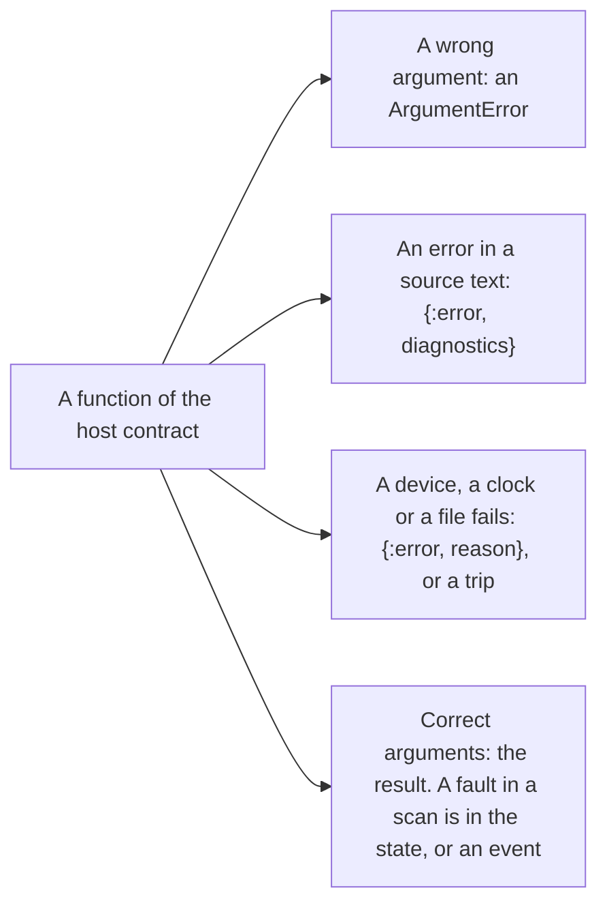
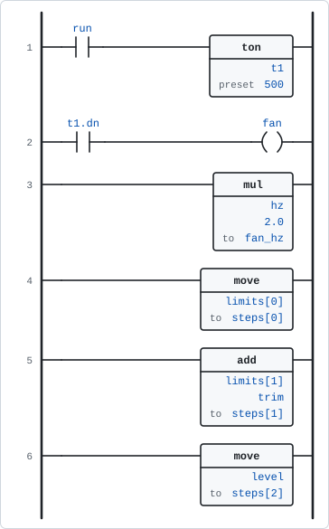

# Host contract

This page is for a reader who looks for an exact rule of a call to logex. The reader is
an Elixir developer who writes a [host](glossary.md#host): the Elixir code that compiles
[programs](glossary.md#program), runs them and gives them their [inputs](glossary.md#input). The page defines
the [host contract](glossary.md#host-contract): the modules that a host calls, the
values that each function takes and gives, and what each function refuses.

> #### Caution {: .error}
>
> - Do not change a program, a [state](glossary.md#state) or a
>   [resource](glossary.md#resource) by hand. Give each one as logex returns it. logex
>   checks a state and some parts of a program. It does not check a resource.
> - Give a module outside the host contract only the values that logex made. That module
>   does not check its arguments.

| To find | Go to |
|---|---|
| The 4 kinds of problem, and how logex reports each kind | [The rule of the contract](#the-rule-of-the-contract) |
| Which modules a host calls | [The modules](#the-modules) |
| Each function, what it gives and what it refuses | [The functions](#the-functions) |
| The names and the values of inputs, and the fields of a state | [The values that a host gives](#the-values-that-a-host-gives) |
| Outputs, the values in `env` and the access paths | [The values that logex gives](#the-values-that-logex-gives) |
| The form of a message | [The form of a message](#the-form-of-a-message) |
| Each message, from a run | [Examples](#examples) |
| The messages of the runner, of the simulated device and of an online edit | [Runner](runner.md), [I/O adapters](io-adapters.md) and [Online edit](online-edit.md) |
| The diagnostics of a source text | [Diagnostics](diagnostics.md) |
| The faults of a scan | [Faults](faults.md) |

Each example on this page is a script, with each line that it prints. Each `elixir` block
is the file under `examples/` that its `$ mix run` line names. The directory `examples`
of the repository is a Mix project, and logex is its dependency. To run a script, give
its command in that directory.

## The rule of the contract

logex finds 4 kinds of problem. It reports each kind in a different way.

| Problem | What logex does | Rules |
|---|---|---|
| A wrong argument from the host, for example an input of 2 for a `bool` | The function raises an `ArgumentError` in the process of the caller | This page |
| An error in a source text, for example a tag with no declaration | The function returns `{:error, diagnostics}`, a list of [diagnostics](glossary.md#diagnostic) | [Diagnostics](diagnostics.md) |
| A [fault](glossary.md#fault) that a [scan](glossary.md#scan) meets, for example a division by 0 | The scan continues. The fault is in `state.faults`, or it is an event of the cycle | [Faults](faults.md) |
| A failure of a device, a clock or a file, for example a device that does not open | The [runner](glossary.md#runner) returns `{:error, reason}`, or it [trips](glossary.md#trip) the [plant](glossary.md#plant) | [Runner](runner.md) |

These are the rules for a wrong argument:

- Each function of the host contract checks its arguments when the host calls it.
- For a wrong argument, the function raises an `ArgumentError`. It raises no other
  exception for a wrong argument.
- The message says what the function takes. It names each wrong value.
- 1 call raises 1 `ArgumentError`.
- Some checks look at a list of values: the inputs, the values in `env`, the problems of
  a configuration and the bindings of the devices. For each of these lists, the message
  has 1 line for each problem, up to 100 problems. An array input with wrong values is 1
  problem, with up to 11 lines.
  [The form of a message](#the-form-of-a-message) gives the sequence of the lines.
- Each other check stops at the first problem. For example, a state with `now: -1` and
  `first: :x` gives only the line for `now`.
- A value that a check refuses does not get to a scan.
- The call changes nothing. The host keeps its state, its resource and its runner as they
  were before the call.

This diagram shows what a call to the host contract can give.



Figure: the results of a call. Only a wrong argument raises an exception. logex gives
each other result to the host as data.

## The modules

### The modules of the host contract

- `Logex`: [compiles](glossary.md#compile) a program, or the type of a function block,
  from its text or its file. Rules: [Diagnostics](diagnostics.md), [Function
  blocks](function-blocks.md).
- `Logex.Runtime`: runs 1 [instance](glossary.md#instance) of a program, 1 scan at a
  time. Runs a resource, 1 [cycle](glossary.md#cycle) at a time. Reads a value at an
  access path. Rules: [Execution model](execution-model.md), [Retained
  values](retained-values-and-store.md).
- `Logex.Edit`: makes an [online edit](glossary.md#online-edit) of the program of 1
  instance. Rules: [Online edit](online-edit.md).
- `Logex.Configuration`: makes a [configuration](glossary.md#configuration) from a file,
  from text or from Elixir data, and checks it. Rules: [Configuration
  file](configuration-file.md).
- `Logex.Configuration.Edit`: changes the configuration of a running resource. Rules:
  [Online edit](online-edit.md).
- `Logex.Runner`: runs a resource on a [clock](glossary.md#clock), through the
  [devices](glossary.md#device). Rules: [Runner](runner.md), [Forcing](forcing.md).
- `Logex.IO`: the behaviour of an [adapter](glossary.md#adapter). Gives the
  [points](glossary.md#point) of a configuration and checks the bindings of the devices.
  Rules: [I/O adapters](io-adapters.md).
- `Logex.Tag`: declares 1 [tag](glossary.md#tag) from Elixir, with `new!/5`. Rules:
  [Declarations and types](declarations-and-types.md).

### The other modules of the host contract

The host contract also holds these modules. Where a host gives one of them an argument,
it refuses a wrong argument with an `ArgumentError`, except where the list says
otherwise.

- `Logex.Configuration.Task`: a struct, 1 [task](glossary.md#task).
  `Logex.Configuration.new!/1` and `check/1` check it.
- `Logex.Configuration.Global`: a struct, 1 [global](glossary.md#global). Its function
  `new!/3` makes one. It refuses the errors of that 1 global when you call it: a wrong
  option, name, type, location or initial value. It judges in 2 steps, which
  the part on `Logex.Configuration` of [The functions](#the-functions) gives. `new!/1` and `check/1` check what needs the other globals or the devices,
  for example 2 globals of 1 name.
- `Logex.Configuration.Instance`: a struct, 1 program instance of a configuration.
  `new!/1` and `check/1` check it.
- `Logex.Configuration.Connection`: a struct, 1 [connection](glossary.md#connection).
  `new!/1` and `check/1` check it.
- `Logex.IO.Point`: a struct, 1 point, as an adapter gets it from logex. It has no
  function, and there is nothing to check.
- `Logex.IO.Sim`: the [simulated device](glossary.md#simulated-device). Each of its
  functions checks its arguments, except `child_spec/1`. `start_link/1` checks the
  options when a supervisor starts the device.
- `Logex.Runner.Clock`: the behaviour of a clock of the runner. A wrong answer of a
  clock is not an `ArgumentError`: it trips the runner.
  [A bad time from the clock](runner.md#a-bad-time-from-the-clock) gives the rules.
- `Logex.Runner.Clock.Monotonic`: the clock of the computer. The runner uses it if the
  host gives no `clock:`. The host gives it no argument.
- `Logex.Runner.Clock.Manual`: a clock that the host moves on by a call. Each of its
  functions checks its arguments, except `child_spec/1`. `start_link/1` checks the
  options when a supervisor starts the clock.

### Modules outside the host contract

logex has other public modules. They take the data that logex makes, and they do not
check it. A wrong value can raise any exception of Elixir. A host can use them in these
ways:

- `Logex.Diagnostic`: prints a diagnostic that logex returns, with its function
  `format/1`.
- `Logex.FbType`: gives the type of a built-in [function
  block](glossary.md#function-block) to `new!/5` of `Logex.Tag`, for example with
  `ctu/0`.
- `Logex.Scan`: the struct that `call/4` of `Logex.Runtime` takes. `call/4` checks it.
- `Logex.Program`: the struct of a [program type](glossary.md#program-type). The host
  reads its fields, for example `warnings`.
- `Logex.Instance`: the struct of a state. The host reads its fields, for example `env`
  and `faults`.
- `Logex.Fault`: the struct of a fault. The host reads its fields.
- `Logex.Lexer`, `Logex.Parser`, `Logex.Printer`, `Logex.Compiler`, `Logex.Declarations`,
  `Logex.Walk`, `Logex.Warnings`: the stages and the tables of the compiler.
- `Logex.Configuration.Text`: the text of a configuration file, read and printed.
- `Logex.FbType.Member`: the struct of a member of a function block type.

The documentation of each of these modules says that it is outside the host contract.
Each other module of logex is internal, and its documentation is hidden.

### Typespecs

Each public function of each module of the host contract has a typespec. The types of
`Logex.Runtime` give the values that a host gives and gets, for example the types
`value`, `values` and `image`. The type `t` of `Logex.Runtime`, the resource, is opaque.
Dialyzer reads these typespecs.

The functions of the modules outside the host contract have no typespecs.

## The functions

Each function of the host contract refuses a value of the wrong kind in each argument. A
value of the wrong kind is, for example, an atom where the function takes a program.
The message names the struct that the function takes. For most functions, it also names
the function that makes that struct:

<!-- unchecked: the form of the message, with a placeholder for the value -->
```text
expected a %Logex.Program{} from Logex.compile/2, got: <value>
```

For each module, a table gives what each function returns. A list under the table gives
the other values that each function refuses with an `ArgumentError`.

### `Logex`

| Call | Returns |
|---|---|
| `compile(source, opts)` | `{:ok, program}`, `{:ok, fb_type}` for the text of a function block, or `{:error, diagnostics}`. A function block type holds no warnings: compile the program that uses it with `compile_file/1` to see them |
| `compile_file(path)` | The same results as `compile/2`. The name of the program is the name of the file |
| `compile_files(paths)` | 1 result for each path, in the sequence of the paths |

- `compile/2`: source text that is not a binary. Options that are not a keyword list with
  `name:` and, if the source uses function blocks, `types:`, each 1 time. `name:` is
  necessary, and there is no `compile/1`. A `name:` that is not a string, or that is not
  a name. A `types:` that is not a list of function block types from `compile/2`.
- `compile_file/1`: a path that is not a binary.
- `compile_files/1`: a value that is not a proper list of binaries.

A name is a letter or `_`, then letters, digits or `_`.

A path to a file that is not a `.ld` file, or that logex cannot read, is not a wrong
argument. `compile_file/1` returns a diagnostic of the stage `:file`.
[Diagnostics](diagnostics.md) gives these messages.

### `Logex.Runtime`: 1 instance

| Call | Returns |
|---|---|
| `instance(program)` | A new state. Each tag has its [initial value](glossary.md#initial-value) |
| `instance(program, image)` | `{state, dropped}`: a new state from a [retained image](glossary.md#retained-image) |
| `retained(program, state)` | The retained image of the state |
| `put_inputs(program, state, inputs)` | The state with the new inputs |
| `scan(program, state)` | `{outputs, state}`: the result of 1 scan, 0 ms after the last scan |
| `scan(program, state, elapsed_ms)` | `{outputs, state}`: the result of 1 scan, `elapsed_ms` after the last scan |
| `call(program, state, inputs, scan)` | `{outputs, state}`: the result of 1 scan at the time `scan.now` |
| `restart(program, state, mode)` | The state after a [cold restart](glossary.md#cold-restart) or a [warm restart](glossary.md#warm-restart) |

- `instance/1` and `instance/2`: a function block type, with its own message. A program
  that the host changed after the compile, as
  [A program and a configuration](#a-program-and-a-configuration) gives.
- `instance/2`: an image that is not a map of `program`, `kinds` and `values`, or an
  image of a different program.
- `retained/2`: a state of a different program.
- `put_inputs/3`: each wrong input. [Inputs](#inputs) gives the rules.
- `scan/3`: an `elapsed_ms` that is not an integer of 0 or more.
- `call/4`: each wrong input. A `%Logex.Scan{}` with a time before the time of the
  state, or with a `first` that does not agree with the state. A scan in which the host
  sets `ons_blocked`, `tags`, `blocks`, `units` or `reals`.
- `restart/3`: a mode that is not `:cold` or `:warm`.

A restart keeps `now` and each `var_input` whose value fits its type. It sets `first` to
`true`. [Retained values](retained-values-and-store.md) gives what each mode keeps.

Each function that takes a state checks the program, then the state, before it does
more. [The fields of a state](#the-fields-of-a-state) gives the checks of a state.
[An image that a start refuses](retained-values-and-store.md#an-image-that-a-start-refuses)
gives each refusal of an image, for `instance/2` and `start/2`.
[Retained values](retained-values-and-store.md) gives the rules of `dropped`.

### `Logex.Runtime`: a resource

| Call | Returns |
|---|---|
| `start(configuration)` | A new resource at the time 0 |
| `start(configuration, image)` | `{resource, dropped}`: a new resource from a retained image |
| `retained(resource)` | The retained image of the resource |
| `cycle(resource, elapsed_ms, inputs)` | `{resource, outputs, events}`: the result of 1 cycle, `elapsed_ms` after the last cycle |
| `next_due_in(resource)` | The time in ms to the next [due](glossary.md#due) time of a [periodic task](glossary.md#periodic-task), or `:infinity` |
| `overlaps(resource)` | The [overlap](glossary.md#overlap) count of each task, by name |
| `get(resource, path)` | `{:ok, value}`, or `{:error, message}` for a path that names no value |
| `get!(resource, path)` | The value |
| `restart(resource, mode)` | The resource after a cold [restart](glossary.md#restart) or a warm restart |

- `start/1` and `start/2`: a configuration that `Logex.Configuration.check/1` refuses.
  The message has 1 line for each diagnostic.
- `start/2`: an image that is not a map of `configuration`, `globals`, `instances` and
  `triggers`, or an image of a different configuration.
- `cycle/3`: an `elapsed_ms` that is not an integer of 0 or more. Each wrong input.
  [Inputs](#inputs) gives the rules.
- `get/2`: a path that is not a string.
- `get!/2`: a path that is not a string, and a path that names no value. The message is
  the message of `get/2`.
- `restart/2`: a mode that is not `:cold` or `:warm`.
- `retained/1`, `next_due_in/1` and `overlaps/1`: only a value of the wrong kind.

`restart/2` keeps the time of the resource and the values of the input points.
[Execution model](execution-model.md) gives what a cycle does, and the events of a cycle.

### `Logex.Edit`

| Call | Returns |
|---|---|
| `accept(running, candidate, state)` | `{:ok, edit, forecast}`, or `{:error, diagnostics}` if the [candidate](glossary.md#candidate) changes the type of a tag |
| `test(edit, state)`, `untest(edit, state)` | `{edit, state, report}` |
| `assemble(edit, state)`, `cancel(edit, state)` | `{program, state, report}` |
| `running(edit)`, `stage(edit)` | The program that the host scans, and the stage of the edit |

- `accept/3`: a function block type. A candidate with a different name. A program that
  the host changed after the compile. A state of a different program.
- `test/2`, `untest/2`, `assemble/2` and `cancel/2`: a step that the stage of the edit
  does not let. A state of a different program.
- `running/1` and `stage/1`: only a value of the wrong kind.

[Online edit](online-edit.md) gives each message of an online edit.

### `Logex.Configuration`

| Call | Returns |
|---|---|
| `compile_file(path)` | `{:ok, configuration}` or `{:error, diagnostics}` |
| `compile(name, source, programs)` | `{:ok, configuration}` or `{:error, diagnostics}` |
| `new!(opts)` | A configuration from Elixir data |
| `check(configuration)` | A list of diagnostics, `[]` for a configuration that runs |
| `initial(global)` | The first value of a global |
| `watchdog(task)` | The [watchdog](glossary.md#watchdog) of a task in ms |
| `location(text)` | `{:ok, {device, "i" or "q", address}}`, or `:error` |

- `compile_file/1`: a path that is not a binary.
- `compile/3`: source text that is not a binary. A name that is not a name. Programs
  that are not a map of each name to the program of that name.
- `new!/1`: options that are not a keyword list. Each problem of the configuration, as 1
  line of the message.
- `check/1`: a value that no configuration file can hold, for example a priority of
  `1.5`. A program that the host changed after the compile.
- `initial/1` and `watchdog/1`: a value that is not a global or a task of the right form.
- `location/1`: nothing. It returns `:error` for each other value.

`check/1` separates 2 kinds of problem. A [configuration file](glossary.md#configuration-file)
can hold a [priority](glossary.md#priority) of `-1`, so `check/1` returns it as a
diagnostic. No file can hold a priority of `1.5`, so `check/1` raises it as a wrong
argument. `new!/1` raises both kinds in 1 message, the wrong arguments first.

> #### Note {: .info}
>
> `Logex.Configuration.Global.new!/3` refuses the errors of 1 global when you call it:
> its name, its type, its location and its initial value. It uses the words of
> `check/1`. It does not compare the global with the other globals or with the devices.
> `new!/1` and `check/1` refuse 2 globals of 1 name and 2 globals at 1 point.
> [Example: wrong calls to compile and declare](#example-wrong-calls-to-compile-and-declare)
> shows a global of the type `bool` with the initial value 5.

`Global.new!/3` judges in 2 steps, by these 2 kinds of problem. First it raises each wrong
argument, such as the name `"1x"`, the type `:nope` or the location `5`. If there is
none, it raises each problem that a line can hold, such as the value 5 for a `bool` or
the location `zz`. Thus `Global.new!("1x", :bool, at: "zz")` raises the line of the name
alone.

### `Logex.Configuration.Edit`

| Call | Returns |
|---|---|
| `accept(resource, candidate, elapsed_ms)` | `{:ok, edit, forecast}`, or `{:error, diagnostics}` |
| `test(edit, resource, elapsed_ms)`, `untest(edit, resource, elapsed_ms)` | `{edit, resource, report}` |
| `assemble(edit, resource)`, `cancel(edit, resource)` | `{configuration, resource, report}` |
| `running(edit)`, `stage(edit)` | The configuration that the resource runs, and the stage of the edit |

- `accept/3`: a candidate that `check/1` refuses. An `elapsed_ms` that is not an integer
  of 0 or more.
- `test/3`, `untest/3`, `assemble/2` and `cancel/2`: a step that the stage of the edit
  does not let. A resource of a different generation. The generation is the count of
  the steps of the edits of the resource: [A second edit and a restart](online-edit.md#a-second-edit-and-a-restart)
  gives the rule.
- `running/1` and `stage/1`: only a value of the wrong kind.

### `Logex.Runner`

| Call | Returns |
|---|---|
| `start_link(opts)` | `{:ok, pid}`, or `{:error, reason}`: a device that does not open, a write of the [store](glossary.md#store) that fails, or a name that another process holds |
| `child_spec(opts)` | The child spec for a supervisor |
| `status(runner)` | The status of the runner |
| `get(runner, path)`, `get!(runner, path)` | As `get/2` and `get!/2` of `Logex.Runtime` |
| `subscribe(runner, kinds)`, `unsubscribe(runner)` | `:ok` |
| `force(runner, name, value)`, `unforce(runner, name)`, `unforce_all(runner)` | `:ok` or `{:error, {:forces, reason}}` |
| `accept(runner, candidate)` | `{:ok, forecast}` or `{:error, diagnostics}` |
| `test(runner)`, `untest(runner)`, `assemble(runner)`, `cancel(runner)` | `{:ok, report}` |
| `restart(runner, mode)` | `:ok` or `{:error, reason}` |
| `stop(runner)`, `stop(runner, reason)` | `:ok` or `{:error, reason}` |

- `start_link/1`: each wrong option, in the process of the caller, before the runner
  starts. A store or a [forces file](glossary.md#forces-file) that another runner of
  this VM holds.
- `child_spec/1`: nothing. It returns a spec for each value, for example `:x`.
  `start_link/1` checks the options when the supervisor starts the runner.
- `status/1`, `get/2`, `get!/2`, `subscribe/2` and `unsubscribe/1`: a runner that does
  not run. A path that is not a string. A kind of event that the runner does not have.
  `get!/2` also refuses a path that names no value.
- `force/3`, `unforce/2` and `unforce_all/1`: a runner with no forces file. A name that
  is not an input point. A value that the type of the point cannot hold.
- `accept/2`: a candidate that is not a configuration, or that `check/1` refuses.
- `test/1`, `untest/1`, `assemble/1` and `cancel/1`: a step when the runner holds no
  edit. A step that the stage of the edit does not let.
- `restart/2`: a runner that runs, because only a tripped runner restarts. A mode that
  is not `:cold` or `:warm`.
- `stop/2`: a runner that does not run.

A call to a pid or a name of no running runner raises an `ArgumentError`. The runner
continues to run after a wrong argument in a call. [Runner](runner.md) gives each option
and each message, and [Forcing](forcing.md) gives the messages of a force.

### `Logex.IO`

| Call | Returns |
|---|---|
| `points(configuration)` | The points of each device |
| `bind!(configuration, io)` | Each device with its adapter, its options and its points |

- `points/1`: a configuration that `Logex.Configuration.check/1` refuses.
- `bind!/2`: an `io` that is not a map. Each device with no adapter. Each device in the
  map that no point is at. Each adapter that is not a module of the behaviour, and each
  set of options that its adapter refuses. Each line names the device.

[I/O adapters](io-adapters.md) gives each message of a binding and of `Logex.IO.Sim`.

### `Logex.Tag`

| Call | Returns |
|---|---|
| `new!(name, type, section, initial, opts)` | A `%Logex.Tag{}` |

`Logex.Tag.new!/5` also has the forms `new!/2`, `new!/3` and `new!/4`. The [section](glossary.md#section) is
`:var` and the initial value is `nil` if you do not give them.

`new!/5` refuses each tag that a [declaration](glossary.md#declaration) line cannot give.
The message is the message of the diagnostic for the same line, with no line number.
It also refuses these values, which no declaration line can give:

- an initial value on an instance of a function block, for example a [preset](glossary.md#preset) of a timer
- a [function block type](glossary.md#function-block-type) that is not the type that its source text gives
- the [qualifier](glossary.md#qualifier) `retain` on a `var_external` tag
- an initial value of `-0.0` for a real
- options that are not a keyword list of `retain:` and `non_retain:`, each `true` or
  `false`, each 1 time, and not both `true`

[Declarations and types](declarations-and-types.md) gives the rules of a declaration.

## The values that a host gives

### Inputs

`Logex.Runtime.put_inputs/3` and `Logex.Runtime.call/4` take the inputs of 1 instance.
`Logex.Runtime.cycle/3` takes the inputs of a resource. The inputs are a map.

| Rule | 1 instance | A resource |
|---|---|---|
| The keys | The name of a `var_input` tag, as a string | The name of an input point, as a string: a [located global](glossary.md#located-global) at a [location](glossary.md#location) with `i`, for example `panel.i.0` |
| A name that logex refuses | A `var_output`, a `var` or a `var_external` tag. A name with no declaration | An output point. A global with no location. A tag of an instance, such as `f1.trim`. A name with no declaration |
| An [element](glossary.md#element) of an array | By its name, for example `"limits[2]"`, with 1 [subscript](glossary.md#subscript) for each dimension | The same |
| Inputs that the map does not name | They keep their values | The same |

These rules are the same for both:

- The value of an input must be in the range of its type.
  [Values of each type](#values-of-each-type) gives each range.
- The host gives an array whole, as a list, or element by element. 1 call cannot do both,
  and it cannot give 1 element 2 times. `"limits[01]"` and `"limits[1]"` name the same
  element.
- The list of an array has the size of the first dimension. For 2 dimensions it is a
  list of lists, for example `[[1, 2], [3, 4]]` for `int[2,2]`.
- A subscript is a number in its dimension. An element of `int[3]` has a subscript from
  0 to 2.
- An instance of a function block, and an array of instances, are never inputs or
  outputs. They are never a global, a connection or a point.
- If a name is near a declared name, the message gives the near name. For example,
  ``input `strat` is not declared — did you mean `start`?``.

With no configuration, a `var_external` tag is a tag of the instance. Its value starts at
0, or at 0.0 for a real.

### Values of each type

A value from the host is an integer, a float or a list. The check uses the [type](glossary.md#type) of the
tag, of the global or of the element.

| Type | Value | Refused |
|---|---|---|
| `bool` | `0` or `1` | `true`, `false`, `2` and each other value |
| `sint`, `int`, `dint`, `lint` | An integer in the signed range of 8, 16, 32 or 64 bits, for example -32768 to 32767 for `int` | A float such as `1.0`. An integer outside the range |
| `usint`, `uint`, `udint`, `ulint` | An integer from 0 to the unsigned limit of 8, 16, 32 or 64 bits, for example 0 to 255 for `usint` | A float. An integer outside the range |
| `byte`, `word`, `dword`, `lword`, the [bit strings](glossary.md#bit-string) | An integer from 0 to the limit of 8, 16, 32 or 64 bits | A float. An integer outside the range |
| `real`, `lreal` | An integer or a float in the range of the type. The 2 ranges follow the table | A value that is not a number, such as `:nan`. A number whose nearest value of the type is outside the range |
| An array | A list, or a list of lists. Each element in the range of its type | A list of the wrong size. A tuple |

[Elementary types](declarations-and-types.md#elementary-types) gives the range of each
type, the 2 real types among them.

logex keeps a real input as the nearest value of its type:

| The host gives | logex keeps |
|---|---|
| `3` to an `lreal` | `3.0` |
| `16777217` to a `real` | `16777216.0` |
| `0.1` to a `real` | `0.10000000149011612` |
| `3.4028235e38` to a `real` | `3.4028234663852886e38` |
| `-0.0` | `0.0` |
| `1.0e-46` to a `real` | `0.0` |

The same ranges apply to a [force](glossary.md#force) and to a value from a device:

- A force outside the range raises an `ArgumentError`, for example
  `` `level` is a usint, forced to an integer from 0 to 255, got: 300 ``.
- A value from a device that does not fit its point trips the plant with an I/O fault.
  [The causes of an I/O fault](runner.md#the-causes-of-an-io-fault) gives the rules.


[Declarations and types](declarations-and-types.md) gives each type.

### The fields of a state

A state is a `%Logex.Instance{}`. The host keeps the state of each instance and gives it
to the next call. logex keeps no state between 2 calls.

| Field | Value | What logex refuses |
|---|---|---|
| `type` | The name of the program | A state of a different program. A `type` that is not a string |
| `env` | Each tag by its name, with its value. [The values in `env`](#the-values-in-env) gives each kind | A value outside the type of its tag or member. An atom key that logex keeps for itself: `:faults`, `:jump`, `:ran` or `:open`. A state that has no array that the program declares |
| `now` | The time of the last scan, in ms. It is 0 before the first scan | A value that is not an integer of 0 or more |
| `first` | `true` before the [first scan](glossary.md#first-scan), and after a restart | A value that is not `true` or `false` |
| `faults` | Each fault of the last scan, in sequence. `[]` if the scan met none | A value that is not a list of faults |
| `ons_blocked` | The [storage bits](glossary.md#storage-bit) that an [online edit](online-edit.md) blocks for the next scan. `[]` at other times | A value that is not a list of storage bit names |
| `switched` | `true` after the [switch](glossary.md#switch) of an online edit, until the next scan | A value that is not `true` or `false` |

Each function that takes a state checks the program, then the state, before it does
more. The functions of `Logex.Edit` check the state too.

These rules apply to the values in `env`:

- logex refuses a value outside its type, at each level. Examples are `5` in a `bool`,
  `5000000000` in a `dint` and `37.5` in a `dint`.
- A real in a state must be a value of its type. logex refuses `0.1` in a `real`,
  because the nearest `real` is `0.10000000149011612`.
- An [array](glossary.md#array) is a tuple of its size, and a tuple of tuples for 2
  dimensions. logex refuses a list.
- An instance of a [timer](glossary.md#timer), a [counter](glossary.md#counter) or a
  function block is a map of its [members](glossary.md#member). logex refuses a value
  that is not a map.
- The member `last` of a timer is the time of its last run. It must be an integer that is
  not after the `now` of the state.
- A tag that is not an array or an instance, and that the state does not hold, reads as 0.
- A timer or a counter that the state does not hold has each member at 0, its preset
  too. With a preset of 0, a `ton` whose rung is true sets `dn` in that scan, and a `ctu`
  sets `q`.
- 1 message gives each value outside its type, with 1 line for each value.

### Time

| Function | The time | Rule |
|---|---|---|
| `scan/2`, `scan/3` | `elapsed_ms`, the time since the last scan. `scan/2` uses 0 ms | An integer of 0 or more |
| `call/4` | `scan.now`, the time of this scan | An integer of 0 or more, and not before the `now` of the state |
| `cycle/3` | `elapsed_ms`, the time since the last cycle | An integer of 0 or more |

Time never goes back for an instance or a resource. The runtime reads no clock. The host
gives each time.

### A program and a configuration

- A function that takes a program takes it as `Logex.compile/2`,
  `Logex.compile_file/1` or `Logex.compile_files/1` returns it. A function block type is
  not a program. A function that takes a program refuses one with the message of
  [Example: wrong calls on 1 instance](#example-wrong-calls-on-1-instance).
- logex checks some parts of a program that the host changed after the compile. It
  checks the time unit of each timer, the reals, the arrays and the retained tags of each
  [routine](glossary.md#routine) against its tags. It checks the type of the
  destination of each arithmetic [instruction](glossary.md#instruction) and of each
  bitwise instruction.
- These functions do the checks: `Logex.Runtime.instance/1` and `instance/2`,
  `Logex.Configuration.check/1`, the functions that use it, and the [accept](glossary.md#accept) of an online
  edit. Each wrong part gives 1 line of the `ArgumentError`. The line ends with
  `was edited by hand after it compiled`.
- No other function checks these parts again. logex does not check the other parts of
  a program.
- A `%Logex.Configuration{}` is data that a host can build. `Logex.Runtime.start/1`,
  `Logex.IO.points/1` and an online edit check it again with
  `Logex.Configuration.check/1`.
- A `%Logex.Runtime{}` is opaque. A resource that the host builds or changes is outside
  the contract.

## The values that logex gives

### Outputs

| Function | The outputs |
|---|---|
| `scan/2`, `scan/3`, `call/4` | A map of the name of each [output](glossary.md#output) to its value |
| `cycle/3` | A map of each output point to its value. A point of an array has the name of its element, for example `"fan_k[1]"` |

An array `var_output` is a list, and a list of lists for 2 dimensions. A `bool` is 0 or
1. A real is a float.

### The values in `env`

| Tag | Value in `env` | Example |
|---|---|---|
| A `bool`, an integer or a bit string | An integer | `"run" => 1` |
| A real | A float | `"hz" => 16777216.0` |
| An array | A tuple, and a tuple of tuples for 2 dimensions | `"limits" => {1, 2, 3}` |
| A timer or a counter | A map of its members, with `last` for a timer | `"t1" => %{"acc" => 500, ...}` |
| An instance of a function block | A map of its members, with a map for each instance in it | `"s3" => %{"run" => 1, ...}` |

A resource holds the state of each of its instances. Between 2 cycles, the `faults` of
each of these states are `[]`, because each fault is an event of the cycle.

### Access paths

An [access path](glossary.md#access-path) is a string that names 1 value of a resource. `Logex.Runtime.get/2`,
`Logex.Runtime.get!/2`, `Logex.Runner.get/2` and `Logex.Runner.get!/2` read the value
at an access path. A path names an element by [literal](glossary.md#literal) subscripts only.

| Example | What it names |
|---|---|
| `"fan_hz"` | A global: the value of the global |
| `"f1.fan"` | An instance and a tag: the value of the tag |
| `"c1.estop"` | An instance and a `var_external` tag: the value of its global |
| `"f1.t1.acc"` | An instance, a tag and a member: a public member of a timer, a counter or a function block |
| `"limits"`, `"f1.steps"` | An array: the array as a list |
| `"limits[1]"`, `"m1.grid[1,7]"` | An element: 1 element, by literal subscripts |
| `"m2.lane_t[2].acc"` | An element of an array of instances, and a member: a public member of the element |

`get/2` gives `{:error, message}` for each of these paths:

- an instance with no tag, for example `"f1"`
- a timer, a counter or a function block with no member, for example `"f1.t1"`
- an internal member, for example `"f1.t1.last"`, or a `var` tag of a function block
- an element of an array of instances, or that array, with no member
- a subscript that is a tag name, or that is outside its dimension
- a task, for example `"fast"`, and a name with no declaration
- the name of the configuration, for example `"fans"`

[Function blocks](function-blocks.md) gives the access paths of members and of arrays of
instances.

## The form of a message

These rules give the form of each message of an `ArgumentError`:

- The message names the struct that the function takes and, for most functions, the
  function that makes it. For example:
  `expected a %Logex.Instance{} from Logex.Runtime.instance/1, got: %{}`.
- The message gives the value that it refuses. For example:
  ``input `level` is a usint: 256 is outside 0 to 255``.
- A number of more than 10,000 characters shows as its first 24 characters and its
  length. `Logex.Configuration.Global.new!/3` and `Logex.Tag.new!/5` do this, and so
  does a diagnostic of `Logex.Configuration.check/1`. For example, `Global.new!("trim",
  :sint, initial: 10 ** 10000)` raises
  `` `trim` is an sint: `100000000000000000000000…` (10001 characters) is outside -128 to 127 ``.
- A name or a location of more than 4,096 bytes shows as its first 4,096 bytes and its
  length, for example `` `aaaa…` (100000 bytes) ``. A name with a control character, for
  example a newline, shows as `inspect/1` shows it: `"x\nb"`.
- A check of a list gives 1 line for each problem. After 100 problems, 1 line gives the
  number of the other problems, for example `and 99900 more mistakes, not listed`. Each
  other check stops at the first problem. [Example: wrong calls on 1 instance](#example-wrong-calls-on-1-instance)
  shows both.
- The lines of the inputs and of a state are in the sorted order of the names, for
  example `fault`, `start`, `stop`.
- `Logex.Configuration.new!/1` gives the wrong arguments first, then the diagnostics in
  the sequence of `check/1`.
  [Example: wrong calls to compile and declare](#example-wrong-calls-to-compile-and-declare)
  shows them.
- `Logex.IO.bind!/2` gives the lines in the sorted order of the devices, for example
  `card`, then `panel`.
- A name near a declared name gets the near name, for example ``did you mean `start`?``.
- A name with no near name gets the list of the names that it can be, for example
  ``the var_inputs are `overtemp`, `reset`, `start`, `stop` ``. A list of more than
  100 names gives the first 100 and the number of the other names, for example
  `and 9900 more, not listed`.

## Examples

### The files of the examples

The examples use 2 programs and 1 configuration. `motor.ld` is the program of
[Your first program](../tutorials/first-program.md):

<!-- file: motor.ld -->
```text
var_input start bool
var_input stop bool
var_input overtemp bool
var_input reset bool
var_output motor bool
var_output run_lamp bool
var_output speed_sp dint 1200
var fault bool

( xic start | xic motor ) xio stop ote motor
xic motor ote run_lamp
xic overtemp otl fault
xic reset otu fault
xic fault move 0 speed_sp
```

`host-contract/fan.ld` has an input of each kind: a `bool`, a `usint`, an `int`, a
`real` and an array of 3 `int`:

<!-- file: host-contract/fan.ld -->
```text
// A fan with an input of each kind: a bool, 2 integers, a real and an array.
var_input  run    bool
var_input  level  usint
var_input  trim   int
var_input  hz     real
var_input  limits int[3]
var_output fan    bool
var_output fan_hz real
var_output steps  int[3]
var t1 ton

xic run ton t1 500
xic t1.dn ote fan
mul hz 2.0 fan_hz
move limits[0] steps[0]
add limits[1] trim steps[1]
move level steps[2]
```

The drawing shows the 6 [rungs](glossary.md#rung) of `fan.ld`.

<!-- rung: host-contract/fan.ld -->


`host-contract/fans.logex` runs 1 instance of `fan.ld`. The inputs of the fan are at 2
devices, `panel` and `card`. The `trim` of the instance is the constant 0.

<!-- file: host-contract/fans.logex -->
```text
// fans.logex -- 1 fan, its inputs at 2 devices
task fast interval 10 priority 1

var_global run    bool   at panel.i.0
var_global level  usint  at card.i.0
var_global hz     real   at card.i.1
var_global limits int[3] at card.i.2
var_global fan    bool   at panel.q.0
var_global fan_hz real
var_global steps  int[3]

program f1 fan with fast
  f1.run    run
  f1.level  level
  f1.trim   0
  f1.hz     hz
  f1.limits limits
  f1.fan    fan
  f1.fan_hz fan_hz
  f1.steps  steps
```

### Example: wrong calls on 1 instance

The script gives wrong arguments to the functions of `Logex.Runtime` for 1 instance of
`motor.ld`.

```elixir
# Each call gives a wrong argument to Logex.Runtime. The script prints the message.
alias Logex.Runtime
alias Logex.Scan

refused = fn label, call ->
  try do
    call.()
    IO.puts("#{label}: no error")
  rescue
    error in ArgumentError ->
      IO.puts("#{label}:\n  " <> String.replace(error.message, "\n", "\n  "))
  end
end

{:ok, motor} = Logex.compile_file("motor.ld")
state = Runtime.instance(motor)

{:ok, seal} =
  Logex.compile("function_block seal\nvar_input go bool\nvar_output run bool\nxic go ote run",
    name: "seal"
  )

refused.("instance/1 with an atom", fn -> Runtime.instance(:motor) end)
refused.("instance/1 with a block type", fn -> Runtime.instance(seal) end)

refused.("put_inputs/3 with a map that is wrong", fn ->
  Runtime.put_inputs(motor, state, %{"motor" => 1, "strat" => 1})
end)

refused.("put_inputs/3 with 3 wrong inputs", fn ->
  Runtime.put_inputs(motor, state, %{"stop" => 3, "start" => true, "fault" => 1})
end)

refused.("put_inputs/3 with an atom key", fn -> Runtime.put_inputs(motor, state, %{start: 1}) end)
refused.("put_inputs/3 with a list", fn -> Runtime.put_inputs(motor, state, [{"start", 1}]) end)
refused.("put_inputs/3 with no state", fn -> Runtime.put_inputs(motor, %{}, %{}) end)
refused.("scan/3 with -1 ms", fn -> Runtime.scan(motor, state, -1) end)
refused.("scan/3 with 1.5 ms", fn -> Runtime.scan(motor, state, 1.5) end)
refused.("restart/3 with :hot", fn -> Runtime.restart(motor, state, :hot) end)

{_outputs, later} = Runtime.call(motor, state, %{}, %Scan{now: 10, first: true})

refused.("call/4 at 9 ms after 10 ms", fn ->
  Runtime.call(motor, later, %{}, %Scan{now: 9, first: false})
end)

refused.("call/4 with first: true again", fn ->
  Runtime.call(motor, later, %{}, %Scan{now: 10, first: true})
end)

refused.("call/4 with a map", fn -> Runtime.call(motor, state, %{}, %{now: 0, first: true}) end)

refused.("call/4 with scan.tags", fn ->
  Runtime.call(motor, state, %{}, %Scan{now: 0, first: true, tags: %{}})
end)

bad = %{state | env: %{state.env | "start" => 5, "speed_sp" => 5_000_000_000, "fault" => 37.5}}
refused.("scan/2 with 3 values outside their types", fn -> Runtime.scan(motor, bad) end)

refused.("scan/2 with an atom key in env", fn ->
  Runtime.scan(motor, %{state | env: Map.put(state.env, :faults, [])})
end)

refused.("scan/2 with state.now -1 and state.first :x", fn ->
  Runtime.scan(motor, %{state | now: -1, first: :x})
end)

edited = %{motor | tags: Map.update!(motor.tags, "speed_sp", &%{&1 | type: :real})}
refused.("instance/1 with a program edited by hand", fn -> Runtime.instance(edited) end)

{:ok, pump} = Logex.compile(File.read!("motor.ld"), name: "pump")
refused.("scan/2 with the state of motor", fn -> Runtime.scan(pump, state) end)
```

```console
$ mix run host-contract-instance.exs
instance/1 with an atom:
  expected a %Logex.Program{} from Logex.compile/2, got: :motor
instance/1 with a block type:
  `seal` is a function block type, which runs inside a program through `cal`: an instance is of a %Logex.Program{}
put_inputs/3 with a map that is wrong:
  input `motor` is a var_output (declared on line 5), not a var_input: only a var_input is set from outside
  input `strat` is not declared — did you mean `start`?
put_inputs/3 with 3 wrong inputs:
  input `fault` is a var (declared on line 8), not a var_input: only a var_input is set from outside
  input `start` is a bool: only 0 or 1 fit, found true
  input `stop` is a bool: only 0 or 1 fit, found 3
put_inputs/3 with an atom key:
  input :start is not a tag name: inputs are keyed by tag name, as a string, as in %{"start" => 1}
put_inputs/3 with a list:
  inputs must be a map of var_input names to values, as in %{"start" => 1}, got: [{"start", 1}]
put_inputs/3 with no state:
  expected a %Logex.Instance{} from Logex.Runtime.instance/1, got: %{}
scan/3 with -1 ms:
  elapsed_ms must be a non-negative integer of milliseconds, got: -1
scan/3 with 1.5 ms:
  elapsed_ms must be a non-negative integer of milliseconds, got: 1.5
restart/3 with :hot:
  restart takes :cold or :warm, got: :hot
call/4 at 9 ms after 10 ms:
  time went backwards: this scan is at 9 ms, but the instance was last scanned at 10 ms
call/4 with first: true again:
  scan.first is true, but the instance has been scanned since it started or restarted
call/4 with a map:
  expected a %Logex.Scan{}, got: %{first: true, now: 0}
call/4 with scan.tags:
  scan.tags is the runtime's, taken from the program: a host leaves it out, got: %{}
scan/2 with 3 values outside their types:
  state.env holds `fault` outside its type: it is a bool, and only 0 or 1 fit, found 37.5
  state.env holds `speed_sp` outside its type: it is a dint, and 5000000000 is outside -2147483648 to 2147483647
  state.env holds `start` outside its type: it is a bool, and only 0 or 1 fit, found 5
scan/2 with an atom key in env:
  state.env holds :faults, the runtime's own key for a record a scan keeps and takes out before it ends: an env is keyed by tag names
scan/2 with state.now -1 and state.first :x:
  state.now must be a non-negative integer of milliseconds, got: -1
instance/1 with a program edited by hand:
  `motor`'s reals give `speed_sp` no real type, where it is a real: `motor` was edited by hand after it compiled
scan/2 with the state of motor:
  this state is an instance of `motor`, not of `pump`
```

The lines of 1 message are in the sorted order of the names: `fault`, `start`, `stop`.
The check of the fields of a state stops at the first problem. Thus the state with
`now: -1` and `first: :x` gives only the line for `now`.

### Example: values of each type

The script gives values of each type to the inputs of `host-contract/fan.ld`. It prints
the state of the instance, and each value that logex refuses.

```elixir
# The values that the host gives to the inputs of fan.ld, and the state that it gets.
alias Logex.Runtime

refused = fn label, call ->
  try do
    call.()
    IO.puts("#{label}: no error")
  rescue
    error in ArgumentError ->
      IO.puts("#{label}:\n  " <> String.replace(error.message, "\n", "\n  "))
  end
end

{:ok, fan} = Logex.compile_file("host-contract/fan.ld")
state = Runtime.instance(fan)
IO.puts("The state of a new instance:")
IO.inspect(state.env)

inputs = %{
  "run" => 1,
  "level" => 255,
  "trim" => -32768,
  "hz" => 16_777_217,
  "limits" => [1, 2, 3]
}

state = Runtime.put_inputs(fan, state, inputs)
{_outputs, state} = Runtime.scan(fan, state, 0)
{outputs, state} = Runtime.scan(fan, state, 600)
IO.puts("\nThe outputs and the state after 2 scans:")
IO.inspect(outputs)
IO.inspect(state.env)
IO.puts("now: #{state.now}, first: #{state.first}, faults: #{inspect(state.faults)}")

IO.puts("\nAn element by its name:")
IO.inspect(Runtime.put_inputs(fan, state, %{"limits[2]" => 9}).env["limits"])
IO.puts("A real input of 0.1:")
IO.inspect(Runtime.put_inputs(fan, state, %{"hz" => 0.1}).env["hz"])

IO.puts("\nInputs that logex refuses:")
refused.("usint 256", fn -> Runtime.put_inputs(fan, state, %{"level" => 256}) end)
refused.("usint -1", fn -> Runtime.put_inputs(fan, state, %{"level" => -1}) end)
refused.("int 1.0", fn -> Runtime.put_inputs(fan, state, %{"trim" => 1.0}) end)
refused.("real 1.0e39", fn -> Runtime.put_inputs(fan, state, %{"hz" => 1.0e39}) end)
refused.("real :nan", fn -> Runtime.put_inputs(fan, state, %{"hz" => :nan}) end)
refused.("array of 2", fn -> Runtime.put_inputs(fan, state, %{"limits" => [1, 2]}) end)
refused.("array as a tuple", fn -> Runtime.put_inputs(fan, state, %{"limits" => {1, 2, 3}}) end)
refused.("element 40000", fn -> Runtime.put_inputs(fan, state, %{"limits" => [1, 2, 40000]}) end)
refused.("element 3", fn -> Runtime.put_inputs(fan, state, %{"limits[3]" => 1}) end)

refused.("element by 2 subscripts", fn ->
  Runtime.put_inputs(fan, state, %{"limits[1,1]" => 1})
end)

refused.("whole and element", fn ->
  Runtime.put_inputs(fan, state, %{"limits" => [1, 2, 3], "limits[2]" => 9})
end)

refused.("1 element 2 times", fn ->
  Runtime.put_inputs(fan, state, %{"limits[1]" => 1, "limits[01]" => 2})
end)

IO.puts("\nStates that logex refuses:")
refused.("t1 not a map", fn -> Runtime.scan(fan, %{state | env: Map.put(state.env, "t1", 5)}) end)

refused.("t1.last after now", fn ->
  Runtime.scan(fan, %{state | env: put_in(state.env, ["t1", "last"], 9999)})
end)

refused.("hz 0.1", fn -> Runtime.scan(fan, %{state | env: Map.put(state.env, "hz", 0.1)}) end)

refused.("steps as a list", fn ->
  Runtime.scan(fan, %{state | env: Map.put(state.env, "steps", [1, 2, 3])})
end)

refused.("no steps", fn -> Runtime.scan(fan, %{state | env: Map.delete(state.env, "steps")}) end)
```

```console
$ mix run host-contract-values.exs
The state of a new instance:
%{
  "fan" => 0,
  "fan_hz" => 0.0,
  "hz" => 0.0,
  "level" => 0,
  "limits" => {0, 0, 0},
  "run" => 0,
  "steps" => {0, 0, 0},
  "t1" => %{
    "acc" => 0,
    "dn" => 0,
    "en" => 0,
    "last" => 0,
    "pre" => 500,
    "tt" => 0
  },
  "trim" => 0
}

The outputs and the state after 2 scans:
%{"fan" => 1, "fan_hz" => 33554432.0, "steps" => [1, -32766, 255]}
%{
  "fan" => 1,
  "fan_hz" => 33554432.0,
  "hz" => 16777216.0,
  "level" => 255,
  "limits" => {1, 2, 3},
  "run" => 1,
  "steps" => {1, -32766, 255},
  "t1" => %{
    "acc" => 500,
    "dn" => 1,
    "en" => 1,
    "last" => 600,
    "pre" => 500,
    "tt" => 0
  },
  "trim" => -32768
}
now: 600, first: false, faults: []

An element by its name:
{1, 2, 9}
A real input of 0.1:
0.10000000149011612

Inputs that logex refuses:
usint 256:
  input `level` is a usint: 256 is outside 0 to 255
usint -1:
  input `level` is a usint: -1 is outside 0 to 255
int 1.0:
  input `trim` is an int: its value must be an integer, found 1.0
real 1.0e39:
  input `hz` is a real: 1.0e39 is beyond a real's range, -3.4028234663852886e38 to 3.4028234663852886e38
real :nan:
  input `hz` is a real: its value must be a number, found :nan
array of 2:
  input `limits` is an array of 3 ints: its value must be a list of 3 elements, found [1, 2]
array as a tuple:
  input `limits` is an array of 3 ints: its value must be a list of 3 elements, found {1, 2, 3}
element 40000:
  input `limits[2]` is an int: 40000 is outside -32768 to 32767
element 3:
  input `limits[3]`'s subscript 3 is outside the elements of `limits`, 0 to 2: `limits` is an array of 3 ints (declared on line 6)
element by 2 subscripts:
  input `limits[1,1]` names an element of `limits`, an array of 3 ints (declared on line 6), by 2 subscripts, where it takes 1, one a dimension, as in `limits[0]`
whole and element:
  inputs `limits` and `limits[2]` each set `limits`, an array of 3 ints (declared on line 6): a call sets an array whole or by its elements, not both
1 element 2 times:
  inputs `limits[01]` and `limits[1]` each set `limits[1]`, an element of `limits`, an array of 3 ints (declared on line 6): a call sets each element once

States that logex refuses:
t1 not a map:
  state.env holds `t1` outside its type: it is a ton, and its value must be a map of its members, found 5
t1.last after now:
  state.env holds `t1.last` outside its type: it is a clock, and 9999 is later than the instance's now, 600
hz 0.1:
  state.env holds `hz` outside its type: it is a real, and 0.1 is no value of a real, whose nearest is 0.10000000149011612
steps as a list:
  state.env holds `steps` outside its type: it is an array of 3 ints, and its value must be a tuple of 3 elements, found [1, 2, 3]
no steps:
  state.env lacks `steps`: it is an array of 3 ints, which a state holds whole, as `Logex.Runtime.instance/1` makes it
```

The state holds each array as a tuple, and the outputs give it as a list. The `real`
input `hz` holds `16777216.0`, the nearest `real` to `16777217`.

### Example: wrong calls on a resource

The script runs a resource of `host-contract/fans.logex` for 2 cycles. Then it reads 12
access paths and makes wrong calls.

```elixir
# A resource of fans.logex: 2 cycles, the reads of 12 access paths and the wrong calls.
alias Logex.Runtime

refused = fn label, call ->
  try do
    call.()
    IO.puts("#{label}: no error")
  rescue
    error in ArgumentError ->
      IO.puts("#{label}:\n  " <> String.replace(error.message, "\n", "\n  "))
  end
end

{:ok, fans} = Logex.Configuration.compile_file("host-contract/fans.logex")
resource = Runtime.start(fans)
IO.puts("next_due_in/1 after start/1: #{Runtime.next_due_in(resource)}")

inputs = %{"run" => 1, "level" => 7, "hz" => 25, "limits" => [10, 20, 30]}
{resource, outputs, events} = Runtime.cycle(resource, 0, inputs)
IO.puts("cycle at 0 ms: #{inspect(outputs)} #{inspect(events)}")
{resource, outputs, events} = Runtime.cycle(resource, 600, %{"limits[1]" => 21})
IO.puts("cycle at 600 ms: #{inspect(outputs)} #{inspect(events)}")

IO.puts(
  "next_due_in/1: #{Runtime.next_due_in(resource)}, overlaps/1: #{inspect(Runtime.overlaps(resource))}"
)

IO.puts("\nget/2:")

paths = [
  "fan_hz",
  "limits",
  "limits[1]",
  "f1.steps",
  "f1.steps[1]",
  "f1.t1.acc",
  "f1",
  "f1.t1",
  "f1.t1.last",
  "f1.limits[3]",
  "fast",
  "f1.nope"
]

for path <- paths,
    do: IO.puts("  #{String.pad_trailing(path, 13)} #{inspect(Runtime.get(resource, path))}")

IO.puts("\nWrong calls:")
refused.("start/1 with an atom", fn -> Runtime.start(:fans) end)
refused.("cycle/3 with -5 ms", fn -> Runtime.cycle(resource, -5, %{}) end)
refused.("cycle/3 with a list", fn -> Runtime.cycle(resource, 5, [{"run", 1}]) end)
refused.("cycle/3 with an atom key", fn -> Runtime.cycle(resource, 5, %{run: 1}) end)

refused.("cycle/3 with 5 wrong inputs", fn ->
  wrong = %{"fan" => 1, "fan_hz" => 1.0, "f1.trim" => 1, "levle" => 1, "run" => 2}
  Runtime.cycle(resource, 5, wrong)
end)

refused.("cycle/3 with a whole array and 1 element", fn ->
  Runtime.cycle(resource, 5, %{"limits" => [1, 2, 3], "limits[0]" => 1})
end)

refused.("get/2 with an atom", fn -> Runtime.get(resource, :fan) end)
refused.("get!/2 of a path that names nothing", fn -> Runtime.get!(resource, "f1.nope") end)
refused.("restart/2 with :hot", fn -> Runtime.restart(resource, :hot) end)
refused.("next_due_in/1 with a map", fn -> Runtime.next_due_in(%{}) end)

refused.("start/2 with the image of another configuration", fn ->
  Runtime.start(fans, %{configuration: "line", globals: %{}, instances: %{}, triggers: %{}})
end)

refused.("start/1 with a configuration that check/1 refuses", fn ->
  Runtime.start(%{fans | instances: [%{hd(fans.instances) | task: "fsat"}]})
end)
```

```console
$ mix run host-contract-resource.exs
next_due_in/1 after start/1: 0
cycle at 0 ms: %{"fan" => 0} [{:ran, "fast", "f1", 0}]
cycle at 600 ms: %{"fan" => 1} [{:overlap, "fast", 59}, {:ran, "fast", "f1", 600}]
next_due_in/1: 10, overlaps/1: %{"fast" => 59}

get/2:
  fan_hz        {:ok, 50.0}
  limits        {:ok, [10, 21, 30]}
  limits[1]     {:ok, 21}
  f1.steps      {:ok, [10, 21, 7]}
  f1.steps[1]   {:ok, 21}
  f1.t1.acc     {:ok, 500}
  f1            {:error, "`f1` is a program instance of `fan`: an access path names one of its tags, as in `f1.fan`"}
  f1.t1         {:error, "`f1.t1` is a ton: an access path names one of its members, as in `f1.t1.acc`"}
  f1.t1.last    {:error, "`f1.t1.last` is internal to `f1.t1`: an access path reads only its public members, `pre`, `acc`, `dn`, `tt` and `en`"}
  f1.limits[3]  {:error, "`f1.limits[3]`'s subscript `3` is outside 0 to 2: `f1.limits` is an array of 3 ints"}
  fast          {:error, "`fast` is a task, not a global or a program instance: an access path starts at one of those, and overlaps/1 reads a task's overlap count"}
  f1.nope       {:error, "`f1` is a program instance of `fan`, which declares no `nope`"}

Wrong calls:
start/1 with an atom:
  expected a %Logex.Configuration{} from Logex.Configuration.new!/1, got: :fans
cycle/3 with -5 ms:
  elapsed_ms must be a non-negative integer of milliseconds, got: -5
cycle/3 with a list:
  inputs must be a map of input-point names to values, as in %{"pb_start_1" => 1}, got: [{"run", 1}]
cycle/3 with an atom key:
  input :run is not a point name: inputs are keyed by input-point name, as a string, as in %{"pb_start_1" => 1}
cycle/3 with 5 wrong inputs:
  input `f1.trim` reaches into the program instance `f1`: only an input point is set from outside
  input `fan` is an output point (at `panel.q.0`), not an input point: only an input point is set from outside
  input `fan_hz` is a global with no location, not an input point: only an input point is set from outside
  input `levle` is not an input point — did you mean `level`?
  input `run` is a bool: only 0 or 1 fit, found 2
cycle/3 with a whole array and 1 element:
  inputs `limits` and `limits[0]` each set `limits`, an array of 3 ints (line 7): a call sets an array whole or by its elements, not both
get/2 with an atom:
  :fan is not an access path: a global, or a program instance, its tag and the members below it, joined by `.`, as in "m1.t1.acc"
get!/2 of a path that names nothing:
  `f1` is a program instance of `fan`, which declares no `nope`
restart/2 with :hot:
  restart takes :cold or :warm, got: :hot
next_due_in/1 with a map:
  expected a %Logex.Runtime{} from Logex.Runtime.start/1, got: %{}
start/2 with the image of another configuration:
  the retained image is of configuration `line`, and this configuration is `fans`: an image starts only the configuration it was taken from
start/1 with a configuration that check/1 refuses:
  host-contract/fans.logex: line 12: no task `fsat` — did you mean `fast`?
```

The input `hz` gets the integer 25, and logex keeps it as the `real` 25.0. The cycle at
600 ms runs the task 1 time and counts 59 [overlaps](glossary.md#overlap).

### Example: wrong calls to compile and declare

The script makes wrong calls to `Logex`, `Logex.Tag` and `Logex.Configuration`.

```elixir
# Wrong calls to Logex, Logex.Tag and Logex.Configuration. The script prints each message.
alias Logex.Configuration
alias Logex.Configuration.{Global, Instance, Task}

refused = fn label, call ->
  try do
    call.()
    IO.puts("#{label}: no error")
  rescue
    error in ArgumentError ->
      IO.puts("#{label}:\n  " <> String.replace(error.message, "\n", "\n  "))
  end
end

source = File.read!("motor.ld")

IO.puts("Logex:")
refused.("compile/2 with no name", fn -> Logex.compile(source, []) end)
refused.("compile/2 with an atom name", fn -> Logex.compile(source, name: :motor) end)
refused.("compile/2 with the name 2motor", fn -> Logex.compile(source, name: "2motor") end)
refused.("compile/2 with a charlist", fn -> Logex.compile(~c"xic a", name: "m") end)
refused.("compile/2 with the option file", fn -> Logex.compile(source, name: "m", file: "x") end)
refused.("compile/2 with types: [1]", fn -> Logex.compile(source, name: "m", types: [1]) end)
refused.("compile_file/1 with a charlist", fn -> Logex.compile_file(~c"motor.ld") end)
refused.("compile_files/1 with a path", fn -> Logex.compile_files("motor.ld") end)
{:error, [diagnostic]} = Logex.compile_file("motor.txt")
IO.puts("compile_file/1 of motor.txt:\n  " <> Logex.Diagnostic.format(diagnostic))

IO.puts("\nLogex.Tag:")
IO.inspect(Logex.Tag.new!("count", :dint, :var_output))
refused.("new!/5 with the name 2x", fn -> Logex.Tag.new!("2x", :bool) end)
refused.("new!/5 with the name xic", fn -> Logex.Tag.new!("xic", :bool) end)
refused.("new!/5 with a bool at 5", fn -> Logex.Tag.new!("b", :bool, :var, 5) end)
refused.("new!/5 with a preset", fn -> Logex.Tag.new!("t1", Logex.FbType.ton(), :var, 5) end)
refused.("new!/5 with retain: 1", fn -> Logex.Tag.new!("c", :dint, :var, nil, retain: 1) end)

IO.puts("\nLogex.Configuration:")
{:ok, motor} = Logex.compile(source, name: "motor")
refused.("new!/1 with a map", fn -> Configuration.new!(%{name: "p"}) end)
refused.("Global.new!/3 with a bool at 5", fn -> Global.new!("estop", :bool, initial: 5) end)
refused.("Global.new!/3 with the option start", fn -> Global.new!("estop", :bool, start: 5) end)

refused.("new!/1 with 5 problems", fn ->
  Configuration.new!(
    name: "p",
    programs: [motor],
    tasks: [
      %Task{name: "fast", priority: 1.5, interval: 10},
      %Task{name: "slow", priority: -1, interval: 10}
    ],
    globals: [%Global{name: "estop", type: :bool, initial: 5}],
    instances: [%Instance{name: "m1", type: "motor", task: "fsat"}]
  )
end)

wrong = %Configuration{
  name: "p",
  programs: %{"motor" => motor},
  tasks: [%Task{name: "fast", priority: -1, interval: 10}],
  globals: [],
  instances: [],
  connections: []
}

refused.("check/1 with a map", fn -> Configuration.check(%{name: "p"}) end)
IO.puts("check/1 of a priority of -1:")
for d <- Configuration.check(wrong), do: IO.puts("  " <> Logex.Diagnostic.format(d))

refused.("check/1 of a priority of 1.5", fn ->
  Configuration.check(%{wrong | tasks: [%Task{name: "fast", priority: 1.5, interval: 10}]})
end)
```

```console
$ mix run host-contract-compile.exs
Logex:
compile/2 with no name:
  Logex.compile/2 takes a name and, where the source uses function blocks, their types, as in Logex.compile(source, name: "motor", types: [seal]), got: []
compile/2 with an atom name:
  a program's name is a string, got: :motor
compile/2 with the name 2motor:
  "2motor" cannot name a program: a name is a letter or `_`, then letters, digits or `_`
compile/2 with a charlist:
  Logex.compile/2 takes source text as a binary, got: ~c"xic a"
compile/2 with the option file:
  Logex.compile/2 takes a name and, where the source uses function blocks, their types, as in Logex.compile(source, name: "motor", types: [seal]), got: [name: "m", file: "x"]
compile/2 with types: [1]:
  types must be function block types from Logex.compile/2, got: 1
compile_file/1 with a charlist:
  Logex.compile_file/1 takes a path as a binary, got: ~c"motor.ld"
compile_files/1 with a path:
  Logex.compile_files/1 takes a list of paths as binaries, got: "motor.ld"
compile_file/1 of motor.txt:
  motor.txt: `motor.txt` is not a `.ld` file: Logex.compile_file/1 compiles a program or a function block from its `.ld` file

Logex.Tag:
%Logex.Tag{
  name: "count",
  type: :dint,
  section: :var_output,
  initial: nil,
  line: nil,
  retain: nil
}
new!/5 with the name 2x:
  "2x" is not a tag name
new!/5 with the name xic:
  `xic` is an instruction and cannot name a tag
new!/5 with a bool at 5:
  `b` is a bool: its initial value must be 0 or 1, found `5`
new!/5 with a preset:
  `t1` is a ton: its preset is the number on its `ton` instruction, as in `ton t1 5000`, not an initial value on its declaration
new!/5 with retain: 1:
  `retain:` for `c` takes true or false, found 1

Logex.Configuration:
new!/1 with a map:
  Logex.Configuration.new!/1 takes a keyword list of name:, programs:, tasks:, globals:, instances: and connections:, got: %{name: "p"}
Global.new!/3 with a bool at 5:
  `estop` is a bool: its initial value must be 0 or 1, found `5`
Global.new!/3 with the option start:
  unknown option :start for `estop`: Logex.Configuration.Global.new!/3 takes `initial:`, `at:`, `retain:` and `non_retain:`
new!/1 with 5 problems:
  task `fast`: a priority is 0, the highest, to 65535, found 1.5
  the priority of `slow` is `-1`: a priority is 0 to 65535, and 0 is the highest
  `estop` is a bool: its initial value must be 0 or 1, found `5`
  no task `fsat` — did you mean `fast`?
  `m1` leaves its var_inputs `start`, `stop`, `overtemp` and `reset` unconnected: connect each to a global, a point or a constant, as in `m1.start 0`
check/1 with a map:
  expected a %Logex.Configuration{}, got: %{name: "p"}
check/1 of a priority of -1:
  the priority of `fast` is `-1`: a priority is 0 to 65535, and 0 is the highest
  this configuration declares no `program`: it would run nothing
check/1 of a priority of 1.5:
  task `fast`: a priority is 0, the highest, to 65535, found 1.5
```

The file `motor.txt` is not a wrong argument: `compile_file/1` returns a diagnostic.
`Logex.Configuration.Global.new!/3` refuses the initial value 5 for a `bool` when it is
called. The script gives `Logex.Configuration.new!/1` that global as a struct, so
`new!/1` refuses it beside its 4 other problems, in the same words. The
configuration of `check/1` has no instance, so `check/1` also gives a second diagnostic.

### Example: wrong calls to the edits, the I/O, the runner and its clocks

The script makes 1 or 2 wrong calls to `Logex.Edit`, `Logex.Configuration.Edit`,
`Logex.IO`, `Logex.Runner`, `Logex.IO.Sim` and `Logex.Runner.Clock.Manual`. Then it
gives an atom to `Logex.Diagnostic.format/1`, which is outside the host contract.

```elixir
# 1 or 2 wrong calls to the edits, the I/O, the runner and its clocks, and 1 call outside
# the host contract.
# A pid is different at each run, so the script prints each pid as #PID<...>.
alias Logex.IO.Sim
alias Logex.Runner
alias Logex.Runner.Clock.Manual

refused = fn label, call ->
  try do
    call.()
    IO.puts("#{label}: no error")
  rescue
    error in ArgumentError ->
      message = Regex.replace(~r/#PID<[0-9.]+>/, error.message, "#PID<...>")
      IO.puts("#{label}:\n  " <> String.replace(message, "\n", "\n  "))
  end
end

{:ok, motor} = Logex.compile_file("motor.ld")
state = Logex.Runtime.instance(motor)
{:ok, fans} = Logex.Configuration.compile_file("host-contract/fans.logex")

refused.("Logex.Edit.accept/3 with an atom", fn -> Logex.Edit.accept(motor, :motor, state) end)
refused.("Logex.Edit.test/2 with no edit", fn -> Logex.Edit.test(:edit, state) end)

refused.("Logex.Configuration.Edit.accept/3 with no resource", fn ->
  Logex.Configuration.Edit.accept(:fans, fans, 0)
end)

refused.("Logex.IO.points/1 with an atom", fn -> Logex.IO.points(:fans) end)
refused.("Logex.IO.bind!/2 with no adapters", fn -> Logex.IO.bind!(fans, %{}) end)
refused.("Logex.Runner.start_link/1 with no options", fn -> Runner.start_link([]) end)

refused.("Logex.Runner.start_link/1 with the option speed", fn ->
  Runner.start_link(configuration: fans, speed: 1)
end)

refused.("Logex.Runner.status/1 with a name", fn -> Runner.status(:fans) end)
refused.("Logex.Runner.child_spec/1 with :x", fn -> Runner.child_spec(:x) end)
refused.("Logex.IO.Sim.start_link/1 with the option speed", fn -> Sim.start_link(speed: 1) end)
refused.("Logex.IO.Sim.child_spec/1 with :x", fn -> Sim.child_spec(:x) end)

refused.("Logex.Runner.Clock.Manual.start_link/1 with the option start", fn ->
  Manual.start_link(start: 0)
end)

{:ok, clock} = Manual.start_link()
refused.("Logex.Runner.Clock.Manual.advance/2 with -1", fn -> Manual.advance(clock, -1) end)
:ok = GenServer.stop(clock)
refused.("Logex.Runner.Clock.Manual.advance/2 after a stop", fn -> Manual.advance(clock, 1) end)

IO.puts("\nOutside the host contract:")

try do
  Logex.Diagnostic.format(:motor)
rescue
  error -> IO.puts("Logex.Diagnostic.format/1 with an atom: #{inspect(error.__struct__)}")
end
```

```console
$ mix run host-contract-modules.exs
Logex.Edit.accept/3 with an atom:
  expected a %Logex.Program{} from Logex.compile/2, got: :motor
Logex.Edit.test/2 with no edit:
  expected a %Logex.Edit{} from Logex.Edit.accept/3, got: :edit
Logex.Configuration.Edit.accept/3 with no resource:
  expected a %Logex.Runtime{} from Logex.Runtime.start/1, got: :fans
Logex.IO.points/1 with an atom:
  expected a %Logex.Configuration{} from Logex.Configuration.new!/1, got: :fans
Logex.IO.bind!/2 with no adapters:
  no adapter is bound to the device `card`, which `level` (card.i.0), `hz` (card.i.1) and `limits[0]` to `limits[2]` (card.i.2 to card.i.4) are at
  no adapter is bound to the device `panel`, which `run` (panel.i.0) and `fan` (panel.q.0) are at
Logex.Runner.start_link/1 with no options:
  Logex.Runner needs configuration:, the %Logex.Configuration{} it runs
Logex.Runner.start_link/1 with the option speed:
  Logex.Runner takes configuration:, io:, clock:, poll:, overhead:, idle:, write_limit:, open:, forces:, retain:, retain_period:, start: and name:, got: :speed
Logex.Runner.status/1 with a name:
  no runner is running under the name :fans
Logex.Runner.child_spec/1 with :x: no error
Logex.IO.Sim.start_link/1 with the option speed:
  Logex.IO.Sim takes reports:, clock:, wait:, inputs:, outputs: and writes:, got: :speed
Logex.IO.Sim.child_spec/1 with :x: no error
Logex.Runner.Clock.Manual.start_link/1 with the option start:
  the manual clock takes now: and wait:, got: :start
Logex.Runner.Clock.Manual.advance/2 with -1:
  advance/2 moves the clock on by a whole number of milliseconds, 0 or more, got: -1
Logex.Runner.Clock.Manual.advance/2 after a stop:
  the manual clock #PID<...> is not running

Outside the host contract:
Logex.Diagnostic.format/1 with an atom: FunctionClauseError
```

`child_spec/1` of the runner and of the simulated device takes `:x` and raises no error.
`Logex.Diagnostic.format/1` does not check its argument. It raises a
`FunctionClauseError`, not an `ArgumentError`.

## See also

- [Your first program](../tutorials/first-program.md): a host that compiles a program and
  runs 5 scans.
- [Build a configuration from Elixir](../howto/build-a-configuration-from-elixir.md): the
  steps to make a configuration with `Logex.Configuration.new!/1`.
- [Execution model](execution-model.md): what a scan, a cycle and a [round](glossary.md#round) do.
- [Diagnostics](diagnostics.md): the errors in a source text, which logex returns.
- [Faults](faults.md): the faults that a scan meets.
- [Runner](runner.md), [I/O adapters](io-adapters.md) and [Online edit](online-edit.md):
  the other messages of the host contract.
- [Programs as data](../explanation/programs-as-data.md): why a program is data that a
  host keeps.
- [Glossary](glossary.md): the technical words of this page.
