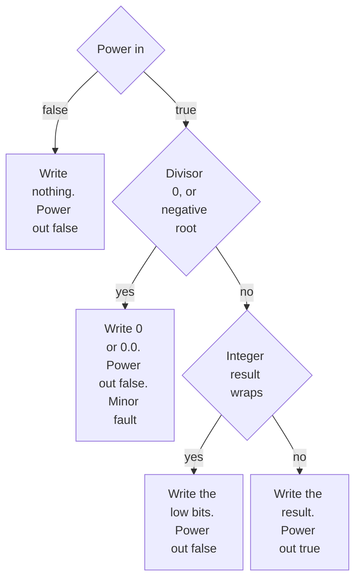
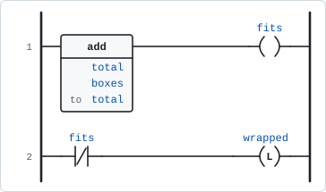

# Instructions: arithmetic and comparison

This page is for a reader who writes or reads a ladder [program](glossary.md#program)
and looks for an exact rule. It defines 15 [instructions](glossary.md#instruction) that
copy, calculate and compare numbers: `move`, 7 arithmetic instructions, `sqrt` and 6
comparisons.

| Instruction | What it does |
|---|---|
| [`move a d`](#move) | It writes the value of `a` to `d`. |
| [`add a b d`](#add) | It writes `a + b` to `d`. |
| [`sub a b d`](#sub) | It writes `a - b` to `d`. |
| [`mul a b d`](#mul) | It writes `a * b` to `d`. |
| [`div a b d`](#div) | It writes `a / b` to `d`. An integer quotient goes toward 0. |
| [`mod a b d`](#mod) | It writes the remainder of `a / b` to `d`. |
| [`neg a d`](#neg) | It writes `-a` to `d`. |
| [`abs a d`](#abs) | It writes the absolute value of `a` to `d`. |
| [`sqrt a d`](#sqrt) | It writes the square root of `a` to `d`. |
| [`eq a b`](#eq-ne-lt-gt-le-and-ge) | It passes power if `a = b`. |
| [`ne a b`](#eq-ne-lt-gt-le-and-ge) | It passes power if `a` is not equal to `b`. |
| [`lt a b`](#eq-ne-lt-gt-le-and-ge) | It passes power if `a < b`. |
| [`gt a b`](#eq-ne-lt-gt-le-and-ge) | It passes power if `a > b`. |
| [`le a b`](#eq-ne-lt-gt-le-and-ge) | It passes power if `a <= b`. |
| [`ge a b`](#eq-ne-lt-gt-le-and-ge) | It passes power if `a >= b`. |

In this table, `a` and `b` are the values that the instruction reads, and `d` is the
[tag](glossary.md#tag) that it writes. The first 9 instructions write `d` only on a
[true rung](glossary.md#true-rung). The 6 comparisons write no tag.

> #### Warning {: .warning}
>
> If an arithmetic result can move a machine, use the power out of the instruction to stop
> the machine or to latch an alarm. An integer result that is too
> large or too small for its type [wraps](glossary.md#wrap), and logex gives no
> [fault](glossary.md#fault). Example: in [the program `fill.ld`](#the-program-fillld),
> the total wraps to a negative value, and the valve opens again. The power out is false
> only in the scan in which the result wraps. [Do arithmetic](../howto/do-arithmetic.md)
> shows how to latch an alarm.

| To find | Go to |
|---|---|
| A rule that is the same for the 15 instructions | [Rules that are the same for the 15 instructions](#rules-that-are-the-same-for-the-15-instructions) |
| What an instruction writes when the result does not fit its type | [Results that a type cannot hold](#results-that-a-type-cannot-hold) |
| The rules of 1 instruction | Its heading: [`move`](#move), [Arithmetic](#arithmetic), [`sqrt`](#sqrt) or [Comparisons](#comparisons) |
| The value that an instruction writes for given [inputs](glossary.md#input) | [Examples](#examples) |
| The message of a wrong [rung](glossary.md#rung) | [Wrong rungs and their diagnostics](#wrong-rungs-and-their-diagnostics) |
| The message of a [warning](glossary.md#warning) | [Programs and their warnings](#programs-and-their-warnings) |
| A rule of a different subject | [See also](#see-also) |

If a rung breaks a rule of this page, logex does not [compile](glossary.md#compile) the
program. It returns a [diagnostic](glossary.md#diagnostic). For some programs that break
no rule, logex gives a warning, and the program compiles.

## Rules that are the same for the 15 instructions

Each part of this page uses these words.

| Word | Meaning |
|---|---|
| A source | An [operand](glossary.md#operand) that the instruction reads. `move`, `neg`, `abs` and `sqrt` have 1 source. The other instructions have 2 sources. |
| The destination | The operand that the instruction writes. Only the first 9 instructions have a destination. It is their last operand. |
| A run of an instruction | 1 time that a [scan](glossary.md#scan) runs the instruction |
| The power in | The [power flow](glossary.md#power-flow) that an instruction gets |
| The power out | The power flow that an instruction gives to the next instruction |
| A true rung | For an instruction, a rung is true if its power in is true. |
| A [false rung](glossary.md#false-rung) | For an instruction, a rung is false if its power in is false. |

[The power in and the power out](instructions-contacts-and-coils.md#the-power-in-and-the-power-out)
gives the power in for each place on a rung. It also gives the 2 cases in which an
instruction has no run.

### What each instruction does on a true rung and on a false rung

| Instruction | On a true rung | On a false rung |
|---|---|---|
| `move` | It writes the source to the destination. The power out is true. | It writes nothing. The power out is false. |
| `add`, `sub`, `mul`, `div`, `mod`, `neg`, `abs` | It calculates and writes the result. The power out is false if an integer result wraps or the divisor is 0. It is also false if a real result is out of the range of the type. Else it is true. | It writes nothing. The power out is false. |
| `sqrt` | It calculates and writes the root. The power out is true if the source is 0 or more. | It writes nothing. The power out is false. |
| `eq`, `ne`, `lt`, `gt`, `le`, `ge` | It compares the 2 sources. The power out is true if the condition is true. | It compares nothing. The power out is false. |

[Results that a type cannot hold](#results-that-a-type-cannot-hold) gives each case in
which the power out of a true rung is false. On a true rung, a fault of an operand also
makes the power out false. [Faults](#faults) gives the rules. In [IEC 61131-3](glossary.md#iec-61131-3),
the power out of a calculation is ENO.

### The operands

This table shows the forms of an operand, with an example of each.
[Source syntax](source-syntax.md#names) gives each form of a name.

| Operand | Source | Destination |
|---|---|---|
| A tag: `total` | Yes | Yes, but not an input |
| An [element](glossary.md#element): `levels[2]` | Yes | Yes |
| A number [member](glossary.md#member) of a [timer](glossary.md#timer) or a [counter](glossary.md#counter): `delay.acc` | Yes | Only `pre`, `acc` and `pv` |
| A member of a [function block](glossary.md#function-block): `meter.count` | Yes | No |
| A [literal](glossary.md#literal): `25`, `16#ff`, `2.5` | Yes | No |
| A [bit](glossary.md#bit), or a bool member: `status.3`, `delay.dn` | `move` only | `move` only |
| An [array](glossary.md#array): `levels` | No | No |
| An [instance](glossary.md#instance): `delay` | No | No |

These rules apply to each row of the table:

- An element can have literal [subscripts](glossary.md#subscript), `levels[2]`, or a
  tag as a subscript, `levels[slot]`.
- Of the members of a timer or a counter, logic writes only `pre` and `acc` of a timer,
  and `pv` of a counter. Of the bool members, `move` writes only `r` and `ld`.
- Only the body of a function block writes its members. A program reads them.
- An instance is a timer, a counter or an instance of a function block.
- A source can be the destination also. The instruction reads each source before it
  writes. Thus `add total flow total` adds `flow` to the value of `total` from the scan
  before.
- A tag of the [section](glossary.md#section) `var`, `var_output` or `var_external` can be a destination.
  [Declarations and types](declarations-and-types.md#sections) gives the sections.
- 2 sources can be the same tag: `add level level twice`.
- The [mnemonic](glossary.md#mnemonic) is not case-sensitive: `add`, `ADD` and `Add` are
  the same. Each of the 15 mnemonics is a [reserved word](glossary.md#reserved-word).

[Wrong rungs 1 to 17](#wrong-rungs-1-to-17-the-operands) show the diagnostics of an
operand.

### The type of the calculation

An instruction with a destination calculates in the [type](glossary.md#type) of the
destination. Each source must have that type, or [widen](glossary.md#widen) into it.
[Declarations and types](declarations-and-types.md#widening) gives each type that a type
widens into.

| Instruction | The type of the destination |
|---|---|
| `move` | Each [elementary type](glossary.md#elementary-type) |
| `add`, `sub`, `mul`, `div`, `abs` | An integer type or a real type |
| `neg` | A signed integer type or a real type |
| `mod` | An integer type |
| `sqrt` | `real` or `lreal` |
| `eq`, `ne`, `lt`, `gt`, `le`, `ge` | No destination. [The pairs of types](#the-pairs-of-types) gives the rule. |

These rules come from the type of the calculation:

- Each value in a calculation is a value of the type of the destination. Thus
  `add a b total` with 2 `int` sources and a `dint` total does not wrap at 32767.
- A [bit string](glossary.md#bit-string) is a pattern of bits, not a number. An
  arithmetic instruction and `sqrt` refuse a bit string. Convert it first, for
  example with `word_to_uint`.
- A bool is not a number. Only `move` takes a bool.
- An integer type that does not widen into the destination needs a conversion first. The
  diagnostic names the conversion, for example `dint_to_uint`.
  [Conversions](conversions.md) gives each conversion.

> #### Note {: .info}
>
> In IEC 61131-3, `INT + INT` calculates in `INT`, and the sum can wrap at 32767. In
> logex, `add` calculates in the type of the destination. A program from a different
> controller that depends on a result that wraps in the narrower type gives a different
> result in logex. [Port a program](../howto/port-a-program.md) gives the steps.

[Wrong rungs 18 to 37](#wrong-rungs-18-to-37-the-types) show the diagnostics of a type.

### A literal as a source

A literal source must be a value of the type of the calculation. For a comparison, it
must be a value of the type of the other source.
[Literals](literals.md#the-type-of-the-place) gives the values of each type.

| Literal | Rule |
|---|---|
| An integer literal in an integer calculation | It must be in the range of the type. `add 70000 1 count` is an error if `count` is a `uint`. |
| An integer literal in a real calculation | It must be a value that the real type holds exactly. `16777217` is an error for a `real`. |
| A real literal in an integer calculation | An error. `move 1.5 count` is an error if `count` is a `dint`. |
| A real literal in a real calculation | logex uses the nearest value of the real type. |
| A real literal that is not the shortest literal for that nearest value | Correct, and logex gives a warning: `16777217.0` and `0.33333333` get it for a `real`. A literal that is exactly a value of the type, or that is the same number as the shortest literal, gets no warning: `0.5`, `0.1`. |
| A real literal out of the range of the real type, or nearer to 0.0 than its [smallest positive value](#results-that-a-type-cannot-hold) | An error. `3.5e38` and `1.0e-40` are errors for a `real`. |
| A literal of value 0 as the divisor of `div` or `mod`, in any form: `0`, `-0`, `16#0`, `0.0`, `-0.0` | An error |
| A negative literal as the source of `sqrt` | An error. `-0.0` is 0.0, and it is correct. |
| Each source of an instruction is a literal | Correct, and logex gives a warning: the result never changes. `move` of a literal gets no warning. |

[A real literal in a real type](literals.md#a-real-literal-in-a-real-type) gives the rule
of the warning.

An operand is 1 tag or 1 literal. logex calculates no expression in an operand:
`move 5-3 count` is an error (wrong rung 51). To subtract, use `sub`.

A [based integer literal](literals.md#based-integer-literal) is a number, not a pattern of
bits. `16#ffff` is 65535, and thus `move 16#ffff trim` is an error if `trim` is an `int`
(wrong rung 52). A Logix controller writes -1 for the same text (1756-RM018A, page 869,
[How logex differs from Logix](../explanation/differences-from-logix.md#what-is-different-in-behaviour)).
To write the 16 bits into an `int`, use `move -1 trim`.

[Wrong rungs 38 to 52](#wrong-rungs-38-to-52-the-literals) show the diagnostics of a
literal. [Programs 1 to 4, 10 and 11](#programs-1-to-12-warnings) show the warnings.

### Results that a type cannot hold

On a true rung, the instruction calculates a result. This table gives what the
instruction does with each result.

| Result | Power out | Writes |
|---|---|---|
| A value of the type | True | The result |
| An integer out of the range of the type | False | The low bits of the result, in 2's complement for a signed type. The value wraps to the other end of the range. |
| A real that the type cannot hold exactly | True | The nearest value of the type |
| A real out of the range of the type | False | The largest value of the type for a positive result, the lowest value for a negative result |
| A real nearer to 0.0 than the smallest positive value | True | `0.0` |
| `-0.0` | True | `0.0` |
| A divisor of 0 | False | `0` or `0.0`, and a fault |
| A negative source of `sqrt` | False | `0.0`, and a fault |

The 2 faults are [minor faults](glossary.md#minor-fault): `:divide_by_zero` and
`:negative_sqrt`. No other row gives a fault.
[Integer cases 1 to 7, 13 and 14](#integer-cases-1-to-24) and
[real cases 1 to 10 and 19](#real-cases-1-to-20) show the rows of the table. The table
after each list of cases gives what each case shows.

A real tag never holds an infinity, a NaN, `-0.0` or a subnormal value. Thus the smallest
positive value of a `real` is `1.1754943508222875e-38`, and of an `lreal` it is
`2.2250738585072014e-308`. [Declarations and types](declarations-and-types.md#elementary-types)
gives the largest value and the lowest value of each type.

This diagram shows the work of an instruction with a destination in 1 run.



Figure: 1 run of `move`, an arithmetic instruction or `sqrt`. A real result follows the table of
[Results that a type cannot hold](#results-that-a-type-cannot-hold). A fault of an operand is not in the diagram. [Faults](#faults) gives it.

On a true rung, the instruction writes the destination also when the power out is false.
After a fault of an operand, it writes nothing. On a false rung, it writes nothing.

### The place of an instruction on a rung

| Item | Rule |
|---|---|
| The place | Each of the 15 instructions can be the first, a middle or the last instruction of a rung or of a [leg](glossary.md#leg). |
| After the instruction | Each instruction can come after it, because each run gives a power out. `add total flow total ote total_ok` writes the power out of `add` to `total_ok`. |
| After a timer instruction or a counter instruction | An error. No instruction comes after a timer instruction or a counter instruction on its path, for example after a `ton`, `tof`, `ctu` or `ctd`. [Instructions: timers and counters](instructions-timers-and-counters.md#the-place-of-an-instruction-on-a-rung) gives the rule. |
| A rung of comparisons only | An error. A rung must write a tag, run an instance or [jump](glossary.md#jump). [Source syntax](source-syntax.md#a-rung-must-write-or-jump) gives the rule. |
| 2 instructions on the same rung | `add a b total add total 1 total` is correct. The second `add` reads the value that the first `add` wrote. Its power in is the power out of the first `add`. |

[Wrong rung 66](#wrong-rungs-53-to-66-the-comparisons) and
[wrong rungs 67 and 68](#wrong-rungs-67-and-68-the-place-on-a-rung) show the diagnostics.

### Faults

A run of these instructions can cause 4 faults. logex reads a tag that is a subscript or
a bit number when the instruction reads or writes the operand.

| Fault | Rule |
|---|---|
| `:index_out_of_range` | A [major fault](glossary.md#major-fault). The cause: in `levels[slot]`, `slot` is less than 0, or more than the last subscript of `levels`. The instruction writes nothing, and the power out is false. |
| `:bit_out_of_range` | A major fault, only in `move`. The cause: in `status.[slot]`, `slot` is less than 0, or more than the last bit number of `status`. The instruction writes nothing, and the power out is false. |
| `:divide_by_zero` | A minor fault. The cause: the divisor of `div` or `mod` is 0 when the instruction runs. The instruction writes `0`, or `0.0` in a real destination, and the power out is false. |
| `:negative_sqrt` | A minor fault. The cause: the source of `sqrt` is less than 0 when the instruction runs. The instruction writes `0.0`, and the power out is false. |

After a fault, the scan runs the next instruction. A [state](glossary.md#state) holds the
faults of its last scan in the field `faults`. A [cycle](glossary.md#cycle) of a
[configuration](glossary.md#configuration) gives each fault as an event. The field `read` of a `:negative_sqrt`
fault holds the source. [Faults](faults.md) gives the fields of a fault, and what logex
does with a major fault.

### Values from one scan to the next

These instructions keep no value from one scan to the next. A
[restart](glossary.md#restart) or an [online edit](glossary.md#online-edit) has no effect
on these instructions. Each destination keeps its value by the rules of its tag.
[Retained values](retained-values-and-store.md) gives the rules of a tag
at a restart.

## `move`

| Part | Rule |
|---|---|
| Operands | A source, then the destination: `move speed shown`. |
| Types | The type of the source is the type of the destination, or it widens into it. A bool can go into a bool, and into a bit string. |
| On a true rung | It writes the value of the source to the destination. A value that widens into a real type is exact: `-32768` becomes `-32768.0`. |
| On a false rung | It writes nothing. |
| Power out | The power in. On a true rung, the power out is false only after a fault of an operand. |
| Faults | `:index_out_of_range` and `:bit_out_of_range`. [Faults](#faults) gives the rules. |
| Warnings | A `move` of a literal gets no warning. A real literal gets the warning of [A literal as a source](#a-literal-as-a-source) (program 9). A `move` that writes a whole tag gets a warning if a [coil](glossary.md#coil) writes a bit of the same tag (program 11). |
| Diagnostics | Wrong rungs [2, 7, 10 and 13 to 15](#wrong-rungs-1-to-17-the-operands), [18 to 22](#wrong-rungs-18-to-37-the-types), and [38, 40 to 45, 51 and 52](#wrong-rungs-38-to-52-the-literals) |
| Examples | [`move` 1 to 12](#move-cases-1-to-12) |

`move` is the only instruction of this page that takes a bool, a bit and a bool member.
`move 1 lamp` writes 1 to a bool tag `lamp`. The literal for a bool is `0` or `1`.

A `move` to `pre` of a timer or to `pv` of a counter changes the
[preset](glossary.md#preset) of the instance.
[Instructions: timers and counters](instructions-timers-and-counters.md#the-preset) gives
the rule.

## Arithmetic

The 7 arithmetic instructions are `add`, `sub`, `mul`, `div`, `mod`, `neg` and `abs`.
Each instruction has the rules of
[Rules that are the same for the 15 instructions](#rules-that-are-the-same-for-the-15-instructions).
The tables of this part give the rules that are different for each instruction.

### `add`

| Part | Rule |
|---|---|
| Operands | 2 sources, then the destination: `add total flow total`. |
| Types | The destination has an integer type or a real type. |
| On a true rung | It writes `a + b`. |
| On a false rung | It writes nothing. |
| Power out | False if an integer result wraps, or if a real result is out of the range of the type. Else true. [Results that a type cannot hold](#results-that-a-type-cannot-hold) gives each case. |
| Faults | `:index_out_of_range` |
| Warnings | Each source is a literal (program 1). A real literal gets the warning of [A literal as a source](#a-literal-as-a-source). |
| Diagnostics | Wrong rungs [1, 5, 6, 8, 9, 11, 12, 16 and 17](#wrong-rungs-1-to-17-the-operands), [23 to 29](#wrong-rungs-18-to-37-the-types), [39](#wrong-rungs-38-to-52-the-literals) and [67](#wrong-rungs-67-and-68-the-place-on-a-rung) |
| Examples | [Integers 1, 2, 5, 7 to 9, 23 and 24](#integer-cases-1-to-24), [reals 1, 2, 5 and 12](#real-cases-1-to-20) |

### `sub`

| Part | Rule |
|---|---|
| Operands | 2 sources, then the destination: `sub full level space`. |
| Types | The destination has an integer type or a real type. |
| On a true rung | It writes `a - b`: the second source subtracted from the first source. |
| On a false rung | It writes nothing. |
| Power out | False if an integer result wraps, or if a real result is out of the range of the type. Else true. |
| Faults | `:index_out_of_range` |
| Warnings | The same as `add` |
| Diagnostics | The same as `add`. Each message names `sub`. |
| Examples | [Integers 3 and 6](#integer-cases-1-to-24) |

### `mul`

| Part | Rule |
|---|---|
| Operands | 2 sources, then the destination: `mul hz 60.0 rpm`. |
| Types | The destination has an integer type or a real type. |
| On a true rung | It writes `a * b`. |
| On a false rung | It writes nothing. |
| Power out | False if an integer result wraps, or if a real result is out of the range of the type. Else true. |
| Faults | `:index_out_of_range` |
| Warnings | The same as `add` |
| Diagnostics | The same as `add`. Each message names `mul`. |
| Examples | [Integers 4](#integer-cases-1-to-24), [reals 3, 4, 6 and 7](#real-cases-1-to-20) |

### `div`

| Part | Rule |
|---|---|
| Operands | 2 sources, then the destination: `div total minutes per_minute`. The first source is the dividend and the second source is the divisor. |
| Types | The destination has an integer type or a real type. |
| On a true rung | It writes `a / b`. In an integer type, the quotient goes toward 0: `div -7 2 q` writes `-3`. In a real type, it writes the nearest value of the type. |
| A divisor of 0 | It writes `0`, or `0.0` in a real type. The power out is false, and the scan gets the minor fault `:divide_by_zero`. A literal divisor of value 0 is an error. |
| The smallest value of a signed type divided by `-1` | The result wraps to the smallest value: `div -2147483648 -1` writes `-2147483648` to a `dint`. The power out is false. |
| On a false rung | It writes nothing. |
| Power out | False if the divisor is 0, if an integer result wraps, or if a real result is out of the range of the type. Else true. |
| Faults | `:divide_by_zero` and `:index_out_of_range` |
| Warnings | The same as `add` |
| Diagnostics | Wrong rungs [46 and 48](#wrong-rungs-38-to-52-the-literals), and the same as `add` |
| Examples | [Integers 10, 13 and 15](#integer-cases-1-to-24), [reals 8 to 11](#real-cases-1-to-20) |

### `mod`

| Part | Rule |
|---|---|
| Operands | 2 sources, then the destination: `mod count 12 loose`. |
| Types | Only integer types. The sources and the destination cannot be real. The rules of this table are the same for each integer type. |
| On a true rung | It writes the remainder of `a / b`. The remainder has the sign of the first source: `mod -7 3 r` writes `-1`, and `mod 7 -3 r` writes `1`. |
| A divisor of 0 | It writes `0`. The power out is false, and the scan gets the minor fault `:divide_by_zero`. A literal divisor of value 0 is an error. |
| The smallest value of a signed type divided by `-1` | It writes `0`, and the power out is true. |
| On a false rung | It writes nothing. |
| Power out | True if the divisor is not 0. |
| Faults | `:divide_by_zero` and `:index_out_of_range` |
| Warnings | The same as `add` |
| Diagnostics | Wrong rungs [30, 31](#wrong-rungs-18-to-37-the-types) and [47](#wrong-rungs-38-to-52-the-literals), and the same as `add` |
| Examples | [Integers 11, 12, 14 and 16](#integer-cases-1-to-24) |

### `neg`

| Part | Rule |
|---|---|
| Operands | 1 source, then the destination: `neg speed reverse`. |
| Types | The destination has a signed integer type or a real type. An unsigned destination is an error, and the diagnostic names a signed type to declare. |
| On a true rung | It writes `0 - a`. |
| The smallest value of a signed type | It has no positive value in the type. The result wraps to the same value, and the power out is false: `neg -2147483648 d` writes `-2147483648` to a `dint`. |
| On a false rung | It writes nothing. |
| Power out | False if the result wraps. Else true. |
| Faults | `:index_out_of_range` |
| Warnings | The source is a literal (program 2). |
| Diagnostics | Wrong rungs [32 to 34](#wrong-rungs-18-to-37-the-types), and the same as `add` |
| Examples | [Integers 17, 18 and 21](#integer-cases-1-to-24), [reals 13](#real-cases-1-to-20) |

### `abs`

| Part | Rule |
|---|---|
| Operands | 1 source, then the destination: `abs drift error`. |
| Types | The destination has an integer type or a real type. An unsigned destination is correct. |
| On a true rung | It writes the absolute value of `a`. |
| The smallest value of a signed type | The result wraps to the same value, and the power out is false: `abs -2147483648 d` writes `-2147483648` to a `dint`. |
| On a false rung | It writes nothing. |
| Power out | False if the result wraps. Else true. |
| Faults | `:index_out_of_range` |
| Warnings | The source is a literal, as for `neg`. |
| Diagnostics | Wrong rung [34](#wrong-rungs-18-to-37-the-types) for a bit string, as for `neg`, and the same as `add` |
| Examples | [Integers 19, 20 and 22](#integer-cases-1-to-24), [reals 14](#real-cases-1-to-20) |

## `sqrt`

| Part | Rule |
|---|---|
| Operands | 1 source, then the destination: `sqrt hz root`. |
| Types | The destination is a `real` or an `lreal`. The source is a number of the type of the destination, or of a type that widens into it. Thus an `int` source can go into a `real`, and a `dint` source can go into an `lreal`. |
| On a true rung | It writes the square root of `a`, as the nearest value of the type of the destination. The root of 0.0 is 0.0. |
| A negative source | It writes `0.0`. The power out is false, and the scan gets the minor fault `:negative_sqrt`. The field `read` of the fault holds the source. A negative literal source is an error. The literal `-0.0` is not negative. |
| On a false rung | It writes nothing. |
| Power out | True if the source is 0 or more. |
| Faults | `:negative_sqrt` and `:index_out_of_range` |
| Warnings | The source is a literal (program 3). |
| Diagnostics | Wrong rungs [3](#wrong-rungs-1-to-17-the-operands), [35 to 37](#wrong-rungs-18-to-37-the-types), [49 and 50](#wrong-rungs-38-to-52-the-literals) |
| Examples | [Reals 15 to 20](#real-cases-1-to-20) |

A [Logix](glossary.md#logix) controller takes the root of the absolute value of a
negative source. logex does not. The root of `-0.25` is never `0.5` in logex.
[How logex differs from Logix](../explanation/differences-from-logix.md#what-is-different-in-behaviour)
gives the source.

## Comparisons

A comparison reads 2 sources and writes no tag. Its power out is true if its power in is
true and its condition is true.

### `eq`, `ne`, `lt`, `gt`, `le` and `ge`

| Instruction | Power out true if | IEC |
|---|---|---|
| `eq a b` | `a` is equal to `b` | `EQ` |
| `ne a b` | `a` is not equal to `b` | `NE` |
| `lt a b` | `a` is less than `b` | `LT` |
| `gt a b` | `a` is more than `b` | `GT` |
| `le a b` | `a` is less than `b`, or equal to `b` | `LE` |
| `ge a b` | `a` is more than `b`, or equal to `b` | `GE` |

| Part | Rule |
|---|---|
| Operands | 2 sources: `ge total setpoint`. |
| Types | [The pairs of types](#the-pairs-of-types) gives the rule. |
| On a true rung | It compares the 2 values. The power out is the result. |
| On a false rung | It compares nothing. The power out is false. |
| Faults | `:index_out_of_range` |
| Warnings | 2 literals (program 4). A literal at a limit of the type of the tag, if the result never changes (programs 5 to 8). A real literal gets the warning of [A literal as a source](#a-literal-as-a-source) (program 10). |
| Diagnostics | Wrong rungs [4](#wrong-rungs-1-to-17-the-operands), [53 to 66](#wrong-rungs-53-to-66-the-comparisons) and [68](#wrong-rungs-67-and-68-the-place-on-a-rung) |
| Examples | [Comparisons 1 to 16](#comparison-cases-1-to-16) |

### The pairs of types

| `a` | `b` | Rule |
|---|---|---|
| An integer | An integer of the same type or of a different type | Correct. logex compares the 2 values exactly. Thus an `sint` with the value `-1` is less than a `udint` with the value `0`. |
| A real | A real | Correct. logex compares the 2 values exactly. A `real` and an `lreal` hold 0.1 as 2 different values. Thus they are not equal. |
| An integer | A real | Correct only if the integer type widens into the real type. An `int` widens into a `real`. A `dint` widens into an `lreal`, and not into a `real`. |
| A bit string | A bit string | Correct, also if the 2 types have different numbers of bits. logex compares the bits as an unsigned integer. |
| A bit string | An integer tag or member, a real tag, or a real literal | An error. Convert 1 of them first. |
| A bit string | An integer literal | Correct if the bit string type holds the value: `eq status 255`. |
| A bool, a bit or a bool member | Each type | An error. Use `xic` or `xio` to read a bool. |

The order of the sources is the order of the condition: `lt a b` passes power if `a` is
less than `b`. The rules of the table are the same in the other order.

### A literal in a comparison

| Case | Rule |
|---|---|
| A literal and a tag | The literal must be a value of the type of the tag. `lt boxes 70000` is an error if `boxes` is a `uint`. |
| A literal and a tag at a limit of the type of the tag | Correct, and logex gives a warning if the result never changes. `ge boxes 0` with a `uint` tag is always true, and it gets the warning. `le step -128` with an `sint` tag can change, and it gets no warning. `ge speed -3.4028235e38` with a `real` tag is always true, and it gets the warning. |
| A real literal and a real tag | logex compares the tag with the value that the real type holds for the literal. Thus `move 37.1 sp` and then `eq sp 37.1` passes power. |
| 2 literals | Correct, and logex gives a warning: the result never changes. An integer literal is its integer value, from -9223372036854775808 to 18446744073709551615. A real literal is an `lreal` value. logex compares the 2 values exactly: `eq 1 1.0` is true, and `eq 9007199254740993 9007199254740992` is false. |

logex gives the warning of a limit for an integer type, a bit string type and a real type.
[Comparison of 2 literals](literals.md#comparison-of-2-literals) gives the range of a
literal in a comparison of 2 literals.

## Examples

Each example is a program or a list of rungs, with a script that runs it. It is not
necessary to read a script, because the page shows each line that it prints. To run a
script, enter its command in the directory `examples` of the repository. Each script
that runs a scan uses `Logex.Runtime.scan/2`, which adds 0 ms to the time of the program
at each scan. These instructions do not read the time.

### The scripts that run the examples

The scripts of the examples read 3 files. The 3 files are in the directory
`examples/instructions-arithmetic-and-comparison` of the repository.

| File | What it does |
|---|---|
| `scans.exs` | It runs the scans of a program, and prints a table of the tags after each scan, and each fault of the scan. |
| `cases.exs` | It runs the cases. Each case is 1 rung with 1 scan. It compiles a program for each case from the [declarations](glossary.md#declaration) of `tags.txt` and the rung. Then it runs 1 scan and prints the inputs, the [outputs](glossary.md#output) that the rung names and each fault. Each input that the case does not give is 0. |
| `tags.txt` | The declarations of the cases and of the wrong rungs |

<!-- file: instructions-arithmetic-and-comparison/scans.exs -->
```elixir
# scans.(file, inputs, names) compiles the program `file` and runs its scans. The map
# `inputs` gives, for each input, a list with its value in each scan. The script prints
# a table with 1 row for each scan: the number of the scan and the value of each name
# after the scan. After a row, it prints each fault of the scan.
fn file, inputs, names ->
  {:ok, program} = Logex.compile_file(file)

  scan = fn values, {number, state, rows} ->
    now = Map.new(Enum.zip(Map.keys(inputs), values))
    state = Logex.Runtime.put_inputs(program, state, now)
    {_outputs, state} = Logex.Runtime.scan(program, state)
    cells = Enum.map([number | Enum.map(names, &state.env[&1])], &"#{&1}")
    {number + 1, state, [{cells, state.faults} | rows]}
  end

  {_number, _state, rows} =
    inputs
    |> Map.values()
    |> Enum.zip_with(& &1)
    |> Enum.reduce({1, Logex.Runtime.instance(program), []}, scan)

  rows = [{["scan" | names], []} | Enum.reverse(rows)]

  widths =
    Enum.zip_with(Enum.map(rows, &elem(&1, 0)), fn column ->
      Enum.max(Enum.map(column, &String.length/1))
    end)

  for {cells, faults} <- rows do
    IO.puts(Enum.join(Enum.zip_with(cells, widths, &String.pad_leading/2), "  "))

    for fault <- faults,
        do: IO.puts("      fault  #{fault.severity}, #{inspect(fault.kind)}, line #{fault.line}")
  end
end
```

<!-- file: instructions-arithmetic-and-comparison/cases.exs -->
```elixir
# cases.(first, cases) runs 1 scan of each case. A case is a rung and a map with the
# value of some inputs. Each other input is 0. The program of a case is the
# declarations of `tags.txt` and the rung. For each case, the script prints the number
# of the case and its rung. Then it prints the inputs, each output that the rung names
# with `ok` first, and each fault of the scan.
tags = File.read!("instructions-arithmetic-and-comparison/tags.txt")

value = fn
  list when is_list(list) -> inspect(list)
  number -> "#{number}"
end

pairs = fn
  [] -> "no input"
  list -> Enum.map_join(list, ", ", fn {name, number} -> "#{name} = #{value.(number)}" end)
end

fault = fn fault ->
  "      fault  #{fault.severity}, #{inspect(fault.kind)}, read #{inspect(fault.read)}"
end

fn first, cases ->
  for {{rung, inputs}, number} <- Enum.with_index(cases, first) do
    {:ok, program} = Logex.compile(tags <> rung, name: "case")
    state = Logex.Runtime.put_inputs(program, Logex.Runtime.instance(program), inputs)
    {outputs, state} = Logex.Runtime.scan(program, state)
    named = Map.take(outputs, String.split(rung, [" ", "["]))
    named = Enum.sort_by(named, fn {name, _value} -> {name != "ok", name} end)
    head = String.pad_leading("#{number}", 2) <> "  " <> rung
    lines = [head, "      in     " <> pairs.(Enum.sort(inputs)), "      out    " <> pairs.(named)]
    IO.puts(Enum.join(lines ++ Enum.map(state.faults, fault), "\n"))
  end
end
```

The name of each tag gives its type. `a_dint` and `b_dint` are `dint` sources,
`d_real` is a `real` destination, and `ok` gets the power out. `go` is a bool input:
`xic go` with `go` at 0 makes a false rung. Each output starts at 0.

<!-- file: instructions-arithmetic-and-comparison/tags.txt -->
```text
var_input  go       bool
var_input  slot     dint
var_input  a_bool   bool
var_input  a_sint   sint
var_input  b_sint   sint
var_input  a_int    int
var_input  a_dint   dint
var_input  b_dint   dint
var_input  a_lint   lint
var_input  a_usint  usint
var_input  b_usint  usint
var_input  a_uint   uint
var_input  a_udint  udint
var_input  a_ulint  ulint
var_input  b_ulint  ulint
var_input  a_byte   byte
var_input  a_word   word
var_input  a_real   real
var_input  b_real   real
var_input  a_lreal  lreal
var_input  b_lreal  lreal
var_output d_bool   bool
var_output d_sint   sint
var_output d_int    int
var_output d_dint   dint
var_output d_usint  usint
var_output d_uint   uint
var_output d_ulint  ulint
var_output d_word   word
var_output d_real   real
var_output d_lreal  lreal
var_output d_array  dint[3]
var_output ok       bool
var        delay    ton
var        boxes    ctu
```

The scripts print a real value as Elixir prints a floating-point number of 64 bits. Thus
the `real` value of 0.1 prints as `0.10000000149011612`, and the largest `real` value
prints as `3.4028234663852886e38`. A message of logex gives the shortest literal for the
same value: `0.1` and `3.4028235e38`.

### The program `fill.ld`

A fill valve stays open until the total flow gets to the setpoint. The program is the file
`examples/fill.ld` of the repository.

| Rung | What it does |
|---|---|
| 1 | `add` adds the flow of this scan to the total. `total_ok` is 0 in a scan in which the total wraps. |
| 2 | If `total_ok` is 0, `otl` [latches](glossary.md#latch) `overflow`. |
| 3 | `ge` writes 1 to `full` when the total is equal to the setpoint or more. |
| 4 | The valve is open while `full` is 0. |
| 5 | `div` calculates the flow for each minute. |

<!-- file: fill.ld -->
```text
var_input flow dint
var_input setpoint dint
var_input minutes dint
var_output valve bool
var_output total dint
var_output total_ok bool
var_output per_minute dint
var_output overflow bool
var full bool

add total flow total ote total_ok
xio total_ok otl overflow
ge total setpoint ote full
xio full ote valve
div total minutes per_minute
```

<!-- rung: fill.ld -->


The script reads the file [`scans.exs`](#the-scripts-that-run-the-examples). The map
`inputs` has 1 list for each input. The list holds the value of the input in
each scan.

```elixir
{scans, _} = Code.eval_file("instructions-arithmetic-and-comparison/scans.exs")

inputs = %{
  "flow" => [400, 400, 400, 2_147_483_000, 2_147_483_000, -5],
  "setpoint" => [1000, 1000, 1000, 1000, 1000, 1000],
  "minutes" => [0, 1, 2, 2, 2, 2]
}

names = ["flow", "minutes", "total", "total_ok", "overflow", "full", "valve", "per_minute"]
scans.("fill.ld", inputs, names)
```

```console
$ mix run instructions-arithmetic-and-comparison-fill.exs
scan        flow  minutes        total  total_ok  overflow  full  valve   per_minute
   1         400        0          400         1         0     0      1            0
      fault  minor, :divide_by_zero, line 15
   2         400        1          800         1         0     0      1          800
   3         400        2         1200         1         0     1      0          600
   4  2147483000        2  -2147483096         0         1     0      1  -1073741548
   5  2147483000        2          -96         1         1     0      1          -48
   6          -5        2         -101         1         1     0      1          -50
```

| Scan | What the scan shows |
|---|---|
| 1 | `minutes` is 0. `div` writes 0 to `per_minute`, and the scan gets the fault `:divide_by_zero` of line 15. The other rungs run. |
| 2 | `div` writes 800 / 1 = 800. |
| 3 | The total is 1200, which is more than the setpoint 1000. `ge` writes 1 to `full`, and the valve closes. |
| 4 | 1200 + 2147483000 is more than 2147483647. The total wraps to -2147483096, and `total_ok` is 0. Rung 2 latches `overflow`. The total is less than the setpoint, and the valve opens again. |
| 5 | -2147483096 + 2147483000 = -96, which fits. `total_ok` is 1 again, but `overflow` stays 1. |
| 6 | A flow of -5 makes the total less. `div` writes -101 / 2 = -50, because the quotient goes toward 0. |

### The script `fill.exs`: faults, a cycle and 2 refusals

The script `fill.exs` runs [the program `fill.ld`](#the-program-fillld) for 6 scans,
100 ms apart. After each scan, it prints the faults of the scan. Then it runs the
program in a configuration for 1 cycle and prints the events. Last, it compiles 2
programs that logex refuses, and prints each diagnostic.

```elixir
{:ok, fill} = Logex.compile_file("fill.ld")

scan = fn state, label, inputs ->
  state = Logex.Runtime.put_inputs(fill, state, inputs)
  {outputs, state} = Logex.Runtime.scan(fill, state, 100)
  IO.puts("#{label}  #{inspect(outputs)}")
  for fault <- state.faults, do: IO.puts("    #{inspect(fault)}")
  state
end

Logex.Runtime.instance(fill)
|> scan.("400 in, no minutes yet", %{"flow" => 400, "setpoint" => 1000})
|> scan.("a minute in           ", %{"minutes" => 1})
|> scan.("past the setpoint     ", %{"minutes" => 2})
|> scan.("a meter gone wild     ", %{"flow" => 2_147_483_000})
|> scan.("still wild            ", %{})
|> scan.("a backflow of 5       ", %{"flow" => -5})

config =
  Logex.Configuration.new!(
    name: "plant",
    programs: [fill],
    tasks: [%Logex.Configuration.Task{name: "fill", interval: 100, priority: 1}],
    globals: [
      %Logex.Configuration.Global{name: "flow", type: :dint, at: "meter.i.0"},
      %Logex.Configuration.Global{name: "valve", type: :bool, at: "panel.q.0"}
    ],
    instances: [%Logex.Configuration.Instance{name: "f1", type: "fill", task: "fill"}],
    connections: [
      %Logex.Configuration.Connection{instance: "f1", member: "flow", to: "flow"},
      %Logex.Configuration.Connection{instance: "f1", member: "setpoint", to: 1000},
      %Logex.Configuration.Connection{instance: "f1", member: "minutes", to: 0},
      %Logex.Configuration.Connection{instance: "f1", member: "valve", to: "valve"}
    ]
  )

{_rt, outputs, events} = Logex.Runtime.cycle(Logex.Runtime.start(config), 0, %{"flow" => 400})
IO.puts("a cycle: #{inspect(outputs)}")
for event <- events, do: IO.puts("    #{inspect(event)}")

{:error, [diagnostic]} =
  Logex.compile("var_input total dint\nvar_output rate dint\ndiv total 0 rate", name: "rate")

IO.puts(Logex.Diagnostic.format(diagnostic))

{:error, [diagnostic]} = Logex.compile("var_output x dint\nmove 5-3 x", name: "minus")
IO.puts(Logex.Diagnostic.format(diagnostic))
```

```console
$ mix run fill.exs
400 in, no minutes yet  %{"overflow" => 0, "per_minute" => 0, "total" => 400, "total_ok" => 1, "valve" => 1}
    %Logex.Fault{severity: :minor, kind: :divide_by_zero, instruction: :div, path: nil, file: "fill.ld", line: 15, read: nil}
a minute in             %{"overflow" => 0, "per_minute" => 800, "total" => 800, "total_ok" => 1, "valve" => 1}
past the setpoint       %{"overflow" => 0, "per_minute" => 600, "total" => 1200, "total_ok" => 1, "valve" => 0}
a meter gone wild       %{"overflow" => 1, "per_minute" => -1073741548, "total" => -2147483096, "total_ok" => 0, "valve" => 1}
still wild              %{"overflow" => 1, "per_minute" => -48, "total" => -96, "total_ok" => 1, "valve" => 1}
a backflow of 5         %{"overflow" => 1, "per_minute" => -50, "total" => -101, "total_ok" => 1, "valve" => 1}
a cycle: %{"valve" => 1}
    {:ran, "fill", "f1", 0}
    {:fault, "fill", "f1", %Logex.Fault{severity: :minor, kind: :divide_by_zero, instruction: :div, path: nil, file: "fill.ld", line: 15, read: nil}}
line 3: `div` divides by the literal `0`: a zero divisor gives 0 and passes no power on every scan, so a literal one is refused
line 2, column 6: missing separator before `-`: "5-3" is neither a tag nor a number, and a sign begins a number
```

| Line | What the line shows |
|---|---|
| 1 and 2 | `minutes` is 0, and `div` gets the minor fault `:divide_by_zero`. The scan continues. |
| 5 | The total goes past the top of a `dint` and wraps. `total_ok` is 0 for this scan, and `otl` latches `overflow`. |
| 6 and 7 | The total counts on from the negative value. |
| 8 to 10 | A cycle gives the fault as an event after the event `:ran` of its instance. |
| 11 and 12 | logex refuses a literal divisor of 0, and the text `5-3`. |

### The program `belt_total.ld`

The input `boxes` is the change of the number of boxes on a belt in 1 scan. The total
is an `sint`, which wraps at 127 and at -128. The program is in the directory
`examples/instructions-arithmetic-and-comparison` of the repository.

<!-- file: instructions-arithmetic-and-comparison/belt_total.ld -->
```text
var_input  boxes   sint
var_output total   sint
var_output fits    bool
var_output wrapped bool

add total boxes total ote fits
xio fits otl wrapped
```

<!-- rung: instructions-arithmetic-and-comparison/belt_total.ld -->


<!-- timing: instructions-arithmetic-and-comparison-belt-total.timing.exs -->


The diagram shows that the power out of `add` is false only in a scan in which the total
wraps. The latch `wrapped` keeps a record that the total wrapped. The diagram gives
100 ms to each scan. `add` does not read the time.

```elixir
{scans, _} = Code.eval_file("instructions-arithmetic-and-comparison/scans.exs")

inputs = %{"boxes" => [25, 25, 25, 25, 25, 25, 25, 25, -40, -40]}

names = ["boxes", "total", "fits", "wrapped"]
scans.("instructions-arithmetic-and-comparison/belt_total.ld", inputs, names)
```

```console
$ mix run instructions-arithmetic-and-comparison-belt-total.exs
scan  boxes  total  fits  wrapped
   1     25     25     1        0
   2     25     50     1        0
   3     25     75     1        0
   4     25    100     1        0
   5     25    125     1        0
   6     25   -106     0        1
   7     25    -81     1        1
   8     25    -56     1        1
   9    -40    -96     1        1
  10    -40    120     0        1
```

| Scan | What the scan shows |
|---|---|
| 1 to 5 | Each scan adds 25. |
| 6 | 125 + 25 = 150, which is more than 127. The low 8 bits of 150 are the `sint` value -106. `fits` is 0, and rung 2 latches `wrapped`. |
| 7 to 9 | `fits` is 1 again. |
| 10 | The sum of -96 and -40 is -136, which is less than -128. The total wraps to 120, and `fits` is 0. |

### `move` cases 1 to 12

The 4 scripts of the cases read the file [`cases.exs`](#the-scripts-that-run-the-examples).

```elixir
{cases, _} = Code.eval_file("instructions-arithmetic-and-comparison/cases.exs")

cases.(1, [
  {"move a_dint d_dint ote ok", %{"a_dint" => -5}},
  {"move a_uint d_dint ote ok", %{"a_uint" => 65535}},
  {"move a_int d_real ote ok", %{"a_int" => -32768}},
  {"move a_real d_lreal ote ok", %{"a_real" => 0.1}},
  {"move a_bool d_word ote ok", %{"a_bool" => 1}},
  {"move 16#ffff d_dint ote ok", %{}},
  {"move 0.1 d_real ote ok", %{}},
  {"move 1 d_bool ote ok", %{}},
  {"xic go move a_dint d_dint ote ok", %{"a_dint" => 7, "go" => 0}},
  {"move a_word.3 d_bool ote ok", %{"a_word" => 8}},
  {"move a_dint d_array[slot] ote ok", %{"a_dint" => 7, "slot" => 3}},
  {"move a_word.[slot] d_bool ote ok", %{"a_word" => 8, "slot" => 16}}
])
```

```console
$ mix run instructions-arithmetic-and-comparison-move.exs
 1  move a_dint d_dint ote ok
      in     a_dint = -5
      out    ok = 1, d_dint = -5
 2  move a_uint d_dint ote ok
      in     a_uint = 65535
      out    ok = 1, d_dint = 65535
 3  move a_int d_real ote ok
      in     a_int = -32768
      out    ok = 1, d_real = -32768.0
 4  move a_real d_lreal ote ok
      in     a_real = 0.1
      out    ok = 1, d_lreal = 0.10000000149011612
 5  move a_bool d_word ote ok
      in     a_bool = 1
      out    ok = 1, d_word = 1
 6  move 16#ffff d_dint ote ok
      in     no input
      out    ok = 1, d_dint = 65535
 7  move 0.1 d_real ote ok
      in     no input
      out    ok = 1, d_real = 0.10000000149011612
 8  move 1 d_bool ote ok
      in     no input
      out    ok = 1, d_bool = 1
 9  xic go move a_dint d_dint ote ok
      in     a_dint = 7, go = 0
      out    ok = 0, d_dint = 0
10  move a_word.3 d_bool ote ok
      in     a_word = 8
      out    ok = 1, d_bool = 1
11  move a_dint d_array[slot] ote ok
      in     a_dint = 7, slot = 3
      out    ok = 0, d_array = [0, 0, 0]
      fault  major, :index_out_of_range, read {3}
12  move a_word.[slot] d_bool ote ok
      in     a_word = 8, slot = 16
      out    ok = 0, d_bool = 0
      fault  major, :bit_out_of_range, read 16
```

| Case | What the case shows |
|---|---|
| 2 to 5 | A source of a type that widens into the destination. A `real` 0.1 is `0.10000000149011612` in an `lreal`. |
| 6 to 8 | A literal source |
| 9 | A false rung: `move` writes nothing. `d_dint` keeps its [initial value](glossary.md#initial-value) 0. |
| 10 | A bit as a source |
| 11 and 12 | A fault of an operand: `move` writes nothing, and the power out is false. |

### Integer cases 1 to 24

```elixir
{cases, _} = Code.eval_file("instructions-arithmetic-and-comparison/cases.exs")

cases.(1, [
  {"add a_dint b_dint d_dint ote ok", %{"a_dint" => 2, "b_dint" => 3}},
  {"add a_dint b_dint d_dint ote ok", %{"a_dint" => 2_147_483_647, "b_dint" => 1}},
  {"sub a_dint b_dint d_dint ote ok", %{"a_dint" => -2_147_483_648, "b_dint" => 1}},
  {"mul a_dint b_dint d_dint ote ok", %{"a_dint" => 65536, "b_dint" => 65536}},
  {"add a_sint b_sint d_sint ote ok", %{"a_sint" => 127, "b_sint" => 1}},
  {"sub a_usint b_usint d_usint ote ok", %{"a_usint" => 0, "b_usint" => 1}},
  {"add a_ulint b_ulint d_ulint ote ok",
   %{"a_ulint" => 18_446_744_073_709_551_615, "b_ulint" => 1}},
  {"add a_int a_int d_dint ote ok", %{"a_int" => 32767}},
  {"add a_sint a_usint d_int ote ok", %{"a_sint" => -128, "a_usint" => 255}},
  {"div a_dint b_dint d_dint ote ok", %{"a_dint" => -7, "b_dint" => 2}},
  {"mod a_dint b_dint d_dint ote ok", %{"a_dint" => -7, "b_dint" => 3}},
  {"mod a_dint b_dint d_dint ote ok", %{"a_dint" => 7, "b_dint" => -3}},
  {"div a_dint b_dint d_dint ote ok", %{"a_dint" => 7, "b_dint" => 0}},
  {"mod a_dint b_dint d_dint ote ok", %{"a_dint" => 7, "b_dint" => 0}},
  {"div a_dint b_dint d_dint ote ok", %{"a_dint" => -2_147_483_648, "b_dint" => -1}},
  {"mod a_dint b_dint d_dint ote ok", %{"a_dint" => -2_147_483_648, "b_dint" => -1}},
  {"neg a_dint d_dint ote ok", %{"a_dint" => 5}},
  {"neg a_dint d_dint ote ok", %{"a_dint" => -2_147_483_648}},
  {"abs a_dint d_dint ote ok", %{"a_dint" => -5}},
  {"abs a_dint d_dint ote ok", %{"a_dint" => -2_147_483_648}},
  {"neg a_uint d_dint ote ok", %{"a_uint" => 65535}},
  {"abs a_usint d_uint ote ok", %{"a_usint" => 200}},
  {"xic go add a_dint b_dint d_dint ote ok", %{"a_dint" => 2, "b_dint" => 3, "go" => 0}},
  {"add d_array[slot] 1 d_dint ote ok", %{"slot" => 3}}
])
```

```console
$ mix run instructions-arithmetic-and-comparison-integers.exs
 1  add a_dint b_dint d_dint ote ok
      in     a_dint = 2, b_dint = 3
      out    ok = 1, d_dint = 5
 2  add a_dint b_dint d_dint ote ok
      in     a_dint = 2147483647, b_dint = 1
      out    ok = 0, d_dint = -2147483648
 3  sub a_dint b_dint d_dint ote ok
      in     a_dint = -2147483648, b_dint = 1
      out    ok = 0, d_dint = 2147483647
 4  mul a_dint b_dint d_dint ote ok
      in     a_dint = 65536, b_dint = 65536
      out    ok = 0, d_dint = 0
 5  add a_sint b_sint d_sint ote ok
      in     a_sint = 127, b_sint = 1
      out    ok = 0, d_sint = -128
 6  sub a_usint b_usint d_usint ote ok
      in     a_usint = 0, b_usint = 1
      out    ok = 0, d_usint = 255
 7  add a_ulint b_ulint d_ulint ote ok
      in     a_ulint = 18446744073709551615, b_ulint = 1
      out    ok = 0, d_ulint = 0
 8  add a_int a_int d_dint ote ok
      in     a_int = 32767
      out    ok = 1, d_dint = 65534
 9  add a_sint a_usint d_int ote ok
      in     a_sint = -128, a_usint = 255
      out    ok = 1, d_int = 127
10  div a_dint b_dint d_dint ote ok
      in     a_dint = -7, b_dint = 2
      out    ok = 1, d_dint = -3
11  mod a_dint b_dint d_dint ote ok
      in     a_dint = -7, b_dint = 3
      out    ok = 1, d_dint = -1
12  mod a_dint b_dint d_dint ote ok
      in     a_dint = 7, b_dint = -3
      out    ok = 1, d_dint = 1
13  div a_dint b_dint d_dint ote ok
      in     a_dint = 7, b_dint = 0
      out    ok = 0, d_dint = 0
      fault  minor, :divide_by_zero, read nil
14  mod a_dint b_dint d_dint ote ok
      in     a_dint = 7, b_dint = 0
      out    ok = 0, d_dint = 0
      fault  minor, :divide_by_zero, read nil
15  div a_dint b_dint d_dint ote ok
      in     a_dint = -2147483648, b_dint = -1
      out    ok = 0, d_dint = -2147483648
16  mod a_dint b_dint d_dint ote ok
      in     a_dint = -2147483648, b_dint = -1
      out    ok = 1, d_dint = 0
17  neg a_dint d_dint ote ok
      in     a_dint = 5
      out    ok = 1, d_dint = -5
18  neg a_dint d_dint ote ok
      in     a_dint = -2147483648
      out    ok = 0, d_dint = -2147483648
19  abs a_dint d_dint ote ok
      in     a_dint = -5
      out    ok = 1, d_dint = 5
20  abs a_dint d_dint ote ok
      in     a_dint = -2147483648
      out    ok = 0, d_dint = -2147483648
21  neg a_uint d_dint ote ok
      in     a_uint = 65535
      out    ok = 1, d_dint = -65535
22  abs a_usint d_uint ote ok
      in     a_usint = 200
      out    ok = 1, d_uint = 200
23  xic go add a_dint b_dint d_dint ote ok
      in     a_dint = 2, b_dint = 3, go = 0
      out    ok = 0, d_dint = 0
24  add d_array[slot] 1 d_dint ote ok
      in     slot = 3
      out    ok = 0, d_array = [0, 0, 0], d_dint = 0
      fault  major, :index_out_of_range, read {3}
```

| Case | What the case shows |
|---|---|
| 2 to 7 | A result that wraps, in a `dint`, an `sint`, a `usint` and a `ulint` |
| 8 and 9 | The calculation in the type of the destination: 2 `int` sources and a `dint` destination do not wrap. |
| 10 to 12 | The quotient goes toward 0, and the remainder has the sign of the first source. |
| 13 and 14 | A divisor of 0 |
| 15 and 16 | The smallest `dint` and `-1` |
| 17 to 22 | `neg` and `abs` |
| 23 | A false rung: `add` writes nothing. `d_dint` keeps its initial value 0. |
| 24 | A fault of an operand |

### Real cases 1 to 20

```elixir
{cases, _} = Code.eval_file("instructions-arithmetic-and-comparison/cases.exs")

cases.(1, [
  {"add a_real b_real d_real ote ok", %{"a_real" => 16_777_216.0, "b_real" => 1.0}},
  {"add a_lreal b_lreal d_lreal ote ok", %{"a_lreal" => 16_777_216.0, "b_lreal" => 1.0}},
  {"mul a_real b_real d_real ote ok", %{"a_real" => 3.0e38, "b_real" => 10.0}},
  {"mul a_real b_real d_real ote ok", %{"a_real" => -3.0e38, "b_real" => 10.0}},
  {"add a_lreal b_lreal d_lreal ote ok", %{"a_lreal" => 1.0e308, "b_lreal" => 1.0e308}},
  {"mul a_real b_real d_real ote ok", %{"a_real" => 1.0e-30, "b_real" => 1.0e-30}},
  {"mul a_real b_real d_real ote ok", %{"a_real" => -1.0, "b_real" => 0.0}},
  {"div a_real b_real d_real ote ok", %{"a_real" => 1.0, "b_real" => 3.0}},
  {"div a_lreal b_lreal d_lreal ote ok", %{"a_lreal" => 1.0, "b_lreal" => 3.0}},
  {"div a_real b_real d_real ote ok", %{"a_real" => 7.0, "b_real" => 0.0}},
  {"div a_dint b_dint d_lreal ote ok", %{"a_dint" => 7, "b_dint" => 2}},
  {"add a_uint a_real d_real ote ok", %{"a_uint" => 65535, "a_real" => 0.5}},
  {"neg a_real d_real ote ok", %{"a_real" => -2.5}},
  {"abs a_real d_real ote ok", %{"a_real" => -2.5}},
  {"sqrt a_real d_real ote ok", %{"a_real" => 2.0}},
  {"sqrt a_lreal d_lreal ote ok", %{"a_lreal" => 2.0}},
  {"sqrt a_int d_real ote ok", %{"a_int" => 16}},
  {"sqrt a_real d_real ote ok", %{"a_real" => 0.0}},
  {"sqrt a_real d_real ote ok", %{"a_real" => -0.25}},
  {"xic go sqrt a_real d_real ote ok", %{"a_real" => 4.0, "go" => 0}}
])
```

```console
$ mix run instructions-arithmetic-and-comparison-reals.exs
 1  add a_real b_real d_real ote ok
      in     a_real = 16777216.0, b_real = 1.0
      out    ok = 1, d_real = 16777216.0
 2  add a_lreal b_lreal d_lreal ote ok
      in     a_lreal = 16777216.0, b_lreal = 1.0
      out    ok = 1, d_lreal = 16777217.0
 3  mul a_real b_real d_real ote ok
      in     a_real = 3.0e38, b_real = 10.0
      out    ok = 0, d_real = 3.4028234663852886e38
 4  mul a_real b_real d_real ote ok
      in     a_real = -3.0e38, b_real = 10.0
      out    ok = 0, d_real = -3.4028234663852886e38
 5  add a_lreal b_lreal d_lreal ote ok
      in     a_lreal = 1.0e308, b_lreal = 1.0e308
      out    ok = 0, d_lreal = 1.7976931348623157e308
 6  mul a_real b_real d_real ote ok
      in     a_real = 1.0e-30, b_real = 1.0e-30
      out    ok = 1, d_real = 0.0
 7  mul a_real b_real d_real ote ok
      in     a_real = -1.0, b_real = 0.0
      out    ok = 1, d_real = 0.0
 8  div a_real b_real d_real ote ok
      in     a_real = 1.0, b_real = 3.0
      out    ok = 1, d_real = 0.3333333432674408
 9  div a_lreal b_lreal d_lreal ote ok
      in     a_lreal = 1.0, b_lreal = 3.0
      out    ok = 1, d_lreal = 0.3333333333333333
10  div a_real b_real d_real ote ok
      in     a_real = 7.0, b_real = 0.0
      out    ok = 0, d_real = 0.0
      fault  minor, :divide_by_zero, read nil
11  div a_dint b_dint d_lreal ote ok
      in     a_dint = 7, b_dint = 2
      out    ok = 1, d_lreal = 3.5
12  add a_uint a_real d_real ote ok
      in     a_real = 0.5, a_uint = 65535
      out    ok = 1, d_real = 65535.5
13  neg a_real d_real ote ok
      in     a_real = -2.5
      out    ok = 1, d_real = 2.5
14  abs a_real d_real ote ok
      in     a_real = -2.5
      out    ok = 1, d_real = 2.5
15  sqrt a_real d_real ote ok
      in     a_real = 2.0
      out    ok = 1, d_real = 1.4142135381698608
16  sqrt a_lreal d_lreal ote ok
      in     a_lreal = 2.0
      out    ok = 1, d_lreal = 1.4142135623730951
17  sqrt a_int d_real ote ok
      in     a_int = 16
      out    ok = 1, d_real = 4.0
18  sqrt a_real d_real ote ok
      in     a_real = 0.0
      out    ok = 1, d_real = 0.0
19  sqrt a_real d_real ote ok
      in     a_real = -0.25
      out    ok = 0, d_real = 0.0
      fault  minor, :negative_sqrt, read -0.25
20  xic go sqrt a_real d_real ote ok
      in     a_real = 4.0, go = 0
      out    ok = 0, d_real = 0.0
```

| Case | What the case shows |
|---|---|
| 1 and 2 | A `real` holds integers exactly only to 16777216. An `lreal` holds 16777217. |
| 3 to 5 | A result more than the largest value: the largest value with the sign, and the power out false |
| 6 and 7 | A result too near to 0.0, and `-0.0`: the instruction writes `0.0`, and the power out is true. |
| 8 and 9 | The nearest value of a `real` and of an `lreal` |
| 10 | A divisor of 0 |
| 11 and 12 | Integer sources that widen into a real destination |
| 15 to 18 | `sqrt` |
| 19 | A negative source of `sqrt`: the field `read` of the fault holds the source. |
| 20 | A false rung: `sqrt` writes nothing. `d_real` keeps its initial value 0.0. |

### Comparison cases 1 to 16

```elixir
{cases, _} = Code.eval_file("instructions-arithmetic-and-comparison/cases.exs")

cases.(1, [
  {"eq a_dint b_dint ote ok", %{"a_dint" => 3, "b_dint" => 3}},
  {"ne a_dint b_dint ote ok", %{"a_dint" => 3, "b_dint" => 3}},
  {"lt a_dint b_dint ote ok", %{"a_dint" => 2, "b_dint" => 3}},
  {"gt a_dint b_dint ote ok", %{"a_dint" => 2, "b_dint" => 3}},
  {"le a_dint b_dint ote ok", %{"a_dint" => 3, "b_dint" => 3}},
  {"ge a_dint b_dint ote ok", %{"a_dint" => 2, "b_dint" => 3}},
  {"lt a_sint a_udint ote ok", %{"a_sint" => -1, "a_udint" => 0}},
  {"gt a_ulint a_lint ote ok",
   %{"a_ulint" => 18_446_744_073_709_551_615, "a_lint" => 9_223_372_036_854_775_807}},
  {"eq a_real a_int ote ok", %{"a_real" => 1.0, "a_int" => 1}},
  {"eq a_real a_lreal ote ok", %{"a_real" => 0.1, "a_lreal" => 0.1}},
  {"eq a_real 0.1 ote ok", %{"a_real" => 0.1}},
  {"gt a_word a_byte ote ok", %{"a_word" => 65535, "a_byte" => 255}},
  {"eq a_word 16#00ff ote ok", %{"a_word" => 255}},
  {"xic go eq a_dint b_dint ote ok", %{"a_dint" => 3, "b_dint" => 3, "go" => 0}},
  {"eq d_array[slot] 0 ote ok", %{"slot" => -1}},
  {"eq 9007199254740993 9007199254740992 ote ok", %{}}
])
```

```console
$ mix run instructions-arithmetic-and-comparison-comparisons.exs
 1  eq a_dint b_dint ote ok
      in     a_dint = 3, b_dint = 3
      out    ok = 1
 2  ne a_dint b_dint ote ok
      in     a_dint = 3, b_dint = 3
      out    ok = 0
 3  lt a_dint b_dint ote ok
      in     a_dint = 2, b_dint = 3
      out    ok = 1
 4  gt a_dint b_dint ote ok
      in     a_dint = 2, b_dint = 3
      out    ok = 0
 5  le a_dint b_dint ote ok
      in     a_dint = 3, b_dint = 3
      out    ok = 1
 6  ge a_dint b_dint ote ok
      in     a_dint = 2, b_dint = 3
      out    ok = 0
 7  lt a_sint a_udint ote ok
      in     a_sint = -1, a_udint = 0
      out    ok = 1
 8  gt a_ulint a_lint ote ok
      in     a_lint = 9223372036854775807, a_ulint = 18446744073709551615
      out    ok = 1
 9  eq a_real a_int ote ok
      in     a_int = 1, a_real = 1.0
      out    ok = 1
10  eq a_real a_lreal ote ok
      in     a_lreal = 0.1, a_real = 0.1
      out    ok = 0
11  eq a_real 0.1 ote ok
      in     a_real = 0.1
      out    ok = 1
12  gt a_word a_byte ote ok
      in     a_byte = 255, a_word = 65535
      out    ok = 1
13  eq a_word 16#00ff ote ok
      in     a_word = 255
      out    ok = 1
14  xic go eq a_dint b_dint ote ok
      in     a_dint = 3, b_dint = 3, go = 0
      out    ok = 0
15  eq d_array[slot] 0 ote ok
      in     slot = -1
      out    ok = 0, d_array = [0, 0, 0]
      fault  major, :index_out_of_range, read {-1}
16  eq 9007199254740993 9007199254740992 ote ok
      in     no input
      out    ok = 0
```

| Case | What the case shows |
|---|---|
| 1 to 6 | The 6 comparisons |
| 7 and 8 | 2 integers of different types: logex compares the values. |
| 9 to 11 | Reals: the `real` 0.1 and the `lreal` 0.1 are not equal. A `real` tag is equal to the real literal `0.1`. |
| 12 and 13 | Bit strings of different numbers of bits |
| 14 | A false rung: the power out is false, and `eq` compares nothing. |
| 15 | A fault of an operand |
| 16 | 2 literals: logex compares the 2 integer values exactly. |

## Wrong rungs and their diagnostics

This part shows 68 wrong rungs in 5 groups. For each group, a script compiles each wrong
rung and prints it after its number. After each rung, the script prints each diagnostic
that logex returns.

| Group | Rungs | Rules |
|---|---|---|
| [The operands](#wrong-rungs-1-to-17-the-operands) | 1 to 17 | [The operands](#the-operands) |
| [The types](#wrong-rungs-18-to-37-the-types) | 18 to 37 | [The type of the calculation](#the-type-of-the-calculation) |
| [The literals](#wrong-rungs-38-to-52-the-literals) | 38 to 52 | [A literal as a source](#a-literal-as-a-source) |
| [The comparisons](#wrong-rungs-53-to-66-the-comparisons) | 53 to 66 | [Comparisons](#comparisons) |
| [The place on a rung](#wrong-rungs-67-and-68-the-place-on-a-rung) | 67 and 68 | [The place of an instruction on a rung](#the-place-of-an-instruction-on-a-rung) |

A wrong rung shows a rule with 1 instruction. For a different instruction with the same
rule, the message names that instruction. The page shows a long message on 2 lines or
more. To find a message, search this page for 3 or 4 words of the message.

Each wrong rung comes after the 35 declarations of the file `tags.txt`, and thus it is
line 36. [The scripts that run the examples](#the-scripts-that-run-the-examples) shows the file. Each script
of this part also reads the file
[`instructions-contacts-and-coils/report.exs`](instructions-contacts-and-coils.md#the-tags-of-the-wrong-rungs),
which prints each rung and each message in lines of 80 characters or fewer.

### Wrong rungs 1 to 17: the operands

```elixir
{report, _} = Code.eval_file("instructions-contacts-and-coils/report.exs")
tags = File.read!("instructions-arithmetic-and-comparison/tags.txt")

rungs = [
  "add a_dint b_dint",
  "move a_dint",
  "sqrt a_real",
  "eq a_dint ote ok",
  "add a_dint b_dint d_dint 2",
  "add a_dint b_dint c_dint",
  "mov a_dint d_dint",
  "add a_dint 1 5",
  "add a_dint 1 a_dint",
  "move a_dint d_array",
  "add d_array 1 d_dint",
  "add delay 1 d_dint",
  "move a_dint delay",
  "move a_dint delay.dn",
  "move a_dint boxes.cv",
  "add a_dint.3 1 d_dint",
  "add a_dint 1 d_word.3"
]

report.(1, rungs, &Logex.compile(tags <> &1, name: "wrong"))
```

```console
$ mix run instructions-arithmetic-and-comparison-wrong-operands.exs
 1  add a_dint b_dint
      line 36: `add` expects 3 operands (a value, then a value, then a tag),
      found 2
 2  move a_dint
      line 36: `move` expects 2 operands (a value, then a tag), found 1
 3  sqrt a_real
      line 36: `sqrt` expects 2 operands (a value, then a tag), found 1
 4  eq a_dint ote ok
      line 36: `eq` expects 2 operands (a value, then a value), found 1 before
      the instruction `ote`
 5  add a_dint b_dint d_dint 2
      line 36: expected an instruction, found `2`
 6  add a_dint b_dint c_dint
      line 36: `c_dint` is not declared — did you mean `a_dint`?
 7  mov a_dint d_dint
      line 36: unknown instruction `mov` — did you mean `move`? (renamed to
      its IEC name)
 8  add a_dint 1 5
      line 36: `add` expects a tag, found `5`
 9  add a_dint 1 a_dint
      line 36: `add` writes `a_dint`, a var_input (declared on line 7): logic
      must not write an input
10  move a_dint d_array
      line 36: `move` writes one tag, but `d_array` is an array of 3 dints
      (declared on line 32): an instruction takes one of its elements, as in
      `d_array[0]`
11  add d_array 1 d_dint
      line 36: `add` reads one tag, but `d_array` is an array of 3 dints
      (declared on line 32): an instruction takes one of its elements, as in
      `d_array[0]`
12  add delay 1 d_dint
      line 36: `add` reads a number, but `delay` is a ton (declared on line 34):
      name one of its members, as in `delay.acc`
13  move a_dint delay
      line 36: `move` writes a value, but `delay` is a ton (declared on line
      34): name one of its members, as in `delay.pre`
14  move a_dint delay.dn
      line 36: `move` writes `delay.dn`, but logic may write only `.pre` and
      `.acc` of a ton
15  move a_dint boxes.cv
      line 36: `move` writes `boxes.cv`, but logic may write only `.r` and `.pv`
      of a ctu
16  add a_dint.3 1 d_dint
      line 36: `add` reads a number, but `a_dint.3` is a bool (declared on line
      7)
17  add a_dint 1 d_word.3
      line 36: `add` writes a number, but `d_word.3` is a bool (declared on line
      29)
```

### Wrong rungs 18 to 37: the types

```elixir
{report, _} = Code.eval_file("instructions-contacts-and-coils/report.exs")
tags = File.read!("instructions-arithmetic-and-comparison/tags.txt")

rungs = [
  "move a_dint d_uint",
  "move a_lreal d_real",
  "move a_bool d_dint",
  "move a_word d_dint",
  "move a_dint d_word",
  "add a_dint 1 d_uint",
  "add a_sint a_usint d_sint",
  "add a_dint a_real d_real",
  "add a_word 1 d_uint",
  "add a_uint 1 d_word",
  "add a_bool 1 d_dint",
  "add a_dint 1 d_bool",
  "mod a_real 2 d_dint",
  "mod a_dint 2 d_real",
  "neg a_dint d_uint",
  "neg a_ulint d_ulint",
  "neg a_word d_dint",
  "sqrt a_real d_dint",
  "sqrt a_lreal d_real",
  "sqrt a_dint d_real"
]

report.(18, rungs, &Logex.compile(tags <> &1, name: "wrong"))
```

```console
$ mix run instructions-arithmetic-and-comparison-wrong-types.exs
18  move a_dint d_uint
      line 36: `move` writes `a_dint`, a dint, into `d_uint`, a uint: a dint
      does not widen into a uint, so convert it with `dint_to_uint`
19  move a_lreal d_real
      line 36: `move` writes `a_lreal`, an lreal, into `d_real`, a real: an
      lreal does not widen into a real, so convert it with `lreal_to_real`
20  move a_bool d_dint
      line 36: `move` writes `a_bool`, a bool, into `d_dint`, a dint: a bool
      does not widen into a dint, and logex has no conversion between them
21  move a_word d_dint
      line 36: `move` writes `a_word`, a word, into `d_dint`, a dint: a word
      does not widen into a dint, so convert it with `word_to_dint`
22  move a_dint d_word
      line 36: `move` writes `a_dint`, a dint, into `d_word`, a word: a dint
      does not widen into a word, so convert it with `dint_to_word`
23  add a_dint 1 d_uint
      line 36: `add` computes in `d_uint`'s type, a uint, but `a_dint` is a dint
      (declared on line 7): a dint does not widen into a uint, so convert it
      first, with `dint_to_uint`
24  add a_sint a_usint d_sint
      line 36: `add` computes in `d_sint`'s type, an sint, but `a_usint` is a
      usint (declared on line 10): a usint does not widen into an sint, so
      convert it first, with `usint_to_sint`
25  add a_dint a_real d_real
      line 36: `add` computes in `d_real`'s type, a real, but `a_dint` is a dint
      (declared on line 7): a dint does not widen into a real, so convert it
      first, with `dint_to_real`
26  add a_word 1 d_uint
      line 36: `add` reads a number, but `a_word` is a word (declared on line
      17): a word is a bit string, not a number: convert it first, with
      `word_to_uint`
27  add a_uint 1 d_word
      line 36: `add` writes a number, but `d_word` is a word (declared on line
      29): a word is a bit string, not a number: compute in an integer and
      convert the result, with `uint_to_word`
28  add a_bool 1 d_dint
      line 36: `add` reads a number, but `a_bool` is a bool (declared on line 3)
29  add a_dint 1 d_bool
      line 36: `add` writes a number, but `d_bool` is a bool (declared on line
      22)
30  mod a_real 2 d_dint
      line 36: `mod` reads an integer, but `a_real` is a real (declared on line
      18)
31  mod a_dint 2 d_real
      line 36: `mod` writes an integer, but `d_real` is a real (declared on line
      30)
32  neg a_dint d_uint
      line 36: `neg` writes `d_uint`, a uint (declared on line 27), which holds
      no negative value: `neg` writes a signed type, so declare `d_uint` a dint
33  neg a_ulint d_ulint
      line 36: `neg` writes `d_ulint`, a ulint (declared on line 28), which
      holds no negative value: `neg` writes a signed type, and a ulint widens
      into none, so convert `a_ulint` first, with `ulint_to_lint`, and declare
      `d_ulint` an lint
34  neg a_word d_dint
      line 36: `neg` reads a number, but `a_word` is a word (declared on line
      17): a word is a bit string, not a number: convert it first, with
      `word_to_uint`
35  sqrt a_real d_dint
      line 36: `sqrt` writes a real, but `d_dint` is a dint (declared on line
      25): a square root is a real's, so declare it a real or an lreal
36  sqrt a_lreal d_real
      line 36: `sqrt` computes in `d_real`'s type, a real, but `a_lreal` is an
      lreal (declared on line 20): an lreal does not widen into a real, so
      convert it first, with `lreal_to_real`
37  sqrt a_dint d_real
      line 36: `sqrt` computes in `d_real`'s type, a real, but `a_dint` is a
      dint (declared on line 7): a dint does not widen into a real, so convert
      it first, with `dint_to_real`
```

### Wrong rungs 38 to 52: the literals

```elixir
{report, _} = Code.eval_file("instructions-contacts-and-coils/report.exs")
tags = File.read!("instructions-arithmetic-and-comparison/tags.txt")

rungs = [
  "move 70000 d_uint",
  "add 70000 1 d_uint",
  "move -1 d_word",
  "move 1.5 d_dint",
  "move 2 d_bool",
  "move 16777217 d_real",
  "move 3.5e38 d_real",
  "move 1.0e-40 d_real",
  "div a_dint 0 d_dint",
  "mod a_dint 16#0 d_dint",
  "div a_real 0.0 d_real",
  "sqrt -4.0 d_real",
  "sqrt -4 d_real",
  "move 5-3 d_dint",
  "move 16#ffff d_int"
]

report.(38, rungs, &Logex.compile(tags <> &1, name: "wrong"))
```

```console
$ mix run instructions-arithmetic-and-comparison-wrong-literals.exs
38  move 70000 d_uint
      line 36: `move` writes `70000` into `d_uint`, a uint: it is outside 0 to
      65535
39  add 70000 1 d_uint
      line 36: `add` computes in `d_uint`'s type, a uint: `70000` is outside 0
      to 65535
40  move -1 d_word
      line 36: `move` writes `-1` into `d_word`, a word: it is outside 0 to
      65535
41  move 1.5 d_dint
      line 36: `move` writes `1.5` into `d_dint`, a dint: it is a real, and a
      dint holds only integers
42  move 2 d_bool
      line 36: `move` writes `2` into `d_bool`, a bool: only 0 or 1 fit
43  move 16777217 d_real
      line 36: `move` writes `16777217` into `d_real`, a real: it is no value of
      a real, which holds integers exactly only to 2^24: the nearest it holds is
      16777216.0
44  move 3.5e38 d_real
      line 36: `move` writes `3.5e38` into `d_real`, a real: it is beyond a
      real's range, -3.4028234663852886e38 to 3.4028234663852886e38
45  move 1.0e-40 d_real
      line 36: `move` writes `1.0e-40` into `d_real`, a real: it is too near 0.0
      for a real, whose smallest above 0.0 is 1.1754943508222875e-38: it would
      be written as 0.0
46  div a_dint 0 d_dint
      line 36: `div` divides by the literal `0`: a zero divisor gives 0 and
      passes no power on every scan, so a literal one is refused
47  mod a_dint 16#0 d_dint
      line 36: `mod` divides by the literal `16#0`: a zero divisor gives 0 and
      passes no power on every scan, so a literal one is refused
48  div a_real 0.0 d_real
      line 36: `div` divides by the literal `0.0`: a zero divisor gives 0.0 and
      passes no power on every scan, so a literal one is refused
49  sqrt -4.0 d_real
      line 36: `sqrt` takes the root of the literal `-4.0`: a negative source
      gives 0.0, passes no power and raises a minor fault on every scan, so a
      literal one is refused
50  sqrt -4 d_real
      line 36: `sqrt` takes the root of the literal `-4`: a negative source
      gives 0.0, passes no power and raises a minor fault on every scan, so a
      literal one is refused
51  move 5-3 d_dint
      line 36, column 6: missing separator before `-`: "5-3" is neither a tag
      nor a number, and a sign begins a number
52  move 16#ffff d_int
      line 36: `move` writes `16#ffff` into `d_int`, an int: it is outside
      -32768 to 32767
```

### Wrong rungs 53 to 66: the comparisons

```elixir
{report, _} = Code.eval_file("instructions-contacts-and-coils/report.exs")
tags = File.read!("instructions-arithmetic-and-comparison/tags.txt")

rungs = [
  "eq a_word a_int ote ok",
  "eq a_real a_dint ote ok",
  "eq a_real a_word ote ok",
  "eq a_ulint a_real ote ok",
  "eq a_bool 1 ote ok",
  "eq delay.dn 1 ote ok",
  "eq delay 1 ote ok",
  "lt a_uint 70000 ote ok",
  "eq a_word -1 ote ok",
  "eq a_int 1.0 ote ok",
  "eq a_real 16777217 ote ok",
  "gt a_real 3.5e38 ote ok",
  "gt 1.0e-310 0.0 ote ok",
  "eq a_dint b_dint"
]

report.(53, rungs, &Logex.compile(tags <> &1, name: "wrong"))
```

```console
$ mix run instructions-arithmetic-and-comparison-wrong-comparisons.exs
53  eq a_word a_int ote ok
      line 36: `eq` compares `a_word`, a word (declared on line 17), with
      `a_int`, an int (declared on line 6): a bit string compares only with a
      bit string, so convert one of them first, with `int_to_word` or
      `word_to_int`
54  eq a_real a_dint ote ok
      line 36: `eq` compares `a_real`, a real (declared on line 18), with
      `a_dint`, a dint (declared on line 7): a dint does not widen into a real,
      so convert it first, with `dint_to_real`
55  eq a_real a_word ote ok
      line 36: `eq` compares `a_real`, a real (declared on line 18), with
      `a_word`, a word (declared on line 17): a real compares only with a
      number, and logex has no conversion between a real and a bit string
56  eq a_ulint a_real ote ok
      line 36: `eq` compares `a_real`, a real (declared on line 18), with
      `a_ulint`, a ulint (declared on line 14): a ulint does not widen into a
      real, so convert it first, with `ulint_to_real`
57  eq a_bool 1 ote ok
      line 36: `eq` reads a number or a bit string, but `a_bool` is a bool
      (declared on line 3)
58  eq delay.dn 1 ote ok
      line 36: `eq` reads a number or a bit string, but `delay.dn` is a bool
59  eq delay 1 ote ok
      line 36: `eq` reads a number or a bit string, but `delay` is a ton
      (declared on line 34): name one of its members, as in `delay.acc`
60  lt a_uint 70000 ote ok
      line 36: `lt` compares `70000` with `a_uint`, a uint (declared on line
      12), which never holds it: `70000` is outside 0 to 65535
61  eq a_word -1 ote ok
      line 36: `eq` compares `-1` with `a_word`, a word (declared on line 17),
      which never holds it: `-1` is outside 0 to 65535
62  eq a_int 1.0 ote ok
      line 36: `eq` compares `1.0` with `a_int`, an int (declared on line 6),
      which never holds it: `1.0` is a real, and an int holds only integers
63  eq a_real 16777217 ote ok
      line 36: `eq` compares `16777217` with `a_real`, a real (declared on line
      18), which never holds it: `16777217` is no value of a real, which holds
      integers exactly only to 2^24: the nearest it holds is 16777216.0
64  gt a_real 3.5e38 ote ok
      line 36: `gt` compares `3.5e38` with `a_real`, a real (declared on line
      18), which never holds it: `3.5e38` is beyond a real's range,
      -3.4028234663852886e38 to 3.4028234663852886e38
65  gt 1.0e-310 0.0 ote ok
      line 36: `gt` reads a number or a bit string, and compares two literals as
      lreals: `1.0e-310` is too near 0.0 for an lreal, whose smallest above 0.0
      is 2.2250738585072014e-308: it would be read as 0.0
66  eq a_dint b_dint
      line 36: this rung writes nothing and jumps nowhere: none of its
      instructions writes a tag, a member or a bit, runs an instance or keeps a
      one-shot's storage bit. A newline ends a rung, so a rung's conditions and
      its outputs go on one line, as in `xic start xio stop ote motor`
```

### Wrong rungs 67 and 68: the place on a rung

```elixir
{report, _} = Code.eval_file("instructions-contacts-and-coils/report.exs")
tags = File.read!("instructions-arithmetic-and-comparison/tags.txt")

rungs = [
  "xic go ton delay 100 add a_dint b_dint d_dint",
  "xic go ctu boxes 5 eq a_dint b_dint ote ok"
]

report.(67, rungs, &Logex.compile(tags <> &1, name: "wrong"))
```

```console
$ mix run instructions-arithmetic-and-comparison-wrong-place.exs
67  xic go ton delay 100 add a_dint b_dint d_dint
      line 36: `add a_dint b_dint d_dint` follows `ton delay` on its path: what
      passes on after a `ton` is not settled, so a `ton` ends its path; read the
      timer with `xic delay.dn` on a rung below
68  xic go ctu boxes 5 eq a_dint b_dint ote ok
      line 36: `eq a_dint b_dint` follows `ctu boxes` on its path: what passes
      on after a `ctu` is not settled, so a `ctu` ends its path; read the
      counter with `xic boxes.q` on a rung below
      line 36: `ote ok` follows `ctu boxes` on its path: what passes on after a
      `ctu` is not settled, so a `ctu` ends its path; read the counter with `xic
      boxes.q` on a rung below
```

## Programs and their warnings

This part shows 19 programs in 2 groups. Each program compiles. For each group, a script
compiles each program and prints it after its number. After each program, the script
prints each warning that logex gives. A program that compiles holds its warnings in the
field `warnings`, and `Logex.Diagnostic.format/1` gives the text of a warning.

| Case | Number | Warning |
|---|---|---|
| Each source of an arithmetic instruction is a literal. | 1 and 2 | Yes |
| The source of `sqrt` is a literal. | 3 | Yes |
| A comparison of 2 literals | 4 | Yes |
| A comparison of a tag with a literal at a limit of its type, and the result never changes | 5 to 9 | Yes |
| A real literal that is not the shortest literal for the value that a `real` keeps | 10 and 11 | Yes |
| A `move` writes a whole tag, and a [coil](glossary.md#coil) writes a bit of the same tag. | 12 | Yes |
| A `move` of a literal | 13 | No |
| A comparison with a literal at a limit, and the result can change | 14 to 16 | No |
| The real literal `0.1` in a `real` | 17 | No |
| A tag is a source and the destination. | 18 | No |
| 2 instructions write the same number tag. | 19 | No |

[Instructions: timers and counters](instructions-timers-and-counters.md#programs-and-their-warnings)
shows the warning of a literal beside `acc` or `pre` of a
[long timer](glossary.md#long-timer). [Warnings](warnings.md) gives each warning of
logex.

### Programs 1 to 12: warnings

```elixir
{report, _} = Code.eval_file("instructions-contacts-and-coils/report.exs")

programs = [
  "var_output total dint\nadd 2 3 total",
  "var_output total dint\nneg 5 total",
  "var_output root real\nsqrt 4.0 root",
  "var_output lamp bool\neq 5 5.0 ote lamp",
  "var_input boxes uint\nvar_output lamp bool\nge boxes 0 ote lamp",
  "var_input boxes uint\nvar_output lamp bool\nle boxes 65535 ote lamp",
  "var_input step sint\nvar_output lamp bool\nlt step -128 ote lamp",
  "var_input status word\nvar_output lamp bool\nle status 16#ffff ote lamp",
  "var_input speed real\nvar_output lamp bool\nge speed -3.4028235e38 ote lamp",
  "var_output speed real\nmove 16777217.0 speed",
  "var_input speed real\nvar_output lamp bool\neq speed 16777217.0 ote lamp",
  "var_input eye bool\nvar_input status word\nvar_output out word\n" <>
    "move status out\nxic eye ote out.3"
]

report.(1, programs, &Logex.compile(&1, name: "warned"))
```

```console
$ mix run instructions-arithmetic-and-comparison-warnings.exs
 1  var_output total dint
    add 2 3 total
      line 2: warning: `add` reads two literals, `2` and `3`: its result never
      changes
 2  var_output total dint
    neg 5 total
      line 2: warning: `neg` reads a literal, `5`: its result never changes
 3  var_output root real
    sqrt 4.0 root
      line 2: warning: `sqrt` reads a literal, `4.0`: its result never changes
 4  var_output lamp bool
    eq 5 5.0 ote lamp
      line 2: warning: `eq` compares two literals, `5` and `5.0`: its result
      never changes
 5  var_input boxes uint
    var_output lamp bool
    ge boxes 0 ote lamp
      line 3: warning: `ge` compares `boxes` with `0`, and a uint holds nothing
      below `0`: its result never changes
 6  var_input boxes uint
    var_output lamp bool
    le boxes 65535 ote lamp
      line 3: warning: `le` compares `boxes` with `65535`, and a uint holds
      nothing above `65535`: its result never changes
 7  var_input step sint
    var_output lamp bool
    lt step -128 ote lamp
      line 3: warning: `lt` compares `step` with `-128`, and an sint holds
      nothing below `-128`: its result never changes
 8  var_input status word
    var_output lamp bool
    le status 16#ffff ote lamp
      line 3: warning: `le` compares `status` with `16#ffff`, and a word holds
      nothing above `16#ffff`: its result never changes
 9  var_input speed real
    var_output lamp bool
    ge speed -3.4028235e38 ote lamp
      line 3: warning: `ge` compares `speed` with `-3.4028235e38`, and a real
      holds nothing below `-3.4028235e38`: its result never changes
10  var_output speed real
    move 16777217.0 speed
      line 2: warning: `16777217.0` is more precise than a real keeps: it is
      held as 16777216.0
11  var_input speed real
    var_output lamp bool
    eq speed 16777217.0 ote lamp
      line 3: warning: `16777217.0` is more precise than a real keeps: it is
      held as 16777216.0
12  var_input eye bool
    var_input status word
    var_output out word
    move status out
    xic eye ote out.3
      line 5: warning: `out.3` is a bit of `out`, which the `move` on line 4
      writes whole: the last one in the scan decides it
```

### Programs 13 to 19: no warning

```elixir
{report, _} = Code.eval_file("instructions-contacts-and-coils/report.exs")

programs = [
  "var_output total dint\nmove 5 total",
  "var_input step sint\nvar_output lamp bool\nle step -128 ote lamp",
  "var_input step sint\nvar_output lamp bool\nne step 127 ote lamp",
  "var_input boxes uint\nvar_output lamp bool\neq boxes 0 ote lamp",
  "var_output speed real\nmove 0.1 speed",
  "var_input flow dint\nvar_output total dint\nadd total flow total",
  "var_input flow dint\nvar_output total dint\nmove flow total\nadd total flow total"
]

report.(13, programs, &Logex.compile(&1, name: "quiet"))
```

```console
$ mix run instructions-arithmetic-and-comparison-no-warning.exs
13  var_output total dint
    move 5 total
      the text compiles, and logex gives no warning
14  var_input step sint
    var_output lamp bool
    le step -128 ote lamp
      the text compiles, and logex gives no warning
15  var_input step sint
    var_output lamp bool
    ne step 127 ote lamp
      the text compiles, and logex gives no warning
16  var_input boxes uint
    var_output lamp bool
    eq boxes 0 ote lamp
      the text compiles, and logex gives no warning
17  var_output speed real
    move 0.1 speed
      the text compiles, and logex gives no warning
18  var_input flow dint
    var_output total dint
    add total flow total
      the text compiles, and logex gives no warning
19  var_input flow dint
    var_output total dint
    move flow total
    add total flow total
      the text compiles, and logex gives no warning
```

## See also

These pages define the rules of a different subject:

| Subject | Page |
|---|---|
| Each instruction on 1 page | [Instruction cheatsheet](cheatsheet.cheatmd) |
| The types, their ranges and the types that each type widens into | [Declarations and types](declarations-and-types.md) |
| The forms of a literal, and the values of each type | [Literals](literals.md) |
| The conversions, such as `dint_to_int` and `real_to_int` | [Conversions](conversions.md) |
| `and`, `or`, `xor`, `not` and the shifts | [Instructions: bitwise](instructions-bitwise.md) |
| The contacts, the coils and the power in of an instruction | [Instructions: contacts and coils](instructions-contacts-and-coils.md) |
| The fields of a fault, and what logex does with a major fault | [Faults](faults.md) |
| Each warning of logex | [Warnings](warnings.md) |

These pages show how to use the instructions, and why they work as they do:

- [Do arithmetic](../howto/do-arithmetic.md): how to calculate a total, a rate and a
  comparison, and how to keep a record that a result wrapped.
- [Choose an integer type and convert values](../howto/choose-integer-widths-and-convert.md):
  how to get a value from 1 type into a different type.
- [Use reals](../howto/use-reals.md): how to calculate with `real` and `lreal`.
- [Port a program](../howto/port-a-program.md): what to change in a program from a
  different controller.
- [Types and overflow](../explanation/types-and-overflow.md): why a result wraps, and
  why the power out is false.
- [Glossary](glossary.md): [wrap](glossary.md#wrap), [widen](glossary.md#widen),
  [bit string](glossary.md#bit-string), [minor fault](glossary.md#minor-fault) and
  [major fault](glossary.md#major-fault).
