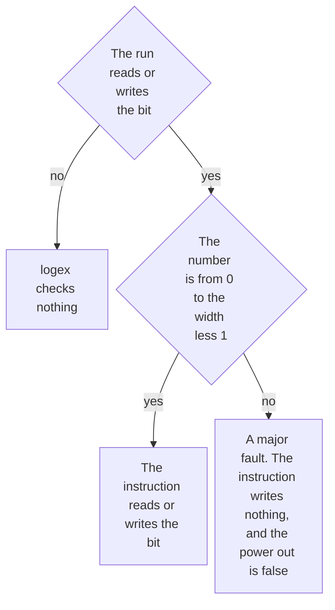
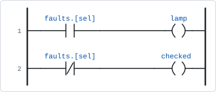

# Instructions: bitwise

This page is for a reader who writes or reads a ladder [program](glossary.md#program)
and looks for an exact rule. It defines 8 [instructions](glossary.md#instruction) that
work on the [bits](glossary.md#bit) of a value: `and`, `or`, `xor`, `not` and 4
instructions that shift or rotate the bits. It also defines bit access: an
[operand](glossary.md#operand) that names 1 bit of a [tag](glossary.md#tag).

| Instruction | What it does |
|---|---|
| [`and a b d`](#and) | Each bit of `d` is 1 if that bit of `a` and of `b` is 1. |
| [`or a b d`](#or) | Each bit of `d` is 1 if that bit of `a` or of `b` is 1. |
| [`xor a b d`](#xor) | Each bit of `d` is 1 if that bit is 1 in only 1 of `a` and `b`. |
| [`not a d`](#not) | Each bit of `d` is the opposite of that bit of `a`. |
| [`shl a n d`](#shl) | It moves the bits of `a` to the left by `n` places. |
| [`shr a n d`](#shr) | It moves the bits of `a` to the right by `n` places. |
| [`rol a n d`](#rol) | It rotates the bits of `a` to the left by `n` places. |
| [`ror a n d`](#ror) | It rotates the bits of `a` to the right by `n` places. |

In this table, `a` and `b` are the values that the instruction reads, `n` is the
count, and `d` is the tag that it writes. Each instruction writes `d` only on a
[true rung](glossary.md#true-rung). Each mnemonic is the name that
[IEC 61131-3](glossary.md#iec-61131-3) gives the instruction, in lowercase.

| Bit access | What it names |
|---|---|
| [`status.3`](#bit-access) | Bit 3 of the tag `status` |
| [`faults.[sel]`](#a-bit-number-in-a-tag) | The bit of `faults` whose number the tag `sel` holds when the instruction runs |
| [`delay.acc.3`](#bit-access) | Bit 3 of the [member](glossary.md#member) `acc` of the timer `delay` |
| [`levels[2].3`](#bit-access) | Bit 3 of the [element](glossary.md#element) `levels[2]` |

> #### Caution {: .error}
>
> Keep a bit number in a tag in the range of its tag. If the number is out of the range
> when the instruction reads or writes the bit, the scan gets a
> [major fault](glossary.md#major-fault). An `ote` writes its bit on a
> [false rung](glossary.md#false-rung) also, and thus a rung that is off can cause the
> fault. If a [runner](glossary.md#runner) runs the program, a major fault causes a
> [trip](glossary.md#trip). The runner then writes 0 to each
> [output](glossary.md#output) and runs no [round](glossary.md#round) until a restart.
>
> [A bit number in a tag](#a-bit-number-in-a-tag) gives the rule.
> [Use bit strings](../howto/use-bit-strings.md) shows how to keep the number in the range.

| To find | Go to |
|---|---|
| A rule that is the same for the 8 instructions | [Rules that are the same for the 8 instructions](#rules-that-are-the-same-for-the-8-instructions) |
| The [type](glossary.md#type) in which an instruction works | [The type in which an instruction works](#the-type-in-which-an-instruction-works) |
| The rules of 1 instruction | Its heading: [`and`](#and), [`or`](#or), [`xor`](#xor), [`not`](#not), [`shl`](#shl), [`shr`](#shr), [`rol`](#rol) or [`ror`](#ror) |
| What reads and writes 1 bit of a tag | [Bit access](#bit-access) |
| The value that an instruction writes for given [inputs](glossary.md#input) | [Examples](#examples) |
| The message of a wrong [rung](glossary.md#rung) | [Wrong rungs and their diagnostics](#wrong-rungs-and-their-diagnostics) |
| The message of a [warning](glossary.md#warning) | [Programs and their warnings](#programs-and-their-warnings) |
| A rule of a different subject | [See also](#see-also) |

If a rung breaks a rule of this page, logex does not [compile](glossary.md#compile) the
program. It returns a [diagnostic](glossary.md#diagnostic). For some programs that break
no rule, logex gives a warning, and the program compiles.

## Rules that are the same for the 8 instructions

Each part of this page uses these words.

| Word | Meaning |
|---|---|
| A source | An operand that the instruction reads for its result. `and`, `or` and `xor` have 2 sources. `not` and the 4 shift and rotate instructions have 1 source. |
| The count | The second operand of `shl`, `shr`, `rol` and `ror`: the number of places to move the bits |
| The destination | The operand that the instruction writes. It is the last operand. |
| The width of a type | The number of bits of a value of the type: 1 for a `bool`, 8 for a `byte`, an `sint` and a `usint`. [Declarations and types](declarations-and-types.md#elementary-types) gives the width of each type. |
| The pattern of a value | The bits of the value in the width of its type. For a signed integer type, the pattern is the value in 2's complement. Thus the pattern of the `sint` -1 is 2#1111_1111. |
| A run of an instruction | 1 time that a [scan](glossary.md#scan) runs the instruction |
| The power in | The [power flow](glossary.md#power-flow) that an instruction gets |
| The power out | The power flow that an instruction gives to the next instruction |
| A true rung | For an instruction, a rung is true if its power in is true. |
| A false rung | For an instruction, a rung is false if its power in is false. |

Bit 0 is the bit with the value 1. Bit 3 has the value 8. The left bits of a pattern
are the high bits.
[The power in and the power out](instructions-contacts-and-coils.md#the-power-in-and-the-power-out)
gives the power in for each place on a rung.

### What each instruction does on a true rung and on a false rung

| Instruction | On a true rung | On a false rung |
|---|---|---|
| `and`, `or`, `xor`, `not` | It writes the result. The power out is true. | It writes nothing. The power out is false. |
| `shl`, `shr`, `rol`, `ror` | It writes the result. The power out is true if the count is 0 or more. | It writes nothing. The power out is false. |

On a true rung, a fault of an operand makes the power out false. [Faults](#faults)
gives the rules. These instructions cannot [wrap](glossary.md#wrap) a result. A shift
drops each bit that it moves out of the width, and the power out stays true.

### The operands

This table shows the forms of an operand, with an example of each.
[Source syntax](source-syntax.md#names) gives each form of a name.

| Operand | Source | Destination |
|---|---|---|
| A tag: `low` | Yes | Yes (1) |
| An element: `masks[2]` | Yes | Yes (1) |
| A bit: `status.3` | Yes | Yes (1) |
| A number member of a [timer](glossary.md#timer) or a [counter](glossary.md#counter): `delay.pre` | Yes | Some (2) |
| A bool member of a timer or a counter: `delay.dn` | Yes | Some (2) |
| A member of a [function block](glossary.md#function-block): `meter.count` | Yes | No |
| A [literal](glossary.md#literal): `16#00ff` | Yes | No |
| An [array](glossary.md#array): `masks` | No | No |
| An [instance](glossary.md#instance): `delay` | No | No |

These rules apply to each row of the table:

- (1) A tag of the [section](glossary.md#section) `var`, `var_output` or `var_external`
  can be a destination. An element or a bit of such a tag can be a destination also. No
  instruction writes a `var_input` tag, an element of it or a bit of it.
- (2) Only a member that logic can write can be a destination.
  [Instructions: timers and counters](instructions-timers-and-counters.md) gives each one.
- A source and the destination can be the same tag. The instruction reads each source
  before it writes. Thus `or alarms changed alarms` adds the bits of `changed` to
  `alarms`.
- 2 sources can be the same tag: `xor a_word a_word d_word` writes 0.
- A count has an integer type. Thus a tag, an element, a number member or a literal can
  be a count, and a bit or a bool member cannot. [The count](#the-count) gives the
  rules.
- The [mnemonic](glossary.md#mnemonic) is not case-sensitive: `and`, `AND` and `And` are
  the same. Each of the 8 mnemonics is a [reserved word](glossary.md#reserved-word) in
  any case: a tag named `shl` or `SHL` is an error.

[Wrong rungs 1 to 13](#wrong-rungs-1-to-13-the-operands) show the diagnostics of an
operand.

### The types

The sources and the destination of 1 instruction are all of 1 of 2 groups.

| Group | Types |
|---|---|
| Bools and [bit strings](glossary.md#bit-string) | `bool`, `byte`, `word`, `dword`, `lword` |
| Integers | `sint`, `int`, `dint`, `lint`, `usint`, `uint`, `udint`, `ulint` |

A real type is in neither group. These instructions refuse a `real` and an `lreal`.

Each source has the type of the destination, or a type that
[widens](glossary.md#widen) into it.
[Declarations and types](declarations-and-types.md#widening) gives each type that a type
widens into. For these instructions, the rules are:

| Source | Destination | Rule |
|---|---|---|
| A `bool` | A bit string | Correct. The bool widens into bit 0. |
| A bit string | A wider bit string | Correct: a `byte` into a `word`, a `dword` or an `lword` |
| A bit string | A `bool` | An error. logex has no conversion between them. |
| An integer | A wider integer type that holds each value of the source type | Correct: an `sint` into an `int`, a `usint` into an `int` |
| A `bool` | An integer, or the other way | An error. logex has no conversion between them. |
| A bit string | An integer, or the other way | An error. The diagnostic names the conversion, for example `word_to_int`. [Conversions](conversions.md) gives each conversion. |

A bit is a `bool`, and a bool member is a `bool` also. Thus
`and a_word.3 a_bool d_word.4` is correct, and `and a_word.3 1 d_int` is an error.

[Wrong rungs 14 to 27](#wrong-rungs-14-to-27-the-types) show the diagnostics of a type.

### The type in which an instruction works

An instruction works in 1 type. It then writes the result in the type of the
destination. This table gives the type in which each instruction works.

| Instruction | Works in | Then |
|---|---|---|
| `and`, `or`, `xor` | The type of the destination. Each source widens into it first. | It writes the result. |
| `not`, `shl`, `shr`, `rol`, `ror` | The type of the source | It widens the result into the type of the destination by value. |
| `not`, `shl`, `shr`, `rol`, `ror` with a literal source | The type of the destination | It writes the result. |

To widen by value is to keep the number. For example, `not a_sint d_int` of the `sint` 5
gives the `sint` -6, with the pattern `2#1111_1010`. logex writes the `int` -6, not 250.
The `byte` `2#1111_0000` becomes the `word` `16#00f0`.

The rule for `not` and the shifts is the rule of IEC 61131-3. There, the result of NOT,
SHL, SHR, ROL and ROR has the type of the input. These examples show the rule.

| Rung | Source | Result |
|---|---|---|
| `not a_bool d_word` | 1 | `16#0000`, not `16#fffe` |
| `not a_bool d_word` | 0 | `16#0001` |
| `not a_byte d_word` | `2#0000_1111` | `16#00f0` |
| `not a_usint d_int` | 5 | 250 |
| `not a_sint d_dint` | -1 | 0 |
| `shl a_byte 1 d_word` | `2#1001_0001` | `16#0022`. Bit 7 moves out of the `byte`. |
| `rol a_byte 1 d_word` | `2#1001_0001` | `16#0023`. Bit 7 comes in at bit 0. |
| `shr a_sint 1 d_int` | -2 | 127 |
| `shl a_bool 3 d_word` | 1 | `16#0000`. The 1 bit moves out of the `bool`. |

For `and`, `or` and `xor`, the 2 rules give the same bits. The
[`not` cases](#not-cases-1-to-12) and the [shift cases](#shift-cases-1-to-24) show
each row.

The type check of `not` and of a shift is the check of `and`: each source must widen
into the destination. Thus the diagnostic of `not` or of a shift names the type of the
destination, as [wrong rung 17](#wrong-rungs-14-to-27-the-types) shows. The instruction
works in the type of the source all the time, by the rule of this table.

### A literal as a source

| Literal | Rule |
|---|---|
| An integer literal | It must be a value of the type of the destination. `and a_word 65536 d_word` and `and a_word -1 d_word` are errors. |
| A literal for a `bool` destination | Only `0` or `1` |
| A [based integer literal](literals.md#based-integer-literal) | It is a number, not a pattern. `16#ff` is 255. Thus `and a_sint 16#ff d_sint` is an error. To give the 8 bits of an `sint`, write `-1`. |
| A real literal | An error |
| The literal source of `not` or of a shift | The instruction works in the type of the destination. `not 0 d_word` writes `16#ffff`, and `shl 1 15 d_int` writes -32768. |
| Each operand that the instruction reads is a literal | Correct, and logex gives a warning: the result never changes. |

[Wrong rungs 28 to 36](#wrong-rungs-28-to-36-the-literals) show the diagnostics of a
literal. [Programs 1 to 3](#programs-1-to-20-warnings) show the warning.
[Literals](literals.md) gives each form of a literal.

### The count

| Item | Rule |
|---|---|
| The type | An integer type of any width: `sint` to `ulint`. The count does not widen into the type of the destination. |
| Not a count | A `bool`, a bit, a bit string or a real. For a bit string, the diagnostic names a conversion, for example `word_to_uint`. |
| A literal count | 0 or more, to 18446744073709551615. A negative literal is an error. |
| A count of 0 | The instruction writes the source. The power out is true. |
| A count that is equal to the width or more | `shl` and `shr` write 0. `rol` and `ror` rotate by the remainder of the count divided by the width. The power out is true. |
| A negative count in a tag | The instruction writes the source as it is, widened into the destination. The power out is false. Thus in `shl status shift moved ote moved_ok`, `moved_ok` is 0 while `shift` is negative. |
| How to see a negative count | Only the power out shows it. The scan gets no fault, and logex gives no warning. |

### The place of an instruction on a rung

| Item | Rule |
|---|---|
| The place | Each of the 8 instructions can be the first, a middle or the last instruction of a rung or of a [leg](glossary.md#leg). |
| After the instruction | Each instruction can come after it, because each run gives a power out. |
| After a timer instruction or a counter instruction | An error. No instruction comes after a timer instruction or a counter instruction on its path, for example after a `ton` or a `ctu`. [Instructions: timers and counters](instructions-timers-and-counters.md#the-place-of-an-instruction-on-a-rung) gives the rule. |
| 2 instructions on the same rung | `and a_word 16#00ff d_word and d_word 16#000f d_word` is correct. The second `and` reads the value that the first `and` wrote. |

[Wrong rung 13](#wrong-rungs-1-to-13-the-operands) shows the diagnostic.

### Faults

A run of these instructions can cause 2 [faults](glossary.md#fault). Each is a major
fault. logex reads the tag of a [subscript](glossary.md#subscript), such as `slot` in
`masks[slot]`, when the instruction reads or writes the element. It reads the tag of a
bit number, such as `slot` in `status.[slot]`, when the instruction reads or writes the
bit.

| Fault | The cause |
|---|---|
| `:index_out_of_range` | In `masks[slot]`, `slot` is less than 0, or more than the last subscript of `masks`. |
| `:bit_out_of_range` | In `status.[slot]`, `slot` is less than 0, or more than the last bit number of `status`. |

The field `read` of a fault holds the value that logex read.

| Fault | The field `read` |
|---|---|
| `:index_out_of_range` | The subscripts, as a tuple: `{3}` |
| `:bit_out_of_range` | The bit number: `16` |

After such a fault, the instruction writes nothing, and the power out is false. The scan
then runs the next instruction. A negative count is not a fault.
[Faults](faults.md) gives the fields of a fault, and what logex does with a major
fault.

### Values from one scan to the next

These instructions keep no value from one scan to the next. A
[restart](glossary.md#restart) or an [online edit](glossary.md#online-edit) has no effect
on these instructions. Each destination keeps its value by the rules of its tag.

## `and`, `or` and `xor`

This table gives 1 bit of the result for each pair of source bits.

| Bit of `a` | Bit of `b` | `and` | `or` | `xor` |
|---|---|---|---|---|
| 0 | 0 | 0 | 0 | 0 |
| 0 | 1 | 0 | 1 | 1 |
| 1 | 0 | 0 | 1 | 1 |
| 1 | 1 | 1 | 1 | 0 |

For a `bool`, the instruction works on its 1 bit. For an integer type, it works on the
pattern in 2's complement. Thus `and` of the `sint` -1 and `16#0f` is 15.

### `and`

| Part | Rule |
|---|---|
| Operands | 2 sources, then the destination: `and status 16#00ff low`. |
| Types | [The types](#the-types) gives the rule. |
| On a true rung | It writes the AND of the 2 patterns, in the type of the destination. |
| On a false rung | It writes nothing. |
| Power out | The power in. On a true rung, the power out is false only after a fault of an operand. |
| Faults | `:index_out_of_range` and `:bit_out_of_range` |
| Warnings | Each source is a literal ([program 1](#programs-1-to-20-warnings)). An `ote` on a bit of the destination: [Warnings of a bit](#warnings-of-a-bit) gives the rule. |
| Diagnostics | Wrong rungs [1 to 13](#wrong-rungs-1-to-13-the-operands), [14 to 24](#wrong-rungs-14-to-27-the-types) and [28 to 33](#wrong-rungs-28-to-36-the-literals) |
| Examples | [`and`, `or` and `xor` cases 1, 4, 5, 8, 10, 12 and 13](#and-or-and-xor-cases-1-to-13) |

A literal source of `and` that has a 1 for each bit to keep is a mask. Thus
`and status 16#00ff low` keeps the low 8 bits of `status`.

### `or`

| Part | Rule |
|---|---|
| Operands | 2 sources, then the destination: `or alarms changed alarms`. |
| Types | [The types](#the-types) gives the rule. A `bool` source widens into bit 0 of a bit string. |
| On a true rung | It writes the OR of the 2 patterns, in the type of the destination. |
| On a false rung | It writes nothing. |
| Power out | The power in. On a true rung, the power out is false only after a fault of an operand. |
| Faults | `:index_out_of_range` and `:bit_out_of_range` |
| Warnings | The same as `and` |
| Diagnostics | The same as `and`. Each message names `or`. |
| Examples | [`and`, `or` and `xor` cases 2, 6, 7 and 11](#and-or-and-xor-cases-1-to-13) |

### `xor`

| Part | Rule |
|---|---|
| Operands | 2 sources, then the destination: `xor eyes last changed`. |
| Types | [The types](#the-types) gives the rule. |
| On a true rung | It writes the exclusive OR of the 2 patterns, in the type of the destination. |
| On a false rung | It writes nothing. |
| Power out | The power in. On a true rung, the power out is false only after a fault of an operand. |
| Faults | `:index_out_of_range` and `:bit_out_of_range` |
| Warnings | The same as `and` |
| Diagnostics | The same as `and`. Each message names `xor`. |
| Examples | [`and`, `or` and `xor` cases 3 and 9](#and-or-and-xor-cases-1-to-13) |

logex has no instruction for NAND, NOR or XNOR. `and`, `or` or `xor`, and then `not`,
give the same result. [Wrong rung 12](#wrong-rungs-1-to-13-the-operands) shows the
diagnostic of `xnor`.

## `not`

| Part | Rule |
|---|---|
| Operands | 1 source, then the destination: `not at_speed slow`. |
| Types | [The types](#the-types) gives the rule. |
| On a true rung | It writes the pattern of the source with each bit changed to the opposite value. It works in the type of the source, and then widens the result into the destination by value. [The type in which an instruction works](#the-type-in-which-an-instruction-works) gives the rule. |
| On a false rung | It writes nothing. |
| Power out | The power in. On a true rung, the power out is false only after a fault of an operand. |
| Faults | `:index_out_of_range` and `:bit_out_of_range` |
| Warnings | The source is a literal ([program 2](#programs-1-to-20-warnings)). An `ote` on a bit of the destination ([program 6](#programs-1-to-20-warnings)). |
| Diagnostics | The same as `and`. Each message names `not`. |
| Examples | [`not` cases 1 to 12](#not-cases-1-to-12) |

`not` changes the bits of a value. `xio` reads a bool and passes power if it is 0.
[Instructions: contacts and coils](instructions-contacts-and-coils.md#xio) gives `xio`.

A [Logix](glossary.md#logix) controller fills a narrower source with 0 bits before its
NOT (1756-RM018A, page 871). Thus its NOT of an `sint` -1 into a `dint` gives
`16#ffff_ff00`, and logex gives 0.
[How logex differs from Logix](../explanation/differences-from-logix.md#what-is-different-in-behaviour)
gives this difference and its source.

## Shifts and rotates

A shift moves each bit of the pattern by the count. It drops each bit that moves out
of the width. A 0 comes in at the other end. A rotate moves each bit by the count also,
but a bit that moves out at 1 end comes in at the other end.

This table shows the result of each instruction for the `byte` `2#0001_1001` with the
count 3.

| Rung | Result | What came in |
|---|---|---|
| `shl a 3 d` | `2#1100_1000` | 0 at bits 2, 1 and 0 |
| `shr a 3 d` | `2#0000_0011` | 0 at bits 7, 6 and 5 |
| `rol a 3 d` | `2#1100_1000` | Bits 7, 6 and 5 at bits 2, 1 and 0 |
| `ror a 3 d` | `2#0010_0011` | Bits 2, 1 and 0 at bits 7, 6 and 5 |

`shl` and `rol` give the same result here, because the 3 bits that move out of the
`byte` are 0. [Shift cases 1 to 4](#shift-cases-1-to-24) run these 4 rungs.

These rules apply to the 4 instructions:

- The instruction works in the type of the source. A `bool` has a width of 1 bit.
  [The type in which an instruction works](#the-type-in-which-an-instruction-works)
  gives the rule.
- A shift never keeps the sign of a signed value. `shr` of the `int` -2 by 1 gives
  32767.
- [The count](#the-count) gives each rule of the count.

### `shl`

| Part | Rule |
|---|---|
| Operands | A source, the count, then the destination: `shl status shift moved`. |
| Types | [The types](#the-types) gives the rule of the source and the destination. [The count](#the-count) gives the rule of the count. |
| On a true rung | It moves the bits of the pattern to the left by the count. A 0 comes in at bit 0. |
| A count that is equal to the width or more | It writes 0. |
| On a false rung | It writes nothing. |
| Power out | False if the count is negative. Else the power in. |
| Faults | `:index_out_of_range` and `:bit_out_of_range` |
| Warnings | The source and the count are literals ([program 3](#programs-1-to-20-warnings)). An `ote` on a bit of the destination: [Warnings of a bit](#warnings-of-a-bit) gives the rule. |
| Diagnostics | Wrong rungs [3](#wrong-rungs-1-to-13-the-operands), [25 to 27](#wrong-rungs-14-to-27-the-types) and [34 to 36](#wrong-rungs-28-to-36-the-literals), and the same as `and` |
| Examples | [Shift cases 1, 6, 8, 10, 11, 14, 16, 18, 20, 21, 23 and 24](#shift-cases-1-to-24) |

### `shr`

| Part | Rule |
|---|---|
| Operands | A source, the count, then the destination: `shr status 8 high`. |
| Types | The same as `shl` |
| On a true rung | It moves the bits of the pattern to the right by the count. A 0 comes in at the highest bit. |
| A count that is equal to the width or more | It writes 0. |
| On a false rung | It writes nothing. |
| Power out | False if the count is negative. Else the power in. |
| Faults | `:index_out_of_range` and `:bit_out_of_range` |
| Warnings | The same as `shl` |
| Diagnostics | The same as `shl`. Each message names `shr`. |
| Examples | [Shift cases 2, 5, 7 and 22](#shift-cases-1-to-24) |

### `rol`

| Part | Rule |
|---|---|
| Operands | A source, the count, then the destination: `rol lamps 1 lamps`. |
| Types | The same as `shl` |
| On a true rung | It moves the bits of the pattern to the left by the count. Each bit that moves out of the highest bit comes in at bit 0. |
| A count that is equal to the width or more | It rotates by the remainder of the count divided by the width. Thus a rotate of a `byte` by 9 is a rotate by 1. |
| On a false rung | It writes nothing. |
| Power out | False if the count is negative. Else the power in. |
| Faults | `:index_out_of_range` and `:bit_out_of_range` |
| Warnings | The same as `shl` |
| Diagnostics | The same as `shl`. Each message names `rol`. |
| Examples | [Shift cases 3, 9, 12, 13, 15 and 19](#shift-cases-1-to-24) |

### `ror`

| Part | Rule |
|---|---|
| Operands | A source, the count, then the destination: `ror pattern 4 swapped`. |
| Types | The same as `shl` |
| On a true rung | It moves the bits of the pattern to the right by the count. Each bit that moves out of bit 0 comes in at the highest bit. |
| A count that is equal to the width or more | It rotates by the remainder of the count divided by the width. |
| On a false rung | It writes nothing. |
| Power out | False if the count is negative. Else the power in. |
| Faults | `:index_out_of_range` and `:bit_out_of_range` |
| Warnings | The same as `shl` |
| Diagnostics | The same as `shl`. Each message names `ror`. |
| Examples | [Shift cases 4 and 17](#shift-cases-1-to-24) |

## Bit access

A bit is 1 bit of a tag, of an element or of a member that has an integer type or a bit
string type. A bit is a `bool`. [Source syntax](source-syntax.md#bit) gives each form of
the name of a bit, and the checks of a literal bit number.

### What reads and writes a bit

| Item | Rule |
|---|---|
| A [contact](glossary.md#contact) | `xic` and `xio` read the bit. |
| A [coil](glossary.md#coil) | `ote`, `otl` and `otu` write the bit. Each other bit of the tag keeps its value. |
| A [one-shot](glossary.md#one-shot) | A bit with a literal number can be the [storage bit](glossary.md#storage-bit) of `ons`, `osr` and `osf`, or the [pulse bit](glossary.md#pulse-bit) of `osr` and `osf`. A bit with its number in a tag cannot. |
| `move` and the 8 instructions of this page | They read and write a bit as a `bool`. A bit cannot be a count. |
| `cal` | A bit can be the operand of a `var_input` or a `var_output` of type `bool`. |
| An arithmetic instruction and a comparison | They refuse a bit, because a bit is a `bool`. |
| The highest bit of a signed type | It is the sign. `xic a_int.15` passes power if `a_int` is negative. `otl d_int.15` on an `int` with the value 0 writes -32768. |
| A bit of a `var_input` tag | A contact reads it. No instruction writes it. |
| A bit of a member of a timer or a counter | An instruction reads a bit of each number member. It writes a bit only of `pre`, `acc` and `pv`. |
| A bit of an element | An element of an array of an integer type or a bit string type has bits: `levels[2].3`. |
| A bit of a `bool`, of a real tag, of an array or of a bit | An error |

[Bit cases 1 to 7](#bit-cases-1-to-13) show the rows of this table. The program
[`status.ld`](#the-program-statusld) [latches](glossary.md#latch) the highest bit of a
`word` with `otl`.

### A bit number in a tag

In `faults.[sel]`, the tag `sel` holds the bit number. logex reads `sel` when the
instruction reads or writes the bit. The bit is a `bool`, as `faults.3` is.

| Item | Rule |
|---|---|
| The tag in the brackets | A tag of an integer type of any width. Not a `bool`, a bit string or a real type. |
| A literal in the brackets | `faults.[4]` and `faults.[16#4]` are the same bit as `faults.4`. logex checks a literal number when it compiles the program. |
| A number in the range | From 0 to the width less 1. The instruction reads or writes that bit. |
| A number out of the range | A major fault, `:bit_out_of_range`. The instruction reads nothing and writes nothing, and the power out is false. The field `read` of the fault holds the number. |
| A storage bit or a pulse bit | An error. A storage bit and a pulse bit must be the same bit in each scan. Thus their bit numbers must be literals. |

This diagram shows 1 run of an instruction with a bit number in a tag.



Figure: 1 run of an instruction with a bit number in a tag. A run that does not read or
write the bit cannot cause the fault.

This table gives the runs that read or write the bit, and thus check the number.

| Instruction | True rung | False rung |
|---|---|---|
| `xic`, `xio` | It reads the bit, and checks. | It reads nothing, and does not check. |
| `ote` | It writes 1, and checks. | It writes 0, and checks. |
| `otl`, `otu` | It writes the bit, and checks. | It writes nothing, and does not check. |
| `move`, and the 8 instructions of this page | It reads or writes the bit, and checks. | It writes nothing, and does not check. |

A rung that a [jump](glossary.md#jump) skips does not run, and thus does not check. If
a `cal` does not run its function block, the rungs of the block check nothing.

With a number out of the range, `xic` and `xio` both pass no power. Thus
`xic faults.[sel] ote lamp` and `xio faults.[sel] ote checked` both write 0.
[The program `selected.ld`](#the-program-selectedld) and
[bit cases 8 to 13](#bit-cases-1-to-13) show the rules.

### Warnings of a bit

An `ote` on a bit and a write of the whole tag both write that bit. logex then gives the
warning that it gives for 2 `ote` on 1 tag: the last write in the scan sets the bit.
These writes count as a write of the whole tag:

- An `ote` on a bit with its number in a tag. It can write each bit of the tag.
- An `otl` or an `otu` on a bit with its number in a tag. It counts so only for an
  `ote` on a bit of the same tag.

This table gives the warnings for the bits of a tag or of a member. In 2 rows, `out` is a
`word`, and `sel` and `other` are `int` tags.

| Case | Warning | Program |
|---|---|---|
| An `ote` on a bit, and a write of the whole tag by `move`, `not` or a different instruction, in either sequence | Yes | [4 to 6](#programs-1-to-20-warnings) |
| 2 `ote` on the same bit | Yes | [7](#programs-1-to-20-warnings) |
| An `ote` on a bit of a member, and a write of the whole member | Yes | [15](#programs-1-to-20-warnings) |
| An `ote` on a bit with its number in a tag, and an `ote` on a different bit of the tag | Yes | [8 to 10](#programs-1-to-20-warnings) |
| An `ote` on a bit with its number in a tag, and a write of the whole tag | Yes | [11](#programs-1-to-20-warnings) |
| `ote out.[sel]`, and an `otl` or an `otu` on `out.[other]`, in either sequence | Yes | [12](#programs-1-to-20-warnings) |
| `ote out.3`, and an `otl` or an `otu` on `out.[sel]`, in either sequence | Yes | [16](#programs-1-to-20-warnings) |
| A storage bit in a tag, and an `ote` on a bit of that tag with its number in a tag | Yes. The message says that the one-shot fires on the wrong scans. | [13](#programs-1-to-20-warnings) |
| A storage bit in a tag, and a write of the whole tag | Yes. The message says that the one-shot fires on the wrong scans. | [14](#programs-1-to-20-warnings) |
| An `ote` on 2 different bits with literal numbers | No | [23](#programs-21-to-32-no-warning) |
| An `ote` and an `otl` or an `otu` on the same bit, through the same literal or the same tag | No | [24 and 25](#programs-21-to-32-no-warning) |
| An `otl` on a bit, and a write of the whole tag | No | [26](#programs-21-to-32-no-warning) |
| An `ote` on a bit, and a storage bit in a different bit of the same tag | No | [27](#programs-21-to-32-no-warning) |
| A contact on a bit with its number in a tag | No. A contact writes nothing. | [28](#programs-21-to-32-no-warning) |
| An `ote` on a bit with its number in a tag, and an `otl` or an `otu` on a bit with a literal number | No | [29](#programs-21-to-32-no-warning) |

A subscript in a tag can name each element of an array. Thus logex gives the warning for
2 bits of elements if the 2 elements can be the same element. The 2 bits must also be
able to be the same bit. In this table, `w` is an array of `word`, and `i`, `j` and `n`
are `int` tags.

| Case | Warning | Program |
|---|---|---|
| `ote w[i].3` and `ote w[j].3` | Yes | [17](#programs-1-to-20-warnings) |
| `ote w[i].3` and `ote w[j].[n]` | Yes | [18](#programs-1-to-20-warnings) |
| `ote w[i].3` and a write of the element `w[j]` | Yes | [19](#programs-1-to-20-warnings) |
| The storage bit `w[1].3` and `ote w[i].3` | Yes. The message says that the one-shot fires on the wrong scans. | [20](#programs-1-to-20-warnings) |
| `ote w[i].3` and `ote w[j].4` | No | [30](#programs-21-to-32-no-warning) |
| `ote w[1].3` and `ote w[2].3` | No | [31](#programs-21-to-32-no-warning) |
| The storage bit `w[1].3` and `ote w[i].4` | No | [32](#programs-21-to-32-no-warning) |

The message of a warning can name the bit of the other write. In program 12, the warning
is on line 6, which writes `out.[other]`. The message names `out.[sel]`, the bit of line
5. [Warnings](warnings.md) gives each warning of logex.

## Examples

Each example is a program or a list of rungs, with a script that runs it. It is not
necessary to read a script, because the page shows each line that it prints. Each
`elixir` block is the file under `examples/` that its `$ mix run` line names. The
directory `examples` of the repository is a Mix project, and logex is its dependency. To
run a script, enter its command in that directory.
[Your first program](../tutorials/first-program.md) shows how to make a Mix project that
has logex as a dependency.

Each script that runs a program uses `Logex.Runtime.scan/2`, which gives 0 ms to each
scan. These instructions do not read the time. The first example is
[the program `status.ld`](#the-program-statusld). The part before it gives the 4 files
that the scripts read.

### The scripts that run the examples

The scripts of the examples read 4 files. The 4 files are in the directory
`examples/instructions-bitwise` of the repository.

| File | What it does |
|---|---|
| `show.exs` | It gives the text of a value. A `byte` is in base 2, and a `word` and a `dword` are in base 16. Each other value is in base 10. |
| `scans.exs` | It runs the scans of a program, and prints a table of the tags after each scan, and each fault of the scan. |
| `cases.exs` | It runs the cases. Each case is 1 rung with 1 scan. It compiles a program for each case from the [declarations](glossary.md#declaration) of `tags.txt` and the rung. Then it runs 1 scan and prints the inputs, the outputs that the rung names and each fault. Each input that the case does not give is 0. |
| `tags.txt` | The declarations of the cases and of the wrong rungs |

<!-- file: instructions-bitwise/show.exs -->
```elixir
# show.(type, value) gives the text of a value of the type. A `byte` is in base 2, a
# `word` and a `dword` are in base 16, and each other value is in base 10. Each text
# is a literal of logex for the same value.
digits = fn number, base, count ->
  number
  |> Integer.to_string(base)
  |> String.downcase()
  |> String.pad_leading(count, "0")
  |> String.graphemes()
  |> Enum.chunk_every(4)
  |> Enum.map_join("_", &Enum.join/1)
end

fn
  :byte, number -> "2#" <> digits.(number, 2, 8)
  :word, number -> "16#" <> digits.(number, 16, 4)
  :dword, number -> "16#" <> digits.(number, 16, 8)
  _type, number -> "#{number}"
end
```

<!-- file: instructions-bitwise/scans.exs -->
```elixir
# scans.(file, inputs, names) compiles the program `file` and runs its scans. The map
# `inputs` gives, for each input, a list with its value in each scan. The script prints
# a table with 1 row for each scan: the number of the scan and the value of each name
# after the scan. After a row, it prints each fault of the scan. `show.exs` gives the
# text of each value.
{show, _} = Code.eval_file("instructions-bitwise/show.exs")

line = fn fault ->
  "      fault  #{fault.severity}, #{inspect(fault.kind)}, line #{fault.line}, read #{fault.read}"
end

fn file, inputs, names ->
  {:ok, program} = Logex.compile_file(file)

  scan = fn values, {number, state, rows} ->
    now = Map.new(Enum.zip(Map.keys(inputs), values))
    state = Logex.Runtime.put_inputs(program, state, now)
    {_outputs, state} = Logex.Runtime.scan(program, state)
    cells = Enum.map(names, &show.(program.tags[&1].type, state.env[&1]))
    {number + 1, state, [{["#{number}" | cells], state.faults} | rows]}
  end

  {_number, _state, rows} =
    inputs
    |> Map.values()
    |> Enum.zip_with(& &1)
    |> Enum.reduce({1, Logex.Runtime.instance(program), []}, scan)

  rows = [{["scan" | names], []} | Enum.reverse(rows)]

  widths =
    Enum.zip_with(Enum.map(rows, &elem(&1, 0)), fn column ->
      Enum.max(Enum.map(column, &String.length/1))
    end)

  for {cells, faults} <- rows do
    IO.puts(Enum.join(Enum.zip_with(cells, widths, &String.pad_leading/2), "  "))

    for fault <- faults, do: IO.puts(line.(fault))
  end
end
```

<!-- file: instructions-bitwise/cases.exs -->
```elixir
# cases.(first, cases) runs 1 scan of each case. A case is a rung and a map with the
# value of some inputs. Each other input is 0. The program of a case is the
# declarations of `tags.txt` and the rung. For each case, the script prints the number
# of the case and its rung. Then it prints the inputs, each output that the rung names
# with `ok` first, and each fault of the scan. `show.exs` gives the text of each value.
tags = File.read!("instructions-bitwise/tags.txt")
{show, _} = Code.eval_file("instructions-bitwise/show.exs")

value = fn
  {:array, type, _sizes}, list -> "[" <> Enum.map_join(list, ", ", &show.(type, &1)) <> "]"
  type, number -> show.(type, number)
end

pairs = fn
  [], _program ->
    "no input"

  list, program ->
    Enum.map_join(list, ", ", fn {name, number} ->
      "#{name} = #{value.(program.tags[name].type, number)}"
    end)
end

fault = fn fault ->
  "      fault  #{fault.severity}, #{inspect(fault.kind)}, read #{inspect(fault.read)}"
end

fn first, cases ->
  for {{rung, inputs}, number} <- Enum.with_index(cases, first) do
    {:ok, program} = Logex.compile(tags <> rung, name: "case")
    state = Logex.Runtime.put_inputs(program, Logex.Runtime.instance(program), inputs)
    {outputs, state} = Logex.Runtime.scan(program, state)
    named = Map.take(outputs, String.split(rung, [" ", "[", "."]))
    named = Enum.sort_by(named, fn {name, _value} -> {name != "ok", name} end)
    head = String.pad_leading("#{number}", 2) <> "  " <> rung
    ins = "      in     " <> pairs.(Enum.sort(inputs), program)
    outs = "      out    " <> pairs.(named, program)
    IO.puts(Enum.join([head, ins, outs | Enum.map(state.faults, fault)], "\n"))
  end
end
```

The name of each tag gives its type. `a_word` and `b_word` are `word` sources, `n_int`
is an `int` count, `d_byte` is a `byte` destination, and `ok` gets the power out. `go` is
a bool input: `xic go` with `go` at 0 makes a false rung. Each output starts at 0.

<!-- file: instructions-bitwise/tags.txt -->
```text
var_input  go       bool
var_input  slot     dint
var_input  a_bool   bool
var_input  b_bool   bool
var_input  a_sint   sint
var_input  a_int    int
var_input  a_usint  usint
var_input  a_dint   dint
var_input  a_byte   byte
var_input  b_byte   byte
var_input  a_word   word
var_input  b_word   word
var_input  a_dword  dword
var_input  a_real   real
var_input  n_int    int
var_input  n_ulint  ulint
var_input  n_word   word
var_output d_bool   bool
var_output d_sint   sint
var_output d_int    int
var_output d_dint   dint
var_output d_byte   byte
var_output d_word   word
var_output d_dword  dword
var_output d_real   real
var_output d_array  word[3]
var_output ok       bool
var        delay    ton
var        boxes    ctu
```

The script of a case gives an input in Elixir: `0b0001_1001` is the logex literal
`2#0001_1001`, and `0x00FF` is `16#00ff`.

### The program `status.ld`

A motor drive gives a status word of 16 bits. Bit 3 is 1 while the motor is at speed.
The program is the file `examples/status.ld` of the repository.

| Rung | What it does |
|---|---|
| 1 | `xic` reads bit 3 of `status` into `at_speed`. |
| 2 | `not` writes the opposite of `at_speed` to the bool `slow`. The script does not show `slow`. |
| 3 | `not` writes the opposite of `at_speed` to the `word` `slow_w`. |
| 4 | `and` keeps the low 8 bits of `status` in `low`. |
| 5 | `word_to_int` writes the pattern of `status` to the `int` `code`. [Conversions](conversions.md) gives the rule. The script does not show `code`. |
| 6 | `shl` moves the bits of `status` to the left by `shift`. `moved_ok` is 0 if `shift` is negative. |
| 7 | `move` copies `status` to `flags`. |
| 8 | While the motor is at speed, `otl` latches bit 15 of `flags`. |

<!-- file: status.ld -->
```text
var_input  status   word
var_input  shift    sint
var_output at_speed bool
var_output low      word
var_output code     int
var_output moved    word
var_output moved_ok bool
var_output flags    word
var_output slow     bool
var_output slow_w   word

xic status.3 ote at_speed
not at_speed slow
not at_speed slow_w
and status 16#00ff low
word_to_int status code
shl status shift moved ote moved_ok
move status flags
xic at_speed otl flags.15
```

<!-- rung: status.ld -->


The script reads the file [`scans.exs`](#the-scripts-that-run-the-examples). The map
`inputs` has 1 list for each input. The list holds the value of the input in each scan.

```elixir
{scans, _} = Code.eval_file("instructions-bitwise/scans.exs")

inputs = %{
  "status" => [0x0008, 0xFFF7, 0x8000, 0x0F0F],
  "shift" => [4, -1, 16, 8]
}

names = ["status", "shift", "at_speed", "slow_w", "low", "moved", "moved_ok", "flags"]
scans.("status.ld", inputs, names)
```

```console
$ mix run instructions-bitwise-status.exs
scan   status  shift  at_speed   slow_w      low    moved  moved_ok    flags
   1  16#0008      4         1  16#0000  16#0008  16#0080         1  16#8008
   2  16#fff7     -1         0  16#0001  16#00f7  16#fff7         0  16#fff7
   3  16#8000     16         0  16#0001  16#0000  16#0000         1  16#8000
   4  16#0f0f      8         1  16#0000  16#000f  16#0f00         1  16#8f0f
```

| Scan | What the scan shows |
|---|---|
| 1 | Bit 3 of `status` is 1, and thus `slow_w` is `16#0000`. `shl` by 4 gives `16#0080`. `otl` sets bit 15 of `flags`. |
| 2 | The count is -1. `moved` is `status` as it is, and `moved_ok` is 0. Bit 3 is 0, thus `slow_w` is `16#0001`. |
| 3 | The count is 16, the width of a `word`. `shl` writes 0, and `moved_ok` is 1. |
| 4 | `and` keeps the low 8 bits, `16#000f`. `shl` by 8 gives `16#0f00`. |

In each scan, `move` writes all of `flags`. Then, while the motor is at speed, `otl` sets
bit 15. `otl` is a latch, and thus logex gives no warning for it.

### The script `status.exs`

The script `status.exs` runs [the program `status.ld`](#the-program-statusld) for 3
scans. Then it gives `status` a value that a `word` cannot hold, and prints the message
of the `ArgumentError`. Last, it compiles 7 wrong rungs and prints each diagnostic.

```elixir
{:ok, status} = Logex.compile_file("status.ld")

scan = fn state, label, inputs ->
  state = Logex.Runtime.put_inputs(status, state, inputs)
  {outputs, state} = Logex.Runtime.scan(status, state)
  IO.puts("#{label}  #{inspect(outputs)}")
  state
end

state =
  Logex.Runtime.instance(status)
  |> scan.("at speed, shifted by 4    ", %{"status" => 0x0008, "shift" => 4})
  |> scan.("16#fff7, shifted by -1    ", %{"status" => 0xFFF7, "shift" => -1})
  |> scan.("16#8000, shifted by 16    ", %{"status" => 0x8000, "shift" => 16})

try do
  Logex.Runtime.put_inputs(status, state, %{"status" => 65_536})
rescue
  error in ArgumentError -> IO.puts(Exception.message(error))
end

{:error, diagnostics} =
  Logex.compile(
    "var status word\nvar code int\nvar lamp bool\n" <>
      "add status 1 status\nand status 16#00ff code\neq status code ote lamp\n" <>
      "xic status.16 ote lamp\nxic lamp.0 ote lamp\nshl status -1 status\n" <>
        "and lamp code code",
    name: "wrong"
  )

for diagnostic <- diagnostics, do: IO.puts(Logex.Diagnostic.format(diagnostic))
```

```console
$ mix run status.exs
at speed, shifted by 4      %{"at_speed" => 1, "code" => 8, "flags" => 32776, "low" => 8, "moved" => 128, "moved_ok" => 1, "slow" => 0, "slow_w" => 0}
16#fff7, shifted by -1      %{"at_speed" => 0, "code" => -9, "flags" => 65527, "low" => 247, "moved" => 65527, "moved_ok" => 0, "slow" => 1, "slow_w" => 1}
16#8000, shifted by 16      %{"at_speed" => 0, "code" => -32768, "flags" => 32768, "low" => 0, "moved" => 0, "moved_ok" => 1, "slow" => 1, "slow_w" => 1}
input `status` is a word: 65536 is outside 0 to 65535
line 4: `add` reads a number, but `status` is a word (declared on line 1): a word is a bit string, not a number: convert it first, with `word_to_uint`
line 4: `add` writes a number, but `status` is a word (declared on line 1): a word is a bit string, not a number: compute in an integer and convert the result, with `uint_to_word`
line 5: `and` computes in `code`'s type, an int, but `status` is a word (declared on line 1): a word does not widen into an int, so convert it first, with `word_to_int`
line 6: `eq` compares `status`, a word (declared on line 1), with `code`, an int (declared on line 2): a bit string compares only with a bit string, so convert one of them first, with `int_to_word` or `word_to_int`
line 7: `status.16` names bit 16 of `status`, a word (declared on line 1), which has bits 0 to 15
line 8: `lamp.0` names a bit of `lamp`, a bool, which has no bits
line 9: `shl` shifts by the literal `-1`: a count is never negative, so a negative literal one is refused
line 10: `and` computes in `code`'s type, an int, but `lamp` is a bool (declared on line 3): a bool does not widen into an int, and logex has no conversion between them
```

### The program `eyes.ld`

A conveyor has 8 photo eyes in the `byte` `eyes`. The program finds the eyes that
change. It also moves a pattern of 2 lamps on a panel at each
[rising edge](glossary.md#rising-edge) of `step`. The program is in the directory
`examples/instructions-bitwise` of the repository.

| Rung | What it does |
|---|---|
| 1 | `xor` writes a 1 to `changed` for each eye that is different from the scan before. |
| 2 | `or` adds the bits of `changed` to `alarms`. A bit of `alarms` stays 1. |
| 3 | `move` keeps the eyes of this scan in `last`. |
| 4 | At each rising edge of `step`, `rol` rotates `lamps` to the left by 1. |

<!-- file: instructions-bitwise/eyes.ld -->
```text
var_input  eyes    byte
var_input  step    bool
var_output changed byte
var_output alarms  byte
var_output lamps   byte 2#1000_0001
var        last    byte
var        stepped bool

xor eyes last changed
or alarms changed alarms
move eyes last
xic step ons stepped rol lamps 1 lamps
```

<!-- rung: instructions-bitwise/eyes.ld -->


```elixir
{scans, _} = Code.eval_file("instructions-bitwise/scans.exs")

inputs = %{
  "eyes" => [0b0000_0000, 0b0000_0001, 0b0000_0010, 0b0000_0010, 0b1000_0100, 0b0000_0000],
  "step" => [1, 0, 1, 1, 0, 1]
}

names = ["eyes", "step", "changed", "alarms", "lamps"]
scans.("instructions-bitwise/eyes.ld", inputs, names)
```

```console
$ mix run instructions-bitwise-eyes.exs
scan         eyes  step      changed       alarms        lamps
   1  2#0000_0000     1  2#0000_0000  2#0000_0000  2#1000_0001
   2  2#0000_0001     0  2#0000_0001  2#0000_0001  2#1000_0001
   3  2#0000_0010     1  2#0000_0011  2#0000_0011  2#0000_0011
   4  2#0000_0010     1  2#0000_0000  2#0000_0011  2#0000_0011
   5  2#1000_0100     0  2#1000_0110  2#1000_0111  2#0000_0011
   6  2#0000_0000     1  2#1000_0100  2#1000_0111  2#0000_0110
```

| Scan | What the scan shows |
|---|---|
| 1 | `lamps` has its [initial value](glossary.md#initial-value) `2#1000_0001`. `step` is 1, but the one-shot gives no pulse in the [first scan](glossary.md#first-scan). |
| 2 | Eye 0 changes. `step` is 0. |
| 3 | Eyes 0 and 1 change. `step` rises, and `rol` moves bit 7 of `lamps` to bit 0. |
| 4 | No eye changes. `changed` is 0, and `alarms` keeps its bits. `step` stays 1, and thus `lamps` does not move. |
| 5 | Eyes 1, 2 and 7 change. `step` is 0. |
| 6 | Eyes 2 and 7 change. The bits of `alarms` stay 1. `step` rises again, and `rol` moves each bit of `lamps` 1 place to the left. |

### The program `selected.ld`

An operator selects 1 of the 16 fault bits of the `word` `faults`. The lamp is on while
the selected bit is 1. The program is the file `examples/selected.ld` of the repository.

<!-- file: selected.ld -->
```text
var_input  faults  word
var_input  sel     int
var_output lamp    bool
var_output checked bool

xic faults.[sel] ote lamp
xio faults.[sel] ote checked
```

<!-- rung: selected.ld -->


```elixir
{scans, _} = Code.eval_file("instructions-bitwise/scans.exs")

inputs = %{
  "faults" => [0x0010, 0x0010, 0x8000, 0xFFFF, 0xFFFF],
  "sel" => [4, 5, 15, 16, -1]
}

names = ["faults", "sel", "lamp", "checked"]
scans.("selected.ld", inputs, names)
```

```console
$ mix run instructions-bitwise-selected.exs
scan   faults  sel  lamp  checked
   1  16#0010    4     1        0
   2  16#0010    5     0        1
   3  16#8000   15     1        0
   4  16#ffff   16     0        0
      fault  major, :bit_out_of_range, line 6, read 16
      fault  major, :bit_out_of_range, line 7, read 16
   5  16#ffff   -1     0        0
      fault  major, :bit_out_of_range, line 6, read -1
      fault  major, :bit_out_of_range, line 7, read -1
```

| Scan | What the scan shows |
|---|---|
| 1 and 2 | Bit 4 is 1 and bit 5 is 0. |
| 3 | Bit 15 is the last bit of a `word`. |
| 4 | 16 is out of the range. `xic` and `xio` both pass no power, and each gets the fault `:bit_out_of_range` of its line. |
| 5 | -1 is out of the range also. |

### The script `selected.exs`

The script `selected.exs` runs [the program `selected.ld`](#the-program-selectedld) for
3 scans, with the bits 4, 15 and 16. Then it runs the program in a plant on the manual
clock. The plant trips when `sel` is 16. Last, it compiles 4 wrong bits, and it runs a
literal bit number in brackets.

```elixir
{:ok, selected} = Logex.compile_file("selected.ld")

scan = fn state, label, inputs ->
  state = Logex.Runtime.put_inputs(selected, state, inputs)
  {outputs, state} = Logex.Runtime.scan(selected, state)
  IO.puts("#{label}  #{inspect(outputs)}")
  for fault <- state.faults, do: IO.puts("    #{inspect(fault)}")
  state
end

Logex.Runtime.instance(selected)
|> scan.("16#0010, bit 4 ", %{"faults" => 0x0010, "sel" => 4})
|> scan.("16#0010, bit 15", %{"sel" => 15})
|> scan.("16#0010, bit 16", %{"sel" => 16})

{:ok, plant} =
  Logex.Configuration.compile(
    "plant",
    """
    task fast interval 10 priority 1
    var_global drive_faults word at drive.i.0
    var_global sel          int  at panel.i.0
    var_global fault_lamp   bool at panel.q.0
    program lamp1 selected with fast
      lamp1.faults drive_faults
      lamp1.sel    sel
      lamp1.lamp   fault_lamp
    """,
    %{"selected" => selected}
  )

{:ok, clock} = Logex.Runner.Clock.Manual.start_link()
{:ok, panel} = Logex.IO.Sim.start_link(reports: true, clock: clock)
{:ok, drive} = Logex.IO.Sim.start_link(clock: clock)

{:ok, runner} =
  Logex.Runner.start_link(
    configuration: plant,
    io: %{"panel" => {Logex.IO.Sim, sim: panel}, "drive" => {Logex.IO.Sim, sim: drive}},
    clock: {Logex.Runner.Clock.Manual, clock}
  )

Logex.IO.Sim.set(drive, "drive.i.0", 0x0010)
Logex.IO.Sim.set(panel, "panel.i.0", 4)
Logex.Runner.Clock.Manual.advance(clock, 10)
IO.puts("bit 4:  the lamp #{inspect(Logex.IO.Sim.outputs(panel))}")
Logex.IO.Sim.set(panel, "panel.i.0", 16)
Logex.Runner.Clock.Manual.advance(clock, 10)
IO.puts("bit 16: the lamp #{inspect(Logex.IO.Sim.outputs(panel))}, #{inspect(Logex.Runner.status(runner).status)}")
IO.puts("    #{inspect(Logex.Runner.status(runner).trip)}")
Logex.Runner.stop(runner)

{:error, diagnostics} =
  Logex.compile(
    "var status word\nvar code word\nvar on bool\nvar n int\n" <>
      "xic status.[code] ote on\nxic on.[n] ote on\nxic on ons status.[n]\nxic status.[16] ote on",
    name: "wrong"
  )

for diagnostic <- diagnostics, do: IO.puts(Logex.Diagnostic.format(diagnostic))

{:ok, literal} =
  Logex.compile("var_input status word\nvar_output on bool\nxic status.[16#4] ote on", name: "literal")

state = Logex.Runtime.put_inputs(literal, Logex.Runtime.instance(literal), %{"status" => 0x0010})
IO.puts("status.[16#4] of 16#0010: #{inspect(elem(Logex.Runtime.scan(literal, state), 0))}")
```

```console
$ mix run selected.exs
16#0010, bit 4   %{"checked" => 0, "lamp" => 1}
16#0010, bit 15  %{"checked" => 1, "lamp" => 0}
16#0010, bit 16  %{"checked" => 0, "lamp" => 0}
    %Logex.Fault{severity: :major, kind: :bit_out_of_range, instruction: :xic, path: nil, file: "selected.ld", line: 6, read: 16}
    %Logex.Fault{severity: :major, kind: :bit_out_of_range, instruction: :xio, path: nil, file: "selected.ld", line: 7, read: 16}
bit 4:  the lamp %{"panel.q.0" => 1}
bit 16: the lamp %{"panel.q.0" => 0}, :tripped
    {:fault, "fast", "lamp1", %Logex.Fault{severity: :major, kind: :bit_out_of_range, instruction: :xic, path: nil, file: "selected.ld", line: 6, read: 16}}
line 5: `status.[code]` takes its bit number from `code`, a word (declared on line 2), which is no integer: a bit number is held in a tag of an integer type, so convert it first, with `word_to_uint`
line 6: `on.[n]` names a bit of `on`, a bool, which has no bits
line 7: `ons` keeps its storage bit in `status.[n]`, whose number `n` holds: a one-shot's storage bit is a bool or a bit with a literal number, as in `status.0`, so that it is one bit whatever the program does
line 8: `status.[16]` names bit 16 of `status`, a word (declared on line 1), which has bits 0 to 15
status.[16#4] of 16#0010: %{"on" => 1}
```

| Line | What the line shows |
|---|---|
| 1 to 5 | Bit 16 is out of the range. Each instruction gets the major fault `:bit_out_of_range`, and the scan continues. |
| 6 to 8 | In the plant, the major fault trips the runner. The runner writes 0 to the lamp, and the reason of the trip names the fault. |
| 9 to 12 | The diagnostics of the 4 wrong bits. |
| 13 | `status.[16#4]` is bit 4 of `status`. |

### `and`, `or` and `xor` cases 1 to 13

The 4 scripts of the cases read the file [`cases.exs`](#the-scripts-that-run-the-examples).

```elixir
{cases, _} = Code.eval_file("instructions-bitwise/cases.exs")

cases.(1, [
  {"and a_byte b_byte d_byte ote ok", %{"a_byte" => 0b1100_1010, "b_byte" => 0b0000_1111}},
  {"or a_byte b_byte d_byte ote ok", %{"a_byte" => 0b1100_1010, "b_byte" => 0b0000_1111}},
  {"xor a_byte b_byte d_byte ote ok", %{"a_byte" => 0b1100_1010, "b_byte" => 0b0000_1111}},
  {"and a_sint 16#0f d_sint ote ok", %{"a_sint" => -1}},
  {"and a_int a_usint d_int ote ok", %{"a_int" => -1, "a_usint" => 200}},
  {"or a_byte a_word d_word ote ok", %{"a_byte" => 0xFF, "a_word" => 0x1200}},
  {"or a_bool a_word d_word ote ok", %{"a_bool" => 1, "a_word" => 0x1200}},
  {"and a_bool b_bool d_bool ote ok", %{"a_bool" => 1, "b_bool" => 1}},
  {"xor a_word a_word d_word ote ok", %{"a_word" => 0x1234}},
  {"and a_word.3 a_bool d_word.4 ote ok", %{"a_word" => 0x0008, "a_bool" => 1}},
  {"or a_dint 16#0f00 delay.pre move delay.pre d_dint ote ok", %{"a_dint" => 1}},
  {"xic go and a_byte b_byte d_byte ote ok", %{"a_byte" => 1, "b_byte" => 1, "go" => 0}},
  {"and a_word 16#00ff d_array[slot] ote ok", %{"a_word" => 0x1234, "slot" => 3}}
])
```

```console
$ mix run instructions-bitwise-and-or-xor.exs
 1  and a_byte b_byte d_byte ote ok
      in     a_byte = 2#1100_1010, b_byte = 2#0000_1111
      out    ok = 1, d_byte = 2#0000_1010
 2  or a_byte b_byte d_byte ote ok
      in     a_byte = 2#1100_1010, b_byte = 2#0000_1111
      out    ok = 1, d_byte = 2#1100_1111
 3  xor a_byte b_byte d_byte ote ok
      in     a_byte = 2#1100_1010, b_byte = 2#0000_1111
      out    ok = 1, d_byte = 2#1100_0101
 4  and a_sint 16#0f d_sint ote ok
      in     a_sint = -1
      out    ok = 1, d_sint = 15
 5  and a_int a_usint d_int ote ok
      in     a_int = -1, a_usint = 200
      out    ok = 1, d_int = 200
 6  or a_byte a_word d_word ote ok
      in     a_byte = 2#1111_1111, a_word = 16#1200
      out    ok = 1, d_word = 16#12ff
 7  or a_bool a_word d_word ote ok
      in     a_bool = 1, a_word = 16#1200
      out    ok = 1, d_word = 16#1201
 8  and a_bool b_bool d_bool ote ok
      in     a_bool = 1, b_bool = 1
      out    ok = 1, d_bool = 1
 9  xor a_word a_word d_word ote ok
      in     a_word = 16#1234
      out    ok = 1, d_word = 16#0000
10  and a_word.3 a_bool d_word.4 ote ok
      in     a_bool = 1, a_word = 16#0008
      out    ok = 1, d_word = 16#0010
11  or a_dint 16#0f00 delay.pre move delay.pre d_dint ote ok
      in     a_dint = 1
      out    ok = 1, d_dint = 3841
12  xic go and a_byte b_byte d_byte ote ok
      in     a_byte = 2#0000_0001, b_byte = 2#0000_0001, go = 0
      out    ok = 0, d_byte = 2#0000_0000
13  and a_word 16#00ff d_array[slot] ote ok
      in     a_word = 16#1234, slot = 3
      out    ok = 0, d_array = [16#0000, 16#0000, 16#0000]
      fault  major, :index_out_of_range, read {3}
```

| Case | What the case shows |
|---|---|
| 1 to 3 | The 3 instructions on the same 2 `byte` values |
| 4 and 5 | An integer takes part by its pattern. The `sint` -1 has 8 bits of 1. |
| 6 and 7 | A `byte` and a `bool` widen into a `word`. The `bool` gives bit 0. |
| 8 | 3 bools |
| 9 | The same tag 2 times: `xor` gives 0. |
| 10 | Bits as sources and as the destination |
| 11 | A member as the destination: `delay.pre` gets `16#0f01`, that is 3841. |
| 12 | A false rung: `and` writes nothing. |
| 13 | A fault of an operand: `and` writes nothing, and the power out is false. |

### `not` cases 1 to 12

```elixir
{cases, _} = Code.eval_file("instructions-bitwise/cases.exs")

cases.(1, [
  {"not a_byte d_byte ote ok", %{"a_byte" => 0b0000_1111}},
  {"not a_word d_word ote ok", %{"a_word" => 0x00FF}},
  {"not a_int d_int ote ok", %{"a_int" => 0}},
  {"not a_bool d_bool ote ok", %{"a_bool" => 1}},
  {"not a_bool d_word ote ok", %{"a_bool" => 1}},
  {"not a_bool d_word ote ok", %{"a_bool" => 0}},
  {"not a_byte d_word ote ok", %{"a_byte" => 0b0000_1111}},
  {"not a_usint d_int ote ok", %{"a_usint" => 5}},
  {"not a_sint d_int ote ok", %{"a_sint" => 5}},
  {"not a_sint d_dint ote ok", %{"a_sint" => -1}},
  {"not 0 d_word ote ok", %{}},
  {"xic go not a_byte d_byte ote ok", %{"a_byte" => 0b0000_1111, "go" => 0}}
])
```

```console
$ mix run instructions-bitwise-not.exs
 1  not a_byte d_byte ote ok
      in     a_byte = 2#0000_1111
      out    ok = 1, d_byte = 2#1111_0000
 2  not a_word d_word ote ok
      in     a_word = 16#00ff
      out    ok = 1, d_word = 16#ff00
 3  not a_int d_int ote ok
      in     a_int = 0
      out    ok = 1, d_int = -1
 4  not a_bool d_bool ote ok
      in     a_bool = 1
      out    ok = 1, d_bool = 0
 5  not a_bool d_word ote ok
      in     a_bool = 1
      out    ok = 1, d_word = 16#0000
 6  not a_bool d_word ote ok
      in     a_bool = 0
      out    ok = 1, d_word = 16#0001
 7  not a_byte d_word ote ok
      in     a_byte = 2#0000_1111
      out    ok = 1, d_word = 16#00f0
 8  not a_usint d_int ote ok
      in     a_usint = 5
      out    ok = 1, d_int = 250
 9  not a_sint d_int ote ok
      in     a_sint = 5
      out    ok = 1, d_int = -6
10  not a_sint d_dint ote ok
      in     a_sint = -1
      out    ok = 1, d_dint = 0
11  not 0 d_word ote ok
      in     no input
      out    ok = 1, d_word = 16#ffff
12  xic go not a_byte d_byte ote ok
      in     a_byte = 2#0000_1111, go = 0
      out    ok = 0, d_byte = 2#0000_0000
```

| Case | What the case shows |
|---|---|
| 1 to 4 | `not` in the same type |
| 5 to 7 | `not` works in the type of the source, and then widens the value. |
| 8 to 10 | An integer source widens by value into a wider integer type. |
| 11 | A literal source: `not` works in the type of the destination. |
| 12 | A false rung: `not` writes nothing. |

### Shift cases 1 to 24

```elixir
{cases, _} = Code.eval_file("instructions-bitwise/cases.exs")

cases.(1, [
  {"shl a_byte 3 d_byte ote ok", %{"a_byte" => 0b0001_1001}},
  {"shr a_byte 3 d_byte ote ok", %{"a_byte" => 0b0001_1001}},
  {"rol a_byte 3 d_byte ote ok", %{"a_byte" => 0b0001_1001}},
  {"ror a_byte 3 d_byte ote ok", %{"a_byte" => 0b0001_1001}},
  {"shr a_int 1 d_int ote ok", %{"a_int" => -2}},
  {"shl a_dint 31 d_dint ote ok", %{"a_dint" => 1}},
  {"shr a_sint 1 d_int ote ok", %{"a_sint" => -2}},
  {"shl a_byte 1 d_word ote ok", %{"a_byte" => 0b1001_0001}},
  {"rol a_byte 1 d_word ote ok", %{"a_byte" => 0b1001_0001}},
  {"shl a_byte 0 d_byte ote ok", %{"a_byte" => 0b1001_0001}},
  {"shl a_byte 8 d_byte ote ok", %{"a_byte" => 0b1111_1111}},
  {"rol a_byte 9 d_byte ote ok", %{"a_byte" => 0b1001_0001}},
  {"rol a_word n_int d_word ote ok", %{"a_word" => 0x8001, "n_int" => 17}},
  {"shl a_byte n_ulint d_byte ote ok", %{"a_byte" => 1, "n_ulint" => 18_446_744_073_709_551_615}},
  {"rol a_byte n_ulint d_byte ote ok", %{"a_byte" => 1, "n_ulint" => 18_446_744_073_709_551_615}},
  {"shl a_word n_int d_word ote ok", %{"a_word" => 0x00FF, "n_int" => -1}},
  {"ror a_word n_int d_word ote ok", %{"a_word" => 0x0019, "n_int" => -3}},
  {"shl a_bool 1 d_bool ote ok", %{"a_bool" => 1}},
  {"rol a_bool 5 d_bool ote ok", %{"a_bool" => 1}},
  {"shl a_bool 3 d_word ote ok", %{"a_bool" => 1}},
  {"shl 1 15 d_int ote ok", %{}},
  {"shr -4 1 d_int ote ok", %{}},
  {"xic go shl a_byte 1 d_byte ote ok", %{"a_byte" => 1, "go" => 0}},
  {"shl a_word.[slot] 0 d_bool ote ok", %{"a_word" => 0x0008, "slot" => -1}}
])
```

```console
$ mix run instructions-bitwise-shifts.exs
 1  shl a_byte 3 d_byte ote ok
      in     a_byte = 2#0001_1001
      out    ok = 1, d_byte = 2#1100_1000
 2  shr a_byte 3 d_byte ote ok
      in     a_byte = 2#0001_1001
      out    ok = 1, d_byte = 2#0000_0011
 3  rol a_byte 3 d_byte ote ok
      in     a_byte = 2#0001_1001
      out    ok = 1, d_byte = 2#1100_1000
 4  ror a_byte 3 d_byte ote ok
      in     a_byte = 2#0001_1001
      out    ok = 1, d_byte = 2#0010_0011
 5  shr a_int 1 d_int ote ok
      in     a_int = -2
      out    ok = 1, d_int = 32767
 6  shl a_dint 31 d_dint ote ok
      in     a_dint = 1
      out    ok = 1, d_dint = -2147483648
 7  shr a_sint 1 d_int ote ok
      in     a_sint = -2
      out    ok = 1, d_int = 127
 8  shl a_byte 1 d_word ote ok
      in     a_byte = 2#1001_0001
      out    ok = 1, d_word = 16#0022
 9  rol a_byte 1 d_word ote ok
      in     a_byte = 2#1001_0001
      out    ok = 1, d_word = 16#0023
10  shl a_byte 0 d_byte ote ok
      in     a_byte = 2#1001_0001
      out    ok = 1, d_byte = 2#1001_0001
11  shl a_byte 8 d_byte ote ok
      in     a_byte = 2#1111_1111
      out    ok = 1, d_byte = 2#0000_0000
12  rol a_byte 9 d_byte ote ok
      in     a_byte = 2#1001_0001
      out    ok = 1, d_byte = 2#0010_0011
13  rol a_word n_int d_word ote ok
      in     a_word = 16#8001, n_int = 17
      out    ok = 1, d_word = 16#0003
14  shl a_byte n_ulint d_byte ote ok
      in     a_byte = 2#0000_0001, n_ulint = 18446744073709551615
      out    ok = 1, d_byte = 2#0000_0000
15  rol a_byte n_ulint d_byte ote ok
      in     a_byte = 2#0000_0001, n_ulint = 18446744073709551615
      out    ok = 1, d_byte = 2#1000_0000
16  shl a_word n_int d_word ote ok
      in     a_word = 16#00ff, n_int = -1
      out    ok = 0, d_word = 16#00ff
17  ror a_word n_int d_word ote ok
      in     a_word = 16#0019, n_int = -3
      out    ok = 0, d_word = 16#0019
18  shl a_bool 1 d_bool ote ok
      in     a_bool = 1
      out    ok = 1, d_bool = 0
19  rol a_bool 5 d_bool ote ok
      in     a_bool = 1
      out    ok = 1, d_bool = 1
20  shl a_bool 3 d_word ote ok
      in     a_bool = 1
      out    ok = 1, d_word = 16#0000
21  shl 1 15 d_int ote ok
      in     no input
      out    ok = 1, d_int = -32768
22  shr -4 1 d_int ote ok
      in     no input
      out    ok = 1, d_int = 32766
23  xic go shl a_byte 1 d_byte ote ok
      in     a_byte = 2#0000_0001, go = 0
      out    ok = 0, d_byte = 2#0000_0000
24  shl a_word.[slot] 0 d_bool ote ok
      in     a_word = 16#0008, slot = -1
      out    ok = 0, d_bool = 0
      fault  major, :bit_out_of_range, read -1
```

| Case | What the case shows |
|---|---|
| 1 to 4 | The 4 instructions on the same `byte`, with the count 3 |
| 5 to 7 | An integer: a 0 comes in, and the instruction does not keep the sign. |
| 8 and 9 | The instruction works in the type of the source, a `byte`, and then widens the value. |
| 10 to 15 | A count of 0, a count of the width or more, and a count of the largest `ulint` |
| 16 and 17 | A negative count: the instruction writes the source, and the power out is false. |
| 18 to 20 | A `bool` has a width of 1 bit. |
| 21 and 22 | A literal source: the instruction works in the type of the destination. |
| 23 | A false rung: `shl` writes nothing. |
| 24 | A fault of an operand |

### Bit cases 1 to 13

```elixir
{cases, _} = Code.eval_file("instructions-bitwise/cases.exs")

cases.(1, [
  {"xic a_word.3 ote d_bool", %{"a_word" => 0x0008}},
  {"xic a_word.[16#3] ote d_bool", %{"a_word" => 0x0008}},
  {"xic a_int.15 ote d_bool", %{"a_int" => -1}},
  {"xic go otl d_int.15", %{"go" => 1}},
  {"move a_word d_word xic go otu d_word.3", %{"a_word" => 0xFFFF, "go" => 1}},
  {"move a_dint boxes.pv xic boxes.pv.3 ote d_bool", %{"a_dint" => 8}},
  {"xic go ote d_array[1].[slot]", %{"go" => 1, "slot" => 2}},
  {"xic a_word.[slot] ote d_bool", %{"a_word" => 0x0010, "slot" => 4}},
  {"xic a_word.[slot] ote d_bool", %{"a_word" => 0xFFFF, "slot" => 16}},
  {"xio a_word.[slot] ote d_bool", %{"a_word" => 0xFFFF, "slot" => 16}},
  {"xic go xic a_word.[slot] ote d_bool", %{"go" => 0, "slot" => 16}},
  {"xic go ote d_word.[slot]", %{"go" => 0, "slot" => 16}},
  {"xic go otl d_word.[slot]", %{"go" => 0, "slot" => 16}}
])
```

```console
$ mix run instructions-bitwise-bits.exs
 1  xic a_word.3 ote d_bool
      in     a_word = 16#0008
      out    d_bool = 1
 2  xic a_word.[16#3] ote d_bool
      in     a_word = 16#0008
      out    d_bool = 1
 3  xic a_int.15 ote d_bool
      in     a_int = -1
      out    d_bool = 1
 4  xic go otl d_int.15
      in     go = 1
      out    d_int = -32768
 5  move a_word d_word xic go otu d_word.3
      in     a_word = 16#ffff, go = 1
      out    d_word = 16#fff7
 6  move a_dint boxes.pv xic boxes.pv.3 ote d_bool
      in     a_dint = 8
      out    d_bool = 1
 7  xic go ote d_array[1].[slot]
      in     go = 1, slot = 2
      out    d_array = [16#0000, 16#0004, 16#0000]
 8  xic a_word.[slot] ote d_bool
      in     a_word = 16#0010, slot = 4
      out    d_bool = 1
 9  xic a_word.[slot] ote d_bool
      in     a_word = 16#ffff, slot = 16
      out    d_bool = 0
      fault  major, :bit_out_of_range, read 16
10  xio a_word.[slot] ote d_bool
      in     a_word = 16#ffff, slot = 16
      out    d_bool = 0
      fault  major, :bit_out_of_range, read 16
11  xic go xic a_word.[slot] ote d_bool
      in     go = 0, slot = 16
      out    d_bool = 0
12  xic go ote d_word.[slot]
      in     go = 0, slot = 16
      out    d_word = 16#0000
      fault  major, :bit_out_of_range, read 16
13  xic go otl d_word.[slot]
      in     go = 0, slot = 16
      out    d_word = 16#0000
```

| Case | What the case shows |
|---|---|
| 1 and 2 | A literal bit number, with and without brackets |
| 3 and 4 | The highest bit of an `int` is the sign. |
| 5 | `otu` writes bit 3 only. Each other bit keeps its value. |
| 6 | A bit of a member |
| 7 | A bit of an element, with its number in a tag |
| 8 to 10 | A bit number in a tag: in the range, then out of the range |
| 11 to 13 | A run that does not read or write the bit does not check the number. A de-energised `ote` writes 0, and thus it checks. |

## Wrong rungs and their diagnostics

This part shows 59 wrong rungs in 4 groups. For each group, a script compiles each wrong
rung and prints it after its number. After each rung, the script prints each diagnostic
that logex returns.

| Group | Rungs | Rules |
|---|---|---|
| [The operands](#wrong-rungs-1-to-13-the-operands) | 1 to 13 | [The operands](#the-operands) |
| [The types](#wrong-rungs-14-to-27-the-types) | 14 to 27 | [The types](#the-types) |
| [The literals](#wrong-rungs-28-to-36-the-literals) | 28 to 36 | [A literal as a source](#a-literal-as-a-source) and [The count](#the-count) |
| [The bits](#wrong-rungs-37-to-59-the-bits) | 37 to 59 | [Bit access](#bit-access) |

Each wrong rung shows 1 rule with 1 instruction. For a different instruction with the
same rule, the message names that instruction. The page shows a long message on 2 lines
or more. To find a message, search this page for 2 or 3 words from 1 line of the
message.

Each wrong rung comes after the 29 declarations of the file `tags.txt`, and thus it is
line 30. [The scripts that run the examples](#the-scripts-that-run-the-examples) shows the
file. Each script of this part also reads the file
[`instructions-contacts-and-coils/report.exs`](instructions-contacts-and-coils.md#the-tags-of-the-wrong-rungs),
which prints each rung and each message in lines of 80 characters or fewer.

### Wrong rungs 1 to 13: the operands

```elixir
{report, _} = Code.eval_file("instructions-contacts-and-coils/report.exs")
tags = File.read!("instructions-bitwise/tags.txt")

rungs = [
  "and a_word b_word",
  "not a_word",
  "shl a_word 1",
  "and a_word 1 5",
  "and a_word 1 a_word",
  "and a_word 1 d_array",
  "and d_array 1 d_word",
  "and delay 1 d_word",
  "not a_word boxes",
  "and a_bool 1 delay.dn",
  "and a_dint 1 boxes.cv",
  "xnor a_word b_word d_word",
  "xic go ton delay 5 and a_word 1 d_word"
]

report.(1, rungs, &Logex.compile(tags <> &1, name: "wrong"))
```

```console
$ mix run instructions-bitwise-wrong-operands.exs
 1  and a_word b_word
      line 30: `and` expects 3 operands (a value, then a value, then a tag),
      found 2
 2  not a_word
      line 30: `not` expects 2 operands (a value, then a tag), found 1
 3  shl a_word 1
      line 30: `shl` expects 3 operands (a value, then a value, then a tag),
      found 2
 4  and a_word 1 5
      line 30: `and` expects a tag, found `5`
 5  and a_word 1 a_word
      line 30: `and` writes `a_word`, a var_input (declared on line 11): logic
      must not write an input
 6  and a_word 1 d_array
      line 30: `and` writes one tag, but `d_array` is an array of 3 words
      (declared on line 26): an instruction takes one of its elements, as in
      `d_array[0]`
 7  and d_array 1 d_word
      line 30: `and` reads one tag, but `d_array` is an array of 3 words
      (declared on line 26): an instruction takes one of its elements, as in
      `d_array[0]`
 8  and delay 1 d_word
      line 30: `and` reads a bool, a bit string or an integer, but `delay` is a
      ton (declared on line 28): name one of its members, as in `delay.acc`
 9  not a_word boxes
      line 30: `not` writes a bool, a bit string or an integer, but `boxes` is a
      ctu (declared on line 29): name one of its members, as in `boxes.r`
10  and a_bool 1 delay.dn
      line 30: `and` writes `delay.dn`, but logic may write only `.pre` and
      `.acc` of a ton
11  and a_dint 1 boxes.cv
      line 30: `and` writes `boxes.cv`, but logic may write only `.r` and `.pv`
      of a ctu
12  xnor a_word b_word d_word
      line 30: unknown instruction `xnor`
13  xic go ton delay 5 and a_word 1 d_word
      line 30: `and a_word 1 d_word` follows `ton delay` on its path: what
      passes on after a `ton` is not settled, so a `ton` ends its path; read the
      timer with `xic delay.dn` on a rung below
```

### Wrong rungs 14 to 27: the types

```elixir
{report, _} = Code.eval_file("instructions-contacts-and-coils/report.exs")
tags = File.read!("instructions-bitwise/tags.txt")

rungs = [
  "and a_word 16#00ff d_int",
  "or a_int 1 d_word",
  "xor a_dword 1 d_word",
  "not a_int d_word",
  "and a_dint 1 d_int",
  "and a_bool a_int d_int",
  "xor a_int 1 d_bool",
  "and a_word 1 d_bool",
  "and a_word.3 1 d_int",
  "and a_real 1 d_dint",
  "and a_word 1 d_real",
  "shl a_word n_word d_word",
  "shl a_word a_bool d_word",
  "shl a_word a_real d_word"
]

report.(14, rungs, &Logex.compile(tags <> &1, name: "wrong"))
```

```console
$ mix run instructions-bitwise-wrong-types.exs
14  and a_word 16#00ff d_int
      line 30: `and` computes in `d_int`'s type, an int, but `a_word` is a word
      (declared on line 11): a word does not widen into an int, so convert it
      first, with `word_to_int`
15  or a_int 1 d_word
      line 30: `or` computes in `d_word`'s type, a word, but `a_int` is an int
      (declared on line 6): an int does not widen into a word, so convert it
      first, with `int_to_word`
16  xor a_dword 1 d_word
      line 30: `xor` computes in `d_word`'s type, a word, but `a_dword` is a
      dword (declared on line 13): a dword does not widen into a word, so
      convert it first, with `dword_to_word`
17  not a_int d_word
      line 30: `not` computes in `d_word`'s type, a word, but `a_int` is an int
      (declared on line 6): an int does not widen into a word, so convert it
      first, with `int_to_word`
18  and a_dint 1 d_int
      line 30: `and` computes in `d_int`'s type, an int, but `a_dint` is a dint
      (declared on line 8): a dint does not widen into an int, so convert it
      first, with `dint_to_int`
19  and a_bool a_int d_int
      line 30: `and` computes in `d_int`'s type, an int, but `a_bool` is a bool
      (declared on line 3): a bool does not widen into an int, and logex has no
      conversion between them
20  xor a_int 1 d_bool
      line 30: `xor` computes in `d_bool`'s type, a bool, but `a_int` is an int
      (declared on line 6): an int does not widen into a bool, and logex has no
      conversion between them
21  and a_word 1 d_bool
      line 30: `and` computes in `d_bool`'s type, a bool, but `a_word` is a word
      (declared on line 11): a word does not widen into a bool, and logex has no
      conversion between them
22  and a_word.3 1 d_int
      line 30: `and` computes in `d_int`'s type, an int, but `a_word.3` is a
      bool (declared on line 11): a bool does not widen into an int, and logex
      has no conversion between them
23  and a_real 1 d_dint
      line 30: `and` reads a bool, a bit string or an integer, but `a_real` is a
      real (declared on line 14)
24  and a_word 1 d_real
      line 30: `and` writes a bool, a bit string or an integer, but `d_real` is
      a real (declared on line 25)
25  shl a_word n_word d_word
      line 30: `shl` reads an integer, but `n_word` is a word (declared on line
      17): a word is a bit string, not an integer: convert it first, with
      `word_to_uint`
26  shl a_word a_bool d_word
      line 30: `shl` reads an integer, but `a_bool` is a bool (declared on line
      3)
27  shl a_word a_real d_word
      line 30: `shl` reads an integer, but `a_real` is a real (declared on line
      14)
```

### Wrong rungs 28 to 36: the literals

```elixir
{report, _} = Code.eval_file("instructions-contacts-and-coils/report.exs")
tags = File.read!("instructions-bitwise/tags.txt")

rungs = [
  "and a_word 65536 d_word",
  "and a_word -1 d_word",
  "and a_word 2#1_0000_0000_0000_0000 d_word",
  "and a_sint 16#ff d_sint",
  "and a_bool 2 d_bool",
  "and a_word 1.5 d_word",
  "shl a_word -1 d_word",
  "shl a_word 1.0 d_word",
  "shl a_word 18446744073709551616 d_word"
]

report.(28, rungs, &Logex.compile(tags <> &1, name: "wrong"))
```

```console
$ mix run instructions-bitwise-wrong-literals.exs
28  and a_word 65536 d_word
      line 30: `and` computes in `d_word`'s type, a word: `65536` is outside 0
      to 65535
29  and a_word -1 d_word
      line 30: `and` computes in `d_word`'s type, a word: `-1` is outside 0 to
      65535
30  and a_word 2#1_0000_0000_0000_0000 d_word
      line 30: `and` computes in `d_word`'s type, a word:
      `2#1_0000_0000_0000_0000` is outside 0 to 65535
31  and a_sint 16#ff d_sint
      line 30: `and` computes in `d_sint`'s type, an sint: `16#ff` is outside
      -128 to 127
32  and a_bool 2 d_bool
      line 30: `and` computes in `d_bool`'s type, a bool: only 0 or 1 fit, found
      `2`
33  and a_word 1.5 d_word
      line 30: `and` computes in `d_word`'s type, a word: `1.5` is a real, and a
      word holds only integers
34  shl a_word -1 d_word
      line 30: `shl` shifts by the literal `-1`: a count is never negative, so a
      negative literal one is refused
35  shl a_word 1.0 d_word
      line 30: `shl` reads an integer: `1.0` is a real, which an integer never
      is
36  shl a_word 18446744073709551616 d_word
      line 30: `shl` reads an integer: `18446744073709551616` is outside
      -9223372036854775808 to 18446744073709551615, every integer type's values
```

Wrong rung 31 is an error because `16#ff` is the number 255.
[Source syntax](source-syntax.md#bit) gives the diagnostics of the form of a bit name,
for example `status.[ 3]`.

### Wrong rungs 37 to 59: the bits

```elixir
{report, _} = Code.eval_file("instructions-contacts-and-coils/report.exs")
tags = File.read!("instructions-bitwise/tags.txt")

rungs = [
  "xic a_word.16 ote ok",
  "xic a_sint.8 ote ok",
  "xic a_word.[16#10] ote ok",
  "xic a_word.[-1] ote ok",
  "xic a_bool.0 ote ok",
  "xic a_real.0 ote ok",
  "xic d_array.3 ote ok",
  "xic d_array[0].16 ote ok",
  "xic delay.dn.0 ote ok",
  "xic delay.acc.32 ote ok",
  "xic d_word.3.1 ote ok",
  "xic a_word.[n_word] ote ok",
  "xic a_word.[a_bool] ote ok",
  "xic a_word.[a_real] ote ok",
  "xic a_word.[boxes] ote ok",
  "xic go ote a_word.3",
  "xic go ote boxes.cv.0",
  "move a_word.[slot] d_dint",
  "eq a_word.1 1 ote ok",
  "add a_word.3 1 d_dint",
  "xic go ons d_word.[slot] ote ok",
  "xic go osr d_word.3 d_word.[slot]",
  "xic go ons delay.pre.2 ote ok"
]

report.(37, rungs, &Logex.compile(tags <> &1, name: "wrong"))
```

```console
$ mix run instructions-bitwise-wrong-bits.exs
37  xic a_word.16 ote ok
      line 30: `a_word.16` names bit 16 of `a_word`, a word (declared on line
      11), which has bits 0 to 15
38  xic a_sint.8 ote ok
      line 30: `a_sint.8` names bit 8 of `a_sint`, an sint (declared on line 5),
      which has bits 0 to 7
39  xic a_word.[16#10] ote ok
      line 30: `a_word.[16#10]` names bit 16 of `a_word`, a word (declared on
      line 11), which has bits 0 to 15
40  xic a_word.[-1] ote ok
      line 30: `a_word.[-1]` names bit -1 of `a_word`, a word (declared on line
      11), which has bits 0 to 15
41  xic a_bool.0 ote ok
      line 30: `a_bool.0` names a bit of `a_bool`, a bool, which has no bits
42  xic a_real.0 ote ok
      line 30: `a_real.0` names a bit of `a_real`, a real, which has no bits
43  xic d_array.3 ote ok
      line 30: `d_array.3` names a bit of `d_array`, an array of 3 words, which
      has no bits
44  xic d_array[0].16 ote ok
      line 30: `d_array[0].16` names bit 16 of `d_array[0]`, a word (declared on
      line 26), which has bits 0 to 15
45  xic delay.dn.0 ote ok
      line 30: `delay.dn.0` names a bit of `delay.dn`, a bool, which has no bits
46  xic delay.acc.32 ote ok
      line 30: `delay.acc.32` names bit 32 of `delay.acc`, a dint, which has
      bits 0 to 31
47  xic d_word.3.1 ote ok
      line 30: `d_word.3.1` goes too deep: `d_word` is a word, which has no
      members
48  xic a_word.[n_word] ote ok
      line 30: `a_word.[n_word]` takes its bit number from `n_word`, a word
      (declared on line 17), which is no integer: a bit number is held in a tag
      of an integer type, so convert it first, with `word_to_uint`
49  xic a_word.[a_bool] ote ok
      line 30: `a_word.[a_bool]` takes its bit number from `a_bool`, a bool
      (declared on line 3), which is no integer: a bit number is held in a tag
      of an integer type
50  xic a_word.[a_real] ote ok
      line 30: `a_word.[a_real]` takes its bit number from `a_real`, a real
      (declared on line 14), which is no integer: a bit number is held in a tag
      of an integer type
51  xic a_word.[boxes] ote ok
      line 30: `a_word.[boxes]` takes its bit number from `boxes`, but `boxes`
      is a ctu (declared on line 29): a bit number is held in a tag of an
      integer type
52  xic go ote a_word.3
      line 30: `ote` writes `a_word.3`, a var_input (declared on line 11): logic
      must not write an input
53  xic go ote boxes.cv.0
      line 30: `ote` writes `boxes.cv.0`, but logic may write only `.r` and
      `.pv` of a ctu
54  move a_word.[slot] d_dint
      line 30: `move` writes `a_word.[slot]`, a bool, into `d_dint`, a dint: a
      bool does not widen into a dint, and logex has no conversion between them
55  eq a_word.1 1 ote ok
      line 30: `eq` reads a number or a bit string, but `a_word.1` is a bool
      (declared on line 11)
56  add a_word.3 1 d_dint
      line 30: `add` reads a number, but `a_word.3` is a bool (declared on line
      11)
57  xic go ons d_word.[slot] ote ok
      line 30: `ons` keeps its storage bit in `d_word.[slot]`, whose number
      `slot` holds: a one-shot's storage bit is a bool or a bit with a literal
      number, as in `d_word.0`, so that it is one bit whatever the program does
58  xic go osr d_word.3 d_word.[slot]
      line 30: `osr` sets its pulse bit in `d_word.[slot]`, whose number `slot`
      holds: a pulse coil's pulse bit is a bool or a bit with a literal number,
      as in `d_word.0`, so that it is one bit whatever the program does
59  xic go ons delay.pre.2 ote ok
      line 30: `ons` keeps its storage bit in a bool or a bit of a tag of its
      own, not in `delay.pre.2`, a bit of a member of `delay`, which its
      instance reads
```

## Programs and their warnings

This part shows 32 programs in 2 groups. Each program compiles. For each group, a script
compiles each program and prints it after its number. After each program, the script
prints each warning that logex gives. A program that compiles holds its warnings in the
field `warnings`. `Logex.Diagnostic.format/1` gives the text of a warning.

| Case | Number | Warning |
|---|---|---|
| Each operand that the instruction reads is a literal | 1 to 3 | Yes |
| An `ote` on a bit, and a write of the whole tag or member | 4 to 6 and 15 | Yes |
| 2 `ote` on the same bit | 7 | Yes |
| An `ote` on a bit with its number in a tag, and a different write of the same tag | 8 to 12 | Yes |
| A write of a tag that holds a storage bit | 13 and 14 | Yes |
| An `ote` on a bit with a literal number, and an `otl` on a bit with its number in a tag | 16 | Yes |
| 2 bits of elements that can be the same bit | 17 to 20 | Yes |
| A literal source and a count in a tag | 21 | No |
| A tag and a literal | 22 | No |
| 2 different bits, a latch and an `ote` on the same bit, or a latch and a write of the whole tag | 23 to 26 | No |
| An `ote` on a bit, and a storage bit in a different bit of the same tag | 27 | No |
| A contact on a bit with its number in a tag | 28 | No |
| An `ote` on a bit with its number in a tag, and an `otl` on a bit with a literal number | 29 | No |
| 2 bits of elements that cannot be the same bit | 30 to 32 | No |

[Warnings of a bit](#warnings-of-a-bit) gives the rules.

### Programs 1 to 20: warnings

```elixir
{report, _} = Code.eval_file("instructions-contacts-and-coils/report.exs")
out = "var_input eye bool\nvar_output out word\n"
sel = out <> "var_input sel int\n"
w = "var_input eye bool\nvar_output w word[4]\nvar_input i int\n"
wj = w <> "var_input j int\n"

programs = [
  "var_output m byte\nand 16#0f 3 m",
  "var_output m byte\nnot 0 m",
  "var_output m byte\nshl 1 3 m",
  out <> "var_input k word\nmove k out\nxic eye ote out.3",
  out <> "var_input k word\nxic eye ote out.3\nmove k out",
  out <> "var_input k word\nnot k out\nxic eye ote out.15",
  out <> "xic eye ote out.3\nxio eye ote out.3",
  sel <> "var_input other int\nxic eye ote out.[sel]\nxic eye ote out.[other]",
  sel <> "xic eye ote out.3\nxic eye ote out.[sel]",
  sel <> "xic eye ote out.[sel]\nxic eye ote out.3",
  sel <> "var_input k word\nmove k out\nxic eye ote out.[sel]",
  sel <> "var_input other int\nxic eye ote out.[sel]\nxic eye otl out.[other]",
  sel <> "var_output p bool\nxic eye ons out.3 ote p\nxic eye ote out.[sel]",
  out <> "var_input k word\nvar_output p bool\nxic eye ons out.3 ote p\nmove k out",
  "var_input go bool\nvar_input x dint\nvar t1 ton\nmove x t1.pre\nxic go ote t1.pre.3\n" <>
    "xic go ton t1 5",
  sel <> "xic eye ote out.3\nxic eye otl out.[sel]",
  wj <> "xic eye ote w[i].3\nxic eye ote w[j].3",
  wj <> "var_input n int\nxic eye ote w[i].3\nxic eye ote w[j].[n]",
  wj <> "var_input x word\nxic eye ote w[i].3\nmove x w[j]",
  w <> "var_output p bool\nxic eye ons w[1].3 ote p\nxic eye ote w[i].3"
]

report.(1, programs, &Logex.compile(&1, name: "warned"))
```

```console
$ mix run instructions-bitwise-warnings.exs
 1  var_output m byte
    and 16#0f 3 m
      line 2: warning: `and` reads two literals, `16#0f` and `3`: its result
      never changes
 2  var_output m byte
    not 0 m
      line 2: warning: `not` reads a literal, `0`: its result never changes
 3  var_output m byte
    shl 1 3 m
      line 2: warning: `shl` reads two literals, `1` and `3`: its result never
      changes
 4  var_input eye bool
    var_output out word
    var_input k word
    move k out
    xic eye ote out.3
      line 5: warning: `out.3` is a bit of `out`, which the `move` on line 4
      writes whole: the last one in the scan decides it
 5  var_input eye bool
    var_output out word
    var_input k word
    xic eye ote out.3
    move k out
      line 5: warning: `out.3` already has an `ote` on line 4: the last one in
      the scan decides it
 6  var_input eye bool
    var_output out word
    var_input k word
    not k out
    xic eye ote out.15
      line 5: warning: `out.15` is a bit of `out`, which the `not` on line 4
      writes whole: the last one in the scan decides it
 7  var_input eye bool
    var_output out word
    xic eye ote out.3
    xio eye ote out.3
      line 4: warning: `out.3` already has an `ote` on line 3: the last one in
      the scan decides it
 8  var_input eye bool
    var_output out word
    var_input sel int
    var_input other int
    xic eye ote out.[sel]
    xic eye ote out.[other]
      line 6: warning: `out.[other]` already has an `ote` on line 5: the last
      one in the scan decides it
 9  var_input eye bool
    var_output out word
    var_input sel int
    xic eye ote out.3
    xic eye ote out.[sel]
      line 5: warning: `out.3` already has an `ote` on line 4: the last one in
      the scan decides it
10  var_input eye bool
    var_output out word
    var_input sel int
    xic eye ote out.[sel]
    xic eye ote out.3
      line 5: warning: `out.3` is a bit of `out`, which the `ote` on line 4
      writes whole: the last one in the scan decides it
11  var_input eye bool
    var_output out word
    var_input sel int
    var_input k word
    move k out
    xic eye ote out.[sel]
      line 6: warning: `out.[sel]` is a bit of `out`, which the `move` on line 5
      writes whole: the last one in the scan decides it
12  var_input eye bool
    var_output out word
    var_input sel int
    var_input other int
    xic eye ote out.[sel]
    xic eye otl out.[other]
      line 6: warning: `out.[sel]` already has an `ote` on line 5: the last one
      in the scan decides it
13  var_input eye bool
    var_output out word
    var_input sel int
    var_output p bool
    xic eye ons out.3 ote p
    xic eye ote out.[sel]
      line 6: warning: `ote` writes `out.3`, the storage bit of the `ons` on
      line 5: the one-shot then fires on the wrong scans
14  var_input eye bool
    var_output out word
    var_input k word
    var_output p bool
    xic eye ons out.3 ote p
    move k out
      line 6: warning: `move` writes `out.3`, the storage bit of the `ons` on
      line 5: the one-shot then fires on the wrong scans
15  var_input go bool
    var_input x dint
    var t1 ton
    move x t1.pre
    xic go ote t1.pre.3
    xic go ton t1 5
      line 5: warning: `t1.pre.3` is a bit of `t1.pre`, which the `move` on line
      4 writes whole: the last one in the scan decides it
16  var_input eye bool
    var_output out word
    var_input sel int
    xic eye ote out.3
    xic eye otl out.[sel]
      line 5: warning: `out.3` already has an `ote` on line 4: the last one in
      the scan decides it
17  var_input eye bool
    var_output w word[4]
    var_input i int
    var_input j int
    xic eye ote w[i].3
    xic eye ote w[j].3
      line 6: warning: `w[j].3` is in `w`, which the `ote` on line 5 may write
      through a tag subscript: the last one in the scan decides it
18  var_input eye bool
    var_output w word[4]
    var_input i int
    var_input j int
    var_input n int
    xic eye ote w[i].3
    xic eye ote w[j].[n]
      line 7: warning: `w[j].[n]` is in `w`, which the `ote` on line 6 may write
      through a tag subscript: the last one in the scan decides it
19  var_input eye bool
    var_output w word[4]
    var_input i int
    var_input j int
    var_input x word
    xic eye ote w[i].3
    move x w[j]
      line 7: warning: `w[j]` is in `w`, which the `ote` on line 6 may write
      through a tag subscript: the last one in the scan decides it
20  var_input eye bool
    var_output w word[4]
    var_input i int
    var_output p bool
    xic eye ons w[1].3 ote p
    xic eye ote w[i].3
      line 6: warning: `ote` writes `w[1].3`, the storage bit of the `ons` on
      line 5: the one-shot then fires on the wrong scans
```

### Programs 21 to 32: no warning

```elixir
{report, _} = Code.eval_file("instructions-contacts-and-coils/report.exs")
out = "var_input eye bool\nvar_output out word\n"
sel = out <> "var_input sel int\n"
w = "var_input eye bool\nvar_output w word[4]\n"
wi = w <> "var_input i int\n"

programs = [
  "var_input n int\nvar_output m byte\nshl 1 n m",
  "var_input k word\nvar_output out word\nand k 16#00ff out",
  out <> "xic eye ote out.3\nxio eye ote out.4",
  out <> "xic eye ote out.3\nxio eye otl out.3",
  sel <> "xic eye ote out.[sel]\nxio eye otu out.[sel]",
  out <> "var_input k word\nmove k out\nxic eye otl out.15",
  out <> "var_output p bool\nxic eye ons out.3 ote p\nxic eye ote out.4",
  sel <> "var_output lamp bool\nxic eye ote out.0\nxic out.[sel] ote lamp",
  sel <> "xic eye ote out.[sel]\nxic eye otl out.3",
  wi <> "var_input j int\nxic eye ote w[i].3\nxic eye ote w[j].4",
  w <> "xic eye ote w[1].3\nxic eye ote w[2].3",
  wi <> "var_output p bool\nxic eye ons w[1].3 ote p\nxic eye ote w[i].4"
]

report.(21, programs, &Logex.compile(&1, name: "quiet"))
```

```console
$ mix run instructions-bitwise-no-warning.exs
21  var_input n int
    var_output m byte
    shl 1 n m
      the text compiles, and logex gives no warning
22  var_input k word
    var_output out word
    and k 16#00ff out
      the text compiles, and logex gives no warning
23  var_input eye bool
    var_output out word
    xic eye ote out.3
    xio eye ote out.4
      the text compiles, and logex gives no warning
24  var_input eye bool
    var_output out word
    xic eye ote out.3
    xio eye otl out.3
      the text compiles, and logex gives no warning
25  var_input eye bool
    var_output out word
    var_input sel int
    xic eye ote out.[sel]
    xio eye otu out.[sel]
      the text compiles, and logex gives no warning
26  var_input eye bool
    var_output out word
    var_input k word
    move k out
    xic eye otl out.15
      the text compiles, and logex gives no warning
27  var_input eye bool
    var_output out word
    var_output p bool
    xic eye ons out.3 ote p
    xic eye ote out.4
      the text compiles, and logex gives no warning
28  var_input eye bool
    var_output out word
    var_input sel int
    var_output lamp bool
    xic eye ote out.0
    xic out.[sel] ote lamp
      the text compiles, and logex gives no warning
29  var_input eye bool
    var_output out word
    var_input sel int
    xic eye ote out.[sel]
    xic eye otl out.3
      the text compiles, and logex gives no warning
30  var_input eye bool
    var_output w word[4]
    var_input i int
    var_input j int
    xic eye ote w[i].3
    xic eye ote w[j].4
      the text compiles, and logex gives no warning
31  var_input eye bool
    var_output w word[4]
    xic eye ote w[1].3
    xic eye ote w[2].3
      the text compiles, and logex gives no warning
32  var_input eye bool
    var_output w word[4]
    var_input i int
    var_output p bool
    xic eye ons w[1].3 ote p
    xic eye ote w[i].4
      the text compiles, and logex gives no warning
```

## See also

These pages define the rules of a different subject:

| Subject | Page |
|---|---|
| Each instruction on 1 page | [Instruction cheatsheet](cheatsheet.cheatmd) |
| The types, their widths and the types that each type widens into | [Declarations and types](declarations-and-types.md) |
| The forms of a literal | [Literals](literals.md) |
| The forms of the name of a bit, and their checks | [Source syntax](source-syntax.md#bit) |
| The conversions between a bit string and an integer, such as `word_to_int` | [Conversions](conversions.md) |
| `move`, the arithmetic and the comparisons | [Instructions: arithmetic and comparison](instructions-arithmetic-and-comparison.md) |
| The contacts, the coils, the one-shots and the power in of an instruction | [Instructions: contacts and coils](instructions-contacts-and-coils.md) |
| The fields of a fault, and what logex does with a major fault | [Faults](faults.md) |
| Each warning of logex | [Warnings](warnings.md) |

These pages show how to use the instructions, and why they work as they do:

- [Use bit strings](../howto/use-bit-strings.md): how to read, mask, shift and select
  the bits of a status word.
- [Choose an integer type and convert values](../howto/choose-integer-widths-and-convert.md):
  how to get a value from a bit string into an integer.
- [Port a program](../howto/port-a-program.md): what to change in a program from a
  different controller.
- [Types and overflow](../explanation/types-and-overflow.md): why a bit string is not a
  number.
- [Glossary](glossary.md): [bit](glossary.md#bit),
  [bit string](glossary.md#bit-string), [widen](glossary.md#widen),
  [storage bit](glossary.md#storage-bit) and [major fault](glossary.md#major-fault).
