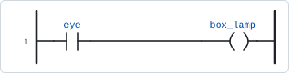
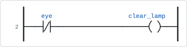
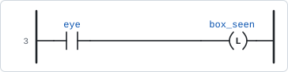
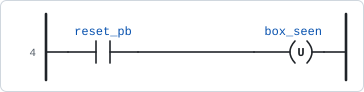
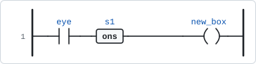
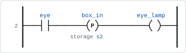
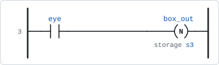
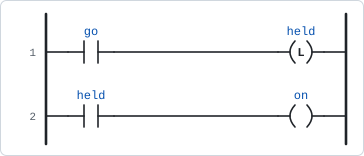

# Instructions: contacts and coils

This page is for a reader who writes or reads a ladder [program](glossary.md#program)
and looks for an exact rule. It defines 8 [instructions](glossary.md#instruction): the
[contacts](glossary.md#contact), the [coils](glossary.md#coil) and the
[one-shots](glossary.md#one-shot). The tutorial
[Your first program](../tutorials/first-program.md) shows the first 5 of them in a
program.

| Instruction | Kind | What it does |
|---|---|---|
| [`xic a`](#xic) | Contact | It passes power if `a` is 1. |
| [`xio a`](#xio) | Contact | It passes power if `a` is 0. |
| [`ote a`](#ote) | Coil | It writes 1 to `a` on a [true rung](glossary.md#true-rung) and 0 on a [false rung](glossary.md#false-rung). |
| [`otl a`](#otl) | Coil | It writes 1 to `a` on a true rung. On a false rung, `a` does not change. |
| [`otu a`](#otu) | Coil | It writes 0 to `a` on a true rung. On a false rung, `a` does not change. |
| [`ons s`](#ons) | One-shot | It passes power for 1 [scan](glossary.md#scan) when its rung goes from false to true. |
| [`osr s p`](#osr) | [Pulse coil](glossary.md#pulse-coil) | It writes 1 to `p` for 1 scan when its rung goes from false to true. |
| [`osf s p`](#osf) | Pulse coil | It writes 1 to `p` for 1 scan when its rung goes from true to false. |

In this table, `a` is a bool [tag](glossary.md#tag), `s` is a
[storage bit](glossary.md#storage-bit) and `p` is a [pulse bit](glossary.md#pulse-bit).
A pulse coil is a one-shot and a coil.

These pages define the other rules:

| Subject | Page |
|---|---|
| Each instruction on 1 page | [Instruction cheatsheet](cheatsheet.cheatmd) |
| The timers and the counters | [Instructions: timers and counters](instructions-timers-and-counters.md) |
| `jmp`, `lbl` and `cal` | [Instructions: jump and call](instructions-jump-and-call.md) |
| The forms of a name: an [element](glossary.md#element), a [member](glossary.md#member) and a [bit](glossary.md#bit) | [Source syntax](source-syntax.md#names) |
| A [branch](glossary.md#branch) | [Source syntax](source-syntax.md#branches) |
| The [sections](glossary.md#section) and the [types](glossary.md#type) of a tag | [Declarations and types](declarations-and-types.md) |
| What a [fault](glossary.md#fault) does | [Faults](faults.md) |
| Each [warning](glossary.md#warning) of logex | [Warnings](warnings.md) |

If a rung breaks a rule of this page, logex does not [compile](glossary.md#compile) the
program. It returns a [diagnostic](glossary.md#diagnostic).
[Wrong rungs and their diagnostics](#wrong-rungs-and-their-diagnostics) shows 39 wrong
rungs with each message.

For some rungs that break no rule, logex gives a warning, and the program compiles. A
program that compiles holds its warnings in the field `warnings`.
`Logex.Diagnostic.format/1` gives the text of a warning.
[Programs and their warnings](#programs-and-their-warnings) shows 7 programs and 2
configurations with each warning. It also shows 7 programs that get no warning.

## Rules that are the same for the 8 instructions

### The power in and the power out

logex runs the instructions of a [rung](glossary.md#rung) from left to right. The
[power flow](glossary.md#power-flow) is true or false. On this page, the power in is
the power flow that an instruction gets. The power out is the power flow that it gives
to the next instruction.

| Case | The power in |
|---|---|
| The instruction is first on its rung. | True |
| The instruction comes after a different instruction. | The power out of that instruction |
| The instruction is first in a [leg](glossary.md#leg) of a branch. | The power flow that comes into the branch |
| The instruction comes after a branch. | True if 1 leg or more of the branch passes power. False if no leg passes power. |

For an instruction, the rung is a true rung if its power in is true. The rung is a false
rung if its power in is false. Each instruction has a rule for a true rung and a rule
for a false rung.

A run of an instruction is 1 time that a scan runs the instruction. In most programs, a
scan runs each instruction 1 time. An instruction has no run while its rung does not
run. These are the 2 cases:

| Case | What the instruction does |
|---|---|
| The rung is between a `jmp` that [jumps](glossary.md#jump) and its [label](glossary.md#label). | It has no run. It writes nothing, and each tag keeps its value. |
| The instruction is in a [function block](glossary.md#function-block), and the `cal` instruction that runs the [instance](glossary.md#instance) is on a false rung. | It has no run. It writes nothing, and each tag of the instance keeps its value. |

> #### A false rung is not a rung that does not run {: .info}
>
> On a false rung, `ote` writes 0. On a rung that does not run, `ote` writes nothing,
> and its tag stays 1 if it is 1. [Instructions: jump and call](instructions-jump-and-call.md)
> gives the rules of `jmp` and of `cal`.

### The operand

Each [operand](glossary.md#operand) of the 8 instructions is a bool. A
[literal](glossary.md#literal) is not an operand of these instructions. This table
shows the forms of a bool, with an example of each. [Source syntax](source-syntax.md#names)
gives each form of a name.

| Operand | What it is |
|---|---|
| `lamp` | A bool tag |
| `lamps[2]` | An element of a bool [array](glossary.md#array) with literal [subscripts](glossary.md#subscript) |
| `lamps[slot]` | An element with a tag as a subscript |
| `status.3` | A bit with a literal number |
| `status.[slot]` | A bit with its number in a tag |
| `delay.dn`, `boxes.r` | A bool member of a [timer](glossary.md#timer) or of a [counter](glossary.md#counter) |
| `delay.acc.3` | A bit of an integer member of a timer or of a counter |
| `horn.on` | A member of an instance of a function block that you write |

2 more tables show where each form can go. The first table is for a contact, which
reads its operand, and for a coil `ote`, `otl` or `otu`, which writes its operand.

| Operand | Contact | Coil |
|---|---|---|
| `lamp` | Yes | Yes |
| `lamps[2]` | Yes | Yes |
| `lamps[slot]` | Yes | Yes |
| `status.3` | Yes | Yes |
| `status.[slot]` | Yes | Yes |
| `delay.dn`, `boxes.r` | Yes | Only `r` and `ld` |
| `delay.acc.3` | Yes | Only a bit of `pre`, `acc` or `pv` |
| `horn.on` | Yes | No |

The second table is for the 2 bits of a one-shot.

| Operand | Storage bit | Pulse bit |
|---|---|---|
| `lamp` | Yes | Yes |
| `lamps[2]` | Yes | Yes |
| `lamps[slot]` | No | No |
| `status.3` | Yes | Yes |
| `status.[slot]` | No | No |
| `delay.dn`, `boxes.r` | No | Only `r` and `ld` |
| `delay.acc.3` | No | Only a bit of `pre`, `acc` or `pv` |
| `horn.on` | No | No |

These rules apply to each row of the 2 tables:

- No instruction writes a `var_input` tag, an element of it or a bit of it. A contact
  can read it.
- A tag of the section `var`, `var_output` or `var_external` can go in each place that
  the tables give as Yes.
- If the [global](glossary.md#global) of a `var_external` tag is at an input
  [point](glossary.md#point), no instruction can write the tag. logex returns a
  diagnostic for the [configuration](glossary.md#configuration).
  [Declarations and types](declarations-and-types.md#var_external) gives the rule.
- A bit is a bit of a tag, of an element or of a member that has an integer type or a
  [bit string](glossary.md#bit-string) type. A bool tag and a real tag have no bits.
- A coil on a bit changes that bit only. Each other bit of the tag keeps its value.
- A storage bit must be the same bit in each scan. A pulse bit must be the same bit in
  each scan also. Thus each subscript and each bit number in its name is a literal.
- A counter of the type `ctu` has the member `r`, and a counter of the type `ctd` has
  the member `ld`. A `ctud` counter has the 2 members. A timer of the type `rto` has the
  member `r`. A typed counter, for example `ctu_int`, and the long timer `rto_ltime`
  have the same members. [Function blocks](function-blocks.md) gives the members of
  each type.
- A coil that writes 1 to `r` resets the counter or the timer. logex has no `res`
  instruction. [Instructions: timers and counters](instructions-timers-and-counters.md)
  gives the rules of `r` and of `ld`.
- A rung can read a `var_input` tag and a `var_output` tag of a function block that you
  write, as members of an instance. A `var` tag of the function block is not a member.

A bool holds 0 or 1 and no other value. If the [host](glossary.md#host) gives a
different value to a bool, logex raises an `ArgumentError` that names the tag and the
value. `Logex.Runtime.put_inputs/3` and each function that runs a scan do this check.
If the [state](glossary.md#state) does not hold a tag, a contact reads the tag as 0.
These are rules of the [host contract](glossary.md#host-contract), and the page
[Host contract](host-contract.md) gives them.

[Wrong rungs 1 to 12](#wrong-rungs-1-to-12-the-operands) show the diagnostics of an
operand. [Wrong rungs 21 to 25](#wrong-rungs-21-to-25-the-members-of-a-function-block)
show the diagnostics of a member of a function block.

### The place of an instruction on a rung

| Item | Rule |
|---|---|
| A contact, a coil or a one-shot | It can be the first, a middle or the last instruction of a rung or of a leg. |
| After a coil | More instructions can come after a coil, because a coil passes its power in. `xic eye ote lamp otl seen` writes 2 tags. |
| A coil in a leg of a branch | logex runs each leg, from the first leg to the last leg. A coil in a later leg writes its tag also when a leg before it passes power. A contact in a later leg reads the value that a coil in a leg before it wrote. |
| A rung of contacts only | An error. A rung must write a tag, run an instance or jump. [Source syntax](source-syntax.md#a-rung-must-write-or-jump) gives the rule. [Wrong rung 13](#wrong-rungs-13-to-16-the-place-on-a-rung) shows the diagnostic. |
| After a timer instruction or a counter instruction | No instruction comes after it on its path. The path is the rest of its leg and the instructions after each branch that holds it. An instruction in a different leg of the same branch is not on the path. Thus `xic eye ( ton delay 100 \| ote lamp )` is correct. [Wrong rungs 14 to 16](#wrong-rungs-13-to-16-the-place-on-a-rung) show the diagnostic. |
| The mnemonic | It is not case-sensitive: `xic`, `XIC` and `Xic` are the same [mnemonic](glossary.md#mnemonic). |
| A reserved word | Each of the 8 mnemonics is a [reserved word](glossary.md#reserved-word). It cannot be the name of a tag. |

### Faults

An operand with a tag as a subscript, or with its bit number in a tag, can cause a
fault. logex reads that tag when the instruction reads or writes the operand.

| Operand | Fault |
|---|---|
| `lamps[slot]` | `:index_out_of_range`, a [major fault](glossary.md#major-fault) |
| `status.[slot]` | `:bit_out_of_range`, a major fault |

The cause of `:index_out_of_range` is a value of `slot` that is less than 0 or more
than the last subscript of `lamps`. The cause of `:bit_out_of_range` is a value of
`slot` that is less than 0 or more than the last bit number of `status`.

An instruction that has such a fault writes nothing and passes no power. The scan then
runs the next instruction. [Faults](faults.md) gives what logex does with a major
fault. The table of each instruction tells when the instruction reads or writes its
operand. A storage bit and a pulse bit have literal numbers only, and thus they cause no
fault.

## Contacts

A contact reads 1 bool. It passes power or it stops the power. It writes nothing. In
this table, the last 2 columns give the power out of `xic` and the power out of `xio`.

| Power in | Operand | `xic` out | `xio` out |
|---|---|---|---|
| True | 1 | True | False |
| True | 0 | False | True |
| False | 0 or 1 | False | False |

On a true rung, 1 of `xic a` and `xio a` passes power, and the other does not.

### `xic`

| Part | Rule |
|---|---|
| Name | Examine if closed, a name from the [conventional set](glossary.md#conventional-set). [IEC 61131-3](glossary.md#iec-61131-3): a normally open contact. |
| Drawing | 2 vertical lines, with the operand over them |
| Operands | 1 bool that the instruction reads: `xic eye` |
| On a true rung | It reads the operand. It passes power if the operand is 1. |
| On a false rung | It does nothing. It does not read the operand. |
| Power out | True if the rung is true and the operand is 1. False in each other case. |
| On the first scan | The same as on each other scan |
| After a restart | It reads the value that the tag has after the [restart](glossary.md#restart). |
| Faults | On a true rung only: the 2 faults of [Faults](#faults) |
| Diagnostics | The operand: [wrong rungs 1 to 12](#wrong-rungs-1-to-12-the-operands). The place on a rung: [wrong rungs 13 to 16](#wrong-rungs-13-to-16-the-place-on-a-rung). A member of a function block: [wrong rung 23](#wrong-rungs-21-to-25-the-members-of-a-function-block). |
| Warnings | A `var_output` tag that a rung reads and no rung writes: [program 4](#programs-1-to-4-contacts-and-coils) |

This drawing shows the rung `xic eye ote box_lamp`, which is rung 1 of the example
[`eye.ld`](#an-example-of-contacts-and-coils). The first element is the `xic`.

<!-- rung: instructions-contacts-and-coils/eye.ld 1 -->


### `xio`

| Part | Rule |
|---|---|
| Name | Examine if open, a name from the conventional set. IEC 61131-3: a normally closed contact. |
| Drawing | 2 vertical lines with a diagonal line across them, and the operand over them |
| Operands | 1 bool that the instruction reads: `xio eye` |
| On a true rung | It reads the operand. It passes power if the operand is 0. |
| On a false rung | It does nothing. It does not read the operand. |
| Power out | True if the rung is true and the operand is 0. False in each other case. |
| On the first scan | The same as on each other scan |
| After a restart | It reads the value that the tag has after the restart. |
| Faults | On a true rung only: the 2 faults of [Faults](#faults) |
| Diagnostics | The operand: [wrong rungs 1 to 12](#wrong-rungs-1-to-12-the-operands). The place on a rung: [wrong rungs 13 to 16](#wrong-rungs-13-to-16-the-place-on-a-rung). A member of a function block: [wrong rung 23](#wrong-rungs-21-to-25-the-members-of-a-function-block). |
| Warnings | A `var_output` tag that a rung reads and no rung writes: [program 4](#programs-1-to-4-contacts-and-coils) |

This drawing shows the rung `xio eye ote clear_lamp`, which is rung 2 of the example
[`eye.ld`](#an-example-of-contacts-and-coils). The first element is the `xio`.

<!-- rung: instructions-contacts-and-coils/eye.ld 2 -->


## Coils

A coil writes 1 bool. It passes its power in to the next instruction. The table shows
what each coil writes.

| Power in | `ote a` | `otl a` | `otu a` |
|---|---|---|---|
| True | It writes 1 to `a`. | It writes 1 to `a`. | It writes 0 to `a`. |
| False | It writes 0 to `a`. | It writes nothing. | It writes nothing. |

The pulse coils `osr` and `osf` are coils also. [One-shots](#one-shots) gives their
rules.

### `ote`

| Part | Rule |
|---|---|
| Name | Output energize, a name from the conventional set. IEC 61131-3: a coil. |
| Drawing | A pair of parentheses, with the operand over them |
| Operands | 1 bool that the instruction writes: `ote lamp` |
| On a true rung | It writes 1 to the operand. |
| On a false rung | It writes 0 to the operand. |
| Power out | The same as the power in |
| On the first scan | The same as on each other scan. On a false rung, it writes 0 to a tag that has the [initial value](glossary.md#initial-value) 1. |
| After a restart | The first run of the `ote` after the restart writes the tag. Before that run, the tag has its initial value, or its last value if it has `retain` and the restart is warm. |
| Faults | On a true rung and on a false rung: the 2 faults of [Faults](#faults) |
| Diagnostics | The operand: [wrong rungs 1 to 12](#wrong-rungs-1-to-12-the-operands). The place on a rung: [wrong rungs 13 to 16](#wrong-rungs-13-to-16-the-place-on-a-rung). The tag that it writes: [wrong rungs 17 to 20](#wrong-rungs-17-to-20-what-a-coil-writes). A member of a function block: [wrong rungs 21 and 22](#wrong-rungs-21-to-25-the-members-of-a-function-block). |
| Warnings | A second `ote` on the same tag: [program 1](#programs-1-to-4-contacts-and-coils). A second coil on an element of the same array, if 1 of the 2 coils has a tag as a subscript: [program 2](#programs-1-to-4-contacts-and-coils). A write of the full tag and an `ote` on 1 of its bits: [program 3](#programs-1-to-4-contacts-and-coils). |

This drawing shows the rung `xic eye ote box_lamp`, which is rung 1 of the example
[`eye.ld`](#an-example-of-contacts-and-coils). The last element is the `ote`.

<!-- rung: instructions-contacts-and-coils/eye.ld 1 -->


### `otl`

| Part | Rule |
|---|---|
| Name | Output latch, a name from the conventional set. IEC 61131-3: a SET coil. The verb is to [latch](glossary.md#latch). |
| Drawing | A pair of parentheses around the letter L, with the operand over them |
| Operands | 1 bool that the instruction writes: `otl seen` |
| On a true rung | It writes 1 to the operand. |
| On a false rung | It does nothing. The operand keeps its value. |
| Power out | The same as the power in |
| On the first scan | The same as on each other scan |
| After a restart | The tag has its initial value. A tag with the [qualifier](glossary.md#qualifier) `retain` has its last value after a [warm restart](glossary.md#warm-restart). |
| Faults | On a true rung only: the 2 faults of [Faults](#faults) |
| Diagnostics | The operand: [wrong rungs 1 to 12](#wrong-rungs-1-to-12-the-operands). The place on a rung: [wrong rungs 13 to 16](#wrong-rungs-13-to-16-the-place-on-a-rung). The tag that it writes: [wrong rungs 17 to 20](#wrong-rungs-17-to-20-what-a-coil-writes). A member of a function block: [wrong rungs 21 and 22](#wrong-rungs-21-to-25-the-members-of-a-function-block). |
| Warnings | An `ote` that writes an element of the same array, if 1 of the 2 coils has a tag as a subscript. [Program 2](#programs-1-to-4-contacts-and-coils) shows this warning with an `ote` and an `otl`. |

This drawing shows the rung `xic eye otl box_seen`, which is rung 3 of the example
[`eye.ld`](#an-example-of-contacts-and-coils). The last element is the `otl`.

<!-- rung: instructions-contacts-and-coils/eye.ld 3 -->


### `otu`

| Part | Rule |
|---|---|
| Name | Output unlatch, a name from the conventional set. IEC 61131-3: a RESET coil. The verb is to [unlatch](glossary.md#unlatch). |
| Drawing | A pair of parentheses around the letter U, with the operand over them |
| Operands | 1 bool that the instruction writes: `otu seen` |
| On a true rung | It writes 0 to the operand. |
| On a false rung | It does nothing. The operand keeps its value. |
| Power out | The same as the power in |
| On the first scan | The same as on each other scan |
| After a restart | The tag has its initial value. A tag with the qualifier `retain` has its last value after a warm restart. |
| Faults | On a true rung only: the 2 faults of [Faults](#faults) |
| Diagnostics | The operand: [wrong rungs 1 to 12](#wrong-rungs-1-to-12-the-operands). The place on a rung: [wrong rungs 13 to 16](#wrong-rungs-13-to-16-the-place-on-a-rung). The tag that it writes: [wrong rungs 17 to 20](#wrong-rungs-17-to-20-what-a-coil-writes). A member of a function block: [wrong rungs 21 and 22](#wrong-rungs-21-to-25-the-members-of-a-function-block). |
| Warnings | An `ote` that writes an element of the same array, if 1 of the 2 coils has a tag as a subscript. [Program 2](#programs-1-to-4-contacts-and-coils) shows this warning with an `ote` and an `otl`. |

This drawing shows the rung `xic reset_pb otu box_seen`, which is rung 4 of the example
[`eye.ld`](#an-example-of-contacts-and-coils). The last element is the `otu`.

<!-- rung: instructions-contacts-and-coils/eye.ld 4 -->


### The value of a tag that coils write

| Item | Rule |
|---|---|
| The value after a scan | The tag has the value that the last coil wrote in the scan. |
| `otl` and `otu` on true rungs in the same scan | The tag has the value that the coil on the later rung wrote. |
| A contact after a coil | A contact reads the value that the coil wrote. In `xic eye ote lamp xic lamp ote horn`, the second contact reads the new value of `lamp`. |
| 2 `ote` instructions on 1 tag | The program compiles, and logex gives a warning. On a false rung, the second `ote` writes 0 over the 1 of the first `ote`. [Program 1](#programs-1-to-4-contacts-and-coils) shows the warning. |
| `ote` with `otl` or `otu` on 1 tag | The program compiles, and logex gives no warning. On a false rung, an `ote` on a later rung writes 0 over the 1 of the `otl`. [Program 10](#programs-10-to-16-no-warning) shows this. |
| `otl` and `otu` on 1 tag | The program compiles, and logex gives no warning. logex gives no warning for 2 `otl` instructions or for 2 `otu` instructions on 1 tag. [Programs 11 and 12](#programs-10-to-16-no-warning) show this. |
| A coil on a bit and a write of the full tag | logex gives a warning for an `ote` on the bit, and no warning for an `otl` or an `otu`. [Program 3](#programs-1-to-4-contacts-and-coils) and [program 14](#programs-10-to-16-no-warning) show this. |
| A restart | The tag has its initial value. A tag with the qualifier `retain` keeps its value in a warm restart. |

[Warnings](warnings.md) gives each case of 2 writes that logex warns about.
[Retained values and the store](retained-values-and-store.md) gives the rules of
`retain` and of the [store](glossary.md#store).

## One-shots

A one-shot gives 1 pulse for 1 change of its power in. A pulse is a signal that is on
for 1 scan.

- `ons` gives the pulse as its power out.
- `osr` and `osf` give the pulse in a pulse bit, and their power out is the same as their
  power in. They are the pulse coils.

The storage bit of a one-shot holds the power in of its last run: 1 for true and 0 for
false. A [rising edge](glossary.md#rising-edge) is a power in that is true while the
storage bit is 0. A [falling edge](glossary.md#falling-edge) is a power in that is false
while the storage bit is 1.

This table shows 1 run of each one-shot. The storage bit is `s` and the pulse bit is
`p`.

- The column In gives the power in.
- The column `s` before gives the value of `s` before the run.
- The column `ons` gives the power out of `ons s`.
- The column `osr` gives the value that `osr s p` writes to `p`.
- The column `osf` gives the value that `osf s p` writes to `p`.

| In | `s` before | `ons` | `osr` | `osf` |
|---|---|---|---|---|
| True | 0 | True | 1 | 0 |
| True | 1 | False | 0 | 0 |
| False | 1 | False | 0 | 1 |
| False | 0 | False | 0 | 0 |

The first row is a rising edge, and the third row is a falling edge. After the run, `s`
is 1 if the power in is true, and 0 if the power in is false. On the
[first scan](glossary.md#first-scan), the 2 edges give no pulse.

### Rules for the 3 one-shots

| Item | Rule |
|---|---|
| The storage bit | The first operand. The one-shot writes it in each run: 1 on a true rung and 0 on a false rung. [The operand](#the-operand) gives its forms. |
| 1 storage bit for 1 one-shot | 2 one-shots with the same storage bit are an error. [Wrong rungs 31 to 33](#wrong-rungs-26-to-33-the-storage-bit) show the diagnostics. |
| A storage bit that is a global | A `var_external` tag can be a storage bit. Each instance of the program then has the same storage bit. If 2 instances write it, the configuration compiles and logex gives a warning. [Configuration 9](#configurations-8-and-9) shows the warning. |
| A different write to the storage bit | The program compiles, and logex gives a warning. The one-shot then gives its pulse in the wrong scans. [Programs 5 and 6](#programs-5-to-7-one-shots) show the warning. |
| A contact on the storage bit | A rung can read the storage bit. logex gives no warning. [Program 15](#programs-10-to-16-no-warning) shows this. |
| The first scan | The one-shot gives no pulse. An `ons` passes no power, and `osr` and `osf` write 0 to the pulse bit. The one-shot writes its storage bit as in each other scan. The initial value of the storage bit does not change this rule. |
| A restart | The first scan after a [cold restart](glossary.md#cold-restart) or after a warm restart is a first scan. |
| An [online edit](glossary.md#online-edit) | If an edit adds a one-shot or changes the rung of a one-shot, that one-shot gives no pulse in its first run after the edit. It writes its bits in that run. [Online edit](online-edit.md) gives the full rule. |
| A rung that does not run | The one-shot has no run, and its storage bit and its pulse bit do not change. A pulse bit that is 1 stays 1 until the one-shot runs again. In its next run, the one-shot compares its power in with the storage bit of its last run. |
| A one-shot in a function block | The rule of the first scan applies only to the first scan of the program. If `cal` runs the instance for the first time in a later scan, the storage bit has its initial value in that run. An `ons` or an `osr` then gives a pulse if its rung is true and the storage bit is 0. An `osf` then gives a pulse if its rung is false and the storage bit is 1. |
| A one-shot under an [event task](glossary.md#event-task) | A one-shot runs only when the [task](glossary.md#task) runs. A change that starts and ends between 2 runs of the task gives no pulse. A pulse bit that is 1 stays 1 until the next run of the task. If a rung is true while the [trigger](glossary.md#trigger) of the task is 1, the rung is true at each run and gives no pulse. With the trigger `estop`, `xic estop osr s1 pressed` is such a rung. The configuration compiles, and logex gives a warning for each one-shot. [Configuration 8](#configurations-8-and-9) shows the warnings. |

### The pulse bit

| Item | Rule |
|---|---|
| What it is | The second operand of `osr` and of `osf`. [The operand](#the-operand) gives its forms. |
| Each run writes it | An `osr` or an `osf` writes its pulse bit in each run. It writes 1 in the run that finds the edge, and 0 in each other run. Thus a pulse bit with the initial value 1 is 0 after the first scan. |
| Not the storage bit | The storage bit and the pulse bit of 1 instruction are different bits. [Wrong rung 35](#wrong-rungs-34-to-39-the-pulse-bit) shows the diagnostic. |
| A member as a pulse bit | The pulse bit can be a member that a coil can write, for example the member `r` of a counter. |
| An `ote` or a second pulse coil on the pulse bit | The program compiles, and logex gives a warning. [Program 7](#programs-5-to-7-one-shots) shows the warning. |
| An `otl` or an `otu` on the pulse bit | The program compiles, and logex gives no warning. [Program 16](#programs-10-to-16-no-warning) shows this. |

### `ons`

| Part | Rule |
|---|---|
| Name | One shot, a name from the conventional set. IEC 61131-3 has no element for it. |
| Drawing | A box with the word `ons`, with the storage bit over it |
| Operands | 1 bool that the instruction writes, the storage bit: `ons s1` |
| On a true rung | It passes power if the storage bit is 0. Then it writes 1 to the storage bit. |
| On a false rung | It writes 0 to the storage bit. |
| Power out | True for the 1 scan of a rising edge. False in each other scan. |
| On the first scan | It passes no power. It writes the storage bit. |
| After a restart | The first scan after the restart is a first scan. |
| Faults | None |
| Diagnostics | The operand: [wrong rungs 1 to 12](#wrong-rungs-1-to-12-the-operands). The place on a rung: [wrong rungs 13 to 16](#wrong-rungs-13-to-16-the-place-on-a-rung). A member of a function block: [wrong rung 24](#wrong-rungs-21-to-25-the-members-of-a-function-block). The storage bit: [wrong rungs 26 to 33](#wrong-rungs-26-to-33-the-storage-bit). |
| Warnings | A different write to the storage bit: [programs 5 and 6](#programs-5-to-7-one-shots). An event task, and a storage bit that is a global: [configurations 8 and 9](#configurations-8-and-9). |

The instructions after an `ons` get power for 1 scan only. In
`xic eye ons s1 ote new_box`, the tag `new_box` is 1 for 1 scan. This drawing shows that
rung, which is rung 1 of the example [`edges.ld`](#an-example-of-the-3-one-shots). The second
element is the `ons`.

<!-- rung: instructions-contacts-and-coils/edges.ld 1 -->


### `osr`

| Part | Rule |
|---|---|
| Name | One shot rising, a name from the conventional set. IEC 61131-3: a positive transition-sensing coil. |
| Drawing | A pair of parentheses around the letter P, with the pulse bit over them and the storage bit under them |
| Operands | 2 bools that the instruction writes. The first is the storage bit, and the second is the pulse bit: `osr s2 box_in` |
| On a true rung | It writes 1 to the pulse bit if the storage bit is 0, and 0 if not. Then it writes 1 to the storage bit. |
| On a false rung | It writes 0 to the pulse bit and 0 to the storage bit. |
| Power out | The same as the power in |
| On the first scan | It writes 0 to the pulse bit. It writes the storage bit. |
| After a restart | The first scan after the restart is a first scan. |
| Faults | None |
| Diagnostics | The operand: [wrong rungs 1 to 12](#wrong-rungs-1-to-12-the-operands). The place on a rung: [wrong rungs 13 to 16](#wrong-rungs-13-to-16-the-place-on-a-rung). A member of a function block: [wrong rungs 24 and 25](#wrong-rungs-21-to-25-the-members-of-a-function-block). The storage bit: [wrong rungs 26 to 33](#wrong-rungs-26-to-33-the-storage-bit). The pulse bit: [wrong rungs 34 to 39](#wrong-rungs-34-to-39-the-pulse-bit). |
| Warnings | A different write to the storage bit: [programs 5 and 6](#programs-5-to-7-one-shots). An `ote` or a second pulse coil on the pulse bit: [program 7](#programs-5-to-7-one-shots). An event task, and a storage bit that is a global: [configurations 8 and 9](#configurations-8-and-9). |

The instructions after an `osr` get the power in of the `osr`, not the pulse. In
`xic eye osr s2 box_in ote eye_lamp`, the tag `eye_lamp` has the same value as `eye`.
This drawing shows that rung, which is rung 2 of the example
[`edges.ld`](#an-example-of-the-3-one-shots). The second element is the `osr`.

<!-- rung: instructions-contacts-and-coils/edges.ld 2 -->


### `osf`

| Part | Rule |
|---|---|
| Name | One shot falling, a name from the conventional set. IEC 61131-3: a negative transition-sensing coil. |
| Drawing | A pair of parentheses around the letter N, with the pulse bit over them and the storage bit under them |
| Operands | 2 bools that the instruction writes. The first is the storage bit, and the second is the pulse bit: `osf s3 box_out` |
| On a true rung | It writes 0 to the pulse bit and 1 to the storage bit. |
| On a false rung | It writes 1 to the pulse bit if the storage bit is 1, and 0 if not. Then it writes 0 to the storage bit. |
| Power out | The same as the power in |
| On the first scan | It writes 0 to the pulse bit. It writes the storage bit. |
| After a restart | The first scan after the restart is a first scan. |
| Faults | None |
| Diagnostics | The operand: [wrong rungs 1 to 12](#wrong-rungs-1-to-12-the-operands). The place on a rung: [wrong rungs 13 to 16](#wrong-rungs-13-to-16-the-place-on-a-rung). A member of a function block: [wrong rungs 24 and 25](#wrong-rungs-21-to-25-the-members-of-a-function-block). The storage bit: [wrong rungs 26 to 33](#wrong-rungs-26-to-33-the-storage-bit). The pulse bit: [wrong rungs 34 to 39](#wrong-rungs-34-to-39-the-pulse-bit). |
| Warnings | A different write to the storage bit: [programs 5 and 6](#programs-5-to-7-one-shots). An `ote` or a second pulse coil on the pulse bit: [program 7](#programs-5-to-7-one-shots). An event task, and a storage bit that is a global: [configurations 8 and 9](#configurations-8-and-9). |

An `osf` gives its pulse in its first run on a false rung after a run on a true rung.
If the rung does not run while the power in is false, the `osf` gives no pulse. This
drawing shows the rung `xic eye osf s3 box_out`, which is rung 3 of the example
[`edges.ld`](#an-example-of-the-3-one-shots). The last element is the `osf`.

<!-- rung: instructions-contacts-and-coils/edges.ld 3 -->


## Examples

### An example of contacts and coils

The program `eye.ld` has each contact and each coil. It is the file
`examples/instructions-contacts-and-coils/eye.ld` of the repository. It has 2
[inputs](glossary.md#input) and 3 [outputs](glossary.md#output). The input `eye` is the
photoelectric sensor of a conveyor. It is 1 while a box is at the sensor.

<!-- file: instructions-contacts-and-coils/eye.ld -->
```text
// the photoelectric sensor of a conveyor: eye is 1 while a box is at the sensor
var_input  eye        bool
var_input  reset_pb   bool
var_output box_lamp   bool
var_output clear_lamp bool
var_output box_seen   bool

xic eye ote box_lamp
xio eye ote clear_lamp
xic eye otl box_seen
xic reset_pb otu box_seen
```

This drawing shows the 4 rungs of `eye.ld`, with the drawing of each contact and of each
coil.

<!-- rung: instructions-contacts-and-coils/eye.ld -->


The script `instructions-contacts-and-coils.exs` runs 8 scans of `eye.ld`. It prints the
value of each tag after each scan. The script is in the directory `examples` of the
repository. It is not necessary to read the script, because its output gives each
value.

```elixir
{:ok, eye} = Logex.compile_file("instructions-contacts-and-coils/eye.ld")

names = ["scan", "eye", "reset_pb", "box_lamp", "clear_lamp", "box_seen"]

row = fn cells ->
  names
  |> Enum.zip(cells)
  |> Enum.map_join("  ", fn {name, cell} -> String.pad_leading("#{cell}", String.length(name)) end)
  |> IO.puts()
end

scan = fn inputs, {number, state} ->
  state = Logex.Runtime.put_inputs(eye, state, inputs)
  {_outputs, state} = Logex.Runtime.scan(eye, state, 10)
  row.([number | Enum.map(tl(names), &state.env[&1])])
  {number + 1, state}
end

row.(names)

[
  %{},
  %{"eye" => 1},
  %{"eye" => 0},
  %{},
  %{"reset_pb" => 1},
  %{"reset_pb" => 0},
  %{"eye" => 1},
  %{"reset_pb" => 1}
]
|> Enum.reduce({1, Logex.Runtime.instance(eye)}, scan)
```

```console
$ mix run instructions-contacts-and-coils.exs
scan  eye  reset_pb  box_lamp  clear_lamp  box_seen
   1    0         0         0           1         0
   2    1         0         1           0         1
   3    0         0         0           1         1
   4    0         0         0           1         1
   5    0         1         0           1         0
   6    0         0         0           1         0
   7    1         0         1           0         1
   8    1         1         1           0         0
```

This timing diagram shows the same 8 scans.

<!-- timing: instructions-contacts-and-coils-eye.timing.exs -->


| Scan | Inputs | What the scan shows |
|---|---|---|
| 1 | No box, `eye` is 0. | `xio eye` passes power, and `ote` writes 1 to `clear_lamp`. `ote` writes 0 to `box_lamp`. |
| 2 | A box, `eye` is 1. | `xic eye` passes power. `ote` writes 1 to `box_lamp`, and `otl` writes 1 to `box_seen`. |
| 3 and 4 | `eye` is 0. | `ote` writes 0 to `box_lamp`. `otl` is on a false rung, and thus `box_seen` stays 1. |
| 5 | `reset_pb` is 1. | `otu` writes 0 to `box_seen`. |
| 6 | `reset_pb` is 0. | `otu` is on a false rung, and thus `box_seen` stays 0. |
| 7 | `eye` is 1. | `otl` writes 1 to `box_seen` again. |
| 8 | `eye` is 1 and `reset_pb` is 1. | Rung 3 writes 1 to `box_seen`, then rung 4 writes 0. The tag has the value that the later rung wrote. |

### An example of the 3 one-shots

The program `edges.ld` has each one-shot on the same input. It is the file
`examples/instructions-contacts-and-coils/edges.ld` of the repository.

<!-- file: instructions-contacts-and-coils/edges.ld -->
```text
// the photoelectric sensor of a conveyor: eye is 1 while a box is at the sensor
var_input  eye      bool
var_output new_box  bool
var_output box_in   bool
var_output eye_lamp bool
var_output box_out  bool
var        s1       bool
var        s2       bool
var        s3       bool

xic eye ons s1 ote new_box
xic eye osr s2 box_in ote eye_lamp
xic eye osf s3 box_out
```

This drawing shows the 3 rungs of `edges.ld`. The drawing of a pulse coil shows its
storage bit under the coil.

<!-- rung: instructions-contacts-and-coils/edges.ld -->


The script `instructions-contacts-and-coils-one-shots.exs` runs 8 scans of `edges.ld`.
A box is at the sensor when the program starts. The script prints the value of each tag
after each scan. The script is in the directory `examples` of the repository. It is not
necessary to read the script, because its output gives each value.

```elixir
{:ok, edges} = Logex.compile_file("instructions-contacts-and-coils/edges.ld")

names = ["scan", "eye", "new_box", "box_in", "eye_lamp", "box_out", "s1", "s2", "s3"]

row = fn cells ->
  names
  |> Enum.zip(cells)
  |> Enum.map_join("  ", fn {name, cell} -> String.pad_leading("#{cell}", String.length(name)) end)
  |> IO.puts()
end

scan = fn inputs, {number, state} ->
  state = Logex.Runtime.put_inputs(edges, state, inputs)
  {_outputs, state} = Logex.Runtime.scan(edges, state, 10)
  row.([number | Enum.map(tl(names), &state.env[&1])])
  {number + 1, state}
end

row.(names)

[%{"eye" => 1}, %{}, %{"eye" => 0}, %{}, %{"eye" => 1}, %{}, %{"eye" => 0}, %{}]
|> Enum.reduce({1, Logex.Runtime.instance(edges)}, scan)
```

```console
$ mix run instructions-contacts-and-coils-one-shots.exs
scan  eye  new_box  box_in  eye_lamp  box_out  s1  s2  s3
   1    1        0       0         1        0   1   1   1
   2    1        0       0         1        0   1   1   1
   3    0        0       0         0        1   0   0   0
   4    0        0       0         0        0   0   0   0
   5    1        1       1         1        0   1   1   1
   6    1        0       0         1        0   1   1   1
   7    0        0       0         0        1   0   0   0
   8    0        0       0         0        0   0   0   0
```

This timing diagram shows the same 8 scans.

<!-- timing: instructions-contacts-and-coils-edges.timing.exs -->


| Scan | Input | What the scan shows |
|---|---|---|
| 1 | `eye` is 1. | The first scan gives no pulse, and `new_box` and `box_in` stay 0. Each one-shot writes 1 to its storage bit. `eye_lamp` is 1, because `osr` passes its power in. |
| 2 | `eye` is 1. | No change of the power in, and no pulse |
| 3 | `eye` is 0. | A falling edge: `osf` writes 1 to `box_out`. |
| 4 | `eye` is 0. | `osf` writes 0 to `box_out`. The pulse is 1 scan long. |
| 5 | `eye` is 1. | A rising edge: `ons` passes power and `new_box` is 1. `osr` writes 1 to `box_in`. |
| 6 | `eye` is 1. | `new_box` and `box_in` are 0 again. `eye_lamp` stays 1. |
| 7 | `eye` is 0. | A falling edge: `box_out` is 1. |
| 8 | `eye` is 0. | `box_out` is 0 again. |

After each scan, each storage bit has the value of `eye`, because `eye` is the power in
of each one-shot.

## Wrong rungs and their diagnostics

This part shows 39 wrong rungs in 6 groups. For each group, a script compiles each
wrong rung and prints it after its number. After each rung, the script prints each
diagnostic that logex returns.

| Group | Wrong rungs | Rules |
|---|---|---|
| [The operands](#wrong-rungs-1-to-12-the-operands) | 1 to 12 | [The operand](#the-operand) |
| [The place on a rung](#wrong-rungs-13-to-16-the-place-on-a-rung) | 13 to 16 | [The place of an instruction on a rung](#the-place-of-an-instruction-on-a-rung) |
| [What a coil writes](#wrong-rungs-17-to-20-what-a-coil-writes) | 17 to 20 | [The operand](#the-operand) |
| [The members of a function block](#wrong-rungs-21-to-25-the-members-of-a-function-block) | 21 to 25 | [The operand](#the-operand) |
| [The storage bit](#wrong-rungs-26-to-33-the-storage-bit) | 26 to 33 | [The operand](#the-operand), [Rules for the 3 one-shots](#rules-for-the-3-one-shots) |
| [The pulse bit](#wrong-rungs-34-to-39-the-pulse-bit) | 34 to 39 | [The operand](#the-operand), [The pulse bit](#the-pulse-bit) |

A wrong rung shows a rule with 1 instruction. For a different instruction with the same
rule, the message names that instruction.

The page shows a long message on 2 lines or more. To find a message, search this page
for 3 or 4 words of the message.

### The tags of the wrong rungs

Each wrong rung comes after the same 10 [declarations](glossary.md#declaration), and
thus it is line 11. Some wrong rungs have 2 rungs, on lines 11 and 12. The file
`tags.txt` holds the 10 declarations.

<!-- file: instructions-contacts-and-coils/tags.txt -->
```text
var_input  eye    bool
var_input  slot   dint
var_output lamp   bool
var_output box_in bool
var        s1     bool
var        status word
var        lamps  bool[4]
var        speed  dint
var        delay  ton
var        boxes  ctu
```

Each script of this part reads `tags.txt`. It also reads the file `report.exs`, which
prints each rung and each message. `report.exs` divides a long message into lines of 80
characters or fewer. The 2 files are in the directory
`examples/instructions-contacts-and-coils` of the repository, and each script is in the
directory `examples`. It is not necessary to read `report.exs` or the scripts to use the
diagnostics.

<!-- file: instructions-contacts-and-coils/report.exs -->
```elixir
# report.(first, texts, compile) prints each text after its number, the first of them
# after the number `first`. After each text, it prints each diagnostic or each warning
# that compile.(text) returns, in lines of 80 characters or fewer.
wrap = fn message ->
  message
  |> String.split(" ")
  |> Enum.chunk_while(
    "     ",
    fn
      word, line when byte_size(line) + byte_size(word) < 80 -> {:cont, line <> " " <> word}
      word, line -> {:cont, line, "      " <> word}
    end,
    fn line -> {:cont, line, ""} end
  )
end

messages = fn
  {:error, diagnostics} -> diagnostics
  {:ok, compiled} -> compiled.warnings
end

lines = fn
  [] -> ["      the text compiles, and logex gives no warning"]
  found -> Enum.map(found, &wrap.(Logex.Diagnostic.format(&1)))
end

fn first, texts, compile ->
  for {text, number} <- Enum.with_index(texts, first) do
    head = String.pad_leading("#{number}", 2) <> "  " <> String.replace(text, "\n", "\n    ")
    IO.puts(Enum.join(List.flatten([head | lines.(messages.(compile.(text)))]), "\n"))
  end
end
```

### Wrong rungs 1 to 12: the operands

[The operand](#the-operand) gives the rules of these rungs.

```elixir
{report, _} = Code.eval_file("instructions-contacts-and-coils/report.exs")
tags = File.read!("instructions-contacts-and-coils/tags.txt")

rungs = [
  "xic 1 ote lamp",
  "xic door ote lamp",
  "xic speed ote lamp",
  "xic delay ote lamp",
  "xic delay.DN ote lamp",
  "xic lamps ote lamp",
  "xic lamps[4] ote lamp",
  "xic status.16 ote lamp",
  "xic eye.0 ote lamp",
  "xic ote lamp",
  "xic eye ote",
  "xic eye ote lamp box_in"
]

report.(1, rungs, &Logex.compile(tags <> &1, name: "wrong"))
```

```console
$ mix run instructions-contacts-and-coils-operands.exs
 1  xic 1 ote lamp
      line 11: `xic` expects a tag, found `1`
 2  xic door ote lamp
      line 11: `door` is not declared
 3  xic speed ote lamp
      line 11: `xic` reads a bool, but `speed` is a dint (declared on line 8)
 4  xic delay ote lamp
      line 11: `xic` reads a bool, but `delay` is a ton (declared on line 9):
      name one of its members, as in `delay.dn`
 5  xic delay.DN ote lamp
      line 11: `delay.DN` is not a member of `delay`, a ton — did you mean
      `delay.dn`? (members are case-sensitive)
 6  xic lamps ote lamp
      line 11: `xic` reads one tag, but `lamps` is an array of 4 bools (declared
      on line 7): an instruction takes one of its elements, as in `lamps[0]`
 7  xic lamps[4] ote lamp
      line 11: `lamps[4]`'s subscript `4` is outside the elements of `lamps`, 0
      to 3: `lamps` is an array of 4 bools (declared on line 7)
 8  xic status.16 ote lamp
      line 11: `status.16` names bit 16 of `status`, a word (declared on line
      6), which has bits 0 to 15
 9  xic eye.0 ote lamp
      line 11: `eye.0` names a bit of `eye`, a bool, which has no bits
10  xic ote lamp
      line 11: `xic` expects 1 operand (a tag), found none before the
      instruction `ote`
11  xic eye ote
      line 11: `ote` expects 1 operand (a tag), found none
12  xic eye ote lamp box_in
      line 11: unknown instruction `box_in`
```

### Wrong rungs 13 to 16: the place on a rung

[The place of an instruction on a rung](#the-place-of-an-instruction-on-a-rung) gives
the rules of these rungs. Wrong rung 16 has 2 instructions after a counter instruction,
and logex returns 1 diagnostic for each.

```elixir
{report, _} = Code.eval_file("instructions-contacts-and-coils/report.exs")
tags = File.read!("instructions-contacts-and-coils/tags.txt")

rungs = [
  "xic eye xio lamp",
  "xic eye ton delay 100 ote lamp",
  "( xic eye ton delay 100 | xic eye ) ote lamp",
  "xic eye ctu boxes 5 ons s1 ote lamp"
]

report.(13, rungs, &Logex.compile(tags <> &1, name: "wrong"))
```

```console
$ mix run instructions-contacts-and-coils-place.exs
13  xic eye xio lamp
      line 11: this rung writes nothing and jumps nowhere: none of its
      instructions writes a tag, a member or a bit, runs an instance or keeps a
      one-shot's storage bit. A newline ends a rung, so a rung's conditions and
      its outputs go on one line, as in `xic start xio stop ote motor`
14  xic eye ton delay 100 ote lamp
      line 11: `ote lamp` follows `ton delay` on its path: what passes on after
      a `ton` is not settled, so a `ton` ends its path; read the timer with `xic
      delay.dn` on a rung below
15  ( xic eye ton delay 100 | xic eye ) ote lamp
      line 11: `ote lamp` follows `ton delay` on its path: what passes on after
      a `ton` is not settled, so a `ton` ends its path; read the timer with `xic
      delay.dn` on a rung below
16  xic eye ctu boxes 5 ons s1 ote lamp
      line 11: `ons s1` follows `ctu boxes` on its path: what passes on after a
      `ctu` is not settled, so a `ctu` ends its path; read the counter with `xic
      boxes.q` on a rung below
      line 11: `ote lamp` follows `ctu boxes` on its path: what passes on after
      a `ctu` is not settled, so a `ctu` ends its path; read the counter with
      `xic boxes.q` on a rung below
```

### Wrong rungs 17 to 20: what a coil writes

[The operand](#the-operand) gives the rules of these rungs.

```elixir
{report, _} = Code.eval_file("instructions-contacts-and-coils/report.exs")
tags = File.read!("instructions-contacts-and-coils/tags.txt")

rungs = [
  "xic eye ote eye",
  "xic eye otl speed",
  "xic eye ote delay.dn",
  "xic eye otu boxes.q"
]

report.(17, rungs, &Logex.compile(tags <> &1, name: "wrong"))
```

```console
$ mix run instructions-contacts-and-coils-writes.exs
17  xic eye ote eye
      line 11: `ote` writes `eye`, a var_input (declared on line 1): logic must
      not write an input
18  xic eye otl speed
      line 11: `otl` writes a bool, but `speed` is a dint (declared on line 8)
19  xic eye ote delay.dn
      line 11: `ote` writes `delay.dn`, but logic may write only `.pre` and
      `.acc` of a ton
20  xic eye otu boxes.q
      line 11: `otu` writes `boxes.q`, but logic may write only `.r` and `.pv`
      of a ctu
```

### Wrong rungs 21 to 25: the members of a function block

These rungs use `horn`, an instance of the function block `alarm`. The file `alarm.ld`
is the function block. It is in the directory `examples/instructions-contacts-and-coils`
of the repository.

<!-- file: instructions-contacts-and-coils/alarm.ld -->
```text
function_block alarm
var_input  go   bool
var_output on   bool
var        held bool

xic go otl held
xic held ote on
```

This drawing shows the 2 rungs of `alarm.ld`.

<!-- rung: instructions-contacts-and-coils/alarm.ld -->


The script adds the declaration `var horn alarm` after the 10 declarations of
`tags.txt`. Thus each of these wrong rungs is line 12. [The operand](#the-operand) gives
the rules of these rungs.

```elixir
{report, _} = Code.eval_file("instructions-contacts-and-coils/report.exs")
tags = File.read!("instructions-contacts-and-coils/tags.txt") <> "var        horn   alarm\n"
{:ok, alarm} = Logex.compile_file("instructions-contacts-and-coils/alarm.ld")

rungs = [
  "xic eye ote horn.go",
  "xic eye otl horn.on",
  "xic horn.held ote lamp",
  "xic eye ons horn.on ote lamp",
  "xic eye osr s1 horn.on"
]

report.(21, rungs, &Logex.compile(tags <> &1, name: "wrong", types: [alarm]))
```

```console
$ mix run instructions-contacts-and-coils-members.exs
21  xic eye ote horn.go
      line 12: `ote` writes `horn.go`, but `horn` is an instance of `alarm`,
      whose members only its body writes
22  xic eye otl horn.on
      line 12: `otl` writes `horn.on`, but `horn` is an instance of `alarm`,
      whose members only its body writes
23  xic horn.held ote lamp
      line 12: `horn.held` is not a member of `horn`, an instance of `alarm`:
      its members are `go` and `on`
24  xic eye ons horn.on ote lamp
      line 12: `ons` writes `horn.on`, but `horn` is an instance of `alarm`,
      whose members only its body writes
25  xic eye osr s1 horn.on
      line 12: `osr` writes `horn.on`, but `horn` is an instance of `alarm`,
      whose members only its body writes
```

### Wrong rungs 26 to 33: the storage bit

[The operand](#the-operand) and [Rules for the 3 one-shots](#rules-for-the-3-one-shots)
give the rules of these rungs. Wrong rungs 31 and 33 have 2 rungs, on lines 11 and 12.

```elixir
{report, _} = Code.eval_file("instructions-contacts-and-coils/report.exs")
tags = File.read!("instructions-contacts-and-coils/tags.txt")

rungs = [
  "xic eye ons eye ote lamp",
  "xic eye ons status.[slot] ote lamp",
  "xic eye ons lamps[slot] ote lamp",
  "xic eye ons boxes.r ote lamp",
  "xic eye ons delay.acc.1 ote lamp",
  "xic eye ons s1 ote lamp\nxio eye ons s1 ote box_in",
  "xic eye ons s1 ons s1 ote lamp",
  "xic eye ons s1 ote lamp\nxio eye osf s1 box_in"
]

report.(26, rungs, &Logex.compile(tags <> &1, name: "wrong"))
```

```console
$ mix run instructions-contacts-and-coils-storage-bit.exs
26  xic eye ons eye ote lamp
      line 11: `ons` writes `eye`, a var_input (declared on line 1): logic must
      not write an input
27  xic eye ons status.[slot] ote lamp
      line 11: `ons` keeps its storage bit in `status.[slot]`, whose number
      `slot` holds: a one-shot's storage bit is a bool or a bit with a literal
      number, as in `status.0`, so that it is one bit whatever the program does
28  xic eye ons lamps[slot] ote lamp
      line 11: `ons` keeps its storage bit in `lamps[slot]`, whose subscript
      `slot` holds: a one-shot's storage bit is a bool, a bit with a literal
      number or an element with literal subscripts, as in `lamps[0]`, so that it
      is one bit whatever the program does
29  xic eye ons boxes.r ote lamp
      line 11: `ons` keeps its storage bit in a bool of its own, not in
      `boxes.r`, a member of `boxes`, which its instance reads
30  xic eye ons delay.acc.1 ote lamp
      line 11: `ons` keeps its storage bit in a bool or a bit of a tag of its
      own, not in `delay.acc.1`, a bit of a member of `delay`, which its
      instance reads
31  xic eye ons s1 ote lamp
    xio eye ons s1 ote box_in
      line 12: `s1` is already the storage bit of the `ons` on line 11: each
      `ons` needs a storage bit of its own
32  xic eye ons s1 ons s1 ote lamp
      line 11: `s1` is already the storage bit of the `ons` in this rung: each
      `ons` needs a storage bit of its own
33  xic eye ons s1 ote lamp
    xio eye osf s1 box_in
      line 12: `s1` is already the storage bit of the `ons` on line 11: each
      `ons`, `osr` or `osf` needs a storage bit of its own
```

### Wrong rungs 34 to 39: the pulse bit

[The operand](#the-operand) and [The pulse bit](#the-pulse-bit) give the rules of these
rungs.

```elixir
{report, _} = Code.eval_file("instructions-contacts-and-coils/report.exs")
tags = File.read!("instructions-contacts-and-coils/tags.txt")

rungs = [
  "xic eye osr s1",
  "xic eye osr s1 s1",
  "xic eye osr s1 eye",
  "xic eye osf s1 delay.dn",
  "xic eye osr s1 status.[slot]",
  "xic eye osf s1 lamps[slot]"
]

report.(34, rungs, &Logex.compile(tags <> &1, name: "wrong"))
```

```console
$ mix run instructions-contacts-and-coils-pulse-bit.exs
34  xic eye osr s1
      line 11: `osr` expects 2 operands (a tag, then a tag), found 1
35  xic eye osr s1 s1
      line 11: `s1` is both the storage bit and the pulse bit of this `osr`: its
      pulse bit is another tag, which it sets for one scan on an edge
36  xic eye osr s1 eye
      line 11: `osr` writes `eye`, a var_input (declared on line 1): logic must
      not write an input
37  xic eye osf s1 delay.dn
      line 11: `osf` writes `delay.dn`, but logic may write only `.pre` and
      `.acc` of a ton
38  xic eye osr s1 status.[slot]
      line 11: `osr` sets its pulse bit in `status.[slot]`, whose number `slot`
      holds: a pulse coil's pulse bit is a bool or a bit with a literal number,
      as in `status.0`, so that it is one bit whatever the program does
39  xic eye osf s1 lamps[slot]
      line 11: `osf` sets its pulse bit in `lamps[slot]`, whose subscript `slot`
      holds: a pulse coil's pulse bit is a bool, a bit with a literal number or
      an element with literal subscripts, as in `lamps[0]`, so that it is one
      bit whatever the program does
```

## Programs and their warnings

This part shows 16 texts in 4 groups. Each text compiles. For each group, a script
compiles each text and prints it after its number. After each text, the script prints
each warning that logex gives. Each script reads the file
[`report.exs`](#the-tags-of-the-wrong-rungs), and it is not necessary to read the
scripts to use the warnings.

| Case | Number | Warning |
|---|---|---|
| 2 `ote` instructions write 1 tag. | 1 | Yes |
| 2 coils write elements of 1 array. 1 of them is an `ote`, and 1 of them has a tag as a subscript. | 2 | Yes |
| An `ote` writes a bit of a tag, and a different instruction writes the full tag. | 3 | Yes |
| A contact reads a `var_output` tag that no rung writes. | 4 | Yes |
| A coil writes the storage bit of a one-shot. | 5 | Yes |
| An instruction writes the full tag that holds the storage bit of a one-shot. | 6 | Yes |
| An `ote` writes the pulse bit of an `osr` or of an `osf`. | 7 | Yes |
| A program with one-shots runs under an event task. | 8 | Yes |
| 2 instances write a global that is the storage bit of a one-shot. | 9 | Yes |
| An `ote` and an `otl` write 1 tag. | 10 | No |
| An `otl` and an `otu` write 1 tag. | 11 | No |
| 2 `otl` instructions write 1 tag. | 12 | No |
| An `otl` and an `otu` write elements of 1 array, and 1 of them has a tag as a subscript. | 13 | No |
| An `otl` writes a bit of a tag, and a different instruction writes the full tag. | 14 | No |
| A contact reads the storage bit of a one-shot. | 15 | No |
| An `otu` writes the pulse bit of an `osr`. | 16 | No |

[Warnings](warnings.md) gives each warning of logex.

### Programs 1 to 4: contacts and coils

```elixir
{report, _} = Code.eval_file("instructions-contacts-and-coils/report.exs")

programs = [
  "var_input eye bool\nvar_output lamp bool\nxic eye ote lamp\nxio eye ote lamp",
  "var_input eye bool\nvar_input slot dint\nvar_output lamps bool[4]\n" <>
    "xic eye ote lamps[slot]\nxio eye otl lamps[2]",
  "var_input eye bool\nvar_output status word\nxic eye move 0 status\nxic eye ote status.3",
  "var_output lamp bool\nvar_output horn bool\nxic lamp ote horn"
]

report.(1, programs, &Logex.compile(&1, name: "warned"))
```

```console
$ mix run instructions-contacts-and-coils-warnings.exs
 1  var_input eye bool
    var_output lamp bool
    xic eye ote lamp
    xio eye ote lamp
      line 4: warning: `lamp` already has an `ote` on line 3: the last one in
      the scan decides it
 2  var_input eye bool
    var_input slot dint
    var_output lamps bool[4]
    xic eye ote lamps[slot]
    xio eye otl lamps[2]
      line 5: warning: `lamps[2]` is in `lamps`, which the `ote` on line 4 may
      write through a tag subscript: the last one in the scan decides it
 3  var_input eye bool
    var_output status word
    xic eye move 0 status
    xic eye ote status.3
      line 4: warning: `status.3` is a bit of `status`, which the `move` on line
      3 writes whole: the last one in the scan decides it
 4  var_output lamp bool
    var_output horn bool
    xic lamp ote horn
      line 1: warning: `lamp` is a var_output, but no rung writes it: it stays
      at 0
```

### Programs 5 to 7: one-shots

```elixir
{report, _} = Code.eval_file("instructions-contacts-and-coils/report.exs")

programs = [
  "var_input eye bool\nvar_output lamp bool\nvar s1 bool\n" <>
    "xic eye ons s1 ote lamp\nxio eye otu s1",
  "var_input eye bool\nvar_output status word\nvar_output lamp bool\n" <>
    "xic eye ons status.3 ote lamp\nxio eye move 0 status",
  "var_input eye bool\nvar_output box_in bool\nvar s1 bool\n" <>
    "xic eye osr s1 box_in\nxio eye ote box_in"
]

report.(5, programs, &Logex.compile(&1, name: "warned"))
```

```console
$ mix run instructions-contacts-and-coils-one-shot-warnings.exs
 5  var_input eye bool
    var_output lamp bool
    var s1 bool
    xic eye ons s1 ote lamp
    xio eye otu s1
      line 5: warning: `otu` writes `s1`, the storage bit of the `ons` on line
      4: the one-shot then fires on the wrong scans
 6  var_input eye bool
    var_output status word
    var_output lamp bool
    xic eye ons status.3 ote lamp
    xio eye move 0 status
      line 5: warning: `move` writes `status.3`, the storage bit of the `ons` on
      line 4: the one-shot then fires on the wrong scans
 7  var_input eye bool
    var_output box_in bool
    var s1 bool
    xic eye osr s1 box_in
    xio eye ote box_in
      line 5: warning: `box_in` is already the pulse bit of the `osr` on line 4:
      the last one in the scan decides it
```

### Configurations 8 and 9

Each of these 2 texts is the text of a [configuration file](glossary.md#configuration-file).

- Configuration 8 runs the program [`edges.ld`](#an-example-of-the-3-one-shots) under the
  event task `pick`. [Use an event task](../howto/use-an-event-task.md) shows how to use
  such a task.
- Configuration 9 runs 2 instances of the program `shared`, which the script holds. The
  storage bit of its `ons` is the `var_external` tag `memory`.

```elixir
{report, _} = Code.eval_file("instructions-contacts-and-coils/report.exs")
{:ok, edges} = Logex.compile_file("instructions-contacts-and-coils/edges.ld")

shared_text = """
var_input    eye    bool
var_output   lamp   bool
var_external memory bool
xic eye ons memory ote lamp
"""

{:ok, shared} = Logex.compile(shared_text, name: "shared")

configurations = [
  "task pick single eye_1 priority 0\nvar_global eye_1 bool\n" <>
    "program e1 edges with pick\n  e1.eye eye_1",
  "task fast interval 10 priority 1\nvar_global memory bool\n" <>
    "program a1 shared with fast\n  a1.eye 0\nprogram a2 shared with fast\n  a2.eye 0"
]

types = %{"edges" => edges, "shared" => shared}
report.(8, configurations, &Logex.Configuration.compile("line", &1, types))
```

```console
$ mix run instructions-contacts-and-coils-configurations.exs
 8  task pick single eye_1 priority 0
    var_global eye_1 bool
    program e1 edges with pick
      e1.eye eye_1
      line 3: warning: `e1` runs under the event task `pick`, and `edges` runs
      an `ons` on line 11 of `edges.ld`, whose storage bit is `s1`: an ons sees
      its rung only at the task's runs, so a pulse between two runs never fires
      it, and a rung that is the task's trigger is true at every run and never
      fires it
      line 3: warning: `e1` runs under the event task `pick`, and `edges` runs
      an `osr` on line 12 of `edges.ld`, whose storage bit is `s2`: an osr sees
      its rung only at the task's runs, so a pulse between two runs is never
      seen, the pulse it sets stays on until the task's next run, and a rung
      that is the task's trigger is true at every run and never pulses
      line 3: warning: `e1` runs under the event task `pick`, and `edges` runs
      an `osf` on line 13 of `edges.ld`, whose storage bit is `s3`: an osf sees
      its rung only at the task's runs, so a drop between two runs is never
      seen, the pulse it sets stays on until the task's next run, and a rung
      that is the task's trigger is true at every run and never pulses
 9  task fast interval 10 priority 1
    var_global memory bool
    program a1 shared with fast
      a1.eye 0
    program a2 shared with fast
      a2.eye 0
      line 5: warning: `a2` writes `memory` through its var_external, as `a1`
      does (line 3): `memory` is the storage bit of an `ons`: the one-shot then
      fires on the wrong scans
```

### Programs 10 to 16: no warning

Each of these programs has 2 writes to 1 tag, or a contact on a storage bit. logex gives
no warning for them.

```elixir
{report, _} = Code.eval_file("instructions-contacts-and-coils/report.exs")

programs = [
  "var_input eye bool\nvar_output lamp bool\nxic eye ote lamp\nxio eye otl lamp",
  "var_input eye bool\nvar_output lamp bool\nxic eye otl lamp\nxio eye otu lamp",
  "var_input eye bool\nvar_output lamp bool\nxic eye otl lamp\nxio eye otl lamp",
  "var_input eye bool\nvar_input slot dint\nvar_output lamps bool[4]\n" <>
    "xic eye otl lamps[slot]\nxio eye otu lamps[2]",
  "var_input eye bool\nvar_output status word\nxic eye move 0 status\nxic eye otl status.3",
  "var_input eye bool\nvar_output lamp bool\nvar_output horn bool\nvar s1 bool\n" <>
    "xic eye ons s1 ote lamp\nxic s1 ote horn",
  "var_input eye bool\nvar_output box_in bool\nvar s1 bool\n" <>
    "xic eye osr s1 box_in\nxio eye otu box_in"
]

report.(10, programs, &Logex.compile(&1, name: "quiet"))
```

```console
$ mix run instructions-contacts-and-coils-no-warning.exs
10  var_input eye bool
    var_output lamp bool
    xic eye ote lamp
    xio eye otl lamp
      the text compiles, and logex gives no warning
11  var_input eye bool
    var_output lamp bool
    xic eye otl lamp
    xio eye otu lamp
      the text compiles, and logex gives no warning
12  var_input eye bool
    var_output lamp bool
    xic eye otl lamp
    xio eye otl lamp
      the text compiles, and logex gives no warning
13  var_input eye bool
    var_input slot dint
    var_output lamps bool[4]
    xic eye otl lamps[slot]
    xio eye otu lamps[2]
      the text compiles, and logex gives no warning
14  var_input eye bool
    var_output status word
    xic eye move 0 status
    xic eye otl status.3
      the text compiles, and logex gives no warning
15  var_input eye bool
    var_output lamp bool
    var_output horn bool
    var s1 bool
    xic eye ons s1 ote lamp
    xic s1 ote horn
      the text compiles, and logex gives no warning
16  var_input eye bool
    var_output box_in bool
    var s1 bool
    xic eye osr s1 box_in
    xio eye otu box_in
      the text compiles, and logex gives no warning
```

## See also

- [Use one-shots and pulse coils](../howto/use-one-shots-and-pulse-coils.md): how to do
  a task with `ons`, `osr` and `osf`.
- [Instruction cheatsheet](cheatsheet.cheatmd): each instruction on 1 page.
- [Instructions: timers and counters](instructions-timers-and-counters.md): the
  instructions that measure time and count.
- [Execution model](execution-model.md): what a scan does with the rungs.
- [What logex does not have](not-supported.md): the instructions that logex does not
  have.
- [Glossary](glossary.md): [contact](glossary.md#contact), [coil](glossary.md#coil),
  [latch](glossary.md#latch), [unlatch](glossary.md#unlatch),
  [one-shot](glossary.md#one-shot), [storage bit](glossary.md#storage-bit),
  [pulse bit](glossary.md#pulse-bit), [pulse coil](glossary.md#pulse-coil),
  [rising edge](glossary.md#rising-edge), [falling edge](glossary.md#falling-edge) and
  [first scan](glossary.md#first-scan).
