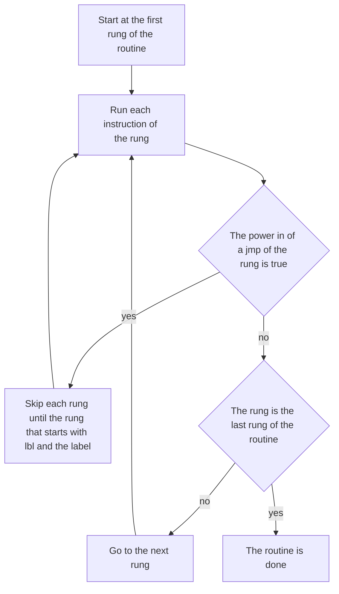
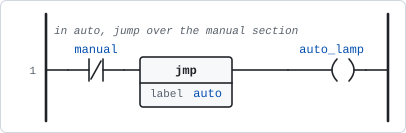
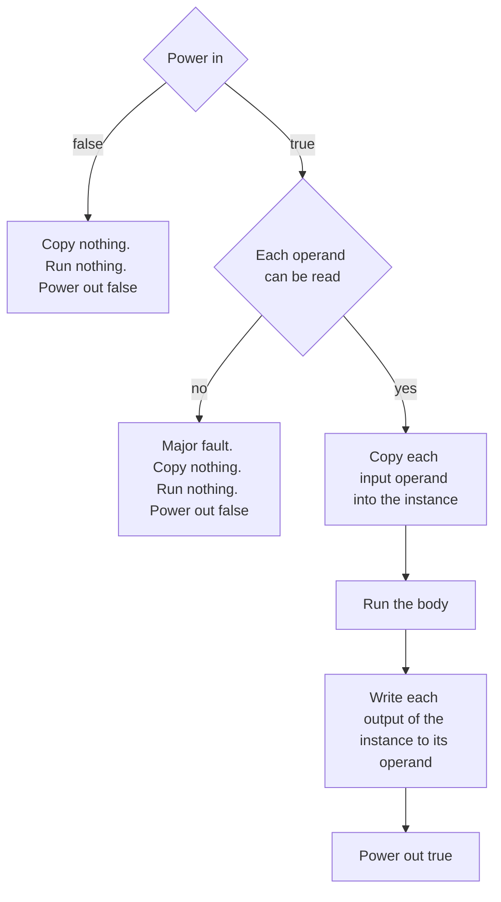
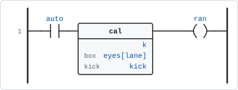

# Instructions: jump and call

This page is for a reader who writes or reads a ladder [program](glossary.md#program)
and looks for an exact rule. It defines 3 [instructions](glossary.md#instruction) that
change which [rungs](glossary.md#rung) a [scan](glossary.md#scan) runs: `jmp`, `lbl`
and `cal`.

| Instruction | What it does |
|---|---|
| [`jmp l`](#jmp) | On a [true rung](glossary.md#true-rung), it [jumps](glossary.md#jump) forward to the rung that `lbl l` starts. The scan does not run the rungs between them. |
| [`lbl l`](#lbl) | It gives the [label](glossary.md#label) `l` to its rung. It does nothing more. |
| [`cal s i1 i2 o1`](#cal) | On a true rung, it runs the [instance](glossary.md#instance) `s` of a [function block](glossary.md#function-block). It copies the inputs `i1` and `i2` in, runs the rungs of the function block and copies the output out to `o1`. |

In this table, `l` is a label, `s` is an instance, `i1` and `i2` are values, and `o1`
is a [tag](glossary.md#tag) that `cal` writes. The number of the inputs and of the
outputs comes from the function block.

> #### Warning {: .warning}
>
> Do not put the stop of a machine only on a rung that a `jmp` can skip. Do not give the
> stop only as an input of a `cal` that is on a rung with a condition. A rung that the
> scan does not run writes nothing, and a `cal` on a false rung copies no input in. An
> [output](glossary.md#output) that is 1 stays 1, and a motor that runs continues to
> run.
>
> Put a stop that must always work on a rung that each scan runs. For a function
> block, give the stop to the block as an input, and put no contact before its `cal` and
> no `jmp` over it. Then the body runs in each scan. Do not use logex for a safety
> function.

| To find | Go to |
|---|---|
| The words of this page | [The words of this page](#the-words-of-this-page) |
| What a rung keeps while the scan does not run it | [A rung that the scan does not run](#a-rung-that-the-scan-does-not-run) |
| The rules of 1 instruction | Its heading: [`jmp`](#jmp), [`lbl`](#lbl) or [`cal`](#cal) |
| The rung that a jump goes to | [Where a jump goes](#where-a-jump-goes) |
| The operands of `cal` and their [types](glossary.md#type) | [The operands of `cal`](#the-operands-of-cal) |
| The values of the tags in a run | [Examples](#examples) |
| The message of a wrong rung | [Wrong rungs and their diagnostics](#wrong-rungs-and-their-diagnostics) |
| The message of a [warning](glossary.md#warning) | [Programs and their warnings](#programs-and-their-warnings) |
| A rule of a different subject | [See also](#see-also) |

If a rung breaks a rule of this page, logex does not [compile](glossary.md#compile) the
program. It returns a [diagnostic](glossary.md#diagnostic). For some programs that break
no rule, logex gives a warning, and the program compiles.

## Rules that are the same for the 3 instructions

### The words of this page

| Word | Meaning |
|---|---|
| The power in | The [power flow](glossary.md#power-flow) that an instruction gets. [The power in and the power out](instructions-contacts-and-coils.md#the-power-in-and-the-power-out) gives it for each place on a rung. |
| The power out | The power flow that an instruction gives to the next instruction |
| A true rung | For an instruction, a rung is true if its power in is true. |
| A [false rung](glossary.md#false-rung) | For an instruction, a rung is false if its power in is false. |
| A run of an instruction | 1 time that a scan runs the instruction |
| A [routine](glossary.md#routine) | The rungs of 1 program, or the rungs of 1 function block. A label belongs to 1 routine. |
| The body | The rungs of a function block |
| A skipped rung | A rung between a `jmp` that jumps and the rung of its label. The scan does not run it. |
| The target rung | The rung that a `jmp` jumps to: the rung that starts with `lbl` and the label of the `jmp` |
| An [input](glossary.md#input) of a function block | A tag of the [section](glossary.md#section) `var_input` in the file of the function block |
| An output of a function block | A tag of the section `var_output` in the file of the function block |

### A rung that the scan does not run

The scan does not run a rung in 2 cases:

- The rung is a skipped rung.
- The rung is in the body of a function block, and the `cal` that runs the instance is
  on a false rung. The scan does not run the body.

In the 2 cases, each instruction of the rung has no run. An instruction with no run
writes nothing and reads nothing. It is not the same as an instruction on a false rung.
This table gives what each instruction does in the 2 cases.

| Instruction | With no run | On a false rung |
|---|---|---|
| `ote` | Its tag keeps its value. The `ote` writes no 1 and no 0. | It writes 0. |
| `otl`, `otu`, `move` and each other instruction that writes a tag | The tag keeps its value. | It writes nothing. The tag keeps its value. |
| A [timer](glossary.md#timer) | It keeps its [members](glossary.md#member) and the time of its last run. It does not count, and it does not reset. At its next run, if the timer counted time at its last run, it adds the full time since that run. If it did not count time at its last run, it adds no time. | It runs its rule for a false rung. For example, a `ton` resets. |
| A [counter](glossary.md#counter) | It keeps its count and the power in of its last run. It does not see a [rising edge](glossary.md#rising-edge) that comes and goes while it has no run. | It keeps its count. `cu` or `cd` gets 0. Thus the next true rung is a rising edge. |
| A [one-shot](glossary.md#one-shot) or a [pulse coil](glossary.md#pulse-coil) | The [storage bit](glossary.md#storage-bit) keeps its value. A [pulse bit](glossary.md#pulse-bit) that is 1 stays 1. | The storage bit gets 0. An `ons` passes no power. An `osr` writes 0 to its pulse bit. An `osf` writes 1 to its pulse bit if its storage bit was 1. |
| `div` and `mod` with the divisor 0 | Each writes nothing, and the scan gets no [fault](glossary.md#fault). | The same |
| An [operand](glossary.md#operand) with a tag as a [subscript](glossary.md#subscript) or as a [bit](glossary.md#bit) number | logex does not read the tag. If the value is out of the range, the scan gets no fault. | logex reads the tag only if the instruction writes on a false rung, as `ote` does. Then a value out of the range causes a fault. |
| `cal` | The instance and each tag of its outputs keep their values. The body does not run. | The same |
| `jmp` | It does not jump. | The same |

A counter or a one-shot compares its power in with the power in of its last run. Thus it
finds a rising edge or a [falling edge](glossary.md#falling-edge) only between 2 of its
runs. These are the rules:

- Its storage bit holds the power in of its last run. For a counter, the storage bit is
  the member `cu` or `cd`.
- On the [first scan](glossary.md#first-scan) of the program instance, a one-shot gives
  no pulse, and a counter does not count. An `ons` passes no power, and an `osr` or an
  `osf` does not set its pulse bit.
- If its first run comes on a later scan, the instruction compares the power in with the
  initial value of its storage bit. A counter counts at that run if its rung is true. An
  `ons` or an `osr` whose storage bit has the initial value 0 gives a pulse if its rung
  is true. An `osf` whose storage bit has the initial value 1 sets its pulse bit if its
  rung is false, even if the power never fell.
- At its first run after an [online edit](glossary.md#online-edit) adds it or changes
  its rung, it finds no edge. [Online edit](online-edit.md) gives the rule.

[The program `sorter.ld`](#the-program-sorterld) shows a one-shot in a function block at
its first run.

[The program `skip.ld`](#the-program-skipld) shows each row of the table in a run.

This diagram shows how a scan runs the rungs of a routine.



Figure: 1 run of a routine. The scan does not run a skipped rung.

### The place on a rung

| Item | Rule |
|---|---|
| `jmp` | It can be at any place on a rung: first, after other instructions, or in a [leg](glossary.md#leg) of a [branch](glossary.md#branch). More instructions can come after it. A rung has 1 `jmp` or none. |
| `lbl` | It is the first instruction of its rung. No instruction and no branch comes before it. More instructions can come after it. |
| `cal` | It can be at any place on a rung. More instructions can come after it. |
| After a timer instruction or a counter instruction | No `jmp` and no `cal` comes after it on its path. [The place of an instruction on a rung](instructions-contacts-and-coils.md#the-place-of-an-instruction-on-a-rung) gives the rule. |
| A rung that writes nothing | A rung that has a `jmp` and writes no tag is correct. A rung that has a `cal` of a function block with no output is correct. [A label alone](#a-label-alone) gives the rule for a rung of `lbl` only. |

### Reserved words

`jmp`, `lbl` and `cal` are [mnemonics](glossary.md#mnemonic). A mnemonic is not
case-sensitive: `JMP` and `jmp` are the same mnemonic. Each mnemonic is a
[reserved word](glossary.md#reserved-word) in each case. A tag or a label cannot have the
name `jmp`, `Jmp`, `lbl`, `LBL`, `cal` or `Cal`.
[Reserved words](source-syntax.md#reserved-words) gives the list.

## `jmp`

| Part | Rule |
|---|---|
| Name | Jump to label, a name from the [conventional set](glossary.md#conventional-set). [IEC 61131-3](glossary.md#iec-61131-3): a jump to a network label. |
| Operands | 1 label: `jmp auto`. A label is a name with no [declaration](glossary.md#declaration). [Labels](source-syntax.md#labels) gives its form. |
| On a true rung | The rest of the rung runs. Then the scan goes to the target rung, and runs it. |
| On a false rung | It does nothing. The scan runs the next rung. |
| Power out | The same as the power in. Thus an instruction after the `jmp` runs on a true rung when the jump occurs. |
| The target rung | A later rung of the same routine. It is the rung that starts with `lbl` and the same label. |
| On the first scan | The same as on each other scan |
| After a [restart](glossary.md#restart) | The same as on each other scan. A `jmp` keeps no value. |
| Faults | None |
| Diagnostics | The label: [wrong rungs 1 to 8](#wrong-rungs-1-to-8-the-label). The target rung and the place: [wrong rungs 9 to 22](#wrong-rungs-9-to-22-where-a-jump-goes). In a function block: [wrong rungs 23 to 27](#wrong-rungs-23-to-27-in-a-function-block). |
| Warnings | A `jmp` gives no warning. [Programs 2 and 3](#programs-1-to-9-warnings) show that a jump does not stop the warning of a second `ote`. |

A `jmp` that is first on its rung has no condition. It jumps in each scan.

logex has no instruction that jumps on a false rung. Put `xio` before the `jmp`:
`xio manual jmp auto` jumps when `manual` is 0.

This drawing shows rung 1 of [the program `jog.ld`](#the-program-jogld). The rung has a
`jmp` after a closed [contact](glossary.md#contact), and a [coil](glossary.md#coil) after the `jmp`.

<!-- rung: jog.ld 1 -->


### Where a jump goes

| Case | What the scan does | Example |
|---|---|---|
| A `jmp` gets a true rung. | It runs the rest of the rung. Then it skips each rung until the target rung, and runs the target rung and the rungs after it. | [Case 1](#jump-cases-1-to-6) |
| The `jmp` is in a leg of a branch. | The `jmp` jumps if the power in of its leg is true. The branch passes power if 1 leg or more passes power. | [Case 2](#jump-cases-1-to-6) |
| A rung between the `jmp` and the target rung starts with a different label. | The scan skips that rung also. | [Case 3](#jump-cases-1-to-6), scan 3 |
| A skipped rung has a `jmp`. | That `jmp` has no run, and it does not jump. | [Case 3](#jump-cases-1-to-6), scan 2 |
| The target rung has a `jmp`. | The target rung runs, and its `jmp` can jump again. | [Case 6](#jump-cases-1-to-6), scan 2 |
| The target rung is `lbl` and the label only. | The scan goes on with the rung after it. If no rung comes after it, the routine ends. | [Case 3](#jump-cases-1-to-6), scan 3 |
| 2 `jmp` instructions name 1 label. | Each `jmp` skips only the rungs between its own rung and the target rung. | [Case 5](#jump-cases-1-to-6) |
| The `jmp` is first on its rung, with no condition. | It jumps in each scan. | [Case 4](#jump-cases-1-to-6) |
| The label is on the same rung as the `jmp`, or on an earlier rung. | logex does not compile the program. A jump goes forward only, so a scan runs each rung of a routine 1 time or less. | [Wrong rungs 9 and 10](#wrong-rungs-9-to-22-where-a-jump-goes) |
| The label is in a different routine. | logex does not compile the program. A `jmp` in a program cannot jump into a function block, and a `jmp` in a body cannot jump out of it. | [Wrong rung 23](#wrong-rungs-23-to-27-in-a-function-block) |

## `lbl`

| Part | Rule |
|---|---|
| Name | Label, a name from the conventional set. IEC 61131-3: a network label. |
| Operands | 1 label: `lbl auto`. [Labels](source-syntax.md#labels) gives its form. |
| On a true rung | It does nothing. |
| On a false rung | It never gets a false rung. As the first instruction of its rung, its power in is always true. |
| Power out | The same as the power in. Thus the rung runs as it does with no `lbl`. |
| The label | It names its rung. 1 label names 1 rung of its routine. |
| On the first scan | The same as on each other scan |
| After a restart | The same as on each other scan. A `lbl` keeps no value. |
| Faults | None |
| Diagnostics | The label: [wrong rungs 1 to 8](#wrong-rungs-1-to-8-the-label). The place, 2 labels and a label alone: [wrong rungs 9 to 22](#wrong-rungs-9-to-22-where-a-jump-goes). In a function block: [wrong rungs 23 to 27](#wrong-rungs-23-to-27-in-a-function-block). |
| Warnings | A label that no `jmp` names: [program 1](#programs-1-to-9-warnings) |

A label and a tag can have the same name. In `xic lamp jmp lamp`, the first `lamp` is a
tag and the second is a label. [Program 11](#programs-10-to-16-no-warning) shows this.

### A label alone

A rung can be `lbl` and its label, with no other instruction: `lbl done`. This rung
writes nothing.

| Case | Rule |
|---|---|
| A `jmp` of the same routine names the label. | The rung is correct. It is a target rung that does nothing. A jump to it goes on with the rung after it, or to the end of the routine. |
| No `jmp` of the routine names the label. | logex does not compile the program. The rung writes nothing and jumps nowhere. [Wrong rung 21](#wrong-rungs-9-to-22-where-a-jump-goes) shows the diagnostic. |
| The rung is `lbl done xic skip`: a label and a contact | logex does not compile the program. A contact writes nothing. [Wrong rung 22](#wrong-rungs-9-to-22-where-a-jump-goes) shows the diagnostic. |

[A rung must write or jump](source-syntax.md#a-rung-must-write-or-jump) gives the rule
for each rung.

## `cal`

| Part | Rule |
|---|---|
| Name | Call. IEC 61131-3: the instruction CAL of the language Instruction List (IL). In a ladder drawing of IEC 61131-3, a function block is a box. Conventional set: a user-defined instruction. |
| Operands | An instance of a function block, then 1 operand for each input and for each output of the function block. [The operands of `cal`](#the-operands-of-cal) gives the rules. |
| On a true rung | 1. It copies the value of each input operand into the input of the instance. 2. It runs the body over the members of the instance. 3. It writes the value of each output of the instance to its output operand. |
| On a false rung | It does nothing. It copies nothing in, it does not run the body, and it writes nothing out. The instance and each tag of its outputs keep their values. |
| Power out | The same as the power in. After a fault of an operand, the power out is false. In IEC 61131-3, the power in is the input EN of the function block, and the power out is ENO. |
| The instance | Each `cal` runs 1 instance, and only 1 `cal` can run an instance. Each instance has a separate [state](glossary.md#state). |
| In a body | A body can declare an instance of a different function block and run it with `cal`. A function block cannot hold an instance of itself: [wrong rung 26](#wrong-rungs-23-to-27-in-a-function-block). |
| On the first scan | For the body, the [first scan](glossary.md#first-scan) is the first scan of the program instance, not the first run of the instance of the function block. On the first scan of the program instance, a one-shot in the body gives no pulse. An `ons` passes no power, and an `osr` or an `osf` does not set its pulse bit. If the first run of the instance comes later, the one-shot can give a pulse at that run. [A rung that the scan does not run](#a-rung-that-the-scan-does-not-run) gives the rule. |
| After a restart | The members of the instance get their [initial values](glossary.md#initial-value) again, as each tag does. [Retained values and the store](retained-values-and-store.md) gives what a [warm restart](glossary.md#warm-restart) keeps. |
| Faults | An operand with a tag as a subscript or as a bit number: see [Faults of `cal`](#faults-of-cal). A fault in the body: the fault names the instance. |
| Diagnostics | In a body: [wrong rungs 26 and 27](#wrong-rungs-23-to-27-in-a-function-block). The instance: [wrong rungs 28 to 41](#wrong-rungs-28-to-41-the-instance). The operands: [wrong rungs 42 to 60](#wrong-rungs-42-to-60-the-operands). |
| Warnings | An instance that no `cal` runs: [programs 4 to 7](#programs-1-to-9-warnings). A `cal` that writes the storage bit of a one-shot: [program 8](#programs-1-to-9-warnings). A real literal that the type of its input cannot hold exactly: [program 9](#programs-1-to-9-warnings). The warning names the value that the input gets. |

This drawing shows the 4 rungs of [the program `belts.ld`](#the-programs-sealld-and-beltsld).
Each of the first 3 rungs has a `cal`. The third `cal` comes after the contact `auto`.

<!-- rung: belts.ld -->


This diagram shows 1 run of `cal`.



Figure: 1 run of `cal`. Only an operand with a tag as a subscript or as a bit number can
cause the fault.

### The operands of `cal`

The operands of `cal` come in this sequence:

1. The instance.
2. 1 operand for each input of the function block. The operands follow the sequence of
   the declarations in the file.
3. 1 operand for each output of the function block, in the sequence of the declarations.

If the file declares an output before an input, the inputs still come first.

> #### Warning {: .warning}
>
> Give the operands in the sequence of the declarations. logex checks the number of the
> operands and the type of each operand. It does not find 2 `bool` operands in the wrong
> sequence. With `cal s1 stop start_1 belt_1`, the program compiles, and the stop button
> starts the belt.

This table gives the operands of rung 1 of `belts.ld`, `cal s1 start_1 stop belt_1`.
The file `seal.ld` declares `start`, `stop` and `run`.

| In the rung | It fills | What `cal` does with it |
|---|---|---|
| `s1` | The instance | It runs `s1`. |
| `start_1` | The input `start` | It copies `start_1` into `s1.start`. |
| `stop` | The input `stop` | It copies `stop` into `s1.stop`. |
| `belt_1` | The output `run` | It writes `s1.run` to `belt_1`. |

The instance can be:

- An instance of a function block that you write: `s1`.
- An [element](glossary.md#element) of an [array](glossary.md#array) of instances, with
  literal subscripts in the range of the array: `lanes[1]`.

The instance cannot be:

- A timer or a counter, or a tag that is not an instance.
- A [member](glossary.md#member), or a full array.
- An element with a tag as a subscript, or with a subscript out of the range.

An input can be:

- A tag, an element, a bit or a member of the type of the input.
- A [literal](glossary.md#literal) that the type of the input can hold.
- A value of a type that [widens](glossary.md#widen) into the type of the input.

An input cannot be:

- A full timer, counter or instance.
- A full array: [wrong rung 59](#wrong-rungs-42-to-60-the-operands).
- A value of a type that does not widen into the type of the input.

An output can be:

- A tag, an element, a bit or a member that an instruction can write. Its type is the
  type of the output, or a type that the type of the output widens into.

An output cannot be:

- A literal, or a `var_input` tag.
- A member of an instance of a function block. This includes the instance that the
  `cal` runs.
- A member of a timer or a counter that an instruction cannot write.
  [The members](instructions-timers-and-counters.md#the-members) gives the members that
  an instruction can write.
- A full array: [wrong rung 60](#wrong-rungs-42-to-60-the-operands).

A `cal` widens a value as `move` does. Thus an `int` widens into a `dint` input, and a
`real` widens into an `lreal` input. A `dint` does not widen into a `real`. The
diagnostic names the conversion to use.
[Declarations and types](declarations-and-types.md) gives the types that each type
widens into.

[The rules of 1 `cal` for 1 instance](#the-rules-of-1-cal-for-1-instance) gives the rules
for 2 instructions that run 1 instance.

### The rules of 1 `cal` for 1 instance

| Item | Rule |
|---|---|
| 2 `cal` instructions | logex does not compile a program in which 2 `cal` instructions run the same instance. This rule is the same for 1 element of an array of instances. |
| An element of an array of instances | `cal lanes[1]` runs only the element `lanes[1]`. Each element of the array needs its `cal`. |
| A timer or a counter | `cal` does not run a timer or a counter. Its instruction, such as `ton`, runs it. |
| An instance that no `cal` runs | The program compiles with a warning. The instance never runs, and its members keep their initial values. |
| 1 tag that 2 instructions write | A `cal` and an `ote` can write the same tag. 2 `cal` instructions can write the same tag. logex gives no warning. The last write in the scan decides the value. |

### Faults of `cal`

A `cal` can get a fault in 2 ways. This table gives a fault of an operand.

| Part | Rule |
|---|---|
| Cause | An operand has a tag as a subscript or as a bit number, and the value is out of the range. |
| Fault | `:index_out_of_range` or `:bit_out_of_range`, a [major fault](glossary.md#major-fault). Its instruction is `cal`. |
| What `cal` does | It copies nothing in, it does not run the body, and it writes nothing out. |
| Power out | False |

This table gives a fault in the body.

| Part | Rule |
|---|---|
| Cause | An instruction of the body has a fault. |
| Fault | The fault of that instruction. Its field `path` names the instance, and its field `line` is the line in the file of the function block. |
| What `cal` does | The rest of the body runs. Then `cal` writes the outputs out. |
| Power out | True |

If a [runner](glossary.md#runner) runs the program, a major fault causes a
[trip](glossary.md#trip). [Faults](faults.md) gives the fields of a fault and what logex
does with it. [The program `sorter.ld`](#the-program-sorterld) shows a fault of an
operand.

### A jump in a function block

The body of a function block is a separate routine. A `jmp` in the body goes to a label
of the body. The labels of the body and the labels of the program are separate. A body
can have the label `done`, and the program can have a different label `done`.

In the file of a function block, `function_block` is a reserved word in each case. It
cannot be a label. [Wrong rungs 24 and 25](#wrong-rungs-23-to-27-in-a-function-block)
show the diagnostic.

[Function blocks](function-blocks.md) gives the file of a function block, its members
and its instances.

## Examples

Each example is a program or a list of rungs, with a script that runs it. It is not
necessary to read a script, because the page shows each line that it prints. Each
`elixir` block is the file under `examples/` that its `$ mix run` line names. The
directory `examples` of the repository is a Mix project, and logex is its dependency. To
run a script, type its command in that directory.
[Your first program](../tutorials/first-program.md) shows how to make a Mix project that
has logex as a dependency.

### The scripts that run the examples

Each script reads the file `scans.exs`. It is in the directory
`examples/instructions-jump-and-call` of the repository. It runs the scans of a program
and prints a table. Each row gives the number of the scan and the value of each name
after the scan. After a row, it prints each fault of the scan.

<!-- file: instructions-jump-and-call/scans.exs -->
```elixir
# scans.(program, step, inputs, names) runs the scans of a compiled program. The map
# `inputs` gives, for each input, a list with its value in each scan. Each scan gets
# `step` ms. After each scan, the script prints the number of the scan and the value of
# each name. A name is a tag, or a member such as "t1.acc". After a row, the script
# prints each fault of the scan.
where = fn
  nil -> ""
  path -> " in #{path}"
end

fault = fn %Logex.Fault{} = fault ->
  "      fault  #{fault.severity} #{inspect(fault.kind)}, `#{fault.instruction}` " <>
    "on line #{fault.line}#{where.(fault.path)}"
end

fn program, step, inputs, names ->
  columns = ["scan" | names]

  row = fn cells ->
    columns
    |> Enum.zip(cells)
    |> Enum.map_join("  ", fn {name, cell} ->
      String.pad_leading("#{cell}", String.length(name))
    end)
    |> IO.puts()
  end

  scan = fn values, {number, state} ->
    now = Map.new(Enum.zip(Map.keys(inputs), values))
    state = Logex.Runtime.put_inputs(program, state, now)
    {_outputs, state} = Logex.Runtime.scan(program, state, step)
    row.([number | Enum.map(names, &get_in(state.env, String.split(&1, ".")))])
    Enum.each(state.faults, &IO.puts(fault.(&1)))
    {number + 1, state}
  end

  row.(columns)

  inputs
  |> Map.values()
  |> Enum.zip_with(& &1)
  |> Enum.reduce({1, Logex.Runtime.instance(program)}, scan)
end
```

### The program `jog.ld`

`jog.ld` runs a conveyor. In the automatic mode, `manual` is 0, and `run_pb` runs the
motor. In the manual mode, `jog_pb` runs the motor while a person holds it. In the
automatic mode, the `jmp` of rung 1 skips rungs 2, 3 and 4, the rungs of the manual
mode.

<!-- file: jog.ld -->
```text
var_input manual bool
var_input jog_pb bool
var_input run_pb bool
var_output auto_lamp bool
var_output jog_lamp bool
var_output jog_long bool
var_output motor bool
var jog_t ton

// in auto, jump over the manual section
xio manual jmp auto ote auto_lamp
xic jog_pb ote jog_lamp
xic jog_pb ton jog_t 3000
xic jog_t.dn ote jog_long
lbl auto ( xic run_pb xio manual | xic manual xic jog_pb ) ote motor
```

<!-- rung: jog.ld -->


The script gives 500 ms to each scan.

```elixir
{scans, _} = Code.eval_file("instructions-jump-and-call/scans.exs")
{:ok, program} = Logex.compile_file("jog.ld")

inputs = %{
  "manual" => [1, 1, 1, 0, 0, 0, 1, 1, 1, 1],
  "jog_pb" => [0, 1, 1, 1, 0, 0, 1, 1, 0, 0],
  "run_pb" => [0, 0, 0, 1, 1, 0, 0, 0, 0, 0]
}

names = ["manual", "jog_pb", "run_pb", "auto_lamp", "jog_lamp", "jog_t.acc", "jog_long", "motor"]
scans.(program, 500, inputs, names)
```

```console
$ mix run instructions-jump-and-call-jog.exs
scan  manual  jog_pb  run_pb  auto_lamp  jog_lamp  jog_t.acc  jog_long  motor
   1       1       0       0          0         0          0         0      0
   2       1       1       0          0         1          0         0      1
   3       1       1       0          0         1        500         0      1
   4       0       1       1          1         1        500         0      1
   5       0       0       1          1         1        500         0      1
   6       0       0       0          1         1        500         0      0
   7       1       1       0          0         1       2500         0      1
   8       1       1       0          0         1       3000         1      1
   9       1       0       0          0         0          0         0      0
  10       1       0       0          0         0          0         0      0
```

| Scans | What the table shows |
|---|---|
| 2 and 3 | The manual mode. `jog_pb` is 1: `jog_lamp` is 1, and the timer counts. |
| 4 to 6 | The automatic mode. The scan skips rungs 2, 3 and 4. `jog_pb` is 0 in scans 5 and 6, but `jog_lamp` stays 1. `jog_t.acc` stays 500. |
| 4 | `auto_lamp` is 1. The `ote` comes after the `jmp` on rung 1, and the `jmp` passes its power in. |
| 7 | The manual mode again. The timer adds the 2000 ms since its last run in scan 3: `jog_t.acc` goes from 500 to 2500. |
| 8 | `jog_t.acc` gets to the [preset](glossary.md#preset) 3000, and `jog_long` comes on. |

### The program `skip.ld`

`skip.ld` has a counter, a timer, a pulse coil and a `div` on
the rungs that a jump skips. While `hold` is 1, the `jmp` of rung 1 skips rungs 2 to 6.
The last rung is a label alone, the target rung.

<!-- file: instructions-jump-and-call/skip.ld -->
```text
// While `hold` is 1, the jump skips rungs 2 to 6.
var_input  hold   bool
var_input  eye    bool
var_input  rate   dint
var_output lamp   bool
var_output kick   bool
var_output share  dint
var        boxes  ctu
var        dwell  ton
var        seen   bool

xic hold jmp held
xic eye ote lamp
xic eye ctu boxes 100
xic eye ton dwell 300
xic eye osr seen kick
div 100 rate share
lbl held
```

<!-- rung: instructions-jump-and-call/skip.ld -->


The script gives 100 ms to each scan.

```elixir
{scans, _} = Code.eval_file("instructions-jump-and-call/scans.exs")
{:ok, program} = Logex.compile_file("instructions-jump-and-call/skip.ld")

inputs = %{
  "hold" => [0, 0, 1, 1, 1, 0, 0, 0],
  "eye" => [0, 1, 0, 1, 0, 1, 0, 1],
  "rate" => [4, 4, 0, 0, 0, 5, 0, 5]
}

names = ["hold", "eye", "rate", "lamp", "boxes.cv", "dwell.acc", "dwell.dn", "kick", "share"]
scans.(program, 100, inputs, names)
```

```console
$ mix run instructions-jump-and-call-skip.exs
scan  hold  eye  rate  lamp  boxes.cv  dwell.acc  dwell.dn  kick  share
   1     0    0     4     0         0          0         0     0     25
   2     0    1     4     1         1          0         0     1     25
   3     1    0     0     1         1          0         0     1     25
   4     1    1     0     1         1          0         0     1     25
   5     1    0     0     1         1          0         0     1     25
   6     0    1     5     1         1        300         1     0     20
   7     0    0     0     0         1          0         0     0      0
      fault  minor :divide_by_zero, `div` on line 17
   8     0    1     5     1         2          0         0     1     20
```

| Scans | What the table shows |
|---|---|
| 1 and 2 | The rungs run. In scan 2, `eye` goes to 1: `boxes.cv` is 1, the timer starts and `kick` is 1. |
| 3 to 5 | `hold` is 1, and the scan skips rungs 2 to 6. `eye` is 0 in scans 3 and 5, but `lamp` and `kick` stay 1. `rate` is 0, but the scan gets no fault, and `share` keeps 25. |
| 4 | `eye` goes to 1 and back to 0 in scans 4 and 5. The counter does not count this rising edge. |
| 6 | The rungs run again. The timer adds the 400 ms since its last run in scan 2, and stops at its preset 300. The counter and the pulse coil compare `eye` with their last run in scan 2, which also had `eye` at 1. Thus `boxes.cv` stays 1, and `kick` is 0. |
| 7 | `rate` is 0, and `div` runs. It writes 0, and the scan gets a [minor fault](glossary.md#minor-fault). |
| 8 | A rising edge of `eye`: `boxes.cv` is 2 and `kick` is 1. |

### Jump cases 1 to 6

Each case is the rungs of a program, with the same 5 declarations. The script compiles
each case and runs its scans. [Where a jump goes](#where-a-jump-goes) gives the rule of
each case.

```elixir
{scans, _} = Code.eval_file("instructions-jump-and-call/scans.exs")

tags = """
var_input  skip   bool
var_input  other  bool
var_input  eye    bool
var_output lamp   bool
var_output belt   bool
"""

# Each case is the rungs of a program and the inputs of its scans.
cases = [
  {"xic skip jmp done ote lamp\nxic eye ote belt\nlbl done",
   %{"skip" => [0, 1, 1, 0], "other" => [0, 0, 0, 0], "eye" => [1, 0, 0, 0]}},
  {"( xic skip jmp done | xic eye ) ote lamp\nxic eye ote belt\nlbl done",
   %{"skip" => [0, 1, 1, 0], "other" => [0, 0, 0, 0], "eye" => [1, 0, 0, 0]}},
  {"xic skip jmp mid\nxic other jmp last\nlbl mid xic eye ote lamp\nxic eye ote belt\nlbl last",
   %{"skip" => [0, 1, 0, 0], "other" => [0, 1, 1, 0], "eye" => [1, 0, 1, 1]}},
  {"jmp done\nxic eye ote lamp\nlbl done xic eye ote belt",
   %{"skip" => [0, 0], "other" => [0, 0], "eye" => [1, 0]}},
  {"xic skip jmp done\nxic eye ote lamp\nxic other jmp done\nxic eye ote belt\nlbl done",
   %{"skip" => [0, 0, 1, 0], "other" => [0, 1, 0, 0], "eye" => [1, 0, 0, 0]}},
  {"xic skip jmp mid\nxic eye ote lamp\nlbl mid xic other jmp last\nxic eye ote belt\nlbl last",
   %{"skip" => [0, 1, 1, 0], "other" => [0, 1, 0, 0], "eye" => [1, 0, 0, 0]}}
]

# A blank line comes before each case after the first.
head = fn
  1 -> "Case 1"
  number -> "\nCase #{number}"
end

for {{rungs, inputs}, number} <- Enum.with_index(cases, 1) do
  IO.puts(head.(number) <> "\n" <> rungs <> "\n")
  {:ok, program} = Logex.compile(tags <> rungs, name: "case")
  scans.(program, 10, inputs, ["skip", "other", "eye", "lamp", "belt"])
end
```

```console
$ mix run instructions-jump-and-call-jumps.exs
Case 1
xic skip jmp done ote lamp
xic eye ote belt
lbl done

scan  skip  other  eye  lamp  belt
   1     0      0    1     0     1
   2     1      0    0     1     1
   3     1      0    0     1     1
   4     0      0    0     0     0

Case 2
( xic skip jmp done | xic eye ) ote lamp
xic eye ote belt
lbl done

scan  skip  other  eye  lamp  belt
   1     0      0    1     1     1
   2     1      0    0     1     1
   3     1      0    0     1     1
   4     0      0    0     0     0

Case 3
xic skip jmp mid
xic other jmp last
lbl mid xic eye ote lamp
xic eye ote belt
lbl last

scan  skip  other  eye  lamp  belt
   1     0      0    1     1     1
   2     1      1    0     0     0
   3     0      1    1     0     0
   4     0      0    1     1     1

Case 4
jmp done
xic eye ote lamp
lbl done xic eye ote belt

scan  skip  other  eye  lamp  belt
   1     0      0    1     0     1
   2     0      0    0     0     0

Case 5
xic skip jmp done
xic eye ote lamp
xic other jmp done
xic eye ote belt
lbl done

scan  skip  other  eye  lamp  belt
   1     0      0    1     1     1
   2     0      1    0     0     1
   3     1      0    0     0     1
   4     0      0    0     0     0

Case 6
xic skip jmp mid
xic eye ote lamp
lbl mid xic other jmp last
xic eye ote belt
lbl last

scan  skip  other  eye  lamp  belt
   1     0      0    1     1     1
   2     1      1    0     1     1
   3     1      0    0     1     0
   4     0      0    0     0     0
```

| Case | Scans | What the table shows |
|---|---|---|
| 1 | 2 and 3 | The `jmp` jumps. `ote lamp` after it on the same rung runs, and `lamp` is 1. The scan skips rung 2, and `belt` stays 1. |
| 2 | 2 and 3 | The `jmp` in the first leg jumps. The leg passes power, and `lamp` is 1. `belt` stays 1. |
| 3 | 2 | The `jmp` of rung 1 jumps to `mid`. The scan skips rung 2, and its `jmp` does not jump. Rungs 3 and 4 run. |
| 3 | 3 | The `jmp` of rung 2 jumps to `last`. The scan skips rung 3, which starts with the label `mid`, and rung 4. `lamp` and `belt` stay 0. |
| 4 | 1 and 2 | The `jmp` has no condition. The scan always skips rung 2, and `lamp` stays 0. |
| 5 | 2 | The `jmp` of rung 3 jumps. Rung 2 runs, and `lamp` is 0. The scan skips rung 4, and `belt` stays 1. |
| 5 | 3 | The `jmp` of rung 1 jumps to the same label. The scan skips rungs 2, 3 and 4. |
| 6 | 2 | The `jmp` of rung 1 jumps to `mid`. The target rung runs, and its `jmp` jumps to `last`. `lamp` and `belt` stay 1. |
| 6 | 3 | The `jmp` of rung 1 jumps to `mid`. The `jmp` of the target rung does not jump. Rung 4 runs, and `belt` is 0. `lamp` stays 1. |

### The programs `seal.ld` and `belts.ld`

`seal.ld` is a function block: a [seal-in](glossary.md#seal-in) with a start and a
stop. `belts.ld` runs 3 belts with 3 instances of `seal`. The input `stop` of each
instance is the same stop button. The instance `s3` runs only while `auto` is 1. The script runs `belts.ld`, and
`Logex.compile_file/1` compiles `seal.ld`, which is in the same directory.

<!-- file: seal.ld -->
```text
// A seal-in: `run` holds itself in from `start` until `stop`.
function_block seal
var_input start bool
var_input stop bool
var_output run bool

( xic start | xic run ) xio stop ote run
```

<!-- file: belts.ld -->
```text
var_input start_1 bool
var_input start_2 bool
var_input start_3 bool
var_input stop bool
var_input auto bool
var_output belt_1 bool
var_output belt_2 bool
var_output belt_3 bool
var_output all_run bool
var s1 seal
var s2 seal
var s3 seal

cal s1 start_1 stop belt_1
cal s2 start_2 stop belt_2
xic auto cal s3 start_3 stop belt_3
xic s1.run xic s2.run xic s3.run ote all_run
```

The script gives 10 ms to each scan. It shows the members of `s3`.

```elixir
{scans, _} = Code.eval_file("instructions-jump-and-call/scans.exs")
{:ok, program} = Logex.compile_file("belts.ld")

inputs = %{
  "start_1" => [1, 0, 0, 0, 0, 0],
  "start_2" => [0, 1, 0, 0, 0, 0],
  "start_3" => [0, 1, 0, 0, 0, 0],
  "stop" => [0, 0, 0, 1, 1, 0],
  "auto" => [1, 1, 1, 0, 1, 1]
}

names = ["start_3", "stop", "auto", "belt_1", "belt_2", "belt_3", "s3.start", "s3.stop", "s3.run"]
scans.(program, 10, inputs, names)
```

```console
$ mix run instructions-jump-and-call-belts.exs
scan  start_3  stop  auto  belt_1  belt_2  belt_3  s3.start  s3.stop  s3.run
   1        0     0     1       1       0       0         0        0       0
   2        1     0     1       1       1       1         1        0       1
   3        0     0     1       1       1       1         0        0       1
   4        0     1     0       0       0       1         0        0       1
   5        0     1     1       0       0       0         0        1       0
   6        0     0     1       0       0       0         0        0       0
```

| Scans | What the table shows |
|---|---|
| 1 to 3 | Belt 1 starts in scan 1, and belts 2 and 3 start in scan 2. The `cal` of `s3` copies `start_3` into `s3.start` in each scan. |
| 4 | `auto` is 0, and `stop` is 1. Belts 1 and 2 stop. The `cal` of `s3` gets a false rung. It does not copy `stop` into the instance: `s3.stop` stays 0. It does not write `belt_3`, and belt 3 continues to run. |
| 5 | `auto` is 1 again. The `cal` copies `stop` into `s3.stop`, the body runs, and belt 3 stops. |

### The program `sorter.ld`

`kicker.ld` is a function block with a one-shot. `sorter.ld` runs 1 instance of it while
`auto` is 1. The input of the instance is an element of the array `eyes`, and the tag
`lane` holds its subscript.

<!-- file: instructions-jump-and-call/kicker.ld -->
```text
// A kicker: `kick` is 1 for 1 run of the body after `box` goes to 1.
function_block kicker
var_input  box   bool
var_output kick  bool
var        seen  bool

xic box ons seen ote kick
```

<!-- file: instructions-jump-and-call/sorter.ld -->
```text
// The kicker runs while `auto` is 1. The tag `lane` selects the eye that it reads.
var_input  auto  bool
var_input  lane  dint
var_input  eyes  bool[2]
var_output kick  bool
var_output ran   bool
var        k     kicker

xic auto cal k eyes[lane] kick ote ran
```

<!-- rung: instructions-jump-and-call/sorter.ld -->


The script gives 10 ms to each scan.

```elixir
{scans, _} = Code.eval_file("instructions-jump-and-call/scans.exs")
{:ok, program} = Logex.compile_file("instructions-jump-and-call/sorter.ld")

inputs = %{
  "auto" => [0, 1, 1, 1, 1, 1, 1, 0],
  "lane" => [0, 0, 0, 0, 1, 5, 1, 1],
  "eyes" => [[1, 0], [1, 0], [1, 0], [0, 0], [0, 1], [0, 1], [0, 1], [0, 0]]
}

names = ["auto", "lane", "ran", "k.box", "k.seen", "kick"]
scans.(program, 10, inputs, names)
```

```console
$ mix run instructions-jump-and-call-sorter.exs
scan  auto  lane  ran  k.box  k.seen  kick
   1     0     0    0      0       0     0
   2     1     0    1      1       1     1
   3     1     0    1      1       1     0
   4     1     0    1      0       0     0
   5     1     1    1      1       1     1
   6     1     5    0      1       1     1
      fault  major :index_out_of_range, `cal` on line 9
   7     1     1    1      1       1     0
   8     0     1    0      1       1     0
```

| Scans | What the table shows |
|---|---|
| 1 | The first scan. `auto` is 0, and the body does not run. `eyes[0]` is 1. |
| 2 | The first run of the instance. `eyes[0]` is still 1, and the one-shot passes power: `kick` is 1. It is not the first scan of the program. |
| 5 | `lane` is 1, and `eyes[1]` goes to 1. `kick` is 1. |
| 6 | `lane` is 5, which is out of the range of `eyes`. The scan gets a major fault of `cal`. The `cal` copies nothing in and writes nothing out: `kick` stays 1. Its power out is false, and `ran` is 0. |
| 8 | `auto` is 0. The body does not run, and `ran` is 0. |

## Wrong rungs and their diagnostics

This part shows 60 wrong rungs in 5 groups. For each group, a script compiles each
wrong rung and prints it after its number. After each rung, the script prints each
diagnostic that logex returns.

| Group | Wrong rungs | Rules |
|---|---|---|
| [The label](#wrong-rungs-1-to-8-the-label) | 1 to 8 | [Labels](source-syntax.md#labels) |
| [Where a jump goes](#wrong-rungs-9-to-22-where-a-jump-goes) | 9 to 22 | [Where a jump goes](#where-a-jump-goes), [A label alone](#a-label-alone) |
| [In a function block](#wrong-rungs-23-to-27-in-a-function-block) | 23 to 27 | [A jump in a function block](#a-jump-in-a-function-block), [`cal`](#cal) |
| [The instance](#wrong-rungs-28-to-41-the-instance) | 28 to 41 | [The operands of `cal`](#the-operands-of-cal), [The rules of 1 `cal` for 1 instance](#the-rules-of-1-cal-for-1-instance) |
| [The operands](#wrong-rungs-42-to-60-the-operands) | 42 to 60 | [The operands of `cal`](#the-operands-of-cal) |

The page shows a long message on 2 lines or more. To find a message, search this page
for 3 or 4 words of the message.

### The tags of the wrong rungs

Each wrong rung comes after the same 15 declarations, and thus it is line 16. Some wrong
rungs have 2 or 3 rungs, on lines 16 to 18. The file `tags.txt` holds the 15
declarations. The instances `s1`, `s2` and `lanes` are of the function block `seal` of
[the program `belts.ld`](#the-programs-sealld-and-beltsld). The instance `g` is of the
function block `gain`. The 2 files are in the directory
`examples/instructions-jump-and-call` of the repository.

<!-- file: instructions-jump-and-call/tags.txt -->
```text
var_input  eye    bool
var_input  skip   bool
var_input  slot   dint
var_input  speed  int
var_input  rate   real
var_input  big    lint
var_output lamp   bool
var_output belt   bool
var_output small  sint
var_output total  lreal
var        delay  ton
var        s1     seal
var        s2     seal
var        lanes  seal[3]
var        g      gain
```

<!-- file: instructions-jump-and-call/gain.ld -->
```text
// A gain: `y` is `x` times `k`.
function_block gain
var_input  x  dint
var_input  k  lreal
var_output y  lreal

mul x k y
```

Each script of this part reads `tags.txt`, `seal.ld` and `gain.ld`. It also reads the
file
[`instructions-contacts-and-coils/report.exs`](instructions-contacts-and-coils.md#the-tags-of-the-wrong-rungs),
which prints each rung and each message in lines of 80 characters or fewer. It is not
necessary to read the scripts to use the diagnostics.

### Wrong rungs 1 to 8: the label

The operand of `jmp` and of `lbl` is a label. In wrong rung 7, the second `done` is
not an operand. logex reads it as the next mnemonic.

```elixir
{report, _} = Code.eval_file("instructions-contacts-and-coils/report.exs")
{:ok, seal} = Logex.compile_file("seal.ld")
{:ok, gain} = Logex.compile_file("instructions-jump-and-call/gain.ld")
tags = File.read!("instructions-jump-and-call/tags.txt")

rungs = [
  "xic eye jmp",
  "xic eye jmp 5",
  "xic eye jmp delay.dn",
  "xic eye jmp lanes[0]",
  "xic eye jmp bool",
  "xic eye jmp ote lamp",
  "xic eye jmp done done\nlbl done ote lamp",
  "lbl ote lamp"
]

report.(1, rungs, &Logex.compile(tags <> &1, name: "wrong", types: [seal, gain]))
```

```console
$ mix run instructions-jump-and-call-wrong-labels.exs
 1  xic eye jmp
      line 16: `jmp` expects 1 operand (a label), found none
 2  xic eye jmp 5
      line 16: `jmp` expects a label, found `5`
 3  xic eye jmp delay.dn
      line 16: `jmp` takes a label, a name with no `.`, found `delay.dn`
 4  xic eye jmp lanes[0]
      line 16: `jmp` takes a label, a name with no subscript, found `lanes[0]`
 5  xic eye jmp bool
      line 16: `jmp` takes a label, found the type `bool`
 6  xic eye jmp ote lamp
      line 16: `jmp` expects 1 operand (a label), found none before the
      instruction `ote`
 7  xic eye jmp done done
    lbl done ote lamp
      line 16: unknown instruction `done`
 8  lbl ote lamp
      line 16: `lbl` expects 1 operand (a label), found none before the
      instruction `ote`
```

### Wrong rungs 9 to 22: where a jump goes

```elixir
{report, _} = Code.eval_file("instructions-contacts-and-coils/report.exs")
{:ok, seal} = Logex.compile_file("seal.ld")
{:ok, gain} = Logex.compile_file("instructions-jump-and-call/gain.ld")
tags = File.read!("instructions-jump-and-call/tags.txt")

rungs = [
  "lbl top xic eye ote lamp\nxic eye jmp top",
  "lbl top xic eye jmp top ote lamp",
  "xic eye jmp done",
  "xic eye jmp dne\nlbl done ote lamp",
  "xic eye jmp Done\nlbl done ote lamp",
  "xic eye jmp done\nxic skip lbl done ote lamp",
  "xic eye jmp done\n( lbl done | xic skip ) ote lamp",
  "xic eye jmp done\nlbl done ote lamp\nlbl done ote belt",
  "xic eye jmp done\nlbl Done ote lamp\nlbl done ote belt",
  "xic eye jmp done jmp done\nlbl done ote lamp",
  "( xic eye jmp done | xic skip jmp done ) ote lamp\nlbl done",
  "xic eye ton delay 100 jmp done\nlbl done",
  "xic eye ote lamp\nlbl done",
  "xic eye jmp done\nlbl done xic skip"
]

report.(9, rungs, &Logex.compile(tags <> &1, name: "wrong", types: [seal, gain]))
```

```console
$ mix run instructions-jump-and-call-wrong-jumps.exs
 9  lbl top xic eye ote lamp
    xic eye jmp top
      line 17: `jmp top` jumps back, to the rung on line 16: a jump goes forward
      only, to a label on a later rung, since one back could loop for ever
10  lbl top xic eye jmp top ote lamp
      line 16: `jmp top` jumps to its own rung: a jump goes forward only, to a
      label on a later rung, since one back could loop for ever
11  xic eye jmp done
      line 16: `jmp done` names no label: no rung of this program begins `lbl
      done`
12  xic eye jmp dne
    lbl done ote lamp
      line 16: `jmp dne` names no label: no rung of this program begins `lbl
      dne` — did you mean `done`?
13  xic eye jmp Done
    lbl done ote lamp
      line 16: `jmp Done` names no label: no rung of this program begins `lbl
      Done` — did you mean `done`? (labels are case-sensitive)
14  xic eye jmp done
    xic skip lbl done ote lamp
      line 17: `lbl done` is not first on its rung: a label stands at the head
      of the rung it names, before any other instruction or branch group
15  xic eye jmp done
    ( lbl done | xic skip ) ote lamp
      line 17: `lbl done` is not first on its rung: a label stands at the head
      of the rung it names, before any other instruction or branch group
16  xic eye jmp done
    lbl done ote lamp
    lbl done ote belt
      line 18: `done` already labels the rung on line 17: a label names one rung
17  xic eye jmp done
    lbl Done ote lamp
    lbl done ote belt
      line 16: `jmp done` names no label: no rung of this program begins `lbl
      done` — did you mean `Done`? (labels are case-sensitive)
      line 18: the labels `done` and `Done` (line 17) differ only in case:
      labels are case-sensitive, so these would be two labels
18  xic eye jmp done jmp done
    lbl done ote lamp
      line 16: `jmp done` is a second `jmp` in this rung, after `jmp done`: a
      rung holds one, since which of two would win is not settled
19  ( xic eye jmp done | xic skip jmp done ) ote lamp
    lbl done
      line 16: `jmp done` is a second `jmp` in this rung, after `jmp done`: a
      rung holds one, since which of two would win is not settled
20  xic eye ton delay 100 jmp done
    lbl done
      line 16: `jmp done` follows `ton delay` on its path: what passes on after
      a `ton` is not settled, so a `ton` ends its path; read the timer with `xic
      delay.dn` on a rung below
21  xic eye ote lamp
    lbl done
      line 17: this rung writes nothing and jumps nowhere: none of its
      instructions writes a tag, a member or a bit, runs an instance or keeps a
      one-shot's storage bit. A newline ends a rung, so a rung's conditions and
      its outputs go on one line, as in `xic start xio stop ote motor`
22  xic eye jmp done
    lbl done xic skip
      line 17: this rung writes nothing and jumps nowhere: none of its
      instructions writes a tag, a member or a bit, runs an instance or keeps a
      one-shot's storage bit. A newline ends a rung, so a rung's conditions and
      its outputs go on one line, as in `xic start xio stop ote motor`
```

### Wrong rungs 23 to 27: in a function block

Each wrong text is the file of a function block `hop`. In wrong text 23, the body has no
label `done`. In wrong text 26, `hop` declares an instance of itself. In wrong text 27,
it declares an array as an input.

```elixir
{report, _} = Code.eval_file("instructions-contacts-and-coils/report.exs")

head = "function_block hop\nvar_input go bool\nvar_output q bool\n"

bodies = [
  "xic go jmp done\nxic go ote q",
  "xic go jmp function_block\nlbl function_block ote q",
  "xic go jmp FUNCTION_BLOCK\nlbl FUNCTION_BLOCK ote q",
  "var me hop\ncal me go q",
  "var_input more bool[2]\nxic more[0] ote q"
]

report.(23, Enum.map(bodies, &(head <> &1)), &Logex.compile(&1, name: "hop"))
```

```console
$ mix run instructions-jump-and-call-wrong-bodies.exs
23  function_block hop
    var_input go bool
    var_output q bool
    xic go jmp done
    xic go ote q
      line 4: `jmp done` names no label: no rung of this function block's body
      begins `lbl done`
24  function_block hop
    var_input go bool
    var_output q bool
    xic go jmp function_block
    lbl function_block ote q
      line 4: `function_block` heads a function block's file and cannot name a
      label in one
      line 5: `function_block` heads a function block's file and cannot name a
      label in one
25  function_block hop
    var_input go bool
    var_output q bool
    xic go jmp FUNCTION_BLOCK
    lbl FUNCTION_BLOCK ote q
      line 4: `FUNCTION_BLOCK` heads a function block's file and cannot name a
      label in one
      line 5: `FUNCTION_BLOCK` heads a function block's file and cannot name a
      label in one
26  function_block hop
    var_input go bool
    var_output q bool
    var me hop
    cal me go q
      line 4: `hop` cannot hold an instance of `hop`: a function block never
      holds an instance of itself
27  function_block hop
    var_input go bool
    var_output q bool
    var_input more bool[2]
    xic more[0] ote q
      line 4: `more` cannot be an array var_input of a function block: a `cal`
      fills each var_input and var_output with one value, so an array is the
      block's own `var`
```

### Wrong rungs 28 to 41: the instance

```elixir
{report, _} = Code.eval_file("instructions-contacts-and-coils/report.exs")
{:ok, seal} = Logex.compile_file("seal.ld")
{:ok, gain} = Logex.compile_file("instructions-jump-and-call/gain.ld")
tags = File.read!("instructions-jump-and-call/tags.txt")

rungs = [
  "cal",
  "cal 5 eye 0 lamp",
  "cal bool eye 0 lamp",
  "cal s9 eye 0 lamp",
  "cal lamp eye 0 lamp",
  "cal delay eye 0 lamp",
  "cal s1.run eye 0 lamp",
  "cal lanes eye 0 lamp",
  "cal lanes[slot] eye 0 lamp",
  "cal lanes[3] eye 0 lamp",
  "cal lanes[1].run eye 0 lamp",
  "cal s1 eye 0 lamp\ncal s1 skip 0 belt",
  "xic skip cal lanes[1] eye 0 lamp\nxic eye cal lanes[1] skip 0 belt",
  "xic eye ton s1 100"
]

report.(28, rungs, &Logex.compile(tags <> &1, name: "wrong", types: [seal, gain]))
```

```console
$ mix run instructions-jump-and-call-wrong-instances.exs
28  cal
      line 16: `cal` expects an instance of a function block, found none
29  cal 5 eye 0 lamp
      line 16: `cal` expects an instance of a function block, found `5`
30  cal bool eye 0 lamp
      line 16: `cal` expects an instance of a function block, found the type
      `bool`
31  cal s9 eye 0 lamp
      line 16: `s9` is not declared
32  cal lamp eye 0 lamp
      line 16: `cal` runs an instance of a function block, but `lamp` is a bool
      (declared on line 7)
33  cal delay eye 0 lamp
      line 16: `cal` runs an instance of a user function block, but `delay` is a
      ton (declared on line 11), which `ton delay` and its preset run
34  cal s1.run eye 0 lamp
      line 16: `cal` runs an instance of a function block, named whole: found
      `s1.run`
35  cal lanes eye 0 lamp
      line 16: `cal` runs one instance of a function block, but `lanes` is an
      array of 3 instances of `seal` (declared on line 14): `cal` runs one of
      its elements, as in `cal lanes[0]`
36  cal lanes[slot] eye 0 lamp
      line 16: `cal` runs `lanes[slot]`, whose subscript `slot` holds: an
      instruction that runs an instance takes an element of an array of
      instances by literal subscripts, as in `cal lanes[0]`, so that each
      element is one instance, run by one instruction whatever the program does
37  cal lanes[3] eye 0 lamp
      line 16: `lanes[3]`'s subscript `3` is outside the elements of `lanes`, 0
      to 2: `lanes` is an array of 3 instances of `seal` (declared on line 14)
38  cal lanes[1].run eye 0 lamp
      line 16: `cal` runs an instance of a function block, named whole: found
      `lanes[1].run`
39  cal s1 eye 0 lamp
    cal s1 skip 0 belt
      line 17: `s1` is already run by the `cal` on line 16: one `cal` runs an
      instance
40  xic skip cal lanes[1] eye 0 lamp
    xic eye cal lanes[1] skip 0 belt
      line 17: `lanes[1]` is already run by the `cal` on line 16: one `cal` runs
      an instance
41  xic eye ton s1 100
      line 16: `ton` runs a ton or ton_ltime, but `s1` is an instance of `seal`
      (declared on line 12)
```

### Wrong rungs 42 to 60: the operands

In wrong rungs 42 to 55, the instance is `s1` of the function block `seal`. In wrong
rungs 56 to 58, the instance is `g` of the function block `gain`. Wrong rungs 59 and 60
declare an array of 4 bools on line 16, and their `cal` of `s1` is on line 17.

In wrong rungs 45 and 46, the `cal` has 1 operand too many. logex reads the extra
operand as the next instruction.

```elixir
{report, _} = Code.eval_file("instructions-contacts-and-coils/report.exs")
{:ok, seal} = Logex.compile_file("seal.ld")
{:ok, gain} = Logex.compile_file("instructions-jump-and-call/gain.ld")
tags = File.read!("instructions-jump-and-call/tags.txt")

rungs = [
  "cal s1",
  "cal s1 eye 0",
  "cal s1 eye ote lamp",
  "cal s1 eye 0 lamp belt",
  "cal s1 eye 0 lamp 5",
  "cal s1 eye slot lamp",
  "cal s1 eye 7 lamp",
  "cal s1 bool 0 lamp",
  "cal s1 delay 0 lamp",
  "cal s1 s2 0 lamp",
  "cal s1 eye 0 1",
  "cal s1 eye 0 skip",
  "cal s1 eye 0 delay.dn",
  "cal s1 eye 0 s2.run",
  "cal g big rate total",
  "cal g 2147483648 rate total",
  "cal g speed rate small",
  "var_input bits bool[4]\ncal s1 bits 0 lamp",
  "var_output bits bool[4]\ncal s1 eye 0 bits"
]

report.(42, rungs, &Logex.compile(tags <> &1, name: "wrong", types: [seal, gain]))
```

```console
$ mix run instructions-jump-and-call-wrong-operands.exs
42  cal s1
      line 16: `cal s1` expects 3 operands after its instance, `start`
      (var_input bool), then `stop` (var_input bool), then `run` (var_output
      bool): found none
43  cal s1 eye 0
      line 16: `cal s1` expects 3 operands after its instance, `start`
      (var_input bool), then `stop` (var_input bool), then `run` (var_output
      bool): found 2
44  cal s1 eye ote lamp
      line 16: `cal s1` expects 3 operands after its instance, `start`
      (var_input bool), then `stop` (var_input bool), then `run` (var_output
      bool): found 1 before the instruction `ote`
45  cal s1 eye 0 lamp belt
      line 16: unknown instruction `belt`
46  cal s1 eye 0 lamp 5
      line 16: expected an instruction, found `5`
47  cal s1 eye slot lamp
      line 16: operand 2 of `cal s1` is `stop` (var_input bool), but `slot` is a
      dint
48  cal s1 eye 7 lamp
      line 16: operand 2 of `cal s1` is `stop` (var_input bool): only 0 or 1
      fit, found `7`
49  cal s1 bool 0 lamp
      line 16: `cal` expects a tag, found the type `bool`
50  cal s1 delay 0 lamp
      line 16: operand 1 of `cal s1` is `start` (var_input bool), but `delay` is
      a ton (declared on line 11): name one of its members
51  cal s1 s2 0 lamp
      line 16: operand 1 of `cal s1` is `start` (var_input bool), but `s2` is an
      instance of `seal` (declared on line 13): name one of its members
52  cal s1 eye 0 1
      line 16: operand 3 of `cal s1` is `run` (var_output bool), which it
      writes: found `1`
53  cal s1 eye 0 skip
      line 16: operand 3 of `cal s1` is `run` (var_output bool), which it
      writes: `skip` is a var_input (declared on line 2), and logic must not
      write an input
54  cal s1 eye 0 delay.dn
      line 16: operand 3 of `cal s1` is `run` (var_output bool), which it
      writes: logic may write only `.pre` and `.acc` of a ton
55  cal s1 eye 0 s2.run
      line 16: operand 3 of `cal s1` is `run` (var_output bool), which it
      writes: `s2` is an instance of `seal`, whose members only its body writes
56  cal g big rate total
      line 16: operand 1 of `cal g` is `x` (var_input dint), but `big` is an
      lint: an lint does not widen into a dint, so convert it with
      `lint_to_dint`
57  cal g 2147483648 rate total
      line 16: operand 1 of `cal g` is `x` (var_input dint): `2147483648` is
      outside -2147483648 to 2147483647
58  cal g speed rate small
      line 16: operand 3 of `cal g` is `y` (var_output lreal), but `small` is an
      sint: an lreal does not widen into an sint, so convert it with
      `lreal_to_sint`
59  var_input bits bool[4]
    cal s1 bits 0 lamp
      line 17: `cal` reads one tag, but `bits` is an array of 4 bools (declared
      on line 16): an instruction takes one of its elements, as in `bits[0]`
60  var_output bits bool[4]
    cal s1 eye 0 bits
      line 17: `cal` writes one tag, but `bits` is an array of 4 bools (declared
      on line 16): an instruction takes one of its elements, as in `bits[0]`
```

## Programs and their warnings

This part shows 16 programs in 2 groups. Each program compiles. For each group, a script
compiles each program and prints it after its number. After each program, the script
prints each warning that logex gives. A program that compiles holds its warnings in the
field `warnings`, and `Logex.Diagnostic.format/1` gives the text of a warning.

| Case | Program | Warning |
|---|---|---|
| A rung starts with a label that no `jmp` names. | 1 | Yes |
| 2 `ote` instructions write 1 tag in 2 parts of the program, and a jump runs only 1 part in each scan. | 2 | Yes |
| 2 `ote` instructions write 1 tag, and a jump can skip the first. | 3 | Yes |
| A rung reads an instance, and no `cal` runs it. | 4 | Yes |
| An instance is an operand of a `cal`, and no `cal` runs it. | 5 | Yes |
| No `cal` runs some elements of an array of instances. | 6 | Yes |
| No rung names an instance. | 7 | Yes |
| A `cal` writes the storage bit of a one-shot. | 8 | Yes |
| A real literal goes into an `lreal` input, and an `lreal` cannot hold it exactly. | 9 | Yes |
| A `jmp` has no condition. | 10 | No |
| A label has the name of a tag. | 11 | No |
| A `cal` is on a skipped rung. | 12 | No |
| A `cal` and an `ote` write the same tag. | 13 | No |
| 2 `cal` instructions write the same tag. | 14 | No |
| An `ote` after a `cal` writes the output tag of the `cal`. | 15 | No |
| A `cal` widens an `int` and a `real` into its inputs. | 16 | No |

logex finds the warnings in the text of the program. It does not know which rungs a jump
skips. If a jump runs only 1 `ote` in each scan, programs 2 and 3 still get the warning of
a second `ote`.

[Warnings](warnings.md) gives each warning of logex.

### Programs 1 to 9: warnings

```elixir
{report, _} = Code.eval_file("instructions-contacts-and-coils/report.exs")
{:ok, seal} = Logex.compile_file("seal.ld")
{:ok, gain} = Logex.compile_file("instructions-jump-and-call/gain.ld")

programs = [
  "var_input eye bool\nvar_output lamp bool\nlbl here xic eye ote lamp",
  "var_input manual bool\nvar_input eye bool\nvar_output motor bool\n" <>
    "xio manual jmp auto\nxic eye ote motor\njmp done\nlbl auto xic eye ote motor\nlbl done",
  "var_input skip bool\nvar_input eye bool\nvar_output lamp bool\n" <>
    "xic skip jmp done\nxic eye ote lamp\nlbl done\nxio eye ote lamp",
  "var_output lamp bool\nvar s1 seal\nxic s1.run ote lamp",
  "var_output lamp bool\nvar s1 seal\nvar s2 seal\ncal s1 s2.run 0 lamp",
  "var_input eye bool\nvar_output lamp bool\nvar lanes seal[3]\ncal lanes[1] eye 0 lamp",
  "var_input eye bool\nvar_output lamp bool\nvar s1 seal\nxic eye jmp done\nlbl done ote lamp",
  "var_input eye bool\nvar_output lamp bool\nvar seen bool\nvar s1 seal\n" <>
    "xic eye ons seen ote lamp\ncal s1 eye 0 seen",
  "var_output total lreal\nvar g gain\ncal g 2 9007199254740993.0 total"
]

report.(1, programs, &Logex.compile(&1, name: "warned", types: [seal, gain]))
```

```console
$ mix run instructions-jump-and-call-warnings.exs
 1  var_input eye bool
    var_output lamp bool
    lbl here xic eye ote lamp
      line 3: warning: `here` labels this rung, but no `jmp` names it: nothing
      jumps here
 2  var_input manual bool
    var_input eye bool
    var_output motor bool
    xio manual jmp auto
    xic eye ote motor
    jmp done
    lbl auto xic eye ote motor
    lbl done
      line 7: warning: `motor` already has an `ote` on line 5: the last one in
      the scan decides it
 3  var_input skip bool
    var_input eye bool
    var_output lamp bool
    xic skip jmp done
    xic eye ote lamp
    lbl done
    xio eye ote lamp
      line 7: warning: `lamp` already has an `ote` on line 5: the last one in
      the scan decides it
 4  var_output lamp bool
    var s1 seal
    xic s1.run ote lamp
      line 2: warning: `s1` is an instance of `seal`, but no `cal` runs it: it
      never runs, and its members stay at their initial values
 5  var_output lamp bool
    var s1 seal
    var s2 seal
    cal s1 s2.run 0 lamp
      line 3: warning: `s2` is an instance of `seal`, but no `cal` runs it: it
      never runs, and its members stay at their initial values
 6  var_input eye bool
    var_output lamp bool
    var lanes seal[3]
    cal lanes[1] eye 0 lamp
      line 3: warning: `lanes` is an array of 3 instances of `seal`, but no
      `cal` runs `lanes[0]` or `lanes[2]`: they never run, and their members
      stay at their initial values
 7  var_input eye bool
    var_output lamp bool
    var s1 seal
    xic eye jmp done
    lbl done ote lamp
      line 3: warning: `s1` is declared but no rung uses it
 8  var_input eye bool
    var_output lamp bool
    var seen bool
    var s1 seal
    xic eye ons seen ote lamp
    cal s1 eye 0 seen
      line 6: warning: `cal` writes `seen`, the storage bit of the `ons` on line
      5: the one-shot then fires on the wrong scans
 9  var_output total lreal
    var g gain
    cal g 2 9007199254740993.0 total
      line 3: warning: `9007199254740993.0` is more precise than an lreal keeps:
      it is held as 9.007199254740992e15
```

### Programs 10 to 16: no warning

```elixir
{report, _} = Code.eval_file("instructions-contacts-and-coils/report.exs")
{:ok, seal} = Logex.compile_file("seal.ld")
{:ok, gain} = Logex.compile_file("instructions-jump-and-call/gain.ld")

programs = [
  "var_input eye bool\nvar_output lamp bool\njmp done\nlbl done xic eye ote lamp",
  "var_input lamp bool\nvar_output belt bool\nxic lamp jmp lamp\nlbl lamp xic lamp ote belt",
  "var_input skip bool\nvar_input eye bool\nvar_output lamp bool\nvar s1 seal\n" <>
    "xic skip jmp done\ncal s1 eye 0 lamp\nlbl done",
  "var_input eye bool\nvar_input skip bool\nvar_output lamp bool\nvar s1 seal\n" <>
    "cal s1 eye skip lamp\nxic skip ote lamp",
  "var_input eye bool\nvar_input skip bool\nvar_output lamp bool\nvar s1 seal\nvar s2 seal\n" <>
    "cal s1 eye skip lamp\ncal s2 skip eye lamp",
  "var_input eye bool\nvar_input skip bool\nvar_output lamp bool\nvar s1 seal\n" <>
    "xic eye cal s1 eye skip lamp ote lamp",
  "var_input speed int\nvar_input rate real\nvar_output total lreal\nvar g gain\n" <>
    "cal g speed rate total"
]

report.(10, programs, &Logex.compile(&1, name: "quiet", types: [seal, gain]))
```

```console
$ mix run instructions-jump-and-call-no-warning.exs
10  var_input eye bool
    var_output lamp bool
    jmp done
    lbl done xic eye ote lamp
      the text compiles, and logex gives no warning
11  var_input lamp bool
    var_output belt bool
    xic lamp jmp lamp
    lbl lamp xic lamp ote belt
      the text compiles, and logex gives no warning
12  var_input skip bool
    var_input eye bool
    var_output lamp bool
    var s1 seal
    xic skip jmp done
    cal s1 eye 0 lamp
    lbl done
      the text compiles, and logex gives no warning
13  var_input eye bool
    var_input skip bool
    var_output lamp bool
    var s1 seal
    cal s1 eye skip lamp
    xic skip ote lamp
      the text compiles, and logex gives no warning
14  var_input eye bool
    var_input skip bool
    var_output lamp bool
    var s1 seal
    var s2 seal
    cal s1 eye skip lamp
    cal s2 skip eye lamp
      the text compiles, and logex gives no warning
15  var_input eye bool
    var_input skip bool
    var_output lamp bool
    var s1 seal
    xic eye cal s1 eye skip lamp ote lamp
      the text compiles, and logex gives no warning
16  var_input speed int
    var_input rate real
    var_output total lreal
    var g gain
    cal g speed rate total
      the text compiles, and logex gives no warning
```

## See also

These pages define the rules of a different subject:

| Subject | Page |
|---|---|
| Each instruction on 1 page | [Instruction cheatsheet](cheatsheet.cheatmd) |
| The form of a label, and a rung that must write or jump | [Source syntax](source-syntax.md) |
| The file of a function block, its members and its instances | [Function blocks](function-blocks.md) |
| The types, and the types that each type widens into | [Declarations and types](declarations-and-types.md) |
| The contacts, the coils, the one-shots and the power in of an instruction | [Instructions: contacts and coils](instructions-contacts-and-coils.md) |
| The timers and the counters | [Instructions: timers and counters](instructions-timers-and-counters.md) |
| The sequence of a scan | [Execution model](execution-model.md) |
| What an [online edit](glossary.md#online-edit) does to a `jmp`, a `lbl` and an instance | [Online edit](online-edit.md) |
| The fields of a fault, and what logex does with a major fault | [Faults](faults.md) |
| Each warning of logex | [Warnings](warnings.md) |

These pages show how to use the instructions, and why they work as they do:

- [Jump over rungs](../howto/jump-over-rungs.md): how to skip the rungs of a mode.
- [Write a function block](../howto/write-a-function-block.md): how to write a
  function block and run it with `cal`.
- [Use arrays of instances](../howto/use-arrays-of-instances.md): how to run 1 instance
  for each lane.
- [The scan, the cycle and time](../explanation/scan-cycle-and-time.md): why a skipped
  timer adds the full time at its next run.
- [Safety and limits](../explanation/safety-and-limits.md): what logex is not.
- [Glossary](glossary.md): [jump](glossary.md#jump), [label](glossary.md#label),
  [routine](glossary.md#routine), [instance](glossary.md#instance) and
  [function block](glossary.md#function-block).
