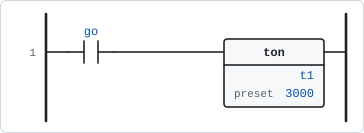
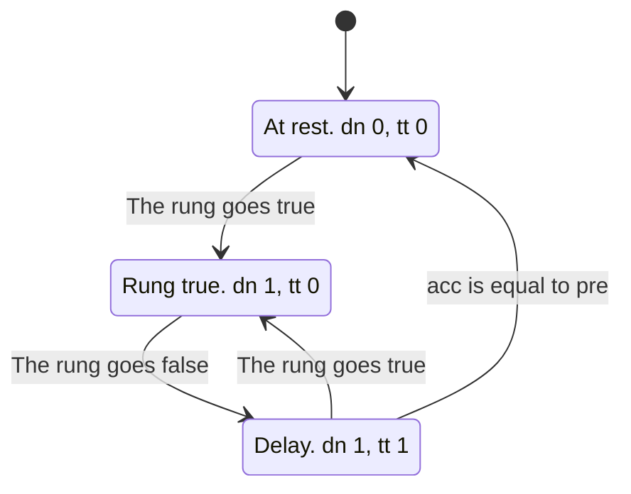
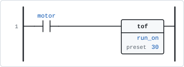
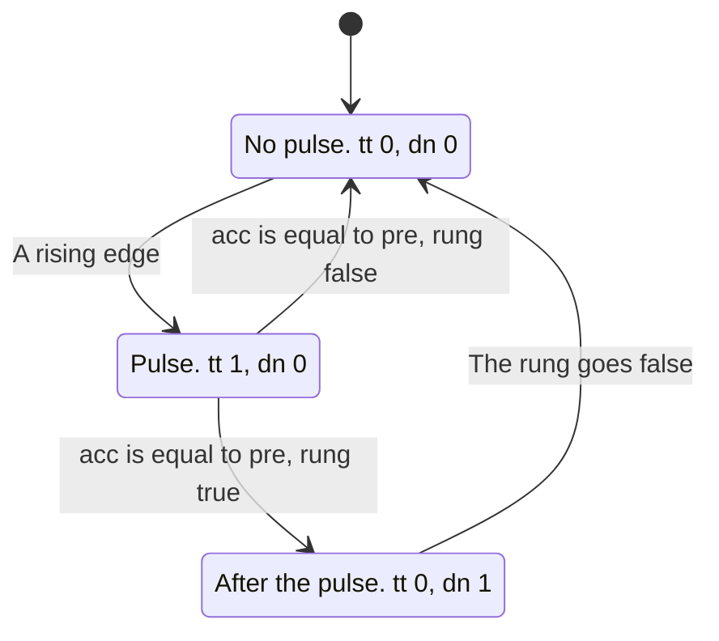
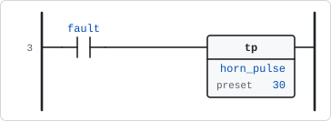
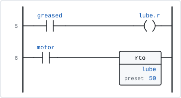
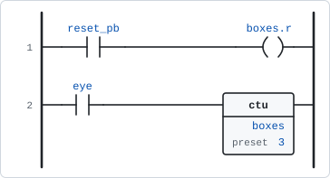
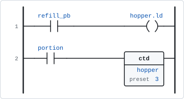
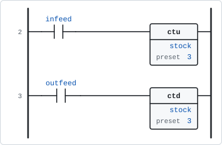

# Instructions: timers and counters

This page is for a reader who writes or reads a ladder [program](glossary.md#program)
and looks for an exact rule. It defines the 6 [instructions](glossary.md#instruction)
that run a [timer](glossary.md#timer) or a [counter](glossary.md#counter). The tutorial
[A timer and a counter](../tutorials/timers-and-counters.md) shows `ton` and `ctu` in a
program.

| Instruction | Runs | What it does |
|---|---|---|
| [`ton t 3000`](#ton) | An on-delay timer | It sets `t.dn` to 1 when its [rung](glossary.md#rung) stays true for 3000 ms. |
| [`tof t 3000`](#tof) | An off-delay timer | It keeps `t.dn` at 1 for 3000 ms after its rung goes false. |
| [`tp t 3000`](#tp) | A pulse timer | It sets `t.tt` to 1 for 3000 ms when its rung goes from false to true. |
| [`rto t 3000`](#rto) | A retentive timer | It adds the times that its rung is true. It sets `t.dn` to 1 at 3000 ms. |
| [`ctu c 12`](#ctu) | An up counter | It adds 1 to `c.cv` when its rung goes from false to true. |
| [`ctd c 12`](#ctd) | A down counter | It subtracts 1 from `c.cv` when its rung goes from false to true. |

In this table, `t` is a timer and `c` is a counter. The number is the
[preset](glossary.md#preset). logex has no instruction for an up-down counter. A `ctu`
and a `ctd` run [a `ctud` counter](#a-ctud-counter).

> #### Warning {: .warning}
>
> If you change the type of a timer between `ton` and `ton_ltime`, change its preset
> also. The preset of a `ton` is a time in ms. The preset of a `ton_ltime` is a time in
> ns. Example: `ton t 2000000` is about 33 minutes for a `ton` and 2 ms for a
> `ton_ltime`. [Long timers](#long-timers) gives the rules.

| To find | Go to |
|---|---|
| A rule that is the same for the 6 instructions | [Rules that are the same for the 6 instructions](#rules-that-are-the-same-for-the-6-instructions) |
| The rules of 1 timer instruction, or of the long timers | [Timers](#timers) |
| The rules of 1 counter instruction, of a `ctud` counter or of the typed counters | [Counters](#counters) |
| The value of each [member](glossary.md#member) in each [scan](glossary.md#scan) of a program | [Examples](#examples) |
| The message of a wrong rung | [Wrong rungs and their diagnostics](#wrong-rungs-and-their-diagnostics) |
| The message of a [warning](glossary.md#warning) | [Programs and their warnings](#programs-and-their-warnings) |
| A rule of a different subject | [See also](#see-also) |

If a rung breaks a rule of this page, logex does not [compile](glossary.md#compile) the
program. It returns a [diagnostic](glossary.md#diagnostic). For some programs that break
no rule, logex gives a warning, and the program compiles.

## Rules that are the same for the 6 instructions

Each part of this page uses these 4 words.

| Word | Meaning |
|---|---|
| A run of an instruction | 1 time that a scan runs the instruction. A timer or a counter changes its members only in a run of its instruction. |
| The power in | The [power flow](glossary.md#power-flow) that an instruction gets |
| A [true rung](glossary.md#true-rung) | For an instruction, a rung is true if the power in of the instruction is true. |
| A [false rung](glossary.md#false-rung) | For an instruction, a rung is false if the power in of the instruction is false. |

[The power in and the power out](instructions-contacts-and-coils.md#the-power-in-and-the-power-out)
gives the power in for each place on a rung.

### The operands

Each of the 6 instructions has 2 [operands](glossary.md#operand): an instance, then a
preset.

| Operand | Rule |
|---|---|
| The instance | A [tag](glossary.md#tag) with the [type](glossary.md#type) of a timer or of a counter: `delay`. Or an [element](glossary.md#element) of an array of timers or of counters, with literal [subscripts](glossary.md#subscript): `lanes[2]`. |
| The preset | An integer [literal](glossary.md#literal): `3000`, `30_000` or `16#ff`. A tag is not a preset. A real literal is not a preset. |

The [mnemonic](glossary.md#mnemonic) does not name the type of the instance. Each
instruction runs the types of 1 row of this table.

| Instruction | Types that it runs |
|---|---|
| `ton` | `ton`, `ton_ltime` |
| `tof` | `tof`, `tof_ltime` |
| `tp` | `tp`, `tp_ltime` |
| `rto` | `rto`, `rto_ltime` |
| `ctu` | `ctu`, `ctud`, `ctu_int`, `ctud_int`, `ctu_lint`, `ctud_lint`, `ctu_udint`, `ctud_udint`, `ctu_ulint`, `ctud_ulint` |
| `ctd` | `ctd`, `ctud`, `ctd_int`, `ctud_int`, `ctd_lint`, `ctud_lint`, `ctd_udint`, `ctud_udint`, `ctd_ulint`, `ctud_ulint` |

The words `ctu_dint`, `ctd_dint` and `ctud_dint` are second names of the types `ctu`,
`ctd` and `ctud`. [Typed counters](#typed-counters) gives the rule.

This page has 1 name for each group of counter types.

| Name on this page | Types |
|---|---|
| A `ctu` counter | The type `ctu`, and each type that starts with `ctu_` |
| A `ctd` counter | The type `ctd`, and each type that starts with `ctd_` |
| A `ctud` counter | The type `ctud`, and each type that starts with `ctud_` |

[Wrong rungs 1 to 13](#wrong-rungs-1-to-13-the-instance) show the diagnostics of an
instance. [Wrong rungs 55 to 59](#wrong-rungs-55-to-59-arrays-of-instances) show the
diagnostics of an array of [instances](glossary.md#instance).

### The preset

The range and the unit of the preset come from the type of the instance.

| Type | Preset |
|---|---|
| `ton`, `tof`, `tp`, `rto` | 0 to 2147483647, a time in ms |
| `ton_ltime`, `tof_ltime`, `tp_ltime`, `rto_ltime` | 0 to 9223372036854775807, a time in ns |
| `ctu`, `ctd`, `ctud` | -2147483648 to 2147483647, a count |
| A [typed counter](glossary.md#typed-counter), for example `ctu_int` | Each value of the type of its count. [Typed counters](#typed-counters) gives each range. |

Each timer and each counter has a preset member: `pre` for a timer and `pv` for a
counter. On this page, the limit is the value of the preset member.

| Item | Rule |
|---|---|
| The unit | The rung does not show the unit. `ton t 3000` is 3000 ms if `t` is a `ton`, and 3000 ns if `t` is a `ton_ltime`. |
| The first value of the preset member | The preset. The preset member gets the preset when the instance starts and at each restart. [Restarts and online edits](#restarts-and-online-edits) gives the exception of an instance with `retain`. |
| The instruction and the preset member | In each run, the instruction reads the limit from the preset member. It does not write the preset member. |
| A write to the preset member | A rung can write `pre` or `pv`: `move wait_ms delay.pre`. The new value is the limit from the next run of the instruction. It stays until a restart that does not keep it. [Restarts and online edits](#restarts-and-online-edits) gives each case. |
| A preset from a tag | A tag cannot be the preset of the instruction. A `move` on a different rung writes the tag to the preset member: `move wait_ms delay.pre`. |
| A preset of 0 | Correct. The tables of [`ton`](#ton), [`tof`](#tof), [`tp`](#tp) and [`rto`](#rto) have a row for it. |
| A negative preset | An error for a timer. Correct for a counter with a signed count: `ctu boxes -10`. The `q` of this counter is 1 from its first run, because 0 is more than -10. |
| A `ctud` counter | Its `ctu` and its `ctd` have the same preset. |

[Wrong rungs 14 to 23](#wrong-rungs-14-to-23-the-preset) show the diagnostics of a
preset.

### 1 instruction for 1 instance

| Instance | Rule |
|---|---|
| A timer | 1 instruction runs it. A second instruction on the same timer is an error. |
| A `ctu` counter or a `ctd` counter | 1 instruction runs it. A second instruction on the same counter is an error. |
| A `ctud` counter | 1 `ctu` and 1 `ctd` run it. They are on 2 rungs, or in 2 [legs](glossary.md#leg) of 1 [branch](glossary.md#branch). The counter can also have only 1 of them. |
| An element of an array | Each element is a separate instance, and 1 instruction runs it. `lanes[1]` and `lanes[01]` are the same element. |
| 2 legs of 1 branch | The rules are the same in the legs of a branch. 2 `ton` instructions on the same timer in 2 legs are an error. |
| An instance that no instruction runs | If a rung names the instance, the program compiles, and logex gives a warning. The timer measures no time, or the counter does not count. |
| An instance that no rung names | The program compiles. logex gives the warning of a tag that no rung uses. |
| `cal` | `cal` does not run a timer or a counter. It runs an instance of a [function block](glossary.md#function-block) that you write. |

The rules of this table are only for the instruction that runs the instance. A different
rung can read each member of the instance. It can also write `pre`, `acc`, `r`, `ld` and
`pv`, by the rules of [The members](#the-members).

[Wrong rungs 24 to 29](#wrong-rungs-24-to-29-1-instruction-for-1-instance) show the
diagnostics. [Programs 1 to 7](#programs-1-to-10-instances-and-members) show the
warnings. [Program 21](#programs-15-to-22-no-warning) has a `ctu` and a `ctd` in 2 legs
of 1 branch.

### The place of an instruction on a rung

| Item | Rule |
|---|---|
| The power in | The instruction acts on its power in. [IEC 61131-3](glossary.md#iec-61131-3) names this signal IN for a timer, CU for an up counter and CD for a down counter. |
| First on a rung | Correct. The power in is then true in each scan: `ton delay 100`. |
| Last on its path | The instruction is the last instruction on its path. No instruction comes after it on its rung, or in its leg. No instruction comes after a branch that holds it. |
| Wrong examples | `xic eye ton delay 100 ote lamp` is wrong. `( xic eye ton delay 100 \| xic eye ) ote lamp` is wrong also. |
| In a leg of a branch | An instruction in a different leg of the same branch is not on the path. Thus `xic eye ( ton delay 100 \| ote lamp )` is correct. |
| The power out | No instruction can read it, because no instruction comes after it. |
| How a rung reads the result | With a contact on a member, on a different rung: `xic delay.dn ote lamp`. A rung after the instruction reads the result of the same scan. |
| The mnemonic | It is not case-sensitive: `ton`, `TON` and `Ton` are the same mnemonic. |
| Reserved words | Each of the 6 mnemonics is a [reserved word](glossary.md#reserved-word), and each type word of a timer or of a counter also. Such a word cannot be the name of a tag. |

[Wrong rungs 30 to 37](#wrong-rungs-30-to-37-the-place-on-a-rung) show the diagnostics.

### The members

A timer or a counter holds its values in members. [The members of a timer](#the-members-of-a-timer)
and [The members of a counter](#the-members-of-a-counter) give each member.

| Item | Rule |
|---|---|
| The name of a member | The name of the instance, a dot and the member: `delay.dn`, `lanes[2].acc`. A member is case-sensitive, and each member is in lower case. |
| A read | An instruction can read a member in each place for a value of its type: `xic delay.dn`, `ge boxes.cv 2`, `move delay.acc waited`. |
| A write | An instruction can write only `pre` and `acc` of a timer, `r` of an `rto` timer, and `r`, `ld` and `pv` of a counter. |
| When the instance uses a write | In its next run. If the rung that writes the member is before the rung of the instance, that run is in the same scan. |
| A [bit](glossary.md#bit) of a member | An integer member has bits: `delay.acc.3` is a bool. An instruction can read each bit. It can write a bit of `pre`, `acc` or `pv`: `ote delay.acc.3`. A bool member has no bits. |
| A member of an element with a tag as a subscript | Correct for a read and for a write: `xic lanes[slot].dn`. Only the instruction that runs the instance must have literal subscripts. |
| 2 `ote` instructions on 1 member | The program compiles, and logex gives a warning. The same rule applies if 1 `ote` names the element with a tag as a subscript: `ote bins[slot].r` and `ote bins[1].r`. |
| The [state](glossary.md#state) | The state of a program holds the members of an instance as a map. In Elixir, `state.env["boxes"]["cv"]` is the count of `boxes`. |

[Function blocks](function-blocks.md) gives the members of each type as a table.
[Wrong rungs 38 to 54](#wrong-rungs-38-to-54-the-members) show the diagnostics of a
member. [Programs 8 to 10](#programs-1-to-10-instances-and-members) show the warnings of
2 `ote` instructions. [Warnings](warnings.md) gives each warning of 2 writes to 1 tag.

### Runs, scans and time

| Item | Rule |
|---|---|
| A true rung and a false rung | The instruction has a run on a true rung and on a false rung. It also does work on a false rung: for example, a `ton` writes 0 to `acc`. |
| The time of a scan | The [host](glossary.md#host) gives each scan the time from the scan before it, in ms. It is the third argument of `Logex.Runtime.scan/3`. The value is a length of time, not the time of day. |
| A scan with no time | `Logex.Runtime.scan/2` gives the scan 0 ms. A timer adds no time in that scan. |
| What a timer measures | Time. It does not count scans. |
| What a timer adds | When a timer adds time, it adds the time of the scans from its last run to this run. A long scan adds more time than a short scan. |
| The smallest step of time | 1 ms. A [long timer](glossary.md#long-timer) measures time in ns, but 1 ms adds 1000000 ns to `acc`. |
| The accuracy | A timer changes `dn` and `tt` in its first run at the preset time or after it. Thus a result is not early. It can be late by the time of 1 scan. |
| A rung that does not run | The instruction has no run, and each member keeps its value. The 2 cases are a rung that a `jmp` [jumps](glossary.md#jump) over, and a function block whose `cal` is on a false rung. |
| A timer after a rung that does not run | If the timer added time in its last run, its next run adds all the time from that last run. |
| A counter after a rung that does not run | A change of the power in while the rung does not run causes no count. The next run compares its power in with the power in of the last run. |
| The [first scan](glossary.md#first-scan) | `tp`, `ctu` and `ctd` act on a [rising edge](glossary.md#rising-edge). No run finds a rising edge in the first scan. `ton`, `tof` and `rto` do the same on the first scan as on each other scan. |
| An [event task](glossary.md#event-task) | A program under an event task runs only when the [trigger](glossary.md#trigger) of the [task](glossary.md#task) goes from 0 to 1. A timer then changes only in those runs, and a counter does not count a pulse between 2 runs. logex gives a warning for each timer and each counter. |

[Execution model](execution-model.md) gives the time that a scan gets in a
[configuration](glossary.md#configuration) and under a [runner](glossary.md#runner).
[Instructions: jump and call](instructions-jump-and-call.md) gives the rules of `jmp`
and of `cal`. [Configuration 14](#configuration-14-an-event-task) shows the warnings of
an event task.

### Restarts and online edits

| Event | Rule |
|---|---|
| A [cold restart](glossary.md#cold-restart) | Each member gets its first value: the preset for `pre` or `pv`, and 0 for each other member. The restart does not keep a value that a rung wrote to `pre` or `pv`. |
| A [warm restart](glossary.md#warm-restart), and the instance has no `retain` | The same as a cold restart |
| A warm restart, and the instance has `retain` | Each member keeps its value, and `pre` and `pv` also. A timer does not add the time between its last run and the restart. |
| A `tof` timer with `retain` in a warm restart | If `dn` is 1 and `tt` is 0, the restart writes 0 to `dn`. If `tt` is 1, the delay continues from the value of `acc`. |
| The first scan after a restart | It is a first scan. `tp`, `ctu` and `ctd` find no rising edge in it. |
| An [online edit](glossary.md#online-edit) changes the preset | `pre` or `pv` gets the new preset if it holds the old preset. A value that a rung wrote stays. |
| An online edit changes the type of the instance | logex refuses the edit. Examples are `ton` to `tof`, `ton` to `ton_ltime` and `ctu` to `ctu_int`. A change between `ctu` and `ctu_dint` changes nothing. |
| An online edit adds a `tp`, a `ctu` or a `ctd`, or changes its rung | The instruction finds no rising edge in its first run after the edit. |

[Retained values](retained-values-and-store.md) gives the full rules of a
[restart](glossary.md#restart) and of the [qualifier](glossary.md#qualifier) `retain`.
[Online edit](online-edit.md) gives the full rules of an edit.

### Faults

The 6 instructions cause no [fault](glossary.md#fault). An instruction that reads or
writes a member can cause 1 of these [major faults](glossary.md#major-fault):

| Fault | Cause |
|---|---|
| `:index_out_of_range` | In `lanes[slot].dn`, `slot` is less than 0 or more than the last subscript of `lanes`. |
| `:bit_out_of_range` | In `delay.acc.[slot]`, `slot` is less than 0 or more than the last bit number of `acc`. |

[Faults](faults.md) gives what logex does with a major fault.

## Timers

A timer is an instance of 1 of 8 types: `ton`, `tof`, `tp`, `rto` and the 4 types of
[long timers](#long-timers). 1 instruction runs each kind of timer.

| Instruction | What it measures |
|---|---|
| [`ton`](#ton) | The time that its rung is true |
| [`tof`](#tof) | The time after its rung goes false |
| [`tp`](#tp) | The time after a rising edge of its rung |
| [`rto`](#rto) | The sum of the times that its rung is true |

Each timer has the 2 results `dn` and `tt`.

| Member | When it is 1 |
|---|---|
| `dn` of a `ton` | From the preset time until the rung goes false |
| `tt` of a `ton` | While the rung is true and `dn` is 0 |
| `dn` of a `tof` | While the rung is true, and for the preset time after it goes false |
| `tt` of a `tof` | For the preset time after the rung goes false |
| `dn` of a `tp` | After the pulse, while the rung stays true |
| `tt` of a `tp` | For the preset time after a rising edge: the pulse |
| `dn` of an `rto` | From the preset time until a reset |
| `tt` of an `rto` | While the rung is true, `dn` is 0 and `r` is 0 |

### The members of a timer

| Member | Type | Write | What it holds |
|---|---|---|---|
| `pre` | `dint` or `lint` | Yes | Preset. The limit of the time, in ms. A long timer has a `lint`, in ns. |
| `acc` | As `pre` | Yes | Accumulated time. The time that the timer measures, in the unit of `pre`. |
| `dn` | `bool` | No | Done. The result. [Timers](#timers) gives its value for each instruction. |
| `tt` | `bool` | No | Timing. 1 while the timer measures time. For a `tp`, it is the pulse. |
| `en` | `bool` | No | [Enable](glossary.md#enable). The power in of the last run: 1 for true and 0 for false. |
| `r` | `bool` | Yes | Reset. Only for `rto` and `rto_ltime`. 1 sets `acc` and `dn` to 0. |

The column Write shows if a rung can write the member.

The names `pre`, `acc`, `dn`, `tt` and `en` come from the
[conventional set](glossary.md#conventional-set), in lower case. IEC 61131-3 names the
preset PT and the time ET. It names the result Q: `dn` for TON and TOF, and `tt` for TP.
IEC 61131-3 has no `en`, and no `tt` for TON and TOF.

A timer also holds the time of its last run. In the state, its key is `last`. No name in
a program reads this value. [Host contract](host-contract.md) gives its rules for a
host.

These rules are the same for the 4 instructions:

| Item | Rule |
|---|---|
| When a timer adds time | A `ton` and an `rto` on a true rung. A `tof` in its delay. A `tp` in its pulse. |
| The range of `acc` | When the instruction adds time, it keeps `acc` from 0 to the limit. `acc` stops at the limit. |
| A negative `pre` | A rung can write a negative value to `pre`. The limit is then 0. |
| A new `pre` while `tt` is 1 | The instruction compares `acc` with the value that `pre` has in that run. A larger `pre` makes the time longer. |
| A write to `acc` | A timer that adds time in its next run continues from the new value. It reads a negative value as 0 and a value of more than the limit as the limit. |
| A write to `acc` that stays | A `tof` at rest, an `rto` on a false rung and a `tp` on a true rung with no pulse do not change `acc`. It keeps the value that the rung wrote. |
| A write to `acc` in each other case | The instruction writes 0 to `acc` in its next run. |

### `ton`

| Part | Rule |
|---|---|
| Name | On-delay timer. IEC 61131-3: TON. Conventional set: TON |
| Drawing | A box with the word `ton`, the name of the timer and the preset |
| Operands | A timer of the type `ton` or `ton_ltime`, then a preset: `ton t1 3000` |
| On a true rung | It adds time to `acc`, and it writes `dn`, `tt` and `en`. The second table of this part gives the sequence. |
| On a false rung | It writes 0 to `acc`, `dn`, `tt` and `en`. |
| Power out | No instruction can read it. |
| On the first scan | The same as on each other scan |
| A preset of 0 | It writes 1 to `dn` in its first run on a true rung. |
| After a restart | Each member gets its first value. [Restarts and online edits](#restarts-and-online-edits) gives the rule of a timer with `retain`. |
| Faults | None |
| Diagnostics | The instance: [wrong rungs 1 to 13](#wrong-rungs-1-to-13-the-instance). The preset: [wrong rungs 14 to 23](#wrong-rungs-14-to-23-the-preset). A second `ton`, and `cal`: [wrong rungs 24, 25 and 29](#wrong-rungs-24-to-29-1-instruction-for-1-instance). The place on a rung: [wrong rungs 30, 36 and 37](#wrong-rungs-30-to-37-the-place-on-a-rung). |
| Warnings | A timer that no `ton` runs: [programs 1 and 5 to 7](#programs-1-to-10-instances-and-members). A long timer: [programs 11 to 13](#programs-11-to-13-long-timers). An event task: [configuration 14](#configuration-14-an-event-task). |

On a true rung, a `ton` does these 3 things in each run.

| Sequence | What the `ton` does |
|---|---|
| 1 | If the last run wrote 1 to `en`, it adds the time from that run to `acc`. Thus the first run on a true rung adds no time. |
| 2 | If `acc` is equal to `pre`, it writes 1 to `dn` and 0 to `tt`. If not, it writes 0 to `dn` and 1 to `tt`. |
| 3 | It writes 1 to `en`. |

This drawing shows the rung `xic go ton t1 3000`, which is rung 1 of the example
[`delay.ld`](#the-program-delayld-ton).

<!-- rung: delay.ld 1 -->


This timing diagram shows 14 scans of `delay.ld`. Each scan gets 500 ms. `go` is on 2
times. The first time, `go` goes off before 3 s, and `t1.acc` goes to 0 in scan 5. The
second time, `go` stays on, and `t1.dn` comes on in scan 12, when `t1.acc` is 3000.

<!-- timing: instructions-timers-and-counters-ton.timing.exs -->


[The program `delay.ld`](#the-program-delayld-ton) gives the value of each member in
each scan.

### `tof`

| Part | Rule |
|---|---|
| Name | Off-delay timer. IEC 61131-3: TOF. Conventional set: TOF |
| Drawing | A box with the word `tof`, the name of the timer and the preset |
| Operands | A timer of the type `tof` or `tof_ltime`, then a preset: `tof run_on 30` |
| The delay | The time that `tt` is 1. It starts when the rung goes from true to false. |
| At rest | The timer is at rest when `dn` and `tt` are 0. A new timer is at rest. |
| On a true rung | It writes 1 to `dn` and `en`, and 0 to `acc` and `tt`. |
| When the rung goes from true to false | The delay starts. It writes 1 to `tt` and 0 to `en`. `dn` stays 1, and it adds no time. |
| On a false rung, during the delay | It adds the time from its last run to `acc`. When `acc` is equal to `pre`, it writes 0 to `dn` and `tt`. The timer is then at rest. |
| On a false rung, at rest | It writes 0 to `dn`, `tt` and `en`, and `acc` keeps its value. |
| When the rung goes true during the delay | The delay stops, and `dn` stays 1. The next change from true to false starts a full delay. |
| Power out | No instruction can read it. |
| On the first scan | The same as on each other scan. `dn` is 0 until a run on a true rung. |
| A preset of 0 | It writes 0 to `dn` in the first run on a false rung. |
| After a restart | The timer is at rest. [Restarts and online edits](#restarts-and-online-edits) gives the rule of a timer with `retain`. |
| Faults | None |
| Diagnostics | The instance: [wrong rungs 1 to 13](#wrong-rungs-1-to-13-the-instance). The preset: [wrong rungs 14 to 23](#wrong-rungs-14-to-23-the-preset). The place on a rung: [wrong rung 31](#wrong-rungs-30-to-37-the-place-on-a-rung). |
| Warnings | A timer that no `tof` runs: the warning of [program 1](#programs-1-to-10-instances-and-members), with the word `tof`. A long timer: [programs 11 to 13](#programs-11-to-13-long-timers). An event task: [configuration 14](#configuration-14-an-event-task). |



Figure: the 3 states of a `tof` timer. `dn` is 1 while the rung is true and during the delay.

This drawing shows the rung `xic motor tof run_on 30`, which is rung 1 of the example
[`line.ld`](#the-program-lineld-tof-tp-and-rto).

<!-- rung: line.ld 1 -->


This timing diagram shows 17 scans of `line.ld`. Each scan gets 10 ms. `motor` is on 3
times. After the first time, `run_on.dn` goes off in scan 7, which is 30 ms after
`motor` goes off. The second time, `motor` comes on again in scan 12, during the delay,
and `run_on.dn` stays on.

<!-- timing: instructions-timers-and-counters-tof.timing.exs -->


[The program `line.ld`](#the-program-lineld-tof-tp-and-rto) gives the value of each
member in each scan.

### `tp`

> #### Note {: .info}
>
> The pulse of a `tp` is `tt`. `dn` is not the pulse. `dn` is 1 after the pulse, while
> the rung stays true. IEC 61131-3 names the pulse Q. A rung reads the pulse with a
> contact on `tt`: `xic horn_pulse.tt ote horn`.

| Part | Rule |
|---|---|
| Name | Pulse timer. IEC 61131-3: TP. The conventional set has no pulse timer. |
| Drawing | A box with the word `tp`, the name of the timer and the preset |
| Operands | A timer of the type `tp` or `tp_ltime`, then a preset: `tp horn_pulse 30` |
| The pulse | The time that `tt` is 1. It starts in the run that finds the rising edge. It ends in the first run at the preset time or after it. |
| The rising edge | A run on a true rung while `en` is 0. `en` holds the power in of the last run. |
| When a rising edge comes and `tt` is 0 | The pulse starts. The instruction writes 1 to `tt` and 0 to `acc` and `dn`. It adds no time in that run. |
| During the pulse | On a true rung and on a false rung, it adds the time from its last run to `acc`. A rising edge during the pulse starts nothing. |
| When `acc` is equal to `pre` | The pulse ends, and the instruction writes 0 to `tt`. On a true rung, it writes 1 to `dn`. On a false rung, it writes 0 to `dn` and `acc`. |
| On a true rung, with no pulse | If the run finds no rising edge, `dn` and `acc` keep their values. Thus `dn` stays 1 after a pulse while the rung stays true. |
| On a false rung, with no pulse | It writes 0 to `acc` and `dn`. |
| `en` | In each run, it writes the power in to `en`: 1 for true and 0 for false. |
| Power out | No instruction can read it. |
| On the first scan | No pulse starts. A rung that is true on the first scan starts no pulse until it goes false and true again. |
| A preset of 0 | A rising edge writes 1 to `dn`, and `tt` stays 0. |
| After a restart | No pulse is on. A pulse of a timer with `retain` continues after a warm restart. |
| Faults | None |
| Diagnostics | The instance: [wrong rungs 1 to 13](#wrong-rungs-1-to-13-the-instance). The preset: [wrong rungs 14 to 23](#wrong-rungs-14-to-23-the-preset). The place on a rung: [wrong rung 32](#wrong-rungs-30-to-37-the-place-on-a-rung). |
| Warnings | A timer that no `tp` runs: the warning of [program 1](#programs-1-to-10-instances-and-members), with the word `tp`. A long timer: [programs 11 to 13](#programs-11-to-13-long-timers). An event task: [configuration 14](#configuration-14-an-event-task). |



Figure: the 3 states of a `tp` timer. Only a rising edge starts a pulse, and only when no pulse is on.

This drawing shows the rung `xic fault tp horn_pulse 30`, which is rung 3 of the example
[`line.ld`](#the-program-lineld-tof-tp-and-rto).

<!-- rung: line.ld 3 -->


This timing diagram shows 14 scans of `line.ld`. Each scan gets 10 ms. The input `fault`
is on in the first scan and starts no pulse. The pulse of scan 4 is 30 ms long. `fault`
goes off and on during that pulse and starts no second pulse. The pulse of scan 10 ends
on a false rung, and `horn_pulse.dn` stays 0.

<!-- timing: instructions-timers-and-counters-tp.timing.exs -->


[The program `line.ld`](#the-program-lineld-tof-tp-and-rto) gives the value of each
member in each scan.

### `rto`

> #### Note {: .info}
>
> A retentive timer keeps `acc` while its rung is false. It does not keep `acc` in a
> restart. Only a timer with the qualifier `retain` keeps `acc` in a warm restart:
> `var retain lube rto`.

| Part | Rule |
|---|---|
| Name | Retentive on-delay timer. Conventional set: RTO. IEC 61131-3 has no such timer. |
| Drawing | A box with the word `rto`, the name of the timer and the preset |
| Operands | A timer of the type `rto` or `rto_ltime`, then a preset: `rto lube 50` |
| The reset | In each run, it reads `r` first. If `r` is 1, it writes 0 to `acc`, `dn` and `tt`, and it adds no time. It writes the power in to `en`. |
| On a true rung, and `r` is 0 | The same as [`ton`](#ton). In the first run after a run on a false rung, it adds no time. |
| On a false rung, and `r` is 0 | `acc` and `dn` keep their values. It writes 0 to `tt` and `en`. |
| `r` | The instruction does not write `r`. A coil writes it: `xic greased ote lube.r`. logex has no `res` instruction. |
| The reset rung | If the rung that writes `r` is before the rung of the `rto`, the reset occurs in the same scan. If it is after, the reset occurs in the next scan. |
| The end of a reset | If the rung is true during the reset, the first run with `r` at 0 adds the time from the last run. |
| Power out | No instruction can read it. |
| On the first scan | The same as on each other scan |
| A preset of 0 | It writes 1 to `dn` in its first run on a true rung. `dn` stays 1 on a false rung, until a reset. |
| After a restart | `acc` and `dn` are 0. An `rto` with `retain` keeps `acc` and `dn` in a warm restart. [Restarts and online edits](#restarts-and-online-edits) gives the rules. |
| Faults | None |
| Diagnostics | The instance: [wrong rungs 1 to 13](#wrong-rungs-1-to-13-the-instance). The preset: [wrong rungs 14 to 23](#wrong-rungs-14-to-23-the-preset). The place on a rung: [wrong rung 33](#wrong-rungs-30-to-37-the-place-on-a-rung). A write to a member: [wrong rung 46](#wrong-rungs-38-to-54-the-members). No `res`: [wrong rung 60](#wrong-rungs-60-to-62-what-logex-does-not-have). |
| Warnings | A timer that no `rto` runs: the warning of [program 1](#programs-1-to-10-instances-and-members), with the word `rto`. A long timer: [programs 11 to 13](#programs-11-to-13-long-timers). An event task: [configuration 14](#configuration-14-an-event-task). |

This drawing shows rungs 5 and 6 of the example
[`line.ld`](#the-program-lineld-tof-tp-and-rto). Rung 5 writes the reset member `lube.r`.
Rung 6 runs the timer.

<!-- rung: line.ld 5 6 -->


This timing diagram shows 16 scans of `line.ld`. Each scan gets 10 ms. `lube.acc` keeps
its 10 ms while `motor` is off in scans 4 and 5. `lube.dn` comes on in scan 10, when
`lube.acc` is 50. The input `greased` resets the timer in scan 11.

<!-- timing: instructions-timers-and-counters-rto.timing.exs -->


[The program `line.ld`](#the-program-lineld-tof-tp-and-rto) gives the value of each
member in each scan.

### Long timers

A long timer is a timer of the type `ton_ltime`, `tof_ltime`, `tp_ltime` or `rto_ltime`.
It measures a time in ns.

| Item | A timer | A long timer |
|---|---|---|
| Type words | `ton`, `tof`, `tp`, `rto` | `ton_ltime`, `tof_ltime`, `tp_ltime`, `rto_ltime` |
| The type of `pre` and `acc` | `dint` | `lint` |
| The unit of the preset, of `pre` and of `acc` | ms | ns |
| What 1 ms of a scan adds to `acc` | 1 | 1000000 |
| IEC 61131-3 | TON, TOF, TP | TON_LTIME, TOF_LTIME, TP_LTIME |

The largest preset of a timer is 2147483647 ms, which is about 24.9 days. The largest
preset of a long timer is 9223372036854775807 ns, which is about 292 years. IEC 61131-3
has no retentive timer.

These rules apply to a long timer:

| Item | Rule |
|---|---|
| The instruction | `ton`, `tof`, `tp` and `rto` run the long timers. Each rule of the instruction is the same, with ns in the place of ms. |
| The unit on the rung | The rung does not show the unit. Only the declaration shows it. |
| The smallest step | 1 ms, that is 1000000 ns. The time that a scan gets is a number of whole ms. |
| A preset that is not a multiple of 1000000 | The program compiles, and logex gives a warning. The timer gets to its preset in the next whole ms. With a preset of 1500000 ns, `dn` comes on after 2 ms. |
| A literal with `pre` or `acc` of a long timer | This row is for a literal that an instruction uses with `pre` or `acc`. If the literal is not a multiple of 1000000, logex gives a warning. The instructions are `move`, a conversion, a comparison, `add` and `sub`. |
| A `move` into `pre` or `acc` | The source is a `lint`, or a value of a type that [widens](glossary.md#widen) into `lint`. |
| A `move` from `pre` or `acc` | The destination is a `lint`. A conversion such as `lint_to_dint` gives a value of a different integer type. |
| An online edit | A change between a timer and a long timer is a change of type, and logex refuses the edit. |

The script `instructions-timers-and-counters-units.exs` compiles the same rung 2 times:
`xic eye ton t 2000000`. The first time, `t` is a `ton`. The second time, `t` is a
`ton_ltime`. Each scan of the script gets the time from the scan before it: 0 ms, 2 ms
and 1999998 ms. The script is in the directory `examples` of the repository. Run its
command from that directory.

```elixir
text = fn type ->
  "var_input eye bool\nvar_output lamp bool\nvar t #{type}\n" <>
    "xic eye ton t 2000000\nxic t.dn ote lamp"
end

run = fn {type, unit} ->
  {:ok, program} = Logex.compile(text.(type), name: "units")
  state = Logex.Runtime.put_inputs(program, Logex.Runtime.instance(program), %{"eye" => 1})
  {_outputs, state} = Logex.Runtime.scan(program, state, 0)
  {early, state} = Logex.Runtime.scan(program, state, 2)
  {late, state} = Logex.Runtime.scan(program, state, 1_999_998)
  IO.puts("var t #{type}: t.pre is #{state.env["t"]["pre"]}, a time in #{unit}")
  IO.puts("  lamp is #{early["lamp"]} after 2 ms, and #{late["lamp"]} after 2000000 ms")
end

Enum.each([{"ton", "ms"}, {"ton_ltime", "ns"}], run)
```

```console
$ mix run instructions-timers-and-counters-units.exs
var t ton: t.pre is 2000000, a time in ms
  lamp is 0 after 2 ms, and 1 after 2000000 ms
var t ton_ltime: t.pre is 2000000, a time in ns
  lamp is 1 after 2 ms, and 1 after 2000000 ms
```

With the type `ton`, the lamp comes on after 2000000 ms, which is about 33 minutes. With
the type `ton_ltime`, the lamp comes on after 2 ms.
[Programs 11 to 13](#programs-11-to-13-long-timers) show the warnings of a long timer.

## Counters

A counter is an instance of 1 of 15 types. A counter counts rising edges of its rung. It
does not count scans, and it does not count while its rung stays true.

The table shows the 3 types that count in a `dint`. [Typed counters](#typed-counters)
gives the 12 types that count in a different integer type.

| Type | Instructions | What it does |
|---|---|---|
| `ctu` | [`ctu`](#ctu) | It counts up. `q` is 1 when the count is equal to the preset or more. |
| `ctd` | [`ctd`](#ctd) | It counts down. `q` is 1 when the count is 0 or less. |
| `ctud` | `ctu` and `ctd` | It counts up and down. [A `ctud` counter](#a-ctud-counter) gives the rules. |

On this page, a `ctu` counter is a counter of the type `ctu` or of a type that starts
with `ctu_`. A `ctd` counter and a `ctud` counter are the same for `ctd` and `ctud`.

### The members of a counter

| Member | Type | Write | What it holds |
|---|---|---|---|
| `cu` | `bool` | No | Count up. The power in of the last run of the `ctu`. Not in a `ctd` counter |
| `cd` | `bool` | No | Count down. The power in of the last run of the `ctd`. Not in a `ctu` counter |
| `r` | `bool` | Yes | Reset. 1 sets the count to 0. Not in a `ctd` counter |
| `ld` | `bool` | Yes | Load. 1 sets the count to `pv`. Not in a `ctu` counter |
| `pv` | Integer | Yes | Preset value. The limit |
| `cv` | Integer | No | Current value. The count |
| `q` | `bool` | No | The result. In a `ctu` counter: 1 when `cv` is equal to `pv` or more. In a `ctd` counter: 1 when `cv` is 0 or less. Not in a `ctud` counter |
| `qu` | `bool` | No | The result of the count up. Only in a `ctud` counter: 1 when `cv` is equal to `pv` or more |
| `qd` | `bool` | No | The result of the count down. Only in a `ctud` counter: 1 when `cv` is 0 or less |
| `ov` | `bool` | No | Overflow. 1 after a count up at the largest value of the count. Not in a `ctd` counter |
| `un` | `bool` | No | Underflow. 1 after a count down at the smallest value of the count. Not in a `ctu` counter |

The column Write shows if a rung can write the member. The type of `pv` and `cv` is
`dint`. For a typed counter, it is the integer type that the type word names.

The names `cu`, `cd`, `r`, `ld`, `pv`, `cv`, `q`, `qu` and `qd` are the names of
IEC 61131-3, in lower case. IEC 61131-3 has no `ov` and no `un`: these 2 names come from
the conventional set.

### A run of a counter instruction

A `ctu` or a `ctd` does these 5 things in each run, on a true rung and on a false rung.

| Sequence | What the instruction does |
|---|---|
| 1 | If the counter has `r`, and `r` is 1, it writes 0 to `cv`, `ov` and `un`. It does not load and it does not count. |
| 2 | If not, and the counter has `ld`, and `ld` is 1, it writes `pv` to `cv`, and 0 to `ov` and `un`. It does not count. |
| 3 | If not, and the run finds a rising edge, it counts: a `ctu` adds 1 to `cv`, and a `ctd` subtracts 1. |
| 4 | It writes its power in to `cu` for a `ctu`, or to `cd` for a `ctd`. |
| 5 | It writes the results from `cv` and `pv`: `q`, or `qu` and `qd`. |

| Item | Rule |
|---|---|
| A rising edge | A run on a true rung while `cu` is 0, for a `ctu`. A run on a true rung while `cd` is 0, for a `ctd`. |
| The first scan | No run finds a rising edge in the first scan. A rung that is true on the first scan causes no count. |
| A reset or a load and the rising edge | A reset or a load does not change `cu` or `cd`. If the rung stays true through a reset, the counter does not count the same rising edge again. |
| A rising edge while `r` or `ld` is 1 | The counter does not count it, in that run or in a later run. |
| Who writes `r` and `ld` | The instruction does not write `r` or `ld`. A coil writes them: `xic reset_pb ote boxes.r`. logex has no `res` instruction. |
| The reset rung | If the rung that writes `r` or `ld` is before the rung of the counter, the counter uses it in the same scan. If it is after, the counter uses it in the next scan. |
| At the largest value of the count | A count up adds nothing and writes 1 to `ov`. `ov` stays 1 until a reset or a load. |
| At the smallest value of the count | A count down subtracts nothing and writes 1 to `un`. `un` stays 1 until a reset or a load. |
| From the largest value to the smallest value | The count does not go from the largest value to the smallest value, or the opposite. The function block CTUD of the conventional set does. |
| The count and the preset | The preset does not stop the count. A `ctu` counts up after `cv` is equal to `pv`, and a `ctd` counts down to less than 0. |
| A write to `pv` | The instruction reads the new `pv` in its next run, on a true rung or on a false rung. |

[The dialect and IEC 61131-3](../explanation/the-dialect-and-iec.md) gives the
differences between logex, IEC 61131-3 and the conventional set.

### `ctu`

| Part | Rule |
|---|---|
| Name | Up counter. IEC 61131-3: CTU. Conventional set: CTU |
| Drawing | A box with the word `ctu`, the name of the counter and the preset |
| Operands | A `ctu` counter or a `ctud` counter, then a preset: `ctu boxes 3` |
| On a true rung | It does [the 5 things of a run](#a-run-of-a-counter-instruction). It adds 1 to `cv` if `cu` is 0, and then writes 1 to `cu`. |
| On a false rung | It does the same 5 things. It does not count, and it writes 0 to `cu`. A reset and a new `pv` apply on a false rung also. |
| The result | For a `ctu` counter: `q` is 1 if `cv` is equal to `pv` or more. For a `ctud` counter: `qu` and `qd`. |
| Power out | No instruction can read it. |
| On the first scan | It does not count. It writes its power in to `cu`. |
| After a restart | `cv` is 0. A counter with `retain` keeps `cv` and `cu` in a warm restart. No run counts in the first scan after a restart. |
| Faults | None |
| Diagnostics | The instance: [wrong rungs 1 to 13](#wrong-rungs-1-to-13-the-instance). The preset: [wrong rungs 14 to 23](#wrong-rungs-14-to-23-the-preset). A second `ctu`, and the preset of a `ctud` counter: [wrong rungs 26 to 28](#wrong-rungs-24-to-29-1-instruction-for-1-instance). The place on a rung: [wrong rung 34](#wrong-rungs-30-to-37-the-place-on-a-rung). |
| Warnings | A counter that no instruction runs: [programs 2 and 3](#programs-1-to-10-instances-and-members). A second `ote` on `r`: [programs 8 to 10](#programs-1-to-10-instances-and-members). An event task: [configuration 14](#configuration-14-an-event-task). |

This drawing shows rungs 1 and 2 of the example [`boxes.ld`](#the-program-boxesld-ctu).
Rung 1 writes the reset member `boxes.r`. Rung 2 runs the counter.

<!-- rung: boxes.ld 1 2 -->


This timing diagram shows 12 scans of `boxes.ld`. Each scan gets 10 ms, but a counter
does not measure time. `eye` is on in the first scan, and the
counter does not count that box. `boxes.q` comes on in scan 8, at the third box. `eye`
stays on through the reset of scan 9, and the counter does not count that box again.

<!-- timing: instructions-timers-and-counters-ctu.timing.exs -->


[The program `boxes.ld`](#the-program-boxesld-ctu) gives the value of each member in
each scan.

### `ctd`

| Part | Rule |
|---|---|
| Name | Down counter. IEC 61131-3: CTD. Conventional set: CTD |
| Drawing | A box with the word `ctd`, the name of the counter and the preset |
| Operands | A `ctd` counter or a `ctud` counter, then a preset: `ctd hopper 3` |
| On a true rung | It does [the 5 things of a run](#a-run-of-a-counter-instruction). It subtracts 1 from `cv` if `cd` is 0, and then writes 1 to `cd`. |
| On a false rung | It does the same 5 things. It does not count, and it writes 0 to `cd`. A load and a new `pv` apply on a false rung also. |
| The result | For a `ctd` counter: `q` is 1 if `cv` is 0 or less. For a `ctud` counter: `qu` and `qd`. |
| A new `ctd` counter | `cv` is 0, and thus `q` is 1 after the first run. A load sets `cv` to `pv`: `xic refill_pb ote hopper.ld`. |
| The CTD of the conventional set | It subtracts 1 from the count. Its result is 1 when the count is equal to the preset or more, and it has no load. The `ctd` of logex is the down counter of IEC 61131-3. |
| Power out | No instruction can read it. |
| On the first scan | It does not count. It writes its power in to `cd`. |
| After a restart | `cv` is 0. A counter with `retain` keeps `cv` and `cd` in a warm restart. No run counts in the first scan after a restart. |
| Faults | None |
| Diagnostics | The instance: [wrong rungs 1 to 13](#wrong-rungs-1-to-13-the-instance). The preset: [wrong rungs 14 to 23](#wrong-rungs-14-to-23-the-preset). The preset of a `ctud` counter: [wrong rung 27](#wrong-rungs-24-to-29-1-instruction-for-1-instance). The place on a rung: [wrong rung 35](#wrong-rungs-30-to-37-the-place-on-a-rung). An element of an array of `ctu` counters: [wrong rung 59](#wrong-rungs-55-to-59-arrays-of-instances). |
| Warnings | A counter that no instruction runs: the warning of [program 2](#programs-1-to-10-instances-and-members), with the word `ctd`. An event task: [configuration 14](#configuration-14-an-event-task). |

This drawing shows rungs 1 and 2 of the example
[`hopper.ld`](#the-program-hopperld-ctd). Rung 1 writes the load member `hopper.ld`. Rung
2 runs the counter.

<!-- rung: instructions-timers-and-counters/hopper.ld 1 2 -->


This timing diagram shows 13 scans of `hopper.ld`. Each scan gets 10 ms, but a counter
does not measure time. `refill_pb` loads the count with 3 in
scan 2. Each time that `portion` comes on, the count goes down by 1. The scale of
`hopper.cv` is from -1 to 3. `hopper.q` comes on in scan 9, when the count is 0.

<!-- timing: instructions-timers-and-counters-ctd.timing.exs -->


[The program `hopper.ld`](#the-program-hopperld-ctd) gives the value of each member in
each scan.

### A `ctud` counter

A `ctud` counter counts up and down. logex has no `ctud` instruction.

| Item | Rule |
|---|---|
| The instructions | 1 `ctu` and 1 `ctd` run it. Each rising edge of the `ctu` adds 1 to `cv`, and each rising edge of the `ctd` subtracts 1. |
| The place of the 2 instructions | They are on 2 rungs, or in 2 legs of 1 branch. |
| The preset | The 2 instructions have the same preset. A different preset on the second instruction is an error. |
| Only 1 of the 2 instructions | Correct. The program compiles, and logex gives no warning. |
| A run | Each of the 2 instructions does [the 5 things of a run](#a-run-of-a-counter-instruction). Each reads `r` and `ld`, and each counts only its direction. |
| `r` and `ld` at the same time | The reset is first: `cv` is 0. |
| A count up and a count down in the same scan | The count changes 2 times: 1 up and 1 down. |
| The results | `qu` is 1 if `cv` is equal to `pv` or more. `qd` is 1 if `cv` is 0 or less. A `ctud` counter has no `q`. |
| `ov` and `un` | A reset or a load writes 0 to the 2 members. A count down does not write 0 to `ov`, and a count up does not write 0 to `un`. |
| Diagnostics | [Wrong rungs 27 and 28](#wrong-rungs-24-to-29-1-instruction-for-1-instance). No `ctud` instruction: [wrong rung 61](#wrong-rungs-60-to-62-what-logex-does-not-have). |
| Warnings | A `ctud` counter that no instruction runs: [program 3](#programs-1-to-10-instances-and-members). No warning: [programs 19 and 21](#programs-15-to-22-no-warning). |

This drawing shows rungs 2 and 3 of the example
[`buffer.ld`](#the-program-bufferld-a-ctud-counter). The 2 rungs run the same counter,
`stock`.

<!-- rung: instructions-timers-and-counters/buffer.ld 2 3 -->


This timing diagram shows 13 scans of `buffer.ld`. Each scan gets 10 ms, but a counter
does not measure time. Each rising edge of `infeed` adds 1
to `stock.cv`, and each rising edge of `outfeed` subtracts 1. In scan 7, the 2
[inputs](glossary.md#input) come on in the same scan, and the count stays 1.
`stock.qu` comes on in scan 11, when the count is 3.

<!-- timing: instructions-timers-and-counters-ctud.timing.exs -->


[The program `buffer.ld`](#the-program-bufferld-a-ctud-counter) gives the value of each
member in each scan.

### Typed counters

The count of a counter has an integer type. The type word of the counter names this
type. In this table, the column Count shows the type of `cv` and `pv`, and its values.

| Type words | Count |
|---|---|
| `ctu`, `ctd`, `ctud` | `dint`: -2147483648 to 2147483647 |
| `ctu_int`, `ctd_int`, `ctud_int` | `int`: -32768 to 32767 |
| `ctu_lint`, `ctd_lint`, `ctud_lint` | `lint`: -9223372036854775808 to 9223372036854775807 |
| `ctu_udint`, `ctd_udint`, `ctud_udint` | `udint`: 0 to 4294967295 |
| `ctu_ulint`, `ctd_ulint`, `ctud_ulint` | `ulint`: 0 to 18446744073709551615 |

| Item | Rule |
|---|---|
| The instruction | `ctu` and `ctd` run each typed counter. The rung does not name the type of the count. |
| The preset | Each value of the type of the count is a correct preset. A value that the type does not hold is an error. |
| The largest value and the smallest value | The count stops at the smallest value and at the largest value of its type. A `ctd_udint` counter does not count to less than 0. |
| A count down with an unsigned count | `q` of a `ctd_udint` counter or of a `ctd_ulint` counter is 1 only when `cv` is 0. The same rule applies to `qd`. |
| `ctu_dint`, `ctd_dint` and `ctud_dint` | Each is a second name of `ctu`, `ctd` or `ctud`. A tag that you declare with `ctu_dint` has the type `ctu`, and each message names it as a `ctu`. |
| A write to `pv` | The source of a `move` is a value of the type of the count, or of a type that widens into it. |
| An online edit | A change of the type of the count is a change of type, and logex refuses the edit. |

[Use counters](../howto/use-counters.md) shows how to use a typed counter.

## What the timers and the counters do not have

| logex does not have | What logex has |
|---|---|
| A `res` instruction | A coil on the member `r`: `xic greased ote lube.r` |
| A `ctud` instruction | A `ctu` and a `ctd` on the same `ctud` counter |
| A literal of time, such as `T#5s` | An integer preset in ms, or in ns for a long timer |
| A preset that is a tag | A `move` into `pre` or `pv` |
| An instruction after a timer or a counter on its path | A contact on a member, on a different rung |
| A step of time of less than 1 ms | A long timer measures time in ns, in steps of 1000000 |
| A count that goes from the largest value to the smallest value | A count that stops, with `ov` or `un` at 1 |

[Wrong rungs 60 to 62](#wrong-rungs-60-to-62-what-logex-does-not-have) show the
diagnostics of the first 3 rows. [What logex does not have](not-supported.md) gives the
full list.

## Examples

Each example is a program with a script that runs it. The script prints the value of
some tags and members after each scan. It is not necessary to read a script, because
the page shows each line that it prints. To run a script, do its command from the
directory `examples` of the repository.

### The script that runs the scans

Each script of this part reads the file `scans.exs`, which runs the scans and prints the
table. The file is in the directory `examples/instructions-timers-and-counters` of the
repository, and each script is in the directory `examples`.

<!-- file: instructions-timers-and-counters/scans.exs -->
```elixir
# scans.(file, step, inputs, names) compiles the program `file` and runs its scans.
# The map `inputs` gives, for each input, a list with its value in each scan. Each scan
# gets `step` ms. After each scan, it prints the number of the scan and the value of each
# name. A name is a tag, or a member such as "t1.acc".
fn file, step, inputs, names ->
  {:ok, program} = Logex.compile_file(file)
  columns = ["scan" | names]

  row = fn cells ->
    columns
    |> Enum.zip(cells)
    |> Enum.map_join("  ", fn {name, cell} ->
      String.pad_leading("#{cell}", String.length(name))
    end)
    |> IO.puts()
  end

  scan = fn values, {number, state} ->
    now = Map.new(Enum.zip(Map.keys(inputs), values))
    state = Logex.Runtime.put_inputs(program, state, now)
    {_outputs, state} = Logex.Runtime.scan(program, state, step)
    row.([number | Enum.map(names, &get_in(state.env, String.split(&1, ".")))])
    {number + 1, state}
  end

  row.(columns)

  inputs
  |> Map.values()
  |> Enum.zip_with(& &1)
  |> Enum.reduce({1, Logex.Runtime.instance(program)}, scan)
end
```

In each script, the map `inputs` has 1 list for each input. The list holds the value of
the input in each scan, from the first scan to the last scan. The same values are in
the column of the input in the table that the script prints.

### The program `delay.ld`: `ton`

The lamp comes on when `go` stays on for 3 s. The program is the file
`examples/delay.ld` of the repository. Its rung 3 has a
[one-shot](glossary.md#one-shot), which is not a subject of this page.

<!-- file: delay.ld -->
```text
var_input go bool
var_output lamp bool
var_output pulse bool
var_output waited dint
var t1 ton
var s1 bool

xic go ton t1 3000
xic t1.dn ote lamp
xic go ons s1 ote pulse
move t1.acc waited
```

<!-- rung: delay.ld -->


The script runs 14 scans of 500 ms. They are the scans of the
[timing diagram of `ton`](#ton).

```elixir
{scans, _} = Code.eval_file("instructions-timers-and-counters/scans.exs")

inputs = %{"go" => [0, 1, 1, 1, 0, 1, 1, 1, 1, 1, 1, 1, 0, 0]}

scans.("delay.ld", 500, inputs, ["go", "t1.acc", "t1.tt", "t1.en", "t1.dn", "lamp"])
```

```console
$ mix run instructions-timers-and-counters-ton.exs
scan  go  t1.acc  t1.tt  t1.en  t1.dn  lamp
   1   0       0      0      0      0     0
   2   1       0      1      1      0     0
   3   1     500      1      1      0     0
   4   1    1000      1      1      0     0
   5   0       0      0      0      0     0
   6   1       0      1      1      0     0
   7   1     500      1      1      0     0
   8   1    1000      1      1      0     0
   9   1    1500      1      1      0     0
  10   1    2000      1      1      0     0
  11   1    2500      1      1      0     0
  12   1    3000      0      1      1     1
  13   0       0      0      0      0     0
  14   0       0      0      0      0     0
```

| Scan | What the scan shows |
|---|---|
| 1 | The rung is false: `acc`, `dn`, `tt` and `en` are 0. |
| 2 | The first run on a true rung: `tt` and `en` are 1, and `acc` stays 0. |
| 3 and 4 | Each run adds 500 ms to `acc`. |
| 5 | A false rung before the preset time: the `ton` writes 0 to `acc`, `tt` and `en`. |
| 6 | `acc` starts again from 0. |
| 7 to 11 | `acc` goes from 500 to 2500. |
| 12 | `acc` is 3000, which is equal to `pre`. `dn` is 1 and `tt` is 0. Rung 2 writes 1 to `lamp`. |
| 13 | A false rung: `acc`, `dn`, `tt` and `en` are 0 again, and `lamp` is 0. |

### The program `line.ld`: `tof`, `tp` and `rto`

The program has 3 timers. The fan stays on for 30 ms after the motor goes off. The horn
sounds for 30 ms when the input `fault` comes on. The lamp `grease_due` comes on when
the motor is on for a total of 50 ms. The presets are short, and thus each script has
17 scans or fewer. The program is the file `examples/line.ld` of the repository.

<!-- file: line.ld -->
```text
var_input motor bool
var_input fault bool
var_input greased bool
var_output fan bool
var_output horn bool
var_output grease_due bool
var_output run_ms dint
var run_on tof
var horn_pulse tp
var lube rto

xic motor tof run_on 30
xic run_on.dn ote fan
xic fault tp horn_pulse 30
xic horn_pulse.tt ote horn
xic greased ote lube.r
xic motor rto lube 50
xic lube.dn ote grease_due
move lube.acc run_ms
```

<!-- rung: line.ld -->


The first script runs the 17 scans of the [timing diagram of `tof`](#tof). Each scan
gets 10 ms.

```elixir
{scans, _} = Code.eval_file("instructions-timers-and-counters/scans.exs")

inputs = %{"motor" => [0, 1, 1, 0, 0, 0, 0, 0, 1, 0, 0, 1, 0, 0, 0, 0, 0]}

names = ["motor", "run_on.acc", "run_on.tt", "run_on.en", "run_on.dn", "fan"]
scans.("line.ld", 10, inputs, names)
```

```console
$ mix run instructions-timers-and-counters-tof.exs
scan  motor  run_on.acc  run_on.tt  run_on.en  run_on.dn  fan
   1      0           0          0          0          0    0
   2      1           0          0          1          1    1
   3      1           0          0          1          1    1
   4      0           0          1          0          1    1
   5      0          10          1          0          1    1
   6      0          20          1          0          1    1
   7      0          30          0          0          0    0
   8      0          30          0          0          0    0
   9      1           0          0          1          1    1
  10      0           0          1          0          1    1
  11      0          10          1          0          1    1
  12      1           0          0          1          1    1
  13      0           0          1          0          1    1
  14      0          10          1          0          1    1
  15      0          20          1          0          1    1
  16      0          30          0          0          0    0
  17      0          30          0          0          0    0
```

| Scan | What the scan shows |
|---|---|
| 1 | The timer is at rest: `dn` is 0, and `tt` is 0. |
| 2 and 3 | A true rung: `dn` and `en` are 1, and rung 2 writes 1 to `fan`. |
| 4 | The rung goes from true to false, and the delay starts. `tt` is 1, `dn` stays 1, and `acc` stays 0. |
| 5 and 6 | Each run adds 10 ms to `acc`. |
| 7 | `acc` is 30, which is equal to `pre`: `dn` and `tt` are 0, and `fan` is 0. This is 30 ms after scan 4. |
| 8 | The timer is at rest, and `acc` keeps its 30. |
| 9 to 11 | `motor` is on for 1 scan, and a new delay starts in scan 10. |
| 12 | The rung goes true during the delay: the delay stops, `dn` stays 1 and `acc` is 0. |
| 13 to 16 | A full delay of 30 ms: `dn` goes to 0 in scan 16. |

The second script runs the 14 scans of the [timing diagram of `tp`](#tp).

```elixir
{scans, _} = Code.eval_file("instructions-timers-and-counters/scans.exs")

inputs = %{"fault" => [1, 1, 0, 1, 0, 1, 1, 1, 0, 1, 0, 0, 0, 0]}

names = ["fault", "horn_pulse.acc", "horn_pulse.tt", "horn_pulse.en", "horn_pulse.dn", "horn"]
scans.("line.ld", 10, inputs, names)
```

```console
$ mix run instructions-timers-and-counters-tp.exs
scan  fault  horn_pulse.acc  horn_pulse.tt  horn_pulse.en  horn_pulse.dn  horn
   1      1               0              0              1              0     0
   2      1               0              0              1              0     0
   3      0               0              0              0              0     0
   4      1               0              1              1              0     1
   5      0              10              1              0              0     1
   6      1              20              1              1              0     1
   7      1              30              0              1              1     0
   8      1              30              0              1              1     0
   9      0               0              0              0              0     0
  10      1               0              1              1              0     1
  11      0              10              1              0              0     1
  12      0              20              1              0              0     1
  13      0               0              0              0              0     0
  14      0               0              0              0              0     0
```

| Scan | What the scan shows |
|---|---|
| 1 and 2 | `fault` is on in the first scan. No pulse starts, and `en` is 1. |
| 3 | A false rung: `en` is 0. |
| 4 | A rising edge: the pulse starts. `tt` is 1, and rung 4 writes 1 to `horn`. |
| 5 | The pulse continues on a false rung: `acc` is 10. |
| 6 | A rising edge during the pulse: it starts nothing. `acc` is 20. |
| 7 | `acc` is 30, and the pulse ends: `tt` is 0. The rung is true, and thus `dn` is 1. |
| 8 | `dn` stays 1 while the rung stays true. |
| 9 | A false rung: `dn` and `acc` are 0. |
| 10 to 12 | A second pulse. `fault` is on for 1 scan only. |
| 13 | The pulse ends on a false rung: `tt`, `dn` and `acc` are 0. |

The third script runs the 16 scans of the [timing diagram of `rto`](#rto).

```elixir
{scans, _} = Code.eval_file("instructions-timers-and-counters/scans.exs")

inputs = %{
  "motor" => [0, 1, 1, 0, 0, 1, 1, 1, 1, 1, 1, 1, 1, 1, 0, 0],
  "greased" => [0, 0, 0, 0, 0, 0, 0, 0, 0, 0, 1, 1, 0, 0, 0, 0]
}

names = ["motor", "greased", "lube.r", "lube.acc", "lube.tt", "lube.en", "lube.dn", "grease_due"]
scans.("line.ld", 10, inputs, names)
```

```console
$ mix run instructions-timers-and-counters-rto.exs
scan  motor  greased  lube.r  lube.acc  lube.tt  lube.en  lube.dn  grease_due
   1      0        0       0         0        0        0        0           0
   2      1        0       0         0        1        1        0           0
   3      1        0       0        10        1        1        0           0
   4      0        0       0        10        0        0        0           0
   5      0        0       0        10        0        0        0           0
   6      1        0       0        10        1        1        0           0
   7      1        0       0        20        1        1        0           0
   8      1        0       0        30        1        1        0           0
   9      1        0       0        40        1        1        0           0
  10      1        0       0        50        0        1        1           1
  11      1        1       1         0        0        1        0           0
  12      1        1       1         0        0        1        0           0
  13      1        0       0        10        1        1        0           0
  14      1        0       0        20        1        1        0           0
  15      0        0       0        20        0        0        0           0
  16      0        0       0        20        0        0        0           0
```

| Scan | What the scan shows |
|---|---|
| 2 | The first run on a true rung: `tt` and `en` are 1, and `acc` stays 0. |
| 3 | `acc` is 10. |
| 4 and 5 | A false rung: `acc` keeps its 10, and `tt` and `en` are 0. |
| 6 | A true rung again: this run adds no time, and `acc` stays 10. |
| 7 to 9 | `acc` goes from 20 to 40. |
| 10 | `acc` is 50, which is equal to `pre`: `dn` is 1, and rung 7 writes 1 to `grease_due`. |
| 11 and 12 | Rung 5 writes 1 to `lube.r`, and the `rto` writes 0 to `acc` and `dn`. `en` is 1, because the rung is true. `tt` is 0 during the reset. |
| 13 | `lube.r` is 0. The `rto` adds the 10 ms from its last run. |
| 15 and 16 | A false rung: `acc` keeps its 20. |

### The program `boxes.ld`: `ctu`

The program counts the boxes on a conveyor. The lamp comes on at 3 boxes, and a
pushbutton resets the count. The program is the file `examples/boxes.ld` of the
repository.

<!-- file: boxes.ld -->
```text
var_input eye bool
var_input reset_pb bool
var_output full_lamp bool
var_output count dint
var boxes ctu

xic reset_pb ote boxes.r
xic eye ctu boxes 3
xic boxes.q ote full_lamp
move boxes.cv count
```

<!-- rung: boxes.ld -->


The script runs the 12 scans of the [timing diagram of `ctu`](#ctu).

```elixir
{scans, _} = Code.eval_file("instructions-timers-and-counters/scans.exs")

inputs = %{
  "eye" => [1, 0, 1, 1, 0, 1, 0, 1, 1, 1, 0, 1],
  "reset_pb" => [0, 0, 0, 0, 0, 0, 0, 0, 1, 0, 0, 0]
}

names = ["eye", "reset_pb", "boxes.cu", "boxes.r", "boxes.cv", "boxes.q", "full_lamp"]
scans.("boxes.ld", 10, inputs, names)
```

```console
$ mix run instructions-timers-and-counters-ctu.exs
scan  eye  reset_pb  boxes.cu  boxes.r  boxes.cv  boxes.q  full_lamp
   1    1         0         1        0         0        0          0
   2    0         0         0        0         0        0          0
   3    1         0         1        0         1        0          0
   4    1         0         1        0         1        0          0
   5    0         0         0        0         1        0          0
   6    1         0         1        0         2        0          0
   7    0         0         0        0         2        0          0
   8    1         0         1        0         3        1          1
   9    1         1         1        1         0        0          0
  10    1         0         1        0         0        0          0
  11    0         0         0        0         0        0          0
  12    1         0         1        0         1        0          0
```

| Scan | What the scan shows |
|---|---|
| 1 | A box is at the sensor in the first scan. The counter does not count it, and `cu` is 1. |
| 3 | A rising edge: `cv` is 1. |
| 4 | The rung stays true: no count. |
| 6 and 8 | 2 more rising edges. In scan 8, `cv` is equal to `pv`, and `q` is 1. |
| 9 | Rung 1 writes 1 to `boxes.r`, and the `ctu` writes 0 to `cv`. `q` is 0. `cu` stays 1. |
| 10 | The reset is off and `eye` is 1. `cu` is 1 from scan 8, and thus the counter does not count this box again. |
| 12 | The next box: `cv` is 1. |

### The program `hopper.ld`: `ctd`

A hopper holds 3 portions. Each portion subtracts 1 from the count, and a pushbutton
loads the count again. The program is the file
`examples/instructions-timers-and-counters/hopper.ld` of the repository.

<!-- file: instructions-timers-and-counters/hopper.ld -->
```text
// a hopper that holds 3 portions: each portion subtracts 1 from the count
var_input  portion    bool
var_input  refill_pb  bool
var_output empty_lamp bool
var_output left       dint
var        hopper     ctd

xic refill_pb ote hopper.ld
xic portion ctd hopper 3
xic hopper.q ote empty_lamp
move hopper.cv left
```

<!-- rung: instructions-timers-and-counters/hopper.ld -->


The script runs the 13 scans of the [timing diagram of `ctd`](#ctd).

```elixir
{scans, _} = Code.eval_file("instructions-timers-and-counters/scans.exs")

inputs = %{
  "portion" => [0, 0, 0, 1, 0, 1, 1, 0, 1, 0, 1, 0, 0],
  "refill_pb" => [0, 1, 0, 0, 0, 0, 0, 0, 0, 0, 0, 1, 0]
}

names = ["portion", "refill_pb", "hopper.cd", "hopper.ld", "hopper.cv", "hopper.q", "empty_lamp"]
scans.("instructions-timers-and-counters/hopper.ld", 10, inputs, names)
```

```console
$ mix run instructions-timers-and-counters-ctd.exs
scan  portion  refill_pb  hopper.cd  hopper.ld  hopper.cv  hopper.q  empty_lamp
   1        0          0          0          0          0         1           1
   2        0          1          0          1          3         0           0
   3        0          0          0          0          3         0           0
   4        1          0          1          0          2         0           0
   5        0          0          0          0          2         0           0
   6        1          0          1          0          1         0           0
   7        1          0          1          0          1         0           0
   8        0          0          0          0          1         0           0
   9        1          0          1          0          0         1           1
  10        0          0          0          0          0         1           1
  11        1          0          1          0         -1         1           1
  12        0          1          0          1          3         0           0
  13        0          0          0          0          3         0           0
```

| Scan | What the scan shows |
|---|---|
| 1 | A new counter: `cv` is 0, and thus `q` is 1 and `empty_lamp` is 1. |
| 2 | Rung 1 writes 1 to `hopper.ld`, and the `ctd` writes `pv` to `cv`: 3. `q` is 0. |
| 4 | A rising edge: `cv` is 2. |
| 6 and 7 | A rising edge in scan 6: `cv` is 1. The rung stays true in scan 7: no count. |
| 9 | `cv` is 0, and `q` is 1. |
| 11 | The count continues to less than 0: `cv` is -1. |
| 12 | A load: `cv` is 3 again. |

### The program `buffer.ld`: a `ctud` counter

A buffer table is between 2 conveyors. `stock` is the number of boxes on the table. The
program is the file `examples/instructions-timers-and-counters/buffer.ld` of the
repository.

<!-- file: instructions-timers-and-counters/buffer.ld -->
```text
// a buffer table between 2 conveyors: stock is the number of boxes on the table
var_input  infeed       bool
var_input  outfeed      bool
var_input  clear_pb     bool
var_output buffer_full  bool
var_output buffer_empty bool
var        stock        ctud

xic clear_pb ote stock.r
xic infeed ctu stock 3
xic outfeed ctd stock 3
xic stock.qu ote buffer_full
xic stock.qd ote buffer_empty
```

<!-- rung: instructions-timers-and-counters/buffer.ld -->


The script runs the 13 scans of the [timing diagram of a `ctud` counter](#a-ctud-counter).

```elixir
{scans, _} = Code.eval_file("instructions-timers-and-counters/scans.exs")

inputs = %{
  "infeed" => [0, 1, 0, 1, 0, 0, 1, 0, 1, 0, 1, 0, 0],
  "outfeed" => [0, 0, 0, 0, 1, 0, 1, 0, 0, 0, 0, 0, 0],
  "clear_pb" => [0, 0, 0, 0, 0, 0, 0, 0, 0, 0, 0, 1, 0]
}

names = ["infeed", "outfeed", "clear_pb", "stock.cv", "stock.qu", "stock.qd", "buffer_full"]
scans.("instructions-timers-and-counters/buffer.ld", 10, inputs, names)
```

```console
$ mix run instructions-timers-and-counters-ctud.exs
scan  infeed  outfeed  clear_pb  stock.cv  stock.qu  stock.qd  buffer_full
   1       0        0         0         0         0         1            0
   2       1        0         0         1         0         0            0
   3       0        0         0         1         0         0            0
   4       1        0         0         2         0         0            0
   5       0        1         0         1         0         0            0
   6       0        0         0         1         0         0            0
   7       1        1         0         1         0         0            0
   8       0        0         0         1         0         0            0
   9       1        0         0         2         0         0            0
  10       0        0         0         2         0         0            0
  11       1        0         0         3         1         0            1
  12       0        0         1         0         0         1            0
  13       0        0         0         0         0         1            0
```

| Scan | What the scan shows |
|---|---|
| 1 | `cv` is 0, and thus `qd` is 1. |
| 2 and 4 | The `ctu` counts 2 boxes in: `cv` is 2. |
| 5 | The `ctd` counts 1 box out: `cv` is 1. |
| 7 | A box in and a box out in the same scan. Rung 2 adds 1 and rung 3 subtracts 1: `cv` stays 1. |
| 9 and 11 | 2 more boxes in. In scan 11, `cv` is equal to `pv`, and `qu` is 1. |
| 12 | Rung 1 writes 1 to `stock.r`: `cv` is 0, `qu` is 0 and `qd` is 1. |

### The program `stock.ld`: typed counters

A buffer table counts its boxes in an `int`. `stock` is a `ctud_int`, and `cases` is a
`ctu_dint`, which is the type `ctu`. The program is the file `examples/stock.ld` of the
repository.

<!-- file: stock.ld -->
```text
var_input infeed bool
var_input outfeed bool
var_output full bool
var_output over bool
var stock ctud_int
var cases ctu_dint

xic infeed ctu stock 32767
xic outfeed ctd stock 32767
xic stock.qu ote full
xic stock.ov ote over
xic infeed ctu cases 12
```

The script `stock.exs` sets the count of `stock` to 32766, 1 less than the top of an
`int`. Then it runs 5 scans, 10 ms apart. It also compiles a preset that an `int` cannot
hold, and prints the diagnostic.

```elixir
{:ok, stock} = Logex.compile_file("stock.ld")

scan = fn state, label, inputs ->
  state = Logex.Runtime.put_inputs(stock, state, inputs)
  {outputs, state} = Logex.Runtime.scan(stock, state, 10)
  IO.puts("#{label}  cv #{state.env["stock"]["cv"]}  #{inspect(outputs)}")
  state
end

state = Logex.Runtime.instance(stock)
{_, state} = Logex.Runtime.scan(stock, state, 10)
# A stock of 32766, one short of an int's top, as a run of boxes leaves it.
state = put_in(state.env["stock"]["cv"], 32_766)

state
|> scan.("box in          ", %{"infeed" => 1})
|> scan.("eye clear       ", %{"infeed" => 0})
|> scan.("box in, at 32767", %{"infeed" => 1})
|> scan.("eye clear       ", %{"infeed" => 0})
|> scan.("box out         ", %{"outfeed" => 1})

IO.puts(inspect(stock.tags["cases"].type == Logex.FbType.ctu()))

{:error, [mistake]} =
  Logex.compile("var e bool\nvar stock ctud_int\nxic e ctu stock 40000\n", name: "m")

IO.puts(Logex.Diagnostic.format(mistake))
```

```console
$ mix run stock.exs
box in            cv 32767  %{"full" => 1, "over" => 0}
eye clear         cv 32767  %{"full" => 1, "over" => 0}
box in, at 32767  cv 32767  %{"full" => 1, "over" => 1}
eye clear         cv 32767  %{"full" => 1, "over" => 1}
box out           cv 32766  %{"full" => 0, "over" => 1}
true
line 3: `ctu` takes a preset of -32768 to 32767 for a counter of ints, found `40000`
```

| Line | What the line shows |
|---|---|
| 1 to 4 | The count stops at 32767. The second box sets `ov`, and `ov` stays on. |
| 5 | A count down takes 1 away. `ov` stays on until a reset or a load. |
| 6 | `cases` has the type `ctu`. |
| 7 | logex refuses the preset 40000 for a counter of `int` values. |

## Wrong rungs and their diagnostics

This part shows 62 wrong rungs in 7 groups. For each group, a script compiles each wrong
rung and prints it after its number. After each rung, the script prints each diagnostic
that logex returns.

| Group | Wrong rungs | Rules |
|---|---|---|
| [The instance](#wrong-rungs-1-to-13-the-instance) | 1 to 13 | [The operands](#the-operands) |
| [The preset](#wrong-rungs-14-to-23-the-preset) | 14 to 23 | [The preset](#the-preset) |
| [1 instruction for 1 instance](#wrong-rungs-24-to-29-1-instruction-for-1-instance) | 24 to 29 | [1 instruction for 1 instance](#1-instruction-for-1-instance) |
| [The place on a rung](#wrong-rungs-30-to-37-the-place-on-a-rung) | 30 to 37 | [The place of an instruction on a rung](#the-place-of-an-instruction-on-a-rung) |
| [The members](#wrong-rungs-38-to-54-the-members) | 38 to 54 | [The members](#the-members) |
| [Arrays of instances](#wrong-rungs-55-to-59-arrays-of-instances) | 55 to 59 | [The operands](#the-operands), [1 instruction for 1 instance](#1-instruction-for-1-instance) |
| [What logex does not have](#wrong-rungs-60-to-62-what-logex-does-not-have) | 60 to 62 | [What the timers and the counters do not have](#what-the-timers-and-the-counters-do-not-have) |

A wrong rung shows a rule with 1 instruction. For a different instruction with the same
rule, the message names that instruction.

The page shows a long message on 2 lines or more. To find a message, search this page
for 3 or 4 words of the message.

[Declarations and types](declarations-and-types.md#wrong-declarations-and-their-diagnostics)
shows the diagnostics of a wrong [declaration](glossary.md#declaration) of a timer or of
a counter.

### The tags of the wrong rungs

Each wrong rung comes after the same 17 declarations, and thus it is line 18. Some wrong
rungs have 2 or 3 rungs, on lines 18 to 20. The file `tags.txt` holds the 17
declarations. It is in the directory `examples/instructions-timers-and-counters` of the
repository.

<!-- file: instructions-timers-and-counters/tags.txt -->
```text
var_input  eye        bool
var_input  slot       dint
var_input  wait_ms    dint
var_output lamp       bool
var        speed      dint
var        delay      ton
var        run_on     tof
var        horn_pulse tp
var        lube       rto
var        cure       ton_ltime
var        boxes      ctu
var        hopper     ctd
var        stock      ctud
var        cases      ctu_int
var        parts      ctd_udint
var        lanes      ton[4]
var        bins       ctu[4]
```

Each script of this part reads `tags.txt`. It also reads the file
[`instructions-contacts-and-coils/report.exs`](instructions-contacts-and-coils.md#the-tags-of-the-wrong-rungs),
which prints each rung and each message in lines of 80 characters or fewer. It is not
necessary to read the scripts to use the diagnostics.

### Wrong rungs 1 to 13: the instance

[The operands](#the-operands) gives the rules of these rungs.

```elixir
{report, _} = Code.eval_file("instructions-contacts-and-coils/report.exs")
tags = File.read!("instructions-timers-and-counters/tags.txt")

rungs = [
  "xic eye ton",
  "xic eye ton delay",
  "xic eye ton 100",
  "xic eye ton delay 100 200",
  "xic eye ton oven 100",
  "xic eye ton speed 100",
  "xic eye ton delay.pre 100",
  "xic eye ton run_on 100",
  "xic eye tof cure 100",
  "xic eye ctu delay 3",
  "xic eye ctd boxes 3",
  "xic eye ctu hopper 3",
  "xic eye ctd cases 3"
]

report.(1, rungs, &Logex.compile(tags <> &1, name: "wrong"))
```

```console
$ mix run instructions-timers-and-counters-instances.exs
 1  xic eye ton
      line 18: `ton` expects 2 operands (a ton or ton_ltime, then a preset),
      found none
 2  xic eye ton delay
      line 18: `ton` expects 2 operands (a ton or ton_ltime, then a preset),
      found 1
 3  xic eye ton 100
      line 18: `ton` expects 2 operands (a ton or ton_ltime, then a preset),
      found 1
      line 18: `ton` expects a ton or ton_ltime, found `100`
 4  xic eye ton delay 100 200
      line 18: expected an instruction, found `200`
 5  xic eye ton oven 100
      line 18: `oven` is not declared
 6  xic eye ton speed 100
      line 18: `ton` runs a ton or ton_ltime, but `speed` is a dint (declared on
      line 5)
 7  xic eye ton delay.pre 100
      line 18: `ton` runs a ton or ton_ltime, but `delay.pre` is a dint
 8  xic eye ton run_on 100
      line 18: `ton` runs a ton or ton_ltime, but `run_on` is a tof (declared on
      line 7)
 9  xic eye tof cure 100
      line 18: `tof` runs a tof or tof_ltime, but `cure` is a ton_ltime
      (declared on line 10)
10  xic eye ctu delay 3
      line 18: `ctu` runs a ctu, ctud, ctu_int, ctud_int, ctu_lint, ctud_lint,
      ctu_udint, ctud_udint, ctu_ulint or ctud_ulint, but `delay` is a ton
      (declared on line 6)
11  xic eye ctd boxes 3
      line 18: `ctd` runs a ctd, ctud, ctd_int, ctud_int, ctd_lint, ctud_lint,
      ctd_udint, ctud_udint, ctd_ulint or ctud_ulint, but `boxes` is a ctu
      (declared on line 11): a ctu only counts up; declare it `var boxes ctud`
      to count both ways
12  xic eye ctu hopper 3
      line 18: `ctu` runs a ctu, ctud, ctu_int, ctud_int, ctu_lint, ctud_lint,
      ctu_udint, ctud_udint, ctu_ulint or ctud_ulint, but `hopper` is a ctd
      (declared on line 12): a ctd only counts down; declare it `var hopper
      ctud` to count both ways
13  xic eye ctd cases 3
      line 18: `ctd` runs a ctd, ctud, ctd_int, ctud_int, ctd_lint, ctud_lint,
      ctd_udint, ctud_udint, ctd_ulint or ctud_ulint, but `cases` is a ctu_int
      (declared on line 14): a ctu_int only counts up; declare it `var cases
      ctud_int` to count both ways
```

### Wrong rungs 14 to 23: the preset

[The preset](#the-preset) gives the rules of these rungs. In wrong rung 16, the preset
is the name of a timer.

```elixir
{report, _} = Code.eval_file("instructions-contacts-and-coils/report.exs")
tags = File.read!("instructions-timers-and-counters/tags.txt")

rungs = [
  "xic eye ton delay wait_ms",
  "xic eye ctu boxes slot",
  "xic eye ton delay run_on",
  "xic eye ton delay -1",
  "xic eye ton delay 2147483648",
  "xic eye ton delay 1.5",
  "xic eye ton cure 9223372036854775808",
  "xic eye ctu boxes 2147483648",
  "xic eye ctu cases 40000",
  "xic eye ctd parts -1"
]

report.(14, rungs, &Logex.compile(tags <> &1, name: "wrong"))
```

```console
$ mix run instructions-timers-and-counters-presets.exs
14  xic eye ton delay wait_ms
      line 18: `ton` takes its preset as a number of milliseconds, found
      `wait_ms`: to preset `delay` from a tag, `move wait_ms delay.pre` on a
      rung above
15  xic eye ctu boxes slot
      line 18: `ctu` takes its preset as a number, a count, found `slot`: to
      preset `boxes` from a tag, `move slot boxes.pv` on a rung above
16  xic eye ton delay run_on
      line 18: `ton` takes its preset as a number of milliseconds, found
      `run_on`
17  xic eye ton delay -1
      line 18: `ton` takes a preset of 0 to 2147483647 ms, found `-1`
18  xic eye ton delay 2147483648
      line 18: `ton` takes a preset of 0 to 2147483647 ms, found `2147483648`
19  xic eye ton delay 1.5
      line 18: `ton` takes a preset of 0 to 2147483647 ms, found `1.5`
20  xic eye ton cure 9223372036854775808
      line 18: `ton` takes a preset of 0 to 9223372036854775807 ns for a
      ton_ltime, found `9223372036854775808`
21  xic eye ctu boxes 2147483648
      line 18: `ctu` takes a preset of -2147483648 to 2147483647, found
      `2147483648`
22  xic eye ctu cases 40000
      line 18: `ctu` takes a preset of -32768 to 32767 for a counter of ints,
      found `40000`
23  xic eye ctd parts -1
      line 18: `ctd` takes a preset of 0 to 4294967295 for a counter of udints,
      found `-1`
```

### Wrong rungs 24 to 29: 1 instruction for 1 instance

[1 instruction for 1 instance](#1-instruction-for-1-instance) gives the rules of these
rungs. Wrong rungs 24 and 26 to 28 have 2 or 3 rungs.

```elixir
{report, _} = Code.eval_file("instructions-contacts-and-coils/report.exs")
tags = File.read!("instructions-timers-and-counters/tags.txt")

rungs = [
  "xic eye ton delay 100\nxio eye ton delay 100",
  "xic eye ( ton delay 100 | ton delay 100 )",
  "xic eye ctu boxes 3\nxio eye ctu boxes 3",
  "xic eye ctu stock 3\nxio eye ctd stock 4",
  "xic eye ctu stock 3\nxio eye ctd stock 3\nxic eye ctu stock 3",
  "xic eye cal delay"
]

report.(24, rungs, &Logex.compile(tags <> &1, name: "wrong"))
```

```console
$ mix run instructions-timers-and-counters-one-instruction.exs
24  xic eye ton delay 100
    xio eye ton delay 100
      line 19: `delay` is already run by the `ton` on line 18: one `ton` runs a
      timer
25  xic eye ( ton delay 100 | ton delay 100 )
      line 18: `delay` is already run by the `ton` in this rung: one `ton` runs
      a timer
26  xic eye ctu boxes 3
    xio eye ctu boxes 3
      line 19: `boxes` is already run by the `ctu` on line 18: one `ctu` runs a
      counter's count up
27  xic eye ctu stock 3
    xio eye ctd stock 4
      line 19: `stock` already has the preset 3 from the `ctu` on line 18: the
      `ctu` and the `ctd` of a ctud give it one preset, so this `ctd` takes 3
      too
28  xic eye ctu stock 3
    xio eye ctd stock 3
    xic eye ctu stock 3
      line 20: `stock` is already run by the `ctu` on line 18: one `ctu` runs a
      counter's count up
29  xic eye cal delay
      line 18: `cal` runs an instance of a user function block, but `delay` is a
      ton (declared on line 6), which `ton delay` and its preset run
```

### Wrong rungs 30 to 37: the place on a rung

[The place of an instruction on a rung](#the-place-of-an-instruction-on-a-rung) gives
the rule of these rungs. Each message shows the contact that reads the result on a
different rung, for example `xic delay.dn`. In wrong rung 37, a branch comes after the
branch that holds the `ton`.

```elixir
{report, _} = Code.eval_file("instructions-contacts-and-coils/report.exs")
tags = File.read!("instructions-timers-and-counters/tags.txt")

rungs = [
  "xic eye ton delay 100 ote lamp",
  "xic eye tof run_on 100 ote lamp",
  "xic eye tp horn_pulse 100 ote lamp",
  "xic eye rto lube 100 ote lamp",
  "xic eye ctu boxes 3 ote lamp",
  "xic eye ctd hopper 3 ote lamp",
  "( xic eye ton delay 100 | xic eye ) ote lamp",
  "( xic eye ton delay 100 | xic eye ) ( ote lamp | ote speed.0 )"
]

report.(30, rungs, &Logex.compile(tags <> &1, name: "wrong"))
```

```console
$ mix run instructions-timers-and-counters-place.exs
30  xic eye ton delay 100 ote lamp
      line 18: `ote lamp` follows `ton delay` on its path: what passes on after
      a `ton` is not settled, so a `ton` ends its path; read the timer with `xic
      delay.dn` on a rung below
31  xic eye tof run_on 100 ote lamp
      line 18: `ote lamp` follows `tof run_on` on its path: what passes on after
      a `tof` is not settled, so a `tof` ends its path; read the timer with `xic
      run_on.dn` on a rung below
32  xic eye tp horn_pulse 100 ote lamp
      line 18: `ote lamp` follows `tp horn_pulse` on its path: what passes on
      after a `tp` is not settled, so a `tp` ends its path; read the timer with
      `xic horn_pulse.tt` on a rung below
33  xic eye rto lube 100 ote lamp
      line 18: `ote lamp` follows `rto lube` on its path: what passes on after
      an `rto` is not settled, so an `rto` ends its path; read the timer with
      `xic lube.dn` on a rung below
34  xic eye ctu boxes 3 ote lamp
      line 18: `ote lamp` follows `ctu boxes` on its path: what passes on after
      a `ctu` is not settled, so a `ctu` ends its path; read the counter with
      `xic boxes.q` on a rung below
35  xic eye ctd hopper 3 ote lamp
      line 18: `ote lamp` follows `ctd hopper` on its path: what passes on after
      a `ctd` is not settled, so a `ctd` ends its path; read the counter with
      `xic hopper.q` on a rung below
36  ( xic eye ton delay 100 | xic eye ) ote lamp
      line 18: `ote lamp` follows `ton delay` on its path: what passes on after
      a `ton` is not settled, so a `ton` ends its path; read the timer with `xic
      delay.dn` on a rung below
37  ( xic eye ton delay 100 | xic eye ) ( ote lamp | ote speed.0 )
      line 18: a branch group follows `ton delay` on its path: what passes on
      after a `ton` is not settled, so a `ton` ends its path; read the timer
      with `xic delay.dn` on a rung below
```

### Wrong rungs 38 to 54: the members

[The members](#the-members) gives the rules of these rungs.

```elixir
{report, _} = Code.eval_file("instructions-contacts-and-coils/report.exs")
tags = File.read!("instructions-timers-and-counters/tags.txt")

rungs = [
  "xic delay ote lamp",
  "xic delay.done ote lamp",
  "xic delay.DN ote lamp",
  "xic delay.r ote lamp",
  "xic boxes.cv ote lamp",
  "xic stock.q ote lamp",
  "xic delay.dn.0 ote lamp",
  "xic eye ote delay.dn",
  "xic eye ote lube.dn",
  "xic eye ote boxes.q",
  "xic eye move 0 boxes.cv",
  "xic eye ote boxes.cv.3",
  "xic eye ote hopper.r",
  "xic eye ote stock.qu",
  "xic eye move 5.5 delay.pre",
  "xic eye move 40000 cases.pv",
  "move cure.acc speed"
]

report.(38, rungs, &Logex.compile(tags <> &1, name: "wrong"))
```

```console
$ mix run instructions-timers-and-counters-members.exs
38  xic delay ote lamp
      line 18: `xic` reads a bool, but `delay` is a ton (declared on line 6):
      name one of its members, as in `delay.dn`
39  xic delay.done ote lamp
      line 18: `delay.done` is not a member of `delay`, a ton — did you mean
      `delay.dn`?
40  xic delay.DN ote lamp
      line 18: `delay.DN` is not a member of `delay`, a ton — did you mean
      `delay.dn`? (members are case-sensitive)
41  xic delay.r ote lamp
      line 18: `delay.r` is not a member of `delay`, a ton: its members are
      `pre`, `acc`, `dn`, `tt` and `en`
42  xic boxes.cv ote lamp
      line 18: `xic` reads a bool, but `boxes.cv` is a dint
43  xic stock.q ote lamp
      line 18: `stock.q` is not a member of `stock`, a ctud — did you mean
      `stock.qu`?
44  xic delay.dn.0 ote lamp
      line 18: `delay.dn.0` names a bit of `delay.dn`, a bool, which has no bits
45  xic eye ote delay.dn
      line 18: `ote` writes `delay.dn`, but logic may write only `.pre` and
      `.acc` of a ton
46  xic eye ote lube.dn
      line 18: `ote` writes `lube.dn`, but logic may write only `.pre`, `.acc`
      and `.r` of an rto
47  xic eye ote boxes.q
      line 18: `ote` writes `boxes.q`, but logic may write only `.r` and `.pv`
      of a ctu
48  xic eye move 0 boxes.cv
      line 18: `move` writes `boxes.cv`, but logic may write only `.r` and `.pv`
      of a ctu
49  xic eye ote boxes.cv.3
      line 18: `ote` writes `boxes.cv.3`, but logic may write only `.r` and
      `.pv` of a ctu
50  xic eye ote hopper.r
      line 18: `hopper.r` is not a member of `hopper`, a ctd: its members are
      `cd`, `ld`, `pv`, `q`, `cv` and `un`
51  xic eye ote stock.qu
      line 18: `ote` writes `stock.qu`, but logic may write only `.r`, `.ld` and
      `.pv` of a ctud
52  xic eye move 5.5 delay.pre
      line 18: `move` writes `5.5` into `delay.pre`, a dint: it is a real, and a
      dint holds only integers
53  xic eye move 40000 cases.pv
      line 18: `move` writes `40000` into `cases.pv`, an int: it is outside
      -32768 to 32767
54  move cure.acc speed
      line 18: `move` writes `cure.acc`, an lint, into `speed`, a dint: an lint
      does not widen into a dint, so convert it with `lint_to_dint`
```

### Wrong rungs 55 to 59: arrays of instances

`lanes` is an array of 4 `ton` timers, and `bins` is an array of 4 `ctu` counters.
[The operands](#the-operands) and
[1 instruction for 1 instance](#1-instruction-for-1-instance) give the rules of these
rungs.

```elixir
{report, _} = Code.eval_file("instructions-contacts-and-coils/report.exs")
tags = File.read!("instructions-timers-and-counters/tags.txt")

rungs = [
  "xic eye ton lanes 100",
  "xic eye ton lanes[slot] 100",
  "xic eye ton lanes[4] 100",
  "xic eye ton lanes[1] 100\nxio eye ton lanes[01] 100",
  "xic eye ctd bins[1] 3"
]

report.(55, rungs, &Logex.compile(tags <> &1, name: "wrong"))
```

```console
$ mix run instructions-timers-and-counters-arrays.exs
55  xic eye ton lanes 100
      line 18: `ton` runs one tag, but `lanes` is an array of 4 tons (declared
      on line 16): an instruction takes one of its elements, as in `lanes[0]`
56  xic eye ton lanes[slot] 100
      line 18: `ton` runs `lanes[slot]`, whose subscript `slot` holds: an
      instruction that runs an instance takes an element of an array of
      instances by literal subscripts, as in `ton lanes[0]`, so that each
      element is one instance, run by one instruction whatever the program does
57  xic eye ton lanes[4] 100
      line 18: `lanes[4]`'s subscript `4` is outside the elements of `lanes`, 0
      to 3: `lanes` is an array of 4 tons (declared on line 16)
58  xic eye ton lanes[1] 100
    xio eye ton lanes[01] 100
      line 19: `lanes[1]` is already run by the `ton` on line 18: one `ton` runs
      a timer
59  xic eye ctd bins[1] 3
      line 18: `ctd` runs a ctd, ctud, ctd_int, ctud_int, ctd_lint, ctud_lint,
      ctd_udint, ctud_udint, ctd_ulint or ctud_ulint, but `bins[1]` is a ctu
      (declared on line 17): a ctu only counts up; declare its array `var bins
      ctud[4]` to count both ways
```

In message 56, the words after `lanes[slot]` mean that the tag `slot` holds the
subscript.

### Wrong rungs 60 to 62: what logex does not have

[What the timers and the counters do not have](#what-the-timers-and-the-counters-do-not-have)
gives the rules of these rungs. In wrong rung 62, the character `#` of the literal of
time is at column 20 of line 18.

```elixir
{report, _} = Code.eval_file("instructions-contacts-and-coils/report.exs")
tags = File.read!("instructions-timers-and-counters/tags.txt")

rungs = [
  "xic eye res boxes",
  "xic eye ctud stock 3",
  "xic eye ton delay T#5s"
]

report.(60, rungs, &Logex.compile(tags <> &1, name: "wrong"))
```

```console
$ mix run instructions-timers-and-counters-not-in-logex.exs
60  xic eye res boxes
      line 18: unknown instruction `res`
61  xic eye ctud stock 3
      line 18: unknown instruction `ctud`
62  xic eye ton delay T#5s
      line 18, column 20: illegal character "#"
```

## Programs and their warnings

This part shows 22 texts in 4 groups. Each text compiles. For each group, a script
compiles each text and prints it after its number. After each text, the script prints
each warning that logex gives. A program that compiles holds its warnings in the field
`warnings`, and `Logex.Diagnostic.format/1` gives the text of a warning.

| Case | Number | Warning |
|---|---|---|
| A rung reads a timer, and no instruction runs it. | 1 | Yes |
| A rung reads a `ctu` counter, and no instruction runs it. | 2 | Yes |
| A rung reads a `ctud` counter, and no instruction runs it. | 3 | Yes |
| No rung names a timer. | 4 | Yes |
| No instruction runs some elements of an array of timers. | 5 | Yes |
| No instruction runs any element of an array of timers. | 6 | Yes |
| No instruction runs 11 elements of an array of timers. | 7 | Yes |
| 2 `ote` instructions write the member `r` of a counter. | 8 | Yes |
| 2 `ote` instructions write the member `r`, and the first has a tag as a subscript. | 9 | Yes |
| 2 `ote` instructions write the member `r`, and the second has a tag as a subscript. | 10 | Yes |
| The preset of a long timer is not a multiple of 1000000. | 11 | Yes |
| A comparison has `acc` of a long timer and a literal that is not a multiple of 1000000. | 12 | Yes |
| A `move` writes such a literal to `pre` of a long timer. | 13 | Yes |
| A program with timers and counters runs under an event task. | 14 | Yes |
| A `ton` is the only instruction of its rung. | 15 | No |
| A timer has a preset of 0. | 16 | No |
| No rung writes the member `r` of an `rto` timer. | 17 | No |
| No rung writes the member `ld` of a `ctd` counter. | 18 | No |
| Only a `ctu` runs a `ctud` counter. | 19 | No |
| An `otl` and an `otu` write the member `r` of a counter. | 20 | No |
| A `ctu` and a `ctd` in 2 legs of 1 branch run a `ctud` counter. | 21 | No |
| An `ote` writes a bit of the member `acc` of a timer. | 22 | No |

[Warnings](warnings.md) gives each warning of logex.

### Programs 1 to 10: instances and members

The warning of program 7 names the first 10 elements that no `ton` runs, and the number
of the other elements.

```elixir
{report, _} = Code.eval_file("instructions-contacts-and-coils/report.exs")

programs = [
  "var_output lamp bool\nvar delay ton\nxic delay.dn ote lamp",
  "var_input reset_pb bool\nvar_output lamp bool\nvar boxes ctu\n" <>
    "xic reset_pb ote boxes.r\nxic boxes.q ote lamp",
  "var_output lamp bool\nvar stock ctud\nxic stock.qu ote lamp",
  "var_input eye bool\nvar_output lamp bool\nvar horn_pulse tp\nxic eye ote lamp",
  "var_input eye bool\nvar_output lamp bool\nvar lanes ton[4]\n" <>
    "xic eye ton lanes[1] 100\nxic lanes[1].dn ote lamp",
  "var_output lamp bool\nvar lanes ton[4]\nxic lanes[1].dn ote lamp",
  "var_input eye bool\nvar_output lamp bool\nvar lanes ton[12]\n" <>
    "xic eye ton lanes[0] 100\nxic lanes[0].dn ote lamp",
  "var_input eye bool\nvar_input reset_pb bool\nvar boxes ctu\n" <>
    "xic reset_pb ote boxes.r\nxic boxes.q ote boxes.r\nxic eye ctu boxes 3",
  "var_input eye bool\nvar_input reset_pb bool\nvar_input slot dint\nvar bins ctu[2]\n" <>
    "xic reset_pb ote bins[slot].r\nxic bins[1].q ote bins[1].r\n" <>
    "xic eye ctu bins[0] 3\nxic eye ctu bins[1] 3",
  "var_input eye bool\nvar_input reset_pb bool\nvar_input slot dint\nvar bins ctu[2]\n" <>
    "xic bins[1].q ote bins[1].r\nxic reset_pb ote bins[slot].r\n" <>
    "xic eye ctu bins[0] 3\nxic eye ctu bins[1] 3"
]

report.(1, programs, &Logex.compile(&1, name: "warned"))
```

```console
$ mix run instructions-timers-and-counters-warnings.exs
 1  var_output lamp bool
    var delay ton
    xic delay.dn ote lamp
      line 2: warning: `delay` is a ton, but no `ton` runs it: it never times
 2  var_input reset_pb bool
    var_output lamp bool
    var boxes ctu
    xic reset_pb ote boxes.r
    xic boxes.q ote lamp
      line 3: warning: `boxes` is a ctu, but no `ctu` runs it: it never counts
 3  var_output lamp bool
    var stock ctud
    xic stock.qu ote lamp
      line 2: warning: `stock` is a ctud, but no `ctu` or `ctd` runs it: it
      never counts
 4  var_input eye bool
    var_output lamp bool
    var horn_pulse tp
    xic eye ote lamp
      line 3: warning: `horn_pulse` is declared but no rung uses it
 5  var_input eye bool
    var_output lamp bool
    var lanes ton[4]
    xic eye ton lanes[1] 100
    xic lanes[1].dn ote lamp
      line 3: warning: `lanes` is an array of 4 tons, but no `ton` runs
      `lanes[0]`, `lanes[2]` or `lanes[3]`: they never time
 6  var_output lamp bool
    var lanes ton[4]
    xic lanes[1].dn ote lamp
      line 2: warning: `lanes` is an array of 4 tons, but no `ton` runs any of
      its elements: they never time
 7  var_input eye bool
    var_output lamp bool
    var lanes ton[12]
    xic eye ton lanes[0] 100
    xic lanes[0].dn ote lamp
      line 3: warning: `lanes` is an array of 12 tons, but no `ton` runs
      `lanes[1]`, `lanes[2]`, `lanes[3]`, `lanes[4]`, `lanes[5]`, `lanes[6]`,
      `lanes[7]`, `lanes[8]`, `lanes[9]`, `lanes[10]` or 1 more: they never time
 8  var_input eye bool
    var_input reset_pb bool
    var boxes ctu
    xic reset_pb ote boxes.r
    xic boxes.q ote boxes.r
    xic eye ctu boxes 3
      line 5: warning: `boxes.r` already has an `ote` on line 4: the last one in
      the scan decides it
 9  var_input eye bool
    var_input reset_pb bool
    var_input slot dint
    var bins ctu[2]
    xic reset_pb ote bins[slot].r
    xic bins[1].q ote bins[1].r
    xic eye ctu bins[0] 3
    xic eye ctu bins[1] 3
      line 6: warning: `bins[1].r` is in `bins`, which the `ote` on line 5 may
      write through a tag subscript: the last one in the scan decides it
10  var_input eye bool
    var_input reset_pb bool
    var_input slot dint
    var bins ctu[2]
    xic bins[1].q ote bins[1].r
    xic reset_pb ote bins[slot].r
    xic eye ctu bins[0] 3
    xic eye ctu bins[1] 3
      line 6: warning: `bins[slot].r` is in `bins`, as `bins[1].r` is, which
      already has an `ote` on line 5: the last one in the scan decides it
```

### Programs 11 to 13: long timers

```elixir
{report, _} = Code.eval_file("instructions-contacts-and-coils/report.exs")

programs = [
  "var_input eye bool\nvar_output lamp bool\nvar cure ton_ltime\n" <>
    "xic eye ton cure 1500000\nxic cure.dn ote lamp",
  "var_input eye bool\nvar_output lamp bool\nvar cure ton_ltime\n" <>
    "xic eye ton cure 2000000\nge cure.acc 3000 ote lamp",
  "var_input eye bool\nvar_output lamp bool\nvar cure ton_ltime\n" <>
    "xic eye move 2500 cure.pre\nxic eye ton cure 2000000\nxic cure.dn ote lamp"
]

report.(11, programs, &Logex.compile(&1, name: "warned"))
```

```console
$ mix run instructions-timers-and-counters-long-timer-warnings.exs
11  var_input eye bool
    var_output lamp bool
    var cure ton_ltime
    xic eye ton cure 1500000
    xic cure.dn ote lamp
      line 4: warning: `ton` gives `cure` a preset of 1500000 ns, which is no
      whole number of milliseconds: a ton_ltime counts whole milliseconds, so it
      times as the next whole millisecond, 2 ms
12  var_input eye bool
    var_output lamp bool
    var cure ton_ltime
    xic eye ton cure 2000000
    ge cure.acc 3000 ote lamp
      line 5: warning: `ge` compares `cure.acc` with `3000`, where `cure.acc` is
      a ton_ltime's time in nanoseconds: 3000 ns is no whole number of
      milliseconds, and a ton_ltime counts whole milliseconds
13  var_input eye bool
    var_output lamp bool
    var cure ton_ltime
    xic eye move 2500 cure.pre
    xic eye ton cure 2000000
    xic cure.dn ote lamp
      line 4: warning: `move` writes `2500` into `cure.pre`, where `cure.pre` is
      a ton_ltime's time in nanoseconds: 2500 ns is no whole number of
      milliseconds, and a ton_ltime counts whole milliseconds
```

### Configuration 14: an event task

This text is the text of a [configuration file](glossary.md#configuration-file). It
runs the program `plant`, which the script holds, under the event task `pick`. The
program has each of the 6 instructions. For a long timer, the message names its type,
for example `a ton_ltime`. [Use an event task](../howto/use-an-event-task.md) shows how
to use such a task.

```elixir
{report, _} = Code.eval_file("instructions-contacts-and-coils/report.exs")

plant_text = """
var_input  eye        bool
var        delay      ton
var        run_on     tof
var        horn_pulse tp
var        lube       rto
var        boxes      ctu
var        hopper     ctd
xic eye ton delay 100
xic eye tof run_on 100
xic eye tp horn_pulse 100
xic eye rto lube 100
xic eye ctu boxes 3
xic eye ctd hopper 3
"""

{:ok, plant} = Logex.compile(plant_text, name: "plant")

configurations = [
  "task pick single eye_1 priority 0\nvar_global eye_1 bool\n" <>
    "program p1 plant with pick\n  p1.eye eye_1"
]

report.(14, configurations, &Logex.Configuration.compile("line", &1, %{"plant" => plant}))
```

```console
$ mix run instructions-timers-and-counters-event-task.exs
14  task pick single eye_1 priority 0
    var_global eye_1 bool
    program p1 plant with pick
      p1.eye eye_1
      line 3: warning: `p1` runs under the event task `pick`, and `plant` runs
      the timer `delay` on its line 8: a ton times across the task's runs, and
      one whose rung is true on two runs in a row counts the whole time between
      them
      line 3: warning: `p1` runs under the event task `pick`, and `plant` runs
      the timer `horn_pulse` on its line 10: a tp's pulse ends only at one of
      the task's runs, so it lasts until the first run after its preset has
      passed, and it starts only on an edge between two runs: a rung that is the
      task's trigger is true at every run and never starts one
      line 3: warning: `p1` runs under the event task `pick`, and `plant` runs
      the timer `lube` on its line 11: an rto times across the task's runs, and
      one whose rung is true on two runs in a row adds the whole time between
      them
      line 3: warning: `p1` runs under the event task `pick`, and `plant` runs
      the timer `run_on` on its line 9: a tof's delay ends only at one of the
      task's runs, so what it holds on stays on until the first run after its
      preset has passed
      line 3: warning: `p1` runs under the event task `pick`, and `plant` runs
      the counter `boxes` on its line 12: a counter sees its rung only at the
      task's runs, so a pulse between two runs is never counted, and a rung that
      is the task's trigger is true at every run and never counts
      line 3: warning: `p1` runs under the event task `pick`, and `plant` runs
      the counter `hopper` on its line 13: a counter sees its rung only at the
      task's runs, so a pulse between two runs is never counted, and a rung that
      is the task's trigger is true at every run and never counts
```

### Programs 15 to 22: no warning

logex gives no warning for these programs.

```elixir
{report, _} = Code.eval_file("instructions-contacts-and-coils/report.exs")

programs = [
  "var_output lamp bool\nvar delay ton\nton delay 100\nxic delay.dn ote lamp",
  "var_input eye bool\nvar_output lamp bool\nvar delay ton\n" <>
    "xic eye ton delay 0\nxic delay.dn ote lamp",
  "var_input eye bool\nvar_output lamp bool\nvar lube rto\n" <>
    "xic eye rto lube 100\nxic lube.dn ote lamp",
  "var_input eye bool\nvar_output lamp bool\nvar hopper ctd\n" <>
    "xic eye ctd hopper 3\nxic hopper.q ote lamp",
  "var_input eye bool\nvar_output lamp bool\nvar stock ctud\n" <>
    "xic eye ctu stock 3\nxic stock.qu ote lamp",
  "var_input eye bool\nvar_input reset_pb bool\nvar_output lamp bool\nvar boxes ctu\n" <>
    "xic reset_pb otl boxes.r\nxic boxes.q otu boxes.r\nxic eye ctu boxes 3\n" <>
    "xic boxes.q ote lamp",
  "var_input infeed bool\nvar_input outfeed bool\nvar_output lamp bool\nvar stock ctud\n" <>
    "( xic infeed ctu stock 3 | xic outfeed ctd stock 3 )\nxic stock.qu ote lamp",
  "var_input eye bool\nvar_output lamp bool\nvar delay ton\n" <>
    "xic eye ton delay 100\nxic eye ote delay.acc.3\nxic delay.dn ote lamp"
]

report.(15, programs, &Logex.compile(&1, name: "quiet"))
```

```console
$ mix run instructions-timers-and-counters-no-warning.exs
15  var_output lamp bool
    var delay ton
    ton delay 100
    xic delay.dn ote lamp
      the text compiles, and logex gives no warning
16  var_input eye bool
    var_output lamp bool
    var delay ton
    xic eye ton delay 0
    xic delay.dn ote lamp
      the text compiles, and logex gives no warning
17  var_input eye bool
    var_output lamp bool
    var lube rto
    xic eye rto lube 100
    xic lube.dn ote lamp
      the text compiles, and logex gives no warning
18  var_input eye bool
    var_output lamp bool
    var hopper ctd
    xic eye ctd hopper 3
    xic hopper.q ote lamp
      the text compiles, and logex gives no warning
19  var_input eye bool
    var_output lamp bool
    var stock ctud
    xic eye ctu stock 3
    xic stock.qu ote lamp
      the text compiles, and logex gives no warning
20  var_input eye bool
    var_input reset_pb bool
    var_output lamp bool
    var boxes ctu
    xic reset_pb otl boxes.r
    xic boxes.q otu boxes.r
    xic eye ctu boxes 3
    xic boxes.q ote lamp
      the text compiles, and logex gives no warning
21  var_input infeed bool
    var_input outfeed bool
    var_output lamp bool
    var stock ctud
    ( xic infeed ctu stock 3 | xic outfeed ctd stock 3 )
    xic stock.qu ote lamp
      the text compiles, and logex gives no warning
22  var_input eye bool
    var_output lamp bool
    var delay ton
    xic eye ton delay 100
    xic eye ote delay.acc.3
    xic delay.dn ote lamp
      the text compiles, and logex gives no warning
```

## See also

These pages define the rules of a different subject:

| Subject | Page |
|---|---|
| Each instruction on 1 page | [Instruction cheatsheet](cheatsheet.cheatmd) |
| The [contacts](glossary.md#contact), the [coils](glossary.md#coil) and the one-shots | [Instructions: contacts and coils](instructions-contacts-and-coils.md) |
| `jmp`, `lbl` and `cal` | [Instructions: jump and call](instructions-jump-and-call.md) |
| The declaration of a timer or of a counter | [Declarations and types](declarations-and-types.md#function-block-types-timers-counters-and-blocks) |
| The built-in [function block types](glossary.md#function-block-type), and [arrays](glossary.md#array) of instances | [Function blocks](function-blocks.md) |
| The forms of a preset | [Literals](literals.md#presets) |
| What a scan does, and the time of a scan | [Execution model](execution-model.md) |
| A restart and the qualifier `retain` | [Retained values](retained-values-and-store.md) |
| An online edit | [Online edit](online-edit.md) |
| Each warning of logex | [Warnings](warnings.md) |
| What logex does not have | [What logex does not have](not-supported.md) |

These pages show how to use the instructions:

- [A timer and a counter](../tutorials/timers-and-counters.md): a tutorial with `ton`
  and `ctu`.
- [Use timers](../howto/use-timers.md): how to do a task with `ton`, `tof`, `tp` and
  `rto`.
- [Use counters](../howto/use-counters.md): how to do a task with `ctu`, `ctd` and a
  `ctud` counter.
- [Glossary](glossary.md): [timer](glossary.md#timer),
  [long timer](glossary.md#long-timer), [counter](glossary.md#counter),
  [typed counter](glossary.md#typed-counter), [preset](glossary.md#preset),
  [rising edge](glossary.md#rising-edge), [first scan](glossary.md#first-scan),
  [cold restart](glossary.md#cold-restart) and [warm restart](glossary.md#warm-restart).
