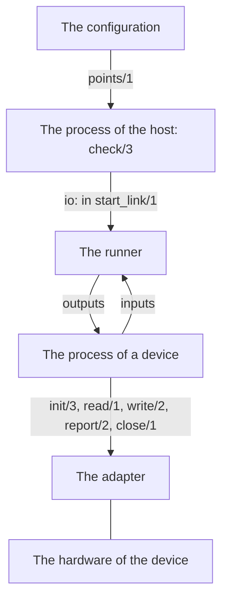
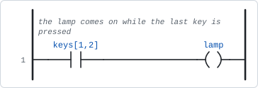

# I/O adapters

This page is for a reader who looks for an exact rule of the I/O of logex. The reader is
an Elixir developer who does 1 of these jobs:

- connects a [plant](glossary.md#plant) to its [devices](glossary.md#device)
- writes an [adapter](glossary.md#adapter)
- runs a plant on a [simulated device](glossary.md#simulated-device) in test code

The page defines the [points](glossary.md#point) that a
[configuration](glossary.md#configuration) gives each device, and the
[address](glossary.md#address) and the value of a point. It defines the binding of a
device to its adapter, each callback of the behaviour `Logex.IO`, and the simulated device
`Logex.IO.Sim`.

> #### Warning {: .warning}
>
> Do not use logex for a [safety function](glossary.md#safety-function). Examples are an
> emergency stop, a guard interlock and a light curtain. Use hardwired circuits or a
> safety-rated controller.
>
> Make sure that the hardware of each device sets its outputs to safe values when it gets
> no write. logex cannot set the outputs of a device to 0 in all cases. A device that
> hangs gets no write of 0. Its outputs do what its hardware does when it hears nothing.
> If the Erlang virtual machine stops, no part of logex runs.

> #### Caution {: .error}
>
> Do not expect a [program](glossary.md#program) to see a short pulse at an input point.
> Make the device keep the pulse until the next read, or make the pulse the
> [trigger](glossary.md#trigger) of an [event task](glossary.md#event-task).
>
> The [runner](glossary.md#runner) gets the value of an input point only from a read or
> from a [report](#report2) of the device. The process of the device reads it 1 time in
> each [poll period](glossary.md#poll-period). Thus the runner does not see a pulse that
> starts and ends between 2 reads, unless the device reports the pulse.
>
> The runner keeps only the last value of each input point. A read or a report makes no
> [round](glossary.md#round). Thus a program does not see a reported pulse either, unless
> a round runs while the pulse holds. The change of a trigger is the only exception: it
> makes a round of its event task.

> #### Note {: .info}
>
> logex has 1 adapter only: `Logex.IO.Sim`, a simulated device for tests and examples.
> logex has no adapter for a fieldbus or for an I/O card. You write each such adapter in
> your [host](glossary.md#host), with the behaviour `Logex.IO`.
> [Write a device adapter](../howto/write-a-device-adapter.md) shows how. The file
> [`examples/line_device.exs`](../../examples/line_device.exs) is an example adapter for
> a card that sends lines of text on a TCP socket.

| To find | Go to |
|---|---|
| The parts of the I/O and the processes | [Devices and adapters](#devices-and-adapters) |
| The plant that the examples run | [The plant of the examples](#the-plant-of-the-examples) |
| The fields of a point, its address and its values | [Points](#points) |
| `Logex.IO.points/1` | [The points of a configuration](#the-points-of-a-configuration) |
| `Logex.IO.bind!/2`, and each message of a wrong binding | [Bindings](#bindings) |
| Each callback of an adapter | [The callbacks](#the-callbacks) |
| What the runner does when a callback fails | [Failures of a callback](#failures-of-a-callback) |
| The options and functions of `Logex.IO.Sim` | [The simulated device](#the-simulated-device) |
| When the runner reads and writes a device | [Runner](runner.md#devices) |
| The time limits of a device | [Runner](runner.md#watchdogs) |
| The text of a location, and the points of a located array | [Configuration file](configuration-file.md) |

Each example on this page is a script, with each line that it prints. Each `elixir` block
is the file under `examples/` that its `$ mix run` line names. The directory `examples`
of the repository is a Mix project, and logex is its dependency. To run a script, give
its command in that directory.

## Devices and adapters

A device is the first part of a [location](glossary.md#location): `panel` in
`panel.i.0`. The device holds the points of each
[located global](glossary.md#located-global) with that first part.



Figure 1: the parts of the I/O, from the configuration to the hardware. `check/3` runs in
the process of the host. The process of a device calls each other callback.

| Part | Rule |
|---|---|
| The binding | The host binds each device to 1 adapter, by the name of the device, in the option `io:` of `Logex.Runner.start_link/1`. |
| The adapter | A module with the behaviour `Logex.IO`. The host gives the module, or the module and a keyword list of options. |
| The process of a device | The runner starts 1 process for each bound device. The process holds the data of the adapter, `state`, and calls each callback except `check/3`. |
| `Logex.Runtime` | It calls no adapter. It takes a map of inputs and gives a map of outputs. The runner fills the inputs from the devices and writes the outputs to the devices. |
| The order | The runner opens, writes and closes the devices in the sorted order of their names. |
| A configuration with no located global | It has no device. Give `io: %{}`. |

[Devices](runner.md#devices) on the page Runner gives when the runner opens, reads and
writes a device. [Stop, shutdown and crash](runner.md#stop-shutdown-and-crash) gives when
it closes a device. [Watchdogs](runner.md#watchdogs) gives the time limit of each call.

## The plant of the examples

The examples on this page run the plant `packing.logex`. The conveyor `c1` and the box
[counter](glossary.md#counter) `b1` read and write 1 device, `panel`. The programs
[`conveyor.ld`](runner.md#the-plant-of-the-examples) and
[`boxes.ld`](runner.md#the-plant-of-the-examples) are on the page Runner. They are in the
directory of `packing.logex`, and the examples read them from there.

<!-- file: packing.logex -->
```text
// packing.logex -- a conveyor on a 10 ms task, and a box counter in the continuous task
task fast interval 10 priority 1 watchdog 50
task main continuous watchdog 200

var_global estop      bool at panel.i.7
var_global pb_start_1 bool at panel.i.0
var_global pb_reset   bool at panel.i.2
var_global eye        bool at panel.i.8
var_global k1         bool at panel.q.0
var_global case_full  bool at panel.q.4

program c1 conveyor with fast
  c1.start pb_start_1
  c1.stop  0
  c1.reset pb_reset
  c1.motor k1

program b1 boxes
  b1.eye       eye
  b1.reset_pb  pb_reset
  b1.full_lamp case_full
```

The input `estop` is for the examples only. An emergency stop is a hardwired circuit, as
the Warning at the top of this page says.

The examples also run a keypad of 2 rows of 3 keys, with a lamp, on 1 rack. The keys are
a located [array](glossary.md#array) of 2 dimensions.

<!-- file: io-adapters/keypad.logex -->
```text
// keypad.logex -- a keypad of 2 rows of 3 keys, and a lamp, on 1 rack
task main continuous

var_global keys bool[2,3] at rack.i.2.4
var_global lamp bool      at rack.q.0

program k1 keypad
  k1.keys keys
  k1.lamp lamp
```

<!-- file: io-adapters/keypad.ld -->
```text
var_input  keys bool[2,3]
var_output lamp bool

// the lamp comes on while the last key is pressed
xic keys[1,2] ote lamp
```

The [rung](glossary.md#rung) of `keypad.ld` sets `lamp` while the key `keys[1,2]` is on.

<!-- rung: io-adapters/keypad.ld -->


## Points

### A point

An adapter gets each point of its device as a `%Logex.IO.Point{}`. A point is plain data.

| Field | Value |
|---|---|
| `name` | The name of the [global](glossary.md#global), for example `"eye"`. For an [element](glossary.md#element) of a located array, the name of the element, for example `"keys[1,2]"`. |
| `direction` | `:input` for a location with `i`, `:output` for a location with `q` |
| `address` | The address, a list of integers. [Addresses](#addresses) gives the rule. |
| `type` | The [elementary type](glossary.md#elementary-type) of the global, for example `:bool`, `:dint`, `:word` or `:real`. For an element, the type of the elements of the array. |

### Addresses

The address of a point is the integers of its location after `i` or `q`, in a list. The
integers are in the order of the location, from left to right: `rack.i.2.4` has the
address `[2, 4]`. logex gives no meaning to each integer. The adapter gives each integer
its meaning, for example the number of a card and the number of a channel.

| Location | Address |
|---|---|
| `panel.i.7` | `[7]` |
| `panel.q.0` | `[0]`. An input point and an output point can have the same address. |
| `rack.i.2.4` | `[2, 4]` |
| `keys[0,0]` to `keys[1,2]`, at `rack.i.2.4` | `[2, 4]` to `[2, 9]`, 1 point for each element |

The rules of the points of an array:

- Each element is a separate point, at its own address.
- The last integer of the address counts up from the location of the array.
- In an array of 2 dimensions, the right [subscript](glossary.md#subscript) changes
  first.
- The runner reads, writes and [forces](glossary.md#force) each element by its name, for
  example `keys[1,2]`.

This table gives the address of each element `keys[r,c]` of the keypad, at
`rack.i.2.4`. Each row is 1 value of the left subscript `r`.

| `keys[r,c]` | `c` = 0 | `c` = 1 | `c` = 2 |
|---|---|---|---|
| `r` = 0 | `[2, 4]` | `[2, 5]` | `[2, 6]` |
| `r` = 1 | `[2, 7]` | `[2, 8]` | `[2, 9]` |

[Configuration file](configuration-file.md) gives the text of a location and the rules of
the points that a configuration refuses.

### Values

Values go by address, in a map: `%{[0] => 1, [4] => 0}`. Each value is a number. A read
and a report give the values of input points. A write gets the values of output points.

### Values of an input

The runner checks each value of an input against the [type](glossary.md#type) of its
point.

| Type of the point | Values that the runner takes |
|---|---|
| `bool` | The integer 0 or 1 |
| An integer type or a [bit string](glossary.md#bit-string) | An integer in the range of the type, for example -128 to 127 for `sint` |
| `real` or `lreal` | An integer or a float. The runner keeps the nearest value of the type. |

- The runner keeps 16777217 at a `real` point as 16777216.0, and 0.1 as
  0.10000000149011612.
- The runner keeps a value nearer 0 than the smallest normal value of the type as 0.0.
  Examples are 1.0e-40 at a `real` point and 1.0e-310 at an `lreal` point.
- A float at a `bool` point or at an integer point does not fit, for example 1.0.
- A value out of the range of its type does not fit, for example 128 at a `sint` point
  or 3.5e38 at a `real` point.
- A value that does not fit is an [I/O fault](runner.md#the-causes-of-an-io-fault). The runner
  [trips](glossary.md#trip) the plant with `{:io, device, {:bad_value, address, value}}`.
  [Failures of a callback](#failures-of-a-callback) gives the other causes.

### Values of an output

| Type of the point | Values that `write/2` gets |
|---|---|
| `bool` | The integer 0 or 1 |
| An integer type or a bit string | An integer in the range of the type |
| `real` or `lreal` | A float |
| Each type, in the write of 0 | The integer 0 |

## The points of a configuration

`Logex.IO.points/1` gives the points of a configuration, grouped by device:
`%{device => [%Logex.IO.Point{}]}`. Each list has the points of the device in the
sequence of the lines of the configuration. These are the points that `init/3` of each
adapter gets.

| Rule | What occurs |
|---|---|
| A global with `at` | 1 point |
| A located array | 1 point for each element |
| A global with no `at` | No point |
| A configuration with no located global | `%{}` |
| A configuration that `Logex.Runtime.start/1` refuses | An `ArgumentError` with the same message |
| An argument that is not a `%Logex.Configuration{}` | An `ArgumentError` |

The script `io-adapters-points.exs` prints the points of the 2 plants. Each line gives
the device, the name, the direction, the address and the type.

```elixir
# The script prints the points of 2 configurations, 1 line for each point: the device,
# the name, the direction, the address and the type.
show = fn path ->
  {:ok, configuration} = Logex.Configuration.compile_file(path)
  IO.puts(path)

  for {device, points} <- Logex.IO.points(configuration), point <- points do
    address = inspect(point.address, charlists: :as_lists)
    columns = [device, point.name, point.direction, address, point.type]
    line = Enum.map_join(columns, "", &String.pad_trailing("#{&1}", 12))
    IO.puts("  " <> String.trim_trailing(line))
  end
end

show.("packing.logex")
show.("io-adapters/keypad.logex")
```

```console
$ mix run io-adapters-points.exs
packing.logex
  panel       estop       input       [7]         bool
  panel       pb_start_1  input       [0]         bool
  panel       pb_reset    input       [2]         bool
  panel       eye         input       [8]         bool
  panel       k1          output      [0]         bool
  panel       case_full   output      [4]         bool
io-adapters/keypad.logex
  rack        keys[0,0]   input       [2, 4]      bool
  rack        keys[0,1]   input       [2, 5]      bool
  rack        keys[0,2]   input       [2, 6]      bool
  rack        keys[1,0]   input       [2, 7]      bool
  rack        keys[1,1]   input       [2, 8]      bool
  rack        keys[1,2]   input       [2, 9]      bool
  rack        lamp        output      [0]         bool
```

The script prints each address with `charlists: :as_lists`. Without it, Elixir shows the
list `[7]` as `~c"\a"`.

## Bindings

`Logex.IO.bind!/2` checks the bindings of a host against the devices of a configuration.
`Logex.Runner.start_link/1` does the same checks on its option `io:`, in the process of
the caller.

| Argument | Value |
|---|---|
| `configuration` | A `%Logex.Configuration{}`. `bind!/2` checks it first, as `points/1` does. |
| `io` | A map from the name of each device, a string, to its binding |
| A binding | An adapter module, or `{module, options}`. `options` is a keyword list. A module alone has the options `[]`. |

`bind!/2` gives a list of `{device, module, options, points}`, 1 for each device, in the
sorted order of the device names. The runner opens the devices in that order.

### The checks

`bind!/2` does the checks in 2 parts:

1. It checks the configuration, then it checks that `io` is a map. Each of these 2
   errors raises an `ArgumentError` alone, before the other checks.
2. It finds all the other errors, and raises 1 `ArgumentError` with 1 line for each
   error.

The lines come in this sequence: first each key that is not a string, then the devices
in the sorted order of their names.

| Error | The message gives |
|---|---|
| A configuration that `Logex.Runtime.start/1` refuses | The message of `start/1` |
| `io` is not a map | The form of the map |
| A key that is not a string | The key. For an atom that spells a device, the string to write. |
| A device with a point and no binding | Each point at the device, with its location. The points of an array are 1 range. |
| A binding for a device with no point | The device, and the nearest name of a device, if there is one |
| A binding that is not a module or `{module, options}` | The binding |
| Options that are not a keyword list | The options |
| A module that does not exist | The module |
| A module with no `init/3`, `read/1` or `write/2` | Each callback that is not there |
| A module with `check/3` | Each line that `check/3` gives, after the name of the device and the words `adapter options:` |
| A `check/3` that gives no list of strings | What `check/3` gave |

The script `io-adapters-bind.exs` binds the device of `packing.logex` to a simulated
device. Then it gives `bind!/2` 7 wrong bindings, and prints each message.

```elixir
# The script binds the device of packing.logex to a simulated device, and prints each
# binding that bind!/2 gives. Then it gives bind!/2 7 wrong bindings, and prints each
# message.
alias Logex.IO.Sim

{:ok, packing} = Logex.Configuration.compile_file("packing.logex")
{:ok, keypad} = Logex.Configuration.compile_file("io-adapters/keypad.logex")
{:ok, panel} = Sim.start_link()
{:ok, small} = Sim.start_link(inputs: 4)
{:ok, rack} = Sim.start_link()

for {device, adapter, options, points} <- Logex.IO.bind!(packing, %{"panel" => {Sim, sim: panel}}) do
  IO.puts(
    "#{device}: #{inspect(adapter)}, options #{inspect(Keyword.keys(options))}, #{length(points)} points"
  )
end

refused = fn configuration, io ->
  try do
    Logex.IO.bind!(configuration, io)
  rescue
    error in ArgumentError -> IO.puts("\n" <> error.message)
  end
end

refused.(packing, %{})
refused.(packing, %{:panel => Sim, "pannel" => Sim})
refused.(packing, %{"panel" => "Sim"})
refused.(packing, %{"panel" => Enum})
refused.(packing, %{"panel" => Sim})
refused.(packing, %{"panel" => {Sim, sim: small}})
refused.(keypad, %{"rack" => {Sim, sim: rack, reports: true}})
```

```console
$ mix run io-adapters-bind.exs
panel: Logex.IO.Sim, options [:sim], 6 points

no adapter is bound to the device `panel`, which `estop` (panel.i.7), `pb_start_1` (panel.i.0), `pb_reset` (panel.i.2), `eye` (panel.i.8), `k1` (panel.q.0) and `case_full` (panel.q.4) are at

io names each device by a string, got: :panel — did you mean "panel"?
no adapter is bound to the device `panel`, which `estop` (panel.i.7), `pb_start_1` (panel.i.0), `pb_reset` (panel.i.2), `eye` (panel.i.8), `k1` (panel.q.0) and `case_full` (panel.q.4) are at
the device `pannel` is bound, but no point is at it — did you mean `panel`?

the device `panel` is bound to "Sim": an adapter is a module that implements Logex.IO, or {module, options}

the device `panel` is bound to `Enum`, which does not implement Logex.IO: it has no init/3, read/1 or write/2

the device `panel`'s adapter options: Logex.IO.Sim is bound with its sim, {Logex.IO.Sim, sim: sim}, got the options []

the device `panel`'s adapter options: `estop` is at `panel.i.7`, past the sim's 4 inputs, `panel.i.0` to `panel.i.3`
the device `panel`'s adapter options: `eye` is at `panel.i.8`, past the sim's 4 inputs, `panel.i.0` to `panel.i.3`

the device `rack`'s adapter options: Logex.IO.Sim is bound with sim: alone, got: :reports
```

The last 3 messages come from `check/3` of `Logex.IO.Sim`. [The adapter side of the
simulated device](#the-adapter-side) gives its checks.

## The callbacks

An adapter is a module with the behaviour `Logex.IO`. It must have `init/3`, `read/1` and
`write/2`. `report/2`, `close/1` and `check/3` are optional.

| Callback | Process | The runner calls it | Result |
|---|---|---|---|
| `check/3` | The process of the host | When it checks `io:`, before it opens a device | A list of strings, `[]` for no error |
| `init/3` | The process of the device | To open the device | `{:ok, state}` or `{:error, reason}` |
| `read/1` | The process of the device | After the open, at each poll and at a restart | `{:ok, values, state}` or `{:error, reason, state}` |
| `write/2` | The process of the device | After a round that changed the outputs of the device, at each poll, and to write 0 | `{:ok, state}` or `{:error, reason, state}` |
| `report/2` | The process of the device | For each message that the process gets and that does not come from logex | `{:ok, values, state}` or `{:error, reason, state}` |
| `close/1` | The process of the device | 1 time, after the last write of 0 | `:ok` |

`state` is the data of the adapter. The process of the device keeps it from 1 callback
to the next. `values` is a map from address to number, as in [Values](#values).

### `check/3`

| Part | Rule |
|---|---|
| Arguments | The name of the device, its points, and the options of its binding. They are the same as the arguments that `init/3` gets. |
| When | `bind!/2` and `start_link/1` call it, in the process of the host, before the runner opens any device. They call it only for a module that has `init/3`, `read/1` and `write/2`, and options that are a keyword list. |
| Result | 1 string for each error in the options. `[]` for no error. |
| What it checks | Only the options that the host wrote. It does not connect to the device. A device that cannot open is an `{:error, reason}` of `init/3`. |
| A raise | It raises in the process of the host, as each function of the host does. |
| Without it | The runner does not check the options. An error in them shows at `init/3`, in the process of the device. |

### `init/3`

| Part | Rule |
|---|---|
| Arguments | The name of the device, for example `"panel"`. Its points, a list of `%Logex.IO.Point{}`. The options of its binding. |
| Result | `{:ok, state}`, or `{:error, reason}` for a device that cannot open |
| Messages | `init/3` runs in the process of the device. An adapter that reports its changes connects to its device there. A port, a socket or a process of the adapter then sends its messages to the process of the device. |
| After it | The runner reads the device 1 time. If that first read fails, the process writes 0 to each output point, calls `close/1`, and stops. |
| A failure | `start_link/1` gives `{:error, {:io_init, device, reason}}`, and closes each device that it opened before. If `init/3` gives `{:error, reason}`, `reason` is that reason. Otherwise `reason` is a cause from [Failures of a callback](#failures-of-a-callback), of `init/3` or of the first read. A device that does not open in its time gives `:timeout`. |

### `read/1`

| Part | Rule |
|---|---|
| Argument | `state` |
| Result | `{:ok, values, state}`, with values for some or all input points of the device |
| Some points | The runner keeps the last value of each input point. Thus a read can give only the points that changed. |
| Only input points | An address that is not an input point of the device is an I/O fault. A read gives no value for an output point. |
| `values` | A map. A struct, such as a `MapSet`, is an I/O fault, at the first read and at each later read. |
| When | After `init/3`, then 1 time in each [poll period](glossary.md#poll-period), and 1 time at each [restart](glossary.md#restart) |

### `write/2`

| Part | Rule |
|---|---|
| Arguments | The values of each output point of the device, by address, and `state` |
| Result | `{:ok, state}`. An error gives `state` back also, so that the next call can connect again. |
| The values | All the output points at each write, not only the points that changed. An adapter can skip a point that did not change. |
| When | After each round that changed an output of the device. At each poll, the process writes the last outputs again. After a trip, the process does not write the last outputs again. After a restart, it writes nothing again until the first round of the restart writes. |
| The write of 0 at a trip | A trip writes 0 to each output point 1 time. If that write fails, the process writes 0 again at each poll, until a write of 0 succeeds. Then the device gets no write until a restart. A restart that fails writes 0 again, 1 time. |
| The write of 0 at a stop | The process writes 0 to each output point 1 time, then calls `close/1`. A device that a trip already wrote 0 to gets no second write of 0. If the write of 0 at the trip failed, the stop tries it 1 more time. |
| A device with no output point | It gets no write. |

### `report/2`

| Part | Rule |
|---|---|
| Arguments | A message that the process of the device got, and `state` |
| Result | `{:ok, values, state}`, with the input points that the message changed. `%{}` for a message that the adapter does not know. |
| When | For each message to the process of the device that does not come from logex. A change comes between 2 reads. |
| Without it | The process ignores each such message. The runner then sees a change only at the next read. |
| Monitors | The `{:DOWN, ...}` message of a monitor is a message as each other, and goes to `report/2`. |
| The values | The same rules as the values of `read/1` |

### `close/1`

| Part | Rule |
|---|---|
| Argument | `state` |
| Result | `:ok` |
| When | 1 time, after the last write of 0. This occurs at a stop, a shutdown, a crash or a kill of the runner. It occurs when the clock of the runner stops, and after a first read that fails. It also occurs when a process that the adapter linked stops with a reason that is not `:normal`. A trip does not close the device. |
| A device that hangs | If the runner or a separate process kills the process of the device, the process calls no `close/1`. |
| A failure | The process ignores a raise, a throw or an exit in `close/1`. The stop continues. |
| Without it | The process stops with no close. |

### The process of a device

| Event | What the process does |
|---|---|
| The runner stops or crashes, or a process kills it | The process traps exits. It writes 0 to each output point 1 time, unless a trip wrote 0 to them already. If the write of 0 at the trip failed, it tries 1 more time. Then it calls `close/1`, and stops. |
| The same, while the process hangs in a callback | The process gets `idle + poll` ms. Then the runner kills it, or at a crash or a kill, a separate process kills it. It gives no write of 0 and calls no `close/1`. Its outputs do what its hardware does when it hears nothing. [Stop, shutdown and crash](runner.md#stop-shutdown-and-crash) gives the rules. |
| A process that the adapter linked stops with `:normal` | Nothing |
| A process that the adapter linked stops with a different reason | The process writes 0 to each output point 1 time, calls `close/1`, and stops. The runner trips with `{:io, device, {:down, reason}}`. The next restart opens the device again. |
| A process that the adapter monitors, and did not link, stops | The `{:DOWN, ...}` message goes to `report/2`. The process of the device continues. |

The script `io-adapters-trace.exs` has an adapter, `TraceIO`, that tells the script each
call of a callback, and the process that makes the call. The script runs
`packing.logex` on it 2 times. The first read gives `%{[0] => 1}`, so `pb_start_1` is 1
and the conveyor starts. The second read gives a struct, and the start fails.

```elixir
# TraceIO is an adapter that tells the script each call of a callback, and the process
# that makes the call. The script runs packing.logex on it 2 times: first with a read
# that gives a map, then with a read that gives a struct.
defmodule TraceIO do
  @behaviour Logex.IO

  @impl true
  def check(_device, _points, options), do: tell(options[:to], "check/3", [])

  @impl true
  def init(device, points, options) do
    state = %{to: options[:to], inputs: options[:inputs]}
    tell(state.to, "init/3 #{inspect(device)}, #{length(points)} points", {:ok, state})
  end

  @impl true
  def read(state), do: tell(state.to, "read/1", {:ok, state.inputs, state})

  @impl true
  def write(values, state),
    do: tell(state.to, "write/2 #{inspect(values, charlists: :as_lists)}", {:ok, state})

  @impl true
  def report(message, state),
    do: tell(state.to, "report/2 #{inspect(message)}", {:ok, %{}, state})

  @impl true
  def close(state), do: tell(state.to, "close/1", :ok)

  defp tell(to, call, result) do
    send(to, {:call, self(), call})
    result
  end
end

alias Logex.Runner
alias Logex.Runner.Clock.Manual

{:ok, plant} = Logex.Configuration.compile_file("packing.logex")
{:ok, clock} = Manual.start_link()
host = self()

calls = fn ->
  {:messages, messages} = Process.info(host, :messages)
  for {:call, _pid, _call} = message <- messages, do: receive(do: (^message -> message))
end

show = fn list ->
  for {:call, pid, call} <- list,
      do: IO.puts("  " <> Map.get(%{host => "host  "}, pid, "device") <> "  " <> call)
end

start = fn inputs ->
  options = [to: host, inputs: inputs]

  Runner.start_link(
    configuration: plant,
    io: %{"panel" => {TraceIO, options}},
    clock: {Manual, clock}
  )
end

IO.puts("A read that gives %{[0] => 1}:")
{:ok, runner} = start.(%{[0] => 1})
started = calls.()
show.(started)
[device] = Enum.uniq(for {:call, pid, _call} <- started, pid != host, do: pid)
send(device, :hello)
Manual.advance(clock, 10)
:ok = Runner.stop(runner)
show.(calls.())

IO.puts("A read that gives a struct:")
# The message holds the state of the adapter, with a pid that is different at each run.
answer = inspect(start.(MapSet.new([[0]])))
IO.puts("  start: " <> Regex.replace(~r/#PID<[0-9.]+>/, answer, "#PID<...>"))
show.(calls.())
```

```console
$ mix run io-adapters-trace.exs
A read that gives %{[0] => 1}:
  host    check/3
  device  init/3 "panel", 6 points
  device  read/1
  device  write/2 %{[0] => 1, [4] => 0}
  device  report/2 :hello
  device  read/1
  device  write/2 %{[0] => 1, [4] => 0}
  device  write/2 %{[0] => 0, [4] => 0}
  device  close/1
A read that gives a struct:
  start: {:error, {:io_init, "panel", {:raised, "TraceIO.read/1 gave {:ok, MapSet.new([[0]]), %{to: #PID<...>, inputs: MapSet.new([[0]])}}, which is none of Logex.IO's results"}}}
  host    check/3
  device  init/3 "panel", 6 points
  device  read/1
  device  write/2 %{[0] => 0, [4] => 0}
  device  close/1
```

The first run shows this sequence:

1. `check/3` runs in the process of the host. Each other callback runs in the process of
   the device.
2. `init/3` gets the 6 points of `panel`. The runner then reads the device 1 time.
3. The first round writes each output point: `k1`, at `[0]`, is 1.
4. The message `:hello` goes to `report/2`.
5. At the poll at 10 ms, the process reads the device, and writes the last outputs again.
6. The stop writes 0 to each output point, then calls `close/1`.

In the second run, the first read fails. The process writes 0 and calls `close/1`.

## Failures of a callback

A callback that fails gives `{:error, reason, state}`, or `{:error, reason}` for
`init/3`. It must not raise. A device that does not answer is a normal event in a plant,
not a defect of the adapter. Give `state` back, so that the next call can connect again.

Each failure of a callback is an I/O fault. The runner trips the plant with
`{:io, device, cause}`. At a start, `start_link/1` gives
`{:error, {:io_init, device, cause}}` in place of a trip. At a restart, `Logex.Runner.restart/2` gives the same, and the
plant stays tripped with the reason of its first trip.

| What the callback does | `cause` |
|---|---|
| It gives `{:error, reason, state}` | `{:error, reason}` |
| It raises | `{:raised, message}` |
| It gives a result that the behaviour does not define, for example a struct for the values | `{:raised, message}`. The message names the callback and the result. |
| It throws | `{:thrown, term}` |
| It exits | `{:exited, term}` |
| A read or a report gives a value that does not fit its point | `{:bad_value, address, value}` |
| A read or a report gives an address that is not an input point of the device | `{:unknown_address, address}` |
| It does not return in its time | `:timeout`. If the device still does not answer, the runner kills its process, with no `close/1`. The next restart opens the device again. |
| A process that the adapter linked stops with a reason that is not `:normal` | `{:down, reason}` |

- In a cause, `address` is the location as the configuration writes it, for example
  `"panel.i.9"`.
- An adapter can give an address that is not a list of whole numbers. The cause then
  gives the address as the adapter gave it, for example `{:unknown_address, [:x]}`.
- `init/3` gives `{:error, reason}`, and the start gives `{:io_init, device, reason}`
  with that reason alone.
- A failure of `close/1` does not trip the plant, and does not stop the stop.

[Runner](runner.md) gives the time limits of each call, what a trip does, and what a
restart opens again.

The script `io-adapters-faults.exs` tells the simulated device to fail 1 time in each way,
and prints the reason of each trip.

```elixir
# The script tells the simulated device to fail 1 time in each way of fail/3, and prints
# the reason of each trip. After each trip, a cold restart opens the device again. Each
# failure acts on the next call of its callback: a read or a write at the next poll, a
# report at the next change of an input.
alias Logex.IO.Sim
alias Logex.Runner
alias Logex.Runner.Clock.Manual

Logger.configure(level: :none)
{:ok, plant} = Logex.Configuration.compile_file("packing.logex")
{:ok, clock} = Manual.start_link()
{:ok, panel} = Sim.start_link(reports: true, clock: clock)

{:ok, runner} =
  Runner.start_link(
    configuration: plant,
    io: %{"panel" => {Sim, sim: panel}},
    clock: {Manual, clock}
  )

failures = [
  {:read, {:error, :closed}},
  {:read, :raise},
  {:read, :throw},
  {:read, :exit},
  {:read, {:value, [8], 2}},
  {:read, {:value, [9], 1}},
  {:write, {:error, :closed}},
  {:write, :raise}
]

for {callback, how} <- failures do
  :ok = Sim.fail(panel, callback, how)
  Manual.advance(clock, 10)
  %{trip: trip} = Runner.status(runner)
  IO.puts("#{callback} #{inspect(how, charlists: :as_lists)}")
  IO.puts("  trip: #{inspect(trip)}")
  :ok = Runner.restart(runner, :cold)
end

:ok = Sim.fail(panel, :report, {:error, :closed})
:ok = Sim.set(panel, "panel.i.2", 1)
IO.puts("report {:error, :closed}")
IO.puts("  trip: #{inspect(Runner.status(runner).trip)}")

:ok = Sim.fail(panel, :close, :raise)
IO.puts("close :raise")
IO.puts("  stop: #{inspect(Runner.stop(runner))}, closed: #{Sim.closed?(panel)}")

:ok = Sim.fail(panel, :init, {:error, :econnrefused})
start = Runner.start_link(configuration: plant, io: %{"panel" => {Sim, sim: panel}})
IO.puts("init {:error, :econnrefused}")
IO.puts("  start: #{inspect(start)}")
```

```console
$ mix run io-adapters-faults.exs
read {:error, :closed}
  trip: {:io, "panel", {:error, :closed}}
read :raise
  trip: {:io, "panel", {:raised, "the simulated device \"panel\" raised in read, as fail/3 told it"}}
read :throw
  trip: {:io, "panel", {:thrown, {Logex.IO.Sim, :read}}}
read :exit
  trip: {:io, "panel", {:exited, {Logex.IO.Sim, :read}}}
read {:value, [8], 2}
  trip: {:io, "panel", {:bad_value, "panel.i.8", 2}}
read {:value, [9], 1}
  trip: {:io, "panel", {:unknown_address, "panel.i.9"}}
write {:error, :closed}
  trip: {:io, "panel", {:error, :closed}}
write :raise
  trip: {:io, "panel", {:raised, "the simulated device \"panel\" raised in write, as fail/3 told it"}}
report {:error, :closed}
  trip: {:io, "panel", {:error, :closed}}
close :raise
  stop: :ok, closed: false
init {:error, :econnrefused}
  start: {:error, {:io_init, "panel", :econnrefused}}
```

The value 2 does not fit the `bool` point `eye`, at `[8]`. The address `[9]` is not an
input point of `panel`. The close that raised does not stop the stop, and the sim stays
open.

## The simulated device

`Logex.IO.Sim` is an adapter, and a small process that a test owns. The test sets the
inputs of the sim, and reads what the runner wrote to its outputs. The sim has no
hardware.

### `start_link/1`

`start_link/1` starts a sim, links it to the caller, and gives `{:ok, sim}`. It takes
a keyword list of these options. Give each option 1 time.

| Option | Value | Default |
|---|---|---|
| `reports:` | `true`: the sim reports each change of an input to the device that opened it. `false`: the runner sees a change at the next read. | `false` |
| `clock:` | A manual [clock](glossary.md#clock), from `Logex.Runner.Clock.Manual.start_link/0`. A failure `{:delay, ms}` moves this clock. | `nil`: a delay is a sleep in real time |
| `wait:` | The time in ms that `set/2` and `set/3` wait for the device to handle a report: 1 to 4294967295 | 5000 |
| `inputs:` | The number of input points, at the addresses `[0]` to `[n - 1]`, 1 or more | `nil`: as many as the configuration gives |
| `outputs:` | The number of output points, at the addresses `[0]` to `[n - 1]`, 1 or more | `nil`: as many as the configuration gives |
| `writes:` | The number of writes that the sim keeps, the newest, 1 or more | 100000 |

A sim with `inputs:` or `outputs:` has addresses with 1 integer only. A point with an
address of 2 integers or more, such as `[2, 4]`, is past them.

### Addresses before and after the open

The address that a test gives to the sim, and that the sim gives back, has 2 forms.

| When | The form of an address | Example |
|---|---|---|
| No runner opened the sim | A list of integers | `[0]` |
| A runner opened the sim | The location, as the configuration writes it | `"panel.i.0"` |

- A sim gets the name of its device when the process of a runner's device calls `init/3`.
  The sim keeps that name after the device closes it, also after a stop.
- A test that calls the callbacks itself opens no runner's device. Its sim keeps the list
  form.
- `outputs/1` and `writes/1` give each write in the form of the device that last opened
  the sim. This includes the writes from before that open.
- `fail/3` takes the address of `{:value, address, value}` as a list in each case.

### The functions of a test

| Function | What it does |
|---|---|
| `set(sim, address, value)` | Sets 1 input. A value is an integer or a float. The runner checks it against the type of its point. |
| `set(sim, values)` | Sets several inputs, from a map of address to value. A sim that reports gives them in 1 report. |
| `outputs(sim)` | The last value of each output, by address |
| `writes(sim)` | Each write, in sequence, the newest `writes:` writes. Each write has the values of all the output points. |
| `reads(sim)` | The number of reads, with the reads that failed |
| `closed?(sim)` | `true` if the device closed the sim after its last open |
| `fail(sim, callback, how)` | Acts out 1 failure at the next call of `callback`. [Failures that a sim acts out](#failures-that-a-sim-acts-out) gives each one. |
| `hold(sim)` | Holds the next read of a restart, until `let_go/1` |
| `let_go(sim)` | Lets the held read continue |
| `holding?(sim)` | `true` while a read of a restart waits in the hold |

Rules of `set/2` and `set/3`:

- An input that no test sets reads 0.
- An address past `inputs:` is an error. The sim sets no value of that call.
- The sim takes the address of an input that no global is at. No point reads that value.
- If the sim reports, the caller waits until the device handled the report. Thus a test
  that sets an input and then moves the clock finds the change in the runner.
- A device that is down, or that stops while it handles the report, does not stop the
  call.
- A device that is alive and does not answer in `wait:` ms is an error of the test.

The script `io-adapters-sim.exs` runs `packing.logex` on a sim, on a manual clock.

```elixir
# The script runs packing.logex on a simulated device, panel, on a manual clock. It sets
# inputs before and after the runner opens the sim, and reads what the sim recorded.
alias Logex.IO.Sim
alias Logex.Runner
alias Logex.Runner.Clock.Manual

{:ok, plant} = Logex.Configuration.compile_file("packing.logex")
{:ok, clock} = Manual.start_link()
{:ok, panel} = Sim.start_link(reports: true, clock: clock)

# No runner opened the sim: an address is a list. [0] is pb_start_1.
:ok = Sim.set(panel, [0], 1)
IO.inspect(Sim.outputs(panel), label: "outputs before the open")

{:ok, runner} =
  Runner.start_link(
    configuration: plant,
    io: %{"panel" => {Sim, sim: panel}},
    clock: {Manual, clock}
  )

IO.inspect(Sim.reads(panel), label: "reads after the open")
IO.inspect(Sim.outputs(panel), label: "outputs after the first round")

# The runner opened the sim: an address is the text of the configuration.
:ok = Sim.set(panel, %{"panel.i.0" => 0, "panel.i.8" => 1})
Manual.advance(clock, 10)
IO.inspect(Sim.reads(panel), label: "reads at 10 ms")
IO.inspect(Runner.get!(runner, "eye"), label: "eye")

:ok = Runner.stop(runner)
IO.inspect(Sim.writes(panel), label: "writes")
IO.inspect(Sim.closed?(panel), label: "closed")

# After the stop, the sim keeps the name of the device.
IO.inspect(Sim.set(panel, "panel.i.0", 1), label: "set after the stop")
```

```console
$ mix run io-adapters-sim.exs
outputs before the open: %{}
reads after the open: 1
outputs after the first round: %{"panel.q.0" => 1, "panel.q.4" => 0}
reads at 10 ms: 2
eye: 1
writes: [
  %{"panel.q.0" => 1, "panel.q.4" => 0},
  %{"panel.q.0" => 1, "panel.q.4" => 0},
  %{"panel.q.0" => 0, "panel.q.4" => 0}
]
closed: true
set after the stop: :ok
```

The sim kept 3 writes. The first round wrote the first. The poll at 10 ms wrote the same
outputs again. The stop wrote 0.

### Failures that a sim acts out

`fail(sim, callback, how)` acts out 1 failure at the next call of `callback`: `:init`,
`:read`, `:write`, `:report` or `:close`. Failures for 1 callback come in the sequence of
the calls of `fail/3`, each 1 time.

| `how` | What the callback does | Callbacks |
|---|---|---|
| `{:error, reason}` | Gives the error back | Each, except `:close` |
| `:raise` | Raises in the process of the device | Each |
| `:throw` | Throws `{Logex.IO.Sim, callback}` | Each |
| `:exit` | Exits with `{Logex.IO.Sim, callback}` | Each |
| `:hang` | Does not return | Each |
| `{:delay, ms}` | Waits `ms` on the clock of `clock:`, or sleeps `ms` in real time, then continues | Each |
| `{:value, address, value}` | Gives the value at the address with the other values. The value can be a value that does not fit. The address can be an address that is not a point. | `:read` and `:report` |

On a manual clock, `advance/2` waits for each device to handle each message of the clock. A device that
hangs makes `advance/2` raise after its wait. Use `:hang` on the clock of the computer.

### The hold of a restart

`hold/1` holds the next read of a restart of a device that stayed up. A test on the clock
of the computer uses it to let a different device poll while the runner waits.

- A read at a poll passes the hold. Only the read of a restart waits in it.
- `holding?/1` gives `true` while a read waits in the hold.
- `let_go/1` lets the read continue. A failure that `fail/3` gave for `:read` acts in that
  read.
- If the runner kills the process of the held read, the hold ends. `holding?/1` then
  gives `false`.
- `reads/1` counts a held read when it continues.

| Error of the test | When |
|---|---|
| `hold/1` | The sim holds already. |
| `let_go/1` | The sim holds no read, and the test did not call `hold/1`. |
| `let_go/1` | The test called `hold/1`, and no restart read the device after it. The hold stays. |

### The adapter side

`Logex.IO.Sim` has each callback of `Logex.IO`.

| Callback | What the sim does |
|---|---|
| `check/3` | Checks the options: `sim:` alone, 1 time, with a sim that runs and that no other device holds. With `inputs:` or `outputs:`, it gives each point past them: the first 10, then a count. |
| `init/3` | Refuses the first of the same errors. Then it opens the sim for the process that calls it. A sim that reports sends its reports to that process. |
| `read/1` | Gives each input point of the device, by address |
| `write/2` | Records the values |
| `report/2` | Gives the input points of a report of the sim. It gives `%{}` for each other message. |
| `close/1` | Records that the device closed the sim |

A sim is for 1 device. After a process of a device opens it, a different process can
open it only after the first closes it or stops. The process that opened it can open it
again.

### Messages of the simulated device

Each wrong call of a test raises an `ArgumentError`. The script
`io-adapters-sim-wrong.exs` makes wrong calls and prints each message.

```elixir
# The script makes wrong calls to the simulated device and prints each message. A pid is
# different at each run, so the script prints each pid as #PID<...>.
alias Logex.IO.Sim
alias Logex.Runner
alias Logex.Runner.Clock.Manual

refused = fn call ->
  try do
    call.()
  rescue
    error in ArgumentError ->
      IO.puts(Regex.replace(~r/#PID<[0-9.]+>/, error.message, "#PID<...>"))
  end
end

IO.puts("Options of start_link/1:")
refused.(fn -> Sim.start_link(speed: 1) end)
refused.(fn -> Sim.start_link(reports: true, reports: false) end)
refused.(fn -> Sim.start_link(reports: 1) end)
refused.(fn -> Sim.start_link(wait: 0) end)
refused.(fn -> Sim.start_link(inputs: 0) end)
refused.(fn -> Sim.start_link(writes: 0) end)

IO.puts("\nBefore a runner opens the sim:")
{:ok, panel} = Sim.start_link(inputs: 9)
refused.(fn -> Sim.set(panel, "panel.i.0", 1) end)
refused.(fn -> Sim.set(panel, [9], 1) end)
refused.(fn -> Sim.set(panel, [-1], 1) end)
refused.(fn -> Sim.set(panel, [0], :on) end)

IO.puts("\nAfter a runner opens the sim:")
{:ok, plant} = Logex.Configuration.compile_file("packing.logex")
{:ok, clock} = Manual.start_link()
io = %{"panel" => {Sim, sim: panel}}
{:ok, runner} = Runner.start_link(configuration: plant, io: io, clock: {Manual, clock})
refused.(fn -> Sim.set(panel, [0], 1) end)
refused.(fn -> Sim.set(panel, "panel.i.9", 1) end)
refused.(fn -> Sim.set(panel, "panel.q.0", 1) end)
refused.(fn -> Sim.set(panel, "drive.i.0", 1) end)
refused.(fn -> Sim.set(panel, "panel.i.07", 1) end)

IO.puts("\nfail/3, hold/1 and let_go/1:")
refused.(fn -> Sim.fail(panel, :open, :raise) end)
refused.(fn -> Sim.fail(panel, :read, :boom) end)
refused.(fn -> Sim.fail(panel, :close, {:error, :closed}) end)
refused.(fn -> Sim.fail(panel, :write, {:value, [0], 1}) end)
refused.(fn -> Sim.let_go(panel) end)
:ok = Sim.hold(panel)
refused.(fn -> Sim.hold(panel) end)
refused.(fn -> Sim.let_go(panel) end)

IO.puts("\nA second runner on the same sim:")
refused.(fn -> Runner.start_link(configuration: plant, io: io, clock: {Manual, clock}) end)
:ok = Runner.stop(runner)
```

```console
$ mix run io-adapters-sim-wrong.exs
Options of start_link/1:
Logex.IO.Sim takes reports:, clock:, wait:, inputs:, outputs: and writes:, got: :speed
Logex.IO.Sim takes each option once, got :reports more than once
Logex.IO.Sim's reports: is true or false, got: 1
Logex.IO.Sim's wait: is a whole number of milliseconds, 1 to 4294967295, the longest the VM waits, got: 0
Logex.IO.Sim's inputs: is how many points it has, 1 or more, or nil for as many as it is given, got: 0
Logex.IO.Sim's writes: is how many writes it keeps, its newest, 1 or more, got: 0

Before a runner opens the sim:
no runner has opened the simulated device #PID<...>, so it knows no device's name: until one has, an input's address is a list of whole numbers, [0], got: "panel.i.0"
the sim has 9 inputs, at the addresses [0] to [8], got: [9]
an address is a list of whole numbers, 0 or more, as `panel.i.1.3`'s is [1, 3], got: [-1]
a point's value is a number, got: :on

After a runner opens the sim:
a runner has opened the simulated device #PID<...> for the device `panel`: an input's address is the configuration's text from then on, "panel.i.0", got: [0]
the sim has 9 inputs, at the addresses "panel.i.0" to "panel.i.8", got: "panel.i.9"
"panel.q.0" is an output of the device `panel`, and set/2 and set/3 set the simulated device #PID<...>'s inputs
"drive.i.0" is the device `drive`'s, and the simulated device #PID<...> is the device `panel`'s, its inputs "panel.i.0" and on
"panel.i.07" is no address as the configuration writes one, an input of the device `panel` as "panel.i.0"

fail/3, hold/1 and let_go/1:
Logex.IO.Sim fails one of its callbacks, :init, :read, :write, :report or :close, got: :open
a failure is {:error, reason}, :raise, :throw, :exit, :hang, {:delay, ms} with ms 0 or more, or, for a read or a report, {:value, address, value}, got: :boom
Logex.IO.Sim cannot act out {:error, :closed} in close
Logex.IO.Sim cannot act out {:value, [0], 1} in write
the simulated device #PID<...> holds no reread: hold/1 holds its next
the simulated device #PID<...> holds its next reread already: let_go/1 lets it go
the simulated device #PID<...> holds no reread yet: hold/1 armed the hold, and no restart has read the device since

A second runner on the same sim:
the device `panel`'s adapter options: the simulated device #PID<...> is the device `panel`'s, opened by #PID<...>, which has not closed it: a sim is one device's
```

A call to a process that is not a sim, or to a sim that stopped, also raises an
`ArgumentError`. The message names the process.

## See also

- [Write a device adapter](../howto/write-a-device-adapter.md): the steps to write an
  adapter for a device with hardware.
- [Map tags to I/O points](../howto/map-io-points.md): the steps to put globals at points.
- [Runner](runner.md): when the runner reads, writes, opens and closes a device, the time
  limits, the trip and the restart.
- [Configuration file](configuration-file.md): the text of a location, and the rules of
  the points.
- [Forcing](forcing.md): a force of an input point.
- [Glossary](glossary.md): the technical words of this page.
