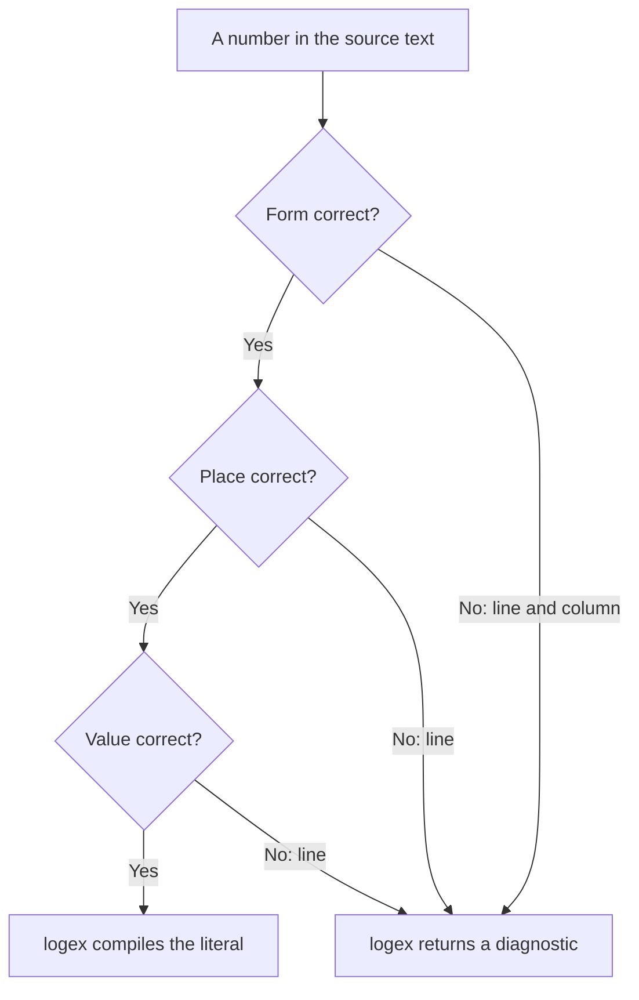

# Literals

This page is for a reader who writes a ladder [program](glossary.md#program) and looks
for the exact rule of a number in its text. A number in the source text is a
[literal](glossary.md#literal). The page defines the 3 forms of a literal, the places
where a literal can go and the values that are correct in each place.

| Question | Part of this page |
|---|---|
| Is this text a number? | [The forms of a literal](#the-forms-of-a-literal) |
| Can a number go in this place? | [Where a literal can go](#where-a-literal-can-go) |
| Is this value correct for the [tag](glossary.md#tag)? | [The type of the place](#the-type-of-the-place) |
| Which rule does this message come from? | [Wrong literals and their diagnostics](#wrong-literals-and-their-diagnostics) |
| Does logex have this form of [IEC 61131-3](glossary.md#iec-61131-3) or of [Logix](glossary.md#logix)? | [Forms that logex does not have](#forms-that-logex-does-not-have) |

These pages define the other rules of a number:

| Subject | Page |
|---|---|
| The spaces between a literal and the next word | [Source syntax](source-syntax.md#rungs) |
| A [subscript](glossary.md#subscript) and the number of a [bit](glossary.md#bit) in a name | [Source syntax](source-syntax.md#names) |
| The range of each [type](glossary.md#type), and the [initial value](glossary.md#initial-value) of a tag | [Declarations and types](declarations-and-types.md) |
| The [operands](glossary.md#operand) of each [instruction](glossary.md#instruction) | [Instruction cheatsheet](cheatsheet.cheatmd) |
| A number in a [configuration file](glossary.md#configuration-file) | [Configuration file](configuration-file.md) |

If a literal breaks a rule of this page, logex returns a
[diagnostic](glossary.md#diagnostic).
[Wrong literals and their diagnostics](#wrong-literals-and-their-diagnostics) shows 57
wrong texts. For each text, it shows each message that logex returns. A part of this
page that has wrong texts ends with their numbers.

## The forms of a literal

A literal has 1 of these 3 forms.

<!-- unchecked: the 3 forms of a literal, not a text that logex reads -->
```text
[-]<digits>                           an integer literal
16#<digits>   or   2#<digits>         a based integer literal
[-]<digits>.<digits>[e[-]<digits>]    a real literal
```

`<digits>` is 1 or more digits. A part in square brackets is optional. The integer
literal and the based integer literal are the 2 integer forms. This table gives examples
of each form.

| Form | Examples | Values |
|---|---|---|
| [Integer literal](#integer-literal) | `12`, `-120`, `30_000`, `007` | 12, -120, 30000, 7 |
| [Based integer literal](#based-integer-literal) | `16#00ff`, `16#FF`, `2#0000_0101` | 255, 255, 5 |
| [Real literal](#real-literal) | `60.0`, `-0.25`, `1.5e3`, `2.5E-3` | 60.0, -0.25, 1500.0, 0.0025 |

### Rules that are the same for each form

| Item | Rule |
|---|---|
| The end of a literal | Put a space or a tab between a literal and the next word. A letter or `_` straight after the last digit is an error: `move 5U trim` names `5U`. |
| The sign | `-` comes straight before the first digit: `-120`. Put a space or a tab before the sign. `move 5-3 trim` is an error that names `5-3`. `ote a-5` is an error that names `a-5`. `- 5` is an error also. |
| No `+` sign | A literal has no `+` sign. `+5` is an error, and `1.5e+3` is an error. |
| Subtraction | A sign does not subtract. The instruction `sub` subtracts: `sub trim 3 trim`. |
| `_` between digits | 1 `_` can come between 2 digits: `30_000`, `-1_000`, `2#0000_0101`, `1_000.25`. It does not change the value. |
| `_` in each other position | An error: `1__0`, `1_`, `16#_ff`, `1_.5`. A word that starts with `_` is a name: `_1` is not a literal. |
| A leading 0 | A literal can start with 1 or more 0 digits: `007` is 7, and `-0` is 0. |
| Capital letters | The digits `a` to `f` of base 16 and the `e` of an exponent can be capital letters: `16#FF`, `2.5E-3`. |
| The type | [The type of the place](#the-type-of-the-place) gives the type of a literal. |
| The length | A literal has 10,000 characters or fewer. [Limits](#limits) gives the rules. |

### Integer literal

| Part | Rule |
|---|---|
| Form | Digits. A `-` can come before the first digit. |
| Sign | `-` or no sign |
| Digits | 1 or more of the digits `0` to `9` |
| `_` | Between 2 digits |
| Value | The digits are a number in base 10. |
| Range | The form has no range. The range comes from the type of the place. |
| Examples | `12`, `-120`, `30_000`, `007`, `-0` |
| Not an integer literal | `+5`, `5U`, `5L`, `1__0`, `1_`, `_1` |

Wrong texts 1 to 6 show the [diagnostics](#the-diagnostics) of these rules.

### Based integer literal

| Part | Rule |
|---|---|
| Form | The base, then `#`, then digits: `16#ff`, `2#1010` |
| Base | 16 or 2, and no other base. Write the base as `16` or `2` exactly: `016#ff` is an error. |
| Sign | No sign. `-16#1` and `16#-1` are errors. The value is 0 or more. |
| Digits | 1 or more digits of the base. Base 16 has the digits `0` to `9`, `a` to `f` and `A` to `F`. Base 2 has the digits `0` and `1`. |
| `_` | Between 2 digits. A `_` straight after `#` is an error: `16#_ff`. |
| Value | The digits are a number in the base. `16#ffff` is 65535 in each place. |
| Range | The form has no range. The range comes from the type of the place. |
| Examples | `16#00ff`, `16#FF`, `16#ffff_ffff`, `2#0000_0101` |
| Not a based integer literal | `8#17`, `-8#17`, `10#5`, `0x1f`, `16#ff#`, `16#fg`, `2#102`, `16#ff.3` |

> #### `16#ffff` is 65535 in each place {: .info}
>
> logex does not change the value of a based integer literal for a signed type. The
> literal `16#ffff` is 65535, and the largest value of an `int` is 32767. Thus
> `move 16#ffff trim` is an error if `trim` is an `int`. A Logix controller writes -1
> for the same text. In logex, `move -1 trim` writes the same 16 bits into the `int`.
> `move 16#ffff count` is correct if `count` is a `uint`, and it writes 65535.

[Use bit strings](../howto/use-bit-strings.md) shows how to write a pattern of bits to a
tag. Wrong texts 7 to 14 show the [diagnostics](#the-diagnostics) of these rules.

### Real literal

| Part | Rule |
|---|---|
| Form | Digits, then `.`, then digits. An exponent can come after them. |
| Sign | `-` or no sign before the first digit. `-` or no sign before the digits of the exponent. |
| Digits | 1 or more digits before the `.`, and 1 or more digits after it. `1.` and `.5` are errors. |
| Exponent | `e` or `E`, then 1 or more digits. The exponent is a power of 10: `1.5e3` is 1500.0. A literal with an exponent must have a `.`: `1e5` is an error, and `1.0e5` is correct. |
| `_` | Between 2 digits, in each group of digits: `1_000.25`, `1.5e1_0` |
| Value | The text is a decimal number. `-0.0` is 0.0. logex then changes the value to the nearest value of the type of the place. |
| Range | A real literal that is too large for an `lreal` is an error of form in each place: `1.0e309`. The largest value of an `lreal` is 1.7976931348623157e308. The exponent is from -9999 to 9999. |
| Examples | `60.0`, `-0.25`, `1.5e3`, `2.5E-3`, `1.0e-5` |
| Not a real literal | `1.`, `.5`, `1e5`, `1.5e+3`, `1.5e`, `1.5L`, `1.5.2` |

[Values of each type](#values-of-each-type) gives the exact limits of a real literal.
[A real literal in a real type](#a-real-literal-in-a-real-type) gives the rules of the
nearest value. Wrong texts 15 to 21 show the [diagnostics](#the-diagnostics) of the
rules of form.

### An example program

The program `fan_drive.ld` has a literal of each form. It is the file
`examples/literals/fan_drive.ld` of the repository. The program reads the status word
and the frequency of a fan drive. It also reads the photoelectric sensor of a conveyor,
the eye.

<!-- file: literals/fan_drive.ld -->
```text
var_input  eye     bool
var_input  status  word
var_input  hz      real
var_output fault   bool
var_output fast    bool
var_output jam     bool
var_output rpm     real
var_output trim    int
var        mask    word 16#00ff
var        code    word
var        blocked ton

// the low byte of the status word is the fault code of the fan drive
and status mask code
eq code 2#0000_0101 ote fault
// the fan turns 60 times in 1 minute for each Hz
mul hz 60.0 rpm
gt rpm 1.5e3 ote fast
xic fast move -120 trim
xio fast move 0 trim
// a box that stays at the eye for 30 s is a jam
xic blocked.dn ote jam
xic eye ton blocked 30_000
```

| Line | Literal | Form and place |
|---|---|---|
| 9 | `16#00ff` | A based integer literal of base 16. It is the initial value of `mask`. |
| 15 | `2#0000_0101` | A based integer literal of base 2, with `_`. It is an operand of the comparison `eq`. |
| 17 | `60.0` | A real literal. It is an operand of `mul`. |
| 18 | `1.5e3` | A real literal with an exponent. It is an operand of the comparison `gt`. |
| 19 | `-120` | An integer literal with a sign. It is the first operand of `move`. |
| 20 | `0` | An integer literal. It is the first operand of `move`. |
| 23 | `30_000` | An integer literal with `_`. It is the [preset](glossary.md#preset) of the [timer](glossary.md#timer) `blocked`. |

This drawing shows the 8 [rungs](glossary.md#rung) of `fan_drive.ld`. Each literal is an
operand in the box of its instruction, with the characters of the source text.

<!-- rung: literals/fan_drive.ld -->


The script `literals.exs` compiles `fan_drive.ld` and does 1
[scan](glossary.md#scan). It gives the program the status word 4613, which is `16#1205`,
and a frequency of 30.0 Hz. Then it prints 6 tags and the preset of the timer. The
script is in the directory `examples` of the repository.

```elixir
{:ok, fan_drive} = Logex.compile_file("literals/fan_drive.ld")

inputs = %{"eye" => 1, "status" => 4613, "hz" => 30.0}
state = Logex.Runtime.put_inputs(fan_drive, Logex.Runtime.instance(fan_drive), inputs)
{_outputs, state} = Logex.Runtime.scan(fan_drive, state)

for name <- ["mask", "code", "fault", "rpm", "fast", "trim"] do
  IO.puts("#{String.pad_trailing(name, 11)} #{inspect(state.env[name])}")
end

IO.puts("blocked.pre #{state.env["blocked"]["pre"]}")
```

```console
$ mix run literals.exs
mask        255
code        5
fault       1
rpm         1800.0
fast        1
trim        -120
blocked.pre 30000
```

| Printed line | What it shows |
|---|---|
| `mask 255` | The value of `16#00ff` is 255. |
| `code 5`, `fault 1` | The low 8 bits of `16#1205` are 5. The value of `2#0000_0101` is 5 also. Thus the comparison is true. |
| `rpm 1800.0` | The program multiplies 30.0 by the literal `60.0`. |
| `fast 1` | The value of `1.5e3` is 1500.0, and 1800.0 is more than 1500.0. |
| `trim -120` | `fast` is 1. Thus the program moves the literal `-120` into `trim`. |
| `blocked.pre 30000` | The value of `30_000` is 30000. The preset of a `ton` timer is a time in ms. |

The other examples of this page use the tags of `fan_drive.ld` and these tags.

| Tag | Declaration |
|---|---|
| `count` | `var_output count uint` |
| `flow` | `var_output flow lreal` |
| `level` | `var_input level dint` |
| `cure` | `var cure ton_ltime`, which is a timer with a preset in ns |
| `boxes` | `var boxes ctu_int`, which is a [counter](glossary.md#counter) |
| `s1` | `var s1 seal`, which is an [instance](glossary.md#instance) of the [function block](glossary.md#function-block) `seal` |

The function block `seal` has the `var_input` tags `start` and `stop` and the
`var_output` tag `run`. [The script](#the-script) has these declarations.

## How logex checks a literal

logex does 3 checks of each literal, in this sequence.



Figure: the 3 checks of a literal. logex returns a diagnostic for a check that fails.

The diagram shows that only the diagnostic for an error of form has a column.

> #### Note {: .info}
>
> logex returns 1 diagnostic for the first error of form in a file. It does not show the
> other errors of that file. Correct the error and compile again to see them.

| Check | Rules | Result |
|---|---|---|
| 1. The form | [The forms of a literal](#the-forms-of-a-literal), [Limits](#limits) | 1 diagnostic, for the first error of form in the file. It has the line and the column of the literal. |
| 2. The place | [Where a literal can go](#where-a-literal-can-go) | A diagnostic with the line, for each error |
| 3. The value | [The type of the place](#the-type-of-the-place), [Literals that logex refuses for an instruction](#literals-that-logex-refuses-for-an-instruction) | A diagnostic with the line, for each error |

A program can [compile](glossary.md#compile) and get a [warning](glossary.md#warning)
for a literal. [Warnings for a literal](#warnings-for-a-literal) gives these warnings.
[Diagnostics](diagnostics.md) gives the form of a diagnostic.

## Where a literal can go

| Place | Example | Forms |
|---|---|---|
| An operand that an instruction reads as a value | `move -120 trim`, `gt rpm 1.5e3 ote fast` | Each form |
| The preset of a timer or of a counter | `xic eye ton blocked 30_000` | The 2 integer forms |
| An operand of `cal` that goes to a `var_input` of the function block | `cal s1 1 0 fault` | Each form |
| An initial value in a [declaration](glossary.md#declaration) | `var mask word 16#00ff` | Each form |
| The size of an [array](glossary.md#array) | `var weights int[8]` | The 2 integer forms |
| A subscript, and the number of a bit in brackets | `weights[3]`, `status.[16#4]` | The 2 integer forms |

This table gives the operands that can be a literal.

| Instructions | Operands |
|---|---|
| `move` | The first operand |
| `add`, `sub`, `mul`, `div`, `mod` | The first operand and the second operand |
| `neg`, `abs`, `sqrt` | The first operand |
| `eq`, `ne`, `lt`, `gt`, `le`, `ge` | The 2 operands |
| `and`, `or`, `xor` | The first operand and the second operand |
| `not` | The first operand |
| `shl`, `shr`, `rol`, `ror` | The first operand, and the second operand, which is the count |
| A conversion, for example `dint_to_int` or `real_trunc_int` | The first operand |
| `ton`, `tof`, `tp`, `rto`, `ctu`, `ctd` | The second operand, which is the preset. It is always a literal. |
| `cal` | Each operand that goes to a `var_input` of the function block. In `cal s1 1 0 fault`, the literals `1` and `0` go to `start` and `stop`. |

A literal cannot go in these places.

| Place | Wrong text | Diagnostic |
|---|---|---|
| The operand of a [contact](glossary.md#contact), of a [coil](glossary.md#coil) or of a [one-shot](glossary.md#one-shot) | `xic 1 ote fault` | `` `xic` expects a tag, found `1` `` |
| The tag that an instruction writes | `move 5 6` | `` `move` expects a tag, found `6` `` |
| The instance that an instruction runs | `xic eye ton 5 30_000` | `` `ton` expects a ton or ton_ltime, found `5` `` |
| A [label](glossary.md#label) | `jmp 5` | `` `jmp` expects a label, found `5` `` |
| An operand of `cal` that gets the value of a `var_output` | `cal s1 eye 0 1` | ``operand 3 of `cal s1` is `run` (var_output bool), which it writes: found `1` `` |
| The place of a [mnemonic](glossary.md#mnemonic) | `move 5 trim 6` | ``expected an instruction, found `6` `` |

A tag cannot be a preset: `xic eye ton blocked level` is an error. To set the preset of
a timer from a tag, write to the [member](glossary.md#member) `pre` on an earlier rung:
`move level blocked.pre`. For a counter, the member is `pv`: `move trim boxes.pv`.

[Initial values](declarations-and-types.md#initial-values) and
[Arrays](declarations-and-types.md#arrays) give the rules of a literal in a declaration.
[Element](source-syntax.md#element) and [Bit](source-syntax.md#bit) give the rules of a
literal in a name. Wrong texts 22 to 27 show the [diagnostics](#the-diagnostics) of the
places.

## The type of the place

A literal has no type. logex takes the type from the place of the literal. The literal
must be a value of that type. The last column of the table gives the first words of the
diagnostic for a wrong value.

| Place | Type | Diagnostic |
|---|---|---|
| The first operand of `move` | The type of the tag that `move` writes | `` `move` writes `16#ffff` into `trim`, an int `` |
| An operand of `add`, `sub`, `mul`, `div`, `mod`, `neg`, `abs` or `sqrt` | The type of the tag that the instruction writes | `` `add` computes in `count`'s type, a uint `` |
| An operand of `and`, `or`, `xor` or `not`, and the first operand of `shl`, `shr`, `rol` or `ror` | The type of the tag that the instruction writes | `` `and` computes in `code`'s type, a word `` |
| The count of `shl`, `shr`, `rol` or `ror` | No type. The count is a literal of an integer form. | `` `shl` reads an integer `` |
| An operand of `eq`, `ne`, `lt`, `gt`, `le` or `ge`, if the other operand is a tag | The type of the tag | `` `eq` compares `65536` with `count`, a uint `` |
| An operand of `eq`, `ne`, `lt`, `gt`, `le` or `ge`, if the other operand is a literal | No type. [Comparison of 2 literals](#comparison-of-2-literals) gives the rules. | `` `eq` reads a number or a bit string `` |
| The first operand of a conversion | The type at the start of the mnemonic: a `dint` in this row | `` `dint_to_int` reads a dint `` |
| An operand of `cal` | The type of the `var_input` | ``operand 1 of `cal s1` is `start` (var_input bool)`` |
| A preset | [Presets](#presets) gives the range. | `` `ton` takes a preset of `` |
| An initial value | The type of the tag. [Initial values](declarations-and-types.md#initial-values) gives the rules. | `` `mask` is a word `` |

The count of a shift is from 0 to 18446744073709551615. A member, a bit and an
[element](glossary.md#element) have a type also. `move 2 code.3` is an error, because a
bit is a `bool`.

### Values of each type

The first table gives the literals of an integer form that are correct for each
[elementary type](glossary.md#elementary-type). The second table gives the other rules
and the rules for a real literal.

| Type | Literal of an integer form |
|---|---|
| `bool` | 0 or 1 |
| `sint` | -128 to 127 |
| `int` | -32768 to 32767 |
| `dint` | -2147483648 to 2147483647 |
| `lint` | -9223372036854775808 to 9223372036854775807 |
| `usint` | 0 to 255 |
| `uint` | 0 to 65535 |
| `udint` | 0 to 4294967295 |
| `ulint` | 0 to 18446744073709551615 |
| `byte` | 0 to 255 |
| `word` | 0 to 65535 |
| `dword` | 0 to 4294967295 |
| `lword` | 0 to 18446744073709551615 |
| `real` | Each integer that a `real` holds exactly |
| `lreal` | Each integer that an `lreal` holds exactly |

| Item | Rule |
|---|---|
| A `bool` | The value is 0 or 1 in each integer form: `1`, `01`, `16#1`, `2#1`. The words `true` and `false` are not literals. |
| A [bit string](glossary.md#bit-string) | The value is 0 or more. `move -1 code` is an error if `code` is a `word`. An integer literal is correct: `and status 255 code`. |
| A real literal for a `bool`, an integer type or a bit string type | Always an error, also if the value is a whole number: `move 1.0 trim` |
| A literal of an integer form for a `real` | Each integer from -16777216 to 16777216 is correct. An integer outside this range is correct only if a `real` holds it exactly: `16777218` is correct, and `16777217` is an error. |
| A literal of an integer form for an `lreal` | Each integer from -9007199254740992 to 9007199254740992 is correct. An integer outside this range is correct only if an `lreal` holds it exactly: `9007199254740994` is correct, and `9007199254740993` is an error. |
| A real literal for a `real` or an `lreal` | Each literal that is in the range of the type and is not too near 0.0 is correct. |
| The largest real literal for a `real` | The largest value of a `real` is 3.4028234663852886e38. `3.4028235e38` is correct, because its nearest `real` value is that largest value. `3.4028236e38` is an error. |
| The largest real literal for an `lreal` | The largest value of an `lreal` is 1.7976931348623157e308. `1.7976931348623158e308` is correct, because its nearest `lreal` value is that largest value. `1.7976931348623159e308` is an error of form. |
| A negative real literal | The same limits apply to a negative literal: `-3.4028236e38` and `-1.0e-38` are errors for a `real`. |
| The smallest positive value | The smallest value of a `real` that is more than 0.0 is 1.1754943508222875e-38. For an `lreal`, it is 2.2250738585072014e-308. |
| A real literal that is too near 0.0 | logex changes the literal to the nearest floating-point number of 32 bits for a `real`, or of 64 bits for an `lreal`. If the literal is not 0.0 and that number is nearer 0.0 than the smallest positive value, the literal is an error. `1.0e-40`, `1.0e-38` and `1.1754942e-38` are errors for a `real`. `1.0e-400`, `1.0e-310` and `2.2e-308` are errors for an `lreal`. |
| A real literal near the smallest positive value | `1.1754944e-38` and `1.1754943e-38` are correct for a `real`, because their nearest `real` value is the smallest positive value. |
| 0.0 | `0.0`, `-0.0` and `0.0e-400` are 0.0. They are correct for each real type. |

[Elementary types](declarations-and-types.md#elementary-types) gives the range of each
type. Wrong texts 28 to 38 and 43 show the [diagnostics](#the-diagnostics) of these
rules.

### Comparison of 2 literals

| Item | Rule |
|---|---|
| A literal of an integer form | From -9223372036854775808 to 18446744073709551615. These numbers are the smallest value and the largest value of the integer types. |
| A real literal | The literal is an `lreal` value. A real literal that is too near 0.0 for an `lreal` is an error. |
| The result | The comparison compares the 2 values: `eq 5 5.0` is true. The result is the same in each scan, and logex gives a warning. |

Wrong texts 39 to 42 show the [diagnostics](#the-diagnostics) of a comparison.

### Presets

The range and the unit of a preset come from the type of the instance.

| Instance type | Preset |
|---|---|
| `ton`, `tof`, `tp`, `rto` | 0 to 2147483647, in ms |
| `ton_ltime`, `tof_ltime`, `tp_ltime`, `rto_ltime` | 0 to 9223372036854775807, in ns |
| `ctu`, `ctd`, `ctud`, and the same types with `_dint` | A count from -2147483648 to 2147483647 |
| `ctu_int`, `ctd_int`, `ctud_int` | A count from -32768 to 32767 |
| `ctu_lint`, `ctd_lint`, `ctud_lint` | A count from -9223372036854775808 to 9223372036854775807 |
| `ctu_udint`, `ctd_udint`, `ctud_udint` | A count from 0 to 4294967295 |
| `ctu_ulint`, `ctd_ulint`, `ctud_ulint` | A count from 0 to 18446744073709551615 |

| Item | Rule |
|---|---|
| Form | A literal of an integer form: `30_000`, `16#ff`. A real literal is an error. |
| A timer | The preset is 0 or more. logex has no literal of time, and a preset is a number of ms or of ns. |
| A counter | The preset is a value of the type of the count. It can be negative for a signed type. |
| The mnemonic | The range does not come from the mnemonic. `ton` runs a `ton` timer and a `ton_ltime` timer. |

[Function block types](declarations-and-types.md#function-block-types-timers-counters-and-blocks)
gives the types of timers and counters. Wrong texts 44 to 47 show the
[diagnostics](#the-diagnostics) of a preset.

## A real literal in a real type

A `real` is a floating-point number of 32 bits. An `lreal` is a floating-point number of
64 bits. A real literal becomes the nearest value of the type of its place.

| Item | Rule |
|---|---|
| A real literal for a `real` | The value is the nearest `real` value. `move 37.1 rpm` writes `37.099998474121094` if `rpm` is a `real`. |
| A real literal for an `lreal` | The value is the nearest `lreal` value. `move 37.1 flow` writes `37.1` if `flow` is an `lreal`. |
| The same literal in 2 instructions | The literal has the same value in each place of the same type. After `move 37.1 rpm`, the comparison `eq rpm 37.1` is true. |
| The same literal in 2 types | After `move 37.1 rpm` and `move 37.1 flow`, the comparison `eq rpm flow` is false. The 2 tags hold different values. |
| A conversion | The literal has the first type of the mnemonic. `real_to_lreal 37.1 flow` writes `37.099998474121094`. |
| The type | [The type of the place](#the-type-of-the-place) gives the type for each place. |
| The value that the [host](glossary.md#host) sees | The host reads a `real` tag as a floating-point number of 64 bits, and Elixir prints `37.099998474121094`. A message of logex shows the shortest literal for the same value: `37.1`. The 2 texts are the same `real` value. |

logex gives a warning for a real literal that has more digits than the type of its place
holds.

| Item | Rule |
|---|---|
| The warning | logex gives no warning if the literal is exactly a value of the type: `0.5`. logex gives no warning if the literal is the same number as the shortest literal for its nearest value: `0.1`, `0.10`. logex gives the warning for each other real literal. |
| The message | It shows the shortest literal for the value: ``warning: `16777217.0` is more precise than a real keeps: it is held as 16777216.0`` |
| Literals that get the warning | `16777217.0`, `0.1234567891`, `37.10000001` and `37.099998474121094` for a `real`. `0.12345678901234567890` for an `lreal`. The exact `real` value that is nearest to 37.1 has more digits than `37.099998474121094`. |
| Literals that do not get the warning | `0.1`, `0.10`, `37.1` and `1.0e-1` for a `real`. Each of them is the shortest literal for its value, or is the same number as that shortest literal. `0.5` is exactly a `real` value. |
| A comparison of 2 literals | logex does not give this warning. |
| The result | The program compiles. The tag gets the nearest value of its type. |
| An initial value | logex gives the same warning for a real literal that is an initial value. [Initial values](declarations-and-types.md#initial-values) gives the rule. |

[Values of each type](#values-of-each-type) gives the real literals that are errors, and
wrong texts 32 to 35 show their [diagnostics](#the-diagnostics).
[Use reals](../howto/use-reals.md) shows how to calculate with real tags.
[Types and overflow](../explanation/types-and-overflow.md) gives the reasons for these
rules.

## Literals that logex refuses for an instruction

logex refuses these literals.

| Instruction | Literal | Diagnostic |
|---|---|---|
| `div`, `mod` | A divisor that is 0, in each form: `0`, `-0`, `00`, `16#0`, `0.0`, `-0.0` | `` `div` divides by the literal `0`: a zero divisor gives 0 and passes no power on every scan, so a literal one is refused `` |
| `sqrt` | A negative first operand: `-4`, `-4.0`. `-0.0` is 0.0 and is correct. | `` `sqrt` takes the root of the literal `-4.0`: a negative source gives 0.0, passes no power and raises a minor fault on every scan, so a literal one is refused `` |
| `shl`, `shr`, `rol`, `ror` | A negative count: `-1` | `` `shl` shifts by the literal `-1`: a count is never negative, so a negative literal one is refused `` |

A program with a tag in these places compiles. If the tag holds such a value in a scan,
the instruction passes no [power](glossary.md#power-flow) in that scan.
[Faults](faults.md) gives the [faults](glossary.md#fault) of `div`, `mod` and `sqrt`.
Wrong texts 48 to 51 show the [diagnostics](#the-diagnostics) of these rules.

## Warnings for a literal

A program with these literals compiles. logex gives a warning for each of them. The
last column is the number of a program of the script `literals-warnings.exs`, which
shows the message.

A long timer is a timer of a type with `_ltime`. Its preset and its members `pre` and
`acc` are times in ns. The timer counts whole ms, and 1 ms is 1000000 ns.

| Case | Example | Program |
|---|---|---|
| The 2 operands of a comparison are literals. | `eq 5 5 ote fault` | 1 |
| The first 2 operands of an arithmetic instruction, of `and`, `or`, `xor` or of a shift are literals. | `add 2 3 trim` | 2 |
| The first operand of `neg`, `abs`, `not`, `sqrt` or of a conversion is a literal. | `neg 5 trim`, `dint_to_int 40000 trim` | 3 and 4 |
| A comparison of a tag with the smallest or the largest value of its type has a result that cannot change. | `ge count 0 ote fault`, if `count` is a `uint` | 5 |
| A real literal has more digits than the type of its place holds. | `move 16777217.0 rpm` | 6 |
| The preset of a long timer is not a multiple of 1000000. | `xic eye ton cure 1500` | 7 |
| A `move`, a conversion, a comparison, `add` or `sub` has a literal and the member `pre` or `acc` of a long timer. The literal is not a multiple of 1000000. | `ge cure.acc 3000 ote fault` | 8 |

The script `literals-warnings.exs` compiles 8 programs. It prints each program with its
number. Under each program, it prints each warning that logex gives. The script is in
the directory `examples` of the repository. It divides a long message into lines of 80
characters or fewer. It is not necessary to read the script to use the warnings.

```elixir
texts = [
  "var_output fault bool\neq 5 5 ote fault",
  "var_output trim int\nadd 2 3 trim",
  "var_output trim int\nneg 5 trim",
  "var_output trim int\ndint_to_int 40000 trim",
  "var_input count uint\nvar_output fault bool\nge count 0 ote fault",
  "var_output rpm real\nmove 16777217.0 rpm",
  "var_input eye bool\nvar cure ton_ltime\nxic eye ton cure 1500",
  "var_input eye bool\nvar_output fault bool\nvar cure ton_ltime\n" <>
    "ge cure.acc 3000 ote fault\nxic eye ton cure 5000000"
]

wrap = fn message ->
  message
  |> String.split(" ")
  |> Enum.chunk_while(
    "     ",
    fn
      word, line when byte_size(line) + byte_size(word) < 80 -> {:cont, line <> " " <> word}
      word, line -> {:cont, line, "      " <> word}
    end,
    fn line -> {:cont, line, ""} end
  )
end

lines =
  for {text, number} <- Enum.with_index(texts, 1) do
    {:ok, program} = Logex.compile(text, name: "warned")
    head = " #{number}  " <> String.replace(text, "\n", "\n    ")
    [head | Enum.map(program.warnings, &wrap.(Logex.Diagnostic.format(&1)))]
  end

IO.puts(Enum.join(List.flatten(lines), "\n"))
```

```console
$ mix run literals-warnings.exs
 1  var_output fault bool
    eq 5 5 ote fault
      line 2: warning: `eq` compares two literals, `5` and `5`: its result never
      changes
 2  var_output trim int
    add 2 3 trim
      line 2: warning: `add` reads two literals, `2` and `3`: its result never
      changes
 3  var_output trim int
    neg 5 trim
      line 2: warning: `neg` reads a literal, `5`: its result never changes
 4  var_output trim int
    dint_to_int 40000 trim
      line 2: warning: `dint_to_int` reads a literal, `40000`: its result never
      changes
 5  var_input count uint
    var_output fault bool
    ge count 0 ote fault
      line 3: warning: `ge` compares `count` with `0`, and a uint holds nothing
      below `0`: its result never changes
 6  var_output rpm real
    move 16777217.0 rpm
      line 2: warning: `16777217.0` is more precise than a real keeps: it is
      held as 16777216.0
 7  var_input eye bool
    var cure ton_ltime
    xic eye ton cure 1500
      line 3: warning: `ton` gives `cure` a preset of 1500 ns, which is no whole
      number of milliseconds: a ton_ltime counts whole milliseconds, so it times
      as the next whole millisecond, 1 ms
 8  var_input eye bool
    var_output fault bool
    var cure ton_ltime
    ge cure.acc 3000 ote fault
    xic eye ton cure 5000000
      line 4: warning: `ge` compares `cure.acc` with `3000`, where `cure.acc` is
      a ton_ltime's time in nanoseconds: 3000 ns is no whole number of
      milliseconds, and a ton_ltime counts whole milliseconds
```

[Warnings](warnings.md) gives each warning of logex.

## The text of a literal that logex keeps

logex keeps the text of each literal. Each rule of this page uses only the value.

| Item | Rule |
|---|---|
| A diagnostic and a warning | The message shows the literal with the characters of the source text: `16#ffff`, `007`, `-0`. |
| The printer | `Logex.Printer.print/1` prints the tree that `Logex.Parser.parse/1` gives, as text. It prints each literal with the characters of the source text: `move 16#00ff mask`. It does not take a compiled program. `Logex.Printer` is not a part of the [host contract](glossary.md#host-contract). |
| The value | `255`, `16#ff`, `16#00ff` and `2#1111_1111` have the same value. Each rule reads them as the same. `1500.0` and `1.5e3` have the same value also. |
| An [online edit](glossary.md#online-edit) | If you change only the text of a literal and not its value, the rung does not change. The same rule applies to an initial value. The report of the edit is empty. [Online edit](online-edit.md) gives the rules. |

## Limits

| Limit | Value |
|---|---|
| The length of a literal | 10,000 characters or fewer. The sign, each `_`, the base with its `#`, the `.` and the exponent are characters of the literal. |
| The exponent of a real literal | From -9999 to 9999 |

| Item | Rule |
|---|---|
| The kind of error | Each limit is a rule of form. The diagnostic has a line and a column. |
| A long literal in a message | The diagnostic shows the first 24 characters of the literal. |
| The value | A limit is not a range of values. `0.0e10000` is an error, and its value is 0.0. The range of the value comes from the type of the place. |
| A number in a name | A literal subscript and a literal bit number have the same limit of 10,000 characters. [Names](source-syntax.md#names) gives the rule. |
| The [store](glossary.md#store) and the [forces file](glossary.md#forces-file) | logex reads the numbers of these files with the same 2 limits. [Retained values and the store](retained-values-and-store.md) and [Forcing](forcing.md) give the rules of these files. |

Wrong texts 52 and 53 show the [diagnostics](#the-diagnostics) of the limits.

## Forms that logex does not have

A reader who knows IEC 61131-3 or a Logix controller can look for these forms. logex
does not have them.

| Form | Example | What logex returns |
|---|---|---|
| A `+` sign | `+5`, `1.5e+3` | An error of form |
| A base that is not 16 or 2, for example base 8 | `8#17`, `10#5` | An error of form |
| The prefix `0x` | `0x1f` | An error of form. Write `16#1f`. |
| A suffix for the type | `5U`, `5L`, `1.5L` | An error of form |
| A type before the literal | `int#5` | `illegal character "#"` |
| A literal of time | `T#5s` | `illegal character "#"`. A preset is an integer number of ms or of ns. |
| The words `true` and `false` | `move true fault` | `` `true` is not declared ``. logex reads the word as the name of a tag. Write `1` and `0`. |
| A character and a string | `'a'` | `illegal character "'"` |

Wrong texts 1, 4, 7, 14, 18 and 20 show the [diagnostics](#the-diagnostics) of the first
4 rows. Wrong texts 54 to 57 show the diagnostics of the last 4 rows.
[What logex does not have](not-supported.md) gives the other things that logex does not
have.

## Wrong literals and their diagnostics

The script `literals-wrong.exs` compiles 57 wrong texts. It prints each text with its
number. Under each text, it prints each diagnostic that logex returns.
[The diagnostics](#the-diagnostics) shows what the script prints. To find a message,
search this page for its first words.

The script prints the wrong texts in groups. Each group starts with a line that names
its subject. This table gives the part of this page that has the rules of each group.

| Group | Wrong texts | Rules |
|---|---|---|
| Integer literals | 1 to 6 | [Rules that are the same for each form](#rules-that-are-the-same-for-each-form), [Integer literal](#integer-literal) |
| Based integer literals | 7 to 14 | [Based integer literal](#based-integer-literal) |
| Real literals | 15 to 21 | [Real literal](#real-literal) |
| Where a literal can go | 22 to 27 | [Where a literal can go](#where-a-literal-can-go) |
| The type of the place | 28 to 43 | [The type of the place](#the-type-of-the-place) |
| Presets | 44 to 47 | [Presets](#presets) |
| Literals that logex refuses for an instruction | 48 to 51 | [Literals that logex refuses for an instruction](#literals-that-logex-refuses-for-an-instruction) |
| Limits | 52 and 53 | [Limits](#limits) |
| Forms that logex does not have | 54 to 57 | [Forms that logex does not have](#forms-that-logex-does-not-have) |

Each wrong text is 1 rung. It comes after the same 14 declarations, and thus it is line
15. Wrong texts 1 to 21, 52 to 55 and 57 get a diagnostic with a column. Each other
wrong text gets a diagnostic with the line only.

### The script

The script is the file `examples/literals-wrong.exs` of the repository. It is not
necessary to read the script to use the diagnostics. logex returns each message that
this page shows.

| Item | What the script does |
|---|---|
| The declarations | The first lines of the script, between the `"""` marks, are the 14 declarations. The script puts them before each wrong text. |
| The function block | It gives the [function block type](glossary.md#function-block-type) `seal` to each program, for the instance `s1`. |
| Wrong text 52 | It makes a literal of 10,001 characters. It prints a short description of the text, not the text. |
| A long message | It divides a long message into lines of 80 characters or fewer. logex returns each message as 1 line. |

```elixir
declarations = """
var_input  eye     bool
var_input  status  word
var_input  hz      real
var_input  level   dint
var_output fault   bool
var_output code    word
var_output rpm     real
var_output flow    lreal
var_output trim    int
var_output count   uint
var        blocked ton
var        cure    ton_ltime
var        boxes   ctu_int
var        s1      seal
"""

{:ok, seal} =
  Logex.compile(
    "function_block seal\nvar_input start bool\nvar_input stop bool\nvar_output run bool\n" <>
      "( xic start | xic run ) xio stop ote run",
    name: "seal"
  )

compile = fn text -> Logex.compile(declarations <> text, name: "wrong", types: [seal]) end

groups = [
  {"Integer literals",
   [
     "move +5 trim",
     "move - 5 trim",
     "move 5-3 trim",
     "move 5U trim",
     "move 1__0 trim",
     "move 1_ trim"
   ]},
  {"Based integer literals",
   [
     "move 8#17 trim",
     "move -16#1 trim",
     "move 16#-1 trim",
     "move 16#ff# trim",
     "move 16#_ff trim",
     "move 16#fg trim",
     "move 2#102 trim",
     "move 0x1f trim"
   ]},
  {"Real literals",
   [
     "move 1. rpm",
     "move .5 rpm",
     "move 1e5 rpm",
     "move 1.5e+3 rpm",
     "move 1.5e rpm",
     "move 1.5L rpm",
     "move 1.0e309 flow"
   ]},
  {"Where a literal can go",
   [
     "xic 1 ote fault",
     "xic eye ote 1",
     "move 5 trim 6",
     "xic eye ton 5 30_000",
     "xic eye ton blocked level",
     "cal s1 eye 0 1"
   ]},
  {"The type of the place",
   [
     "move 2 fault",
     "move 16#ffff trim",
     "move -1 code",
     "move 1.0 trim",
     "move 16777217 rpm",
     "move 3.5e38 rpm",
     "move 1.0e-38 rpm",
     "move 1.0e-400 flow",
     "add count -1 count",
     "shl code 1.0 code",
     "dint_to_int 2147483648 trim",
     "eq count 65536 ote fault",
     "gt hz 1.0e-40 ote fault",
     "eq 18446744073709551616 5 ote fault",
     "gt 1.0e-310 0.0 ote fault",
     "cal s1 2 0 fault"
   ]},
  {"Presets",
   [
     "xic eye ton blocked -1",
     "xic eye ton blocked 1.5",
     "xic eye ton cure 9223372036854775808",
     "xic eye ctu boxes 40000"
   ]},
  {"Literals that logex refuses for an instruction",
   [
     "div trim 0 trim",
     "div hz -0.0 rpm",
     "sqrt -4.0 rpm",
     "shl code -1 code"
   ]},
  {"Limits",
   [
     {"move <a 1 and 10,000 zeros> flow", "move 1" <> String.duplicate("0", 10_000) <> " flow"},
     "move 0.0e10000 rpm"
   ]},
  {"Forms that logex does not have",
   [
     "move int#5 trim",
     "xic eye ton blocked T#5s",
     "move true fault",
     "move 'a' trim"
   ]}
]

shown = fn
  {text, _source} -> text
  text -> text
end

source = fn
  {_text, source} -> source
  source -> source
end

wrap = fn message ->
  message
  |> String.split(" ")
  |> Enum.chunk_while(
    "     ",
    fn
      word, line when byte_size(line) + byte_size(word) < 80 -> {:cont, line <> " " <> word}
      word, line -> {:cont, line, "      " <> word}
    end,
    fn line -> {:cont, line, ""} end
  )
end

{printed, _next} =
  Enum.map_reduce(groups, 1, fn {section, texts}, first ->
    lines =
      for {text, number} <- Enum.with_index(texts, first) do
        {:error, diagnostics} = compile.(source.(text))
        head = String.pad_leading("#{number}", 2) <> "  " <> shown.(text)
        [head | Enum.map(diagnostics, &wrap.(Logex.Diagnostic.format(&1)))]
      end

    {Enum.join(List.flatten([section | lines]), "\n"), first + length(texts)}
  end)

IO.puts(Enum.join(printed, "\n\n"))
```

### The diagnostics

```console
$ mix run literals-wrong.exs
Integer literals
 1  move +5 trim
      line 15, column 6: illegal character "+"
 2  move - 5 trim
      line 15, column 6: illegal character "-"
 3  move 5-3 trim
      line 15, column 6: missing separator before `-`: "5-3" is neither a tag
      nor a number, and a sign begins a number
 4  move 5U trim
      line 15, column 6: missing separator after integer: "5U" is neither a
      number nor a tag
 5  move 1__0 trim
      line 15, column 6: "1__0" is no number: a `_` in a number stands only
      between two digits
 6  move 1_ trim
      line 15, column 6: "1_" is no number: a `_` in a number stands only
      between two digits

Based integer literals
 7  move 8#17 trim
      line 15, column 6: "8#17" is no number: a based number is written in base
      16, `16#ff`, or base 2, `2#1010`, and logex reads no other base
 8  move -16#1 trim
      line 15, column 6: "-16#1" is no number: a based number takes no sign
 9  move 16#-1 trim
      line 15, column 6: "16#-1" is no number: a based number takes no sign
10  move 16#ff# trim
      line 15, column 6: "16#ff#" is no number: a based number holds one `#`,
      between its base and its digits, `16#ff`
11  move 16#_ff trim
      line 15, column 6: "16#_ff" is no number: a `_` in a number stands only
      between two digits
12  move 16#fg trim
      line 15, column 6: "16#fg" is no number: a number in base 16 is written
      with the digits 0 to 9 and a to f, in either case, after its `16#`
13  move 2#102 trim
      line 15, column 6: "2#102" is no number: a number in base 2 is written
      with the digits 0 and 1 after its `2#`
14  move 0x1f trim
      line 15, column 6: missing separator after integer: "0x1f" is neither a
      number nor a tag

Real literals
15  move 1. rpm
      line 15, column 6: "1." is no number: a real has digits on both sides of
      its `.`, `1.0` or `0.5`
16  move .5 rpm
      line 15, column 6: ".5" is no number: a real has digits on both sides of
      its `.`, `1.0` or `0.5`
17  move 1e5 rpm
      line 15, column 6: "1e5" is no number: a real has a `.` with digits on
      both sides before its exponent, `1.0e5`
18  move 1.5e+3 rpm
      line 15, column 6: "1.5e+3" is no number: logex takes no `+`, so an
      exponent is `e3` or `e-3`
19  move 1.5e rpm
      line 15, column 6: "1.5e" is no number: an exponent is `e` and its digits,
      `1.5e3` or `1.5e-3`
20  move 1.5L rpm
      line 15, column 6: missing separator after a real: "1.5L" is neither a
      number nor a tag
21  move 1.0e309 flow
      line 15, column 6: "1.0e309" is no number logex holds: an lreal's largest
      is 1.7976931348623157e308

Where a literal can go
22  xic 1 ote fault
      line 15: `xic` expects a tag, found `1`
23  xic eye ote 1
      line 15: `ote` expects a tag, found `1`
24  move 5 trim 6
      line 15: expected an instruction, found `6`
25  xic eye ton 5 30_000
      line 15: `ton` expects a ton or ton_ltime, found `5`
26  xic eye ton blocked level
      line 15: `ton` takes its preset as a number of milliseconds, found
      `level`: to preset `blocked` from a tag, `move level blocked.pre` on a
      rung above
27  cal s1 eye 0 1
      line 15: operand 3 of `cal s1` is `run` (var_output bool), which it
      writes: found `1`

The type of the place
28  move 2 fault
      line 15: `move` writes `2` into `fault`, a bool: only 0 or 1 fit
29  move 16#ffff trim
      line 15: `move` writes `16#ffff` into `trim`, an int: it is outside -32768
      to 32767
30  move -1 code
      line 15: `move` writes `-1` into `code`, a word: it is outside 0 to 65535
31  move 1.0 trim
      line 15: `move` writes `1.0` into `trim`, an int: it is a real, and an int
      holds only integers
32  move 16777217 rpm
      line 15: `move` writes `16777217` into `rpm`, a real: it is no value of a
      real, which holds integers exactly only to 2^24: the nearest it holds is
      16777216.0
33  move 3.5e38 rpm
      line 15: `move` writes `3.5e38` into `rpm`, a real: it is beyond a real's
      range, -3.4028234663852886e38 to 3.4028234663852886e38
34  move 1.0e-38 rpm
      line 15: `move` writes `1.0e-38` into `rpm`, a real: it is too near 0.0
      for a real, whose smallest above 0.0 is 1.1754943508222875e-38: it would
      be written as 0.0
35  move 1.0e-400 flow
      line 15: `move` writes `1.0e-400` into `flow`, an lreal: it is too near
      0.0 for an lreal, whose smallest above 0.0 is 2.2250738585072014e-308: it
      would be written as 0.0
36  add count -1 count
      line 15: `add` computes in `count`'s type, a uint: `-1` is outside 0 to
      65535
37  shl code 1.0 code
      line 15: `shl` reads an integer: `1.0` is a real, which an integer never
      is
38  dint_to_int 2147483648 trim
      line 15: `dint_to_int` reads a dint: `2147483648` is outside -2147483648
      to 2147483647
39  eq count 65536 ote fault
      line 15: `eq` compares `65536` with `count`, a uint (declared on line 10),
      which never holds it: `65536` is outside 0 to 65535
40  gt hz 1.0e-40 ote fault
      line 15: `gt` compares `1.0e-40` with `hz`, a real (declared on line 3),
      which never holds it: `1.0e-40` is too near 0.0 for a real, whose smallest
      above 0.0 is 1.1754943508222875e-38: it would be read as 0.0
41  eq 18446744073709551616 5 ote fault
      line 15: `eq` reads a number or a bit string: `18446744073709551616` is
      outside -9223372036854775808 to 18446744073709551615, every integer type's
      values
42  gt 1.0e-310 0.0 ote fault
      line 15: `gt` reads a number or a bit string, and compares two literals as
      lreals: `1.0e-310` is too near 0.0 for an lreal, whose smallest above 0.0
      is 2.2250738585072014e-308: it would be read as 0.0
43  cal s1 2 0 fault
      line 15: operand 1 of `cal s1` is `start` (var_input bool): only 0 or 1
      fit, found `2`

Presets
44  xic eye ton blocked -1
      line 15: `ton` takes a preset of 0 to 2147483647 ms, found `-1`
45  xic eye ton blocked 1.5
      line 15: `ton` takes a preset of 0 to 2147483647 ms, found `1.5`
46  xic eye ton cure 9223372036854775808
      line 15: `ton` takes a preset of 0 to 9223372036854775807 ns for a
      ton_ltime, found `9223372036854775808`
47  xic eye ctu boxes 40000
      line 15: `ctu` takes a preset of -32768 to 32767 for a counter of ints,
      found `40000`

Literals that logex refuses for an instruction
48  div trim 0 trim
      line 15: `div` divides by the literal `0`: a zero divisor gives 0 and
      passes no power on every scan, so a literal one is refused
49  div hz -0.0 rpm
      line 15: `div` divides by the literal `-0.0`: a zero divisor gives 0.0 and
      passes no power on every scan, so a literal one is refused
50  sqrt -4.0 rpm
      line 15: `sqrt` takes the root of the literal `-4.0`: a negative source
      gives 0.0, passes no power and raises a minor fault on every scan, so a
      literal one is refused
51  shl code -1 code
      line 15: `shl` shifts by the literal `-1`: a count is never negative, so a
      negative literal one is refused

Limits
52  move <a 1 and 10,000 zeros> flow
      line 15, column 6: "100000000000000000000000…" is no number logex reads:
      a number is written in at most 10000 characters, and this one has 10001
53  move 0.0e10000 rpm
      line 15, column 6: "0.0e10000" is no number logex reads: a real's exponent
      is at most 9999, `e9999` or `e-9999`

Forms that logex does not have
54  move int#5 trim
      line 15, column 9: illegal character "#"
55  xic eye ton blocked T#5s
      line 15, column 22: illegal character "#"
56  move true fault
      line 15: `true` is not declared
57  move 'a' trim
      line 15, column 6: illegal character "'"
```

## See also

- [Source syntax](source-syntax.md): the text of a program, and a literal in a name.
- [Declarations and types](declarations-and-types.md): the types, their ranges and the
  initial values.
- [Instruction cheatsheet](cheatsheet.cheatmd): each instruction and its operands.
- [Conversions](conversions.md): the typed conversions, for example `dint_to_int`.
- [Diagnostics](diagnostics.md) and [Warnings](warnings.md): the messages of logex.
- [Read a diagnostic](../howto/read-diagnostics.md): how to find and correct an error.
- [Use reals](../howto/use-reals.md) and
  [Use bit strings](../howto/use-bit-strings.md): how to use real tags and bit strings.
- [Choose integer widths and convert](../howto/choose-integer-widths-and-convert.md):
  how to use the integer types.
- [Types and overflow](../explanation/types-and-overflow.md): why a literal has the
  type of its place.
- [The dialect and IEC 61131-3](../explanation/the-dialect-and-iec.md): why logex has
  these forms.
- [What logex does not have](not-supported.md): the forms and the types that logex does
  not have.
- [Glossary](glossary.md): the technical words of logex.
