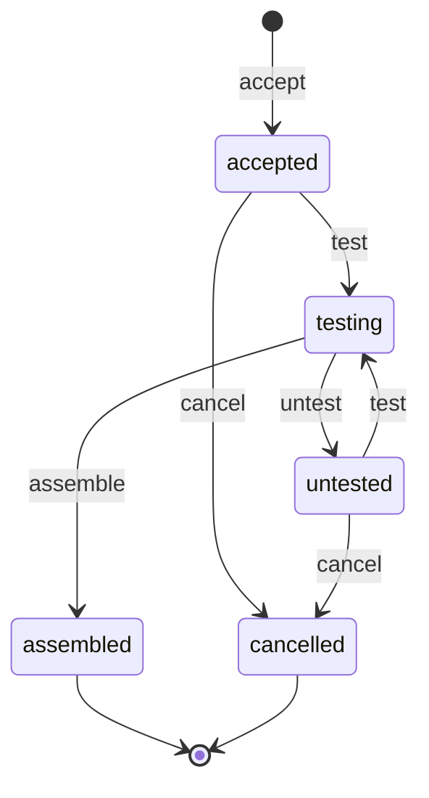
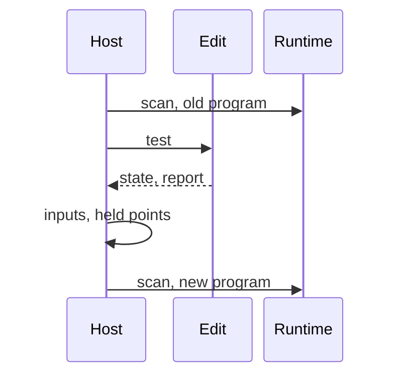

# Online edit

This page is for an Elixir developer or a controls engineer who changes a running
[program](glossary.md#program) and must know the exact result. It gives the rules of an
[online edit](glossary.md#online-edit): the steps, and what each step keeps and starts
again. It also gives what logex refuses, each kind of entry in a report and each message.

An online edit changes the program of an [instance](glossary.md#instance), or the
[configuration](glossary.md#configuration) of a [resource](glossary.md#resource), with no
[restart](glossary.md#restart). The instance keeps its [state](glossary.md#state). 3 modules
do the steps:

- `Logex.Edit` edits 1 instance that the [host](glossary.md#host) scans with
  `Logex.Runtime`.
- `Logex.Configuration.Edit` edits the configuration that a resource runs.
- `Logex.Runner` does the steps of `Logex.Configuration.Edit` for the
  [plant](glossary.md#plant) that a [runner](glossary.md#runner) runs.

> #### Warning {: .warning}
>
> Do not use logex for a [safety function](glossary.md#safety-function). An online edit
> changes the logic while the machine runs. Before each step, make sure that a wrong
> [output](glossary.md#output) cannot cause injury or damage to the machine. logex can
> stop at any time.

[The model of an online edit](../explanation/online-edit-model.md) tells why an edit
works in this way. [Edit a running program](../howto/edit-a-running-program.md) and
[Edit a running plant](../howto/edit-a-running-plant.md) give the procedures.

This page uses 2 names for the 2 programs of an edit. The old program is the program that
runs before the edit. The new program is the program that the edit puts in its place. The
messages of logex use other names: `the running program` is the old program, and `the
candidate` is the new program. The [candidate](glossary.md#candidate) of a configuration
is the new configuration.

Each rule on this page has an example that the suite runs.
[Examples](#examples), at the end of the page, gives the scripts and their output. A
reference such as "switch case 4" names a case of those scripts.

## The steps

An edit has 5 steps: [accept](glossary.md#accept), [test](glossary.md#test),
[untest](glossary.md#untest), [assemble](glossary.md#assemble) and
[cancel](glossary.md#cancel). A test and an untest are each a
[switch](glossary.md#switch).

### The functions

`Logex.Edit`, for 1 instance. `state` is the instance.

| Call | Returns |
|---|---|
| `accept(old, new, state)` | `{:ok, edit, forecast}` or `{:error, diagnostics}` |
| `test(edit, state)` | `{edit, state, report}` |
| `untest(edit, state)` | `{edit, state, report}` |
| `assemble(edit, state)` | `{program, state, report}` |
| `cancel(edit, state)` | `{program, state, report}` |

`Logex.Configuration.Edit`, for a resource. `runtime` is the resource.

| Call | Returns |
|---|---|
| `accept(runtime, new, elapsed_ms)` | `{:ok, edit, forecast}` or `{:error, diagnostics}` |
| `test(edit, runtime, elapsed_ms)` | `{edit, runtime, report}` |
| `untest(edit, runtime, elapsed_ms)` | `{edit, runtime, report}` |
| `assemble(edit, runtime)` | `{configuration, runtime, report}` |
| `cancel(edit, runtime)` | `{configuration, runtime, report}` |

`Logex.Runner`, for a runner. The runner holds the edit.

| Call | Returns |
|---|---|
| `accept(runner, new)` | `{:ok, forecast}` or `{:error, diagnostics}` |
| `test(runner)` | `{:ok, report}` |
| `untest(runner)` | `{:ok, report}` |
| `assemble(runner)` | `{:ok, report}` |
| `cancel(runner)` | `{:ok, report}` |

- `Logex.Edit.running/1` and `Logex.Configuration.Edit.running/1` return the program or
  the configuration that runs at this stage of the edit.
- `Logex.Edit.stage/1` and `Logex.Configuration.Edit.stage/1` return the stage:
  `:accepted`, `:testing` or `:untested`. A message says `under test` for `:testing`.
- `elapsed_ms` is the time in ms since the last [cycle](glossary.md#cycle) of the
  resource. It is 0 if you do not give it. [Tasks](#tasks) tells what it changes.
- The key `edit` of `Logex.Runner.status/1` gives the stage of the edit that the runner
  holds, or `nil`.

### The stages

| Step | Before | After the step |
|---|---|---|
| Accept | No open edit. A resource and a runner also take an open edit, and the accept replaces it. | The state does not change. The host runs the old program. |
| Test | `:accepted` or `:untested` | The state switches to the new program, and the host runs it. |
| Untest | `:testing` | The state switches to the old program, and the host runs it. |
| Assemble | `:testing` | The state keeps only the tags of the new program. The host runs the new program, and the edit ends. |
| Cancel | `:accepted` | The state does not change, and the report is `[]`. The host runs the old program, and the edit ends. |
| Cancel | `:untested` | The state keeps only the tags of the old program. The host runs the old program, and the edit ends. |
| Cancel | `:testing` | The cancel raises an `ArgumentError`, and nothing changes. Do an untest, then the cancel. |



Figure: the stages of an online edit. The host runs the new program in `testing` and
after the assemble. It runs the old program in `accepted`, in `untested` and after the
cancel.

The diagram shows that only the assemble keeps the new program. You can do a test and an
untest many times before the assemble or the cancel.

These rules apply to each step:

- The host does each step between 2 [scans](glossary.md#scan) of the instance, or
  between 2 cycles of the resource.
- Each step returns a report. [The report](#the-report) gives each kind of entry.
- No step compiles Elixir code.
- The accept changes nothing. Its [forecast](glossary.md#forecast) is the report of a
  test that the host does at that moment. A test that the host does later reads the
  state at that later moment.
- A switch does not restart the instance. It does not change the time of the instance,
  and it does not make the next scan a [first scan](glossary.md#first-scan).
- An edit keeps the name of the program. `Logex.compile_file/1` gives a program the name
  of its file, thus a new program in the file `motor_v2.ld` gets the name `motor_v2`.
  [Compile](glossary.md#compile) it with `Logex.compile(text, name: "motor")` to edit
  the program `motor`.
- A restart during an edit keeps the stage of the edit.

> #### Caution {: .error}
>
> - Before you remove the rung that writes `r` of a counter or of an `rto` timer, make
>   sure that `r` is 0. The switch keeps `r` at its last value, and a reset at 1 holds
>   the counter or the timer at 0 until a restart.
> - Scan only the program that `Logex.Edit.running/1` returns. logex does not detect a
>   scan of the other program, and the state becomes wrong.
> - Before a test, read the `:ons_blocked` entries of the forecast. A one-shot that the
>   switch blocks passes no [rising edge](glossary.md#rising-edge) at the next scan that
>   runs it. A button that rises at that scan gives no pulse.

The first item is edges case 3, and the last item is edges case 5.

A plain swap is a scan of a new program of the same name over the old state, with no
edit. logex does not refuse a plain swap. The state keeps each value, and logex starts
nothing and blocks nothing. The host gets no report.
[The model of an online edit](../explanation/online-edit-model.md) shows what goes wrong.

## The report

A report is a list of entries `{kind, name, value}`, with 1 entry or fewer for each kind
and name. logex sorts the list by kind, then by name. An entry names a tag or a global by
its name, and a member or a tag of an instance by its path. A global, a task and an
instance share 1 set of names.

The kinds are an open set. Your host must accept a kind that it does not know.

| Kind | What it names: its value |
|---|---|
| `:added` | Tag, member or global: the initial value at which it starts |
| `:input` | `var_input`: the value in the state. The host sends the real value before the next scan. |
| `:unread` | `var_input`: the value that it holds, 0 if the state does not hold it. The host stops sending it. |
| `:initial_changed` | Tag, element or global: `{old, new}`, the 2 initial values. The value stays. |
| `:preset` | Timer or counter: `{from, to}`, the move of `.pre` or `.pv` |
| `:preset_kept` | Timer or counter: `{pre, preset}`. `.pre` or `.pv` stays, and is not the preset of its [instruction](glossary.md#instruction) |
| `:dn_drops` | Timer or counter: `{acc, pre}` or `{cv, pv}`. The done [bit](glossary.md#bit) goes to 0 at the next run |
| `:dn_rises` | Timer or counter: `{acc, pre}` or `{cv, pv}`. The done bit goes to 1 at the next run |
| `:resumed` | Timer: the ms that the timer does not count |
| `:resume_undone` | Timer: the ms of the resume that the last switch made, which this switch gives back |
| `:ons_blocked` | Storage bit or edge memory: its value, unchanged. The next run passes no power, sets no pulse or counts no edge. |
| `:held` | `var_output` or global: the value that the host holds at the point |
| `:unwritten` | Member input: the value that it keeps |
| `:pruned` | Tag, member or global: its last value |
| `:retain_added` | Path or global: the value that it holds, which a warm restart keeps |
| `:retain_removed` | Path or global: the value that it holds, which a warm restart does not keep |
| `:instance_added` | Instance: its program type |
| `:instance_stopped` | Instance: its program type |
| `:instance_back` | Instance: its program type |
| `:instance_pruned` | Instance: its program type |
| `:holds` | `var_output` of an instance: the value of the held global, at which it starts |
| `:hold_undone` | `var_output` of an instance: the value that it had before the last switch |
| `:joined` | Tag of an instance: `{own, global}` |
| `:left` | Tag of an instance: the value of the global, which it keeps |
| `:interval` | Task: `{old, new}` in ms |
| `:next_due` | Task: `{from, to}` in ms |
| `:priority` | Task: `{old, new}` |
| `:watchdog` | Task: `{old, new}` in ms |
| `:order` | Task, `:none` or `:tasks`: the names in their new sequence |

- A switch gives each kind of the table. Each step gives `:held`.
- The assemble and the cancel give `:held`, `:pruned` and `:instance_pruned`. They give
  `:holds` only if a restart since the last switch left the `var_output` at another value
  (plant case 10).
- The first test after a second accept also gives `:pruned` and `:instance_pruned`.
- The kinds from `:instance_added` to `:order` come only from `Logex.Configuration.Edit`.
- The done bit is `.dn` of a timer, `q` of a `ctu` or a `ctd`, and `qu` of a `ctud`.
- A value of a timer, a counter or an instance is a map of its members. A value of an
  array is a list.
- `:held` names the output and the value that the host holds at its point. `:holds`
  names a `var_output` of an instance that the switch starts at the value of a held
  global.

## What the host does during an edit

### 1 instance

The host must scan, set the inputs and restart with the program that
`Logex.Edit.running/1` returns, until the edit ends. After the edit, it uses the program
that the assemble or the cancel returns. It sends only the `var_input` tags of that
program: `Logex.Runtime.put_inputs/3` refuses each other input.

| Kind of entry | What the host does |
|---|---|
| `:input` | It sends the real value of the [input](glossary.md#input) before the next scan. |
| `:unread` | It stops sending that input. |
| `:held` | It holds the [point](glossary.md#point) at the value of the entry. |
| Each other kind | Nothing. The entry is a fact or a forecast. |



Figure: 1 switch between 2 scans. `Edit` is `Logex.Edit`, and `Runtime` is
`Logex.Runtime`.

The diagram shows that the host does the step between 2 scans, and reads the report
before it scans again.

For 1 instance, logex does not detect these errors. The state can then be wrong.

- a scan of a program that `Logex.Edit.running/1` does not return
- a second accept before the edit that is open ends
- a step on an edit that ended

### A configuration

- The host does each step between 2 cycles.
- The host keeps the runtime that each step returns. `Logex.Runtime.cycle/3` runs the
  configuration that it holds.
- The host accepts a kind that it does not know.

The resource keeps its input image across each step. Each `var_input` reads its
connection. The outputs of each cycle give each held point the value that it holds.

### The runner

- Each step is a call to the runner. The runner does each step between 2 rounds. It
  holds 1 edit at a time.
- The runner does the work of the accept in the process of the caller. The rounds do not
  wait for it.
- A second accept replaces the first edit. A refused accept keeps the edit that the
  runner holds.
- After each step, the rounds read the watchdogs of the configuration that the resource
  runs.
- The runner gives the time since its last [round](glossary.md#round) as `elapsed_ms`,
  and 0 between a trip and the restart.
- The runner sends `{:edit, step, report}` for each step to each process that
  `Logex.Runner.subscribe/1` subscribes. For the accept, the report is the forecast.
- You can do a step after a [trip](glossary.md#trip), before the restart. A restart
  keeps the stage of the edit.

[The runner](runner.md) gives the rules of the rounds, the trip and the subscribers.

## What the accept refuses

The accept refuses a change that only a restart can make. It returns `{:error,
diagnostics}`, 1 [diagnostic](glossary.md#diagnostic) for each change, with the stage
`:edit`. Nothing changes, and the old program runs on. To make such a change, start the
new program or configuration again. [Execution model](execution-model.md) gives the
start and the restart, and [Retained values](retained-values-and-store.md)
tells how to keep values across them.

### A program

| Change | Message |
|---|---|
| The [type](glossary.md#type) of a [tag](glossary.md#tag) that both programs declare | `` `<tag>` is a <type> in the running program and a <type> in the candidate: a tag's type changes only with a restart `` |
| The type of a [timer](glossary.md#timer) or of a [counter](glossary.md#counter), for example `ton` to `tof` or `ton` to `ton_ltime` | The same message |
| The width of a counter, for example `ctu` to `ctu_int` | The same message |
| The size or the [element](glossary.md#element) type of an [array](glossary.md#array) | `` `<tag>` is an array of <n> <type>s in the running program and an array of <n> <type>s in the candidate: a tag's type changes only with a restart `` |
| The dimensions of an array | `` `<tag>` is an array of 2 by 4 ints in the running program and an array of 8 ints in the candidate: ... `` |
| An array changed to a tag that is not an array, or the reverse | `` `<tag>` is an array of <n> <type>s in the running program and a <type> in the candidate: ... ``, or the reverse |
| The type of a [member](glossary.md#member) of a [function block](glossary.md#function-block) | `` `<instance>.<member>` is a <type> in the running program and a <type> in the candidate: a member's type changes only with a restart `` |
| The same member in each element of an array of instances | `` `<array>[*].<member>` is a <type> in the running program and a <type> in the candidate, in every element: a member's type changes only with a restart `` |
| The [function block type](glossary.md#function-block-type) of an instance, for example `seal` to `latch` | `` `<instance>` is an instance of `<type>` in the running program and an instance of `<type>` in the candidate: a tag's type changes only with a restart `` |

- Each diagnostic has the line of the [declaration](glossary.md#declaration) in the new
  program. The diagnostics are in the sequence of their lines. A tag that the host
  declares with `Logex.Tag.new!/5` has no line, and its diagnostic comes last.
- A diagnostic of a member names the member by its path, at the line of the instance that
  holds it.
- A new program from `Logex.compile_file/1` keeps its file, and each diagnostic names it,
  for example `v2/motor.ld: line 7: ...`. A new program from `Logex.compile/2` has no
  file, and its diagnostics name none.
- A counter word and its alias are 1 type. `ctu` to `ctu_dint` is not a change.
- An instance keeps its type if the block keeps its name. It also keeps its type if each
  member that both programs declare keeps its type.

Examples: refusals cases 1 to 8 and 11.

### Changes that the accept does not refuse

| Change | What the switch does |
|---|---|
| The [section](glossary.md#section) of a tag | Keeps the value. A tag that becomes a `var_input` gets `:input`. A tag that is a `var_input` only in the program stopped gets `:unread`. A `var_output` that the program stopped writes, and that becomes another section, gets `:held`. |
| The [initial value](glossary.md#initial-value) of a tag | Keeps the value, `:initial_changed`. logex compares the 2 initial values exactly: `0` and `0.0` are different. |
| A [literal](glossary.md#literal) written in another form, for example `2000` as `16#7d0` | Nothing. logex compares a literal by its value. |
| A [warning](glossary.md#warning) in the new program | Nothing. A warning does not stop the accept. |

Examples: refusals cases 9 and 10.

### A configuration

The accept of a configuration refuses each of these changes. It also refuses each change
of [A program](#a-program) in a [program type](glossary.md#program-type) that an instance
runs in both configurations.

| Change | Message |
|---|---|
| A [task](glossary.md#task) added | `` task `<task>` is added: a task is added only with a restart `` |
| A task removed | `` task `<task>` (line <n> of the running configuration) is removed: a task is removed only with a restart `` |
| A [continuous task](glossary.md#continuous-task) made [periodic](glossary.md#periodic-task), or a periodic task made continuous | `` task `<task>` is <kind> in the running configuration and <kind> in the candidate: a task's kind changes only with a restart `` |
| The `single` of a task added, removed or changed | `` task `<task>`'s single changes from <old> to <new>: a task's single changes only with a restart ``. `<old>` or `<new>` is `` `<global>` `` or `none`. |
| The interval of an [event task](glossary.md#event-task) added or removed | `` task `<task>` has a single, and its interval is added: an event task's interval is added or removed only with a restart ``, or `is removed` |
| An instance that both configurations run with the same program type, moved to another task, to no task or from no task | `` `<instance>` runs with `<task>` in the running configuration and with `<task>` in the candidate: an instance moves to another task only with a restart `` |
| The type of a [global](glossary.md#global) | `` `<global>` is a <type> global in the running configuration and a <type> in the candidate: a global's type changes only with a restart `` |
| The size of an array global | `` `<global>` is a global array of <n> <type>s in the running configuration and an array of <n> <type>s in the candidate: a global's type changes only with a restart `` |
| A [location](glossary.md#location) moved | `` `<global>` is at `<point>` in the running configuration and at `<point>` in the candidate: located I/O changes only with a restart `` |
| A location removed or added | `` ... and has no location in the candidate: ... `` or `` `<global>` has no location in the running configuration and is at `<point>` in the candidate: ... `` |
| A [located global](glossary.md#located-global) array made longer or shorter | `` `<global>` is at `<first point>` to `<last point>` in the running configuration and at `<first point>` to `<last point>` in the candidate: located I/O changes only with a restart `` |

- An instance that the new configuration runs as another program type can go to
  another task. The switch starts it as a new instance (plant case 9).
- logex runs an instance with no task as part of the continuous task. Thus, if an
  instance has no task, to add or remove `with main` moves nothing.
- The diagnostics of the configuration come first. Each is at the line of the element in
  the file of the new configuration. An element that only the old configuration has
  comes last, with no line, and its message gives its line in the old configuration.
- The diagnostics of each program type come next. Each is in the file of its program
  type.
- A warning in the new configuration does not stop the accept.

Examples: plant cases 11 to 22.

### Connections that a switch cannot hold

A switch can hold a global through a `var_output` that no rung writes
([Held outputs and points](#held-outputs-and-points)). The accept refuses the
[connection](glossary.md#connection) of such a `var_output` in these cases, because the
hold gives a wrong value. `<who>` is `the candidate holds`, `the candidate stops
driving` or `an untest holds`.

| Connection | Message |
|---|---|
| The `var_output` has another type than its point | `` `<instance>.<output>` is an int var_output no rung of `<type>` writes, wired to `<global>`, a dint global <who>: a held point is wired to a var_output of another type only with a restart `` |
| A rung of its program reads the `var_output`, for example `xic aux ote lamp` | `` `<instance>.<output>` is a var_output no rung of `<type>` writes and line <n> of `<type>` reads, wired to `<global>`, a global <who>: holding it would change what that rung gives, so a held point is wired to a var_output a rung reads only with a restart `` |
| The new configuration also wires the `var_output` to another point | `` `<instance>.<output>` is a var_output no rung of `<type>` writes, wired to `<global>`, a global <who>, and to `<other>`: holding it would move `<other>`, so a held point is wired to a var_output that drives another point only with a restart `` |
| A connection of a kept instance that both configurations make, before the first run of the instance after a start or a restart. A rung reads the `var_output`, and the `var_output` holds another value than its point. | `` `<instance>.<output>` is a var_output no rung of `<type>` writes and line <n> of `<type>` reads, wired to `<global>`, a global <who>, and holds <value> where `<global>` holds <value> until `<instance>` first runs after a start or a restart: holding it now would change what that rung gives, so the edit is accepted only once `<instance>` has run, or with a restart `` |

- A diagnostic for the untest names the line of the connection in the old
  configuration.
- The accept does not refuse a connection of a kept instance that both configurations
  make, for its type or for the rung that reads it. The last row is the only exception.
  Such a connection holds the value of the point from the first run of the instance.
- After the first run of the instance, the accept takes the edit of the last row.

Examples: plant cases 23 to 26.

## The switch

A switch is a test or an untest. It moves the state from the program that it stops to the
program that it starts. The tables of this part use 2 names: the program started and the
program stopped. At a test, the program started is the new program. At an untest, it is
the old program.

A switch prunes nothing. A tag that only the program stopped declares stays in the state,
unused. An untest finds it again, and the assemble or the cancel removes it.

### Tags

| In the state | After the switch, and the entry |
|---|---|
| A tag that both programs declare, with the same type | Keeps its value. No entry. |
| A tag that the program started declares and the state does not hold | Starts at its initial value. A timer gets the [preset](glossary.md#preset) of the instruction that runs it. A counter gets the preset of its `ctu` or `ctd`. Entry: `:added`, with the initial value. A `var_input` gets `:input`. |
| A tag that the new program adds, if a plain swap left a value under its name | At the first test, starts at its initial value, over that value. Entry: `:added`. |
| A tag that only the program stopped declares | Stays in the state, unused. No entry. The assemble or the cancel gives `:pruned`. |
| A tag of both programs whose initial value changes | Keeps its value. The new initial value applies at the next restart. Entry: `:initial_changed`, `{old, new}`. |
| An element of an array whose initial value changes | Keeps its value. Entry: `:initial_changed`, 1 entry for each element, by its name, for example `limits[1]`. |

Examples: switch case 1, refusals case 9, edges case 12.

### Inputs and outputs

| In the state | After the switch, and the entry |
|---|---|
| A `var_input` of the program started that was not a `var_input` of the program stopped | Keeps the value of the state. Entry: `:input`, with that value. |
| A `var_input` that the state does not hold | Starts at 0. Entry: `:input`, not `:added`. |
| A `var_input` of the program stopped that is not a `var_input` of the program started | Keeps its value. Entry: `:unread`, with that value. |
| A `var_output` that the program stopped writes and that the program started does not write as a `var_output` | Keeps its value. The host holds its [point](glossary.md#point). Entry: `:held`. |

The switch holds a `var_output` when the program started removes it, gives it another
section, or writes it no more. Each step reports the held output. The assemble and the
cancel also report it. The value of the entry is 1 of these 2:

- If the program that runs next still has the tag as a `var_output`: the value in the
  state. The next scan gives this value to the host.
- If the program that runs next does not have it: the value that the point received last.
  The edit learns that value only from a scan of the program stopped. If no such scan
  ran, the step does not report the output (switch case 2).

A test, its forecast and the assemble report the outputs that the old program writes and
the new program does not. An untest, and a cancel after an untest, report the reverse.

A [rung](glossary.md#rung) can write these member inputs:

- `r`, `ld` and `pv` of a counter
- `r` of an `rto` timer
- `.pre` of a timer

If the program stopped writes such an input and the program started does not, the input
keeps its value. The switch reports it as `:unwritten`, by its path, with the value that
it keeps. A reset that stays at 1 holds its counter or timer at 0 until a restart. A
write through a tag [subscript](glossary.md#subscript), `move 2 lane_c[lane].pv`, writes
each element. Its removal gives 1 `:unwritten` entry for each element.

Examples: switch cases 1 to 3, refusals case 9, edges cases 3, 8 and 13.

### Timers

A timer that the switch starts is at its initial value. A timer that both programs declare
keeps each member, but the switch can move `.pre` and the time of the timer. If the last
switch of this edit moved `.pre`, and no rung wrote `.pre` after it, the switch puts
`.pre` back to its old value. If not, the other rows apply.

In this table, the instruction of a timer is the `ton`, `tof`, `tp` or `rto` that runs
it.

| Case | After the switch, and the entry |
|---|---|
| The edit moved `.pre` at its last switch, and no rung changed `.pre` since | `.pre` goes back to the value that the last switch found. Entry: `:preset`. |
| Both programs run an instruction on the timer, and `.pre` is the preset of the program stopped | `.pre` moves to the preset of the program started. Entry: `:preset`, `{from, to}`. |
| A rung wrote `.pre`, and `.pre` is not the preset of the program started | `.pre` stays. Entry: `:preset_kept`, `{pre, preset}`. |
| The program started runs no instruction on the timer | `.pre` stays. No entry. |
| The program started runs an instruction on the timer, and the program stopped runs none | `.pre` takes the preset of the program started. Entry: `:preset`. |
| The new `.pre` makes `.dn` 0 at the next scan with a true rung | `.dn` goes to 0 at that scan, unless the timer gets to the new `.pre` before it. Entry: `:dn_drops`, `{acc, pre}`. |
| The new `.pre` makes `.dn` 1 at the next scan with a true rung | `.dn` goes to 1 at that scan. Entry: `:dn_rises`, `{acc, pre}`. |
| The program started runs the timer, the program stopped does not, and the timer counted time at its last run | The timer continues from its accumulated time. The time of the program stopped does not count. Entry: `:resumed`, the ms that it does not count. |
| A test and an untest with no scan between them, after a resume | The resume goes back. Entry: `:resume_undone`, the ms. |

- A `tof` timer in its delay: `:dn_drops` says that `.dn` goes to 0 at its next
  run, unless that run finds its rung true.
- A `tp` timer that is in its pulse: `:dn_rises` says that the pulse ends at its next
  run.
- A `tp` timer that the edit adds while its rung is true starts no pulse at the switch.
  The switch blocks its edge memory `.en` as it blocks a one-shot, `:ons_blocked`, by its
  path, for example `p.en`.
- An `rto` timer keeps `.dn` on a [false rung](glossary.md#false-rung). Thus its `.dn`
  changes at its next run with a [true rung](glossary.md#true-rung).
- A [long timer](glossary.md#long-timer) gives each value of `.pre` and `.acc` in ns, and
  each `:resumed` in ms.
- A `jmp` that the edit adds skips its rungs from the first scan after the switch. When
  a scan runs a skipped timer again, the timer adds the skipped time to `.acc`. A `jmp`
  that the edit removes ends the skip.

Examples: switch cases 1 and 4 to 11.

### Counters

| Case | After the switch, and the entry |
|---|---|
| A counter of both programs | Keeps its count `cv` and its flags. No entry. |
| The preset of the counter changes, and no rung wrote `.pv` | `.pv` moves to the new preset. Entry: `:preset`, `{from, to}`. |
| A rung wrote `.pv` | `.pv` stays. Entry: `:preset_kept`. |
| The new `.pv` changes the done bit, `q`, or `qu` for a `ctud`, at the next run | The done bit changes at the next run of the counter, if that run does not count, reset or load. Entry: `:dn_drops` or `:dn_rises`, `{cv, pv}`. |
| The edit adds the counter, or changes its rung | The switch blocks its edge memory, `cu` or `cd`. The counter counts no edge at the next scan that runs it. Entry: `:ons_blocked`, by its path, for example `rejects.cu`. |

- A `ctd` counter has no `:dn_drops` and no `:dn_rises`: its `q` is `cv <= 0`, and no
  `.pv` changes it.
- When logex compares 2 rungs, it does not compare the presets of timers and counters.
  Thus a change of a preset alone blocks no edge memory.
- The switch resumes no counter: a counter keeps no time.

Examples: edges cases 1 to 3 and 15.

### One-shots and pulse coils

No switch writes a [storage bit](glossary.md#storage-bit). A switch blocks the
[one-shot](glossary.md#one-shot) for 1 run instead. The next scan that runs the blocked
`ons` passes no power through it, and the `ons` still writes its storage bit.

| Case | After the switch, and the entry |
|---|---|
| An `ons` that the edit adds | Blocked. Entry: `:ons_blocked`, with the value of the storage bit. |
| An `ons` whose rung the edit changes | Blocked. Entry: `:ons_blocked`. |
| An `ons` whose storage bit another instruction also writes, in the program that scanned last | Blocked. Entry: `:ons_blocked`. |
| An `ons` on a rung that the edit does not change | Not blocked. It passes a [rising edge](glossary.md#rising-edge) at the first scan after the switch. No entry. |
| A [pulse coil](glossary.md#pulse-coil) `osr` or `osf` that the edit adds, or whose rung the edit changes | Blocked: it sets no pulse at the next scan that runs it. Entry: `:ons_blocked`, by its storage bit. |
| The [pulse bit](glossary.md#pulse-bit) of a pulse coil that the edit removes | An ordinary bool. A `var_output` keeps its value, and the host holds its point. Entry: `:held`. |

- A rung stays the same rung if only these things change: its line number, a preset on
  it, or the form of a literal. Each other change makes another rung.
- The [label](glossary.md#label) and the `jmp` of a rung are part of the rung. An edit
  that adds `lbl` or `jmp` to the rung of a one-shot blocks the one-shot 1 time.
- A tag in a subscript of the rung is part of the rung.
- A one-shot on a rung that a [jump](glossary.md#jump) skips stays blocked until a scan
  runs the rung. A one-shot in a function block stays blocked until a `cal` runs the
  block.
- A blocked one-shot costs 1 rising edge: a button that rises at the first scan that runs
  the one-shot after the switch gives no pulse.
- Labels are names. An edit that moves rungs keeps each jump.
- A switch blocks no one-shot of the program that it starts, if that program scanned
  last. Its storage bits are as that program left them. Thus a test and an untest with no
  scan between them lose no rising edge.

Examples: switch case 1, edges cases 4 to 10.

### Function blocks and arrays

- A function block can change its body, the sequence of its members and their sections.
  The edit can add or remove members.
- A switch moves each member by its path, for example `s1.edge`, with the rules of a tag.
  Each entry names the member by its path.
- The switch blocks an `ons` that the edit adds or changes in a block, in each instance,
  for example `s1.edge` and `s2.edge`.
- An array keeps its type while its element type and its sizes stay. The switch moves an
  array whole, by its name.
- An entry names each element by its name, for example `lane_t[2]`. A subscript that is a
  literal in another form, `edge[16#2]`, names the same element.
- An entry gives the value of an array as a list, a list of lists for 2 dimensions.

Examples: edges cases 10, 12 and 13.

### Retention

An edit that only adds `retain` or removes it changes no value. The switch writes nothing
and reports each path whose retention changes:

- `:retain_added`, with the value that the path holds. The next
  [warm restart](glossary.md#warm-restart) keeps this value.
- `:retain_removed`, with the value that the path holds. The next warm restart does not
  keep it.

The paths follow these rules:

- A tag, an array of an [elementary type](glossary.md#elementary-type) and an instance of a built-in type are each 1
  path. The value of a timer is a map of its members with no `last`.
- A member of an instance of a function block is a path, for example `g.count`.
- A member of each element of an array of instances is 1 path with `[*]`, for example
  `gs[*].count`. Its value is the list of the values of the elements.
- `non_retain` and no [qualifier](glossary.md#qualifier) are the same.
- A tag that the new program adds with `retain` gets only `:added`.
- If an edit changes the qualifier and the type of a tag, the accept refuses the change
  of type. The message does not name the qualifier.
- The assemble and the cancel report no change of retention.

[Retained values](retained-values-and-store.md) gives the rules of
retention.

Examples: edges cases 11 and 14, plant case 5.

## Assemble and cancel

The assemble and the cancel after an untest are not switches:

- Each prunes the state to the tags of the program that it keeps. Each tag that it
  removes gets the entry `:pruned`, with its last value.
- Each reports the held outputs of the program that it keeps.
- Neither blocks a one-shot. A one-shot that the last switch blocked stays blocked until a
  scan runs it.
- Neither reports `:retain_added` or `:retain_removed`.

A cancel from the accept changes nothing and returns the report `[]`.

Examples: switch cases 1 and 2, plant cases 1, 8 and 10.

## The switch of a configuration

A switch of a configuration switches each instance of the resource in the same step. The
host cannot switch 1 instance alone. The next cycle runs the configuration that the
switch started. An instance that both configurations run with the same program type is a
kept instance. A kept instance moves by the rules of [The switch](#the-switch), and each
entry names its tags by the path of the instance, for example `c1.t1`.

### Instances

| Case | After the switch, and the entry |
|---|---|
| An instance that only the configuration started runs | Starts as `Logex.Runtime.start/1` starts it. Entry: `:instance_added`, with its program type. |
| An instance that only the configuration stopped runs | Set aside: the switch keeps its state, and no cycle runs it. Entry: `:instance_stopped`. |
| An instance set aside by an earlier switch of the edit, and run again | Comes back as it was. Each timer that counted time continues. The time while the switch keeps the instance aside does not count. Entry: `:instance_back`. |
| An instance that the new configuration runs as another program type | The switch sets the old instance aside and starts a new instance. It can run on another task. Entry: `:instance_stopped` and `:instance_added`. |

The assemble prunes each instance set aside, `:instance_pruned`.

Examples: plant cases 1, 2 and 9.

### Globals and connections

| Case | After the switch, and the entry |
|---|---|
| A global that only the configuration started declares | Starts at its initial value. Entry: `:added`. |
| A global that only the configuration stopped declares | Stays, unused. An instance that comes back finds it. No entry. The assemble gives `:pruned`. |
| A global whose initial value changes | Keeps its value until a restart. Entry: `:initial_changed`, `{old, new}`. |
| A global whose `retain` changes | Keeps its value. The switch writes nothing. Entry: `:retain_added` or `:retain_removed`. |
| A tag that becomes a `var_external` of a global | The tag loses its own value. The instance reads the global from its next scan. Entry: `:joined`, `{own, global}`. `own` is `nil` if the program stopped does not declare the tag. |
| A `var_external` that becomes a tag of the program | Keeps the value of the global as its own value. Entry: `:left`, the value. |
| A global that the configuration stopped writes and the configuration started does not write | Keeps its value. Each output point holds. Entry: `:held`. |
| A `var_input` of a kept instance | Reads its new connection at its next scan. No entry. |

No switch writes a global.

Examples: plant cases 1, 4 and 5.

### Held outputs and points

A switch holds a global when the configuration stopped writes it and the configuration
started declares it and does not write it. Each step of that direction reports it, `{:held,
global, value}`. The outputs of the next cycle give the held value to each output point.

A connection can wire a `var_output` that no rung of its program writes to a global. If
the switch holds that global, it sets the `var_output` to the value of the global,
`{:holds, path, value}`. The point then keeps its value until a rung writes the
`var_output`. If no restart occurs first, the next switch of the edit puts the
`var_output` back, `{:hold_undone, path, value}`.

The assemble and the cancel also report each held point. A restart since the last switch
can leave the `var_output` at another value than the global. The assemble and the cancel
then set it to the value of the global again, `:holds`. [Connections that a switch cannot
hold](#connections-that-a-switch-cannot-hold) gives the connections that the accept
refuses.

Examples: plant cases 8 and 10, 23 to 26.

### Tasks

| Case | After the switch, and the entry |
|---|---|
| The interval of a periodic task changes | The task is next [due](glossary.md#due) at the smaller of its old due time and the time of the step plus the new interval. Entry: `:interval`, `{old, new}`, and `:next_due`, `{from, to}` if the due time moves. |
| The [priority](glossary.md#priority) of a task changes | The next cycle reads it. Entry: `:priority`, `{old, new}`. |
| The [watchdog](glossary.md#watchdog) of a task changes | The runner reads it. The resource keeps no state for it. Entry: `:watchdog`, `{old, new}` in ms. A task with no watchdog has a watchdog of 500 ms. |
| The sequence of the instances of a task, or of the tasks, changes | The next cycle reads it. Entry: `:order`, the task and the names in their new sequence. |

- The time of a step is the time of the last cycle of the resource, plus `elapsed_ms`.
- No switch fires an event. An event task keeps the last
  [sample](glossary.md#sample) of its [trigger](glossary.md#trigger), and runs at the
  next rising edge.
- The name of an `:order` entry is a task, `:none` or `:tasks`. `:none` is for the
  instances with no task. If the configuration has a continuous task, these instances and
  the instances `with` it have 1 sequence, under the name of the continuous task. `:tasks`
  is for the sequence of the [timed tasks](glossary.md#timed-task).

Examples: plant cases 1 and 3.

### A second edit and a restart

- The resource counts the steps of its edits. This count is its generation. Each step
  adds 1 to the generation, except the accept. A cancel from the accept also adds 1.
- A step on an edit that ended, or on an edit that another edit stepped past, finds
  another generation and raises an `ArgumentError`.
- An edit accepted while another edit is open replaces it. At its first test, the switch
  first drops what the earlier edit left: each instance set aside, `:instance_pruned`,
  and each unused global, `:pruned`. An instance or a global that the new configuration
  names again starts as new.
- A restart during an edit restarts the instances that the resource runs. It drops the
  instances set aside and the globals of the other configuration only. It keeps the
  generation and the stage. The next switch starts again what the restart dropped,
  `:instance_added` and `:added`.

Examples: plant cases 6, 7 and 10.

## Wrong arguments

A wrong argument raises an `ArgumentError`. A step checks the edit first, then the state
or the runtime, then the stage. This list gives each error and its message.

- The new program has another name:
  `` the candidate is `<new>`, but the running program is `<old>`: an edit keeps the program's name ``
- The new program is not a program:
  `expected a %Logex.Program{} from Logex.compile/2, got: <value>`
- A function block type in the place of a program:
  `` `<type>` is a function block type, which runs inside a program through `cal`: an instance is of a %Logex.Program{} ``
- An argument that is not an edit of 1 instance:
  `expected a %Logex.Edit{} from Logex.Edit.accept/3, got: <value>`
- A step that the stage does not take:
  `<step> takes an edit <stage>, but this one is <stage>`
- A state of another program:
  `` this state is an instance of `<other>`, not of `<program>` ``
- An input that the program declares in another section:
  `` input `<tag>` is a <section> (declared on line <n>), not a var_input: only a var_input is set from outside ``
- An input that the program does not declare:
  `` input `<tag>` is not declared ``, then the nearest name, the list `` : the var_inputs are `<tag>`, `<tag>` ``, or `: this program has no var_input`
- The new configuration has another name:
  `` the candidate is `<new>`, but the running configuration is `<old>`: an edit keeps the configuration's name ``
- An `elapsed_ms` that is not an integer of 0 or more:
  `elapsed_ms must be a non-negative integer of milliseconds, got: <value>`
- An argument that is not an edit of a configuration:
  `expected a %Logex.Configuration.Edit{} from Logex.Configuration.Edit.accept/2, got: <value>`
- A step on a resource that runs another configuration:
  `this edit is of another configuration than the one the resource runs: accept the candidate against this resource`
- A step on an edit of a configuration that ended:
  `this edit expects the resource at generation <n>, but it is at generation <m>: the edit has ended, or another edit has stepped since`
- A step on a runner that holds no edit:
  `the runner holds no edit: <step>/1 is a step of the edit accept/2 accepts`
- An accept of the runner with no configuration:
  `expected a %Logex.Configuration{} from Logex.Configuration.new!/1, got: <value>`

A program that the host changed after it compiled, or a configuration that
`Logex.Configuration.check/1` refuses, raises the messages of `Logex.Runtime` at the
accept. [The host contract](host-contract.md) gives these messages.

```elixir
alias Logex.Runner
alias Logex.Runner.Clock.Manual
alias Logex.IO.Sim

# Each call is a wrong argument. The script prints the message of each ArgumentError.
raised = fn label, call ->
  try do
    call.()
  rescue
    error in ArgumentError -> IO.puts(String.pad_trailing(label, 22) <> error.message)
  end
end

lamp = "var_input go bool\nvar_output lamp bool\nxic go ote lamp"
{:ok, line} = Logex.compile(lamp, name: "line")
{:ok, other} = Logex.compile(lamp, name: "other")

{:ok, seal} =
  Logex.compile("function_block seal\nvar_input go bool\nvar_output run bool\nxic go ote run",
    name: "seal"
  )

state = Logex.Runtime.instance(line)

raised.("a program renamed", fn -> Logex.Edit.accept(line, other, state) end)
raised.("not a program", fn -> Logex.Edit.accept(line, :line, state) end)
raised.("a block type", fn -> Logex.Edit.accept(line, seal, state) end)
raised.("no edit", fn -> Logex.Edit.test(:edit, state) end)
{:ok, edit, []} = Logex.Edit.accept(line, line, state)
raised.("a step at its stage", fn -> Logex.Edit.untest(edit, state) end)
raised.("the state of another", fn -> Logex.Edit.test(edit, Logex.Runtime.instance(other)) end)

# Under test, the new program has no var_input `go`.
{:ok, new} = Logex.compile(String.replace(lamp, "var_input go", "var go"), name: "line")
{:ok, edit, _forecast} = Logex.Edit.accept(line, new, state)
{edit, state, _report} = Logex.Edit.test(edit, state)

raised.("an input of the old", fn ->
  Logex.Runtime.put_inputs(Logex.Edit.running(edit), state, %{"go" => 1})
end)

raised.("an input of no one", fn ->
  Logex.Runtime.put_inputs(Logex.Edit.running(edit), state, %{"nope" => 1})
end)

raised.("a cancel under test", fn -> Logex.Edit.cancel(edit, state) end)

# A configuration: wrong arguments, and a step on an edit that has ended.
plant =
  "task fast interval 10 priority 1\nvar_global go bool at panel.i.0\nprogram m1 line with fast\n  m1.go go\n"

{:ok, configuration} = Logex.Configuration.compile("plant", plant, %{"line" => line})
{:ok, renamed} = Logex.Configuration.compile("other", plant, %{"line" => line})

{:ok, larger} =
  Logex.Configuration.compile("plant", plant <> "var_global spare bool\n", %{"line" => line})

runtime = Logex.Runtime.start(configuration)
alias Logex.Configuration.Edit
raised.("a plant renamed", fn -> Edit.accept(runtime, renamed) end)
raised.("a time below 0", fn -> Edit.accept(runtime, configuration, -1) end)
raised.("not an edit", fn -> Edit.test(:edit, runtime) end)
{:ok, edit, []} = Edit.accept(runtime, configuration)
raised.("another resource", fn -> Edit.test(edit, Logex.Runtime.start(larger)) end)
{_configuration, runtime, []} = Edit.cancel(edit, runtime)
raised.("an edit that ended", fn -> Edit.test(edit, runtime) end)

# A runner: a step with no edit held, an accept of no configuration, and a step at its
# stage.
{:ok, clock} = Manual.start_link()
{:ok, panel} = Sim.start_link(clock: clock)

{:ok, runner} =
  Runner.start_link(
    configuration: configuration,
    clock: {Manual, clock},
    io: %{"panel" => {Sim, sim: panel}}
  )

raised.("the runner, no edit", fn -> Runner.test(runner) end)
raised.("the runner, no plant", fn -> Runner.accept(runner, :plant) end)
{:ok, []} = Runner.accept(runner, configuration)
raised.("the runner, its stage", fn -> Runner.assemble(runner) end)
:ok = Runner.stop(runner)
```

```console
$ mix run online-edit-errors.exs
a program renamed     the candidate is `other`, but the running program is `line`: an edit keeps the program's name
not a program         expected a %Logex.Program{} from Logex.compile/2, got: :line
a block type          `seal` is a function block type, which runs inside a program through `cal`: an instance is of a %Logex.Program{}
no edit               expected a %Logex.Edit{} from Logex.Edit.accept/3, got: :edit
a step at its stage   untest takes an edit under test, but this one is accepted
the state of another  this state is an instance of `other`, not of `line`
an input of the old   input `go` is a var (declared on line 1), not a var_input: only a var_input is set from outside
an input of no one    input `nope` is not declared: this program has no var_input
a cancel under test   cancel takes an edit accepted or untested, but this one is under test
a plant renamed       the candidate is `other`, but the running configuration is `plant`: an edit keeps the configuration's name
a time below 0        elapsed_ms must be a non-negative integer of milliseconds, got: -1
not an edit           expected a %Logex.Configuration.Edit{} from Logex.Configuration.Edit.accept/2, got: :edit
another resource      this edit is of another configuration than the one the resource runs: accept the candidate against this resource
an edit that ended    this edit expects the resource at generation 0, but it is at generation 1: the edit has ended, or another edit has stepped since
the runner, no edit   the runner holds no edit: test/1 is a step of the edit accept/2 accepts
the runner, no plant  expected a %Logex.Configuration{} from Logex.Configuration.new!/1, got: :plant
the runner, its stage assemble takes an edit under test, but this one is accepted
```

## Examples

Each script prints the lines of the old program after a `-`, and the lines of the new
program after a `+`. Then it prints 1 line for each step: a scan or a cycle with its
inputs and outputs, and each report. A refused accept prints `refused`, then each
diagnostic on a separate line. To run a script, enter its command in the directory
`examples` of the repository. That directory is a Mix project, and logex is its
dependency.

The file `online-edit/instance.exs` runs the cases of 1 instance. The file
`online-edit/plant.exs` runs the cases of a configuration. The scripts of this part read
them.

<!-- file: online-edit/instance.exs -->
```elixir
# show.(first, cases) runs each case and prints it after its number, the first case after
# the number `first`. A case is {title, before, after, steps}. `before` is the program that
# runs, and `after` is the new program. Each is a text, or {text, blocks}: blocks is a list
# of {name, text}, 1 for each function block that the program uses. A step is 1 of these:
#
#   {:scan, ms, inputs}  sets the inputs, then scans the program that runs, ms after the
#                        last scan
#   :accept              accepts the new program and prints the forecast, or prints
#                        "refused" and each diagnostic on a line of its own
#   :test, :untest, :assemble, :cancel
#                        does the step and prints its report
#
# For each case, the script prints the lines that only `before` has, after a "-", and the
# lines that only `after` has, after a "+". Then it prints 1 line for each step.
block = fn {name, text} ->
  {:ok, type} = Logex.compile(text, name: name)
  type
end

program = fn
  {text, blocks} -> Logex.compile(text, name: "line", types: Enum.map(blocks, block))
  text -> Logex.compile(text, name: "line")
end

pairs = fn values -> Enum.map_join(values, " ", fn {name, value} -> "#{name}=#{value}" end) end

entries = fn
  [] -> ["(no entry)"]
  report -> Enum.map(report, &inspect/1)
end

# Before the accept and after the end of the edit, the host scans its own program.
running = fn
  nil, program -> program
  edit, _program -> Logex.Edit.running(edit)
end

print = fn label, lines ->
  [first | rest] = lines
  IO.puts("      " <> String.pad_trailing(label, 12) <> first)
  Enum.each(rest, &IO.puts("      " <> String.duplicate(" ", 12) <> &1))
end

accepted = fn
  {:ok, edit, forecast}, run ->
    print.("accept", entries.(forecast))
    %{run | edit: edit, forecast: forecast}

  {:error, diagnostics}, run ->
    print.("accept", ["refused"])
    Enum.each(diagnostics, &IO.puts("        " <> Logex.Diagnostic.format(&1)))
    run
end

# The report of the first test after an accept is the forecast.
tested = fn
  report, report -> ["the entries of the forecast"]
  report, _forecast -> entries.(report)
end

step = fn
  {:scan, ms, inputs}, run ->
    program = running.(run.edit, run.program)
    state = Logex.Runtime.put_inputs(program, run.state, inputs)
    {outputs, state} = Logex.Runtime.scan(program, state, ms)
    line = ["scan +#{ms} ms", pairs.(inputs), "->", pairs.(outputs)]
    IO.puts("      " <> Enum.join(Enum.reject(line, &(&1 == "")), "  "))
    %{run | state: state}

  :accept, run ->
    accepted.(Logex.Edit.accept(run.program, run.after, run.state), run)

  :test, run ->
    {edit, state, report} = Logex.Edit.test(run.edit, run.state)
    print.("test", tested.(report, run.forecast))
    %{run | edit: edit, state: state, forecast: nil}

  :untest, run ->
    {edit, state, report} = Logex.Edit.untest(run.edit, run.state)
    print.("untest", entries.(report))
    %{run | edit: edit, state: state}

  ending, run ->
    {program, state, report} = apply(Logex.Edit, ending, [run.edit, run.state])
    print.(Atom.to_string(ending), entries.(report))
    %{run | program: program, state: state, edit: nil}
end

# The lines of the blocks, then the lines of the program.
text = fn
  {text, blocks} -> Enum.map_join(blocks, "\n", &elem(&1, 1)) <> "\n" <> text
  text -> text
end

fn first, cases ->
  for {{title, before, later, steps}, number} <- Enum.with_index(cases, first) do
    IO.puts(String.pad_leading("#{number}", 2) <> "  " <> title)
    old = String.split(text.(before), "\n", trim: true)
    new = String.split(text.(later), "\n", trim: true)
    Enum.each(old -- new, &IO.puts("      - " <> &1))
    Enum.each(new -- old, &IO.puts("      + " <> &1))
    {:ok, running} = program.(before)
    {:ok, candidate} = program.(later)
    start = %{program: running, after: candidate, state: Logex.Runtime.instance(running)}
    Enum.reduce(steps, Map.merge(start, %{edit: nil, forecast: nil}), step)
  end

  :ok
end
```

<!-- file: online-edit/plant.exs -->
```elixir
# show.(first, cases) runs each case and prints it after its number, the first case after
# the number `first`. A case is {title, before, after, steps}. `before` is the
# configuration that runs, and `after` is the new configuration. Each is {text, programs}:
# programs is a map from the name of each program type to its text. A step is 1 of these:
#
#   {:cycle, ms, inputs}  runs 1 cycle with these input points, ms after the last cycle
#   {:get, names}         prints the value of each global or path
#   :accept               accepts the new configuration and prints the forecast, or
#                         prints "refused" and each diagnostic on a line of its own
#   :accept_old           accepts the old configuration, as a second edit, and prints the
#                         forecast
#   :test, :untest, :assemble, :cancel
#                         does the step and prints its report
#   {:restart, mode}      restarts the resource, :cold or :warm
#
# For each case, the script prints the lines that only `before` has, after a "-", and the
# lines that only `after` has, after a "+". Then it prints 1 line for each step.
alias Logex.Configuration.Edit

compile = fn {text, programs} ->
  types =
    Map.new(programs, fn {name, source} ->
      {:ok, type} = Logex.compile(source, name: name)
      {name, type}
    end)

  {:ok, configuration} = Logex.Configuration.compile("plant", text, types)
  configuration
end

# The lines of the configuration, then the lines of each program type.
lines = fn {text, programs} ->
  Enum.reduce(programs, String.split(text, "\n", trim: true), fn {name, source}, lines ->
    lines ++ Enum.map(String.split(source, "\n", trim: true), &"#{name}: #{&1}")
  end)
end

pairs = fn values -> Enum.map_join(values, " ", fn {name, value} -> "#{name}=#{value}" end) end

entries = fn
  [] -> ["(no entry)"]
  report -> Enum.map(report, &inspect/1)
end

print = fn label, lines ->
  [first | rest] = lines
  IO.puts("      " <> String.pad_trailing(label, 12) <> first)
  Enum.each(rest, &IO.puts("      " <> String.duplicate(" ", 12) <> &1))
end

accepted = fn
  {:ok, edit, forecast}, label, run ->
    print.(label, entries.(forecast))
    %{run | edit: edit, forecast: forecast}

  {:error, diagnostics}, label, run ->
    print.(label, ["refused"])
    Enum.each(diagnostics, &IO.puts("        " <> Logex.Diagnostic.format(&1)))
    run
end

# The report of the first test after an accept is the forecast.
tested = fn
  report, report -> ["the entries of the forecast"]
  report, _forecast -> entries.(report)
end

step = fn
  {:cycle, ms, inputs}, run ->
    {runtime, outputs, _events} = Logex.Runtime.cycle(run.runtime, ms, inputs)
    line = ["cycle +#{ms} ms", pairs.(inputs), "->", pairs.(outputs)]
    IO.puts("      " <> Enum.join(Enum.reject(line, &(&1 == "")), "  "))
    %{run | runtime: runtime}

  {:get, names}, run ->
    values = Enum.map(names, &{&1, Logex.Runtime.get!(run.runtime, &1)})
    print.("get", [pairs.(values)])
    run

  :accept, run ->
    accepted.(Edit.accept(run.runtime, run.after), "accept", run)

  :accept_old, run ->
    accepted.(Edit.accept(run.runtime, run.before), "accept old", run)

  {:restart, mode}, run ->
    print.("restart", [Atom.to_string(mode)])
    %{run | runtime: Logex.Runtime.restart(run.runtime, mode)}

  :test, run ->
    {edit, runtime, report} = Edit.test(run.edit, run.runtime)
    print.("test", tested.(report, run.forecast))
    %{run | edit: edit, runtime: runtime, forecast: nil}

  :untest, run ->
    {edit, runtime, report} = Edit.untest(run.edit, run.runtime)
    print.("untest", entries.(report))
    %{run | edit: edit, runtime: runtime}

  ending, run ->
    {_configuration, runtime, report} = apply(Edit, ending, [run.edit, run.runtime])
    print.(Atom.to_string(ending), entries.(report))
    %{run | runtime: runtime, edit: nil}
end

fn first, cases ->
  for {{title, before, later, steps}, number} <- Enum.with_index(cases, first) do
    IO.puts(String.pad_leading("#{number}", 2) <> "  " <> title)
    Enum.each(lines.(before) -- lines.(later), &IO.puts("      - " <> &1))
    Enum.each(lines.(later) -- lines.(before), &IO.puts("      + " <> &1))
    old = compile.(before)
    start = %{before: old, after: compile.(later), runtime: Logex.Runtime.start(old)}
    Enum.reduce(steps, Map.merge(start, %{edit: nil, forecast: nil}), step)
  end

  :ok
end
```

### Example: what the accept refuses

```elixir
{show, _} = Code.eval_file("online-edit/instance.exs")

# The conveyor: a seal-in of the motor, a lamp, a speed and a delay timer.
tags = """
var_input  start    bool
var_input  stop     bool
var_output motor    bool
var_output run_lamp bool
var_output speed_sp dint 1200
var        t1       ton
"""

rungs = """
( xic start | xic motor ) xio stop ote motor
xic motor ote run_lamp
xic motor ton t1 2000
"""

conveyor = tags <> rungs

# A function block with a seal-in, and 3 belts that each run 1 instance of it.
seal = fn kind ->
  {"seal",
   "function_block seal\nvar_input start bool\nvar_input stop bool\nvar_output run bool\n" <>
     "var memo #{kind}\n( xic start | xic run ) xio stop ote run"}
end

latch = {"latch", String.replace(elem(seal.("bool"), 1), "block seal", "block latch")}

belts =
  "var_input start bool\nvar_input stop bool\nvar_output belt_1 bool\n" <>
    "var_output belt_2 bool\nvar_output belt_3 bool\nvar s1 seal\nvar s2 seal\nvar s3 seal\n" <>
    "cal s1 start stop belt_1\ncal s2 start stop belt_2\ncal s3 start stop belt_3"

lanes =
  "var_input start bool\nvar_input stop bool\nvar_output belt bool\nvar ws seal[3]\n" <>
    "cal ws[0] start stop belt\ncal ws[1] start stop belt\ncal ws[2] start stop belt"

show.(1, [
  {"3 tags change type", conveyor,
   conveyor
   |> String.replace("run_lamp bool", "run_lamp dint")
   |> String.replace("speed_sp dint 1200", "speed_sp int 1200")
   |> String.replace("t1       ton", "t1       tof")
   |> String.replace("xic motor ote run_lamp", "xic motor move 1 run_lamp")
   |> String.replace("ton t1 2000", "tof t1 2000"), [:accept]},
  {"a timer made a long timer", conveyor,
   conveyor
   |> String.replace("t1       ton", "t1       ton_ltime")
   |> String.replace("ton t1 2000", "ton t1 2000000000"), [:accept]},
  {"a counter of 32 bits made a counter of 16 bits",
   "var_input eye bool\nvar boxes ctu\nxic eye ctu boxes 3",
   "var_input eye bool\nvar boxes ctu_int\nxic eye ctu boxes 3", [:accept]},
  {"a counter word made its alias", "var_input eye bool\nvar boxes ctu\nxic eye ctu boxes 3",
   "var_input eye bool\nvar boxes ctu_dint\nxic eye ctu boxes 3", [:accept]},
  {"3 arrays change size, element type and kind",
   "var_input zone int\nvar temps int[8]\nvar limits int[8]\nvar levels int[8]\n" <>
     "move zone temps[1]\nmove zone limits[1]\nmove zone levels[1]",
   "var_input zone int\nvar temps int[10]\nvar limits dint[8]\nvar levels int\n" <>
     "move zone temps[1]\nmove zone limits[1]\nmove zone levels", [:accept]},
  {"a member of a function block changes type", {belts, [seal.("bool")]},
   {belts, [seal.("dint")]}, [:accept]},
  {"a function block of another name", {belts, [seal.("bool")]},
   {String.replace(belts, " seal", " latch"), [latch]}, [:accept]},
  {"a member changes type in each element of an array of instances", {lanes, [seal.("bool")]},
   {lanes, [seal.("dint")]}, [:accept]},
  {"2 sections and 2 initial values change",
   tags <> "var level real 0\n" <> rungs <> "xic motor move 1.5 level",
   String.replace(tags, "var_input  stop", "var        stop")
   |> String.replace("var_output run_lamp", "var        run_lamp")
   |> String.replace("speed_sp dint 1200", "speed_sp dint 1500")
   |> Kernel.<>("var level real 0.0\n" <> rungs <> "xic motor move 1.5 level"),
   [{:scan, 10, %{"stop" => 1}}, :accept]},
  {"a literal written in another base", conveyor,
   String.replace(conveyor, "ton t1 2000", "ton t1 16#7d0"), [:accept]},
  {"a tag made an array, and an array of 2 dimensions made an array of 1",
   "var_input zone int\nvar temp int\nvar grid int[2,4]\nmove zone temp\nmove zone grid[0,0]",
   "var_input zone int\nvar temp int[4]\nvar grid int[8]\nmove zone temp[0]\nmove zone grid[0]",
   [:accept]}
])
```

```console
$ mix run online-edit-refusals.exs
 1  3 tags change type
      - var_output run_lamp bool
      - var_output speed_sp dint 1200
      - var        t1       ton
      - xic motor ote run_lamp
      - xic motor ton t1 2000
      + var_output run_lamp dint
      + var_output speed_sp int 1200
      + var        t1       tof
      + xic motor move 1 run_lamp
      + xic motor tof t1 2000
      accept      refused
        line 4: `run_lamp` is a bool in the running program and a dint in the candidate: a tag's type changes only with a restart
        line 5: `speed_sp` is a dint in the running program and an int in the candidate: a tag's type changes only with a restart
        line 6: `t1` is a ton in the running program and a tof in the candidate: a tag's type changes only with a restart
 2  a timer made a long timer
      - var        t1       ton
      - xic motor ton t1 2000
      + var        t1       ton_ltime
      + xic motor ton t1 2000000000
      accept      refused
        line 6: `t1` is a ton in the running program and a ton_ltime in the candidate: a tag's type changes only with a restart
 3  a counter of 32 bits made a counter of 16 bits
      - var boxes ctu
      + var boxes ctu_int
      accept      refused
        line 2: `boxes` is a ctu in the running program and a ctu_int in the candidate: a tag's type changes only with a restart
 4  a counter word made its alias
      - var boxes ctu
      + var boxes ctu_dint
      accept      (no entry)
 5  3 arrays change size, element type and kind
      - var temps int[8]
      - var limits int[8]
      - var levels int[8]
      - move zone levels[1]
      + var temps int[10]
      + var limits dint[8]
      + var levels int
      + move zone levels
      accept      refused
        line 2: `temps` is an array of 8 ints in the running program and an array of 10 ints in the candidate: a tag's type changes only with a restart
        line 3: `limits` is an array of 8 ints in the running program and an array of 8 dints in the candidate: a tag's type changes only with a restart
        line 4: `levels` is an array of 8 ints in the running program and an int in the candidate: a tag's type changes only with a restart
 6  a member of a function block changes type
      - var memo bool
      + var memo dint
      accept      refused
        line 6: `s1.memo` is a bool in the running program and a dint in the candidate: a member's type changes only with a restart
        line 7: `s2.memo` is a bool in the running program and a dint in the candidate: a member's type changes only with a restart
        line 8: `s3.memo` is a bool in the running program and a dint in the candidate: a member's type changes only with a restart
 7  a function block of another name
      - function_block seal
      - var s1 seal
      - var s2 seal
      - var s3 seal
      + function_block latch
      + var s1 latch
      + var s2 latch
      + var s3 latch
      accept      refused
        line 6: `s1` is an instance of `seal` in the running program and an instance of `latch` in the candidate: a tag's type changes only with a restart
        line 7: `s2` is an instance of `seal` in the running program and an instance of `latch` in the candidate: a tag's type changes only with a restart
        line 8: `s3` is an instance of `seal` in the running program and an instance of `latch` in the candidate: a tag's type changes only with a restart
 8  a member changes type in each element of an array of instances
      - var memo bool
      + var memo dint
      accept      refused
        line 4: `ws[*].memo` is a bool in the running program and a dint in the candidate, in every element: a member's type changes only with a restart
 9  2 sections and 2 initial values change
      - var_input  stop     bool
      - var_output run_lamp bool
      - var_output speed_sp dint 1200
      - var level real 0
      + var        stop     bool
      + var        run_lamp bool
      + var_output speed_sp dint 1500
      + var level real 0.0
      scan +10 ms  stop=1  ->  motor=0 run_lamp=0 speed_sp=1200
      accept      {:held, "run_lamp", 0}
                  {:initial_changed, "level", {0, 0.0}}
                  {:initial_changed, "speed_sp", {1200, 1500}}
                  {:unread, "stop", 1}
10  a literal written in another base
      - xic motor ton t1 2000
      + xic motor ton t1 16#7d0
      accept      (no entry)
11  a tag made an array, and an array of 2 dimensions made an array of 1
      - var temp int
      - var grid int[2,4]
      - move zone temp
      - move zone grid[0,0]
      + var temp int[4]
      + var grid int[8]
      + move zone temp[0]
      + move zone grid[0]
      accept      refused
        line 2: `temp` is an int in the running program and an array of 4 ints in the candidate: a tag's type changes only with a restart
        line 3: `grid` is an array of 2 by 4 ints in the running program and an array of 8 ints in the candidate: a tag's type changes only with a restart
```

- **Cases 1 to 8 and 11.** Each changes a type. The accept refuses it, and gives 1
  diagnostic for each tag, member or instance.
- **Case 4.** `ctu_dint` is the alias of `ctu`, thus the type does not change.
- **Case 9.** `run_lamp` becomes a `var`, and the switch holds its point at 0.
- **Case 10.** `16#7d0` is 2000, thus the rung does not change.

### Example: the switch of 1 instance

```elixir
{show, _} = Code.eval_file("online-edit/instance.exs")

# The conveyor: a seal-in of the motor and a lamp while it runs.
conveyor = """
var_input  start    bool
var_input  stop     bool
var_output motor    bool
var_output run_lamp bool
( xic start | xic motor ) xio stop ote motor
xic motor ote run_lamp
"""

# The new conveyor: no lamp, but `at_speed` after 2000 ms and `started` for 1 scan.
at_speed = """
var_input  start    bool
var_input  stop     bool
var_output motor    bool
var_output at_speed bool
var_output started  bool
var        t1       ton
var        s1       bool
( xic start | xic motor ) xio stop ote motor
xic motor ton t1 2000
xic t1.dn ote at_speed
xic motor ons s1 ote started
"""

# The fan: it runs while `run` is on. A delay timer sets the lamp.
fan = fn rungs ->
  "var_input run bool\nvar_input hold bool\nvar_input set bool\nvar_output lamp bool\n" <>
    "var t1 ton\n" <> rungs
end

show.(1, [
  {"a tag added, an output no longer written, a one-shot added", conveyor, at_speed,
   [
     {:scan, 10, %{"start" => 1}},
     {:scan, 10, %{"start" => 0}},
     :accept,
     :test,
     {:scan, 10, %{}},
     :untest,
     {:scan, 10, %{}},
     :test,
     :assemble
   ]},
  {"the same edit, cancelled after an untest", conveyor, at_speed,
   [{:scan, 10, %{"start" => 1}}, :accept, :test, :untest, :cancel]},
  {"an input made a var, then back", conveyor,
   String.replace(conveyor, "var_input  stop", "var        stop"),
   [{:scan, 10, %{"stop" => 1}}, :accept, :test, :untest]},
  {"a preset made longer while the timer is done",
   fan.("xic run ton t1 3000\nxic t1.dn ote lamp"),
   fan.("xic run ton t1 5000\nxic t1.dn ote lamp"),
   [
     {:scan, 10, %{"run" => 1}},
     {:scan, 3500, %{}},
     :accept,
     :test,
     {:scan, 10, %{}},
     :untest,
     {:scan, 10, %{}}
   ]},
  {"a preset that a rung wrote",
   fan.("xic set move 4000 t1.pre\nxic run ton t1 3000\nxic t1.dn ote lamp"),
   fan.("xic set move 4000 t1.pre\nxic run ton t1 5000\nxic t1.dn ote lamp"),
   [{:scan, 10, %{"set" => 1}}, :accept]},
  {"a timer that only the new program runs", fan.("xic t1.dn ote lamp"),
   fan.("xic run ton t1 3000\nxic t1.dn ote lamp"),
   [
     {:scan, 10, %{"run" => 1}},
     :accept,
     :test,
     {:scan, 100, %{}},
     :untest,
     {:scan, 50, %{}},
     :test,
     :untest
   ]},
  {"a jump added before a timer", fan.("xic run ton t1 300\nxic t1.dn ote lamp"),
   fan.("xic hold jmp skip\nxic run ton t1 300\nlbl skip\nxic t1.dn ote lamp"),
   [
     {:scan, 10, %{"run" => 1}},
     {:scan, 100, %{}},
     :accept,
     :test,
     {:scan, 500, %{"hold" => 1}},
     {:scan, 10, %{"hold" => 0}}
   ]},
  {"a fall delay made shorter during its delay",
   fan.("var f tof\nxic run tof f 3000\nxic f.dn ote lamp"),
   fan.("var f tof\nxic run tof f 1000\nxic f.dn ote lamp"),
   [
     {:scan, 10, %{"run" => 1}},
     {:scan, 10, %{"run" => 0}},
     {:scan, 2000, %{}},
     :accept,
     :test,
     {:scan, 10, %{}}
   ]},
  {"a pulse made shorter during the pulse",
   fan.("var p tp\nxic run tp p 3000\nxic p.tt ote lamp"),
   fan.("var p tp\nxic run tp p 1000\nxic p.tt ote lamp"),
   [
     {:scan, 10, %{}},
     {:scan, 10, %{"run" => 1}},
     {:scan, 2000, %{}},
     :accept,
     :test,
     {:scan, 10, %{}}
   ]},
  {"a pulse timer added on a true rung", fan.("var p tp\nxic run ote lamp"),
   fan.("var p tp\nxic run tp p 500\nxic p.tt ote lamp"),
   [{:scan, 10, %{"run" => 1}}, :accept, :test, {:scan, 10, %{}}]},
  {"a retentive timer's preset made shorter while it times",
   fan.("var r rto\nxic run rto r 3000\nxic r.dn ote lamp"),
   fan.("var r rto\nxic run rto r 1000\nxic r.dn ote lamp"),
   [{:scan, 10, %{"run" => 1}}, {:scan, 2000, %{}}, :accept, :test, {:scan, 10, %{}}]}
])
```

```console
$ mix run online-edit-switch.exs
 1  a tag added, an output no longer written, a one-shot added
      - var_output run_lamp bool
      - xic motor ote run_lamp
      + var_output at_speed bool
      + var_output started  bool
      + var        t1       ton
      + var        s1       bool
      + xic motor ton t1 2000
      + xic t1.dn ote at_speed
      + xic motor ons s1 ote started
      scan +10 ms  start=1  ->  motor=1 run_lamp=1
      scan +10 ms  start=0  ->  motor=1 run_lamp=1
      accept      {:added, "at_speed", 0}
                  {:added, "s1", 0}
                  {:added, "started", 0}
                  {:added, "t1", %{"acc" => 0, "dn" => 0, "en" => 0, "last" => 0, "pre" => 2000, "tt" => 0}}
                  {:held, "run_lamp", 1}
                  {:ons_blocked, "s1", 0}
      test        the entries of the forecast
      scan +10 ms  ->  at_speed=0 motor=1 started=0
      untest      {:held, "at_speed", 0}
                  {:held, "started", 0}
      scan +10 ms  ->  motor=1 run_lamp=1
      test        {:held, "run_lamp", 1}
                  {:ons_blocked, "s1", 1}
                  {:resumed, "t1", 10}
      assemble    {:held, "run_lamp", 1}
                  {:pruned, "run_lamp", 1}
 2  the same edit, cancelled after an untest
      - var_output run_lamp bool
      - xic motor ote run_lamp
      + var_output at_speed bool
      + var_output started  bool
      + var        t1       ton
      + var        s1       bool
      + xic motor ton t1 2000
      + xic t1.dn ote at_speed
      + xic motor ons s1 ote started
      scan +10 ms  start=1  ->  motor=1 run_lamp=1
      accept      {:added, "at_speed", 0}
                  {:added, "s1", 0}
                  {:added, "started", 0}
                  {:added, "t1", %{"acc" => 0, "dn" => 0, "en" => 0, "last" => 0, "pre" => 2000, "tt" => 0}}
                  {:held, "run_lamp", 1}
                  {:ons_blocked, "s1", 0}
      test        the entries of the forecast
      untest      (no entry)
      cancel      {:pruned, "at_speed", 0}
                  {:pruned, "s1", 0}
                  {:pruned, "started", 0}
                  {:pruned, "t1", %{"acc" => 0, "dn" => 0, "en" => 0, "last" => 0, "pre" => 2000, "tt" => 0}}
 3  an input made a var, then back
      - var_input  stop     bool
      + var        stop     bool
      scan +10 ms  stop=1  ->  motor=0 run_lamp=0
      accept      {:unread, "stop", 1}
      test        the entries of the forecast
      untest      {:input, "stop", 1}
 4  a preset made longer while the timer is done
      - xic run ton t1 3000
      + xic run ton t1 5000
      scan +10 ms  run=1  ->  lamp=0
      scan +3500 ms  ->  lamp=1
      accept      {:dn_drops, "t1", {3000, 5000}}
                  {:preset, "t1", {3000, 5000}}
      test        the entries of the forecast
      scan +10 ms  ->  lamp=0
      untest      {:dn_rises, "t1", {3010, 3000}}
                  {:preset, "t1", {5000, 3000}}
      scan +10 ms  ->  lamp=1
 5  a preset that a rung wrote
      - xic run ton t1 3000
      + xic run ton t1 5000
      scan +10 ms  set=1  ->  lamp=0
      accept      {:preset_kept, "t1", {4000, 5000}}
 6  a timer that only the new program runs
      + xic run ton t1 3000
      scan +10 ms  run=1  ->  lamp=0
      accept      {:preset, "t1", {0, 3000}}
      test        the entries of the forecast
      scan +100 ms  ->  lamp=0
      untest      {:preset, "t1", {3000, 0}}
      scan +50 ms  ->  lamp=0
      test        {:preset, "t1", {0, 3000}}
                  {:resumed, "t1", 50}
      untest      {:preset, "t1", {3000, 0}}
                  {:resume_undone, "t1", 50}
 7  a jump added before a timer
      + xic hold jmp skip
      + lbl skip
      scan +10 ms  run=1  ->  lamp=0
      scan +100 ms  ->  lamp=0
      accept      (no entry)
      test        the entries of the forecast
      scan +500 ms  hold=1  ->  lamp=0
      scan +10 ms  hold=0  ->  lamp=1
 8  a fall delay made shorter during its delay
      - xic run tof f 3000
      + xic run tof f 1000
      scan +10 ms  run=1  ->  lamp=1
      scan +10 ms  run=0  ->  lamp=1
      scan +2000 ms  ->  lamp=1
      accept      {:dn_drops, "f", {2000, 1000}}
                  {:preset, "f", {3000, 1000}}
      test        the entries of the forecast
      scan +10 ms  ->  lamp=0
 9  a pulse made shorter during the pulse
      - xic run tp p 3000
      + xic run tp p 1000
      scan +10 ms  ->  lamp=0
      scan +10 ms  run=1  ->  lamp=1
      scan +2000 ms  ->  lamp=1
      accept      {:dn_rises, "p", {2000, 1000}}
                  {:preset, "p", {3000, 1000}}
      test        the entries of the forecast
      scan +10 ms  ->  lamp=0
10  a pulse timer added on a true rung
      - xic run ote lamp
      + xic run tp p 500
      + xic p.tt ote lamp
      scan +10 ms  run=1  ->  lamp=1
      accept      {:ons_blocked, "p.en", 0}
                  {:preset, "p", {0, 500}}
      test        the entries of the forecast
      scan +10 ms  ->  lamp=0
11  a retentive timer's preset made shorter while it times
      - xic run rto r 3000
      + xic run rto r 1000
      scan +10 ms  run=1  ->  lamp=0
      scan +2000 ms  ->  lamp=0
      accept      {:dn_rises, "r", {2000, 1000}}
                  {:preset, "r", {3000, 1000}}
      test        the entries of the forecast
      scan +10 ms  ->  lamp=1
```

- **Case 1.** The test adds `at_speed`, `s1`, `started` and `t1`, and holds `run_lamp`.
  The test blocks the one-shot `s1`: `started` stays 0, but `motor` is 1. The second
  test blocks `s1` again, because the old program scanned last. `t1` continues from 10 ms
  and does not count the 10 ms of the old program.
- **Case 2.** The cancel prunes the tags of the new program. It holds no output, because
  no scan of the new program ran between the test and the untest.
- **Case 4.** The lamp goes off at the first scan after the test, and on at the first
  scan after the untest.
- **Case 6.** The second untest gives back the resume of the second test.
- **Case 7.** The jump skips `t1` at 100 ms for 500 ms. When `hold` goes off, `t1` adds
  the skipped time and the lamp comes on.
- **Cases 8 to 11.** Each timer gets the preset of the instruction that runs it: `tof`,
  `tp` or `rto`.

### Example: counters, one-shots, blocks and retention

```elixir
{show, _} = Code.eval_file("online-edit/instance.exs")

# The box counter: it counts the boxes that pass the eye, and lights the lamp at the preset.
boxes = fn rungs ->
  "var_input eye bool\nvar_input reset_pb bool\nvar_output full_lamp bool\n" <>
    "var_output count dint\nvar boxes ctu\nvar rejects ctu\n" <> rungs <> "\nmove boxes.cv count"
end

# The jog panel: a one-shot, a pulse coil and a jump.
panel = fn rungs ->
  "var_input start bool\nvar_input jog bool\nvar_input auto bool\n" <>
    "var_output started bool\nvar_output pulse bool\nvar s1 bool\nvar s2 bool\n" <> rungs
end

seal = fn rungs ->
  {"seal",
   "function_block seal\nvar_input start bool\nvar_input stop bool\nvar_output run bool\n" <>
     rungs}
end

belts =
  "var_input start bool\nvar_input stop bool\nvar_output belt_1 bool\n" <>
    "var_output belt_2 bool\nvar s1 seal\nvar s2 seal\n" <>
    "cal s1 start stop belt_1\ncal s2 start stop belt_2"

# A gate counts the scans while `go` is on. `gs` is an array of 2 gates. The lamp `timing`
# is on while `t1` times.
gate = fn count ->
  {"gate", "function_block gate\nvar_input go bool\n#{count}\nxic go add count 1 count"}
end

gates =
  "var_input go bool\nvar_output timing bool\nvar t1 ton\nvar g gate\nvar gs gate[2]\n" <>
    "xic go ton t1 100\nxic t1.tt ote timing\ncal g go\ncal gs[0] go\ncal gs[1] go"

# An up-down counter, its done bit on a lamp.
updown = fn preset ->
  "var_input up bool\nvar_input down bool\nvar_output lamp bool\nvar c ctud\n" <>
    "xic up ctu c #{preset}\nxic down ctd c #{preset}\nxic c.qu ote lamp"
end

show.(1, [
  {"a counter's preset made larger when the counter is done",
   boxes.("xic reset_pb ote boxes.r\nxic eye ctu boxes 3\nxic boxes.q ote full_lamp"),
   boxes.("xic reset_pb ote boxes.r\nxic eye ctu boxes 5\nxic boxes.q ote full_lamp"),
   [
     {:scan, 10, %{}},
     {:scan, 10, %{"eye" => 1}},
     {:scan, 10, %{"eye" => 0}},
     {:scan, 10, %{"eye" => 1}},
     {:scan, 10, %{"eye" => 0}},
     {:scan, 10, %{"eye" => 1}},
     :accept,
     :test,
     {:scan, 10, %{}}
   ]},
  {"a counter added on a true rung", boxes.("xic eye ctu boxes 3"),
   boxes.("xic eye ctu boxes 3\nxic eye ctu rejects 9"), [{:scan, 10, %{"eye" => 1}}, :accept]},
  {"a reset that no rung writes after the edit",
   boxes.("xic reset_pb ote boxes.r\nxic eye ctu boxes 3"), boxes.("xic eye ctu boxes 3"),
   [
     {:scan, 10, %{"reset_pb" => 1}},
     :accept,
     :test,
     {:scan, 10, %{"eye" => 1}},
     {:scan, 10, %{"eye" => 0}},
     {:scan, 10, %{"eye" => 1}}
   ]},
  {"a one-shot on a rung that the edit does not change",
   panel.("xic start ons s1 ote started\nxic jog ote pulse"),
   panel.("xic start ons s1 ote started\nxio jog ote pulse"),
   [{:scan, 10, %{}}, :accept, :test, {:scan, 10, %{"start" => 1}}]},
  {"a one-shot on a rung that the edit changes", panel.("xic start ons s1 ote started"),
   panel.("xic start xio jog ons s1 ote started"),
   [
     {:scan, 10, %{}},
     :accept,
     :test,
     {:scan, 10, %{"start" => 1}},
     {:scan, 10, %{"start" => 0}},
     {:scan, 10, %{"start" => 1}}
   ]},
  {"a label added to the rung of a one-shot", panel.("xic start ons s1 ote started"),
   panel.("lbl here xic start ons s1 ote started"),
   [{:scan, 10, %{}}, :accept, :test, {:scan, 10, %{"start" => 1}}]},
  {"a pulse coil added on a true rung", panel.("xic jog ote pulse"),
   panel.("xic jog ote pulse\nxic start osr s2 started"),
   [{:scan, 10, %{"start" => 1}}, :accept, :test, {:scan, 10, %{}}]},
  {"a pulse coil removed in the scan of its pulse", panel.("xic start osr s2 started"),
   panel.("xic jog ote pulse"),
   [{:scan, 10, %{}}, {:scan, 10, %{"start" => 1}}, :accept, :test, {:scan, 10, %{}}]},
  {"a one-shot changed on a rung that a jump skips",
   panel.("xic auto jmp over\nxic start ons s1 ote started\nlbl over"),
   panel.("xic auto jmp over\nxic start xio jog ons s1 ote started\nlbl over"),
   [
     {:scan, 10, %{"auto" => 1}},
     :accept,
     :test,
     {:scan, 10, %{"start" => 1}},
     {:scan, 10, %{"auto" => 0}},
     {:scan, 10, %{"start" => 0}},
     {:scan, 10, %{"start" => 1}}
   ]},
  {"a one-shot added in a function block",
   {belts, [seal.("( xic start | xic run ) xio stop ote run")]},
   {belts,
    [
      seal.(
        "var edge bool\nvar went bool\n( xic start | xic run ) xio stop ote run\n" <>
          "xic run ons edge ote went"
      )
    ]}, [{:scan, 10, %{"start" => 1}}, :accept]},
  {"retain added to the counter", boxes.("xic eye ctu boxes 3"),
   String.replace(boxes.("xic eye ctu boxes 3"), "var boxes ctu", "var retain boxes ctu"),
   [{:scan, 10, %{}}, {:scan, 10, %{"eye" => 1}}, :accept, :test, :assemble]},
  {"a changed initial value of 1 element of an array",
   "var_input zone int\nvar limits int[3] 10 20 30\nmove zone limits[0]",
   "var_input zone int\nvar limits int[3] 10 25 30\nmove zone limits[0]", [:accept]},
  {"a write through a tag subscript removed",
   "var_input lane dint\nvar_input eye bool\nvar lane_c ctu[2]\nxic eye move 2 lane_c[lane].pv\n" <>
     "xic eye ctu lane_c[0] 5\nxic eye ctu lane_c[1] 5",
   "var_input lane dint\nvar_input eye bool\nvar lane_c ctu[2]\n" <>
     "xic eye ctu lane_c[0] 5\nxic eye ctu lane_c[1] 5", [:accept]},
  {"retain added to a timer and to a member of a function block",
   {gates, [gate.("var count dint")]},
   {String.replace(gates, "var t1 ton", "var retain t1 ton"), [gate.("var retain count dint")]},
   [{:scan, 10, %{"go" => 1}}, {:scan, 10, %{}}, :accept]},
  {"the preset of an up-down counter made larger when the counter is done", updown.(2),
   updown.(5),
   [
     {:scan, 10, %{"up" => 1}},
     {:scan, 10, %{"up" => 0}},
     {:scan, 10, %{"up" => 1}},
     {:scan, 10, %{"up" => 0}},
     {:scan, 10, %{"up" => 1}},
     :accept,
     :test,
     {:scan, 10, %{}}
   ]}
])
```

```console
$ mix run online-edit-edges.exs
 1  a counter's preset made larger when the counter is done
      - xic eye ctu boxes 3
      + xic eye ctu boxes 5
      scan +10 ms  ->  count=0 full_lamp=0
      scan +10 ms  eye=1  ->  count=1 full_lamp=0
      scan +10 ms  eye=0  ->  count=1 full_lamp=0
      scan +10 ms  eye=1  ->  count=2 full_lamp=0
      scan +10 ms  eye=0  ->  count=2 full_lamp=0
      scan +10 ms  eye=1  ->  count=3 full_lamp=1
      accept      {:dn_drops, "boxes", {3, 5}}
                  {:preset, "boxes", {3, 5}}
      test        the entries of the forecast
      scan +10 ms  ->  count=3 full_lamp=0
 2  a counter added on a true rung
      + xic eye ctu rejects 9
      scan +10 ms  eye=1  ->  count=0 full_lamp=0
      accept      {:ons_blocked, "rejects.cu", 0}
                  {:preset, "rejects", {0, 9}}
 3  a reset that no rung writes after the edit
      - xic reset_pb ote boxes.r
      scan +10 ms  reset_pb=1  ->  count=0 full_lamp=0
      accept      {:unwritten, "boxes.r", 1}
      test        the entries of the forecast
      scan +10 ms  eye=1  ->  count=0 full_lamp=0
      scan +10 ms  eye=0  ->  count=0 full_lamp=0
      scan +10 ms  eye=1  ->  count=0 full_lamp=0
 4  a one-shot on a rung that the edit does not change
      - xic jog ote pulse
      + xio jog ote pulse
      scan +10 ms  ->  pulse=0 started=0
      accept      (no entry)
      test        the entries of the forecast
      scan +10 ms  start=1  ->  pulse=1 started=1
 5  a one-shot on a rung that the edit changes
      - xic start ons s1 ote started
      + xic start xio jog ons s1 ote started
      scan +10 ms  ->  pulse=0 started=0
      accept      {:ons_blocked, "s1", 0}
      test        the entries of the forecast
      scan +10 ms  start=1  ->  pulse=0 started=0
      scan +10 ms  start=0  ->  pulse=0 started=0
      scan +10 ms  start=1  ->  pulse=0 started=1
 6  a label added to the rung of a one-shot
      - xic start ons s1 ote started
      + lbl here xic start ons s1 ote started
      scan +10 ms  ->  pulse=0 started=0
      accept      {:ons_blocked, "s1", 0}
      test        the entries of the forecast
      scan +10 ms  start=1  ->  pulse=0 started=0
 7  a pulse coil added on a true rung
      + xic start osr s2 started
      scan +10 ms  start=1  ->  pulse=0 started=0
      accept      {:ons_blocked, "s2", 0}
      test        the entries of the forecast
      scan +10 ms  ->  pulse=0 started=0
 8  a pulse coil removed in the scan of its pulse
      - xic start osr s2 started
      + xic jog ote pulse
      scan +10 ms  ->  pulse=0 started=0
      scan +10 ms  start=1  ->  pulse=0 started=1
      accept      {:held, "started", 1}
      test        the entries of the forecast
      scan +10 ms  ->  pulse=0 started=1
 9  a one-shot changed on a rung that a jump skips
      - xic start ons s1 ote started
      + xic start xio jog ons s1 ote started
      scan +10 ms  auto=1  ->  pulse=0 started=0
      accept      {:ons_blocked, "s1", 0}
      test        the entries of the forecast
      scan +10 ms  start=1  ->  pulse=0 started=0
      scan +10 ms  auto=0  ->  pulse=0 started=0
      scan +10 ms  start=0  ->  pulse=0 started=0
      scan +10 ms  start=1  ->  pulse=0 started=1
10  a one-shot added in a function block
      + var edge bool
      + var went bool
      + xic run ons edge ote went
      scan +10 ms  start=1  ->  belt_1=1 belt_2=1
      accept      {:added, "s1.edge", 0}
                  {:added, "s1.went", 0}
                  {:added, "s2.edge", 0}
                  {:added, "s2.went", 0}
                  {:ons_blocked, "s1.edge", 0}
                  {:ons_blocked, "s2.edge", 0}
11  retain added to the counter
      - var boxes ctu
      + var retain boxes ctu
      scan +10 ms  ->  count=0 full_lamp=0
      scan +10 ms  eye=1  ->  count=1 full_lamp=0
      accept      {:retain_added, "boxes", %{"cu" => 1, "cv" => 1, "ov" => 0, "pv" => 3, "q" => 0, "r" => 0}}
      test        the entries of the forecast
      assemble    (no entry)
12  a changed initial value of 1 element of an array
      - var limits int[3] 10 20 30
      + var limits int[3] 10 25 30
      accept      {:initial_changed, "limits[1]", {20, 25}}
13  a write through a tag subscript removed
      - xic eye move 2 lane_c[lane].pv
      accept      {:unwritten, "lane_c[0].pv", 5}
                  {:unwritten, "lane_c[1].pv", 5}
14  retain added to a timer and to a member of a function block
      - var count dint
      - var t1 ton
      + var retain count dint
      + var retain t1 ton
      scan +10 ms  go=1  ->  timing=1
      scan +10 ms  ->  timing=1
      accept      {:retain_added, "g.count", 2}
                  {:retain_added, "gs[*].count", [2, 2]}
                  {:retain_added, "t1", %{"acc" => 10, "dn" => 0, "en" => 1, "pre" => 100, "tt" => 1}}
15  the preset of an up-down counter made larger when the counter is done
      - xic up ctu c 2
      - xic down ctd c 2
      + xic up ctu c 5
      + xic down ctd c 5
      scan +10 ms  up=1  ->  lamp=0
      scan +10 ms  up=0  ->  lamp=0
      scan +10 ms  up=1  ->  lamp=0
      scan +10 ms  up=0  ->  lamp=0
      scan +10 ms  up=1  ->  lamp=1
      accept      {:dn_drops, "c", {2, 5}}
                  {:preset, "c", {2, 5}}
      test        the entries of the forecast
      scan +10 ms  ->  lamp=0
```

- **Case 1.** The lamp goes off after the test. The box that stays on the eye does not
  count again.
- **Case 3.** The reset `boxes.r` stays at 1, and the counter counts no box.
- **Cases 4 to 6.** The one-shot on the rung that the edit does not change passes the
  rising edge of `start`. The one-shot on a changed rung or on a labelled rung does not.
- **Case 9.** The one-shot stays blocked while `auto` skips its rung. It passes the first
  rising edge after the jump stops.
- **Case 15.** The done bit of a `ctud` is `qu`: the lamp goes off after the test.

### Example: a configuration

```elixir
{show, _} = Code.eval_file("online-edit/plant.exs")

# The conveyor latches a fault when the e-stop is on. A snapshot keeps the contactor's
# value at the rise of the e-stop.
conveyor = """
var_input    start bool
var_input    stop  bool
var_output   motor bool
var_external estop bool
var          fault bool
xic estop otl fault
( xic start | xic motor ) xio stop xio fault ote motor
"""

snapshot = "var_input a bool\nvar_output a_was bool\nxic a ote a_was\n"

plant = """
task fast interval 10 priority 1
task trip single estop priority 0
var_global estop      bool at panel.i.7
var_global start_pb   bool at panel.i.0
var_global k1         bool at panel.q.0
var_global k1_at_trip bool
program c1 conveyor with fast
  c1.start start_pb
  c1.stop  0
  c1.motor k1
program snap snapshot with trip
  snap.a     k1
  snap.a_was k1_at_trip
"""

programs = %{"conveyor" => conveyor, "snapshot" => snapshot}
before = {plant, programs}
change = fn old, new -> {String.replace(plant, old, new), programs} end

# The new conveyor sounds a horn while it has a fault. The new plant checks it every 5 ms
# and has no snapshot.
horn =
  {plant
   |> String.replace("interval 10", "interval 5")
   |> String.replace(
     "var_global k1_at_trip bool",
     "var_global k1_at_trip bool\nvar_global horn bool"
   )
   |> String.replace(
     "program snap snapshot with trip\n  snap.a     k1\n  snap.a_was k1_at_trip\n",
     ""
   ),
   %{
     programs
     | "conveyor" =>
         String.replace(
           conveyor,
           "var          fault bool",
           "var_external horn  bool\nvar          fault bool"
         ) <>
           "xic fault ote horn\n"
   }}

# The lamp program: a var_output that a rung writes, and 1 that no rung writes.
lamp = %{
  "lamp" => "var_input go bool\nvar_output aux bool\nvar_output aux2 bool\nxic go ote aux\n"
}

lamp_plant = """
task fast interval 10 priority 1
var_global go bool at panel.i.0
var_global k2 bool at panel.q.0
program m1 lamp with fast
  m1.go  go
  m1.aux k2
"""

second_snap = "program snap2 snapshot with trip\n  snap2.a k1\n"

# k2 is a retained global with no location: a warm restart keeps its value.
retained =
  "task fast interval 10 priority 1\nvar_global go bool at panel.i.0\n" <>
    "var_global retain k2 bool\nprogram m1 lamp with fast\n  m1.go  go\n  m1.aux k2\n"

retained_v2 = String.replace(retained, "m1.aux k2", "m1.aux2 k2")

# The connections that a switch cannot hold. `reader` reads its var_output `aux2` on
# line 6. `n` and `n2` are int var_outputs that no rung writes.
wired = %{
  "lamp" =>
    "var_input go bool\nvar_output aux bool\nvar_output aux2 bool\nvar_output n int\n" <>
      "var_output n2 int\nxic go ote aux\n",
  "reader" =>
    "var_input go bool\nvar_output aux bool\nvar_output aux2 bool\nvar_output lamp bool\n" <>
      "xic go ote aux\nxic aux2 ote lamp\n"
}

wired_plant = fn type, connections ->
  "task fast interval 10 priority 1\nvar_global go bool at panel.i.0\n" <>
    "var_global k2 bool at panel.q.0\nvar_global k3 bool at panel.q.1\n" <>
    "var_global kn dint at panel.q.2\nprogram m1 #{type} with fast\n  m1.go go\n" <>
    Enum.map_join(connections, &"  #{&1}\n")
end

# The old `writer` writes `aux2`, which starts at 1. The new `writer` only reads it.
writer = fn rungs ->
  %{
    "writer" =>
      "var_input go bool\nvar_output aux2 bool 1\nvar_output lamp bool\n" <>
        rungs <> "xic aux2 ote lamp\n"
  }
end

show.(1, [
  {"an instance removed, a global added, an interval made shorter", before, horn,
   [
     {:cycle, 10, %{"start_pb" => 1}},
     {:cycle, 10, %{"start_pb" => 0}},
     :accept,
     :test,
     {:cycle, 5, %{"estop" => 1}},
     {:get, ["horn"]},
     :untest,
     {:cycle, 10, %{"estop" => 0}},
     :test,
     :assemble
   ]},
  {"an instance added", before, {plant <> second_snap, programs},
   [{:cycle, 10, %{}}, :accept, :test, :untest, :test, :assemble]},
  {"a priority, a watchdog and the order of 2 instances", {plant <> second_snap, programs},
   {String.replace(plant, "priority 1", "priority 3 watchdog 50")
    |> String.replace("program snap snapshot", second_snap <> "program snap snapshot"), programs},
   [:accept]},
  {"a var_external made a var, then back", before,
   {plant,
    %{
      programs
      | "conveyor" => String.replace(conveyor, "var_external estop", "var          estop")
    }}, [{:cycle, 10, %{"estop" => 1}}, :accept, :test, :untest]},
  {"an initial value and retain added to a global", before,
   change.("var_global k1_at_trip bool", "var_global retain k1_at_trip bool 1"), [:accept]},
  {"a second edit accepted while the first is under test", before, horn,
   [{:cycle, 10, %{}}, :accept, :test, :accept_old, :test]},
  {"a cold restart during an edit", before, horn,
   [
     {:cycle, 10, %{}},
     :accept,
     :test,
     {:restart, :cold},
     :untest,
     {:restart, :cold},
     :test,
     :assemble
   ]},
  {"an output point wired to a var_output that no rung writes", {lamp_plant, lamp},
   {String.replace(lamp_plant, "m1.aux k2", "m1.aux2 k2"), lamp},
   [
     {:cycle, 10, %{"go" => 1}},
     :accept,
     :test,
     {:cycle, 10, %{"go" => 0}},
     :untest,
     :test,
     :assemble
   ]},
  {"an instance given another program type and another task", before,
   {String.replace(plant, "program snap snapshot with trip", "program snap recorder with fast"),
    Map.put(programs, "recorder", snapshot)}, [{:cycle, 10, %{}}, :accept]},
  {"a warm restart before the assemble", {retained, lamp}, {retained_v2, lamp},
   [
     {:cycle, 10, %{"go" => 1}},
     :accept,
     :test,
     {:restart, :warm},
     {:get, ["k2", "m1.aux2"]},
     :assemble
   ]}
])

# Each of these changes needs a restart.
show.(11, [
  {"a task added", before,
   change.("task trip single", "task slow interval 100 priority 2\ntask trip single"), [:accept]},
  {"a task removed", before,
   {plant
    |> String.replace("task trip single estop priority 0\n", "")
    |> String.replace("snapshot with trip", "snapshot with fast"), programs}, [:accept]},
  {"the single of an event task changed", before, change.("single estop", "single start_pb"),
   [:accept]},
  {"a single added to a periodic task", before,
   change.("task fast interval 10", "task fast single start_pb interval 10"), [:accept]},
  {"an interval added to an event task", before,
   change.("single estop priority 0", "single estop interval 50 priority 0"), [:accept]},
  {"the interval of an event task removed",
   change.("single estop priority 0", "single estop interval 50 priority 0"), before, [:accept]},
  {"an instance moved to another task with the same program type", before,
   change.("program c1 conveyor with fast", "program c1 conveyor with trip"), [:accept]},
  {"the type of a global", before,
   {plant
    |> String.replace("var_global k1_at_trip bool", "var_global k1_at_trip int")
    |> String.replace("  snap.a_was k1_at_trip\n", ""), programs}, [:accept]},
  {"a location moved, a location removed and a location added", before,
   {plant
    |> String.replace("start_pb   bool at panel.i.0", "start_pb   bool at panel.i.3")
    |> String.replace("k1         bool at panel.q.0", "k1         bool")
    |> String.replace("k1_at_trip bool", "k1_at_trip bool at panel.q.5"), programs}, [:accept]},
  {"a timed task made continuous", before,
   change.("task fast interval 10 priority 1", "task fast continuous"), [:accept]},
  {"the type of a tag of a program type", before,
   {plant,
    %{
      programs
      | "conveyor" =>
          String.replace(conveyor, "fault bool", "fault dint")
          |> String.replace("xic estop otl fault", "xic estop move 1 fault")
          |> String.replace("xio fault ", "")
    }}, [:accept]},
  {"a located array made longer, and an array made longer",
   {plant <> "var_global zone_t int[4] at panel.i.10\nvar_global spare int[4]\n", programs},
   {plant <> "var_global zone_t int[6] at panel.i.10\nvar_global spare int[6]\n", programs},
   [:accept]},
  {"an output point held through a var_output of another type",
   {wired_plant.("lamp", ["m1.aux k2", "m1.n kn"]), wired},
   {wired_plant.("lamp", ["m1.aux k2", "m1.n2 kn"]), wired},
   [{:cycle, 10, %{"go" => 1}}, :accept]},
  {"an output point held through a var_output that a rung reads",
   {wired_plant.("reader", ["m1.aux k2", "m1.lamp k3"]), wired},
   {wired_plant.("reader", ["m1.aux2 k2", "m1.lamp k3"]), wired},
   [{:cycle, 10, %{"go" => 1}}, :accept]},
  {"an output point held through a var_output that drives another point",
   {wired_plant.("lamp", ["m1.aux k3"]), wired},
   {wired_plant.("lamp", ["m1.aux2 k3", "m1.aux2 k2"]), wired},
   [{:cycle, 10, %{"go" => 1}}, :accept]},
  {"a var_output that a rung reads, before its first run after a restart",
   {wired_plant.("writer", ["m1.aux2 k3", "m1.lamp k2"]), writer.("xic go ote aux2\n")},
   {wired_plant.("writer", ["m1.aux2 k3", "m1.lamp k2"]), writer.("")},
   [{:cycle, 10, %{"go" => 1}}, {:restart, :cold}, :accept, {:cycle, 10, %{}}, :accept]}
])
```

```console
$ mix run online-edit-plant.exs
 1  an instance removed, a global added, an interval made shorter
      - task fast interval 10 priority 1
      - program snap snapshot with trip
      -   snap.a     k1
      -   snap.a_was k1_at_trip
      + task fast interval 5 priority 1
      + var_global horn bool
      + conveyor: var_external horn  bool
      + conveyor: xic fault ote horn
      cycle +10 ms  start_pb=1  ->  k1=1
      cycle +10 ms  start_pb=0  ->  k1=1
      accept      {:added, "horn", 0}
                  {:held, "k1_at_trip", 0}
                  {:instance_stopped, "snap", "snapshot"}
                  {:interval, "fast", {10, 5}}
                  {:joined, "c1.horn", {nil, 0}}
                  {:next_due, "fast", {30, 25}}
      test        the entries of the forecast
      cycle +5 ms  estop=1  ->  k1=0
      get         horn=1
      untest      {:instance_back, "snap", "snapshot"}
                  {:interval, "fast", {5, 10}}
      cycle +10 ms  estop=0  ->  k1=0
      test        {:held, "k1_at_trip", 0}
                  {:instance_stopped, "snap", "snapshot"}
                  {:interval, "fast", {10, 5}}
                  {:joined, "c1.horn", {nil, 1}}
      assemble    {:held, "k1_at_trip", 0}
                  {:instance_pruned, "snap", "snapshot"}
 2  an instance added
      + program snap2 snapshot with trip
      +   snap2.a k1
      cycle +10 ms  ->  k1=0
      accept      {:instance_added, "snap2", "snapshot"}
      test        the entries of the forecast
      untest      {:instance_stopped, "snap2", "snapshot"}
      test        {:instance_back, "snap2", "snapshot"}
      assemble    (no entry)
 3  a priority, a watchdog and the order of 2 instances
      - task fast interval 10 priority 1
      + task fast interval 10 priority 3 watchdog 50
      accept      {:order, "trip", ["snap2", "snap"]}
                  {:priority, "fast", {1, 3}}
                  {:watchdog, "fast", {500, 50}}
 4  a var_external made a var, then back
      - conveyor: var_external estop bool
      + conveyor: var          estop bool
      cycle +10 ms  estop=1  ->  k1=0
      accept      {:left, "c1.estop", 1}
      test        the entries of the forecast
      untest      {:joined, "c1.estop", {1, 1}}
 5  an initial value and retain added to a global
      - var_global k1_at_trip bool
      + var_global retain k1_at_trip bool 1
      accept      {:initial_changed, "k1_at_trip", {0, 1}}
                  {:retain_added, "k1_at_trip", 0}
 6  a second edit accepted while the first is under test
      - task fast interval 10 priority 1
      - program snap snapshot with trip
      -   snap.a     k1
      -   snap.a_was k1_at_trip
      + task fast interval 5 priority 1
      + var_global horn bool
      + conveyor: var_external horn  bool
      + conveyor: xic fault ote horn
      cycle +10 ms  ->  k1=0
      accept      {:added, "horn", 0}
                  {:held, "k1_at_trip", 0}
                  {:instance_stopped, "snap", "snapshot"}
                  {:interval, "fast", {10, 5}}
                  {:joined, "c1.horn", {nil, 0}}
                  {:next_due, "fast", {20, 15}}
      test        the entries of the forecast
      accept old  {:instance_added, "snap", "snapshot"}
                  {:instance_pruned, "snap", "snapshot"}
                  {:interval, "fast", {5, 10}}
      test        the entries of the forecast
 7  a cold restart during an edit
      - task fast interval 10 priority 1
      - program snap snapshot with trip
      -   snap.a     k1
      -   snap.a_was k1_at_trip
      + task fast interval 5 priority 1
      + var_global horn bool
      + conveyor: var_external horn  bool
      + conveyor: xic fault ote horn
      cycle +10 ms  ->  k1=0
      accept      {:added, "horn", 0}
                  {:held, "k1_at_trip", 0}
                  {:instance_stopped, "snap", "snapshot"}
                  {:interval, "fast", {10, 5}}
                  {:joined, "c1.horn", {nil, 0}}
                  {:next_due, "fast", {20, 15}}
      test        the entries of the forecast
      restart     cold
      untest      {:instance_added, "snap", "snapshot"}
                  {:interval, "fast", {5, 10}}
      restart     cold
      test        {:added, "horn", 0}
                  {:held, "k1_at_trip", 0}
                  {:instance_stopped, "snap", "snapshot"}
                  {:interval, "fast", {10, 5}}
                  {:joined, "c1.horn", {nil, 0}}
      assemble    {:held, "k1_at_trip", 0}
                  {:instance_pruned, "snap", "snapshot"}
 8  an output point wired to a var_output that no rung writes
      -   m1.aux k2
      +   m1.aux2 k2
      cycle +10 ms  go=1  ->  k2=1
      accept      {:held, "k2", 1}
                  {:holds, "m1.aux2", 1}
      test        the entries of the forecast
      cycle +10 ms  go=0  ->  k2=1
      untest      {:hold_undone, "m1.aux2", 0}
      test        {:held, "k2", 1}
                  {:holds, "m1.aux2", 1}
      assemble    {:held, "k2", 1}
 9  an instance given another program type and another task
      - program snap snapshot with trip
      + program snap recorder with fast
      + recorder: var_input a bool
      + recorder: var_output a_was bool
      + recorder: xic a ote a_was
      cycle +10 ms  ->  k1=0
      accept      {:instance_added, "snap", "recorder"}
                  {:instance_stopped, "snap", "snapshot"}
10  a warm restart before the assemble
      -   m1.aux k2
      +   m1.aux2 k2
      cycle +10 ms  go=1  ->
      accept      {:held, "k2", 1}
                  {:holds, "m1.aux2", 1}
      test        the entries of the forecast
      restart     warm
      get         k2=1 m1.aux2=0
      assemble    {:held, "k2", 1}
                  {:holds, "m1.aux2", 1}
11  a task added
      + task slow interval 100 priority 2
      accept      refused
        line 2: task `slow` is added: a task is added only with a restart
12  a task removed
      - task trip single estop priority 0
      - program snap snapshot with trip
      + program snap snapshot with fast
      accept      refused
        line 10: `snap` runs with `trip` in the running configuration and with `fast` in the candidate: an instance moves to another task only with a restart
        task `trip` (line 2 of the running configuration) is removed: a task is removed only with a restart
13  the single of an event task changed
      - task trip single estop priority 0
      + task trip single start_pb priority 0
      accept      refused
        line 2: task `trip`'s single changes from `estop` to `start_pb`: a task's single changes only with a restart
14  a single added to a periodic task
      - task fast interval 10 priority 1
      + task fast single start_pb interval 10 priority 1
      accept      refused
        line 1: task `fast`'s single changes from none to `start_pb`: a task's single changes only with a restart
15  an interval added to an event task
      - task trip single estop priority 0
      + task trip single estop interval 50 priority 0
      accept      refused
        line 2: task `trip` has a single, and its interval is added: an event task's interval is added or removed only with a restart
16  the interval of an event task removed
      - task trip single estop interval 50 priority 0
      + task trip single estop priority 0
      accept      refused
        line 2: task `trip` has a single, and its interval is removed: an event task's interval is added or removed only with a restart
17  an instance moved to another task with the same program type
      - program c1 conveyor with fast
      + program c1 conveyor with trip
      accept      refused
        line 7: `c1` runs with `fast` in the running configuration and with `trip` in the candidate: an instance moves to another task only with a restart
18  the type of a global
      - var_global k1_at_trip bool
      -   snap.a_was k1_at_trip
      + var_global k1_at_trip int
      accept      refused
        line 6: `k1_at_trip` is a bool global in the running configuration and an int in the candidate: a global's type changes only with a restart
19  a location moved, a location removed and a location added
      - var_global start_pb   bool at panel.i.0
      - var_global k1         bool at panel.q.0
      - var_global k1_at_trip bool
      + var_global start_pb   bool at panel.i.3
      + var_global k1         bool
      + var_global k1_at_trip bool at panel.q.5
      accept      refused
        line 4: `start_pb` is at `panel.i.0` in the running configuration and at `panel.i.3` in the candidate: located I/O changes only with a restart
        line 5: `k1` is at `panel.q.0` in the running configuration and has no location in the candidate: located I/O changes only with a restart
        line 6: `k1_at_trip` has no location in the running configuration and is at `panel.q.5` in the candidate: located I/O changes only with a restart
20  a timed task made continuous
      - task fast interval 10 priority 1
      + task fast continuous
      accept      refused
        line 1: task `fast` is periodic in the running configuration and continuous in the candidate: a task's kind changes only with a restart
21  the type of a tag of a program type
      - conveyor: var          fault bool
      - conveyor: xic estop otl fault
      - conveyor: ( xic start | xic motor ) xio stop xio fault ote motor
      + conveyor: var          fault dint
      + conveyor: xic estop move 1 fault
      + conveyor: ( xic start | xic motor ) xio stop ote motor
      accept      refused
        line 5: `fault` is a bool in the running program and a dint in the candidate: a tag's type changes only with a restart
22  a located array made longer, and an array made longer
      - var_global zone_t int[4] at panel.i.10
      - var_global spare int[4]
      + var_global zone_t int[6] at panel.i.10
      + var_global spare int[6]
      accept      refused
        line 14: `zone_t` is at `panel.i.10` to `panel.i.13` in the running configuration and at `panel.i.10` to `panel.i.15` in the candidate: located I/O changes only with a restart
        line 15: `spare` is a global array of 4 ints in the running configuration and an array of 6 ints in the candidate: a global's type changes only with a restart
23  an output point held through a var_output of another type
      -   m1.n kn
      +   m1.n2 kn
      cycle +10 ms  go=1  ->  k2=1 k3=0 kn=0
      accept      refused
        line 9: `m1.n2` is an int var_output no rung of `lamp` writes, wired to `kn`, a dint global the candidate holds: a held point is wired to a var_output of another type only with a restart
        `m1.n` (line 9 of the running configuration) is an int var_output no rung of `lamp` writes, wired to `kn`, a dint global an untest holds: a held point is wired to a var_output of another type only with a restart
24  an output point held through a var_output that a rung reads
      -   m1.aux k2
      +   m1.aux2 k2
      cycle +10 ms  go=1  ->  k2=1 k3=0 kn=0
      accept      refused
        line 8: `m1.aux2` is a var_output no rung of `reader` writes and line 6 of `reader` reads, wired to `k2`, a global the candidate stops driving: holding it would change what that rung gives, so a held point is wired to a var_output a rung reads only with a restart
25  an output point held through a var_output that drives another point
      -   m1.aux k3
      +   m1.aux2 k3
      +   m1.aux2 k2
      cycle +10 ms  go=1  ->  k2=0 k3=1 kn=0
      accept      refused
        line 8: `m1.aux2` is a var_output no rung of `lamp` writes, wired to `k3`, a global the candidate stops driving, and to `k2`: holding it would move `k2`, so a held point is wired to a var_output that drives another point only with a restart
        line 9: `m1.aux2` is a var_output no rung of `lamp` writes, wired to `k2`, a global the candidate holds, and to `k3`: holding it would move `k3`, so a held point is wired to a var_output that drives another point only with a restart
26  a var_output that a rung reads, before its first run after a restart
      - writer: xic go ote aux2
      cycle +10 ms  go=1  ->  k2=1 k3=1 kn=0
      restart     cold
      accept      refused
        line 8: `m1.aux2` is a var_output no rung of `writer` writes and line 4 of `writer` reads, wired to `k3`, a global the candidate stops driving, and holds 1 where `k3` holds 0 until `m1` first runs after a start or a restart: holding it now would change what that rung gives, so the edit is accepted only once `m1` has run, or with a restart
      cycle +10 ms  ->  k2=1 k3=1 kn=0
      accept      {:held, "k3", 1}
                  {:held, "m1.aux2", 1}
```

- **Case 1.** The test sets `snap` aside and adds the global `horn`. `c1` reads `horn`
  from its next scan. The task `fast` is next due at 25 ms, not 30 ms. The e-stop at
  25 ms sets the horn, and runs no snapshot. The second test does not start `horn`
  again: `c1` joins it at its last value, 1.
- **Case 3.** The lines of the 2 configurations differ in their sequence only, thus the
  script prints no line for the order.
- **Case 6.** The second accept replaces the first edit. Its test prunes `snap`, which the
  first edit set aside, and starts a new `snap`.
- **Case 7.** The restart drops `snap`, which the test set aside. The untest then starts a
  new `snap`, `:instance_added`, not `:instance_back`.
- **Case 8.** `k2` holds its value 1 under the test, but `go` goes off.
- **Case 10.** The warm restart keeps `k2` at 1 and starts `m1.aux2` at 0. The assemble
  sets `m1.aux2` to 1 again.
- **Case 26.** The first accept comes before the first run after the restart, and logex
  refuses it. After 1 cycle, logex accepts the same edit.

## See also

- [The model of an online edit](../explanation/online-edit-model.md): why an edit keeps
  the state and blocks a one-shot.
- [Change a running program](../tutorials/change-a-running-program.md): a lesson that
  does each step.
- [Edit a running program](../howto/edit-a-running-program.md) and
  [Edit a running plant](../howto/edit-a-running-plant.md): the procedures.
- [The runner](runner.md): the rounds, the trip and the subscribers of a runner.
- [The host contract](host-contract.md): what the host gives to logex and what it gets.
- [Retained values](retained-values-and-store.md): retention and the warm
  restart.
- [Glossary](glossary.md): the technical words of logex.
