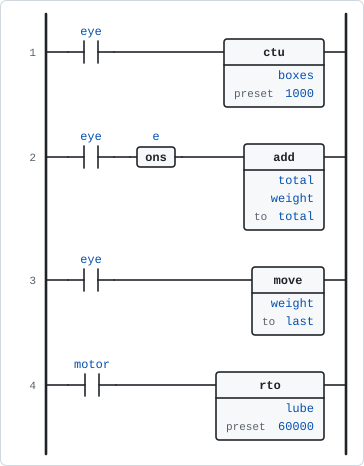

# Retained values

This page is for a reader who looks for an exact rule about the values that logex keeps
across a [restart](glossary.md#restart). The reader is an Elixir developer who writes a
[host](glossary.md#host), or a controls engineer who must know what a
[plant](glossary.md#plant) keeps. The page defines the qualifier
[`retain`](glossary.md#retain), the [warm restart](glossary.md#warm-restart), the [cold
restart](glossary.md#cold-restart) and the [retained image](glossary.md#retained-image).
[The store](store.md) defines the file in which a [runner](glossary.md#runner) keeps the
retained values.

> #### Warning {: .warning}
>
> Do not keep a value of a [safety function](glossary.md#safety-function) in logex. A
> person can edit the [store](glossary.md#store), a cold start discards each retained
> value, and a crash can set a value back to an older value. Examples of such values are
> the lockout of a burner, a [latch](glossary.md#latch) that an open guard sets and a
> count of trips. logex is not battery-backed memory and not safety memory.

> #### Warning {: .warning}
>
> Do not expect a warm restart or a warm start to keep each [output](glossary.md#output)
> at 0. A [rung](glossary.md#rung) that reads a retained value writes its output from
> that value in the first [scan](glossary.md#scan) after the restart or the start. Thus an
> output can come on immediately, with no person at the machine. The
> [configuration](glossary.md#configuration) warns only of a retained `var_output` that a
> [connection](glossary.md#connection) wires straight to an output
> [point](glossary.md#point).

> #### Note {: .info}
>
> logex keeps a retained value in 1 of 2 places only. A warm restart keeps it in memory.
> A runner with the option `retain:` also keeps it in the store, a file on the disk of the
> host. `Logex.Runtime` reads and writes no file.

| To find | Go to |
|---|---|
| The words of this page, such as a path and a warm start | [Words of this page](#words-of-this-page) |
| Which tags `retain` selects | [The qualifiers](#the-qualifiers) |
| What a warm restart and a cold restart keep | [Restarts](#restarts) |
| The image as data, and a start from an image | [The retained image](#the-retained-image) |
| What logex does not retain | [What logex does not retain](#what-logex-does-not-retain) |
| The text of the store, its refusals, its copies and its writes | [The store](store.md) |
| The steps to keep values across a restart | [Keep values across a restart](../howto/keep-values-across-a-restart.md) |
| The reasons for these rules | [Warm and cold restarts](../explanation/warm-and-cold-restarts.md) |

Each example on this page is a script, with each line that it prints. Each `elixir` block
is the file under `examples/` that its `$ mix run` line names. The directory `examples` of
the repository is a Mix project, and logex is its dependency. To run a script, give its
command in that directory.

## Words of this page

| Word | Meaning |
|---|---|
| A retained value | The value of a [tag](glossary.md#tag), a [member](glossary.md#member) or a [global](glossary.md#global) that has the [qualifier](glossary.md#qualifier) `retain` |
| A path | The name of a value inside an [instance](glossary.md#instance), as a rung names it: `boxes.cv`, `total`, `lane_t[2].acc` |
| `last` of a timer | A hidden member of a [timer](glossary.md#timer). It holds the time of the last scan of the timer. A [program](glossary.md#program) cannot name it. |
| A start from an image | `Logex.Runtime.instance/2` or `Logex.Runtime.start/2` with a retained image |
| A fresh start | `Logex.Runner.start_link/1` of a new runner, for example after a crash |
| A warm start | A fresh start that reads the store. A fresh start with `retain:` is warm unless the host gives `start: :cold`. |

## The program of the examples

`shift.ld` runs alone, as a lone instance. It counts boxes, adds their weights to `total`
and times the motor for its lubrication. The tags `total`, `boxes` and `lube` have
`retain`. The tag `last` has no qualifier.

<!-- file: shift.ld -->
```text
var_input eye bool
var_input weight dint
var_input motor bool
var_output retain total dint
var_output last dint
var retain boxes ctu
var retain lube rto
var e bool

xic eye ctu boxes 1000
xic eye ons e add total weight total
xic eye move weight last
xic motor rto lube 60000
```

<!-- rung: shift.ld -->


## The qualifiers

A [declaration](glossary.md#declaration) can have 1 qualifier: `retain` or `non_retain`.
[Declarations and types](declarations-and-types.md) gives the syntax and each message.
[Configuration file](configuration-file.md) gives the syntax of a global.

### Where a qualifier goes

| Declaration | `retain` and `non_retain` |
|---|---|
| `var` and `var_output` of a program | Correct: `var retain count dint` |
| `var_input` of a program | An error. The host gives its value, and each restart keeps it. |
| `var_external` | An error. The global keeps its value. |
| `var_input`, `var_output` and `var` in the file of a [function block](glossary.md#function-block) | Correct |
| `var_global` with no [location](glossary.md#location) | Correct: `var_global retain total_boxes dint 0` |
| `var_global` at a point, a [located global](glossary.md#located-global) | `retain` is an error. `non_retain` is correct. |
| A `program` line of a [configuration file](glossary.md#configuration-file) | An error. The program declares what it keeps. |

- The qualifier comes straight after the [section](glossary.md#section) word.
- A declaration cannot have `retain` and `non_retain` together.
- `retain` and `non_retain` are [reserved words](glossary.md#reserved-word) in each case
  of their letters. No tag, global, instance, [task](glossary.md#task), [program
  type](glossary.md#program-type) or [device](glossary.md#device) can have the name
  `retain` or `non_retain`.
- A value with no qualifier is not retained. `non_retain` states this default.

### What a qualifier selects

| Declaration | Values that logex retains |
|---|---|
| `var retain count dint` | `count` |
| `var retain w int[4]` | Each [element](glossary.md#element) of the [array](glossary.md#array). logex retains no element alone. |
| `var retain boxes ctu` | Each member of the [counter](glossary.md#counter) `boxes`. This includes `cu`, `ov` and `pv`. |
| `var retain lube rto` | Each member of the timer `lube` that a program can name. This includes `en` and `tt`. |
| `var retain s1 seal`, an instance of a function block | Each member of `s1`, except a member that has `non_retain` in the file of the block |
| `var non_retain step dint` in the file of the block | No value of `step`. This is true also in an instance that has `retain`. |
| `var retain n dint` in the file of the block | `n`. This is true also in an instance that has no qualifier. |

logex uses the qualifier that is nearest to the member on its path. Example: if `step`
has `non_retain` in the file of the block, logex does not retain `s1.step`, also when `s1`
has `retain`. logex does not retain a path with no qualifier on it.

## Restarts

### The functions

- `Logex.Runtime.restart/3`, `restart(program, state, mode)`, restarts 1 lone instance.
- `Logex.Runtime.restart/2`, `restart(runtime, mode)`, restarts a
  [resource](glossary.md#resource): each instance and each global. There is no restart of
  1 instance inside a resource.
- `Logex.Runner.restart/2`, `restart(runner, mode)`, restarts a runner after a [trip](glossary.md#trip).
  [Runner](runner.md#restart) gives the steps.

The mode is `:warm` or `:cold`. A different mode is an `ArgumentError`.

### What each restart keeps

| Value | Warm restart | Cold restart |
|---|---|---|
| A `var_input` tag | Keeps its value | Keeps its value |
| A value that has `retain` | Keeps its value | Gets its [initial value](glossary.md#initial-value) |
| Each other tag and member, also a `var_output` with no `retain` | Gets its initial value | Gets its initial value |
| A global that has `retain` | Keeps its value. A `var_external` of it reads the kept value. | Gets its initial value |
| Each other global with no location | Gets its initial value | Gets its initial value |
| A global at an [input](glossary.md#input) point | Keeps the last value of the input | Keeps the last value of the input |
| A global at an output point | 0 until the first scan writes it | 0 until the first scan writes it |
| The last sample of a [trigger](glossary.md#trigger) that has `retain` | Kept. [A retained trigger](#a-retained-trigger) gives the rule. | 0 |
| The [clock](glossary.md#clock) of the instance, `now` | Kept | Kept |

- If a program has no `retain`, a warm restart and a cold restart give the same values.
- If the [state](glossary.md#state) holds no value for a retained path, the path gets its
  initial value. Example: the host restarts a new program, with a new tag, from an older
  state.

### The first scan after a restart

- The next scan after each restart, warm or cold, is a [first
  scan](glossary.md#first-scan). It finds no [rising edge](glossary.md#rising-edge) and no
  [falling edge](glossary.md#falling-edge). Thus a box on the photo-eye at the restart
  does not count.
- An [online edit](glossary.md#online-edit) can block a [one-shot](glossary.md#one-shot)
  for 1 scan. A restart removes each such block.
- logex runs no prescan.

### Timers across a restart

| Timer | After a warm restart |
|---|---|
| A retained timer | It keeps `acc` and its other members. Its next scan adds only the time that the host gives that scan. The restart does not count the time of the stop. |
| A retained `tof` or `tof_ltime` that is on and not timing: `en` 1, `tt` 0 | The restart sets `en`, `tt` and `dn` to 0 and keeps `acc`. Its first [false rung](glossary.md#false-rung) starts no off-delay. |
| A retained `tof` in its off-delay: `tt` 1 | It continues its off-delay. |
| A timer with no `retain` | It gets its initial values, `acc` 0. |

- These rules apply to each timer at each depth: a member of a block, and an element of an
  array of timers.
- In a resource, each instance restarts at the `now` of the resource. Thus the restart
  does not count the time from the last scan of an instance to the restart.
- A runner gives the first [round](glossary.md#round) the time since the restart. Thus the
  runner does not count the time while tripped.

### Example: a warm restart and a cold restart

`shift.exs` counts 2 boxes while the motor runs. It restarts warm, with the second box on
the eye. It counts a third box. It takes the retained image and restarts cold. Then it
starts a new instance from the image, with `total` changed to a `lint`.

```elixir
{:ok, shift} = Logex.compile_file("shift.ld")

show = fn state, label ->
  env = state.env
  IO.puts("#{label}  boxes=#{env["boxes"]["cv"]} total=#{env["total"]} lube=#{env["lube"]["acc"]} last=#{env["last"]}")
  state
end

scan = fn state, label, inputs, ms ->
  state = Logex.Runtime.put_inputs(shift, state, inputs)
  {_outputs, state} = Logex.Runtime.scan(shift, state, ms)
  show.(state, label)
end

state =
  Logex.Runtime.instance(shift)
  |> scan.("motor on          ", %{"motor" => 1}, 0)
  |> scan.("box of 12 kg      ", %{"eye" => 1, "weight" => 12}, 10)
  |> scan.("eye clear         ", %{"eye" => 0}, 10)
  |> scan.("box of 15 kg      ", %{"eye" => 1, "weight" => 15}, 10)

state =
  Logex.Runtime.restart(shift, state, :warm)
  |> show.("warm restart      ")
  |> scan.("first scan, 10 ms ", %{}, 10)
  |> scan.("10 ms on          ", %{}, 10)
  |> scan.("eye clear         ", %{"eye" => 0}, 10)
  |> scan.("box of 9 kg       ", %{"eye" => 1, "weight" => 9}, 10)

image = Logex.Runtime.retained(shift, state)
IO.inspect(image)
Logex.Runtime.restart(shift, state, :cold) |> show.("cold restart      ")

{:ok, v2} = Logex.compile(String.replace(File.read!("shift.ld"), "total dint", "total lint"), name: "shift")
{fresh, dropped} = Logex.Runtime.instance(v2, image)
show.(fresh, "total made a lint ")
IO.inspect(dropped)
```

```console
$ mix run shift.exs
motor on            boxes=0 total=0 lube=0 last=0
box of 12 kg        boxes=1 total=12 lube=10 last=12
eye clear           boxes=1 total=12 lube=20 last=12
box of 15 kg        boxes=2 total=27 lube=30 last=15
warm restart        boxes=2 total=27 lube=30 last=0
first scan, 10 ms   boxes=2 total=27 lube=40 last=15
10 ms on            boxes=2 total=27 lube=50 last=15
eye clear           boxes=2 total=27 lube=60 last=15
box of 9 kg         boxes=3 total=36 lube=70 last=9
%{
  values: %{
    "boxes.cu" => {:bool, 1},
    "boxes.cv" => {:dint, 3},
    "boxes.ov" => {:bool, 0},
    "boxes.pv" => {:dint, 1000},
    "boxes.q" => {:bool, 0},
    "boxes.r" => {:bool, 0},
    "lube.acc" => {:dint, 70},
    "lube.dn" => {:bool, 0},
    "lube.en" => {:bool, 1},
    "lube.pre" => {:dint, 60000},
    "lube.r" => {:bool, 0},
    "lube.tt" => {:bool, 1},
    "total" => {:dint, 36}
  },
  program: "shift",
  kinds: %{"boxes" => "ctu", "lube" => "rto"}
}
cold restart        boxes=0 total=0 lube=0 last=0
total made a lint   boxes=3 total=0 lube=70 last=0
[{"total", {:retyped, :dint, :lint}}]
```

| Lines | What they show |
|---|---|
| `warm restart` | `boxes`, `total` and `lube` keep their values. `last` has no `retain` and gets 0. |
| `first scan, 10 ms` | The box on the eye does not count, because the first scan finds no edge. `lube` adds only the 10 ms of the scan. `last` gets 15 from the rung. |
| `box of 9 kg` | The third box counts. |
| The map | The image holds each member of `boxes` and `lube` that a program can name, and `total`. It does not hold the tag `last`, because `last` has no `retain`. |
| `cold restart` | Each value gets its initial value. |
| `total made a lint` | The new instance keeps `boxes` and `lube`. It drops `total`, because its [type](glossary.md#type) changed, and `total` starts at 0. |

### A retained global

In a configuration, a warm restart keeps each global that has `retain`, and each value
that a program retains. [Keep values across a
restart](../howto/keep-values-across-a-restart.md) runs a plant through a warm restart and
a cold restart.

| Case | Rule |
|---|---|
| A retained `var_output` that a connection wires to a global | The warm restart keeps the `var_output`. The global gets its initial value until the first run of the instance copies the `var_output` out. |
| A retained `var_output` that a connection wires to an output point | The first round after a warm restart or a warm start writes the kept value to the point. The configuration gives a [warning](glossary.md#warning). |
| A rung that reads a retained value and writes an output | No warning. The warning finds only a connection straight from the `var_output` to an output point. |
| A retained global that a connection drives from a `var_output` with no `retain` | The global keeps its value until the first run of that instance. Then the copy-out writes the initial value of the `var_output` over it. The configuration gives a warning at the line of the connection. |
| A retained global that a connection drives from a retained `var_output` | The global loses nothing, and no warning comes. |
| A write through `var_external` | It is not a connection, and no warning comes. |

The 2 warnings have these forms. [Warnings](warnings.md#a-retained-value-that-a-connection-drives)
gives each rule and an example.

- For an output: `` `<connection>` is retained and drives the output `<global>`: after a warm start it is written in the first round ``
- For a global: `` `<global>` is retained but driven by `<connection>`, which is not: the first round writes over it ``

### A retained trigger

A global that has `retain` and that is the `single` of an [event
task](glossary.md#event-task) keeps its last [sample](glossary.md#sample). A rising edge
is a sample of 0 and then a sample of 1.

| Event | The last sample |
|---|---|
| A warm restart | It keeps the sample that the resource took last. If the trigger stays 1, the task waits for a rising edge. |
| A rung sets the trigger after the resource takes its sample, and then a trip occurs | The warm restart keeps the old sample, 0. The task runs 1 time in the first [cycle](glossary.md#cycle). |
| A trip in a round before the step that runs the task | The resource did not sample the 1. The task runs in the next cycle that samples it, after a warm restart or a fresh start. |
| 2 event tasks on 1 trigger, and the round stops between their steps | Each task keeps its own sample. Only the task that the trip stopped runs, 1 time. |
| A start from the image or from the store | It sets the sample as a warm restart keeps it. |
| A store that holds the sample of a task that the configuration does not have | The start drops it, for example `{"early", :undeclared}`, and starts. |
| A cold restart | The sample is 0 again. A trigger that is already 1 runs its task in the first cycle. |

## The retained image

The retained image is the retained values as plain data. The host takes it out and puts it
into a new instance or a new resource.

- `Logex.Runtime.retained/2`, `retained(program, state)`, gives the image of a lone
  instance.
- `Logex.Runtime.instance/2`, `instance(program, image)`, starts a new instance from the
  image. It gives `{state, dropped}`.
- `Logex.Runtime.retained/1`, `retained(runtime)`, gives the image of a resource.
- `Logex.Runtime.start/2`, `start(configuration, image)`, starts a new resource from the
  image. It gives `{runtime, dropped}`.

### The image of an instance

<!-- fragment: the shape of the image of an instance, as Logex.Runtime.retained/2 gives it -->
```elixir
%{program: "shift", kinds: %{"boxes" => "ctu"}, values: %{"boxes.cv" => {:dint, 3}}}
```

| Key | Value |
|---|---|
| `program` | The name of the program |
| `kinds` | Each instance on the path to a value, with its kind: `"boxes" => "ctu"`. An instance of a block has the name of the block: `"s1" => "seal"`. An array of instances is `{:array, "ton", [4]}`. |
| `values` | Each retained value by its path, as `{type, value}`. The type is an atom such as `:dint`, or an array such as `{:array, :int, [8]}` with a list as its value. |

- An element of an array of instances has its path by the values of its
  [subscript](glossary.md#subscript)s: `lane_t[2].acc`.
- The image never holds `last` of a timer.
- A program that retains nothing gives empty maps.

### The image of a resource

<!-- fragment: the shape of the image of a resource, as Logex.Runtime.retained/1 gives it -->
```elixir
%{
  configuration: "tally",
  globals: %{"total_boxes" => {:dint, 5}},
  instances: %{"t1" => %{program: "tally", kinds: %{"boxes" => "ctu"}, values: %{"boxes.cv" => {:dint, 5}}}},
  triggers: %{}
}
```

| Key | Value |
|---|---|
| `configuration` | The name of the configuration |
| `globals` | Each global with `retain`, by its name, as `{type, value}` |
| `instances` | Each instance whose program retains a value, by its name, as the image of an instance |
| `triggers` | Each retained global that is the `single` of a task, by its name, with its last sample, 0 or 1 |
| `triggers`, for a task | A task whose last sample is different from the sample of its trigger, by the name of the task, with its sample |

During an online edit, the image holds the values of the program that runs. It does not
hold an instance that the edit set aside.

### A start from an image

A start from an image keeps a stored value only if each of these conditions is true:

- For a resource, the configuration has an instance of that name, with the same program
  type.
- The program declares the path, with `retain`.
- The type is exactly the stored type. A wider type, an array of a different size and an
  instance of a different kind do not match.
- Each instance on the path is of its stored kind.
- The value fits the type.

For a global, the configuration must declare a global of that name, with `retain`, of
exactly the stored type, and the value must fit.

| Stored value | What the start does |
|---|---|
| A value that meets each condition | It keeps the value. |
| A value that does not meet a condition | It gives the path its initial value, and reports it in `dropped`. [What a start drops](#what-a-start-drops) gives the reasons. |
| A value whose initial value changed in the program | It keeps the stored value, and does not report it. |
| A member of an instance of a block | It matches the instance member by member. It reports only the members that do not match. |
| An element of an array of instances, if its sizes did not change | It matches the array element by element. It reports only the elements that do not match. |
| The [preset](glossary.md#preset) of a timer or a counter that an [instruction](glossary.md#instruction) of the program runs | It gives the preset from the number on the instruction. It reports a stored preset that is different. |
| The preset of a timer or a counter that no instruction of the program runs | It keeps the stored preset, and does not report it. |
| An integer for a value or a global of a real type | It gives the nearest real, and does not report it. |
| A subscript with leading 0s, `tl[01]` | It gives the value to the element of its value, `tl[1]`. |
| A retained timer | It starts the timer with the clock of the start. It does not count the outage. |
| A retained `tof` that is on and not timing | It puts the timer at rest, as a warm restart does. |

- A member that the new version of a block adds gets its initial value. The start does
  not report it.
- A path that the new program retains and that the image does not hold gets its initial
  value. The start does not report it.
- The first scan after the start is a first scan. It finds no edge.

From the same inputs, a resource that starts from an image runs as the resource that gave
the image runs after a warm restart. This is not true if a program writes a preset.

### What a start drops

`dropped` is a list of `{path, reason}`. It gives each stored value that the start did not
keep, 1 time, in path order.

| Reason | Cause |
|---|---|
| `:undeclared` | The configuration or the program does not declare the instance, the global, the tag or the member. |
| `:unretained` | The path has no `retain` in the new program. |
| `:misfit` | The value has the correct type but does not fit it. |
| `{:retyped, stored, now}` | The type or the kind changed. An instance that runs a different program type is `{"m1", {:retyped, "motor", "pump"}}`. |
| `{:resized, from, to}` | The sizes of an array, or of an array of instances, changed. |
| `{:preset, stored, now}` | The program gives a different preset with its instruction. |

- If the start drops each value under a path, the list gives the path 1 time: `{"m1",
  :undeclared}`.
- If each element of an array of instances drops a member for 1 reason, the list gives 1
  entry: `"m1.gates[*].j"`. Elements that drop for different reasons have 1 entry each.
- The sample of a trigger that the start puts on no task is `{name, :undeclared}`.

### Example: a new version of a program

`retained-values-and-store-image.exs` counts 2 boxes on `shift.ld` and takes the image.
Then it starts a new version: `total` is a `lint`, the counter counts to 500 and `lube`
has no `retain`.

```elixir
{:ok, shift} = Logex.compile_file("shift.ld")

# 2 boxes, 12 kg and 15 kg, while the motor runs.
state =
  Enum.reduce(
    [
      %{"motor" => 1},
      %{"eye" => 1, "weight" => 12},
      %{"eye" => 0},
      %{"eye" => 1, "weight" => 15}
    ],
    Logex.Runtime.instance(shift),
    fn inputs, state ->
      state = Logex.Runtime.put_inputs(shift, state, inputs)
      {_outputs, state} = Logex.Runtime.scan(shift, state, 10)
      state
    end
  )

image = Logex.Runtime.retained(shift, state)

# A new version: total is a lint, the counter counts to 500, lube keeps no time.
text =
  File.read!("shift.ld")
  |> String.replace("total dint", "total lint")
  |> String.replace("ctu boxes 1000", "ctu boxes 500")
  |> String.replace("var retain lube rto", "var lube rto")

{:ok, v2} = Logex.compile(text, name: "shift")
{fresh, dropped} = Logex.Runtime.instance(v2, image)
Enum.each(dropped, &IO.inspect/1)
env = fresh.env

IO.puts(
  "boxes.cv=#{env["boxes"]["cv"]} boxes.pv=#{env["boxes"]["pv"]} total=#{env["total"]} lube.acc=#{env["lube"]["acc"]}"
)
```

```console
$ mix run retained-values-and-store-image.exs
{"boxes.pv", {:preset, 1000, 500}}
{"lube", :unretained}
{"total", {:retyped, :dint, :lint}}
boxes.cv=2 boxes.pv=500 total=0 lube.acc=0
```

The count 2 stays, and the preset is 500 from the new instruction. `lube` and `total`
start at 0.

### An image that a start refuses

A start refuses an image that is not correct. This is an error of the host: 1
`ArgumentError`, with 1 line for each problem. The start refuses each of these images:

- an image that is not a map of the correct keys, or that has a part that is not correct
- the image of a different program or of a different configuration
- an image with a path that no rung can name, such as `a b`
- an image with a subscript that is not digits
- an image with 2 paths that name 1 value, or with an element of an array as a path
- an image with an entry under an instance whose kind the image does not hold
- an image that holds `last` of a timer
- an image with a sample that is not 0 or 1

A start drops the values that do not match a changed program. It refuses an image that is
not correct. Some messages, copied from runs:

| The image | The message |
|---|---|
| An empty map | ``a retained image is a map of `program`, `kinds` and `values`, as Logex.Runtime.retained/2 gives one, got: %{}`` |
| The image of the program `q`, for the program `p` | ``the retained image is of program `q`, and this program is `p`: an image starts only an instance of the program it was taken from`` |
| The image of the configuration `tally`, for `line_2` | ``the retained image is of configuration `tally`, and this configuration is `line_2`: an image starts only the configuration it was taken from`` |
| `last` of the timer `t1` in `values` | `` `values` holds `t1.last`, a timer's clock, which no image holds: each retained timer starts at the start's `now` `` |
| The path `a b` in `values` | `` `values` holds "a b", which is no path `` |

### Example: a retained global, 2 restarts and an image

This example uses [`tally.ld`](store.md#the-files-of-the-examples) and
[`tally.logex`](store.md#the-files-of-the-examples). `tally.logex` declares the global
`total_boxes` with `retain`.

The script `retained.exs` counts 4 boxes and does a warm restart. It counts 2 more boxes,
the first under the eye at the restart. Then it takes the retained image and does a cold
restart. It starts a new resource from the image, and a different one whose program
counts in a `ctu_int`. Last, it loads 2 more files. `wired.logex` wires `full` to an
output point:

<!-- file: wired.logex -->
```text
var_global eye_1              bool at panel.i.0
var_global retain total_boxes dint 0
var_global case_lamp          bool at panel.q.0

program t1 tally
  t1.eye  eye_1
  t1.full case_lamp
```

`broken_retain.logex` has an error on each of its last 5 lines:

<!-- file: broken_retain.logex -->
```text
var_global eye_1              bool at panel.i.0
var_global retain case_lamp   bool at panel.q.0
var_global total_boxes retain dint
var_global retain non_retain total dint
var_global eye_2              bool at program.i.1
program retain tally
```

```elixir
{:ok, plant} = Logex.Configuration.compile_file("tally.logex")

show = fn rt, label ->
  IO.puts("#{label}  total_boxes=#{Logex.Runtime.get!(rt, "total_boxes")} " <>
            "t1.boxes.cv=#{Logex.Runtime.get!(rt, "t1.boxes.cv")} " <>
            "case_full=#{Logex.Runtime.get!(rt, "case_full")}")
  rt
end

boxes = fn rt, n ->
  Enum.reduce(1..n, rt, fn _, rt ->
    {rt, _, _} = Logex.Runtime.cycle(rt, 10, %{"eye_1" => 1})
    {rt, _, _} = Logex.Runtime.cycle(rt, 10, %{"eye_1" => 0})
    rt
  end)
end

{rt, _, _} = Logex.Runtime.cycle(Logex.Runtime.start(plant), 0, %{})

rt =
  rt
  |> boxes.(4)
  |> show.("four boxes   ")
  |> Logex.Runtime.restart(:warm)
  |> show.("warm restart ")
  |> boxes.(1)
  |> show.("first box    ")
  |> boxes.(1)
  |> show.("one more     ")

image = Logex.Runtime.retained(rt)
rt |> Logex.Runtime.restart(:cold) |> show.("cold restart ")

{fresh, []} = Logex.Runtime.start(plant, image)
show.(fresh, "from image   ")

{:ok, ld} = File.read("tally.ld")
{:ok, recounted} = Logex.compile(String.replace(ld, "boxes ctu", "boxes ctu_int"), name: "tally")
{:ok, text} = File.read("tally.logex")
{:ok, recounting} = Logex.Configuration.compile("tally", text, %{"tally" => recounted})
{fresh, dropped} = Logex.Runtime.start(recounting, image)
show.(fresh, "a ctu_int    ")
IO.inspect(dropped)

{:ok, wired} = Logex.Configuration.compile_file("wired.logex")
Enum.each(wired.warnings, &IO.puts(Logex.Diagnostic.format(&1)))

{:error, diagnostics} = Logex.Configuration.compile_file("broken_retain.logex")
Enum.each(diagnostics, &IO.puts(Logex.Diagnostic.format(&1)))
```

```console
$ mix run retained.exs
four boxes     total_boxes=4 t1.boxes.cv=4 case_full=1
warm restart   total_boxes=4 t1.boxes.cv=4 case_full=0
first box      total_boxes=4 t1.boxes.cv=4 case_full=1
one more       total_boxes=5 t1.boxes.cv=5 case_full=1
cold restart   total_boxes=0 t1.boxes.cv=0 case_full=0
from image     total_boxes=5 t1.boxes.cv=5 case_full=0
a ctu_int      total_boxes=5 t1.boxes.cv=0 case_full=0
[{"t1.boxes", {:retyped, "ctu", "ctu_int"}}]
wired.logex: line 7: warning: `t1.full` is retained and drives the output `case_lamp`: after a warm start it is written in the first round
broken_retain.logex: line 2: `case_lamp` is an output point, and a located global takes no `retain`: an input point is read again at every start, and an output point starts at 0 until logic writes it
broken_retain.logex: line 3, column 24: `retain` comes straight after `var_global`, as in `var_global retain total_boxes dint`
broken_retain.logex: line 4, column 19: a global takes `retain` or `non_retain`, not both: found `retain` and `non_retain`
broken_retain.logex: line 5: `program` is a keyword and cannot name a device
broken_retain.logex: line 6: `retain` is a keyword and cannot name an instance
```

| Line | What the line shows |
|---|---|
| 2 | The warm restart keeps the retained count and the retained total. `case_full` is not retained, and goes to 0. |
| 3 | The first scan after a start counts no edge. Thus the box under the eye at the restart is not counted. |
| 5 | A cold restart puts each value back to its initial value. |
| 6 | A new resource gets the values of the image. |
| 7 and 8 | The type of `t1.boxes` is different, and the start drops its value. |
| 9 | A retained value that drives an output point gives a warning. |
| 10 to 14 | The diagnostics of `broken_retain.logex`. |

## What logex does not retain

- No `persistent` values. A cold restart discards each retained value.
- No `retain` on the `program` line of a configuration.
- No retained located global. The runner reads an input point again at each start. An
  output point is 0 at each start until a program writes it.
- No element of an array retained alone. logex retains an array whole.
- No count of the time of a stop. A retained timer continues as if no time went by.
- No [bit](glossary.md#bit) for the first scan. [Keep values across a
  restart](../howto/keep-values-across-a-restart.md) shows a program that keeps its own.
- No prescan, no hot restart, and no warm restart that starts some paths cold.
- No retained [force](glossary.md#force). The forces have the [forces
  file](glossary.md#forces-file).
- No battery-backed memory and no safety memory. In `Logex.Runtime`, a retained value is
  in memory only.
- [The store](store.md#what-the-store-does-not-do) gives the limits of the store.

## See also

- [The store](store.md): the file in which a runner keeps the retained values.
- [Keep values across a restart](../howto/keep-values-across-a-restart.md): mark tags
  `retain` and restart warm.
- [Warm and cold restarts](../explanation/warm-and-cold-restarts.md): why logex keeps what
  it keeps.
- [Runner](runner.md): the options, the status, the events and the trip.
- [Declarations and types](declarations-and-types.md): the syntax of a qualifier.
- [Configuration file](configuration-file.md): the syntax of a retained global.
- [Online edit](online-edit.md): an edit that changes a qualifier.
- [Glossary](glossary.md): the technical words of logex.
