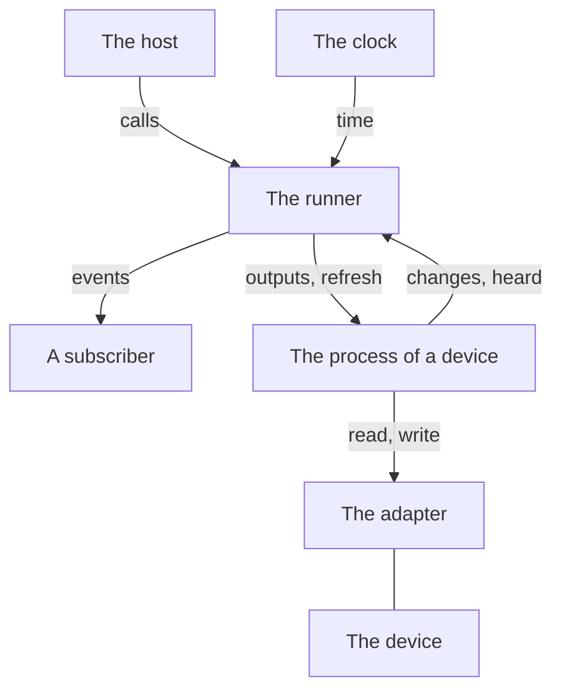
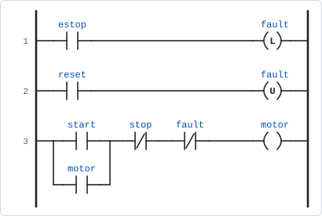
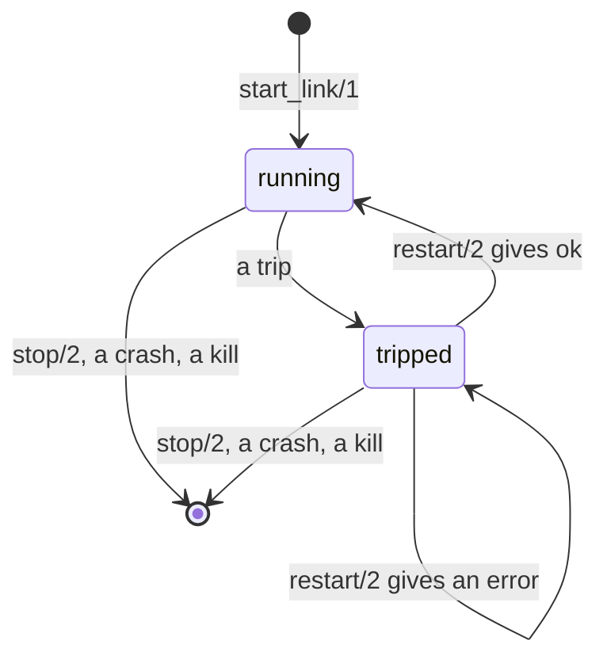

# Runner

This page is for a reader who looks for an exact rule of `Logex.Runner`. The reader is an
Elixir developer who runs a [plant](glossary.md#plant) on a clock. The reader can also
be a controls engineer who must know what the plant does after a failure. The page
defines the options of the [runner](glossary.md#runner), its
[devices](glossary.md#device), a
[round](glossary.md#round), the status, the events, the
[watchdogs](glossary.md#watchdog), the [trip](glossary.md#trip) and the
[restart](glossary.md#restart).

> #### Warning {: .warning}
>
> Do not use logex for a [safety function](glossary.md#safety-function). Examples are an
> emergency stop, a guard interlock, a light curtain, a 2-hand control, and burner or
> pressure protection. Use hardwired circuits or a safety-rated controller. logex makes
> no claim against a functional-safety standard, and it has no certificate for an
> industrial use. Wire the emergency stop that cuts the power so that it works with logex
> stopped, crashed or never started.

> #### Warning {: .warning}
>
> Do not go near the machine after a trip until `unzeroed` is `[]`, and until you checked
> each [output](glossary.md#output) [point](glossary.md#point). A trip writes 0 to each
> output point, 1 time, through each device that answers. A device that hangs gets no
> write of 0. Its outputs do what its hardware does when it hears nothing from
> the runner. If the Erlang virtual machine stops, no part of logex runs to set an output point to 0.

> #### Caution {: .error}
>
> Do not expect the runner to run on time. logex is not hard real-time. It runs on the
> Erlang virtual machine, on a general-purpose operating system. It gives no limit for the
> lateness of a round. A watchdog trips the plant after a [task](glossary.md#task) runs
> too long. It cannot make a task run on time.
>
> The suite of logex does not include a computer that goes to sleep. This page gives no rule
> for the clock of the runner after a sleep.

| To find | Go to |
|---|---|
| The parts of a runner, and the functions of `Logex.Runner` | [The runner and its functions](#the-runner-and-its-functions) |
| The words of this page, such as a look, a turn and the cap | [Words of this page](#words-of-this-page) |
| The plant that the examples run | [The plant of the examples](#the-plant-of-the-examples) |
| Each option of `start_link/1`, and the answers of a start | [Start a runner](#start-a-runner) |
| When the runner reads and writes a device | [Devices](#devices) |
| When a call of the [host](glossary.md#host) waits | [Calls and the share](#calls-and-the-share) |
| Each key of `status/1` | [Status](#status) |
| Each event and its kind | [Events](#events) |
| Each watchdog, and a late runner | [Watchdogs](#watchdogs) |
| What a trip does, and each reason of a trip | [The trip](#the-trip) |
| What `restart/2` does | [Restart](#restart) |
| How a runner ends | [Stop, shutdown and crash](#stop-shutdown-and-crash) |
| The rules of the files of a runner | [Files](#files) |
| When a round runs, and the sequence of the tasks | [Execution model](execution-model.md) |
| The [force](glossary.md#force) of an input point, and the [forces file](glossary.md#forces-file) | [Forcing](forcing.md) |
| The [store](glossary.md#store) | [The store](store.md) |
| An [online edit](glossary.md#online-edit) through the runner | [Online edit](online-edit.md) |
| What an [adapter](glossary.md#adapter) must do | [I/O adapters](io-adapters.md) |
| The reasons for the watchdogs and the trip | [Trips and watchdogs](../explanation/trips-and-watchdogs.md) |
| The time that a round takes, and the size of a plant | [Timing and capacity](../explanation/timing-and-capacity.md) |

Each example on this page is a script, with each line that it prints. Each `elixir` block
is the file under `examples/` that its `$ mix run` line names. The directory `examples`
of the repository is a Mix project, and logex is its dependency. To run a script, give
its command in that directory.

## The runner and its functions

The runner is a process. It runs the [resource](glossary.md#resource) of 1
[configuration](glossary.md#configuration) on a [clock](glossary.md#clock), through the
devices that the points of the configuration name. It is the only part of logex that
reads a clock. Each device has a separate process, which calls the adapter of the device.



Figure 1: the parts of a runner. The host calls the runner. The runner reads the clock
and sends events to each subscriber. The process of each device calls the adapter, and
the adapter reads and writes the device.

### Words of this page

In this table and on the rest of this page, `idle` and `poll` are the values of the
options `idle:` and `poll:`, in ms.

| Word | Meaning |
|---|---|
| Name order | The sorted order of the device names. The runner opens, writes and closes the devices in name order. |
| Answer | A device answers when its process replies to the runner in its time. |
| A write that succeeds | The `write/2` callback of the adapter gives `{:ok, state}`. |
| Refresh | A message from the runner to the process of a device. It gives the device a new deadline. A refresh calls no adapter. |
| Deadline | The time by which a device must get its next refresh |
| Heard | The process of a device tells the runner that it is back from the adapter. It does this after a read, a report, and a write in time. |
| Unheard | The time since the runner last heard a device |
| Hung | A device that is unheard for more than `idle + poll` ms |
| Look | A check of the runner for a hung device. The runner makes a look as each round starts, and at each refresh while it waits. |
| Late | A wake of the runner that comes more than `idle` ms after its time |
| Turn | The 1 poll period after a late look. In a turn, a hung device does not trip the plant, unless it is unheard for more than the cap. |
| Cap | `4 * idle + poll` ms. With `idle: 50` and `poll: 10`, the cap is 210 ms. |
| The write of 0 | The write of 0 to each output point that a trip or a stop makes, 1 time, through each device that answers |
| Fallback | What a device does when it hears nothing from the runner. The hardware of the device sets this. |

### The functions

- `Logex.Runner.start_link/1`: Starts a runner that is linked to the caller. It gives
  `{:ok, pid}` or `{:error, reason}`. [The answers of a start](#the-answers-of-a-start)
  gives each one.
- `Logex.Runner.child_spec/1`: Gives the child spec for a supervisor. [The child
  spec](#the-child-spec) gives its keys.
- `Logex.Runner.status/1`: Gives the status of the runner, a map. [Status](#status) gives
  each key.
- `Logex.Runner.get/2`: Reads a value of the resource at a path, as `Logex.Runtime.get/2`
  reads it. It gives `{:ok, value}` or `{:error, message}`.
- `Logex.Runner.get!/2`: Reads a value, as `Logex.Runtime.get!/2` reads it. It gives the
  value, or raises an `ArgumentError` for a path that names no value.
- `Logex.Runner.subscribe/1,2`: Sends the caller the events of the kinds in the list. It
  gives `:ok`. [Events](#events) gives each kind.
- `Logex.Runner.unsubscribe/1`: Stops the events to the caller. It gives `:ok`.
- `Logex.Runner.force/3`, `unforce/2`, `unforce_all/1`: Force an
  [input](glossary.md#input) point, or remove a force. [Forcing](forcing.md) gives the
  rules.
- `Logex.Runner.accept/2`, `test/1`, `untest/1`, `assemble/1`, `cancel/1`: The steps of an
  online edit of the configuration. [Online edit](online-edit.md) gives the rules.
- `Logex.Runner.restart/2`: Starts a tripped runner again, `:cold` or `:warm`. It gives
  `:ok` or `{:error, reason}`. [Restart](#restart) gives each one.
- `Logex.Runner.stop/1,2`: Writes 0 to each output point, closes each device and stops the
  runner. It gives `:ok` or `{:error, reason}`. [Stop, shutdown and
  crash](#stop-shutdown-and-crash) gives each one.

A path is the name of a [global](glossary.md#global), or the name of an
[instance](glossary.md#instance) and its [tag](glossary.md#tag), joined by `.`, for example `"c1.fault"`.

### Rules of a call

- In each call, the host names the runner by its pid, or by the value of `name:`.
- Each call goes through the mailbox of the runner. The runner serves it between 2
  rounds.
- A wrong argument in a call raises an `ArgumentError` in the process of the caller.
  The runner continues to run. For example, `get/2` and `get!/2` raise for a path that
  is not a string.
- A call to a runner that stopped raises an `ArgumentError`. A call that waits when
  the runner stops raises the same error.
- The runner answers a `GenServer.call/3` that is no function of `Logex.Runner` with
  `{:raise, error}`, and continues to run. `error` is an `ArgumentError`.
- The runner ignores each other message and each cast.
- `get/2` and `get!/2` read the values of the last round that the runner computed.

<!-- unchecked: the messages of 4 wrong calls, copied from a run -->
```text
the runner #PID<0.102.0> is not running
no runner is running under the name :plant
:k1 is not an access path: a global, or a program instance, its tag and the members below it, joined by `.`, as in "m1.t1.acc"
Logex.Runner has no request :foo: a runner is called through get/2, get!/2, status/1, subscribe/2, unsubscribe/1, force/3, unforce/2, unforce_all/1, accept/2, test/1, untest/1, assemble/1, cancel/1, restart/2 and stop/2
```

## The plant of the examples

Each example on this page runs the plant `packing.logex`. The task `fast` runs the
conveyor `c1` each 10 ms. The box [counter](glossary.md#counter) `b1` runs in the
[continuous task](glossary.md#continuous-task). 1
[simulated device](glossary.md#simulated-device), `panel`, holds each point.

<!-- file: packing.logex -->
```text
// packing.logex -- a conveyor on a 10 ms task, and a box counter in the continuous task
task fast interval 10 priority 1 watchdog 50
task main continuous watchdog 200

var_global estop      bool at panel.i.7
var_global pb_start_1 bool at panel.i.0
var_global pb_reset   bool at panel.i.2
var_global eye        bool at panel.i.8
var_global k1         bool at panel.q.0
var_global case_full  bool at panel.q.4

program c1 conveyor with fast
  c1.start pb_start_1
  c1.stop  0
  c1.reset pb_reset
  c1.motor k1

program b1 boxes
  b1.eye       eye
  b1.reset_pb  pb_reset
  b1.full_lamp case_full
```

<!-- file: conveyor.ld -->
```text
var_input start bool
var_input stop bool
var_input reset bool
var_output motor bool
var_external estop bool
var fault bool

xic estop otl fault
xic reset otu fault
( xic start | xic motor ) xio stop xio fault ote motor
```

<!-- rung: conveyor.ld -->


<!-- file: boxes.ld -->
```text
var_input eye bool
var_input reset_pb bool
var_output full_lamp bool
var_output count dint
var boxes ctu

xic reset_pb ote boxes.r
xic eye ctu boxes 3
xic boxes.q ote full_lamp
move boxes.cv count
```

## Start a runner

### The options

`start_link/1` takes a keyword list. `configuration:` and `io:` are necessary. Each other
option has a default.

- `configuration:` The configuration that the runner runs: a `%Logex.Configuration{}`. It
  is necessary.
- `io:` The adapter of each device: a map from the name of each device to `{adapter,
  options}`. It is necessary. Give `%{}` for a configuration with no point.
  `Logex.IO.bind!/2` checks it.
- `clock:` The clock of the runner: `{module, clock}`. Default:
  `Logex.Runner.Clock.Monotonic`, the clock of the computer. `Logex.Runner.Clock.Manual`
  is a clock that a script moves.
- `poll:` The [poll period](glossary.md#poll-period) of each device: 1 to 2147483647 ms.
  Default: 10.
- `overhead:` The [share](glossary.md#share) of the time for the work of the runner: 10 to
  90 percent. Default: 20.
- `idle:` The [idle watchdog](glossary.md#idle-watchdog): 1 to 2147483647 ms. Default:
  500.
- `write_limit:` The longest time in real time for each read and write of a file of the
  runner: 1 to 2147483647 ms. Default: 5000.
- `open:` The longest time in real time to open a device, or to read it at a restart. The
  value is 1 to 2147483647 ms, or a map from the name of a device to a number of ms.
  Default: 5000 for each device. [Open a device](#open-a-device) gives the rule.
- `forces:` The forces file: a path. Default: none. With no forces file, `force/3` raises
  an `ArgumentError`.
- `retain:` The store: a path. Default: none. With no store, the runner keeps no value
  across a crash. It needs a clock with `wall_ms/1`.
- `retain_period:` The time between 2 periodic writes of the store: 100 to 3600000 ms, or
  `nil` for the default. Default: 1000. It needs `retain:`.
- `start:` How a new runner uses the store: `:warm` or `:cold`. Default: `:warm`. It needs
  `retain:`.
- `name:` The name of the runner, as `GenServer.start_link/3` takes it. Default: none. For
  a `{:via, module, term}` name, the module must export `register_name/2`,
  `unregister_name/1`, `whereis_name/1` and `send/2`.

The checks of the options:

- `start_link/1` checks each option in the process of the caller, before the runner
  starts. A wrong option raises an `ArgumentError` there, and no runner starts.
- It checks the configuration as `Logex.Runtime.start/1` does, and the bindings of `io:`
  as `Logex.IO.bind!/2` does.
- Give each option 1 time. An option that you give 2 times, or that the table does not
  list, raises an `ArgumentError`.

<!-- unchecked: the messages of a force with no forces file, and of 2 wrong options, copied from a run -->
```text
the runner keeps no forces file, so a force would not survive a crash: start it with forces: a path
the runner keeps no store, so retain_period: 500 has none to write: start it with retain: a path
the runner's clock `NoWall` has no wall_ms/1, which a runner given retain: writes its store's time by
```

### What a start does

| Order | What `start_link/1` does |
|---|---|
| 1 | It checks each option in the process of the caller. |
| 2 | It reads the forces file, if `forces:` names one, and then the store, if `retain:` names one. [Forcing](forcing.md) and [The store](store.md) give the rules. |
| 3 | The runner registers its name and claims its files. [Files](#files) gives the rules. |
| 4 | It writes the store, if `start: :cold` or if the store file does not exist. |
| 5 | It opens each device in name order, and reads each device 1 time. |
| 6 | It runs the first round immediately. |
| 7 | `start_link/1` returns `{:ok, pid}`. A call that the host sends to the name of the runner before this step waits until the first round ran. |

### The answers of a start

| Answer | When |
|---|---|
| `{:ok, pid}` | Each device opened, and the first round ran. |
| `{:error, {:io_init, device, reason}}` | The runner cannot open a device, or the first read of the device fails. The runner closes each device that it opened before, and stops. `reason` is the error of `init/3`, or the cause of the failure, as in [The causes of an I/O fault](#the-causes-of-an-io-fault). It is `:timeout` for a device that did not open in its time `open:`. |
| `{:error, {:retain, reason}}` | The first write of the store failed, or took longer than `write_limit:`. A cold start also gives it if it cannot read the store, or cannot make the copy of a store that a warm start refuses. [The store](store.md#the-numbered-copies) gives the copy. |
| `{:error, {:already_started, pid}}` | A different process has the name of `name:`. The start writes nothing. |
| An `ArgumentError` | A wrong option. Or the start refuses a forces file or a store. Examples are a line that is no force, and a store that is cut short. Or a store or a forces file that is a symbolic link. Or a file that a different runner of this virtual machine holds. [Forcing](forcing.md) and [Files](#files) give the rules. |

<!-- unchecked: the answers of 5 starts, copied from a run -->
```text
{:error, {:io_init, "panel", :econnrefused}}
{:error, {:io_init, "panel", {:error, :eio}}}
{:error, {:io_init, "panel", {:bad_value, "panel.i.0", 2}}}
{:error, {:already_started, #PID<0.111.0>}}
{:error, {:retain, :eisdir}}
```

| Line | Why the start failed |
|---|---|
| 1 | `init/3` of the adapter gave `{:error, :econnrefused}`. The reason is the error of `init/3`. |
| 2 | The first read gave `{:error, :eio, state}`. The reason is the cause of an I/O fault. |
| 3 | The first read gave the value 2 for a `bool` point. |
| 4 | A different process has the name. |
| 5 | A cold start found a directory in the place of the store. |

<!-- unchecked: the messages of 2 starts that a forces file and a store refuse, copied from a run -->
```text
bad.forces: line 1: `nosuch` is no input point of `packing`
bad.retain: line 1: `junk` is no store's header: a store's first line is `logex retain 3`
bad.retain: line 2: the store names no configuration: its second line is `configuration <name> written <time>`
```

### Example: wrong options

The script `runner-wrong-options.exs` starts a runner of
[the plant of the examples](#the-plant-of-the-examples) with a wrong option, 8 times. It
prints the message of each `ArgumentError`. Then it prints the shutdown time of the child
spec for 3 sets of options.

```elixir
alias Logex.Runner
alias Logex.Runner.Clock.Manual
alias Logex.IO.Sim

{:ok, plant} = Logex.Configuration.compile_file("packing.logex")
{:ok, clock} = Manual.start_link()
{:ok, panel} = Sim.start_link(reports: true, clock: clock)
options = [configuration: plant, io: %{"panel" => {Sim, sim: panel}}, clock: {Manual, clock}]

# Each start raises an ArgumentError in this process. The script prints its message.
wrong = fn label, opts ->
  try do
    Runner.start_link(opts)
  rescue
    error in ArgumentError -> IO.puts("#{label}\n  #{Exception.message(error)}")
  end
end

wrong.("no io:", Keyword.delete(options, :io))
wrong.("io: with no panel", Keyword.put(options, :io, %{}))
wrong.("poll: 0", options ++ [poll: 0])
wrong.("overhead: 5", options ++ [overhead: 5])
wrong.("open: for a device that io: does not bind", options ++ [open: %{"drive" => 2000}])
wrong.("start: with no retain:", options ++ [start: :cold])
wrong.("an option twice", options ++ [poll: 10, poll: 20])
wrong.("an unknown option", options ++ [speed: 1])

# The shutdown time of the child spec, in ms, for 1 device.
for extra <- [[], [idle: 1000, poll: 20], [forces: "packing.forces"]] do
  IO.puts("shutdown with #{inspect(extra)}: #{Runner.child_spec(options ++ extra).shutdown}")
end
```

```console
$ mix run runner-wrong-options.exs
no io:
  Logex.Runner needs io:, each device its points are at bound by name to its adapter, %{} for a configuration with no point
io: with no panel
  no adapter is bound to the device `panel`, which `estop` (panel.i.7), `pb_start_1` (panel.i.0), `pb_reset` (panel.i.2), `eye` (panel.i.8), `k1` (panel.q.0) and `case_full` (panel.q.4) are at
poll: 0
  the runner's poll: is a whole number of milliseconds, 1 to 2147483647, got: 0
overhead: 5
  the runner's overhead: is the share of the time kept for its own work, a whole number of percent from 10 to 90, got: 5
open: for a device that io: does not bind
  the runner's open: names the device `drive`, which io: binds no adapter to
start: with no retain:
  the runner keeps no store, so start: :cold has none to start from: start it with retain: a path
an option twice
  Logex.Runner takes each option once, got :poll more than once
an unknown option
  Logex.Runner takes configuration:, io:, clock:, poll:, overhead:, idle:, write_limit:, open:, forces:, retain:, retain_period:, start: and name:, got: :speed
shutdown with []: 10510
shutdown with [idle: 1000, poll: 20]: 11020
shutdown with [forces: "packing.forces"]: 20510
```

### The child spec

`child_spec/1` gives the spec that a supervisor uses to start a runner.

| Key | Value |
|---|---|
| `restart:` | `:temporary`. A supervisor does not start the runner again after it stops. The host starts a new runner. |
| `shutdown:` | The time in ms that a supervisor waits for the runner to stop: `devices * (idle + poll) + 2 * write_limit`. With `forces:`, add `2 * write_limit`. The value is 5000 or more, and 4294967295 or less. |

In the formula, `devices` is the number of devices in `io:`. Each other name is the value
of its option, or its default. In the example, 1 device gives `510 + 10000`, that is
10510 ms. A host that gives its own `shutdown:` with `Supervisor.child_spec/2` gets its
own value.

## Devices

### Open a device

| Rule | What the runner does |
|---|---|
| Order | It opens the devices in name order. |
| Open | It calls `init/3` of the adapter, then reads the device 1 time. |
| Time | The open of each device has the limit `open:` in real time. `open: %{"drive" => 2000}` gives `drive` 2000 ms and each other device 5000 ms. |
| A device past its limit | The runner kills the process of the device. The reason is `:timeout`. |
| A device that the runner cannot open | `start_link/1` gives `{:error, {:io_init, device, reason}}`. The runner closes each device that it opened before. |
| A restart | The read of each device, and the open of each device that went down, has the same limit `open:`. |

### Reads and changes

| Rule | What occurs |
|---|---|
| Poll | The process of each device reads its adapter 1 time in each poll period, on the clock of the runner. The times stay on a grid from the open of the device. |
| A device that reports | The process of the device sends each message that does not come from logex to the `report/2` callback of the adapter. Thus a device that reports gives each change between 2 reads. `Logex.IO.Sim.start_link/1` with `reports: true` makes such a device. |
| A change | The process keeps the newest value of each point that the runner did not take. It gives the runner the points that changed, by a call, 1 change at a time, in sequence. |
| A change of an input | The runner merges the change into the inputs of the next round. The change makes no round. |
| A change of a [trigger](glossary.md#trigger) | The change makes a round immediately. Each change of a trigger makes a separate round, in the sequence of the addresses. The call of the device returns after those rounds ran and wrote their outputs. Thus `Logex.IO.Sim.set/3` returns after that round. |
| A value that does not fit its point, or an address that is no input point | The runner does not take the change. It trips the plant with an [I/O fault](#the-causes-of-an-io-fault). |
| While tripped | The process continues to read the device. The runner merges each change, and the change makes no round. |

[Execution model](execution-model.md) gives when a round runs, and how a
[program](glossary.md#program) sees a change of an input.

### Writes

| Rule | What occurs |
|---|---|
| After each round | Each device whose outputs changed gets each of its output points, by address. The runner writes the devices in name order, and waits for each answer. |
| The time of a write | The write of each device has `idle + poll` ms, from the start of the write of that device. A slow device before it does not make that time shorter. |
| A write that fails | The runner trips the plant immediately. It does not write the devices after it. |
| No answer in time | The runner kills the process of the device, and trips the plant with `:timeout`. The devices that the runner wrote before this device answered in time. They get the write of 0. |
| At each poll | After its read, the process writes again the outputs that it wrote last. It does this also when no round wrote to it in the poll period. Thus a device hears from the runner 1 time in each poll period. |
| A device never written | It gets no write at a poll. A device with no output point is such a device. |

### Refresh and deadline

The runner refreshes each device before each step of a round and before its own work.

| When | The deadline that the refresh gives |
|---|---|
| Before each step of a round | The watchdog of the task of the step, plus `poll` ms, from the start of the step |
| Before the writes of a round | `idle + poll` ms |
| Before the write of a device, if the clock moved after the last refresh | `idle + poll` ms |
| Before the work of the runner, or while it waits for a round | `idle + poll` ms. The runner refreshes each device 1 time in each poll period or more often. |

- A device that gets no refresh before its deadline writes 0 to each output point, 1
  time. Then it writes nothing more until a restart, and tells the runner.
- The runner trips the plant when it next runs, before any round. The reason is
  `{:watchdog, {:device, device, ms}}`. `ms` is the time from the last refresh to the
  deadline.
- For example, the runner hangs in a step of the task `fast`, whose watchdog is 50 ms.
  Each device that answers writes 0 at most 50 + 10 = 60 ms after the start of that step.
- After each read and each report, the process of a device tells the runner that it is
  back from the adapter: the runner heard it.
  [A device that hangs](#a-device-that-hangs-and-a-late-runner) gives what the runner
  does if it does not hear a device.

## Calls and the share

A call of the host waits until the runner serves it between 2 rounds. The share,
`overhead:`, limits the time of the calls. The runner serves the calls in
[slots](glossary.md#slot). After C ms of rounds of the continuous task, the runner
serves its own work for up to S ms. For a share of p percent:

- C is `max(1, round((100 - p) / p))`.
- S is `max(1, round(p / (100 - p)))`.

An untimed program is a program in the continuous task, or a program with no task. If
the configuration has no untimed program, a round runs only at a due time or for a
trigger.

| `overhead:` | C, ms of rounds | S, ms of calls |
|---|---|---|
| 10 | 9 | 1 |
| 20 | 4 | 1 |
| 50 | 1 | 1 |
| 90 | 1 | 9 |

| Rule | What occurs |
|---|---|
| No round is [due](glossary.md#due) | The runner serves a call immediately. |
| The time of a round | For C, the time of a round is from its start to its end, and at least 1 ms. The runs of the [timed tasks](glossary.md#timed-task) in the round are not part of it. |
| A slot | The slot comes at the end of the round that completes C ms. A slot always serves its first call. It never stops a call before the call ends. Thus a slot can be longer than S ms by 1 call. |
| A slot that finds no call | The slot stays open. The runner serves the next call immediately, and the slot closes. |
| No untimed program | A call that comes while a periodic round is due waits for that round. After the round, the runner serves the calls while no round is due. If the rounds take longer than their periods, the calls get the slot after C ms of rounds. |
| A loop of calls | A loop of `status/1` holds back a due round by 1 call or 1 slot at most. |
| `stop/2` | The runner serves it immediately, outside the share. It also stops a runner that `:sys.suspend/1` suspended. |

### On the manual clock

- A round takes no time unless a part of the round moves the clock. Thus the runner
  serves a call before the next round.
- If a round moves the clock, the next round is due immediately. A call made then waits for
  its slot, as on the clock of the computer.
- The call gets its answer in the `advance/2` that runs the round that completes C ms.
  With no untimed program, the answer comes in the `advance/2` that runs the due round.
  If a slot is open, the call gets its answer immediately.
- `Logex.Runner.Clock.Manual.advance(clock, 0)` counts as such an `advance/2`. Each
  `advance(clock, 0)` runs the 1 round that is due immediately. Thus C calls of it or fewer
  bring the slot.
- A call from the process that moves the clock does not return, because no process
  moves the clock to its slot.
  [Write ExUnit tests on the manual clock](../howto/test-on-the-manual-clock.md) gives
  the steps.

### Example: a plant on the manual clock

The script `on_the_clock.exs` runs [the plant of the examples](#the-plant-of-the-examples)
on a manual clock. A simulated panel tells the runner of each change. The script starts
the conveyor, passes 3 boxes and presses the e-stop. Then it prints the status, the last
2 writes of the panel and the state of the panel after `stop/2`.

```elixir
alias Logex.Runner
alias Logex.Runner.Clock.Manual
alias Logex.IO.Sim

{:ok, plant} = Logex.Configuration.compile_file("packing.logex")
{:ok, clock} = Manual.start_link()
{:ok, panel} = Sim.start_link(reports: true, clock: clock)

{:ok, runner} =
  Runner.start_link(
    configuration: plant,
    io: %{"panel" => {Sim, sim: panel}},
    clock: {Manual, clock}
  )

show = fn label ->
  %{now: now, rounds: rounds} = Runner.status(runner)
  out = Sim.outputs(panel)
  IO.puts("t=#{String.pad_leading("#{now}", 2)}  #{label}  rounds=#{String.pad_leading("#{rounds}", 2)}  k1=#{out["panel.q.0"]} case_full=#{out["panel.q.4"]}  boxes=#{Runner.get!(runner, "b1.count")}")
end

show.("started        ")
Sim.set(panel, "panel.i.0", 1)              # pb_start_1, reported and merged at once
Manual.advance(clock, 10)                   # a round each millisecond, the conveyor's at 10
show.("start pressed  ")
Sim.set(panel, "panel.i.0", 0)

for _box <- 1..3 do
  Sim.set(panel, "panel.i.8", 1)            # a box on the eye...
  Manual.advance(clock, 2)
  Sim.set(panel, "panel.i.8", 0)            # ...and past it
  Manual.advance(clock, 2)
end

show.("three boxes    ")
:ok = Runner.subscribe(runner, [:ran])
Sim.set(panel, "panel.i.7", 1)              # the e-stop, which the conveyor reads at 30
Manual.advance(clock, 10)
show.("e-stop at 22   ")
IO.inspect(for({Runner, ^runner, {:ran, "fast", i, at}} <- Process.info(self(), :messages) |> elem(1), do: {i, at}), label: "the conveyor ran")
IO.inspect(for(key <- [:runs, :overlaps, :latest_wake], do: {key, Map.fetch!(Runner.status(runner), key)}))

:ok = Runner.stop(runner)
IO.inspect(Enum.take(Sim.writes(panel), -2), label: "the last two writes")
IO.inspect(Sim.closed?(panel), label: "closed")
```

```console
$ mix run on_the_clock.exs
t= 0  started          rounds= 1  k1=0 case_full=0  boxes=0
t=10  start pressed    rounds=11  k1=1 case_full=0  boxes=0
t=22  three boxes      rounds=23  k1=1 case_full=1  boxes=3
t=32  e-stop at 22     rounds=33  k1=0 case_full=1  boxes=3
the conveyor ran: [{"c1", 30}]
[
  runs: %{"fast" => {0, 50}, "main" => {0, 200}},
  overlaps: %{"fast" => 0, "main" => 0},
  latest_wake: 0
]
the last two writes: [%{"panel.q.0" => 0, "panel.q.4" => 1}, %{"panel.q.0" => 0, "panel.q.4" => 0}]
closed: true
```

| Line | What the line shows |
|---|---|
| 1 and 2 | The box counter is untimed. Thus a round runs each ms of the clock. `advance(clock, 10)` runs 10 rounds. |
| 4 and 5 | The e-stop is not a trigger. The runner merges it at 22 ms, and the conveyor reads it in its next run, at 30 ms. |
| 6 to 10 | The status. On the manual clock, a round takes 0 ms. |
| 11 | `stop/2` writes 0 to each output 1 time. |
| 12 | `stop/2` closes each device before it returns. |

A call that comes while a round is owed waits for its slot. Thus a script that moves the
clock makes the call from a different process. Then it moves the clock until the call
gets its answer. This fragment continues `on_the_clock.exs` in that state:

```elixir
task = Task.async(fn -> Runner.get!(runner, "b1.count") end)

answered = fn
  _answered, {:ok, value} ->
    value

  answered, nil ->
    Manual.advance(clock, 0)                # one owed round; at most 4 bring the slot
    answered.(answered, Task.yield(task, 10))
end

answered.(answered, Task.yield(task, 10))
```

## Status

`status/1` gives a map. Each key is in the map at all times.

| Key | Value, and its rule |
|---|---|
| `status` | `:running` or `:tripped`. It is `:tripped` from a trip until a restart. |
| `trip` | The reason of the trip, or `nil` while running. A later failure does not change the reason. |
| `now` | The time of the resource, in ms: the time of the last round. The time while tripped does not count. |
| `rounds` | The number of rounds that ran. A round that tripped does not count. |
| `runs` | `%{task => {longest_ms, watchdog_ms}}`: the longest run of each timed task, and the longest round of the continuous task, under its name or `:none`. It is 0 for a continuous task with no instance, and on a clock that does not move in a round. |
| `overlaps` | `%{task => count}`: the periods that each task missed, as `Logex.Runtime.overlaps/1` gives them |
| `latest_wake` | The most ms that the runner was late for a wake, at a round or at a refresh |
| `refresh_gap` | The longest time in ms between 2 refreshes of the devices |
| `unzeroed` | A list of device names: the devices whose outputs can be on after the trip. It is `[]` while running. [What each device keeps](#what-each-device-keeps) gives the rule. |
| `edit` | `:accepted`, `:testing`, `:untested` or `nil`: the stage of the online edit that the runner holds |
| `forces` | `%{point => value}`: each force in effect. [Forcing](forcing.md) gives this key and the next 3. |
| `forces_unread` | `{path, reason}` or `nil`: the forces file that the last start or restart did not read |
| `forces_unknown` | A map or `nil`: the forces of a write of the forces file that took longer than `write_limit:` |
| `forcing` | A map or `nil`: the forces of the write of the forces file that is not complete |
| `retain` | `nil` for a runner with no store. Else a map with the keys `path`, `written_at`, `failed`, `dropped`, `copy`, `unknown` and `warning`. [The store](store.md#the-status-of-the-store) gives each one. |

The `watchdog` of each task and `idle:` must be more than the values of `runs` and
`latest_wake` on the target computer.
[Set the watchdogs](../howto/set-watchdogs.md) gives the steps.

### Example: status and events

The script `runner-status.exs` starts a runner of
[the plant of the examples](#the-plant-of-the-examples) on a manual clock. It prints each
key of the status. Then it subscribes to the kinds `:ran` and `:round`, and prints the
events of 2 rounds. At the end, it reads 2 values and stops the runner.

```elixir
alias Logex.Runner
alias Logex.Runner.Clock.Manual
alias Logex.IO.Sim

{:ok, plant} = Logex.Configuration.compile_file("packing.logex")
{:ok, clock} = Manual.start_link()
{:ok, panel} = Sim.start_link(reports: true, clock: clock)

{:ok, runner} =
  Runner.start_link(
    configuration: plant,
    io: %{"panel" => {Sim, sim: panel}},
    clock: {Manual, clock}
  )

# Prints each key of status/1, in a fixed sequence.
keys =
  ~w(status trip now rounds runs overlaps latest_wake refresh_gap unzeroed edit forces)a ++
    ~w(forces_unread forces_unknown forcing retain)a

status = Runner.status(runner)
for key <- keys, do: IO.puts("#{key}: #{inspect(status[key])}")

# Prints each event in the mailbox, and removes it.
events = fn ->
  {:messages, messages} = Process.info(self(), :messages)
  for {Runner, ^runner, event} <- messages, do: IO.puts("  event #{inspect(event)}")
  for {Runner, ^runner, _event} <- messages, do: receive(do: ({Runner, ^runner, _} -> :ok))
end

:ok = Runner.subscribe(runner, [:ran, :round])
Sim.set(panel, "panel.i.0", 1)
IO.puts("start pressed, then advance 1 ms")
Manual.advance(clock, 1)
events.()
IO.puts("unsubscribe, advance 8 ms, subscribe, advance 1 ms")
:ok = Runner.unsubscribe(runner)
Manual.advance(clock, 8)
:ok = Runner.subscribe(runner, [:ran, :round])
Manual.advance(clock, 1)
events.()

IO.puts("get: #{inspect(Runner.get(runner, "k1"))} #{inspect(Runner.get(runner, "k9"))}")
IO.puts("stop: #{inspect(Runner.stop(runner))}")
IO.puts("last 2 writes: #{inspect(Enum.take(Sim.writes(panel), -2))}")
IO.puts("closed: #{Sim.closed?(panel)}")
```

```console
$ mix run runner-status.exs
status: :running
trip: nil
now: 0
rounds: 1
runs: %{"fast" => {0, 50}, "main" => {0, 200}}
overlaps: %{"fast" => 0, "main" => 0}
latest_wake: 0
refresh_gap: 0
unzeroed: []
edit: nil
forces: %{}
forces_unread: nil
forces_unknown: nil
forcing: nil
retain: nil
start pressed, then advance 1 ms
  event {:ran, "main", "b1", 1}
  event {:round, 1, %{"case_full" => 0, "k1" => 0}}
unsubscribe, advance 8 ms, subscribe, advance 1 ms
  event {:ran, "fast", "c1", 10}
  event {:ran, "main", "b1", 10}
  event {:round, 10, %{"case_full" => 0, "k1" => 1}}
get: {:ok, 1} {:error, "`k9` is neither a global nor a program instance"}
stop: :ok
last 2 writes: [%{"panel.q.0" => 1, "panel.q.4" => 0}, %{"panel.q.0" => 0, "panel.q.4" => 0}]
closed: true
```

| Lines | What the result shows |
|---|---|
| 1 to 15 | After the start, the first round ran: `now` is 0 and `rounds` is 1. On the manual clock, `runs` and `latest_wake` are 0. |
| 16 to 18 | The round at 1 ms runs only `b1`, the continuous task. `k1` is 0, because `c1` did not run. |
| 19 to 22 | The round at 10 ms runs `c1` and then `b1`. `c1` reads the start button and sets `k1`. A `:round` event gives the outputs by the names of their globals. |
| 23 | `get/2` gives `{:error, message}` for a name that is not in the resource. |
| 24 to 26 | `stop/2` writes 0 to each output point, 1 time, and closes the device. |

## Events

A subscriber is a process that called `subscribe/1` or `subscribe/2`. The runner sends
each event to it as `{Logex.Runner, runner, event}`, where `runner` is the pid. The kind
of an event is the first atom of its tuple, for example `:trip`. `subscribe/1` takes each
kind except `:ran` and `:round`.

| Event | When |
|---|---|
| `{:overlap, task, missed}` | A [periodic task](glossary.md#periodic-task) missed periods. [Execution model](execution-model.md) gives the rule. |
| `{:fault, task, instance, fault}` | A [scan](glossary.md#scan) met a [fault](glossary.md#fault). [Faults](faults.md) gives each fault. |
| `{:trip, reason}` | At a trip |
| `{:restart, mode}` | At a restart that succeeds, before its first round |
| `{:edit, step, report}` | At each step of an online edit. The step [accept](glossary.md#accept) gives its [forecast](glossary.md#forecast). |
| `{:retain, {:error, reason}}` | A write of the store failed, or took longer than `write_limit:`. |
| `{:retain, {:warning, message}}` | A different program wrote the store that the start read. The runner sends it 1 time to each subscription that takes `:retain`, when it subscribes. |
| `{:forces, {:error, reason}}` | At an orderly end, the runner writes its forces over a forces file that it did not read. This event comes if that write fails. |
| `{:ran, task, instance, now}` | Each scan of an instance |
| `{:round, now, outputs}` | After each round. `outputs` gives each output point by the name of its global. A round that stops during its writes gives the outputs of the devices that it reached. |

- `subscribe/2` takes a list of kinds. Another call of `subscribe/2` replaces the kinds.
- `:ran` and `:round` come only when the list names them, because a runner can send
  thousands of them each second.
- The runner monitors each subscriber, and removes a subscriber that stops.
- The runner sends an event and does not wait.
- The first round of a start sends no event, because no subscriber can exist before
  `start_link/1` returns.

<!-- unchecked: the message of a wrong list of kinds, copied from a run -->
```text
a runner's events are subscribed by a list of their kinds, among :overlap, :fault, :trip, :restart, :edit, :retain, :forces, :ran and :round, got: [:rounds]
```

## Watchdogs

[Words of this page](#words-of-this-page) defines heard, hung, look, late, turn and the
cap. [The reasons of a trip](#the-reasons-of-a-trip) gives the reason that each watchdog
gives.

| Watchdog | What it times | Limit |
|---|---|---|
| The watchdog of a timed task | 1 run of the task: from the start of the scan of its first instance to the end of the scan of its last | `watchdog` on the line of the task, 500 ms by default |
| The watchdog of the continuous task | 1 round: from the inputs taken to the end of the last scan of an untimed program. The runs of the timed tasks in the round count. | `watchdog` on the line of the continuous task, 500 ms by default. With no continuous task, 500 ms. |
| The idle watchdog | 1 piece of the work of the runner, from its start to its end | `idle:`, 500 ms by default |
| The deadline of a device | The time from a refresh to the next refresh | The deadline of the refresh |
| A device that hangs | The time for which a device is unheard | `idle + poll` ms |
| The lateness of the runner | The time between 2 looks of the runner | The cap, `4 * idle + poll` ms |

- The runner checks a task and a round after the step, and before the writes of the
  round. Thus a round that ran too long never gets to the devices.
- A watchdog does not stop a scan. The runner trips when the step ends.

<!-- unchecked: 3 reasons of a watchdog trip, from the suite of logex -->
```text
{:watchdog, {:task, "fast", 51, 50}}
{:watchdog, {:round, "main", 201, 200, [{"fan", 151}, {"main", 50}]}}
{:watchdog, {:round, :none, 501, 500, [{:none, 501}]}}
```

The second reason is from a plant with a timed task `fan`, which this page does not show.

### The work of the runner

The runner does its own work between 2 rounds. `work` in
`{:watchdog, {:idle, ms, work}}` names the work.

| Work | `work` |
|---|---|
| A call of the host | The name of the function: `:get`, `:get!`, `:status`, `:subscribe`, `:unsubscribe`, `:force`, `:unforce`, `:unforce_all` or `:accept` |
| A step of an online edit | `{:edit, step}`, for example `{:edit, :test}` |
| The hand-off of the store to its writer at each period | `:period` |

The write of the forces file for a force, and the write of the store, are not work of
the runner. Each is a separate process with the limit `write_limit:`.

### A device that hangs and a late runner

At each look, the runner asks these questions in this order. The first answer "yes"
gives the result.

1. Is the look more than the cap after the last look, with each device unheard for more
   than the cap? Then the runner trips `{:watchdog, {:late, ms}}`.
2. Is a device unheard for more than the cap? Then the runner trips
   `{:io, device, :timeout}`.
3. Is the wake late, or is a turn open? Then nothing trips. Each device has its turn.
4. Is a device hung? Then the runner trips `{:io, device, :timeout}`.

Thus the runner gives its own lateness as the reason only if it heard no device within
the cap. Else it gives the device that hangs.

| Rule | What occurs |
|---|---|
| A hung device | The runner kills its process and trips the plant: `{:io, device, :timeout}`. The device does what its fallback sets. The next restart opens it again. |
| A late wake | Each device gets a turn. Thus a healthy device that the computer did not run in time does not trip the plant. A hung device trips at the first look that comes on time after the turn. It also trips at each look at which it is unheard for more than the cap. |
| A late look for a different cause | A look also sees the lateness when a change of a device, a force or a step of an edit comes before the late wake. Work of the runner longer than `idle` ms gives a turn. A step of a round longer than `idle` ms gives a turn, from the end of the step. |
| The cap | A device unheard for more than the cap trips the plant, also in a turn. |
| The lateness of the runner | `ms` counts from the last look, or from the end of the last round. `latest_wake` counts from the time of the wake, which can be up to 1 poll period later. This trip does not kill a device because of the lateness. As at each trip, the runner kills a device that does not answer the write of 0 in time, and `unzeroed` names it. |
| A call of the host | A call is not a look. Work of the runner longer than the idle watchdog trips `{:watchdog, {:idle, ms, work}}` first. |

These cases are from the suite of logex, with `idle: 50` and `poll: 10`. The cap is
210 ms. The last round before the late wake ran at 1000 ms, and the wake was due at
1010 ms.

| Case | Result |
|---|---|
| 1 wake 201 ms late. Each device answered at the poll at 1010 ms. | No trip |
| 1 wake 210 ms late. Each device is 210 ms unheard, the cap. | No trip |
| 1 wake 211 ms late. Each device is 211 ms unheard. | `{:watchdog, {:late, 221}}`: 221 ms from the round at 1000 ms. `latest_wake` is 211, from the wake at 1010 ms. |
| 1 wake 201 ms or 210 ms late. The device `drive` hangs, `panel` is healthy. | `{:io, "drive", :timeout}` |
| 1 wake 211 ms late. The device `drive` hangs, `panel` is healthy. | `{:watchdog, {:late, 221}}`. `drive` does not answer the write of 0, and `unzeroed` is `["drive"]`. |
| Each wake 100 ms late. The device `drive` hangs. | No trip at the first late look. At the next look, `drive` is 220 ms unheard, more than the cap: `{:io, "drive", :timeout}` |

## The trip

> #### Warning {: .warning}
>
> After a trip, read `unzeroed` before a person goes near the machine. A device in
> `unzeroed` can still drive its outputs.

### What a trip does

A trip has 1 sequence of actions, for each cause.

| Order | What the runner does |
|---|---|
| 1 | It stops the schedule of the rounds. |
| 2 | It writes 0 to each output point, 1 time, through each device that answers, in name order. |
| 3 | Each device then writes nothing more until a restart. It does not write again at its polls. |
| 4 | It sends `{:trip, reason}` to the subscribers. `status/1` gives `:tripped` and the reason. |
| 5 | It answers each call that waited. It serves each later call immediately. |
| 6 | It keeps the resource as the last round computed it, for `get/2`. This includes outputs that the devices did not get. |
| 7 | It runs no round until `restart/2`. The runner merges a change of a device into the inputs. The change makes no round. |

- If `retain:` names a store, the trip writes the store after the write of 0. The store
  holds the values of the resource at the trip.
- If the runner is tripped, a later failure does not change the reason.
- A device tells the runner of each failure in a message. The runner takes these messages
  in the order of their times, and in name order for the same time. Thus a run on the
  manual clock trips for the same reason each time.



Figure 2: the status of a runner, from the start to the end. A restart that fails keeps
the runner tripped, with the first reason.

### The reasons of a trip

| Reason | Cause |
|---|---|
| `{:watchdog, {:task, task, took_ms, limit_ms}}` | A run of a timed task took longer than its watchdog. |
| `{:watchdog, {:round, task, took_ms, limit_ms, steps}}` | A round of the continuous task took longer than its watchdog. `task` is the name of the continuous task, or `:none`. `steps` is each step of the round, in sequence, as `{task, ms}`. |
| `{:watchdog, {:idle, ms, work}}` | Work of the runner took longer than the idle watchdog. [The work of the runner](#the-work-of-the-runner) gives each `work`. |
| `{:watchdog, {:device, device, ms}}` | A device got no refresh before its deadline. |
| `{:watchdog, {:late, ms}}` | The runner was late, and it heard no device within the cap. |
| `{:io, device, cause}` | An I/O fault of a device. [The causes of an I/O fault](#the-causes-of-an-io-fault) gives each `cause`. |
| `{:fault, task, instance, fault}` | A [major fault](glossary.md#major-fault) in a scan. It is the first major fault of the round. [Faults](faults.md) gives the rules. |
| `{:clock, {:now_ms, answer}}` | The clock of the runner, or of a device, gave a time that the runner cannot hold. [A bad time from the clock](#a-bad-time-from-the-clock) gives the rules. |
| `{:clock, {:wall_ms, answer}}` | The wall clock gave a time that the runner cannot hold. |
| `{:internal, message}` | An exception in `Logex.Runtime`. A host cannot cause it. It is a defect of logex. |

A [minor fault](glossary.md#minor-fault) does not trip the plant.

### The causes of an I/O fault

| `cause` | What the device did |
|---|---|
| `{:error, reason}` | A callback of the adapter gave `{:error, reason, state}`. |
| `{:raised, message}` | A callback raised, or gave a result that the `Logex.IO` behaviour does not define. |
| `{:thrown, term}` | A callback threw. |
| `{:exited, term}` | A callback exited. |
| `{:bad_value, address, value}` | A read or a report gave a value that does not fit its point. |
| `{:unknown_address, address}` | A read or a report gave an address that is no input point. |
| `:timeout` | The device did not answer a write in its time, or it hangs in a read or a report. |
| `{:down, reason}` | The process of the device stopped. |

- `address` is a text, as the configuration writes it, for example `"panel.i.0"`. If the
  adapter gave an address that is not a list of whole numbers, the cause gives it as the
  adapter gave it.
- A device whose read, report or poll write fails tells the runner. It writes 0 if the
  adapter can still write, and then writes nothing more until a restart.

### A bad time from the clock

`now_ms/1` must give a whole number of ms in the range of a signed 64-bit integer.
`wall_ms/1` must give a whole number of ms after the Unix epoch, from the year 0 to the
year 9999.

| When | What occurs |
|---|---|
| At `start_link/1` | A wrong argument: an `ArgumentError`. |
| As a round starts, as the runner times a step, or as the writes start | The round stops there. The devices get no output of the round. The write of 0 is the next write. |
| At the write of a device | The devices written before it keep the outputs of the round until the write of 0. |
| At the end of a round | Each device has the outputs of the round. Then the write of 0 follows. |
| Outside a round | The runner trips when it next takes a message. |
| At a read of a device | The process of the device stops and writes 0 to each output point. The runner trips, and gives the clock as the reason. |
| At a periodic write of the store | The write fails, and the runner trips. |
| At `restart/2` | The restart gives `{:error, {:clock, cause}}`, and the runner stays tripped. |

- A round that stops during its writes sends its `{:round, now, outputs}` event, with
  the outputs of each device that its writes reached.
- A clock process that stops, raises or exits stops the runner: `{:shutdown, {:clock,
  reason}}`. Each device writes 0 and closes, as at a stop.

### What each device keeps

| The device | What it keeps | `unzeroed` |
|---|---|---|
| It answered, and its write of 0 succeeded | 0 on each output point | No |
| It answered a write late | The trip writes 0 to it. | Only if that write of 0 fails |
| Its write of 0 failed | The output of the last write that succeeded. The runner writes 0 again at each poll, until a write of 0 succeeds. | Yes, until a write of 0 succeeds |
| It hangs, or its process stopped | What its fallback sets | Yes, until a restart opens it |

- `unzeroed` names the devices in name order. It is `[]` while running.
- A device that stops after the trip, also after its write of 0, is in `unzeroed` until a
  restart.

### Example: a trip and a restart

The script `runner-trip.exs` runs
[the plant of the examples](#the-plant-of-the-examples) on a manual clock. In part 1,
the panel fails 1 time at its poll at 20 ms, in 6 ways. Each failure trips a new runner.
The script prints the reason of the trip. In part 2, the read fails, and the write of 0
also fails. Then the script restarts the runner 2 times.

```elixir
alias Logex.Runner
alias Logex.Runner.Clock.Manual
alias Logex.IO.Sim

{:ok, plant} = Logex.Configuration.compile_file("packing.logex")

# Starts a runner on a manual clock, presses start, and runs to 10 ms: k1 is 1.
start = fn ->
  {:ok, clock} = Manual.start_link()
  {:ok, panel} = Sim.start_link(reports: true, clock: clock)

  {:ok, runner} =
    Runner.start_link(
      configuration: plant,
      io: %{"panel" => {Sim, sim: panel}},
      clock: {Manual, clock}
    )

  :ok = Runner.subscribe(runner)
  Sim.set(panel, "panel.i.0", 1)
  Manual.advance(clock, 10)
  Sim.set(panel, "panel.i.0", 0)
  {runner, clock, panel}
end

# Part 1: 1 failure of the panel at its poll at 20 ms, and the reason of the trip.
for {callback, how} <- [
      read: {:error, :eio},
      read: :raise,
      read: :throw,
      read: {:value, [0], 2},
      read: {:value, [40], 1},
      write: {:error, :eio}
    ] do
  {runner, clock, panel} = start.()
  Sim.fail(panel, callback, how)
  Manual.advance(clock, 15)
  how = inspect(how, charlists: :as_lists)
  IO.puts("#{callback} #{how}\n  #{inspect(Runner.status(runner).trip)}")
  :ok = Runner.stop(runner)
end

# Part 2: the read at 20 ms fails, and the write of 0 of the trip also fails.
{runner, clock, panel} = start.()
Sim.fail(panel, :read, {:error, :eio})
Sim.fail(panel, :write, {:error, :eio})
Manual.advance(clock, 15)

show = fn label ->
  status = Runner.status(runner)
  IO.puts("#{label}")

  for key <- [:status, :trip, :now, :rounds, :unzeroed] do
    IO.puts("  #{key}: #{inspect(status[key])}")
  end

  IO.puts("  k1 in the resource: #{Runner.get!(runner, "k1")}")
  IO.puts("  last write: #{inspect(List.last(Sim.writes(panel)))}")
end

show.("the trip")
writes = length(Sim.writes(panel))
Manual.advance(clock, 50)
show.("50 ms later")
IO.puts("  writes in the 50 ms: #{length(Sim.writes(panel)) - writes}")

Sim.fail(panel, :read, {:error, :eio})
IO.puts("restart: #{inspect(Runner.restart(runner, :warm))}")
IO.puts("restart: #{inspect(Runner.restart(runner, :warm))}")
show.("after the restart")

try do
  Runner.restart(runner, :cold)
rescue
  error in ArgumentError -> IO.puts("restart: #{Exception.message(error)}")
end

{:messages, messages} = Process.info(self(), :messages)
for {Runner, ^runner, event} <- messages, do: IO.puts("event #{inspect(event)}")
:ok = Runner.stop(runner)
```

```console
$ mix run runner-trip.exs
read {:error, :eio}
  {:io, "panel", {:error, :eio}}
read :raise
  {:io, "panel", {:raised, "the simulated device \"panel\" raised in read, as fail/3 told it"}}
read :throw
  {:io, "panel", {:thrown, {Logex.IO.Sim, :read}}}
read {:value, [0], 2}
  {:io, "panel", {:bad_value, "panel.i.0", 2}}
read {:value, [40], 1}
  {:io, "panel", {:unknown_address, "panel.i.40"}}
write {:error, :eio}
  {:io, "panel", {:error, :eio}}
the trip
  status: :tripped
  trip: {:io, "panel", {:error, :eio}}
  now: 19
  rounds: 20
  unzeroed: ["panel"]
  k1 in the resource: 1
  last write: %{"panel.q.0" => 1, "panel.q.4" => 0}
50 ms later
  status: :tripped
  trip: {:io, "panel", {:error, :eio}}
  now: 19
  rounds: 20
  unzeroed: []
  k1 in the resource: 1
  last write: %{"panel.q.0" => 0, "panel.q.4" => 0}
  writes in the 50 ms: 1
restart: {:error, {:io_init, "panel", {:error, :eio}}}
restart: :ok
after the restart
  status: :running
  trip: nil
  now: 19
  rounds: 21
  unzeroed: []
  k1 in the resource: 0
  last write: %{"panel.q.0" => 0, "panel.q.4" => 0}
restart: the runner is running: restart/2 starts a runner again once it has tripped
event {:trip, {:io, "panel", {:error, :eio}}}
event {:restart, :warm}
```

| Lines | What the result shows |
|---|---|
| 1 to 12 | The reason of each trip gives the device and the cause. The address in a cause is the text of the configuration, `"panel.i.0"`. In the last case, the write at the poll at 20 ms fails. That write repeats the outputs of the last round. |
| 13 to 20 | The read at the poll at 20 ms failed, before the round at 20 ms. Thus `now` is 19, the time of the last round, and `rounds` is 20. The panel got `k1` = 1 at 10 ms. Its write of 0 failed, so `unzeroed` gives it, and its last write still has `k1` at 1. |
| 21 to 29 | While tripped, the runner runs no round. It writes 0 again at the next poll. This write succeeds, and `unzeroed` is `[]`. |
| 30 | The first restart reads the panel, and the read fails. The runner stays tripped, with the first reason. |
| 31 to 39 | The second restart succeeds. `now` stays 19, because the time while tripped does not count. The warm restart sets `k1` to its initial value, 0, because `k1` has no qualifier `retain`. The script released the start button at 10 ms, so the first round keeps `k1` at 0. |
| 40 | A restart of a runner that runs is a wrong argument. |
| 41 and 42 | The subscriber got the trip and the restart that succeeded. The restart that failed sent no event. |

### Example: a read that fails

The script `a_trip.exs` runs the same plant as `on_the_clock.exs`, and starts it in the
same way. The page shows the part after the start. The script starts the conveyor and
makes the next read of the panel fail. Then it moves the clock 1000 ms and does a cold
restart.

```elixir
:ok = Runner.subscribe(runner)

status = fn keys ->                         # the fields named, in the order named
  IO.inspect(for(key <- keys, do: {key, Map.fetch!(Runner.status(runner), key)}))
end

Sim.set(panel, "panel.i.0", 1)              # start pressed
Manual.advance(clock, 10)
Sim.set(panel, "panel.i.0", 0)

Sim.fail(panel, :read, {:error, :eio})      # the panel's next read, at its poll at 20, fails
Manual.advance(clock, 15)
status.([:status, :trip, :now, :rounds])    # a call, answered once the runner has tripped
IO.inspect(for({Runner, ^runner, event} <- Process.info(self(), :messages) |> elem(1), do: event), label: "events")
IO.inspect(Runner.get!(runner, "k1"), label: "k1 in the resource")
IO.inspect(Enum.take(Sim.writes(panel), -2), label: "the panel's last two writes")

Manual.advance(clock, 1000)                 # tripped: nothing runs, nothing is written
status.([:status, :now, :rounds])

:ok = Runner.restart(runner, :cold)         # the latch released, the first round at once
status.([:status, :trip, :now, :rounds])
IO.inspect(Sim.outputs(panel), label: "the panel's outputs")
```

```console
$ mix run a_trip.exs
[status: :tripped, trip: {:io, "panel", {:error, :eio}}, now: 19, rounds: 20]
events: [trip: {:io, "panel", {:error, :eio}}]
k1 in the resource: 1
the panel's last two writes: [%{"panel.q.0" => 1, "panel.q.4" => 0}, %{"panel.q.0" => 0, "panel.q.4" => 0}]
[status: :tripped, now: 19, rounds: 20]
[status: :running, trip: nil, now: 19, rounds: 21]
the panel's outputs: %{"panel.q.0" => 0, "panel.q.4" => 0}
```

| Line | What the line shows |
|---|---|
| 1 and 2 | The read fails, and the runner trips with the reason `{:io, "panel", {:error, :eio}}`. |
| 3 | The resource keeps the value 1 of `k1`. |
| 4 | The runner writes 0 to each output of the panel 1 time. |
| 5 | While the runner is tripped, no round runs. |
| 6 and 7 | The cold restart runs its first round immediately. |

## Restart

> #### Warning {: .warning}
>
> Do not expect a warm restart to keep each output point at 0. The restart keeps no
> output. But a [rung](glossary.md#rung) that reads a retained value writes its output
> from that value in the first round. Thus an output point can come on immediately after
> a warm restart, with no person at the machine. No [warning](glossary.md#warning) of
> logex finds such a rung. [Warm and cold restarts](../explanation/warm-and-cold-restarts.md)
> gives an example.

`restart(runner, :cold)` and `restart(runner, :warm)` start a tripped runner again.

| Order | What `restart/2` does |
|---|---|
| 1 | It reads the forces file again. [Forcing](forcing.md) gives the rules. |
| 2 | A [cold restart](glossary.md#cold-restart) writes the store first, if `retain:` names one. If the write fails, the runner stays tripped, and the restart gives `{:error, {:retain, reason}}`. |
| 3 | It releases each device, in name order: the device can write again. It kills a device that does not answer in `idle + poll` ms. |
| 4 | It reads each device 1 time, in name order, as a start does. It opens again each device that went down. Each read or open has the limit `open:`. |
| 5 | It restarts the resource with `Logex.Runtime.restart/2`. The resource keeps the values of its inputs, as the devices gave them. Each other global gets its [initial value](glossary.md#initial-value). A [warm restart](glossary.md#warm-restart) keeps each value with the [qualifier](glossary.md#qualifier) `retain`. |
| 6 | It sends `{:restart, mode}` to the subscribers. |
| 7 | It runs the first round immediately, on the values that it read. The time while tripped does not count. |
| 8 | It returns `:ok`. |

- A device that the restart released writes nothing until the first round writes its
  outputs. Thus a restart never writes again the outputs from before the trip.
- After step 4, the runner counts each device as heard. Thus the first round finds no
  device unheard because of the time while tripped.
- If the cause of the trip is still there, the first round can trip again. `restart/2`
  still gives `:ok`.
- A step of an online edit can run while tripped. A restart keeps the stage of the edit.
- The runner judges a restart when the restart comes to it. The runner refuses a restart
  that comes while it runs. It also refuses it if a trip occurs before it serves the
  restart.
- Thus a trip stays until a restart that the host asks for after the trip.

| Answer | When |
|---|---|
| `:ok` | The restart ran its first round. |
| `{:error, {:io_init, device, reason}}` | The first device, in name order, that the runner cannot open or whose read fails. The runner stays tripped, with its first reason. Each device that answers gets the write of 0 again, and writes nothing more until a restart. After a cold restart, the runner writes the store again with the values that it holds. Thus the refused restart changes nothing on disk. |
| `{:error, {:retain, reason}}` | The write of the store of a cold restart failed. |
| `{:error, {:clock, cause}}` | The clock still gives a bad time. |
| An `ArgumentError` | The runner runs, or the mode is not `:cold` or `:warm`. Or the forces file holds a line that is no force, or a force that the configuration cannot take. The runner stays tripped. |

<!-- unchecked: the messages of 3 wrong restarts, copied from a run -->
```text
the runner is running: restart/2 starts a runner again once it has tripped
a runner restarts :cold or :warm, got: :hot
bad.forces: line 1: `nosuch` is no input point of `packing`
```

## Stop, shutdown and crash

| How the runner ends | What occurs |
|---|---|
| `stop/2` of a running runner | Each device gets the write of 0. The runner closes each device in name order. Then it writes the store. |
| `stop/2` of a tripped runner | The runner tries again, 1 time, to write 0 to each device in `unzeroed`. It closes each device, also if the write of 0 fails. Then it writes the store. |
| A shutdown from the parent, or `GenServer.stop/3` with `:shutdown`, `{:shutdown, term}` or `:normal` | The same as `stop/2`. A failure of the write of the store goes only to the subscribers. |
| A crash or a kill | Each device writes 0 to each output point, 1 time, if it did not before. Then each device closes. The runner does not write the store. |
| The clock process stops | The same as `stop/2`, but the runner does not write the store. |

- `stop/2` returns after the write of 0, the close and the write of the store.
- A device whose last write of 0 hangs gets `idle + poll` ms in real time. Then the
  runner kills it and does not close its adapter.
- On a crash or a kill, a device that hangs in its adapter gets the same time. Then a
  separate process kills it, and the device does what its fallback sets.
- A reason of `stop/2` that is not `:normal`, `:shutdown` or `{:shutdown, term}` is an
  abnormal exit, as for each GenServer.
- With no `retain:`, the runner keeps nothing across a crash.

| Answer of `stop/2` | When |
|---|---|
| `:ok` | Each write succeeded, or the runner has no files. |
| `{:error, {:retain, reason}}` | The write of the store failed, or took longer than `write_limit:`. The runner stops. |
| `{:error, {:forces, reason}}` | The write of the forces of the runner over a forces file that it did not read failed. [Forcing](forcing.md) gives the rule. |
| `{:error, [forces: reason, retain: reason]}` | Both writes failed. |

## Files

A runner can hold 2 files: the forces file, `forces:`, and the store, `retain:`. It
writes each file to a new `.tmp` file beside it, and then renames that file over it. The
store also has numbered copies. [The store](store.md#the-numbered-copies)
gives the copies.

> #### Caution {: .error}
>
> Do not give 1 file to 2 runners of different virtual machines, or to 2 runners through
> 2 paths of a linked directory. No check finds such runners. Each runner writes over the
> file of the other.

| Rule | What occurs |
|---|---|
| 2 files | `retain:` and `forces:` must name 2 files. Neither can be the `.tmp` file of the other, or a copy of the store. |
| A symbolic link | The runner refuses a store or a forces file that is a symbolic link. |
| 1 runner for each file | A start that names a file that a different runner of this virtual machine holds raises an `ArgumentError`. The runner holds its files until it stops, crashes, or a process kills it. |
| A write that did not end | If the runner stopped a write at its limit, the file stays held until that write ends. The runner refuses a start on the file until then. |
| Paths | The runner makes each path a full path 1 time, at the start, from the working directory of that time. A later `File.cd/1` moves no file. `status/1` and the messages give the path as the host gave it. |
| The limit of time | Each read and write of a file is a separate process with the limit `write_limit:` of real time. The runner stops a write at its limit, and the answer is `:timeout`. The write can still end later, when the disk answers. |
| A large store | A store that the runner cannot make and write in `write_limit:` gives `:timeout`. A longer `write_limit:` gives the write more time. |

<!-- unchecked: the messages of 5 wrong files, copied from a run -->
```text
the runner's retain: and forces: name one file, "p7.retain": the store and the forces file are two files
the runner's retain: "p7.forces.tmp" is the file its forces: "p7.forces" is written through, each written whole to the `.tmp` beside it and renamed over it: the store and the forces file are two files, neither the other's `.tmp`
the runner's retain: "p7.link" is a symbolic link: the store is written whole beside it and renamed over it, which would put a file in the link's place and leave the file it names as it was: name that file itself
the runner's forces: "p7.forces.link" is a symbolic link: the forces file is written whole beside it and renamed over it, which would put a file in the link's place and leave the file it names as it was: name that file itself
the runner's retain: "./p7.retain" names the store of another runner of this VM, #PID<0.118.0>, which holds it until it stops: two runners on one file write each over the other's
```

## See also

- [Run a plant on the clock](../howto/run-on-the-clock.md): the steps to start a runner
  with devices.
- [Watch a runner](../howto/watch-a-runner.md): subscribe to the events and read the
  status.
- [Restart after a trip](../howto/restart-after-a-trip.md): the steps after a trip.
- [Set the watchdogs](../howto/set-watchdogs.md): how to choose `watchdog` and `idle:`.
- [Write ExUnit tests on the manual clock](../howto/test-on-the-manual-clock.md): how
  to move the time of a runner in a test.
- [Trips and watchdogs](../explanation/trips-and-watchdogs.md): why the runner trips, and
  what a trip cannot do.
- [Execution model](execution-model.md): when a round runs.
- [Faults](faults.md): each fault, and the trip after a major fault.
- [Glossary](glossary.md): the technical words of this page.
