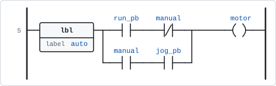
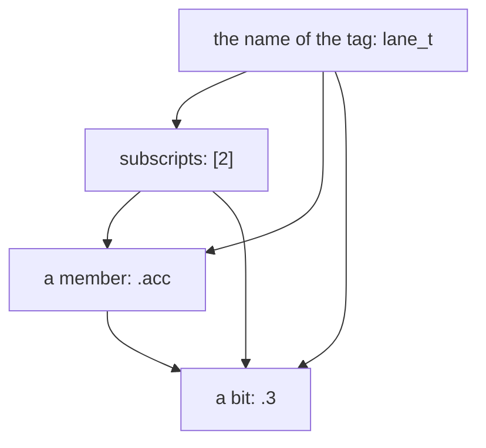

# Source syntax

This page is for a reader who writes a ladder [program](glossary.md#program) and looks
for an exact rule of its text. It defines the text of a `.ld` file: the lines, the
[rungs](glossary.md#rung), the [branches](glossary.md#branch), the names and the
comments. It also defines the name of the file, the case of each word and the
[reserved words](glossary.md#reserved-word).

The syntax of this page is the [dialect](glossary.md#dialect) of logex. logex does not
read the export file of a vendor tool.

These pages define the other parts of the text:

| Part of the text | Page |
|---|---|
| A [declaration](glossary.md#declaration): its section, its type and its [initial value](glossary.md#initial-value) | [Declarations and types](declarations-and-types.md) |
| A [literal](glossary.md#literal): the forms of a number | [Literals](literals.md) |
| The [instructions](glossary.md#instruction) and their [operands](glossary.md#operand) | [Instruction cheatsheet](cheatsheet.cheatmd) |
| The body of a [function block](glossary.md#function-block) and the instruction `cal` | [Function blocks](function-blocks.md) |
| A [configuration file](glossary.md#configuration-file), `.logex` | [Configuration file](configuration-file.md) |

If a text breaks a rule of this page, logex returns a
[diagnostic](glossary.md#diagnostic).
[Wrong texts and their diagnostics](#wrong-texts-and-their-diagnostics) shows 57 wrong
texts. For each text, it shows the message that logex returns.
[Diagnostics](diagnostics.md) gives the groups of messages.

## The parts of a program

The program `jog.ld` has most of the parts that this page defines.

<!-- file: jog.ld -->
```text
var_input manual bool
var_input jog_pb bool
var_input run_pb bool
var_output auto_lamp bool
var_output jog_lamp bool
var_output jog_long bool
var_output motor bool
var jog_t ton

// in auto, jump over the manual section
xio manual jmp auto ote auto_lamp
xic jog_pb ote jog_lamp
xic jog_pb ton jog_t 3000
xic jog_t.dn ote jog_long
lbl auto ( xic run_pb xio manual | xic manual xic jog_pb ) ote motor
```

| Line | Example of the text | Part |
|---|---|---|
| 1 to 8 | `var_input manual bool` | A declaration. All declarations come before the first rung. |
| 9 | No text | A blank line. logex ignores it. |
| 10 | `// in auto, jump over the manual section` | A comment |
| 11 to 15 | `xic jog_pb ote jog_lamp` | A rung. 1 line is 1 rung. Line 11 is rung 1 and line 15 is rung 5. |
| 11 | `xio`, `jmp`, `ote` | 3 [mnemonics](glossary.md#mnemonic). Each mnemonic starts an instruction. |
| 11 and 15 | `auto` | A [label](glossary.md#label) |
| 13 | `3000` | A literal |
| 14 | `jog_t.dn` | A [member](glossary.md#member) of the timer `jog_t` |
| 15 | `( xic run_pb xio manual \| xic manual xic jog_pb )` | A branch of 2 [legs](glossary.md#leg) |

This drawing shows the 5 rungs of `jog.ld` between the 2 [rails](glossary.md#rail). The
number at the left of each rung is the number of the rung, not the number of the line.

<!-- rung: jog.ld -->


## Kinds of file

logex reads 3 kinds of file.

| Kind | Name of the file | First line that is not blank and not a comment |
|---|---|---|
| A program | `motor.ld` | A declaration or a rung |
| A function block | `seal.ld` | `function_block seal` |
| A configuration file | `plant.logex` | [Configuration file](configuration-file.md) gives its lines |

| Kind | What `Logex.compile_file/1` returns |
|---|---|
| A program | `{:ok, program}`, a `%Logex.Program{}` |
| A function block | `{:ok, type}`, a `%Logex.FbType{}` |
| A configuration file | `{:error, diagnostics}`. `Logex.Configuration.compile_file/1` reads this kind of file. |

| Item | Rule |
|---|---|
| The extension | `.ld`, in lower case. logex does not read `motor.txt`, `motor.LD` or `motor`. |
| The name | The text before `.ld` is the name of the program or of the function block type. The file `motor.ld` holds the program `motor`. |
| The characters of the name | A letter or `_`, then letters, digits and `_`. logex refuses `my-motor.ld`, `1m.ld` and `a.b.ld`. |
| The case of the name | The name has the case of the file name: `Motor.ld` holds the program `Motor`. |
| A reserved word as the name | The name of a program can be a reserved word: `ote.ld` is a correct program file. The name of a function block type cannot. |
| The first line of a function block | `function_block`, then the name of the file, in the same case. Only comments and blank lines can come before this line. |
| The other lines of a function block | The declarations come after the `function_block` line. The rungs come after the declarations. |
| The function blocks of a program | If a declaration of the program has the type word `seal`, `Logex.compile_file/1` reads `seal.ld` from the directory of the program. |

The first 5 lines of `seal.ld` are a comment, the `function_block` line and 3
declarations:

<!-- part of: seal.ld -->
```text
// A seal-in: `run` holds itself in from `start` until `stop`.
function_block seal
var_input start bool
var_input stop bool
var_output run bool
```

[Function blocks](function-blocks.md) gives the other rules of this kind of file.

## Lines

| Item | Rule |
|---|---|
| A line | 1 line holds 1 declaration or 1 rung. A newline ends the rung. In the file of a function block, the first line is the `function_block` line. |
| A long rung | No character continues a rung on a second line. |
| A newline | LF, CR LF, or CR alone. Each of the 3 forms ends 1 line. |
| The last line | The last line can end with no newline. |
| A blank line | logex ignores a blank line. A blank line can come before, between and after the other lines. |
| Spaces and tabs at the start or at the end of a line | logex ignores them. |
| The number of a line | The first line of the file is line 1. A blank line and a comment line each count as 1 line. |
| Declarations and rungs | All declarations come before the first rung. A declaration after a rung is an error. |
| A file with no rung | logex [compiles](glossary.md#compile) the file. The program has 0 rungs. |

### A rung must write or jump

A newline ends a rung. If you divide a rung into 2 lines, logex reads 2 rungs. The first
of the 2 rungs writes nothing. logex refuses a rung that writes nothing and jumps nowhere.

A rung is correct if 1 or more of its instructions does 1 of these things:

- The instruction writes a [tag](glossary.md#tag), a member or a [bit](glossary.md#bit).
  Examples are `ote` and `move`.
- The instruction runs an [instance](glossary.md#instance). Examples are `ton`, `ctu` and
  `cal`.
- The instruction is a [one-shot](glossary.md#one-shot), which writes its
  [storage bit](glossary.md#storage-bit). An example is `ons`.
- The instruction is `jmp`.

These rungs have no such instruction:

| Rung | Result |
|---|---|
| `lbl done`, and a `jmp done` is in the same [routine](glossary.md#routine) | The rung is correct. A [jump](glossary.md#jump) to the end of a routine goes to such a rung. |
| `lbl done`, and no `jmp` names `done` | logex refuses the rung. |
| `lbl done xic a` | logex refuses the rung. A label and a [contact](glossary.md#contact) write nothing. |
| `( )` | logex refuses the rung. An empty branch has no instruction. |

This text is wrong. The newline divides 1 rung into 2 rungs:

<!-- unchecked: a wrong form of the syntax; it is wrong text 1 of the script of this page -->
```text
xic start xio stop
ote motor
```

logex refuses line 1, and thus it compiles no program. Line 2 is a full rung. With no
line 1, it sets `motor` to 1 in each [scan](glossary.md#scan), also when `stop` is 1.

This text is correct:

<!-- unchecked: the correct form of the same rung -->
```text
xic start xio stop ote motor
```

## Characters, spaces and comments

| Item | Rule |
|---|---|
| The encoding | UTF-8 |
| The characters of a name | The letters `a` to `z` and `A` to `Z`, the digits and `_` |
| The other characters of the syntax | `.`, `[`, `]` and `,` in a name. `-`, `#`, `.` and `_` in a literal. `(`, `\|` and `)` for a branch. `//` for a comment. |
| Each other character, outside a comment | An error, `illegal character`. Examples are `;`, `+`, `é`, a single `/` and a byte order mark at the start of the file. |
| Spaces and tabs between words | 1 or more spaces or tabs separate 2 words. |
| `(`, `\|` and `)` | A space before or after these characters is not necessary: `(xic start\|xic motor)xio stop ote motor` is correct. |
| A comment | `//` starts a comment. The comment ends at the end of the line. |
| The text of a comment | A comment can hold each character of UTF-8. A byte that is not UTF-8 is an illegal character there also. |
| The place of a comment | After a declaration, after a rung, or alone on a line |
| A terminator | A rung has no terminator such as `;`. The newline ends the rung. |
| Parentheses and commas between operands | logex has none. `xic(start)` is an error, because `(` starts a branch. |

## Rungs

A rung is a series of instructions. logex reads them from left to right.

| Item | Rule |
|---|---|
| An instruction | A mnemonic, then its operands. Spaces or tabs separate them. |
| The number of operands | Each mnemonic has a fixed number of operands. For `cal`, the number of operands comes from its [function block type](glossary.md#function-block-type). |
| The next instruction | The word after the last operand is the mnemonic of the next instruction. Thus an operand too many is an `unknown instruction` error that names the operand. |
| An operand | A name or a literal. [Names](#names) gives the forms of a name. |
| A literal before a letter | A space must come between a literal and a word. `move 1bst aa` is an error that names `1bst`. |
| A sign | `-` is the sign of the literal that comes straight after it. A space must come before the sign: `5-3` and `a-5` are errors. A literal has no `+` sign. The instruction `sub` subtracts. |
| A word that is not a mnemonic, in the place of a mnemonic | An error, `unknown instruction`. A literal in that place is an error also. |
| The last instruction of a path | A [timer](glossary.md#timer) instruction or a [counter](glossary.md#counter) instruction is the last instruction of its rung or of its leg. No instruction comes after the branch that holds it. |

The [Instruction cheatsheet](cheatsheet.cheatmd) gives the operands of each instruction.

## Branches

A branch is a group of parallel legs.

| Text | Function |
|---|---|
| `(` | Starts the branch and its first leg |
| `\|` | Ends a leg and starts a new leg |
| `)` | Ends the last leg and the branch |

| Item | Rule |
|---|---|
| The legs | A branch has 1 leg or more. |
| A leg | A leg is a series of instructions. A leg can hold a branch. |
| An empty leg | A leg can have no instruction. An empty leg passes the power that comes into the branch. In `( xic start \| ) ote motor` the branch is first on its rung, and thus the rung sets `motor` to 1 in each scan. |
| The place of a branch | A branch can come first, in the middle or last on a rung. `xic start ( ote motor \| ote lamp )` writes 2 [coils](glossary.md#coil). |
| A branch and the newline | A branch starts and ends on the same line. |
| The power | [Power flows](glossary.md#power-flow) out of a branch if 1 leg or more passes power. logex runs each leg, also when a leg before it passes power. |

Rung 5 of `jog.ld` has a branch of 2 legs:

<!-- part of: jog.ld -->
```text
lbl auto ( xic run_pb xio manual | xic manual xic jog_pb ) ote motor
```

<!-- rung: jog.ld 5 -->


In the drawing, `(` is the place where the rung divides. `|` is the step from the top leg
to the bottom leg. `)` is the place where the legs join.

## Names

A name is a word that you give to a tag, a member, a label, a program or a function
block type.

| Item | Rule |
|---|---|
| The first character | A letter or `_` |
| The other characters | Letters, digits and `_` |
| The case | A name is case-sensitive: `motor` and `Motor` are different names. A program cannot declare both as tags. [Case](#case) gives the rule for each kind of word. |
| Reserved words | The name of a tag, of a label or of a function block type cannot be a reserved word. The name of a program can. [Reserved words](#reserved-words) gives the list. |
| The length of a subscript or of a bit number | A literal subscript or a literal bit number has 10,000 characters or fewer. |

An operand can name a tag, or an [element](glossary.md#element), a member or a bit of a
tag. Such a name has 4 parts or fewer, in a fixed sequence.



Figure: the parts of the name `lane_t[2].acc.3`, and the parts that can come after each part.

The diagram shows that subscripts come only straight after the name of the tag, and that
a bit is always the last part. This table gives the same facts:

| Part | Example | What it comes straight after |
|---|---|---|
| The name of the tag | `lane_t` | Nothing. It is the first part. |
| Subscripts | `[2]` | The name of the tag |
| A member | `.acc` | The name of the tag, or the subscripts |
| A bit | `.3` | The name of the tag, the subscripts or the member |

| Form | Examples | What it names |
|---|---|---|
| A name alone | `motor` | A tag |
| A name and subscripts | `weights[3]`, `grid[1,7]`, `weights[slot]` | An element of an [array](glossary.md#array) |
| A dot and a member | `jog_t.dn`, `lane_t[2].acc` | A member of an instance |
| A dot and a number | `status.3`, `jog_t.acc.3`, `alarms[2].3` | A bit of a tag, of a member or of an element |
| A dot and a number in brackets | `status.[4]`, `faults.[sel]` | A bit. The number is a literal or the value of a tag. |

In its declaration, the name of a tag has no dot and no brackets.

### Element

| Item | Rule |
|---|---|
| Form | The name of the array, then 1 pair of brackets. No space comes before `[`. |
| The first element | The first element of each dimension has the [subscript](glossary.md#subscript) 0. An array of 8 elements has the subscripts 0 to 7. |
| Number of subscripts | 1 subscript for each dimension of the array. A `,` with no space separates 2 subscripts: `grid[1,7]`. |
| A subscript | An integer literal, or the name of a tag that has an integer type: `weights[slot]`, `grid[1,c]` |
| A literal subscript | The literal can have a leading 0 or a base: `weights[3]`, `weights[03]` and `weights[16#3]` name the same element. |
| Check when logex compiles | logex compares each literal subscript with the size of its dimension. `weights[8]` and `weights[-1]` are errors in an array of 8 elements. |
| Check when the instruction runs | logex reads a tag subscript when the instruction runs. A value that is less than 0 or more than the last subscript is a [major fault](glossary.md#major-fault). |
| Not a subscript | A subscript cannot be a real literal (`weights[1.0]`), a member (`weights[t1.acc]`), an element (`weights[idx[0]]`), a bit or a calculation (`weights[slot+1]`). A tag subscript cannot have the type `bool`, a [bit string](glossary.md#bit-string) type or a real type. |
| The correction of such a subscript | Put the value into a tag of an integer type first. For a bit string, use a conversion, for example `word_to_uint`. |
| The array with no subscript | An instruction does not take a full array. It takes 1 element. |

### Member

| Item | Rule |
|---|---|
| Form | The name of an instance, or an element of an array of instances. Then a dot and the name of the member. |
| The members | A timer and a counter have fixed members. A function block has its `var_input` tags and its `var_output` tags as members. |
| The case | The name of a member is case-sensitive: `jog_t.DN` is not `jog_t.dn`. |
| Check when logex compiles | The instance must have the member. A tag that is not an instance has no members. |
| Not a member | A member of a member. A `var` tag of a function block is not a member outside that function block. |

[Function blocks](function-blocks.md) gives the members of each type.

### Bit

| Item | Rule |
|---|---|
| Form | A tag, an element or a member that has an integer type or a bit string type. Then a dot and the number of the bit. |
| The number | Digits: `status.3`. Or a literal in brackets: `status.[4]` and `status.[16#4]` are the same bit as `status.4`. |
| The number in a tag | The name of a tag that has an integer type, in brackets: `faults.[sel]`. No space comes before `[`, after `[` or before `]`. |
| The end of the name | A bit is the last part of a name. No dot and no bracket come after it. |
| Bit 0 | Bit 0 is the least significant bit: it has the value 1. Bit 3 has the value 8. |
| Check when logex compiles | logex compares a literal bit number with the width of the type. `status.16` of a `word` is an error. |
| Check when the instruction runs | logex reads the tag in the brackets when the instruction runs. A value that is less than 0 or more than the last bit number is a major fault. |
| Not a bit | A bit of a `bool` tag or of a real tag, and a bit of a bit |
| Not a bit number | The brackets cannot hold a member (`status.[t1.acc]`), an element, a bit or a calculation. The tag in the brackets cannot have the type `bool`, a bit string type or a real type. |
| The correction of such a bit number | Put the value into a tag of an integer type first. For a bit string, use a conversion, for example `word_to_uint`. |
| The type of a bit | A bit is a `bool`. A contact reads it and a coil writes it. |

[Faults](faults.md) gives the [faults](glossary.md#fault) of a subscript and of a bit
number.

### Names that must have literal numbers

Some operands must name the same tag, element or bit in each scan. These operands take no
tag as a subscript or as a bit number.

| Operand | Example | Rule |
|---|---|---|
| The instance that a timer instruction, a counter instruction or `cal` runs | `ton lane_t[0] 30` | Literal subscripts only |
| The storage bit of `ons`, `osr` and `osf` | `ons edges[0]`, `ons status.3` | Literal subscripts and a literal bit number only |
| The [pulse bit](glossary.md#pulse-bit) of `osr` and `osf` | `osr s1 status.3` | Literal subscripts and a literal bit number only |

## Labels

A label is the operand of `jmp` and of `lbl`.

| Item | Rule |
|---|---|
| Form | A name. A label has no dot and no subscript, and it is not a literal. |
| Declaration | A label has no declaration. `lbl` gives the label to its rung. |
| The place of `lbl` | `lbl` and its label are the first words of the rung. No instruction and no branch comes before them. |
| 1 label, 1 rung | A routine cannot have 2 rungs with the same label. |
| The direction of a jump | A `jmp` goes to a label on a later rung only. |
| Reserved words | A label cannot be a reserved word. |
| Labels and tags | The labels of a routine are a separate group of names. A label can have the name of a tag: `lbl auto` is correct in a program that has a tag `auto`. |
| The routine | A label belongs to 1 routine. The labels of a function block are separate from the labels of the program. |
| The case | A label is case-sensitive. logex refuses 2 labels of a routine that are different only in case. |

[Instructions: jump and call](instructions-jump-and-call.md) gives the other rules of
`jmp` and `lbl`.

## Case and reserved words

### Case

| Word | Examples | Rule |
|---|---|---|
| A mnemonic | `xic`, `XIC`, `Xic` | Not case-sensitive: the 3 examples are the same mnemonic. |
| A [section](glossary.md#section) word or a [qualifier](glossary.md#qualifier) | `var_input`, `VAR_INPUT`, `Retain` | Not case-sensitive |
| A type word of a built-in [type](glossary.md#type) | `bool`, `BOOL`, `ton`, `TON` | Not case-sensitive |
| `function_block` | `FUNCTION_BLOCK seal` | Not case-sensitive |
| A tag | `motor` | Case-sensitive. A program cannot declare 2 tags that are different only in case, such as `motor` and `Motor`. |
| A member | `jog_t.dn` | Case-sensitive |
| A label | `auto` | Case-sensitive |
| The name of a function block type that you write | `seal` | Case-sensitive: `var s1 Seal` does not find the type `seal`. |

If you write a tag, a member or a label in a different case, the diagnostic shows the
name in its correct case.

### Reserved words

A reserved word cannot be the name of a tag, of a label or of a function block type. The
rule is not case-sensitive: `ote`, `Ote` and `OTE` are 3 forms of 1 reserved word.

| Group | Words | Number |
|---|---|---|
| Mnemonics | The 40 instructions and the 182 typed conversions. [Instruction mnemonics](glossary.md#instruction-mnemonics) lists the 40 instructions and gives the 2 forms of the names of the conversions. | 222 |
| Section words | `var`, `var_input`, `var_output`, `var_external` | 4 |
| Qualifiers | `retain`, `non_retain` | 2 |
| Type words of the [elementary types](glossary.md#elementary-type) | `bool`, `sint`, `int`, `dint`, `lint`, `usint`, `uint`, `udint`, `ulint`, `byte`, `word`, `dword`, `lword`, `real`, `lreal` | 15 |
| Type words of the timers | `ton`, `tof`, `tp`, `rto`, and each of these 4 words with `_ltime`: `ton_ltime` | 8 |
| Type words of the counters | `ctu`, `ctd`, `ctud`, and each of these 3 words with `_int`, `_dint`, `_lint`, `_udint` or `_ulint`: `ctu_int` | 18 |

The words `ton`, `tof`, `tp`, `rto`, `ctu` and `ctd` are in 2 groups: each is a mnemonic
and a type word. [Conversions](conversions.md) gives the name of each conversion.

Some words are reserved only in 1 kind of file:

| Word | Where it is reserved | In a program |
|---|---|---|
| `function_block` | In the file of a function block. It cannot be the name of a tag or of a label there. | A tag or a label can have this name. |
| `task`, `single`, `interval`, `priority`, `continuous`, `watchdog`, `with`, `program`, `var_global`, `at` | In a configuration file | A tag can have 1 of these names. A `var_external` tag cannot, because its name is also the name of a [global](glossary.md#global). |
| The name of a function block type that you write, for example `seal` | In no file | A tag can have this name. |

The qualifiers and the type words of the elementary types are reserved in a
configuration file also. [Configuration file](configuration-file.md) gives its reserved
words.

## Wrong texts and their diagnostics

| Kind of error | What logex returns |
|---|---|
| A character, a literal or a name that logex cannot read, or a `(`, `\|` or `)` in a wrong place | 1 diagnostic, with the line and the column. logex stops at the first error of this kind and does not show the other errors of the file. Correct the error and compile again. |
| Each other error | A diagnostic with the line. logex returns all these errors, in the sequence of the lines. |

The column is the number of the character in its line. The first character is column 1,
and a tab counts as 1 character.

The script `source-syntax.exs` compiles 57 wrong texts. It is in the directory `examples`
of the repository. It is not necessary to read the script. The block after the script
shows each wrong text with its number. Under each text, it shows each diagnostic that
logex returns.

The script prints the wrong texts in groups. Each group starts with a line that names a
section of this page.

| Group | Wrong texts | Section that gives the rules |
|---|---|---|
| Lines | 1 to 3 | [Lines](#lines) |
| Characters, spaces and comments | 4 to 6 | [Characters, spaces and comments](#characters-spaces-and-comments) |
| Rungs | 7 to 13 | [Rungs](#rungs) |
| Branches | 14 to 17 | [Branches](#branches) |
| Names | 18 and 19 | [Names](#names) |
| Element | 20 to 25 | [Element](#element) |
| Member | 26 to 28 | [Member](#member) |
| Bit | 29 to 35 | [Bit](#bit) |
| Names that must have literal numbers | 36 to 38 | [Names that must have literal numbers](#names-that-must-have-literal-numbers) |
| Labels | 39 to 47 | [Labels](#labels) |
| Case and reserved words | 48 to 52 | [Case and reserved words](#case-and-reserved-words) |
| Kinds of file | 53 to 57 | [Kinds of file](#kinds-of-file) |

Wrong texts 1 to 52 are lines of a program. Each text comes after the same 8
declarations, and thus its first line is line 9. No wrong text ends with a newline. Thus
the branch of text 15 ends at the end of the file, and the branch of text 14 ends at a
newline.

Wrong texts 53 to 55 are files of the function block `seal`. Wrong texts 56 and 57 are
names of files.

The script divides a long message into lines of 80 characters or fewer. logex returns
each message as 1 line.

```elixir
declarations = """
var_input start bool
var_input stop bool
var_output motor bool
var status word
var weights int[8]
var t1 ton
var sel int
var lane_t ton[3]
"""

program = fn text -> Logex.compile(declarations <> text, name: "wrong") end
block = fn text -> Logex.compile(text, name: "seal") end

groups = [
  {"Lines", program,
   [
     "xic start xio stop\note motor",
     "( )",
     "xic start ote motor\nvar late bool"
   ]},
  {"Characters, spaces and comments", program,
   [
     "xic start ote motor;",
     "move +5 sel",
     "xic(start) ote motor"
   ]},
  {"Rungs", program,
   [
     "move 1bst sel",
     "move 5-3 sel",
     "start ote motor",
     "5 ote motor",
     "xic start ote motor stop",
     "move 5",
     "xic start ton t1 100 ote motor"
   ]},
  {"Branches", program,
   [
     "( xic start | xic motor\nxio stop ote motor",
     "( xic start | xic motor xio stop ote motor",
     "xic start ) ote motor",
     "xic start | xic motor ote motor"
   ]},
  {"Names", program,
   [
     "var stop.pb bool",
     "var late[3] bool"
   ]},
  {"Element", program,
   [
     "move weights [1] sel",
     "move weights[1, 2] sel",
     "move weights[1][2] sel",
     "move weights[8] sel",
     "move weights[status] sel",
     "move weights sel"
   ]},
  {"Member", program,
   [
     "xic t1.DN ote motor",
     "xic start.dn ote motor",
     "xic t1.dn.x ote motor"
   ]},
  {"Bit", program,
   [
     "xic status.16 ote motor",
     "xic start.0 ote motor",
     "xic status. [3] ote motor",
     "xic status.[ 3] ote motor",
     "xic status.[3x] ote motor",
     "xic status.[3].1 ote motor",
     "xic status.[status] ote motor"
   ]},
  {"Names that must have literal numbers", program,
   [
     "xic start ton lane_t[sel] 30",
     "ons status.[sel] ote motor",
     "xic start osr motor status.[sel]"
   ]},
  {"Labels", program,
   [
     "xic start jmp t1.dn",
     "xic start jmp weights[0]",
     "xic start jmp 5",
     "xic start jmp bool",
     "xic start jmp done",
     "xic start lbl done ote motor",
     "lbl done ote motor\nxic start jmp done",
     "xic start jmp done\nlbl done ote motor\nlbl done ote motor",
     "xic start jmp done\nlbl Done ote motor\nlbl done ote motor"
   ]},
  {"Case and reserved words", program,
   [
     "xic Start ote motor",
     "var Motor bool",
     "var ote bool",
     "var bool bool",
     "var var_input bool"
   ]},
  {"Kinds of file: the first line of a function block", block,
   [
     "var_input start bool\nvar_output run bool\nfunction_block seal\nxic start ote run",
     "function_block\nvar_output run bool\note run",
     "function_block Seal\nvar_output run bool\note run"
   ]},
  {"Kinds of file: the name of the file", &Logex.compile_file/1,
   [
     "motor.txt",
     "motor.logex"
   ]}
]

wrap = fn message ->
  message
  |> String.split(" ")
  |> Enum.chunk_while(
    "     ",
    fn
      word, line when byte_size(line) + byte_size(word) < 80 -> {:cont, line <> " " <> word}
      word, line -> {:cont, line, "      " <> word}
    end,
    fn line -> {:cont, line, ""} end
  )
end

{shown, _next} =
  Enum.map_reduce(groups, 1, fn {section, compile, texts}, first ->
    lines =
      for {text, number} <- Enum.with_index(texts, first) do
        {:error, diagnostics} = compile.(text)
        head = String.pad_leading("#{number}", 2) <> "  " <> String.replace(text, "\n", "\n    ")
        [head | Enum.map(diagnostics, &wrap.(Logex.Diagnostic.format(&1)))]
      end

    {Enum.join(List.flatten([section | lines]), "\n"), first + length(texts)}
  end)

IO.puts(Enum.join(shown, "\n\n"))
```

```console
$ mix run source-syntax.exs
Lines
 1  xic start xio stop
    ote motor
      line 9: this rung writes nothing and jumps nowhere: none of its
      instructions writes a tag, a member or a bit, runs an instance or keeps a
      one-shot's storage bit. A newline ends a rung, so a rung's conditions and
      its outputs go on one line, as in `xic start xio stop ote motor`
 2  ( )
      line 9: a rung of empty groups alone, after line 8, writes nothing and
      jumps nowhere: a group holds no instruction until a leg has one. A newline
      ends a rung, so a rung's conditions and its outputs go on one line, as in
      `xic start ( xio stop | xic jog ) ote motor`
 3  xic start ote motor
    var late bool
      line 10: `var` after the first rung (line 9): declarations come first

Characters, spaces and comments
 4  xic start ote motor;
      line 9, column 20: illegal character ";"
 5  move +5 sel
      line 9, column 6: illegal character "+"
 6  xic(start) ote motor
      line 9: `xic` expects 1 operand (a tag), found none before a branch group
      line 9: unknown instruction `start`

Rungs
 7  move 1bst sel
      line 9, column 6: missing separator after integer: "1bst" is neither a
      number nor a tag
 8  move 5-3 sel
      line 9, column 6: missing separator before `-`: "5-3" is neither a tag nor
      a number, and a sign begins a number
 9  start ote motor
      line 9: unknown instruction `start`
10  5 ote motor
      line 9: expected an instruction, found `5`
11  xic start ote motor stop
      line 9: unknown instruction `stop`
12  move 5
      line 9: `move` expects 2 operands (a value, then a tag), found 1
13  xic start ton t1 100 ote motor
      line 9: `ote motor` follows `ton t1` on its path: what passes on after a
      `ton` is not settled, so a `ton` ends its path; read the timer with `xic
      t1.dn` on a rung below

Branches
14  ( xic start | xic motor
    xio stop ote motor
      line 9, column 24: expected `|` or `)`, found a newline
15  ( xic start | xic motor xio stop ote motor
      line 9, column 1: this `(` is never closed: the input ends before its `)`
16  xic start ) ote motor
      line 9, column 11: expected a newline or end of input, found `)`
17  xic start | xic motor ote motor
      line 9, column 11: expected a newline or end of input, found `|`

Names
18  var stop.pb bool
      line 9: `stop.pb` cannot name a tag: `.` is kept for a member, as in a
      timer's `t1.dn`
19  var late[3] bool
      line 9: `late[3]` cannot name a tag: brackets are kept for an element's
      subscripts, as in `temps[3]`

Element
20  move weights [1] sel
      line 9, column 14: illegal character "["
21  move weights[1, 2] sel
      line 9, column 6: "weights[1, 2]" is no name: an element's subscripts are
      one pair of brackets straight after its array's name, each a number or a
      tag's name, split by `,` with no space, as in `grid[1,7]`
22  move weights[1][2] sel
      line 9, column 6: "weights[1][2]" is no name: an element's subscripts end
      at their `]`, after which only a `.` part may follow, so every subscript
      goes inside the one pair of brackets, as in `grid[1,7]`
23  move weights[8] sel
      line 9: `weights[8]`'s subscript `8` is outside the elements of `weights`,
      0 to 7: `weights` is an array of 8 ints (declared on line 5)
24  move weights[status] sel
      line 9: `weights[status]` takes a subscript from `status`, a word
      (declared on line 4), which is no integer: a subscript is a literal or a
      tag of an integer type, so convert it first, with `word_to_uint`
25  move weights sel
      line 9: `move` reads one tag, but `weights` is an array of 8 ints
      (declared on line 5): an instruction takes one of its elements, as in
      `weights[0]`

Member
26  xic t1.DN ote motor
      line 9: `t1.DN` is not a member of `t1`, a ton — did you mean `t1.dn`?
      (members are case-sensitive)
27  xic start.dn ote motor
      line 9: `start.dn` names a member of `start`, but `start` is a bool
      (declared on line 1): only an instance of a function block has members
28  xic t1.dn.x ote motor
      line 9: `t1.dn.x` goes too deep: `t1.dn` is a bool, which has no members

Bit
29  xic status.16 ote motor
      line 9: `status.16` names bit 16 of `status`, a word (declared on line 4),
      which has bits 0 to 15
30  xic start.0 ote motor
      line 9: `start.0` names a bit of `start`, a bool, which has no bits
31  xic status. [3] ote motor
      line 9, column 5: "status. [3]" is no name: a bit number in brackets is
      written straight after its name's `.`, with no space, `status.[n]`
32  xic status.[ 3] ote motor
      line 9, column 5: "status.[ 3]" is no name: a bit number in brackets is
      one tag's name between `[` and `]`, with no space, `status.[n]`
33  xic status.[3x] ote motor
      line 9, column 5: "status.[3x]" is no name: a bit number in brackets is a
      tag's name, `status.[n]`, or one number closed by its `]`, `status.[4]` or
      `status.[16#4]`
34  xic status.[3].1 ote motor
      line 9, column 5: "status.[3].1" is no name: a bit number in brackets,
      `status.[n]`, ends its name, and nothing may follow its `]` but a space
35  xic status.[status] ote motor
      line 9: `status.[status]` takes its bit number from `status`, a word
      (declared on line 4), which is no integer: a bit number is held in a tag
      of an integer type, so convert it first, with `word_to_uint`

Names that must have literal numbers
36  xic start ton lane_t[sel] 30
      line 9: `ton` runs `lane_t[sel]`, whose subscript `sel` holds: an
      instruction that runs an instance takes an element of an array of
      instances by literal subscripts, as in `ton lane_t[0]`, so that each
      element is one instance, run by one instruction whatever the program does
37  ons status.[sel] ote motor
      line 9: `ons` keeps its storage bit in `status.[sel]`, whose number `sel`
      holds: a one-shot's storage bit is a bool or a bit with a literal number,
      as in `status.0`, so that it is one bit whatever the program does
38  xic start osr motor status.[sel]
      line 9: `osr` sets its pulse bit in `status.[sel]`, whose number `sel`
      holds: a pulse coil's pulse bit is a bool or a bit with a literal number,
      as in `status.0`, so that it is one bit whatever the program does

Labels
39  xic start jmp t1.dn
      line 9: `jmp` takes a label, a name with no `.`, found `t1.dn`
40  xic start jmp weights[0]
      line 9: `jmp` takes a label, a name with no subscript, found `weights[0]`
41  xic start jmp 5
      line 9: `jmp` expects a label, found `5`
42  xic start jmp bool
      line 9: `jmp` takes a label, found the type `bool`
43  xic start jmp done
      line 9: `jmp done` names no label: no rung of this program begins `lbl
      done`
44  xic start lbl done ote motor
      line 9: `lbl done` is not first on its rung: a label stands at the head of
      the rung it names, before any other instruction or branch group
45  lbl done ote motor
    xic start jmp done
      line 10: `jmp done` jumps back, to the rung on line 9: a jump goes forward
      only, to a label on a later rung, since one back could loop for ever
46  xic start jmp done
    lbl done ote motor
    lbl done ote motor
      line 11: `done` already labels the rung on line 10: a label names one rung
47  xic start jmp done
    lbl Done ote motor
    lbl done ote motor
      line 9: `jmp done` names no label: no rung of this program begins `lbl
      done` — did you mean `Done`? (labels are case-sensitive)
      line 11: the labels `done` and `Done` (line 10) differ only in case:
      labels are case-sensitive, so these would be two labels

Case and reserved words
48  xic Start ote motor
      line 9: `Start` is not declared — did you mean `start`? (tags are
      case-sensitive)
49  var Motor bool
      line 9: `Motor` and `motor` (line 3) differ only in case: tags are
      case-sensitive, so these would be two tags
50  var ote bool
      line 9: `ote` is an instruction and cannot name a tag
51  var bool bool
      line 9: `bool` is a type and cannot name a tag
52  var var_input bool
      line 9: `var_input` is a keyword and cannot name a tag

Kinds of file: the first line of a function block
53  var_input start bool
    var_output run bool
    function_block seal
    xic start ote run
      line 3: `function_block` heads a function block's file, as its first line
54  function_block
    var_output run bool
    ote run
      line 1: `function_block` takes the block's name, as in `function_block
      seal`
55  function_block Seal
    var_output run bool
    ote run
      line 1: this function block is `Seal`, but it is compiled as `seal`: a
      block is named after its file

Kinds of file: the name of the file
56  motor.txt
      motor.txt: `motor.txt` is not a `.ld` file: Logex.compile_file/1 compiles
      a program or a function block from its `.ld` file
57  motor.logex
      motor.logex: `motor.logex` is a configuration file (`.logex`), which
      Logex.Configuration.compile_file/1 loads
```

The script does not show 2 messages. The first message is for a program file that has
the name `my-motor.ld`. The second message is for a subscript of 10,001 characters in
line 9 of a program. Each message is 1 line, divided here as the script divides it.

<!-- unchecked: 2 messages from runs by hand; the script has no file with this name and does not print a text of 10,001 characters -->
```text
my-motor.ld: "my-motor" cannot name a program: a name is a letter or `_`, then
  letters, digits or `_` (rename the file)
line 9, column 6: "weights[0000000000000000…" is no name logex reads: a number in
  a name, a subscript or a bit's number, is written in at most 10000 characters
```

## See also

- [Declarations and types](declarations-and-types.md): the declaration lines of a
  program.
- [Literals](literals.md): the forms of a number.
- [Instruction cheatsheet](cheatsheet.cheatmd): each instruction and its operands.
- [Diagnostics](diagnostics.md): the form of a diagnostic and the groups of messages.
- [Read a diagnostic](../howto/read-diagnostics.md): how to find and correct an error.
- [Jump over rungs](../howto/jump-over-rungs.md): how to use a label.
- [Use arrays](../howto/use-arrays.md) and [Use bit strings](../howto/use-bit-strings.md):
  how to use elements and bits.
- [Write a function block](../howto/write-a-function-block.md): how to make the file of
  a function block.
- [The dialect and IEC 61131-3](../explanation/the-dialect-and-iec.md): why logex has
  this syntax.
- [Glossary](glossary.md): the technical words of logex.
