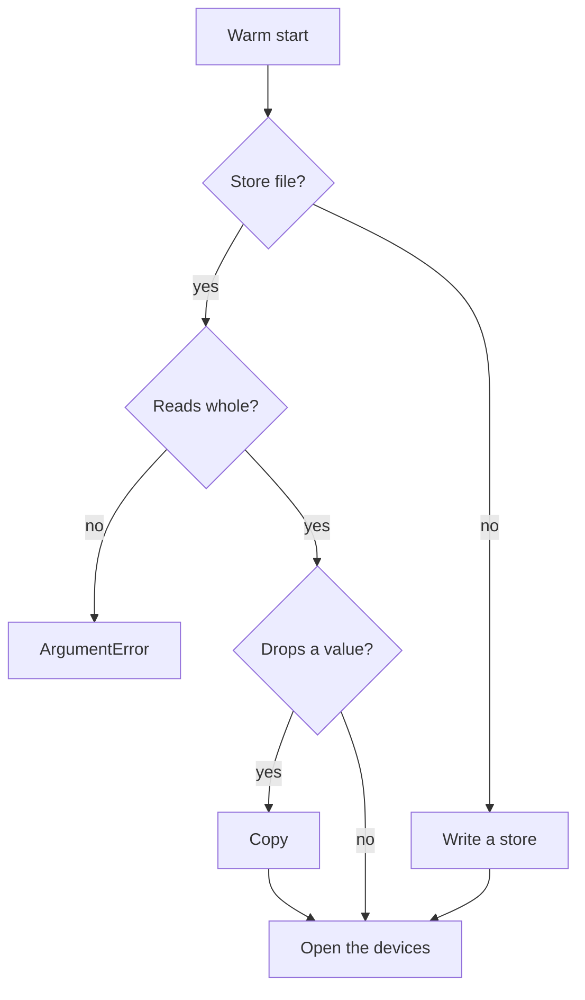
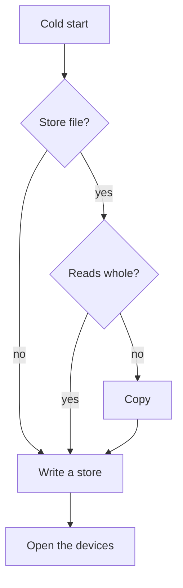

# The store

This page is for a reader who looks for an exact rule about the
[store](glossary.md#store). The store is the file in which a [runner](glossary.md#runner)
keeps the retained values of its [resource](glossary.md#resource). The reader is an Elixir
developer who gives a runner a store, or a controls engineer who keeps a
[plant](glossary.md#plant) running. The page defines the text of the store and its
versions. It also defines what a fresh start does with the store, each refusal, each copy,
each write and the status.
[Retained values](retained-values-and-store.md) defines the values that the store holds:
the [qualifier](glossary.md#qualifier) [`retain`](glossary.md#retain), the restarts and the [retained
image](glossary.md#retained-image).

> #### Warning {: .warning}
>
> Do not keep a value of a [safety function](glossary.md#safety-function) in the store. A
> person can edit the store, a cold start discards each retained value, and a crash can
> set a value back to an older value. The store is not battery-backed memory and not
> safety memory.

> #### Warning {: .warning}
>
> Do not expect a warm start to keep each [output](glossary.md#output) at 0. A
> [rung](glossary.md#rung) that reads a retained value writes its output from that value
> in the first [round](glossary.md#round). Thus an output can come on immediately, with no
> person at the machine. If a supervisor of the [host](glossary.md#host) starts a crashed runner again, that
> start is warm unless its options give `start: :cold`.

| To find | Go to |
|---|---|
| The words of this page, such as a fresh start and an owed copy | [Words of this page](#words-of-this-page) |
| The lines of the store, its digests and its versions | [The text of the store](#the-text-of-the-store) |
| What a fresh start does with the store, and each refusal | [A fresh start](#a-fresh-start) |
| The [warning](glossary.md#warning) that a different [program](glossary.md#program) wrote the store | [The warning of a different program](#the-warning-of-a-different-program) |
| The files `tally.retain.dropped.1` and so on | [The numbered copies](#the-numbered-copies) |
| When the runner writes the store, and what a crash loses | [The writes](#the-writes) |
| The key `retain` of the status of a runner | [The status of the store](#the-status-of-the-store) |
| The rules for the path of the store | [The file of the store](#the-file-of-the-store) |
| A change to the store with a text editor | [A hand edit](#a-hand-edit) |
| The options `retain:`, `retain_period:`, `start:` and `write_limit:` | [Runner](runner.md#the-options) |

Each example on this page is a script, with each line that it prints. Each `elixir` block
is the file under `examples/` that its `$ mix run` line names. The directory `examples` of
the repository is a Mix project, and logex is its dependency. To run a script, give its
command in that directory.

## Words of this page

| Word | Meaning |
|---|---|
| A fresh start | `Logex.Runner.start_link/1` of a new runner, for example after a crash |
| A warm start | A fresh start that reads the store. A fresh start is warm unless the host gives `start: :cold`. |
| A cold start | A fresh start with `start: :cold` |
| A store that reads whole | A store that a warm start does not refuse |
| A write | The runner writes the whole store to the disk. |
| A periodic write | The write that the runner does each `retain_period:` ms |
| A write at an event | The write of a [trip](glossary.md#trip), of a stop, of a shutdown, of a [cold restart](glossary.md#cold-restart) or of a fresh start |
| The write limit | The limit of real time for each read and each write of the store: the option `write_limit:`, 5000 ms if not set |
| A refusal | An `ArgumentError` that a fresh start raises because of the store. Its message has 1 line for each problem. |
| A copy | A file `<store>.dropped.<n>` that holds the store as a fresh start read it |
| An owed copy | A copy whose write failed. The runner writes it before its next write over the store. |
| A shutdown | A process ends the runner with the reason `:normal`, `:shutdown` or `{:shutdown, term}`. |
| A crash | The runner ends for a different reason, or a process kills it. |
| A digest | The MD5 of a text, as 32 lowercase hexadecimal digits |

## The files of the examples

`tally.ld` counts boxes in the plant `tally.logex`. It adds each box to the
[global](glossary.md#global) `total_boxes` through `var_external`. When the counter gets to
3, it latches `full`. The [counter](glossary.md#counter) `boxes` and the output `full` have `retain`. In
`tally.logex`, the global `total_boxes` has `retain`. The [simulated
device](glossary.md#simulated-device) `panel` holds the [input](glossary.md#input)
[point](glossary.md#point) of the photo-eye.

<!-- file: tally.ld -->
```text
var_input eye bool
var_output retain full bool
var_external total_boxes dint
var retain boxes ctu
var e bool

xic eye ctu boxes 3
xic eye ons e add total_boxes 1 total_boxes
xic boxes.q otl full
```

<!-- file: tally.logex -->
```text
// tally.logex -- a box counter whose count and total survive a warm restart
var_global eye_1              bool at panel.i.0
var_global retain total_boxes dint 0
var_global case_full          bool

program t1 tally
  t1.eye  eye_1
  t1.full case_full
```

## The text of the store

### Example: the store, a fresh start and a warning

`kept.exs` runs `tally.logex` on the [manual clock](glossary.md#clock). It counts 4 boxes
and stops the runner, which writes the store. It prints the store. It starts the runner
again, warm from the store, and then with `start: :cold`. Then it makes an [online
edit](glossary.md#online-edit) and [assemble](glossary.md#assemble)s it, and starts again
from `tally.ld` on the disk. Last, it starts from a store that names a different
[configuration](glossary.md#configuration).

```elixir
alias Logex.IO.Sim
alias Logex.Runner
alias Logex.Runner.Clock.Manual

{:ok, plant} = Logex.Configuration.compile_file("tally.logex")
File.rm("tally.retain")

# The manual clock, its wall clock 2026-10-30T14:00:00Z.
{:ok, clock} = Manual.start_link(now: 1_793_368_800_000)
{:ok, panel} = Sim.start_link(clock: clock)

opts = [
  configuration: plant,
  io: %{"panel" => {Sim, sim: panel}},
  clock: {Manual, clock},
  retain: "tally.retain"
]

show = fn runner, label ->
  IO.puts("#{label}  total_boxes=#{Runner.get!(runner, "total_boxes")} " <>
            "t1.boxes.cv=#{Runner.get!(runner, "t1.boxes.cv")} " <>
            "case_full=#{Runner.get!(runner, "case_full")}")
end

{:ok, runner} = Runner.start_link(opts)

for eye <- [1, 0, 1, 0, 1, 0, 1, 0] do
  Sim.set(panel, "panel.i.0", eye)
  Manual.advance(clock, 1000)
end

show.(runner, "four boxes  ")
IO.inspect(Runner.stop(runner), label: "stop")
IO.write(File.read!("tally.retain"))

{:ok, runner} = Runner.start_link(opts)
show.(runner, "fresh start ")
IO.inspect(Runner.status(runner).retain.written_at, label: "written_at")
:ok = Runner.stop(runner)

{:ok, runner} = Runner.start_link(opts ++ [start: :cold])
show.(runner, "start: :cold")
:ok = Runner.stop(runner)

# An edit made online and assembled, never written to tally.ld.
{:ok, coil} = Logex.compile(String.replace(File.read!("tally.ld"), "otl full", "ote full"), name: "tally")
{:ok, edited} = Logex.Configuration.compile("tally", File.read!("tally.logex"), %{"tally" => coil})
{:ok, runner} = Runner.start_link(opts)
{:ok, _forecast} = Runner.accept(runner, edited)
{:ok, _report} = Runner.test(runner)
{:ok, _report} = Runner.assemble(runner)
:ok = Runner.stop(runner)

{:ok, runner} = Runner.start_link(opts)
IO.puts(Runner.status(runner).retain.warning)
:ok = Runner.stop(runner)

File.write!("tally.retain", String.replace(File.read!("tally.retain"), "configuration tally", "configuration line_2"))

try do
  Runner.start_link(opts)
rescue
  error in ArgumentError -> IO.puts(error.message)
end
```

```console
$ mix run kept.exs
four boxes    total_boxes=4 t1.boxes.cv=4 case_full=1
stop: :ok
logex retain 4
configuration tally written 2026-10-30T14:00:08Z
resource 013cc059392445fdcc1e84c9b0de6118
program tally bd882e28a8159d8e8a4ea56ade7b36b6
global total_boxes dint 4
instance t1 tally
t1.boxes ctu
t1.boxes.cu bool 0
t1.boxes.cv dint 4
t1.boxes.ov bool 0
t1.boxes.pv dint 3
t1.boxes.q bool 1
t1.boxes.r bool 0
t1.full bool 1
digest 8cfa2e4d3e860b659fe02173b2f9f18a
end 16 lines
fresh start   total_boxes=4 t1.boxes.cv=4 case_full=1
written_at: ~U[2026-10-30 14:00:08Z]
start: :cold  total_boxes=0 t1.boxes.cv=0 case_full=0
tally.retain: the store was written by another program than the one this start was given: `tally`'s text differs; whether by a deploy of changed files, or an edit tested or assembled online that never reached the files, this start runs the program it was given, with the store's retained values laid over it by name and type
tally.retain: line 2: the store is of configuration `line_2`, and this configuration is `tally`: a store starts only the configuration it was written for, so a renamed configuration starts only cold: start it with start: :cold to start over it, which copies it first to the next `.dropped.<n>` beside it and then writes a new store over it
```

| Line | What it shows |
|---|---|
| `four boxes` | The plant counts 4 boxes, and `case_full` is 1. |
| `stop: :ok` | The stop writes the store. |
| `logex retain 4` to `end 16 lines` | The store. [The lines of the store](#the-lines-of-the-store) gives each line. |
| `fresh start` | A warm start reads the store. Each value is the value at the stop. |
| `written_at` | The time on the `configuration` line of the store |
| `start: :cold` | A cold start. Each value gets its [initial value](glossary.md#initial-value). |
| `tally.retain: the store was written by another program` | After the edit, a warm start from the files gives the warning. [The warning of a different program](#the-warning-of-a-different-program) gives the rules. |
| `tally.retain: line 2:` | A warm start refuses a store of a different configuration. |

### The lines of the store

The store is text that a person can read. Its lines come in this sequence. The output of
`kept.exs` shows each line.

| Line | What it holds |
|---|---|
| The header, `logex retain 4` | The version of the store |
| The `configuration` line | The name of the configuration, the word `written` and the time of the write, in UTC to the second |
| The `resource` line | The digest of the lines of the configuration |
| A `program` line | 1 line for each [program type](glossary.md#program-type), in name order: its name and the digest of its text |
| A global, `global total_boxes dint 4` | Each retained global, in name order: its name, its [type](glossary.md#type) and its value |
| A [trigger](glossary.md#trigger), `trigger arm 0` | Each retained `single`, with its last [sample](glossary.md#sample). A task with its own sample has a line with the name of the task. |
| An instance, `instance t1 tally` | Each [instance](glossary.md#instance) whose program retains a value: its name and its program type |
| An instance on a path, `t1.boxes ctu` | Each instance on the path to a value, with its kind. An array of instances is `m1.lane_t ton[4]`. |
| A value, `t1.boxes.cv dint 4` | Each value, with its path and its type, in path order |
| The `digest` line | The digest of the value lines. [The digest of the values](#the-digest-of-the-values) gives the rule. |
| The end line, `end 16 lines` | The count of the lines of the store. This count includes the header and the end line. |

- The time comes from the wall clock of the [clock](glossary.md#clock) of the runner,
  through its `wall_ms/1`. The manual clock gives the wall time that its option `now:`
  sets. The time is for a person and for the status. No timer reads it.
- Each line has words with 1 space between them.
- An [array](glossary.md#array) has its [element](glossary.md#element)s on 1 line, in
  the sequence of the elements. The last [subscript](glossary.md#subscript) changes
  fastest. Example: `m1.weights int[8] 0 0 12 14 0 0 0 0`.
- An integer and a bool are decimal. A real has the shortest text that reads back to the
  same real.
- The store never holds the hidden member `last` of a [timer](glossary.md#timer).
- The runner ends each line with LF.

### The digests

The `resource` line and the `program` lines name the program that the runner ran when it
wrote the store. A warm start compares them with the program that it got.

| Digest | Of what |
|---|---|
| `resource` | The tasks, globals, instances and connections of the configuration, as text with no line numbers |
| `program` | The text of the program type in a fixed form, and the text of each user block that it holds, after it. |

| A change to a file | Changes the digest |
|---|---|
| A comment or an empty line in the [configuration file](glossary.md#configuration-file) | No |
| A comment, an empty line, CRLF line ends or more spaces in a `.ld` file | No |
| A [literal](glossary.md#literal) with a different spelling: `16#3E8` for `1000`, `temps[03]` for `temps[3]` | No |
| A number in a name with a different spelling: a subscript, a [bit](glossary.md#bit) number, the size of an array | No |
| The case of a word that logex reads in each case: `XIC` for `xic`, `DINT` for `dint` | No |
| A bit number in brackets: `w.[4]` for `w.4` | No |
| The case of the name of a [tag](glossary.md#tag), a [member](glossary.md#member), a [label](glossary.md#label) or a user block: `Start` for `start` | Yes |
| A different initial value, [task](glossary.md#task), global, instance or [connection](glossary.md#connection) in the configuration | Yes |
| A different rung, [instruction](glossary.md#instruction) or [declaration](glossary.md#declaration) in a program | Yes |

These digests are of the program, not of the store. The `digest` line is of the store.

### The digest of the values

The `digest` line holds the digest of the value lines of the store. A fresh start computes
the digest again, and refuses a store whose `digest` line does not hold it. Thus a hand
edit that changes, adds or removes a value line must also change the `digest` line.

| Rule | What it is |
|---|---|
| The value lines | Each line after the `configuration` line, except the `resource` line, the `program` lines, the `digest` line and the end line |
| The digest | The MD5 of the value lines as 32 lowercase hexadecimal digits. Each value line has LF at its end. |
| Line ends | The digest is the same for a store with CRLF or CR line ends. |
| A store that names no program | It holds no `digest` line, and its header is `logex retain 2`. |

A fresh start refuses these stores. Each refusal gives the way out.

| The store | Refused at | The refusal | Case of [Example: refusals](#example-refusals) |
|---|---|---|---|
| A `digest` line that does not hold the digest of the value lines | The `digest` line | Gives the digest of the value lines, so that you can keep an edit | 22, 23 |
| A `digest` line whose digest is not 32 lowercase hexadecimal digits | The `digest` line | Gives the digest of the value lines, so that you can keep an edit | 26 |
| A store of `logex retain 4` with no `digest` line | Line 1 | Says that the end of the store can be lost, and the values after its last line. It gives no digest. | 24 |

- The refusal of the digest comes only when the store has no other problem. If a line does
  not read, or the count is not correct, the refusal gives only those problems. A
  `digest` line whose digest is not 32 lowercase hexadecimal digits is then 1 of the
  problems, with no digest and no way out.
- A store with no `digest` line was cut short and given an end line, or a person removed
  its `digest` line. The refusal gives no digest. With a digest written, a start reads
  the values that the cut took at their initial values. Start it cold, which copies it
  first.
- A `digest` line in a store of a different version is refused.
- The digest finds an edit by hand that was not mended. It is not a protection against a
  person who mends it. [What the store does not do](#what-the-store-does-not-do) gives
  this limit.

### The versions

logex reads 4 versions of the store. Each write makes a store of `logex retain 4`, or of
`logex retain 2` if the store names no program.

| Header | What the store holds |
|---|---|
| `logex retain 4` | The naming lines: 1 `resource` line, then the `program` lines. A `digest` line. An end line. The rules of this page apply. |
| `logex retain 3` | The naming lines and an end line. No `digest` line. A start reads it by each rule of version 4 but the digest, which it holds none of. |
| `logex retain 2` | An end line. The naming lines are possible. |
| `logex retain 1` | No naming lines and no end line. A start warns of nothing. It cannot find a store that is cut short. |

Rules for a store of `logex retain 2`:

- If the store has `resource` and `program` lines, each program digest is the MD5 of the
  bytes of its file. The start compares the bytes of the files that it got, and warns if
  they are different.
- A store that names no program starts with no warning.
- A store with its `resource` line only warns that each program type of the start is not
  in the store.

A store of `logex retain 4` or `logex retain 3` must name its program with its `resource`
line and at least 1 `program` line. A fresh start refuses each of these stores:

| The store | Refused at |
|---|---|
| No `resource` line and no `program` line | Line 1 |
| A `program` line and no `resource` line | The `program` line |
| A `resource` line and no `program` line | The `resource` line |

- A cold start starts over such a store. It first copies the store to the next numbered
  copy.
- The refusal of a missing naming line comes only when the count of the store is correct.
  If the count is not correct, or the store is cut short, the refusal gives only that
  problem.
- A `resource` or `program` line whose digest is not 32 lowercase hexadecimal digits gets
  a different message, not the message of a missing line.

### The end line

The last line of a store of `logex retain 4`, `logex retain 3` or `logex retain 2` is the
end line, `end <count> lines`.
The count includes the header and the end line, as `wc -l` counts them. A fresh start
refuses a store whose last line is not an end line, or whose count is not the count of its
lines.

| Change | Result |
|---|---|
| A copy that stops early, or a file system that loses the end of a file | The file loses its end line, or the end line is cut. The start refuses the store. |
| A cut inside a number | The file loses its end line. Thus the start does not read a smaller number. |
| A hand edit that changes a line and keeps the number of lines | The count stays correct. The digest finds a changed value line. |
| A hand edit that adds or removes a line, and does not change the count | The count is not correct. The start refuses the store. |
| A line that is lost or doubled inside the file | The count is not correct. The start refuses the store. |
| A store that lost only its last LF | Each line stays whole. The start reads the store. |

The end line finds a store that is cut short. It does not find a value that a person
changed in place. The `digest` line finds it.

### What a start reads and what it refuses

| Text | What a fresh start does |
|---|---|
| Lines that end with LF, CRLF or 1 CR | It reads each line the same. It counts each line, with each kind of line end. The next write uses LF. |
| A last line with no line end | It reads the line. |
| A byte-order mark before the header | It refuses the store with a message for the mark. It reads the rest as if the mark is not there, and gives each other problem also. |
| A comment | It refuses the store. |
| A tab | It refuses the store. |
| A byte that is not printable ASCII | It refuses the store. |
| An empty line | It refuses the store. |
| An end line under `logex retain 1`, or under a header that the start cannot read | It refuses the end line, because only versions 4, 3 and 2 end with an end line. |
| A number of 10,000 characters or fewer | It reads the number. A based literal such as `16#5` is correct. |
| A number of more than 10,000 characters, or `+5` | It refuses the line: the text is no number. |
| A real out of the range of its type, such as `1.0e9999`, or a real with no fraction, such as `1e3` | It refuses the line: the text is no number. |
| An integer for a value of a real type, such as `5` for an `lreal` | It reads the nearest real, `5.0`. |
| A value that does not fit its type, such as `5.0` for a `dint` | It reads the store and drops the value as `:misfit`. |

## A fresh start

> #### Caution {: .error}
>
> Copy the store before a cold start if you can need its values again. A cold start over
> a store that reads whole makes no copy. It writes the initial values over the store.

### Warm, cold and no store



Figure 1: a warm start. A warm start refuses a store that does not read whole. It copies a
store from which it drops a value. With no store file, it writes a store of initial
values.



Figure 2: a cold start. A cold start copies only a store that does not read whole. Then it
writes a store of initial values.

| Start | What it does |
|---|---|
| A warm start, the store reads whole | It puts each stored value over the resource by the rules of [A start from an image](retained-values-and-store.md#a-start-from-an-image). It writes nothing. If it drops a value, it copies the store at the start, before it opens a [device](glossary.md#device). |
| A warm start, the store does not read whole | It raises 1 `ArgumentError`. The runner does not start and opens no device. |
| A warm start, the runner cannot read the store, for example a directory or a FIFO | It raises an `ArgumentError`, for example `tally.retain: the store cannot be read: illegal operation on a directory` |
| A cold start, the store reads whole | It makes no copy. It writes a new store of initial values before it opens a device. |
| A cold start, the store does not read whole | It copies the store first. Then it writes a new store of initial values before it opens a device. |
| A cold start, the runner cannot make the copy or read the store | It gives `{:error, {:retain, reason}}`, for example `{:error, {:retain, :eisdir}}`. The store stays as it was. |
| No store file, warm or cold | It writes a store of initial values before it opens a device. |
| A cold [restart](glossary.md#restart) with `restart/2` of a tripped runner | It reads no store and makes no copy. It starts from the values that the runner holds. |

- The runner reads the store in the caller, after the [forces
  file](glossary.md#forces-file).
- The read has the write limit. The check for a symbolic link has the same limit. If the
  disk does not answer in this limit, the start does as for a store that it cannot read.
- For a relative path, the start reads the working directory in the write limit. If the
  start cannot read it, the start raises an `ArgumentError`. Example: `x.retain: the store
  cannot be located: the working directory a relative path is read against cannot be
  read`.
- A runner with `retain:` must have a clock with `wall_ms/1`. Else `start_link/1` raises
  an `ArgumentError`. [Runner](runner.md#the-options) gives the message.

### What a warm start refuses

A warm start refuses the store, with 1 line for each problem, for each of these causes.
The cases are in [Example: refusals](#example-refusals).

| Cause | Case |
|---|---|
| A store of a different configuration, also of a configuration with a new name | The last line of [`kept.exs`](#example-the-store-a-fresh-start-and-a-warning) |
| A store cut short, or an end line whose count is not correct | 1, 2, 3 |
| A comment, an empty line, a byte-order mark, a tab or a byte that is not printable ASCII | 4 to 8 |
| An empty file, or a header that logex does not read | 9, 10 |
| An end line under a store that has no end line | 10, 11 |
| No `configuration` line | 12 |
| A store of `logex retain 4` that does not name its program | 13, 14 |
| A digest that is not 32 lowercase hexadecimal digits | 15 |
| A line that is no line of a store, or a line in the wrong place | 16 |
| 2 lines that name 1 value | 3 |
| A `digest` line that does not hold the digest of the value lines, a digest mistyped, or no `digest` line | 22 to 24, 26 |
| A word that is no type, or no number | 17, 18 |
| An image that `Logex.Runtime.start/2` refuses | [An image that a start refuses](retained-values-and-store.md#an-image-that-a-start-refuses) |

The message of a refusal:

| Part | Rule |
|---|---|
| Each line | `<path>: line <n>: <problem>` |
| The number of lines | The first 50 problems, then 1 line: `<path>: and 10 more problems, not listed` |
| A text of the store that a line quotes | 60 bytes or fewer. A longer text ends with `…`. A byte that is not printable shows as its escape, `\xC3`. |
| The path | Printable. A path of more than 4,096 bytes shows as `…` and its last 4,096 bytes. |
| A line | 1,000 bytes or fewer after the path |
| The way out | ``start it with start: :cold to start over it, which copies it first to the next `.dropped.<n>` beside it and then writes a new store over it``. 1 time in a refusal, at the end of the first line that gives it. |

These refusals give the way out:

- a store cut short
- a missing naming line
- a store of a different configuration
- a `digest` line that does not hold the digest of the values, or no `digest` line
- a digest mistyped in a store with no other problem

A refusal of a problem that a person can repair by hand gives no way out. Examples are a
bad line, a digest of a naming line with a wrong character and a count that is not
correct.

### Example: refusals

`store-refusals.exs` writes a good store. Then it changes the store in 26 ways, and
starts a runner on each. Cases 19 to 21 and 25 start. Cases 19 to 21 change a value, and
mend the `digest` line with the function `sealed`.

```elixir
alias Logex.IO.Sim
alias Logex.Runner
alias Logex.Runner.Clock.Manual

{:ok, plant} = Logex.Configuration.compile_file("tally.logex")
File.rm("tally.retain")

# The manual clock, its wall clock 2026-10-30T14:00:00Z.
{:ok, clock} = Manual.start_link(now: 1_793_368_800_000)
{:ok, panel} = Sim.start_link(clock: clock)

opts = [
  configuration: plant,
  io: %{"panel" => {Sim, sim: panel}},
  clock: {Manual, clock},
  retain: "tally.retain"
]

# A good store: the start writes it, and the stop writes it again.
{:ok, runner} = Runner.start_link(opts)
:ok = Runner.stop(runner)
good = File.read!("tally.retain")

start = fn label, text ->
  File.write!("tally.retain", text)
  IO.puts("-- #{label}")

  try do
    {:ok, runner} = Runner.start_link(opts)
    retain = Runner.status(runner).retain

    IO.puts(
      "started, count #{Runner.get!(runner, "t1.boxes.cv")}, dropped #{inspect(retain.dropped)}"
    )

    :ok = Runner.stop(runner)
  rescue
    error in ArgumentError -> IO.puts(error.message)
  end
end

# A line added or removed, with the count of the end line changed to match.
counted = fn text, lines -> String.replace(text, "end 16 lines", "end #{lines} lines") end

# A value line edited, with the digest mended to match: the MD5 of every line after the
# configuration's line, but the naming lines, the digest and the end line, each with LF.
sealed = fn text ->
  [_header, _configuration | lines] = String.split(text, "\n", trim: true)
  naming = ["resource ", "program ", "digest ", "end "]
  values = for line <- lines, not String.starts_with?(line, naming), do: [line, ?\n]
  digest = Base.encode16(:erlang.md5(values), case: :lower)
  String.replace(text, ~r/^digest \w+$/m, "digest #{digest}")
end

start.("1. the end line taken away", String.replace(good, "end 16 lines\n", ""))
start.("2. the file cut inside the end line", String.replace(good, "end 16 lines\n", "end 1"))

start.(
  "3. a line doubled, the count kept",
  String.replace(good, "t1.full bool 0\n", "t1.full bool 0\nt1.full bool 0\n")
)

start.(
  "4. a comment",
  String.replace(good, "instance t1 tally\n", "# counted by hand\ninstance t1 tally\n")
)

start.("5. an empty line after the end line", good <> "\n")
start.("6. a byte-order mark", "" <> good)
start.("7. a tab", String.replace(good, "t1.boxes ctu", "t1.boxes\tctu"))
start.("8. a byte that is not ASCII", String.replace(good, "t1.full bool 0", "t1.fullé bool 0"))
start.("9. an empty file", "")
start.("10. version 5", String.replace(good, "logex retain 4", "logex retain 5"))

start.(
  "11. an end line under logex retain 1",
  good
  |> String.replace("logex retain 4", "logex retain 1")
  |> String.replace(~r/^(resource|program|digest) .*\n/m, "")
  |> counted.(13)
)

start.(
  "12. no configuration line",
  good |> String.replace(~r/^configuration .*\n/m, "") |> counted.(15)
)

start.(
  "13. no resource line and no program line",
  good |> String.replace(~r/^(resource|program) .*\n/m, "") |> counted.(14)
)

start.(
  "14. a resource line and no program line",
  good |> String.replace(~r/^program .*\n/m, "") |> counted.(15)
)

start.(
  "15. a digest with a wrong character",
  String.replace(good, "resource 013cc", "resource 013cZ")
)

start.(
  "16. a line before the first instance line",
  good |> String.replace("instance t1 tally\n", "junk here\ninstance t1 tally\n") |> counted.(17)
)

start.("17. a word that is no type", String.replace(good, "cv dint 0", "cv dnt 0"))
start.("18. a word that is no number", String.replace(good, "cv dint 0", "cv dint +5"))
start.("19. a based number", good |> String.replace("cv dint 0", "cv dint 16#5") |> sealed.())

start.(
  "20. a value that does not fit its type",
  good |> String.replace("cv dint 0", "cv dint 5.0") |> sealed.()
)

start.(
  "21. CRLF line ends, a count of 7",
  good |> String.replace("cv dint 0", "cv dint 7") |> sealed.() |> String.replace("\n", "\r\n")
)

start.("22. a value changed, the digest kept", String.replace(good, "cv dint 0", "cv dint 7"))

start.(
  "23. a line removed, its count mended, the digest kept",
  good |> String.replace("t1.full bool 0\n", "") |> counted.(15)
)

start.(
  "24. no digest line, its count mended",
  good |> String.replace(~r/^digest .*\n/m, "") |> counted.(15)
)

start.(
  "25. a store of version 3, which holds no digest",
  good
  |> String.replace("logex retain 4", "logex retain 3")
  |> String.replace(~r/^digest .*\n/m, "")
  |> String.replace("cv dint 0", "cv dint 3")
  |> counted.(15)
)

start.(
  "26. a digest line with a digit lost",
  String.replace(good, ~r/^digest (\w{31})\w$/m, "digest \\1")
)
```

```console
$ mix run store-refusals.exs
-- 1. the end line taken away
tally.retain: line 15: `digest d1e15a92bd876216f0fa2e5bf5537c82` is the store's last line, and no end line: a store of `logex retain 4` ends with `end <count> lines`, its count of lines, so this one was cut short, and a store cut short is not read: start it with start: :cold to start over it, which copies it first to the next `.dropped.<n>` beside it and then writes a new store over it
-- 2. the file cut inside the end line
tally.retain: line 16: `end 1` is the store's last line, and no end line: a store of `logex retain 4` ends with `end <count> lines`, its count of lines, so this one was cut short, and a store cut short is not read: start it with start: :cold to start over it, which copies it first to the next `.dropped.<n>` beside it and then writes a new store over it
-- 3. a line doubled, the count kept
tally.retain: line 15: `t1.full bool 0` names what line 14 names already
tally.retain: line 17: the store's end line counts 16 lines, and the store has 17: a line was lost or doubled, or a hand edit added or removed one without changing the count, which counts every line, the end line among them, and the store is not read
-- 4. a comment
tally.retain: line 6: `# counted by hand` is a comment, and a store holds none: the runner writes the store whole at every write, so no comment outlives the next
tally.retain: line 17: the store's end line counts 16 lines, and the store has 17: a line was lost or doubled, or a hand edit added or removed one without changing the count, which counts every line, the end line among them, and the store is not read
-- 5. an empty line after the end line
tally.retain: line 17: an empty line, which a store never holds: its end line is last
-- 6. a byte-order mark
tally.retain: line 1: the store begins with a byte-order mark, `\xEF\xBB\xBF`, as an editor that saves UTF-8 with one writes it: a store is ASCII and begins `logex retain 4`, so save it without one
-- 7. a tab
tally.retain: line 7: `t1.boxes	ctu` holds a tab, and a store's words are each one space apart
-- 8. a byte that is not ASCII
tally.retain: line 14: `t1.full\xC3\xA9 bool 0` holds the byte \xC3, which no store holds: a store's text is printable ASCII, its words each one space apart
-- 9. an empty file
tally.retain: line 1: the store is empty: its first line is `logex retain 4`
-- 10. version 5
tally.retain: line 1: the store is of version 5, which this logex does not read: it reads `logex retain 4`, `logex retain 3`, `logex retain 2` and `logex retain 1`
tally.retain: line 15: `digest d1e15a92bd876216f0fa2e5bf5537c82` is a digest line, which a store whose first line is `logex retain 4` holds, and this store's first line is not
tally.retain: line 16: `end 16 lines` is an end line, which a store whose first line is `logex retain 4`, `logex retain 3` or `logex retain 2` ends with, and this store's first line is none of them
-- 11. an end line under logex retain 1
tally.retain: line 13: `end 13 lines` is an end line, which a store whose first line is `logex retain 4`, `logex retain 3` or `logex retain 2` ends with, and this store's first line is none of them
-- 12. no configuration line
tally.retain: line 2: `resource 013cc059392445fdcc1e84c9b0de6118` names no configuration: a store's second line is `configuration <name> written <time>`
tally.retain: line 3: `program tally bd882e28a8159d8e8a4ea56ade7b36b6` names a program type of the store's writer, and the store names no resource: a store that names the program that wrote it gives `resource <digest>` straight after its configuration's line, and then a `program <type> <digest>` a type: start it with start: :cold to start over it, which copies it first to the next `.dropped.<n>` beside it and then writes a new store over it
-- 13. no resource line and no program line
tally.retain: line 1: `logex retain 4` heads a store that names the program that wrote it, and the store names none: a store that names the program that wrote it gives `resource <digest>` straight after its configuration's line, and then a `program <type> <digest>` a type: start it with start: :cold to start over it, which copies it first to the next `.dropped.<n>` beside it and then writes a new store over it
-- 14. a resource line and no program line
tally.retain: line 3: `resource 013cc059392445fdcc1e84c9b0de6118` names the resource of the store's writer, and the store names no program type: a store that names the program that wrote it gives `resource <digest>` straight after its configuration's line, and then a `program <type> <digest>` a type: start it with start: :cold to start over it, which copies it first to the next `.dropped.<n>` beside it and then writes a new store over it
-- 15. a digest with a wrong character
tally.retain: line 3: `013cZ059392445fdcc1e84c9b0de6118` is no digest: a store's is 32 lowercase hexadecimal digits
-- 16. a line before the first instance line
tally.retain: line 6: `junk here` comes before any `instance` line: an instance's lines follow its own
-- 17. a word that is no type
tally.retain: line 9: `dnt` is no type of a retained value: an elementary type's word, or an array of one, as `int[8]`
-- 18. a word that is no number
tally.retain: line 9: `+5` is no number
-- 19. a based number
started, count 5, dropped []
-- 20. a value that does not fit its type
started, count 0, dropped [{"t1.boxes.cv", :misfit}]
-- 21. CRLF line ends, a count of 7
started, count 7, dropped []
-- 22. a value changed, the digest kept
tally.retain: line 15: `digest d1e15a92bd876216f0fa2e5bf5537c82` is not the digest of the store's value lines, which is `0658ecbf84fdd6a959bb479677fdb6e6`: a value line was edited, added or removed by hand and the digest not mended, so the store is not read; to keep the edit write `digest 0658ecbf84fdd6a959bb479677fdb6e6` in its place, and to start anyway: start it with start: :cold to start over it, which copies it first to the next `.dropped.<n>` beside it and then writes a new store over it
-- 23. a line removed, its count mended, the digest kept
tally.retain: line 14: `digest d1e15a92bd876216f0fa2e5bf5537c82` is not the digest of the store's value lines, which is `4d3b92f4ff82f33a17a2631a878de836`: a value line was edited, added or removed by hand and the digest not mended, so the store is not read; to keep the edit write `digest 4d3b92f4ff82f33a17a2631a878de836` in its place, and to start anyway: start it with start: :cold to start over it, which copies it first to the next `.dropped.<n>` beside it and then writes a new store over it
-- 24. no digest line, its count mended
tally.retain: line 1: `logex retain 4` heads a store that holds the digest of its value lines, and the store holds no `digest` line: its end was lost, the store cut short and an end line written after the cut, or its `digest` line was taken away, so the values that stood after line 14 may be lost and the store is not read; to start anyway: start it with start: :cold to start over it, which copies it first to the next `.dropped.<n>` beside it and then writes a new store over it
-- 25. a store of version 3, which holds no digest
started, count 3, dropped []
-- 26. a digest line with a digit lost
tally.retain: line 15: `d1e15a92bd876216f0fa2e5bf5537c8` is no digest: a store's is 32 lowercase hexadecimal digits, and the store's value lines' digest is `d1e15a92bd876216f0fa2e5bf5537c82`: to keep them write `digest d1e15a92bd876216f0fa2e5bf5537c82` in its place, and to start anyway: start it with start: :cold to start over it, which copies it first to the next `.dropped.<n>` beside it and then writes a new store over it
```

| Case | What the start does |
|---|---|
| 1 | Refuses: the last line is not an end line. The message gives the way out. |
| 2 | Refuses: the end line is cut, and `end 1` is not an end line. |
| 3 | Refuses: 2 lines name 1 value, and the count is not correct. |
| 4 | Refuses: a comment, and the count. |
| 5 | Refuses: an empty line. |
| 6 | Refuses: the byte-order mark. The rest of the store is correct. |
| 7 | Refuses: a tab. |
| 8 | Refuses: a byte that is not printable ASCII. The message gives each such byte as its escape. |
| 9 | Refuses: an empty file. |
| 10 | Refuses: version 5, the `digest` line and the end line under a header that it cannot read. |
| 11 | Refuses: the end line under `logex retain 1`. |
| 12 | Refuses: the line 2 is not a `configuration` line, and the `program` line has no `resource` line before it. |
| 13 | Refuses: no naming line. The message gives the way out. |
| 14 | Refuses: no `program` line. The message gives the way out. |
| 15 | Refuses: the digest. |
| 16 | Refuses: a line before the first `instance` line. |
| 17 | Refuses: `dnt` is no type. |
| 18 | Refuses: `+5` is no number. |
| 19 | Starts, with the count 5 from `16#5`. |
| 20 | Starts. It drops the value `5.0` as `:misfit`. |
| 21 | Starts. It reads the CRLF line ends, and the count is 7. |
| 22 | Refuses: the value changed, and the `digest` line did not. The message gives the digest of the values and the way out. |
| 23 | Refuses: a line removed. The count is correct, and the digest is not. |
| 24 | Refuses: no `digest` line. The message says that values after line 14 can be lost, and gives the way out and no digest. |
| 25 | Starts: a store of `logex retain 3` holds no `digest` line. The count is 3. |
| 26 | Refuses: the digest has 31 digits. The message gives the digest of the values and the way out. |

### The warning of a different program

> #### Caution {: .error}
>
> Write an assembled edit to the files before you stop the runner. A fresh start runs the
> program of the files, not the program of the edit.

The runner and its store hold an online edit. The edit does not change the files on the
disk. After a [test](glossary.md#test) or an assemble of an edit, each write of the store
names the edited program. A warm start from the files finds a store that a different
program wrote. A deploy of changed files gives the same result.

The warning:

- The warning is 1 message. It names the store, each difference and the 2 possible causes.
  `kept.exs` shows it, in [Example: the store, a fresh start and a
  warning](#example-the-store-a-fresh-start-and-a-warning).
- It gives each difference with 1 of these texts:
  - `the configuration's tasks, globals, instances or connections differ`
  - `` `tally`'s text differs ``
  - `` `tally` is not in the store ``
  - `` `tally` is not in this start ``
- It gives the difference of the configuration first, and then each program type in name
  order. It gives the first 10 differences, and then `and <n> more`.
- `status/1` gives the warning in the key `warning` of `retain`, for the life of the
  runner. It is `nil` if nothing warned.
- The runner also sends `{:retain, {:warning, message}}` to each subscription that takes
  `:retain`, when it subscribes. It sends it 1 time for each subscription. A subscription
  that takes `:retain` away and then back gets it again. A round, a trip, a restart, a
  step of an edit and a write do not send it.

When the warning comes:

- The start gives the warning, and refuses nothing. It puts the stored values over the
  program that it got, by name and type, and runs.
- A change that does not change a digest gives no warning. [The digests](#the-digests)
  gives these changes.
- A cold start and a store that names no program give no warning.
- The next write names the program of the start. After that write, no start gives the
  warning.

[Edit a running plant](../howto/edit-a-running-plant.md) gives the steps of an edit.

## The numbered copies

A warm start that drops a value copies the store, as it read it, to a separate file. It
makes the copy at the start, before it opens a device. A cold start over a store that does
not read whole also makes a copy first. Thus the old values stay after each later write.

- The name of a copy is `<store>.dropped.<n>`: `tally.retain.dropped.1`,
  `tally.retain.dropped.2` and so on.
- The number is 1 more than the highest number of a file or a directory with that name
  beside the store. It is 1 if there is none.
- No copy replaces a file. A copy stays until the host deletes it.
- The copies of a store with the name `tally.dropped` are `tally.dropped.dropped.1` and so
  on.
- The runner keeps an old copy with no number, `tally.retain.dropped`, as it is. It does
  not count for a number.
- If the store has the same bytes as the highest copy, the runner makes no new copy, and
  `copy` names the highest copy. Thus a start that fails after its copy, and that a
  supervisor starts again 5 times, makes 1 copy.
- A highest copy that the runner cannot read, such as a directory, is not the same. The
  runner makes a new copy after it.
- A name with a different spelling at that number, such as `tally.retain.dropped.007`,
  counts for its number. The runner does not compare it.
- A start that drops nothing makes no copy.

### How the runner writes a copy

- It writes the copy as each other write: through `<store>.dropped.tmp`, in the write
  limit.
- If a file with the number of the copy appears while the runner writes the copy, the
  copy fails with `:eexist`. In the short time between the last check and the rename, the
  rename replaces such a file.
- The runner reports a copy that fails as a failed write: `failed` in the status. The
  start continues, and the copy is owed.
- While the copy is owed, each write over the store makes the copy first, under the next
  number. The write over the store comes only after the copy. Thus while the runner cannot
  make the copy, each write fails, and the store stays as the start read it.

### Example: a mistaken deploy and its copy

`store-copies.exs` deletes the store and its copies of an earlier run. It counts 2 boxes
and stops. Then it starts a mistaken deploy, in which the counter of `tally.ld` is a
`ctu_int`. It starts the good configuration again, and puts the copy back. Last, it starts
cold over a store that is cut short.

```elixir
alias Logex.IO.Sim
alias Logex.Runner
alias Logex.Runner.Clock.Manual

{:ok, good} = Logex.Configuration.compile_file("tally.logex")

# No store and no copy from an earlier run.
for file <- File.ls!(), String.starts_with?(file, "tally.retain"), do: File.rm!(file)

# A mistaken deploy: the counter of tally.ld made a ctu_int.
{:ok, recount} =
  Logex.compile(String.replace(File.read!("tally.ld"), "boxes ctu", "boxes ctu_int"),
    name: "tally"
  )

{:ok, mistaken} =
  Logex.Configuration.compile("tally", File.read!("tally.logex"), %{"tally" => recount})

{:ok, clock} = Manual.start_link(now: 1_793_368_800_000)
{:ok, panel} = Sim.start_link(clock: clock)

start = fn configuration, more ->
  opts = [
    configuration: configuration,
    io: %{"panel" => {Sim, sim: panel}},
    clock: {Manual, clock},
    retain: "tally.retain"
  ]

  {:ok, runner} = Runner.start_link(opts ++ more)
  retain = Runner.status(runner).retain

  IO.puts(
    "count=#{Runner.get!(runner, "t1.boxes.cv")} dropped=#{inspect(retain.dropped)} copy=#{inspect(retain.copy)}"
  )

  runner
end

# 2 boxes, then a stop: the store holds the count 2.
runner = start.(good, [])

for eye <- [1, 0, 1, 0] do
  Sim.set(panel, "panel.i.0", eye)
  Manual.advance(clock, 1000)
end

:ok = Runner.stop(runner)

IO.puts("-- the mistaken deploy")
:ok = Runner.stop(start.(mistaken, []))
IO.puts("-- the good configuration again")
:ok = Runner.stop(start.(good, []))
IO.puts("-- the copy put back")
File.cp!("tally.retain.dropped.1", "tally.retain")
:ok = Runner.stop(start.(good, []))

IO.puts("-- a store cut short, started cold")
File.write!("tally.retain", String.replace(File.read!("tally.retain"), ~r/end \d+ lines\n/, ""))
:ok = Runner.stop(start.(good, start: :cold))

File.ls!()
|> Enum.filter(&String.starts_with?(&1, "tally.retain"))
|> Enum.sort()
|> Enum.each(&IO.puts/1)
```

```console
$ mix run store-copies.exs
count=0 dropped=[] copy=nil
-- the mistaken deploy
count=0 dropped=[{"t1.boxes", {:retyped, "ctu", "ctu_int"}}] copy="tally.retain.dropped.1"
-- the good configuration again
count=0 dropped=[{"t1.boxes", {:retyped, "ctu_int", "ctu"}}] copy="tally.retain.dropped.2"
-- the copy put back
count=2 dropped=[] copy=nil
-- a store cut short, started cold
count=0 dropped=[] copy="tally.retain.dropped.3"
tally.retain
tally.retain.dropped.1
tally.retain.dropped.2
tally.retain.dropped.3
```

| Step | What occurs |
|---|---|
| The mistaken deploy | The counter has a different kind. The start drops it and copies the store with the count 2 to `tally.retain.dropped.1`. |
| The good configuration again | It drops the counter of the store that the mistaken deploy wrote. It copies that store to `tally.retain.dropped.2`. The count 2 stays in copy 1. |
| The copy put back | With the runner stopped, the script copies `tally.retain.dropped.1` to `tally.retain`. The start reads the count 2 and drops nothing. |
| The cold start | The store has no end line, and a warm start refuses it. The cold start copies it to `tally.retain.dropped.3` and starts at 0. |

[Recover from a refused store](../howto/recover-a-refused-store.md) gives the steps to put a
copy back.

## The writes

### When the runner writes the store

| Event | The runner writes |
|---|---|
| A fresh start with no store file | Yes, before it opens a device |
| A cold start | Yes, before it opens a device, after the copy if it makes one |
| A warm start | No |
| Each `retain_period:` ms, 1000 if not set | Yes, between 2 rounds, if the runner is not tripped |
| A trip | Yes, the values at the trip, after each output is 0 |
| `Logex.Runner.stop/2` | Yes, after each output is 0 and each device is closed |
| A shutdown | Yes, as `stop/2` |
| A cold restart | Yes, before it releases or reads a device |
| A cold restart that a device refuses | Yes, again after the write of 0, with the values that the runner holds |
| A [warm restart](glossary.md#warm-restart) | No |
| A crash, a kill, or a stop of the clock process | No |
| A start whose devices cannot open | No, at its end |
| A start under a name that a different process holds | No |

- A cold restart writes before it releases a device. Thus a crash immediately after it
  brings back none of the values that it discarded.
- A cold restart that a device refuses writes the store again with the old values. Thus
  the refused restart changes nothing on the disk or in memory.
- A start under a name that a different process holds gives `{:error, {:already_started,
  pid}}`.
- A start whose devices cannot open writes nothing as it ends. After a warm start, the
  store is the same as before, byte for byte. A cold start and a start with no store file
  write their initial values before they open a device. That write stays.

### How the runner writes

1. It writes the whole store to `<store>.tmp`, for example `tally.retain.tmp`.
2. It flushes the file to the disk.
3. It renames the file over the store.

- A crash at any time keeps the old store or the new store, never a mix.
- Each write first deletes an old `.tmp` file, then makes a new one.
- A separate process makes the text of the store and writes it, in the write limit.
- If the runner stops during a write, the write stops after its current call to the file
  system. Thus it does not write over the store of the next runner.

> #### Caution {: .error}
>
> Do not expect the last write to stay after a power failure. The runner does not flush
> the rename. On some file systems, a power failure immediately after a write brings back
> the write before it.

### The write limit

Each write has the write limit, 5000 ms if not set. This limit is separate from the
[watchdogs](glossary.md#watchdog).

| Write | When it does not end in the limit |
|---|---|
| A write at an event | The runner kills it. The write fails with the reason `:timeout`, as [A write that fails](#a-write-that-fails) gives. `unknown` names the file. The runner continues to answer. |
| A periodic write | Each subscriber gets `{:retain, {:error, :timeout}}` 1 time. The write continues, and `unknown` names the file. The runner reads the result when the write ends. |

- A write that the runner stops can still complete when the disk answers. The store is
  then the old store or the new store. The status names the file in `unknown`, and
  `failed` is `nil`.
- If the disk is slower than the limit, each write at an event fails. Each periodic write
  is late, and the plant runs with an old store.
- A store too large to make and write in the limit gives `{:retain, {:error, :timeout}}`.
  The store keeps its last write. A longer `write_limit:` gives the write more time.
- The child spec of the runner gives the shutdown `devices * (idle + poll) + 2 *
  write_limit` ms. With `forces:`, it adds `2 * write_limit`. The shutdown is 5000 ms or
  more, and 4294967295 ms or less. [The child spec](runner.md#the-child-spec) gives
  `idle` and `poll`. A `shutdown:` that the host gives in `Supervisor.child_spec/2`
  replaces it.

### A write that fails

| Write | Result |
|---|---|
| Each write | The store stays as it was. Each subscriber gets `{:retain, {:error, reason}}`, and the status gives `failed`. |
| A periodic write | The plant runs. |
| The write of a cold restart | The runner stays tripped, each output 0. `restart/2` gives `{:error, {:retain, reason}}`. |
| The write of a fresh start | The runner does not start. `start_link/1` gives `{:error, {:retain, reason}}`. |
| The write of `stop/2` | The runner stops. `stop/2` gives `{:error, {:retain, reason}}`. |
| The write of a shutdown | `GenServer.stop/3` gives `:ok`. Only the subscribers get the failure. |

### The periodic write

- The runner writes the store each `retain_period:` ms, from 100 ms to 3,600,000 ms. The
  writes are at fixed times from the start: start + 1 period, start + 2 periods and so on.
- If a fixed time passes while the runner is busy, the runner does not do that write
  later.
- After a restart, the writes continue at the next fixed time.
- The runner takes the retained values out between 2 rounds. It never does this inside a
  round, and it does not move the [due](glossary.md#due) time of a round.
- A writer process of the runner makes the text and writes it. Thus a slow disk does not
  delay a round.
- While a write runs, the next waits. A newer write replaces a write that waits. Thus a
  period that is shorter than a write becomes as long as the write. An example on a busy
  machine: a store of 32,768 retained timers, 3.6 MB, with a period of 1000 ms. The
  runner wrote it each 3.5 to 4.4 s.
- If the writer process stops, each subscriber gets `{:retain, {:error, {:down,
  reason}}}`. A new writer process does the next write.
- While the runner is tripped, it does no periodic write. Only the write of the trip
  stays.
- A write at an event waits for the periodic write that runs, and drops the write that
  waits. Thus the write of the event is the last on the disk.
- `written_at` changes when the write ends, not when the clock advances.

### Example: a write that fails

`store-writes.exs` starts a runner with no store file, in the directory `disk`. Then it
deletes the directory and stops the runner.

```elixir
alias Logex.IO.Sim
alias Logex.Runner
alias Logex.Runner.Clock.Manual

{:ok, plant} = Logex.Configuration.compile_file("tally.logex")
File.rm_rf!("disk")
File.mkdir_p!("disk")

# The manual clock, its wall clock 2026-10-30T14:00:00Z.
{:ok, clock} = Manual.start_link(now: 1_793_368_800_000)
{:ok, panel} = Sim.start_link(clock: clock)

opts = [
  configuration: plant,
  io: %{"panel" => {Sim, sim: panel}},
  clock: {Manual, clock},
  retain: "disk/tally.retain"
]

# No store file: the start writes the store before it opens a device.
{:ok, runner} = Runner.start_link(opts)
IO.inspect(Runner.status(runner).retain.written_at, label: "written_at")
IO.puts(hd(String.split(File.read!("disk/tally.retain"), "\n")))

# The directory of the store goes away: the write of the stop fails.
File.rm_rf!("disk")
IO.inspect(Runner.stop(runner), label: "stop")

# The directory does not exist: the start cannot write its first store.
IO.inspect(Runner.start_link(opts), label: "start")
```

```console
$ mix run store-writes.exs
written_at: ~U[2026-10-30 14:00:00Z]
logex retain 4
stop: {:error, {:retain, :enoent}}
start: {:error, {:retain, :enoent}}
```

### What a crash loses

A crash writes nothing. The next fresh start reads the last write that the runner made.
That write is a periodic write, or the write of a start, a trip, a stop, a shutdown or a
cold restart.

| While | A crash loses |
|---|---|
| The writes succeed and the writer keeps its period | At most 1 period and the write in progress |
| The disk is slower than the period | More than 1 period |
| The writes fail, for example on a full disk | Each change since the last good write |
| The runner is tripped | Each change that a step of an online edit made while tripped |
| A power failure occurs immediately after a write | Possibly that write too |

The child spec of the runner has `restart: :temporary`. A supervisor starts a crashed
runner again only if the host gives its own `restart:` in `Supervisor.child_spec/2`. That
start is a fresh start. It is warm unless the options give `start: :cold`.

## The status of the store

`Logex.Runner.status/1` gives the key `retain`. It is `nil` for a runner with no
`retain:`. Else it is a map with each of these keys, always.

| Key | Value |
|---|---|
| `path` | The path of the store, as the host gave it |
| `written_at` | The time of the last write that the runner knows is complete. After a warm start, it is the time on the `configuration` line of the store. |
| `failed` | The reason of the last write that failed, or `nil` |
| `unknown` | The file of a write that did not end in the write limit, for example `"tally.retain"` or `"tally.retain.dropped.1"`. `nil` if there is none. |
| `dropped` | What the fresh start dropped from the store, as `{path, reason}` |
| `copy` | The copy that the fresh start made, or `nil` |
| `warning` | The warning of a different program, or `nil` |

- `copy` is `nil` while the copy is owed, and if the start dropped nothing. `dropped` and
  `failed` tell the 2 cases apart.
- `unknown` stays until a later write of that file succeeds or fails.

## The file of the store

| Rule | Value |
|---|---|
| 2 files | The store and the forces file must be 2 files. `retain:` cannot name the forces file, or the `.tmp` of the forces file. `forces:` cannot name the `.tmp` of the store, a copy of the store, `<store>.dropped` or `<store>.dropped.tmp`. `./tally.retain` and `tally.retain` are 1 file. |
| A symbolic link | The start refuses a store that is a symbolic link. It does not follow the link. A link that a person puts there after the start becomes a file at the next write. |
| 1 runner for each file | A start refuses a store, a copy name or a `.tmp` that a different runner of the same virtual machine holds. The file is free again when that runner stops, crashes or is killed, and when each of its writes ends. |
| 2 virtual machines | logex cannot see a runner of a different virtual machine, or 1 file by 2 paths through a linked directory. 2 such runners write over the store of each other. A crash then brings back 1 runner with the values of the other. |
| The path | The runner resolves the path 1 time, at the start. A `File.cd/1` after the start does not move the store. |

[Runner](runner.md#files) gives the message of each refusal.

## A hand edit

> #### Caution {: .error}
>
> Stop the runner before you edit the store. A runner that runs, also a tripped runner,
> holds each retained value in memory. A warm restart starts from the values in memory,
> not from the store. A trip or a stop then writes the values in memory over your edit.

- An edit that changes a line in place keeps the count of lines.
- An edit that adds or removes a line must change the end line also.
- An edit that changes, adds or removes a value line must change the `digest` line also.
  The refusal of a fresh start gives the digest to write.
- The store holds no comment. The runner writes the whole store at each write.

A retained value can trip the plant again at each warm restart and each warm start.
Example: a retained subscript `slot` at 8, for an `int[8]`, whose subscripts are 0 to 7. The
[fault](glossary.md#fault) of the trip gives the instance, the file, the line and the
subscript that the [scan](glossary.md#scan) read. A cold restart, an online edit that writes a correct value,
or a hand edit of the store stops the trip. [Restart after a
trip](../howto/restart-after-a-trip.md) gives the steps. [Edit the store by
hand](../howto/edit-the-store-by-hand.md) gives the steps of a hand edit.

## What the store does not do

- 1 store for each runner, and no store for an instance. `Logex.Runtime` reads and writes
  no file.
- No encryption of the store, and no protection against a person who mends the `digest`
  line. The grammar and the end line find a store that is cut short. The `digest` line
  finds a value line that a person changed, added or removed and did not mend.
- No flush of the rename. [How the runner writes](#how-the-runner-writes) gives the
  result of a power failure.
- No retained [force](glossary.md#force). The forces have the forces file.
- No battery-backed memory and no safety memory.

## See also

- [Retained values](retained-values-and-store.md): the qualifiers, the restarts and the
  retained image.
- [Keep retained values on disk](../howto/keep-values-on-disk.md): give a runner a store.
- [Recover from a refused store](../howto/recover-a-refused-store.md): start after a refusal.
- [Edit the store by hand](../howto/edit-the-store-by-hand.md): change a value safely.
- [Warm and cold restarts](../explanation/warm-and-cold-restarts.md): why logex keeps what
  it keeps.
- [Runner](runner.md): the options, the status, the events and the trip.
- [Forcing](forcing.md): the forces file.
- [Glossary](glossary.md): the technical words of logex.
