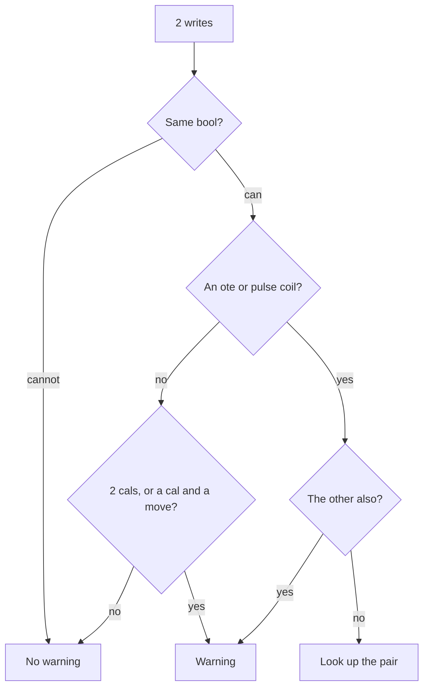
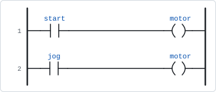
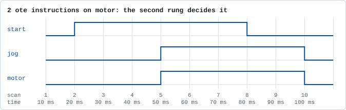

# Warnings

This page is for a controls engineer or an Elixir developer who has a
[warning](glossary.md#warning) from logex and looks up its cause. It gives each warning
of a [program](glossary.md#program) and of a
[configuration](glossary.md#configuration), and the rules for 2 writes to 1 bool.

A warning tells you about a possible error in a source text. A warning is not an error:
the text compiles, and the program runs as its text says. logex gives a warning in the
struct of a [diagnostic](glossary.md#diagnostic), `%Logex.Diagnostic{}`, with
`severity: :warning`. [Diagnostics](diagnostics.md) gives the errors that stop a compile,
the fields of the struct and its printed form.

> #### Caution {: .error}
>
> Read each warning before you run a program on a machine. logex does not change a
> [rung](glossary.md#rung) because of a warning. The rung does what its text says, and
> that can be different from what you want.

| To find | Go to |
|---|---|
| What a warning is, and where logex puts it | [The rules of a warning](#the-rules-of-a-warning) |
| A warning about a tag, an instance, a label, a literal, a long timer or a real | [The warnings of a program](#the-warnings-of-a-program) |
| `` already has an `ote` ``, `is already the pulse bit of`, `is a bit of`, `is in`, `in this rung` | [The warnings of 2 writes](#the-warnings-of-2-writes) |
| `the storage bit of` | [The storage bit of a one-shot](#the-storage-bit-of-a-one-shot) |
| A warning of a configuration | [The warnings of a configuration](#the-warnings-of-a-configuration) |
| The warning of a runner about its store | [The warning of the runner](#the-warning-of-the-runner) |
| The scripts that show each warning | [Examples](#examples) |

Each rule cites the case of an example that shows it. The cases have the numbers 1 to 82,
and each number is a link to its example. In a message, a word in angle brackets, for
example `<tag>`, is the part that changes from 1 warning to the next.

## The rules of a warning

| Subject | Rule |
|---|---|
| The struct | A warning is a `%Logex.Diagnostic{}` with `severity: :warning`. |
| The printed form | `Logex.Diagnostic.format/1` gives `` line 3: warning: `spare` is declared but no rung uses it `` ([1](#cases-1-to-10-a-program)). A warning of a compile of a file starts with the path: `` warnings/motor.ld: line 7: warning: `` ([the example of `motor.ld`](#example-2-ote-instructions-on-motor)). |
| The stage | `:validate` for a program and for a function block. `:configure` for a warning of a configuration's own text. A [warning of a program type](#the-warnings-of-a-program-type) in a configuration keeps its `:validate`. |
| The sequence | logex gives the warnings of a text in line order. A configuration gives its own warnings first, then the [warnings of its program types](#the-warnings-of-a-program-type). |
| A text with an error | The text gets no warnings. logex gives the warnings of a text only when the text compiles. |
| The run | A warning does not stop a compile. The program or the configuration runs as its text says. |
| An online edit | A warning of the candidate of an [online edit](glossary.md#online-edit) does not stop the edit. |
| The line | The line of the [declaration](glossary.md#declaration) or of the [instruction](glossary.md#instruction) that the warning is about. A warning of a program type gives the line of the program type's text, not of the configuration's text. |
| The field | [Warnings](diagnostics.md#warnings) on the page Diagnostics gives the field that holds the warnings of each compile. |
| The names | A warning gives a name as the text spells it, for example `lamps[02]` or `status.03` ([14](#cases-11-to-28-2-writes-with-a-warning) and [16](#cases-11-to-28-2-writes-with-a-warning)). |
| A long list | A warning names 10 [elements](glossary.md#element) or fewer. Then it gives the number of the others ([4](#cases-1-to-10-a-program), [46](#cases-44-to-62-a-configuration) and [51](#cases-44-to-62-a-configuration)). In a program or a function block, a list of real initial values gets 10 warnings. A last warning gives the number of the others ([10](#cases-1-to-10-a-program)). In a configuration, the list also gets 10 warnings and a last warning with the number of the others ([62](#cases-44-to-62-a-configuration)). |
| A tag from Elixir | A tag that the [host](glossary.md#host) declares with `Logex.Tag.new!/5` has no line. logex gives no warning about it. |
| An option | `Logex.compile/2` has no option that stops a warning. |

## The warnings of a program

logex gives these warnings for a program and for the body of a
[function block](glossary.md#function-block).

### A tag that no rung uses

| Part | Rule |
|---|---|
| Message | `` `<tag>` is declared but no rung uses it `` |
| Cause | A [tag](glossary.md#tag) that no rung names. This is true for each [section](glossary.md#section) and each [type](glossary.md#type), for an instance and for an [array](glossary.md#array). |
| In the run | The tag keeps its [initial value](glossary.md#initial-value). |
| No warning | A rung that names 1 element of an array uses the array. A rung that names a tag only as a [subscript](glossary.md#subscript) or as the number of a bit uses the tag. |
| Case | [1](#cases-1-to-10-a-program) |

### A `var_output` that no rung writes

| Part | Rule |
|---|---|
| Message | `` `<tag>` is a var_output, but no rung writes it: it stays at <value> `` |
| Cause | A `var_output` tag that a rung reads and that no instruction writes. |
| In the run | The tag keeps its initial value. |
| `<value>` | The number of the initial value, as Elixir prints it: `16#ff` gives `255`. With no initial value: `0`, or `0.0` for a real. An array with an initial list gives `its initial values`. An array with no list gives `0` or `0.0`. |
| `<value>` of a real | The nearest real that the tag holds, not the number of the literal. `var_output gain real 16777217.0` gives `it stays at 16777216.0`, as its other warning gives `it is held as 16777216.0`. |
| No warning | A `var` tag that a rung reads and that no instruction writes. A `var_output` that no rung names gets the warning [A tag that no rung uses](#a-tag-that-no-rung-uses). |
| Case | [2](#cases-1-to-10-a-program) |

### An instance that no instruction runs

| Part | Rule |
|---|---|
| Message for a [timer](glossary.md#timer) | `` `<tag>` is a <type>, but no `<mnemonic>` runs it: it never times ``, with `an` before a type that starts with a vowel |
| Message for a [counter](glossary.md#counter) | `` `<tag>` is a <type>, but no `<mnemonic>` runs it: it never counts ``. For a `ctud`, `<mnemonic>` is `` `ctu` or `ctd` ``. |
| Message for a function block | `` `<tag>` is an instance of `<block>`, but no `cal` runs it: it never runs, and its members stay at their initial values `` |
| Cause | An [instance](glossary.md#instance) that a rung names, and that no instruction of its type runs. |
| In the run | A timer never times. A counter never counts. The [members](glossary.md#member) of an instance of a function block keep their initial values. |
| Case | [3](#cases-1-to-10-a-program) |

### An array of instances with elements that no instruction runs

| Part | Rule |
|---|---|
| Message | `` `<array>` is an array of <n> <type>s, but no `<mnemonic>` runs <elements>: they never time ``, or `they never count`. For a function block: `` is an array of <n> instances of `<block>` ``, then `they never run, and their members stay at their initial values`. |
| `<elements>` | The names of the elements, the last after `or`. For 1 element, the message says `it` in place of `they`. If no element runs, `<elements>` is `any of its elements`. |
| Cause | An array of instances in which no instruction runs 1 element or more. |
| In the run | Those elements never time, never count or never run. |
| Limit | The message names the first 10 elements, then `or <n> more`. |
| Case | [4](#cases-1-to-10-a-program) |

### A label that no `jmp` names

| Part | Rule |
|---|---|
| Message | `` `<label>` labels this rung, but no `jmp` names it: nothing jumps here `` |
| Cause | A [label](glossary.md#label), `lbl`, that no `jmp` of its [routine](glossary.md#routine) names. |
| In the run | No [jump](glossary.md#jump) goes to the rung. |
| Case | [5](#cases-1-to-10-a-program) |

### An instruction that reads only literals

| Part | Rule |
|---|---|
| Message | `` `<mnemonic>` compares two literals, `<a>` and `<b>`: its result never changes ``, `` `<mnemonic>` reads two literals, `<a>` and `<b>` `` or `` `<mnemonic>` reads a literal, `<a>` ``, then `: its result never changes` |
| Cause | A comparison, an arithmetic instruction, a bitwise instruction or a [conversion](glossary.md#conversion) in which each source is a [literal](glossary.md#literal). |
| In the run | The result is the same in each scan. |
| No warning | A `move` of a literal. |
| Case | [6](#cases-1-to-10-a-program) |

### A comparison with the limit of a type

| Part | Rule |
|---|---|
| Message | `` `<mnemonic>` compares `<a>` with `<b>`, and a <type> holds nothing below `<limit>`: its result never changes ``, or `holds nothing above` |
| Cause | A comparison of a tag with the smallest or the largest value of its type. The tag can be a member or an element, of an integer type or a [bit string](glossary.md#bit-string). The warning is for a comparison whose result is the same for each value of the tag. For a `usint` tag `boxes`, `ge boxes 0` and `gt boxes 255` are examples. The literal can be the first [operand](glossary.md#operand) or the second operand. |
| In the run | The result is the same in each scan. |
| No warning | A comparison of a `real` or an `lreal` tag. |
| An error instead | A literal that the type cannot hold. [Instructions: arithmetic and comparison](instructions-arithmetic-and-comparison.md) gives that error. |
| Case | [7](#cases-1-to-10-a-program) |

### A long timer and a time that is not a whole number of ms

| Part | Rule |
|---|---|
| Message for a preset | `` `<mnemonic>` gives `<timer>` a preset of <n> ns, which is no whole number of milliseconds: a <type> counts whole milliseconds, so it times as the next whole millisecond, <m> ms `` |
| Message for a literal | What the instruction does with the literal, for example `` `move` writes `2500` into `cure.pre` ``. Then `` , where `<member>` is a <type>'s time in nanoseconds: <n> ns is no whole number of milliseconds, and a <type> counts whole milliseconds ``. |
| Cause | A [long timer](glossary.md#long-timer) counts whole ms. Its members `.pre` and `.acc` hold ns. The warning is for a [preset](glossary.md#preset) that is not a whole number of ms. It is also for such a literal beside `.pre` or `.acc` in a `move`, a conversion, a comparison, an `add` or a `sub`. A real literal in a conversion, for example `lreal_to_lint 1.5e6 cure.pre`, is the integer that the conversion gives. |
| `<type>` | The type of the timer, for example `ton_ltime` or `tof_ltime`. |
| In the run | A timer with such a preset times to the next whole ms. |
| No warning | The same literal in a different instruction, for example `mul`. |
| Case | [8](#cases-1-to-10-a-program) |

### A real with more digits than its type keeps

| Part | Rule |
|---|---|
| Message | `` `<literal>` is more precise than a real keeps: it is held as <value> ``, or `than an lreal keeps` |
| Cause | A real literal in an instruction, or a real initial value of a declaration, with more digits than the type keeps. For an instruction, the type is [the type of the calculation](instructions-arithmetic-and-comparison.md#the-type-of-the-calculation). For example, `mul hz 0.12345678901234567890 precise` calculates in `lreal`, because `precise` is an `lreal`. |
| In the run | The instruction or the tag uses the nearest value of the type. The message gives that value. |
| No warning | A literal that is the shortest text of its nearest value, for example `0.1` and `37.1`. |
| Limit | A list of initial values gets 10 warnings, then `` <n> more literals of this initial list are more precise than a real keeps, not listed ``. |
| Cases | [9](#cases-1-to-10-a-program) and [10](#cases-1-to-10-a-program) |

### 2 writes to 1 bool

The messages `` already has an `ote` ``, `is already the pulse bit of`, `is a bit of` and
`is in` are for 2 writes that can set the same bool.
[The warnings of 2 writes](#the-warnings-of-2-writes) gives their rules.

### A write to the storage bit of a one-shot

The message `the storage bit of` is for a write to the
[storage bit](glossary.md#storage-bit) of a one-shot.
[The storage bit of a one-shot](#the-storage-bit-of-a-one-shot) gives its rules.

## The warnings of 2 writes

In each [scan](glossary.md#scan), the rungs run in sequence, from the first rung to the
last. Thus the last write in the scan sets the value that the
[outputs](glossary.md#output) get. logex gives a warning for some pairs of writes that
can set the same bool. [Which 2 writes get the warning](#which-2-writes-get-the-warning)
gives the pairs. Each message ends with `the last one in the scan decides it`.

### The words of this part

| Word | Meaning | Example |
|---|---|---|
| A write | An instruction that sets the value of a tag, a member, an element or a [bit](glossary.md#bit) | `ote motor`, `move 0 status` |
| An `ote` or a pulse coil | An `ote`, or an `osr` or an `osf` on its [pulse bit](glossary.md#pulse-bit). These [coils](glossary.md#coil) set their bool in each scan, on a [true rung](glossary.md#true-rung) and on a [false rung](glossary.md#false-rung). | `ote motor`, and `osr s1 kick` on `kick` |
| A latch | An `otl` or an `otu` | `otl motor` |
| A write of a different kind | Each other write: a latch, a `move`, the output operand of a `cal`, and each other instruction that writes a value | `otl motor`, `move 0 lamps[2]` |
| The word of a bit | The tag, the member or the element that holds the bit | `status` for `status.3`, `flags[1]` for `flags[1].3` |
| A literal element, a literal bit | An element with only literals as subscripts. A bit with a literal as its number. | `lamps[2]`, `status.3` |
| A write through a tag | A write with a tag as a subscript or as the number of a bit | `lamps[slot]`, `status.[n]`, `flags[i].3` |
| The same tags | 2 writes through tags that have the same names in the same places | `lamps[slot]` and `lamps[slot]`. But `flags[i].3` and `flags[i].[n]` are not through the same tags. |

A [pulse coil](glossary.md#pulse-coil) is an `osr` or an `osf`. logex does not know the
value of a tag in a subscript or in a bit number when it compiles. Thus a write through a
tag can write each element of the array, or each bit of the word.

### Which 2 writes get the warning

This diagram shows how logex decides if 2 writes get the warning.



Figure: the decision for 2 writes. Follow the answers from the top to a warning, to no
warning or to a table.

The questions of the diagram, in sequence:

1. Can the 2 writes set the same bool?
   [When 2 writes cannot set the same bool](#when-2-writes-cannot-set-the-same-bool)
   gives the pairs that cannot.
2. Is 1 of the writes an `ote` or a pulse coil? 2 writes of a different kind get no
   warning ([30](#cases-29-to-43-2-writes-with-no-warning), [31](#cases-29-to-43-2-writes-with-no-warning) and [37](#cases-29-to-43-2-writes-with-no-warning)). A `cal` is the exception. The output
   operands of 2 `cal` instructions on 1 bool get the warning
   ([78](#cases-63-to-82-pairs-in-the-2-orders)). So do a `cal` and a write that is not a latch
   ([79](#cases-63-to-82-pairs-in-the-2-orders)). A `cal` on a bit or an element follows each rule of
   an `ote` ([81](#cases-63-to-82-pairs-in-the-2-orders), [82](#cases-63-to-82-pairs-in-the-2-orders)).
3. Is the other write also an `ote` or a pulse coil? Then the 2 writes get the warning
   ([11](#cases-11-to-28-2-writes-with-a-warning) to [14](#cases-11-to-28-2-writes-with-a-warning), [16](#cases-11-to-28-2-writes-with-a-warning) to [20](#cases-11-to-28-2-writes-with-a-warning) and [23](#cases-11-to-28-2-writes-with-a-warning)).
4. If not, look up the pair in
   [An `ote` and a write of a different kind](#an-ote-and-a-write-of-a-different-kind).

Each rule of this part is true in each order of the 2 writes in the text. Cases [63](#cases-63-to-82-pairs-in-the-2-orders)
to [73](#cases-63-to-82-pairs-in-the-2-orders) and [75](#cases-63-to-82-pairs-in-the-2-orders) to [82](#cases-63-to-82-pairs-in-the-2-orders) show each pair in the 2 orders.

### When 2 writes cannot set the same bool

| The 2 writes | Can set the same bool (cases) |
|---|---|
| 2 different tags, 2 different members, or 2 different literal elements or literal bits, for example `lamps[1]` and `lamps[2]` | No ([33](#cases-29-to-43-2-writes-with-no-warning), [34](#cases-29-to-43-2-writes-with-no-warning)) |
| Elements whose literal subscripts are different in 1 place or more, for example `grid[1,i]` and `grid[0,j]` | No ([38](#cases-29-to-43-2-writes-with-no-warning), [39](#cases-29-to-43-2-writes-with-no-warning)) |
| Bits whose literal numbers are different, for example `faults[i].1` and `faults[j].2` | No ([40](#cases-29-to-43-2-writes-with-no-warning)) |
| All other pairs of writes to 1 tag, for example `grid[i,0]` and `grid[j,0]`, or `faults[i].1` and `faults[sel].[n]` | Yes ([23](#cases-11-to-28-2-writes-with-a-warning)) |

### An `ote` and a write of a different kind

These tables give the pairs of an `ote` or a pulse coil and a write of a different kind
that can set the same bool. In each table, the column The `ote` is the `ote` or the pulse
coil. The column The other write is the write of a different kind. Each row is true in
each order of the 2 writes.

On a bool tag, on a member of 1 instance, or on a pulse bit:

| The `ote` | The other write | Warning |
|---|---|---|
| On the bool | A latch on the same bool | No ([29](#cases-29-to-43-2-writes-with-no-warning), [43](#cases-29-to-43-2-writes-with-no-warning)) |
| On the bool | Each other write on the same bool, a `move` or the output operand of a `cal` among them | Yes ([73](#cases-63-to-82-pairs-in-the-2-orders), [75](#cases-63-to-82-pairs-in-the-2-orders)) |

On an element of a bool array, or on a bool member of an element of an array of
instances, for example `lane_c[i].r`:

| The `ote` | The other write | Warning |
|---|---|---|
| On a literal element | A latch on the same literal element | No ([80](#cases-63-to-82-pairs-in-the-2-orders)) |
| On a literal element | Each other write on the same literal element | Yes ([63](#cases-63-to-82-pairs-in-the-2-orders)) |
| On a literal element | Through a tag | Yes ([21](#cases-11-to-28-2-writes-with-a-warning), [64](#cases-63-to-82-pairs-in-the-2-orders)) |
| Through a tag | On a literal element | Yes ([65](#cases-63-to-82-pairs-in-the-2-orders)) |
| Through tags | A latch through the same tags | No ([35](#cases-29-to-43-2-writes-with-no-warning)) |
| Through tags | Each other write through the same tags | Yes ([77](#cases-63-to-82-pairs-in-the-2-orders)) |
| Through tags | Through different tags | Yes ([66](#cases-63-to-82-pairs-in-the-2-orders), [82](#cases-63-to-82-pairs-in-the-2-orders)) |

On a bit of a word, that is a word tag, a word member of 1 instance or an element of a
word array:

| The `ote` | The other write | Warning |
|---|---|---|
| On a bit | A write of its word, or of an element that can be its word, also through the same tags | Yes ([15](#cases-11-to-28-2-writes-with-a-warning), [17](#cases-11-to-28-2-writes-with-a-warning), [22](#cases-11-to-28-2-writes-with-a-warning), [70](#cases-63-to-82-pairs-in-the-2-orders), [81](#cases-63-to-82-pairs-in-the-2-orders)) |
| On a literal bit | A latch on the same literal bit | No ([67](#cases-63-to-82-pairs-in-the-2-orders)) |
| On a literal bit | Each other write on the same literal bit | Yes ([76](#cases-63-to-82-pairs-in-the-2-orders)) |
| On a bit | On a bit through a tag, not through the same tags | Yes ([68](#cases-63-to-82-pairs-in-the-2-orders)) |
| Through a tag | On a literal bit | No ([36](#cases-29-to-43-2-writes-with-no-warning), [69](#cases-63-to-82-pairs-in-the-2-orders)) |
| Through tags | A latch on a bit through the same tags | No ([35](#cases-29-to-43-2-writes-with-no-warning)) |

A member of an element of an array of timers or counters can be a word, for example
`lane_c[i].pv`. On a bit of such a member, the rules of a word array apply, with 2
differences:

| The `ote` | The other write | Warning |
|---|---|---|
| Through a tag subscript, for example `lane_c[i].pv.3` or `lane_c[i].pv.[n]` | On a literal bit of a literal element, for example `lane_c[1].pv.3` | Yes ([71](#cases-63-to-82-pairs-in-the-2-orders)) |
| On a literal bit through a tag subscript, for example `lane_c[i].pv.3` | A write of the member through the same tag subscript, for example `move 5 lane_c[i].pv` | No ([72](#cases-63-to-82-pairs-in-the-2-orders)) |

A bit through a tag beside a write of the member through the same tag subscript gets the
warning, for example `ote lane_c[i].pv.[n]` and `move 5 lane_c[i].pv` ([72](#cases-63-to-82-pairs-in-the-2-orders)).

### The messages

logex gives the warning at the line of the later write in the text. The message names the
first write in the text that can set the same bool. Thus a third write also names the
first write ([11](#cases-11-to-28-2-writes-with-a-warning)). If the first write is in the same rung, the message says
`in this rung` in place of `on line <n>` ([74](#cases-63-to-82-pairs-in-the-2-orders)).

| Message | When | Cases |
|---|---|---|
| `` `<bool>` already has an `ote` on line <n> `` | The first write is an `ote` on the bool. | [11](#cases-11-to-28-2-writes-with-a-warning), [13](#cases-11-to-28-2-writes-with-a-warning), [14](#cases-11-to-28-2-writes-with-a-warning), [20](#cases-11-to-28-2-writes-with-a-warning) |
| `` `<bool>` is already the pulse bit of the `<mnemonic>` on line <n> `` | The first write is a pulse coil on the bool. | [12](#cases-11-to-28-2-writes-with-a-warning) |
| `` `<bool>` is already written by the `<mnemonic>` on line <n> `` | The first write is the output operand of a `cal`, or a write that is not a latch. It is on the same bool, by the same literals or through the same tags. | [63](#cases-63-to-82-pairs-in-the-2-orders), [73](#cases-63-to-82-pairs-in-the-2-orders), [75](#cases-63-to-82-pairs-in-the-2-orders) to [79](#cases-63-to-82-pairs-in-the-2-orders) |
| `` `<bit>` is a bit of `<word>`, which the `<mnemonic>` on line <n> writes whole `` | The later write is an `ote` on a bit. The first write writes its word. | [15](#cases-11-to-28-2-writes-with-a-warning) |
| `` `<bit>` is a bit of `<word>`, and the `<mnemonic>` on line <n> writes one bit of it, `<first>`, which a tag numbers `` | The later write is an `ote` on a bit. The first write writes a bit of the word through a tag. | [17](#cases-11-to-28-2-writes-with-a-warning), [68](#cases-63-to-82-pairs-in-the-2-orders) |
| `` `<word>` is written whole by the `<mnemonic>`, and its bit `<bit>` already has an `ote` on line <n> `` | The later write writes the word. The first write is an `ote` on a bit of the word. | [15](#cases-11-to-28-2-writes-with-a-warning), [17](#cases-11-to-28-2-writes-with-a-warning) |
| `` `<word>` is written whole by the `<mnemonic>`, and its bit `<bit>` is already written by the `cal` on line <n> `` | The later write writes the word. The first write is the output operand of a `cal` on a bit of the word. | [81](#cases-63-to-82-pairs-in-the-2-orders) |
| `` `<later>`, which the `<mnemonic>` writes, is a bit of `<word>` that a tag numbers, and `<bit>` already has an `ote` on line <n> `` | The later write writes a bit of the word through a tag. The first write is an `ote` on another bit of the word. | [68](#cases-63-to-82-pairs-in-the-2-orders) |
| `` `<later>` is in `<array>`, which the `<mnemonic>` on line <n> may write through a tag subscript `` | The first write goes through a tag subscript. | [18](#cases-11-to-28-2-writes-with-a-warning), [19](#cases-11-to-28-2-writes-with-a-warning), [22](#cases-11-to-28-2-writes-with-a-warning) to [24](#cases-11-to-28-2-writes-with-a-warning), [70](#cases-63-to-82-pairs-in-the-2-orders) |
| `` `<later>` is in `<array>`, as `<first>` is, which already has an `ote` on line <n> `` | The later write goes through a tag. The first write is an `ote` on a literal element or bit. | [18](#cases-11-to-28-2-writes-with-a-warning), [21](#cases-11-to-28-2-writes-with-a-warning), [64](#cases-63-to-82-pairs-in-the-2-orders) |
| `` `<later>` is in `<array>`, as `<first>` is, which is already the pulse bit of the `<mnemonic>` on line <n> `` | The later write goes through a tag. The first write is a pulse coil on a literal element. | [12](#cases-11-to-28-2-writes-with-a-warning) |
| `` `<later>` is in `<array>`, as `<first>` is, which the `<mnemonic>` on line <n> writes `` | The later write is an `ote` through a tag. The first write is a write of a different kind. It is on a literal element, on a member of a literal element, or on a bit of 1 of these. | [65](#cases-63-to-82-pairs-in-the-2-orders), [71](#cases-63-to-82-pairs-in-the-2-orders) |
| `` `<later>` is in `<array>`, as `<first>` is, which the `<mnemonic>` on line <n> writes whole `` | The later write is an `ote` through a tag. The first write writes a literal element of a word array, or a member of a literal element, whole. It can also be a write through a tag on a bit of 1 of these. | [15](#cases-11-to-28-2-writes-with-a-warning) |

The name in a message is the name of the later write. The later write can write a word
after an `ote` on a bit of that word. Then the message names the word and the bit. The
`move` of case [15](#cases-11-to-28-2-writes-with-a-warning) gets
`` `faults[1]` is written whole by the `move`, and its bit `faults[1].0` already has an `ote` on line 23 ``.

logex counts a write on a bit through a tag as a write of its word. The tag can number any
bit of the word. The message names the 1 bit that the write writes:

- `` `status.[n]`, which the `otl` writes, is a bit of `status` that a tag numbers ``, for
  an `otl` on that bit ([68](#cases-63-to-82-pairs-in-the-2-orders))
- `writes one bit of it`, for an `ote` on a bit after it ([17](#cases-11-to-28-2-writes-with-a-warning))

### Example: 2 `ote` instructions on `motor`

The file `warnings/motor.ld` has 2 rungs with an `ote` on `motor`.

<!-- file: warnings/motor.ld -->
```text
// 2 rungs write the coil motor. The second rung decides the value of motor.
var_input  start bool
var_input  jog   bool
var_output motor bool

xic start ote motor
xic jog   ote motor
```

<!-- rung: warnings/motor.ld -->


The script `warnings-motor.exs` compiles the file and prints its warning.

```elixir
{:ok, motor} = Logex.compile_file("warnings/motor.ld")
Enum.each(motor.warnings, &IO.puts(Logex.Diagnostic.format(&1)))
```

```console
$ mix run warnings-motor.exs
warnings/motor.ld: line 7: warning: `motor` already has an `ote` on line 6: the last one in the scan decides it
```

This timing diagram shows 10 scans of `motor.ld`, 10 ms apart. The
[inputs](glossary.md#input) are `start` and `jog`.

<!-- timing: warnings-motor.timing.exs -->


| Scans | `start` | `jog` | `motor` |
|---|---|---|---|
| 1 | 0 | 0 | 0 |
| 2 to 4 | 1 | 0 | 0 |
| 5 to 7 | 1 | 1 | 1 |
| 8 and 9 | 0 | 1 | 1 |
| 10 | 0 | 0 | 0 |

In each scan, `motor` has the value of `jog`, because rung 2 runs last.

### Rungs that a jump skips

logex reads the text of a program. It does not find which rungs a jump skips. Thus 2
`ote motor` instructions get the warning, also if a jump lets only 1 of them run
([25](#cases-11-to-28-2-writes-with-a-warning)). [Instructions: jump and call](instructions-jump-and-call.md) gives the rules of
a jump.

### The storage bit of a one-shot

A [one-shot](glossary.md#one-shot) keeps the [power flow](glossary.md#power-flow) of its
last run in its storage bit. A write to the storage bit by a different instruction
changes the scan of the next pulse.

| Part | Rule |
|---|---|
| Message | `` `<mnemonic>` writes `<bit>`, the storage bit of the `<one-shot>` on line <n>: the one-shot then fires on the wrong scans ``, or `in this rung` in place of `on line <n>` |
| Cause | An instruction that is not the one-shot, and that can write its storage bit. That is a write of any kind: an `ote`, an `otl`, an `otu`, or a write of the word of the bit. It is also a write through a tag that can write the storage bit. |
| `<one-shot>` | `ons`, `osr` or `osf` |
| Order | Each such write gets the warning, before the one-shot in the text or after it. |
| In the run | The one-shot gives its pulse in the wrong scans. |
| No warning | A [contact](glossary.md#contact) that reads the storage bit. A write through a tag that cannot write the storage bit, for example `ote edges[i,0]` beside `ons edges[1,1]`. |
| An error instead | A second one-shot on the same storage bit. [Instructions: contacts and coils](instructions-contacts-and-coils.md) gives that error. |
| Cases | [26](#cases-11-to-28-2-writes-with-a-warning) to [28](#cases-11-to-28-2-writes-with-a-warning), [41](#cases-29-to-43-2-writes-with-no-warning), [42](#cases-29-to-43-2-writes-with-no-warning), [74](#cases-63-to-82-pairs-in-the-2-orders) |

## The warnings of a configuration

logex gives these warnings for a configuration from a text and for a configuration from
Elixir data. A warning of Elixir data has no line. In a text, a warning about a
[global](glossary.md#global) is at the line of its `var_global`. A warning about an
instance is at the line of its `program`. A warning about a
[connection](glossary.md#connection) is at the line of the connection.
[Configuration file](configuration-file.md) gives the rules of each line of a
[configuration file](glossary.md#configuration-file).

### A global that nothing uses

| Part | Rule |
|---|---|
| Message | `` `<global>` is declared but nothing uses it `` |
| Cause | A global that no connection, no `var_external` and no `single` of a task names. |
| Case | [44](#cases-44-to-62-a-configuration) |

### An output point that nothing drives

| Part | Rule |
|---|---|
| Message | `` `<global>` is an output point, but nothing drives it: it stays at 0 `` |
| Cause | A global at an output [point](glossary.md#point) that a program reads, through a `var_external` or through a connection to a `var_input`. No connection from a `var_output` and no write through `var_external` drives it. |
| In the run | The output stays at 0. |
| No warning | A global at an output point that nothing reads gets the warning [A global that nothing uses](#a-global-that-nothing-uses). |
| Case | [45](#cases-44-to-62-a-configuration) |

### An array of output points that nothing drives

| Part | Rule |
|---|---|
| Message | `` `<global>` is an array of output points, `<first point>` to `<last point>`, `` then `but nothing drives it: each element stays at 0`, or `` but nothing drives <elements>: they stay at 0 `` |
| Cause | An array of output points in which nothing drives each element, or nothing drives some elements. |
| What drives an element | A connection from a `var_output` to the array or to the element. A write through `var_external` on that literal element. A write through `var_external` through a tag subscript drives each element of the array. |
| In the run | Each element that nothing drives stays at 0. |
| Limit | The message names the first 10 elements, then `and <n> more`. |
| Cases | [46](#cases-44-to-62-a-configuration), [61](#cases-44-to-62-a-configuration) |

### A task that runs no instance

| Part | Rule |
|---|---|
| Message | `` task `<task>` runs no instance `` |
| Cause | A [task](glossary.md#task) that no `program` line names. A [continuous task](glossary.md#continuous-task) also gets the warning. |
| Case | [47](#cases-44-to-62-a-configuration) |

### 2 instances that write 1 global through `var_external`

| Part | Rule |
|---|---|
| Message | `` `<instance>` writes `<global>` through its var_external, as `<other>` does (line <n>): each scan reads what the other last wrote, and the later write in a cycle stands `` |
| Cause | 2 instances whose programs write 1 global, or 1 element of a global array, through a `var_external` tag. |
| Line | The line of the second instance. The message names the first instance and the line of its `program`. |
| Message for a write through a tag | An instance that writes through a tag as a subscript can write each element. The message then says `` writes `<element>` `` and `` as `<other>` may ``. |
| No warning | 2 instances that write different elements of 1 global array. |
| Limit | The message names the first 10 elements, then `and <n> more`. |
| Cases | [48](#cases-44-to-62-a-configuration) to [51](#cases-44-to-62-a-configuration) |

### A write through `var_external` to a global that a connection drives

| Part | Rule |
|---|---|
| Message | `` `<instance>` writes `<global>` through its var_external, and `<connection>` drives it (line <n>): ``, then the end of the message |
| Cause | An instance writes a global through a `var_external` tag, and a connection from a `var_output` drives the same global. |
| An element | If the instance writes the array through a tag subscript and the connection drives 1 element, the message says `` drives `<element>` `` in place of `drives it`. |
| Message end | If the connection is of a different instance: `each scan reads what the other last wrote, and the later write in a cycle stands`. If the connection is of the same instance, the message says `` its own `<connection>` `` and ends with `its own copy-out, after the scan, stands`. |
| Cases | [52](#cases-44-to-62-a-configuration), [53](#cases-44-to-62-a-configuration), [60](#cases-44-to-62-a-configuration) |

### A storage bit in a global

| Part | Rule |
|---|---|
| Message end | `` `<global>` is the storage bit of an `<one-shot>`: the one-shot then fires on the wrong scans ``, in place of the other ends of the 2 warnings before this one |
| Cause | A global that is the storage bit of an `ons`, an `osr` or an `osf`. 2 instances write it through `var_external`, or an instance writes it through `var_external` and a connection drives it. |
| Cases | [54](#cases-44-to-62-a-configuration), [59](#cases-44-to-62-a-configuration) |

### A timer, a counter or a one-shot under an event task

| Part | Rule |
|---|---|
| Message | `` `<instance>` runs under the event task `<task>`, and `<program type>` runs the timer `<timer>` on its line <n>: `` and what the timer does under the task. For a counter: `the counter`. For a one-shot: `` runs an `<one-shot>` on its line <n>, whose storage bit is `<bit>`: ``. |
| Cause | An instance under an [event task](glossary.md#event-task), with or without an interval, whose program runs a timer, a counter, an `ons`, an `osr` or an `osf`. [Task lines](configuration-file.md#task-lines) gives the words of an event task. |
| `<program type>` | The [program type](glossary.md#program-type) of the instance. |
| A function block | A timer in a function block gets the warning also. The message gives its path and `` on line <n> of block `<block>` ``. |
| In the run | The instruction sees its rung only when the task runs. The message gives the result for each instruction. |
| No warning | A task with an interval and no trigger. |
| Cases | [55](#cases-44-to-62-a-configuration), [56](#cases-44-to-62-a-configuration) |

The result for each instruction:

| Instruction | What the message says |
|---|---|
| `ton` and `rto` | The timer times across the runs of the task. If its rung is true in 2 runs in sequence, it adds the full time between the 2 runs. |
| `tof` | The delay ends only at a run of the task. The output stays on until the first run after the preset. |
| `tp` | The pulse ends only at a run of the task. It starts only on an edge between 2 runs. Under a task with no interval, a rung that is the [trigger](glossary.md#trigger) of the task is true at each run and never starts a pulse. |
| A counter | A pulse between 2 runs does not count. Under a task with no interval, a rung that is the trigger of the task never counts. |
| `ons`, `osr` and `osf` | A pulse between 2 runs gives no pulse. For an `osf`, a drop between 2 runs gives no pulse. The pulse bit of an `osr` or an `osf` stays on until the next run. Under a task with no interval, a rung that is the trigger of the task never gives a pulse. |

A task with an interval also runs at a due time while its trigger is 0. Thus a rung that
is the trigger is 0 at that run and 1 at the next rise. The message does not say that it
never changes. [A task with a trigger and an interval](../explanation/event-tasks.md#a-task-with-a-trigger-and-an-interval)
gives the runs.

### A retained value that a connection drives

| Part | Rule |
|---|---|
| Message for an output | `` `<connection>` is retained and drives the output `<global>`: after a warm start it is written in the first round `` |
| Cause for an output | A [retained](glossary.md#retain) `var_output` with a connection to an output point, or to an element of an array of output points. |
| Message for a global | `` `<global>` is retained but driven by `<connection>`, which is not: the first round writes over it `` |
| Cause for a global | A retained global, or an element of one, that a connection from a `var_output` drives, if its program does not retain that `var_output`. |
| Limit | logex sees a connection only. It does not see a rung that reads a retained value and writes an output. It does not see a write through `var_external`. |
| Case | [57](#cases-44-to-62-a-configuration) |

### A real with more digits than its type keeps, in a configuration

| Part | Rule |
|---|---|
| Message | `` `<literal>` is more precise than a real keeps: it is held as <value> ``, or `than an lreal keeps` |
| Cause | A real initial value of a `var_global` line, or a real constant of a connection, with more digits than its type keeps. |
| Limit | A list of initial values gets 10 warnings, then `` <n> more literals of this initial list are more precise than a real keeps, not listed ``, as in a program. |
| No warning | A configuration from Elixir data. It holds the value of the number, not its text. |
| Cases | [58](#cases-44-to-62-a-configuration), [62](#cases-44-to-62-a-configuration) |

### The warnings of a program type

| Part | Rule |
|---|---|
| Message | `` program type `<type>`: `` and the message of the warning of the program type |
| Cause | A warning of a [program type](glossary.md#program-type) that an instance of the configuration runs. The program type keeps the warning in its own `warnings` too. |
| Where | After the warnings of the configuration, in the sequence of the program types that the instances name. Each warning keeps its line and its file: the `.ld` file of the program type, or of the function block that holds the line. A program type that `Logex.Configuration.compile/3` is given has no file, so its warning gives only its line, the line of the program type's text. |
| Each program type 1 time | A program type that 2 instances run gives its warnings 1 time. |

## The warning of the runner

The [runner](glossary.md#runner), `Logex.Runner`, has 1 more warning. It is a string, not a
diagnostic.

| Part | Rule |
|---|---|
| Message | `` <store>: the store was written by another program than the one this start was given: <differences>; whether by a deploy of changed files, or an edit tested or assembled online that never reached the files, this start runs the program it was given, with the store's retained values laid over it by name and type `` |
| `<store>` | The path of the [store](glossary.md#store), as the `retain:` option gives it. |
| `<differences>` | Each difference, in name order, the first 10 and then `and <n> more`: `` `<program type>`'s text differs ``, `` `<program type>` is not in the store ``, `` `<program type>` is not in this start `` or `the configuration's tasks, globals, instances or connections differ`. |
| Example | `` tally.retain: the store was written by another program than the one this start was given: `tally`'s text differs; whether by `` and the rest of the message. |
| Cause | `Logex.Runner.start_link/1` starts warm from a store whose configuration or program types are different from those of the start. |
| Where | The key `warning` of the map `retain` of `Logex.Runner.status/1`, and the event `{:retain, {:warning, message}}` to each subscriber of `:retain`. |
| In the run | The runner starts. It puts the retained values of the store on the program by name and type. |
| No warning | A cold start, or a store that names no program. The key `warning` then holds `nil`. |

[The store](store.md) gives the rules of the
store.

## Examples

Each script of this part [compiles](glossary.md#compile) some cases and prints each case
after its number. For each program or configuration of a case, it prints the lines with
their numbers, then each warning. 5 scripts read the file `warnings/report.exs`, which
prints the cases. It is not necessary to read `report.exs` to use the warnings.

<!-- file: warnings/report.exs -->
```elixir
# report.(first, cases, compile, options) prints each case after its number, the first
# case after the number `first`. A case is {title, text} or {title, [text, ...]}: each text
# is 1 program or 1 configuration. compile.(tags <> text) compiles it. The options are
# `tags:`, a text put before each text ("" if not given), and `none:`, the line printed
# for a text with no warning ("no warning" if not given). For each text, the script prints
# its lines with their line numbers, then each warning of the compiled text.
lines = fn text, before ->
  text
  |> String.split("\n")
  |> Enum.with_index(before + 1)
  |> Enum.map(fn {line, number} ->
    "    " <> String.pad_leading("#{number}", 4) <> "  " <> line
  end)
end

warnings = fn
  {:ok, %{warnings: []}}, none -> ["    " <> none]
  {:ok, %{warnings: found}}, _none -> Enum.map(found, &("    " <> Logex.Diagnostic.format(&1)))
end

fn first, cases, compile, options ->
  tags = Keyword.get(options, :tags, "")
  none = Keyword.get(options, :none, "no warning")
  before = length(String.split(tags, "\n", trim: true))

  for {{title, texts}, number} <- Enum.with_index(cases, first) do
    head = String.pad_leading("#{number}", 2) <> "  " <> title

    shown =
      Enum.flat_map(List.wrap(texts), fn text ->
        lines.(text, before) ++ warnings.(compile.(tags <> text), none)
      end)

    IO.puts(Enum.join([head | shown], "\n"))
  end
end
```

The scripts for the cases 11 to 43 and 63 to 74 add their rungs to the tags of
`warnings/tags.txt`. Thus the first line of each of these cases is line 21. These
scripts print only the warnings about 2 writes. The tags give other warnings, for example
`is declared but no rung uses it`. When a case has no warning about 2 writes, the script
prints `no warning about 2 writes`.

<!-- file: warnings/tags.txt -->
```text
var_input  start  bool
var_input  stop   bool
var_input  jog    bool
var_input  slot   dint
var_input  sel    dint
var_input  n      dint
var_input  i      dint
var_input  j      dint
var_input  panel  word
var_output motor  bool
var_output kick   bool
var_output status word
var_output lamps  bool[4]
var_output faults word[4]
var_output grid   bool[2,4]
var        s1     bool
var        edges  bool[2,2]
var        flags  word[4]
var        boxes  ctu
var        lane_c ctu[3]
```

### Cases 1 to 10: a program

```elixir
{report, _} = Code.eval_file("warnings/report.exs")

{:ok, seal} =
  Logex.compile(
    "function_block seal\nvar_input start bool\nvar_input stop bool\nvar_output run bool\n" <>
      "( xic start | xic run ) xio stop ote run",
    name: "seal"
  )

cases = [
  {"a tag that no rung uses",
   "var_input start bool\nvar_output motor bool\nvar spare dint\nxic start ote motor"},
  {"var_output tags that a rung reads and no rung writes",
   "var_input start bool\nvar_output motor bool\nvar_output alarm bool\nvar_output speed_sp dint 1200\n" <>
     "var_output belt_lamp bool\nvar_output rate real\nvar_output mask word 16#ff\n" <>
     "var_output gain real 16777217.0\nvar_output steps dint[2]\nvar_output trims real[2] 1.5 2.5\n" <>
     "var limit dint 5\n" <>
     "xic start xic belt_lamp gt speed_sp 1000 gt rate 1.0 gt limit 3 ote motor\n" <>
     "xic start ne mask 0 gt gain 1.0 gt steps[0] 1 gt trims[0] 1.0 ote alarm"},
  {"instances that no instruction runs",
   "var_input eye bool\nvar_output full_lamp bool\nvar delay ton\nvar boxes ctud\n" <>
     "var belt seal\nxic eye xic delay.dn xic boxes.qu xic belt.run ote full_lamp"},
  {"arrays of instances, with some elements that no instruction runs",
   "var_input eye bool\nvar_output full_lamp bool\nvar lane_t ton[4]\nvar lane_c ctu[13]\n" <>
     "var belts seal[3]\nvar pulses tp[2]\nxic eye ton lane_t[0] 500\nxic eye ton lane_t[2] 500\n" <>
     "xic eye ctu lane_c[0] 5\ncal belts[1] eye 0 full_lamp\n" <>
     "xic lane_t[0].dn xic lane_c[0].q xic pulses[1].dn ote full_lamp"},
  {"a label that no jmp names",
   "var_input start bool\nvar_output motor bool\nlbl manual xic start ote motor"},
  {"instructions that read only literals",
   "var_input start bool\nvar_output lamp bool\nvar_output count int\nvar_output mask word\n" <>
     "var_output trim sint\nxic start eq 1 2 ote lamp\nxic start add 2 3 count\n" <>
     "xic start and 16#0f 3 mask\nxic start dint_to_sint 129 trim\nxic start neg 5 count\n" <>
     "xic start move 5 count"},
  {"comparisons with a literal at the limit of the type",
   "var_input boxes usint\nvar_input level int\nvar_output lamp bool\n" <>
     "( ge boxes 0 | gt boxes 255 | le 0 boxes | lt level -32768 ) ote lamp"},
  {"a long timer with a time that is not a whole number of ms",
   "var_input start bool\nvar_output lamp bool\nvar_output left lint\nvar cure ton_ltime\n" <>
     "xic start ton cure 1500000\nxic start ge cure.acc 3000 ote lamp\n" <>
     "xic start move 2500 cure.pre\nxic start sub 1500 cure.acc left\n" <>
     "xic start lreal_to_lint 1.5e6 cure.pre"},
  {"real literals with more digits than the type keeps",
   "var_input hz real\nvar_output speed real\nvar_output precise lreal\n" <>
     "mul hz 16777217.0 speed\nmul hz 0.12345678901234567890 precise\n" <>
     "mul hz 0.1 speed\nmul hz 37.1 speed"},
  {"real initial values with more digits than a real keeps",
   "var_input hz real\nvar_output speed real\nvar limit real 16777217.0\n" <>
     "var steps real[12] " <>
     Enum.map_join(1..12, " ", &"#{16_777_215 + 2 * &1}.0") <>
     "\n" <>
     "mul hz limit speed\nmul hz steps[0] speed"}
]

report.(1, cases, &Logex.compile(&1, name: "panel", types: [seal]), [])
```

```console
$ mix run warnings-program.exs
 1  a tag that no rung uses
       1  var_input start bool
       2  var_output motor bool
       3  var spare dint
       4  xic start ote motor
    line 3: warning: `spare` is declared but no rung uses it
 2  var_output tags that a rung reads and no rung writes
       1  var_input start bool
       2  var_output motor bool
       3  var_output alarm bool
       4  var_output speed_sp dint 1200
       5  var_output belt_lamp bool
       6  var_output rate real
       7  var_output mask word 16#ff
       8  var_output gain real 16777217.0
       9  var_output steps dint[2]
      10  var_output trims real[2] 1.5 2.5
      11  var limit dint 5
      12  xic start xic belt_lamp gt speed_sp 1000 gt rate 1.0 gt limit 3 ote motor
      13  xic start ne mask 0 gt gain 1.0 gt steps[0] 1 gt trims[0] 1.0 ote alarm
    line 4: warning: `speed_sp` is a var_output, but no rung writes it: it stays at 1200
    line 5: warning: `belt_lamp` is a var_output, but no rung writes it: it stays at 0
    line 6: warning: `rate` is a var_output, but no rung writes it: it stays at 0.0
    line 7: warning: `mask` is a var_output, but no rung writes it: it stays at 255
    line 8: warning: `16777217.0` is more precise than a real keeps: it is held as 16777216.0
    line 8: warning: `gain` is a var_output, but no rung writes it: it stays at 16777216.0
    line 9: warning: `steps` is a var_output, but no rung writes it: it stays at 0
    line 10: warning: `trims` is a var_output, but no rung writes it: it stays at its initial values
 3  instances that no instruction runs
       1  var_input eye bool
       2  var_output full_lamp bool
       3  var delay ton
       4  var boxes ctud
       5  var belt seal
       6  xic eye xic delay.dn xic boxes.qu xic belt.run ote full_lamp
    line 3: warning: `delay` is a ton, but no `ton` runs it: it never times
    line 4: warning: `boxes` is a ctud, but no `ctu` or `ctd` runs it: it never counts
    line 5: warning: `belt` is an instance of `seal`, but no `cal` runs it: it never runs, and its members stay at their initial values
 4  arrays of instances, with some elements that no instruction runs
       1  var_input eye bool
       2  var_output full_lamp bool
       3  var lane_t ton[4]
       4  var lane_c ctu[13]
       5  var belts seal[3]
       6  var pulses tp[2]
       7  xic eye ton lane_t[0] 500
       8  xic eye ton lane_t[2] 500
       9  xic eye ctu lane_c[0] 5
      10  cal belts[1] eye 0 full_lamp
      11  xic lane_t[0].dn xic lane_c[0].q xic pulses[1].dn ote full_lamp
    line 3: warning: `lane_t` is an array of 4 tons, but no `ton` runs `lane_t[1]` or `lane_t[3]`: they never time
    line 4: warning: `lane_c` is an array of 13 ctus, but no `ctu` runs `lane_c[1]`, `lane_c[2]`, `lane_c[3]`, `lane_c[4]`, `lane_c[5]`, `lane_c[6]`, `lane_c[7]`, `lane_c[8]`, `lane_c[9]`, `lane_c[10]` or 2 more: they never count
    line 5: warning: `belts` is an array of 3 instances of `seal`, but no `cal` runs `belts[0]` or `belts[2]`: they never run, and their members stay at their initial values
    line 6: warning: `pulses` is an array of 2 tps, but no `tp` runs any of its elements: they never time
    line 11: warning: `full_lamp` is already written by the `cal` on line 10: the last one in the scan decides it
 5  a label that no jmp names
       1  var_input start bool
       2  var_output motor bool
       3  lbl manual xic start ote motor
    line 3: warning: `manual` labels this rung, but no `jmp` names it: nothing jumps here
 6  instructions that read only literals
       1  var_input start bool
       2  var_output lamp bool
       3  var_output count int
       4  var_output mask word
       5  var_output trim sint
       6  xic start eq 1 2 ote lamp
       7  xic start add 2 3 count
       8  xic start and 16#0f 3 mask
       9  xic start dint_to_sint 129 trim
      10  xic start neg 5 count
      11  xic start move 5 count
    line 6: warning: `eq` compares two literals, `1` and `2`: its result never changes
    line 7: warning: `add` reads two literals, `2` and `3`: its result never changes
    line 8: warning: `and` reads two literals, `16#0f` and `3`: its result never changes
    line 9: warning: `dint_to_sint` reads a literal, `129`: its result never changes
    line 10: warning: `neg` reads a literal, `5`: its result never changes
 7  comparisons with a literal at the limit of the type
       1  var_input boxes usint
       2  var_input level int
       3  var_output lamp bool
       4  ( ge boxes 0 | gt boxes 255 | le 0 boxes | lt level -32768 ) ote lamp
    line 4: warning: `ge` compares `boxes` with `0`, and a usint holds nothing below `0`: its result never changes
    line 4: warning: `gt` compares `boxes` with `255`, and a usint holds nothing above `255`: its result never changes
    line 4: warning: `le` compares `0` with `boxes`, and a usint holds nothing below `0`: its result never changes
    line 4: warning: `lt` compares `level` with `-32768`, and an int holds nothing below `-32768`: its result never changes
 8  a long timer with a time that is not a whole number of ms
       1  var_input start bool
       2  var_output lamp bool
       3  var_output left lint
       4  var cure ton_ltime
       5  xic start ton cure 1500000
       6  xic start ge cure.acc 3000 ote lamp
       7  xic start move 2500 cure.pre
       8  xic start sub 1500 cure.acc left
       9  xic start lreal_to_lint 1.5e6 cure.pre
    line 5: warning: `ton` gives `cure` a preset of 1500000 ns, which is no whole number of milliseconds: a ton_ltime counts whole milliseconds, so it times as the next whole millisecond, 2 ms
    line 6: warning: `ge` compares `cure.acc` with `3000`, where `cure.acc` is a ton_ltime's time in nanoseconds: 3000 ns is no whole number of milliseconds, and a ton_ltime counts whole milliseconds
    line 7: warning: `move` writes `2500` into `cure.pre`, where `cure.pre` is a ton_ltime's time in nanoseconds: 2500 ns is no whole number of milliseconds, and a ton_ltime counts whole milliseconds
    line 8: warning: `sub` takes `cure.acc` from `1500` into `left`, where `cure.acc` is a ton_ltime's time in nanoseconds: 1500 ns is no whole number of milliseconds, and a ton_ltime counts whole milliseconds
    line 9: warning: `lreal_to_lint` reads a literal, `1.5e6`: its result never changes
    line 9: warning: `lreal_to_lint` writes `1.5e6` into `cure.pre`, where `cure.pre` is a ton_ltime's time in nanoseconds: 1500000 ns is no whole number of milliseconds, and a ton_ltime counts whole milliseconds
 9  real literals with more digits than the type keeps
       1  var_input hz real
       2  var_output speed real
       3  var_output precise lreal
       4  mul hz 16777217.0 speed
       5  mul hz 0.12345678901234567890 precise
       6  mul hz 0.1 speed
       7  mul hz 37.1 speed
    line 4: warning: `16777217.0` is more precise than a real keeps: it is held as 16777216.0
    line 5: warning: `0.12345678901234567890` is more precise than an lreal keeps: it is held as 0.12345678901234568
10  real initial values with more digits than a real keeps
       1  var_input hz real
       2  var_output speed real
       3  var limit real 16777217.0
       4  var steps real[12] 16777217.0 16777219.0 16777221.0 16777223.0 16777225.0 16777227.0 16777229.0 16777231.0 16777233.0 16777235.0 16777237.0 16777239.0
       5  mul hz limit speed
       6  mul hz steps[0] speed
    line 3: warning: `16777217.0` is more precise than a real keeps: it is held as 16777216.0
    line 4: warning: `16777217.0` is more precise than a real keeps: it is held as 16777216.0
    line 4: warning: `16777219.0` is more precise than a real keeps: it is held as 16777220.0
    line 4: warning: `16777221.0` is more precise than a real keeps: it is held as 16777220.0
    line 4: warning: `16777223.0` is more precise than a real keeps: it is held as 16777224.0
    line 4: warning: `16777225.0` is more precise than a real keeps: it is held as 16777224.0
    line 4: warning: `16777227.0` is more precise than a real keeps: it is held as 16777228.0
    line 4: warning: `16777229.0` is more precise than a real keeps: it is held as 16777228.0
    line 4: warning: `16777231.0` is more precise than a real keeps: it is held as 16777232.0
    line 4: warning: `16777233.0` is more precise than a real keeps: it is held as 16777232.0
    line 4: warning: `16777235.0` is more precise than a real keeps: it is held as 16777236.0
    line 4: warning: 2 more literals of this initial list are more precise than a real keeps, not listed
```

### Cases 11 to 28: 2 writes with a warning

```elixir
{report, _} = Code.eval_file("warnings/report.exs")
tags = File.read!("warnings/tags.txt")

# Each case is the tags of tags.txt and its rungs. The script keeps only the warnings
# about 2 writes: the warnings that end with "decides it" or with "wrong scans".
two_writes = fn compiled ->
  {:ok, program} = compiled

  kept =
    Enum.filter(program.warnings, &String.ends_with?(&1.message, ["decides it", "wrong scans"]))

  {:ok, %{program | warnings: kept}}
end

cases = [
  {"3 ote instructions on 1 tag", "xic start ote motor\nxic jog ote motor\nxic stop ote motor"},
  {"a pulse coil and an ote on 1 pulse bit, in the 2 orders",
   "xic start osr s1 kick\nxic stop ote kick\nxic jog ote motor\nxic start osf edges[0,0] motor\n" <>
     "xic jog osr edges[0,1] lamps[3]\nxic stop ote lamps[slot]"},
  {"2 ote instructions on 1 member", "xic start ote boxes.r\nxic stop ote boxes.r"},
  {"2 spellings of 1 element", "xic start ote lamps[2]\nxic stop ote lamps[02]"},
  {"an ote on a bit and a write of its word, in the 2 orders",
   "xic start move panel status\nxic stop ote status.3\nxic jog ote faults[1].0\n" <>
     "xic stop move 0 faults[1]\nxic start move 0 flags[2]\nxic stop ote flags[slot].1"},
  {"2 spellings of 1 bit", "xic start ote status.3\nxic stop ote status.03"},
  {"a bit with a tag as its number",
   "xic start ote status.[n]\nxic stop ote status.3\nxic jog ote status.[slot]\n" <>
     "xic start move panel status\nxic stop ote status.[n]"},
  {"an element with a tag as a subscript, and a literal element",
   "xic start ote lamps[slot]\nxic stop ote lamps[2]\nxic jog ote faults[3].1\n" <>
     "xic start ote faults[slot].1"},
  {"2 elements with tags as subscripts", "xic start ote lamps[slot]\nxic stop ote lamps[sel]"},
  {"1 element with the same tag as a subscript",
   "xic start ote lamps[slot]\nxic stop ote lamps[slot]"},
  {"an otl and a move through tags, beside an ote",
   "xic start ote lamps[2]\nxic stop otl lamps[slot]\nxic jog move 0 lamps[sel]"},
  {"a write with a tag as a subscript, then an ote on an element or a bit",
   "xic start move 0 lamps[slot]\nxic stop ote lamps[2]\nxic start move 0 faults[slot]\n" <>
     "xic stop ote faults[2].1"},
  {"elements that can be the same element",
   "xic start ote grid[i,0]\nxic stop ote grid[j,0]\nxic jog ote faults[i].1\n" <>
     "xic start ote faults[j].1\nxic stop ote faults[sel].[n]"},
  {"members of elements of an array of counters",
   "xic start ote lane_c[i].r\nxic stop ote lane_c[1].r\nxic jog otl lane_c[j].r\n" <>
     "xic start ote lane_c[i].pv.3\nxic stop move 5 lane_c[1].pv\n" <>
     "xic jog ote lane_c[j].pv.[n]"},
  {"2 rungs that a jump makes exclusive",
   "xic jog jmp manual\nxic start ote motor\nlbl manual xic jog ote motor"},
  {"writes to the storage bit of a one-shot",
   "xic jog ote s1\nxic start ons s1 ote kick\nxic stop otu s1"},
  {"writes to a storage bit in a word",
   "xic start ons status.3 ote kick\nxic stop move panel status\nxic jog otl status.[n]"},
  {"writes with tags as subscripts to a storage bit in an array",
   "xic start ons edges[1,1] ote kick\nxic stop ote edges[i,1]\nxic start ons flags[1].3 ote motor\n" <>
     "xic stop ote flags[i].3"}
]

report.(11, cases, &two_writes.(Logex.compile(&1, name: "panel")),
  tags: tags,
  none: "no warning about 2 writes"
)
```

```console
$ mix run warnings-writes.exs
11  3 ote instructions on 1 tag
      21  xic start ote motor
      22  xic jog ote motor
      23  xic stop ote motor
    line 22: warning: `motor` already has an `ote` on line 21: the last one in the scan decides it
    line 23: warning: `motor` already has an `ote` on line 21: the last one in the scan decides it
12  a pulse coil and an ote on 1 pulse bit, in the 2 orders
      21  xic start osr s1 kick
      22  xic stop ote kick
      23  xic jog ote motor
      24  xic start osf edges[0,0] motor
      25  xic jog osr edges[0,1] lamps[3]
      26  xic stop ote lamps[slot]
    line 22: warning: `kick` is already the pulse bit of the `osr` on line 21: the last one in the scan decides it
    line 24: warning: `motor` already has an `ote` on line 23: the last one in the scan decides it
    line 26: warning: `lamps[slot]` is in `lamps`, as `lamps[3]` is, which is already the pulse bit of the `osr` on line 25: the last one in the scan decides it
13  2 ote instructions on 1 member
      21  xic start ote boxes.r
      22  xic stop ote boxes.r
    line 22: warning: `boxes.r` already has an `ote` on line 21: the last one in the scan decides it
14  2 spellings of 1 element
      21  xic start ote lamps[2]
      22  xic stop ote lamps[02]
    line 22: warning: `lamps[02]` already has an `ote` on line 21: the last one in the scan decides it
15  an ote on a bit and a write of its word, in the 2 orders
      21  xic start move panel status
      22  xic stop ote status.3
      23  xic jog ote faults[1].0
      24  xic stop move 0 faults[1]
      25  xic start move 0 flags[2]
      26  xic stop ote flags[slot].1
    line 22: warning: `status.3` is a bit of `status`, which the `move` on line 21 writes whole: the last one in the scan decides it
    line 24: warning: `faults[1]` is written whole by the `move`, and its bit `faults[1].0` already has an `ote` on line 23: the last one in the scan decides it
    line 26: warning: `flags[slot].1` is in `flags`, as `flags[2]` is, which the `move` on line 25 writes whole: the last one in the scan decides it
16  2 spellings of 1 bit
      21  xic start ote status.3
      22  xic stop ote status.03
    line 22: warning: `status.03` already has an `ote` on line 21: the last one in the scan decides it
17  a bit with a tag as its number
      21  xic start ote status.[n]
      22  xic stop ote status.3
      23  xic jog ote status.[slot]
      24  xic start move panel status
      25  xic stop ote status.[n]
    line 22: warning: `status.3` is a bit of `status`, and the `ote` on line 21 writes one bit of it, `status.[n]`, which a tag numbers: the last one in the scan decides it
    line 23: warning: `status.[slot]` already has an `ote` on line 21: the last one in the scan decides it
    line 24: warning: `status` is written whole by the `move`, and its bit `status.[n]` already has an `ote` on line 21: the last one in the scan decides it
    line 25: warning: `status.[n]` already has an `ote` on line 21: the last one in the scan decides it
18  an element with a tag as a subscript, and a literal element
      21  xic start ote lamps[slot]
      22  xic stop ote lamps[2]
      23  xic jog ote faults[3].1
      24  xic start ote faults[slot].1
    line 22: warning: `lamps[2]` is in `lamps`, which the `ote` on line 21 may write through a tag subscript: the last one in the scan decides it
    line 24: warning: `faults[slot].1` is in `faults`, as `faults[3].1` is, which already has an `ote` on line 23: the last one in the scan decides it
19  2 elements with tags as subscripts
      21  xic start ote lamps[slot]
      22  xic stop ote lamps[sel]
    line 22: warning: `lamps[sel]` is in `lamps`, which the `ote` on line 21 may write through a tag subscript: the last one in the scan decides it
20  1 element with the same tag as a subscript
      21  xic start ote lamps[slot]
      22  xic stop ote lamps[slot]
    line 22: warning: `lamps[slot]` already has an `ote` on line 21: the last one in the scan decides it
21  an otl and a move through tags, beside an ote
      21  xic start ote lamps[2]
      22  xic stop otl lamps[slot]
      23  xic jog move 0 lamps[sel]
    line 22: warning: `lamps[slot]` is in `lamps`, as `lamps[2]` is, which already has an `ote` on line 21: the last one in the scan decides it
    line 23: warning: `lamps[sel]` is in `lamps`, as `lamps[2]` is, which already has an `ote` on line 21: the last one in the scan decides it
22  a write with a tag as a subscript, then an ote on an element or a bit
      21  xic start move 0 lamps[slot]
      22  xic stop ote lamps[2]
      23  xic start move 0 faults[slot]
      24  xic stop ote faults[2].1
    line 22: warning: `lamps[2]` is in `lamps`, which the `move` on line 21 may write through a tag subscript: the last one in the scan decides it
    line 24: warning: `faults[2].1` is in `faults`, which the `move` on line 23 may write through a tag subscript: the last one in the scan decides it
23  elements that can be the same element
      21  xic start ote grid[i,0]
      22  xic stop ote grid[j,0]
      23  xic jog ote faults[i].1
      24  xic start ote faults[j].1
      25  xic stop ote faults[sel].[n]
    line 22: warning: `grid[j,0]` is in `grid`, which the `ote` on line 21 may write through a tag subscript: the last one in the scan decides it
    line 24: warning: `faults[j].1` is in `faults`, which the `ote` on line 23 may write through a tag subscript: the last one in the scan decides it
    line 25: warning: `faults[sel].[n]` is in `faults`, which the `ote` on line 23 may write through a tag subscript: the last one in the scan decides it
24  members of elements of an array of counters
      21  xic start ote lane_c[i].r
      22  xic stop ote lane_c[1].r
      23  xic jog otl lane_c[j].r
      24  xic start ote lane_c[i].pv.3
      25  xic stop move 5 lane_c[1].pv
      26  xic jog ote lane_c[j].pv.[n]
    line 22: warning: `lane_c[1].r` is in `lane_c`, which the `ote` on line 21 may write through a tag subscript: the last one in the scan decides it
    line 23: warning: `lane_c[j].r` is in `lane_c`, which the `ote` on line 21 may write through a tag subscript: the last one in the scan decides it
    line 25: warning: `lane_c[1].pv` is in `lane_c`, which the `ote` on line 24 may write through a tag subscript: the last one in the scan decides it
    line 26: warning: `lane_c[j].pv.[n]` is in `lane_c`, which the `ote` on line 24 may write through a tag subscript: the last one in the scan decides it
25  2 rungs that a jump makes exclusive
      21  xic jog jmp manual
      22  xic start ote motor
      23  lbl manual xic jog ote motor
    line 23: warning: `motor` already has an `ote` on line 22: the last one in the scan decides it
26  writes to the storage bit of a one-shot
      21  xic jog ote s1
      22  xic start ons s1 ote kick
      23  xic stop otu s1
    line 21: warning: `ote` writes `s1`, the storage bit of the `ons` on line 22: the one-shot then fires on the wrong scans
    line 23: warning: `otu` writes `s1`, the storage bit of the `ons` on line 22: the one-shot then fires on the wrong scans
27  writes to a storage bit in a word
      21  xic start ons status.3 ote kick
      22  xic stop move panel status
      23  xic jog otl status.[n]
    line 22: warning: `move` writes `status.3`, the storage bit of the `ons` on line 21: the one-shot then fires on the wrong scans
    line 23: warning: `otl` writes `status.3`, the storage bit of the `ons` on line 21: the one-shot then fires on the wrong scans
28  writes with tags as subscripts to a storage bit in an array
      21  xic start ons edges[1,1] ote kick
      22  xic stop ote edges[i,1]
      23  xic start ons flags[1].3 ote motor
      24  xic stop ote flags[i].3
    line 22: warning: `ote` writes `edges[1,1]`, the storage bit of the `ons` on line 21: the one-shot then fires on the wrong scans
    line 24: warning: `ote` writes `flags[1].3`, the storage bit of the `ons` on line 23: the one-shot then fires on the wrong scans
```

### Cases 29 to 43: 2 writes with no warning

```elixir
{report, _} = Code.eval_file("warnings/report.exs")
tags = File.read!("warnings/tags.txt")

# The same tags and the same filter as warnings-writes.exs. logex gives no warning about
# 2 writes for these cases.
two_writes = fn compiled ->
  {:ok, program} = compiled

  kept =
    Enum.filter(program.warnings, &String.ends_with?(&1.message, ["decides it", "wrong scans"]))

  {:ok, %{program | warnings: kept}}
end

cases = [
  {"an ote, an otl and an otu on 1 tag",
   "xic start ote motor\nxic jog otl motor\nxic stop otu motor\nxic stop otl motor"},
  {"2 writes of a bool tag or of a word, with no ote",
   "xic start move 1 motor\nxic stop move 0 motor\nxic start move panel status\n" <>
     "xic stop move 0 status"},
  {"an otl and a move on 1 bool tag", "xic start otl kick\nxic stop move 0 kick"},
  {"an otl on a bit and a write of its word",
   "xic start otl status.3\nxic stop move panel status"},
  {"2 bits with different numbers", "xic start ote status.3\nxic stop ote status.4"},
  {"2 different elements", "xic start ote lamps[1]\nxic stop ote lamps[2]"},
  {"an ote and a latch through the same tag",
   "xic start ote lamps[slot]\nxic stop otl lamps[slot]\nxic start ote status.[n]\n" <>
     "xic stop otu status.[n]\nxic jog ote lane_c[i].r\nxic stop otl lane_c[i].r"},
  {"an otl on a literal bit and an ote on a bit through a tag, in the 2 orders",
   "xic start otl status.3\nxic stop ote status.[n]\nxic jog ote flags[1].[n]\nxic stop otl flags[1].3"},
  {"2 writes with no ote, 1 with a tag as a subscript",
   "xic start move 0 faults[slot]\nxic stop move 1 faults[2]"},
  {"literal subscripts that are different", "xic start ote grid[1,i]\nxic stop ote grid[0,j]"},
  {"a literal element in a different row", "xic start ote grid[0,i]\nxic stop ote grid[1,3]"},
  {"literal bit numbers that are different",
   "xic start ote faults[i].1\nxic stop ote faults[j].2\nxic jog ote lane_c[1].pv.[n]\n" <>
     "xic start ote lane_c[2].pv.3"},
  {"a contact on a storage bit", "xic s1 ote motor\nxic start ons s1 ote kick"},
  {"writes with tags as subscripts that cannot write the storage bit",
   "xic start ons edges[1,1] ote kick\nxic stop ote edges[i,0]\nxic start ons flags[1].3 ote motor\n" <>
     "xic stop ote flags[i].4"},
  {"an otl on a pulse bit", "xic start osr s1 kick\nxic stop otl kick"}
]

report.(29, cases, &two_writes.(Logex.compile(&1, name: "panel")),
  tags: tags,
  none: "no warning about 2 writes"
)
```

```console
$ mix run warnings-no-warning.exs
29  an ote, an otl and an otu on 1 tag
      21  xic start ote motor
      22  xic jog otl motor
      23  xic stop otu motor
      24  xic stop otl motor
    no warning about 2 writes
30  2 writes of a bool tag or of a word, with no ote
      21  xic start move 1 motor
      22  xic stop move 0 motor
      23  xic start move panel status
      24  xic stop move 0 status
    no warning about 2 writes
31  an otl and a move on 1 bool tag
      21  xic start otl kick
      22  xic stop move 0 kick
    no warning about 2 writes
32  an otl on a bit and a write of its word
      21  xic start otl status.3
      22  xic stop move panel status
    no warning about 2 writes
33  2 bits with different numbers
      21  xic start ote status.3
      22  xic stop ote status.4
    no warning about 2 writes
34  2 different elements
      21  xic start ote lamps[1]
      22  xic stop ote lamps[2]
    no warning about 2 writes
35  an ote and a latch through the same tag
      21  xic start ote lamps[slot]
      22  xic stop otl lamps[slot]
      23  xic start ote status.[n]
      24  xic stop otu status.[n]
      25  xic jog ote lane_c[i].r
      26  xic stop otl lane_c[i].r
    no warning about 2 writes
36  an otl on a literal bit and an ote on a bit through a tag, in the 2 orders
      21  xic start otl status.3
      22  xic stop ote status.[n]
      23  xic jog ote flags[1].[n]
      24  xic stop otl flags[1].3
    no warning about 2 writes
37  2 writes with no ote, 1 with a tag as a subscript
      21  xic start move 0 faults[slot]
      22  xic stop move 1 faults[2]
    no warning about 2 writes
38  literal subscripts that are different
      21  xic start ote grid[1,i]
      22  xic stop ote grid[0,j]
    no warning about 2 writes
39  a literal element in a different row
      21  xic start ote grid[0,i]
      22  xic stop ote grid[1,3]
    no warning about 2 writes
40  literal bit numbers that are different
      21  xic start ote faults[i].1
      22  xic stop ote faults[j].2
      23  xic jog ote lane_c[1].pv.[n]
      24  xic start ote lane_c[2].pv.3
    no warning about 2 writes
41  a contact on a storage bit
      21  xic s1 ote motor
      22  xic start ons s1 ote kick
    no warning about 2 writes
42  writes with tags as subscripts that cannot write the storage bit
      21  xic start ons edges[1,1] ote kick
      22  xic stop ote edges[i,0]
      23  xic start ons flags[1].3 ote motor
      24  xic stop ote flags[i].4
    no warning about 2 writes
43  an otl on a pulse bit
      21  xic start osr s1 kick
      22  xic stop otl kick
    no warning about 2 writes
```

### Cases 44 to 62: a configuration

```elixir
{report, _} = Code.eval_file("warnings/report.exs")

{:ok, seal} =
  Logex.compile(
    "function_block seal\nvar_input start bool\nvar_output run bool\nvar delay ton\n" <>
      "xic start ton delay 500\nxic delay.dn ote run",
    name: "seal"
  )

# The program types of the configurations, compiled from text.
texts = %{
  "lamp" => "var_input on bool\nvar_output lamp bool\nxic on ote lamp",
  "horn" =>
    "var_input on bool\nvar_output lamp bool\nvar_external horn bool\nxic on xic horn ote lamp",
  "totaliser" => "var_input eye bool\nvar_external total dint\nxic eye add total 1 total",
  "box_counter" =>
    "var_input eye bool\nvar_output count dint\nvar boxes ctu\nxic eye ctu boxes 3\n" <>
      "move boxes.cv count",
  "tally" =>
    "var_input eye bool\nvar_output count dint\nvar_external total dint\n" <>
      "xic eye add total 1 total\nmove total count",
  "lamp_2" => "var_input eye bool\nvar_external lamps bool[14]\nxic eye ote lamps[2]",
  "lamp_3" => "var_input eye bool\nvar_external lamps bool[14]\nxic eye ote lamps[3]",
  "slot_lamp" =>
    "var_input eye bool\nvar_input slot dint\nvar_external lamps bool[14]\nxic eye ote lamps[slot]",
  "lamps_12" =>
    "var_input eye bool\nvar_external lamps bool[14]\n" <>
      Enum.map_join(0..11, "\n", &"xic eye ote lamps[#{&1}]"),
  "gate" =>
    "var_input eye bool\nvar_output kick bool\nvar_external edge bool\nxic eye ons edge ote kick",
  "timers" =>
    "var_input go bool\nvar_output motor bool\nvar t1 ton\nvar t2 tof\nvar t3 tp\nvar t4 rto\n" <>
      "xic go ton t1 100\nxic go tof t2 100\nxic go tp t3 100\nxic go rto t4 100\n" <>
      "xic t1.dn xic t2.dn xic t3.dn xic t4.dn ote motor",
  "edges" =>
    "var_input go bool\nvar_output a bool\nvar_output b bool\nvar_output c bool\n" <>
      "var s1 bool\nvar s2 bool\nvar s3 bool\nxic go ons s1 ote a\nxic go osr s2 b\nxic go osf s3 c",
  "belt" => "var_input go bool\nvar_output run bool\nvar s seal\ncal s go run",
  "kept" =>
    "var_input go bool\nvar_output retain run bool\nvar_output count dint\n" <>
      "xic go ote run\nxic go add count 1 count",
  "fan" => "var_input go bool\nvar_input sp real\nvar_output fan bool\nxic go gt sp 1.0 ote fan",
  "pulse" =>
    "var_input eye bool\nvar_output kick bool\nvar_output seen bool\nvar_external edge bool\n" <>
      "xic eye osr edge kick\nxic eye ote seen",
  "q_slot" =>
    "var_input eye bool\nvar_input slot dint\nvar_external q bool[3]\nxic eye ote q[slot]",
  "q_2" => "var_input eye bool\nvar_external q bool[3]\nxic eye ote q[2]",
  "stepper" =>
    "var_input go bool\nvar_input trim lreal\nvar_external steps real[12]\nvar_output f real\n" <>
      "var_output high bool\nxic go move steps[0] f\nxic go gt trim 1.0 ote high"
}

types =
  Map.new(texts, fn {name, text} ->
    {:ok, program} = Logex.compile(text, name: name, types: [seal])
    {name, program}
  end)

cases = [
  {"a global that nothing uses", "var_global spare bool\nprogram l1 lamp\n  l1.on 0"},
  {"an output point that a program reads and nothing drives",
   "var_global horn bool at panel.q.0\nprogram h1 horn\n  h1.on 0"},
  {"arrays of output points that nothing drives, or drives in part",
   "var_global lamps bool[3] at panel.q.0\nvar_global beacons bool[14] at card.q.0\n" <>
     "program l1 lamp\n  l1.on lamps[0]\n  l1.lamp beacons[1]"},
  {"tasks that run no instance",
   "task fast interval 10 priority 1\ntask slow interval 50 priority 2\ntask main continuous\n" <>
     "program l1 lamp with fast\n  l1.on 0"},
  {"2 instances that write 1 global through var_external",
   "var_global total dint\nprogram t1 totaliser\n  t1.eye 0\nprogram t2 totaliser\n  t2.eye 0"},
  {"2 instances that can write 1 element of a global array",
   "var_global lamps bool[14]\nprogram s1 slot_lamp\n  s1.eye 0\n  s1.slot 0\n" <>
     "program s2 lamp_2\n  s2.eye 0"},
  {"2 instances that write different elements of a global array",
   "var_global lamps bool[14]\nprogram s2 lamp_2\n  s2.eye 0\nprogram s3 lamp_3\n  s3.eye 0"},
  {"2 instances that write 12 elements of a global array",
   "var_global lamps bool[14]\nprogram a1 lamps_12\n  a1.eye 0\nprogram a2 lamps_12\n  a2.eye 0"},
  {"a write through var_external and a connection that drive 1 global",
   "var_global total dint\nprogram t1 totaliser\n  t1.eye 0\nprogram b1 box_counter\n" <>
     "  b1.eye 0\n  b1.count total"},
  {"1 instance that drives 1 global in the 2 ways",
   "var_global total dint\nprogram k1 tally\n  k1.eye 0\n  k1.count total"},
  {"2 instances that keep the storage bit of a one-shot in 1 global",
   "var_global edge bool\nprogram g1 gate\n  g1.eye 0\nprogram g2 gate\n  g2.eye 0"},
  {"timers under an event task",
   "var_global trip bool\ntask on_trip single trip priority 0\nprogram m1 timers with on_trip\n" <>
     "  m1.go trip\nprogram b1 belt with on_trip\n  b1.go trip"},
  {"a counter and one-shots under an event task",
   "var_global trip bool\ntask on_trip single trip priority 0\n" <>
     "program c1 box_counter with on_trip\n  c1.eye trip\nprogram e1 edges with on_trip\n  e1.go trip"},
  {"retained values and the connections that drive them",
   "var_global run_lamp bool at panel.q.0\nvar_global retain count dint\nprogram k1 kept\n" <>
     "  k1.go 0\n  k1.run run_lamp\n  k1.count count"},
  {"real values with more digits than a real keeps",
   "var_global sp real 16777217.0\nprogram f1 fan\n  f1.go 0\n  f1.sp sp\nprogram f2 fan\n" <>
     "  f2.go 0\n  f2.sp 16777217.0"},
  {"storage bits in a global, with a connection, and for an osr",
   [
     "var_global edge bool\nprogram g1 gate\n  g1.eye 0\nprogram l1 lamp\n  l1.on 0\n  l1.lamp edge",
     "var_global edge bool\nprogram p1 pulse\n  p1.eye 0\n  p1.seen edge"
   ]},
  {"a write through a tag subscript and a connection that drives 1 element",
   "var_global lamps bool[14]\nprogram s1 slot_lamp\n  s1.eye 0\n  s1.slot 0\nprogram l1 lamp\n" <>
     "  l1.on 0\n  l1.lamp lamps[3]"},
  {"arrays of output points that writes through var_external drive",
   [
     "var_global q bool[3] at panel.q.0\nprogram w1 q_slot\n  w1.eye 0\n  w1.slot 0",
     "var_global q bool[3] at panel.q.0\nprogram w2 q_2\n  w2.eye 0"
   ]},
  {"a list of 12 real initial values, and an lreal",
   "var_global steps real[12] " <>
     Enum.map_join(1..12, " ", &"#{16_777_215 + 2 * &1}.0") <>
     "\nvar_global fine lreal 0.12345678901234567890\nprogram s1 stepper\n  s1.go 0\n" <>
     "  s1.trim fine"}
]

report.(44, cases, &Logex.Configuration.compile("plant", &1, types), [])
```

```console
$ mix run warnings-configuration.exs
44  a global that nothing uses
       1  var_global spare bool
       2  program l1 lamp
       3    l1.on 0
    line 1: warning: `spare` is declared but nothing uses it
45  an output point that a program reads and nothing drives
       1  var_global horn bool at panel.q.0
       2  program h1 horn
       3    h1.on 0
    line 1: warning: `horn` is an output point, but nothing drives it: it stays at 0
46  arrays of output points that nothing drives, or drives in part
       1  var_global lamps bool[3] at panel.q.0
       2  var_global beacons bool[14] at card.q.0
       3  program l1 lamp
       4    l1.on lamps[0]
       5    l1.lamp beacons[1]
    line 1: warning: `lamps` is an array of output points, `panel.q.0` to `panel.q.2`, but nothing drives it: each element stays at 0
    line 2: warning: `beacons` is an array of output points, `card.q.0` to `card.q.13`, but nothing drives `beacons[0]`, `beacons[2]`, `beacons[3]`, `beacons[4]`, `beacons[5]`, `beacons[6]`, `beacons[7]`, `beacons[8]`, `beacons[9]`, `beacons[10]` and 3 more: they stay at 0
47  tasks that run no instance
       1  task fast interval 10 priority 1
       2  task slow interval 50 priority 2
       3  task main continuous
       4  program l1 lamp with fast
       5    l1.on 0
    line 2: warning: task `slow` runs no instance
    line 3: warning: task `main` runs no instance
48  2 instances that write 1 global through var_external
       1  var_global total dint
       2  program t1 totaliser
       3    t1.eye 0
       4  program t2 totaliser
       5    t2.eye 0
    line 4: warning: `t2` writes `total` through its var_external, as `t1` does (line 2): each scan reads what the other last wrote, and the later write in a cycle stands
49  2 instances that can write 1 element of a global array
       1  var_global lamps bool[14]
       2  program s1 slot_lamp
       3    s1.eye 0
       4    s1.slot 0
       5  program s2 lamp_2
       6    s2.eye 0
    line 5: warning: `s2` writes `lamps[2]` through its var_external, as `s1` may (line 2): each scan reads what the other last wrote, and the later write in a cycle stands
50  2 instances that write different elements of a global array
       1  var_global lamps bool[14]
       2  program s2 lamp_2
       3    s2.eye 0
       4  program s3 lamp_3
       5    s3.eye 0
    no warning
51  2 instances that write 12 elements of a global array
       1  var_global lamps bool[14]
       2  program a1 lamps_12
       3    a1.eye 0
       4  program a2 lamps_12
       5    a2.eye 0
    line 4: warning: `a2` writes `lamps[0]`, `lamps[1]`, `lamps[2]`, `lamps[3]`, `lamps[4]`, `lamps[5]`, `lamps[6]`, `lamps[7]`, `lamps[8]`, `lamps[9]` and 2 more through its var_external, as `a1` does (line 2): each scan reads what the other last wrote, and the later write in a cycle stands
52  a write through var_external and a connection that drive 1 global
       1  var_global total dint
       2  program t1 totaliser
       3    t1.eye 0
       4  program b1 box_counter
       5    b1.eye 0
       6    b1.count total
    line 2: warning: `t1` writes `total` through its var_external, and `b1.count` drives it (line 6): each scan reads what the other last wrote, and the later write in a cycle stands
53  1 instance that drives 1 global in the 2 ways
       1  var_global total dint
       2  program k1 tally
       3    k1.eye 0
       4    k1.count total
    line 2: warning: `k1` writes `total` through its var_external, and its own `k1.count` drives it (line 4): its own copy-out, after the scan, stands
54  2 instances that keep the storage bit of a one-shot in 1 global
       1  var_global edge bool
       2  program g1 gate
       3    g1.eye 0
       4  program g2 gate
       5    g2.eye 0
    line 4: warning: `g2` writes `edge` through its var_external, as `g1` does (line 2): `edge` is the storage bit of an `ons`: the one-shot then fires on the wrong scans
55  timers under an event task
       1  var_global trip bool
       2  task on_trip single trip priority 0
       3  program m1 timers with on_trip
       4    m1.go trip
       5  program b1 belt with on_trip
       6    b1.go trip
    line 3: warning: `m1` runs under the event task `on_trip`, and `timers` runs the timer `t1` on its line 7: a ton times across the task's runs, and one whose rung is true on two runs in a row counts the whole time between them
    line 3: warning: `m1` runs under the event task `on_trip`, and `timers` runs the timer `t2` on its line 8: a tof's delay ends only at one of the task's runs, so what it holds on stays on until the first run after its preset has passed
    line 3: warning: `m1` runs under the event task `on_trip`, and `timers` runs the timer `t3` on its line 9: a tp's pulse ends only at one of the task's runs, so it lasts until the first run after its preset has passed, and it starts only on an edge between two runs: a rung that is the task's trigger is true at every run and never starts one
    line 3: warning: `m1` runs under the event task `on_trip`, and `timers` runs the timer `t4` on its line 10: an rto times across the task's runs, and one whose rung is true on two runs in a row adds the whole time between them
    line 5: warning: `b1` runs under the event task `on_trip`, and `belt` runs the timer `s.delay` on line 5 of block `seal`: a ton times across the task's runs, and one whose rung is true on two runs in a row counts the whole time between them
56  a counter and one-shots under an event task
       1  var_global trip bool
       2  task on_trip single trip priority 0
       3  program c1 box_counter with on_trip
       4    c1.eye trip
       5  program e1 edges with on_trip
       6    e1.go trip
    line 3: warning: `c1` runs under the event task `on_trip`, and `box_counter` runs the counter `boxes` on its line 4: a counter sees its rung only at the task's runs, so a pulse between two runs is never counted, and a rung that is the task's trigger is true at every run and never counts
    line 5: warning: `e1` runs under the event task `on_trip`, and `edges` runs an `ons` on its line 8, whose storage bit is `s1`: an ons sees its rung only at the task's runs, so a pulse between two runs never fires it, and a rung that is the task's trigger is true at every run and never fires it
    line 5: warning: `e1` runs under the event task `on_trip`, and `edges` runs an `osr` on its line 9, whose storage bit is `s2`: an osr sees its rung only at the task's runs, so a pulse between two runs is never seen, the pulse it sets stays on until the task's next run, and a rung that is the task's trigger is true at every run and never pulses
    line 5: warning: `e1` runs under the event task `on_trip`, and `edges` runs an `osf` on its line 10, whose storage bit is `s3`: an osf sees its rung only at the task's runs, so a drop between two runs is never seen, the pulse it sets stays on until the task's next run, and a rung that is the task's trigger is true at every run and never pulses
57  retained values and the connections that drive them
       1  var_global run_lamp bool at panel.q.0
       2  var_global retain count dint
       3  program k1 kept
       4    k1.go 0
       5    k1.run run_lamp
       6    k1.count count
    line 5: warning: `k1.run` is retained and drives the output `run_lamp`: after a warm start it is written in the first round
    line 6: warning: `count` is retained but driven by `k1.count`, which is not: the first round writes over it
58  real values with more digits than a real keeps
       1  var_global sp real 16777217.0
       2  program f1 fan
       3    f1.go 0
       4    f1.sp sp
       5  program f2 fan
       6    f2.go 0
       7    f2.sp 16777217.0
    line 1: warning: `16777217.0` is more precise than a real keeps: it is held as 16777216.0
    line 7: warning: `16777217.0` is more precise than a real keeps: it is held as 16777216.0
59  storage bits in a global, with a connection, and for an osr
       1  var_global edge bool
       2  program g1 gate
       3    g1.eye 0
       4  program l1 lamp
       5    l1.on 0
       6    l1.lamp edge
    line 2: warning: `g1` writes `edge` through its var_external, and `l1.lamp` drives it (line 6): `edge` is the storage bit of an `ons`: the one-shot then fires on the wrong scans
       1  var_global edge bool
       2  program p1 pulse
       3    p1.eye 0
       4    p1.seen edge
    line 2: warning: `p1` writes `edge` through its var_external, and its own `p1.seen` drives it (line 4): `edge` is the storage bit of an `osr`: the one-shot then fires on the wrong scans
60  a write through a tag subscript and a connection that drives 1 element
       1  var_global lamps bool[14]
       2  program s1 slot_lamp
       3    s1.eye 0
       4    s1.slot 0
       5  program l1 lamp
       6    l1.on 0
       7    l1.lamp lamps[3]
    line 2: warning: `s1` writes `lamps` through its var_external, and `l1.lamp` drives `lamps[3]` (line 7): each scan reads what the other last wrote, and the later write in a cycle stands
61  arrays of output points that writes through var_external drive
       1  var_global q bool[3] at panel.q.0
       2  program w1 q_slot
       3    w1.eye 0
       4    w1.slot 0
    no warning
       1  var_global q bool[3] at panel.q.0
       2  program w2 q_2
       3    w2.eye 0
    line 1: warning: `q` is an array of output points, `panel.q.0` to `panel.q.2`, but nothing drives `q[0]` or `q[1]`: they stay at 0
62  a list of 12 real initial values, and an lreal
       1  var_global steps real[12] 16777217.0 16777219.0 16777221.0 16777223.0 16777225.0 16777227.0 16777229.0 16777231.0 16777233.0 16777235.0 16777237.0 16777239.0
       2  var_global fine lreal 0.12345678901234567890
       3  program s1 stepper
       4    s1.go 0
       5    s1.trim fine
    line 1: warning: `16777217.0` is more precise than a real keeps: it is held as 16777216.0
    line 1: warning: `16777219.0` is more precise than a real keeps: it is held as 16777220.0
    line 1: warning: `16777221.0` is more precise than a real keeps: it is held as 16777220.0
    line 1: warning: `16777223.0` is more precise than a real keeps: it is held as 16777224.0
    line 1: warning: `16777225.0` is more precise than a real keeps: it is held as 16777224.0
    line 1: warning: `16777227.0` is more precise than a real keeps: it is held as 16777228.0
    line 1: warning: `16777229.0` is more precise than a real keeps: it is held as 16777228.0
    line 1: warning: `16777231.0` is more precise than a real keeps: it is held as 16777232.0
    line 1: warning: `16777233.0` is more precise than a real keeps: it is held as 16777232.0
    line 1: warning: `16777235.0` is more precise than a real keeps: it is held as 16777236.0
    line 1: warning: 2 more literals of this initial list are more precise than a real keeps, not listed
    line 2: warning: `0.12345678901234567890` is more precise than an lreal keeps: it is held as 0.12345678901234568
```

### Cases 63 to 82: pairs in the 2 orders

Each case of this script is 1 pair of writes. The script compiles the pair in the 2
orders: first the `ote`, then the write of a different kind first.

```elixir
{report, _} = Code.eval_file("warnings/report.exs")
tags = File.read!("warnings/tags.txt")

{:ok, seal} =
  Logex.compile(
    "function_block seal\nvar_input start bool\nvar_output run bool\nxic start ote run",
    name: "seal"
  )

# The same tags and the same filter as warnings-writes.exs. Each case is 1 pair of writes
# in the 2 orders: an ote first, then the other write first.
two_writes = fn compiled ->
  {:ok, program} = compiled

  kept =
    Enum.filter(program.warnings, &String.ends_with?(&1.message, ["decides it", "wrong scans"]))

  {:ok, %{program | warnings: kept}}
end

orders = fn ote, other ->
  ["xic start #{ote}\nxic stop #{other}", "xic stop #{other}\nxic start #{ote}"]
end

cases = [
  {"an ote and a move on 1 literal element", orders.("ote lamps[2]", "move 0 lamps[2]")},
  {"an ote on a literal element and an otl through a tag",
   orders.("ote lamps[2]", "otl lamps[slot]")},
  {"an ote through a tag and an otl on a literal element or member",
   orders.("ote lamps[slot]", "otl lamps[2]") ++ orders.("ote lane_c[i].r", "otu lane_c[1].r")},
  {"an ote and an otl through different tags", orders.("ote lamps[slot]", "otl lamps[sel]")},
  {"an ote and an otl on 1 literal bit", orders.("ote status.3", "otl status.3")},
  {"an ote on a bit and an otl on a bit with a tag as its number",
   orders.("ote status.3", "otl status.[n]")},
  {"an ote on a bit through a tag and an otl on a literal bit of a literal element",
   orders.("ote flags[i].3", "otl flags[1].3")},
  {"an ote on a bit and a move of its element through the same tag",
   orders.("ote flags[i].3", "move 0 flags[i]")},
  {"a member of an element: an ote through a tag and an otl on a literal bit",
   orders.("ote lane_c[i].pv.3", "otl lane_c[1].pv.3")},
  {"a member of an element: an ote and a move through the same tag",
   orders.("ote lane_c[i].pv.3", "move 5 lane_c[i].pv") ++
     orders.("ote lane_c[i].pv.[n]", "move 5 lane_c[i].pv")},
  {"an ote and the output operand of a cal on 1 bool tag",
   Enum.map(orders.("ote motor", "cal belt jog motor"), &("var belt seal\n" <> &1))},
  {"2 writes in 1 rung", "xic start ote motor ote motor\nxic jog ons s1 ote s1"},
  {"an ote and a move on 1 bool tag", orders.("ote kick", "move 0 kick")},
  {"an ote and a move on 1 literal bit", orders.("ote status.3", "move 1 status.3")},
  {"an ote and a move on 1 element through the same tag",
   orders.("ote lamps[slot]", "move 0 lamps[slot]")},
  {"the output operands of 2 cals on 1 bool tag",
   "var belt seal\nvar roll seal\nxic start cal belt jog motor\nxic stop cal roll jog motor"},
  {"a move and the output operand of a cal on 1 bool tag",
   Enum.map(orders.("cal belt jog motor", "move 0 motor"), &("var belt seal\n" <> &1))},
  {"an ote and an otl on 1 literal element", orders.("ote lamps[2]", "otl lamps[2]")},
  {"the output operand of a cal on 1 bit and a move of its word",
   Enum.map(orders.("cal belt jog status.3", "move 0 status"), &("var belt seal\n" <> &1))},
  {"the output operand of a cal and a move through different tags",
   Enum.map(orders.("cal belt jog lamps[slot]", "move 0 lamps[sel]"), &("var belt seal\n" <> &1))}
]

report.(63, cases, &two_writes.(Logex.compile(&1, name: "panel", types: [seal])),
  tags: tags,
  none: "no warning about 2 writes"
)
```

```console
$ mix run warnings-pairs.exs
63  an ote and a move on 1 literal element
      21  xic start ote lamps[2]
      22  xic stop move 0 lamps[2]
    line 22: warning: `lamps[2]` already has an `ote` on line 21: the last one in the scan decides it
      21  xic stop move 0 lamps[2]
      22  xic start ote lamps[2]
    line 22: warning: `lamps[2]` is already written by the `move` on line 21: the last one in the scan decides it
64  an ote on a literal element and an otl through a tag
      21  xic start ote lamps[2]
      22  xic stop otl lamps[slot]
    line 22: warning: `lamps[slot]` is in `lamps`, as `lamps[2]` is, which already has an `ote` on line 21: the last one in the scan decides it
      21  xic stop otl lamps[slot]
      22  xic start ote lamps[2]
    line 22: warning: `lamps[2]` is in `lamps`, which the `otl` on line 21 may write through a tag subscript: the last one in the scan decides it
65  an ote through a tag and an otl on a literal element or member
      21  xic start ote lamps[slot]
      22  xic stop otl lamps[2]
    line 22: warning: `lamps[2]` is in `lamps`, which the `ote` on line 21 may write through a tag subscript: the last one in the scan decides it
      21  xic stop otl lamps[2]
      22  xic start ote lamps[slot]
    line 22: warning: `lamps[slot]` is in `lamps`, as `lamps[2]` is, which the `otl` on line 21 writes: the last one in the scan decides it
      21  xic start ote lane_c[i].r
      22  xic stop otu lane_c[1].r
    line 22: warning: `lane_c[1].r` is in `lane_c`, which the `ote` on line 21 may write through a tag subscript: the last one in the scan decides it
      21  xic stop otu lane_c[1].r
      22  xic start ote lane_c[i].r
    line 22: warning: `lane_c[i].r` is in `lane_c`, as `lane_c[1].r` is, which the `otu` on line 21 writes: the last one in the scan decides it
66  an ote and an otl through different tags
      21  xic start ote lamps[slot]
      22  xic stop otl lamps[sel]
    line 22: warning: `lamps[sel]` is in `lamps`, which the `ote` on line 21 may write through a tag subscript: the last one in the scan decides it
      21  xic stop otl lamps[sel]
      22  xic start ote lamps[slot]
    line 22: warning: `lamps[slot]` is in `lamps`, which the `otl` on line 21 may write through a tag subscript: the last one in the scan decides it
67  an ote and an otl on 1 literal bit
      21  xic start ote status.3
      22  xic stop otl status.3
    no warning about 2 writes
      21  xic stop otl status.3
      22  xic start ote status.3
    no warning about 2 writes
68  an ote on a bit and an otl on a bit with a tag as its number
      21  xic start ote status.3
      22  xic stop otl status.[n]
    line 22: warning: `status.[n]`, which the `otl` writes, is a bit of `status` that a tag numbers, and `status.3` already has an `ote` on line 21: the last one in the scan decides it
      21  xic stop otl status.[n]
      22  xic start ote status.3
    line 22: warning: `status.3` is a bit of `status`, and the `otl` on line 21 writes one bit of it, `status.[n]`, which a tag numbers: the last one in the scan decides it
69  an ote on a bit through a tag and an otl on a literal bit of a literal element
      21  xic start ote flags[i].3
      22  xic stop otl flags[1].3
    no warning about 2 writes
      21  xic stop otl flags[1].3
      22  xic start ote flags[i].3
    no warning about 2 writes
70  an ote on a bit and a move of its element through the same tag
      21  xic start ote flags[i].3
      22  xic stop move 0 flags[i]
    line 22: warning: `flags[i]` is in `flags`, which the `ote` on line 21 may write through a tag subscript: the last one in the scan decides it
      21  xic stop move 0 flags[i]
      22  xic start ote flags[i].3
    line 22: warning: `flags[i].3` is in `flags`, which the `move` on line 21 may write through a tag subscript: the last one in the scan decides it
71  a member of an element: an ote through a tag and an otl on a literal bit
      21  xic start ote lane_c[i].pv.3
      22  xic stop otl lane_c[1].pv.3
    line 22: warning: `lane_c[1].pv.3` is in `lane_c`, which the `ote` on line 21 may write through a tag subscript: the last one in the scan decides it
      21  xic stop otl lane_c[1].pv.3
      22  xic start ote lane_c[i].pv.3
    line 22: warning: `lane_c[i].pv.3` is in `lane_c`, as `lane_c[1].pv.3` is, which the `otl` on line 21 writes: the last one in the scan decides it
72  a member of an element: an ote and a move through the same tag
      21  xic start ote lane_c[i].pv.3
      22  xic stop move 5 lane_c[i].pv
    no warning about 2 writes
      21  xic stop move 5 lane_c[i].pv
      22  xic start ote lane_c[i].pv.3
    no warning about 2 writes
      21  xic start ote lane_c[i].pv.[n]
      22  xic stop move 5 lane_c[i].pv
    line 22: warning: `lane_c[i].pv` is in `lane_c`, which the `ote` on line 21 may write through a tag subscript: the last one in the scan decides it
      21  xic stop move 5 lane_c[i].pv
      22  xic start ote lane_c[i].pv.[n]
    line 22: warning: `lane_c[i].pv.[n]` is in `lane_c`, which the `move` on line 21 may write through a tag subscript: the last one in the scan decides it
73  an ote and the output operand of a cal on 1 bool tag
      21  var belt seal
      22  xic start ote motor
      23  xic stop cal belt jog motor
    line 23: warning: `motor` already has an `ote` on line 22: the last one in the scan decides it
      21  var belt seal
      22  xic stop cal belt jog motor
      23  xic start ote motor
    line 23: warning: `motor` is already written by the `cal` on line 22: the last one in the scan decides it
74  2 writes in 1 rung
      21  xic start ote motor ote motor
      22  xic jog ons s1 ote s1
    line 21: warning: `motor` already has an `ote` in this rung: the last one in the scan decides it
    line 22: warning: `ote` writes `s1`, the storage bit of the `ons` in this rung: the one-shot then fires on the wrong scans
75  an ote and a move on 1 bool tag
      21  xic start ote kick
      22  xic stop move 0 kick
    line 22: warning: `kick` already has an `ote` on line 21: the last one in the scan decides it
      21  xic stop move 0 kick
      22  xic start ote kick
    line 22: warning: `kick` is already written by the `move` on line 21: the last one in the scan decides it
76  an ote and a move on 1 literal bit
      21  xic start ote status.3
      22  xic stop move 1 status.3
    line 22: warning: `status.3` already has an `ote` on line 21: the last one in the scan decides it
      21  xic stop move 1 status.3
      22  xic start ote status.3
    line 22: warning: `status.3` is already written by the `move` on line 21: the last one in the scan decides it
77  an ote and a move on 1 element through the same tag
      21  xic start ote lamps[slot]
      22  xic stop move 0 lamps[slot]
    line 22: warning: `lamps[slot]` already has an `ote` on line 21: the last one in the scan decides it
      21  xic stop move 0 lamps[slot]
      22  xic start ote lamps[slot]
    line 22: warning: `lamps[slot]` is already written by the `move` on line 21: the last one in the scan decides it
78  the output operands of 2 cals on 1 bool tag
      21  var belt seal
      22  var roll seal
      23  xic start cal belt jog motor
      24  xic stop cal roll jog motor
    line 24: warning: `motor` is already written by the `cal` on line 23: the last one in the scan decides it
79  a move and the output operand of a cal on 1 bool tag
      21  var belt seal
      22  xic start cal belt jog motor
      23  xic stop move 0 motor
    line 23: warning: `motor` is already written by the `cal` on line 22: the last one in the scan decides it
      21  var belt seal
      22  xic stop move 0 motor
      23  xic start cal belt jog motor
    line 23: warning: `motor` is already written by the `move` on line 22: the last one in the scan decides it
80  an ote and an otl on 1 literal element
      21  xic start ote lamps[2]
      22  xic stop otl lamps[2]
    no warning about 2 writes
      21  xic stop otl lamps[2]
      22  xic start ote lamps[2]
    no warning about 2 writes
81  the output operand of a cal on 1 bit and a move of its word
      21  var belt seal
      22  xic start cal belt jog status.3
      23  xic stop move 0 status
    line 23: warning: `status` is written whole by the `move`, and its bit `status.3` is already written by the `cal` on line 22: the last one in the scan decides it
      21  var belt seal
      22  xic stop move 0 status
      23  xic start cal belt jog status.3
    line 23: warning: `status.3` is a bit of `status`, which the `move` on line 22 writes whole: the last one in the scan decides it
82  the output operand of a cal and a move through different tags
      21  var belt seal
      22  xic start cal belt jog lamps[slot]
      23  xic stop move 0 lamps[sel]
    line 23: warning: `lamps[sel]` is in `lamps`, which the `cal` on line 22 may write through a tag subscript: the last one in the scan decides it
      21  var belt seal
      22  xic stop move 0 lamps[sel]
      23  xic start cal belt jog lamps[slot]
    line 23: warning: `lamps[slot]` is in `lamps`, which the `move` on line 22 may write through a tag subscript: the last one in the scan decides it
```

## See also

- [Diagnostics](diagnostics.md): the errors that stop a compile, and the field that
  holds the warnings.
- [Read a diagnostic](../howto/read-diagnostics.md): the steps to find and correct an
  error in a source text.
- [Instructions: contacts and coils](instructions-contacts-and-coils.md): the coils, the
  one-shots and the pulse coils.
- [Configuration file: messages](configuration-file-messages.md): each message of a
  configuration file.
- [Glossary](glossary.md): the technical words of logex.
