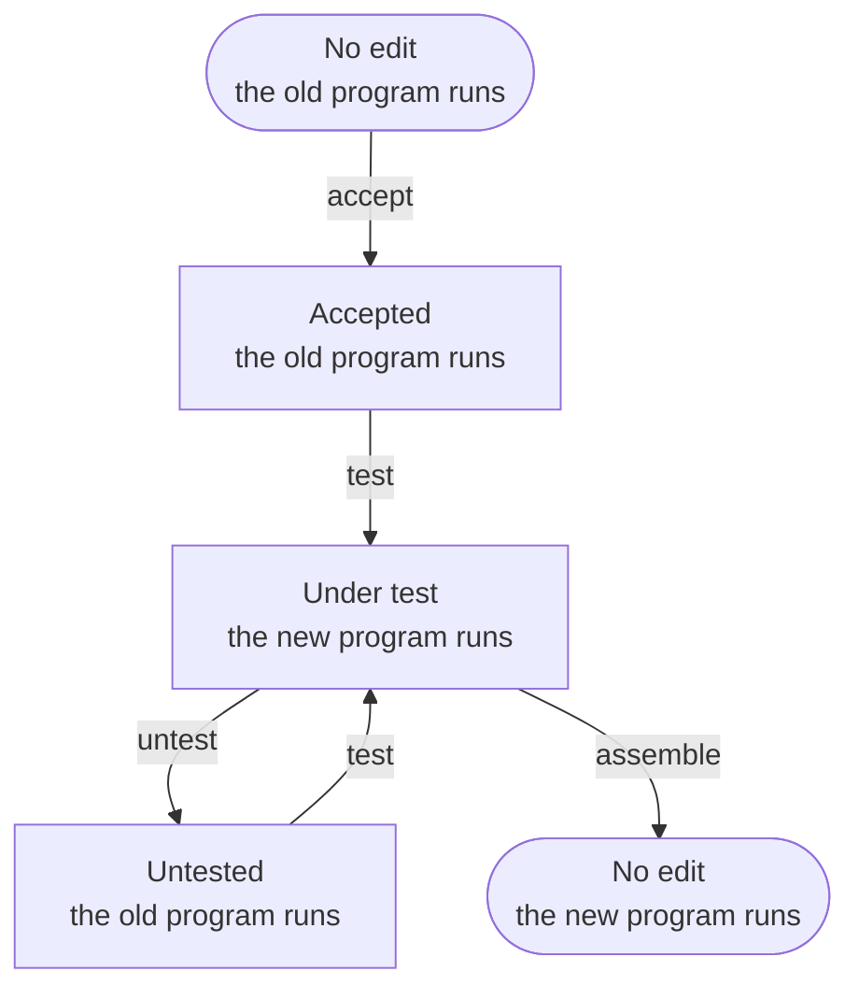
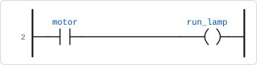
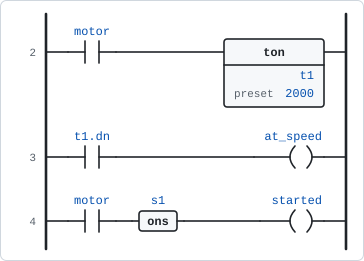

# Change a running program

This tutorial is for an Elixir developer who did the tutorials
[Your first program](first-program.md) and [A timer and a counter](timers-and-counters.md).
You change the program of a motor while the motor runs. You do it with an
[online edit](../reference/glossary.md#online-edit), and the motor stays on.

You learn 4 steps of an online edit: [accept](../reference/glossary.md#accept),
[test](../reference/glossary.md#test), [untest](../reference/glossary.md#untest) and
[assemble](../reference/glossary.md#assemble). You also learn how to read the report
that each step returns.

## What you make

You make a new [program](../reference/glossary.md#program) for the motor of the first
tutorial. The old program is `motor.ld`. The new program is `motor_v2.ld`, and it has 2
changes:

- It has no lamp `run_lamp`. In its place, the output `at_speed` comes on when the motor
  runs for 2 s.
- The output `started` is 1 for 1 [scan](../reference/glossary.md#scan) when the motor
  starts. A [one-shot](../reference/glossary.md#one-shot) gives this pulse. It gives no
  pulse in the [first scan](../reference/glossary.md#first-scan) of an instance.

The motor of this tutorial is a tag of a program. The scripts drive no machine.

You also write 2 scripts. The first script does the accept, and the second script does
the complete edit.

Your script is the [host](../reference/glossary.md#host). It does each step of the edit
between 2 scans. This diagram shows the steps of this tutorial.



Figure: the steps of the online edit of this tutorial. Each box names the program that
runs.

Each step of the edit returns a report. A report is a list of entries. An entry gives a
change that the step makes to the [state](../reference/glossary.md#state), or a fact that
the host must know.

## Before you start

You must have:

- the project of [Your first program](first-program.md): the directory `first` with its
  file `mix.exs`
- the file [`motor.ld`](first-program.md#step-2-write-the-ladder-program) of that
  tutorial, in that directory

Do each step of this tutorial in the directory `first`.

## Step 1: Write the new program

Make the file `motor_v2.ld` with this text:

<!-- file: motor_v2.ld -->
```text
var_input start bool
var_input stop bool
var_input overtemp bool
var_input reset bool
var_output motor bool
var_output at_speed bool
var_output started bool
var_output speed_sp dint 1200
var fault bool
var t1 ton
var s1 bool

( xic start | xic motor ) xio stop ote motor
xic motor ton t1 2000
xic t1.dn ote at_speed
xic motor ons s1 ote started
xic overtemp otl fault
xic reset otu fault
xic fault move 0 speed_sp
```

The old program has 1 [rung](../reference/glossary.md#rung) for the lamp. It is rung 2
of `motor.ld`:

<!-- rung: motor.ld 2 -->


The new program has 3 rungs in the place of that rung. They are rungs 2, 3 and 4 of
`motor_v2.ld`:

<!-- rung: motor_v2.ld 2 3 4 -->


The other 4 rungs are the same in the 2 programs. The new program declares the
[outputs](../reference/glossary.md#output) `at_speed` and `started`, the
[timer](../reference/glossary.md#timer) `t1` and the
[storage bit](../reference/glossary.md#storage-bit) `s1`. It does not declare `run_lamp`.

[Step 2](#step-2-accept-the-new-program) checks this file.

## Step 2: Accept the new program

An accept compares the new program with the old program and with the state of the
[instance](../reference/glossary.md#instance). It changes nothing. Make the file
`change-a-running-program-accept.exs` with this text:

```elixir
{:ok, motor} = Logex.compile_file("motor.ld")

state = Logex.Runtime.put_inputs(motor, Logex.Runtime.instance(motor), %{"start" => 1})
{outputs, state} = Logex.Runtime.scan(motor, state, 10)
IO.puts("the motor runs  #{inspect(outputs)}")

accepted =
  with {:ok, v2} <- Logex.compile(File.read!("motor_v2.ld"), name: "motor") do
    Logex.Edit.accept(motor, v2, state)
  end

text = fn
  {:ok, _edit, forecast} -> Enum.map_join(forecast, "\n", &inspect/1)
  {:error, diagnostics} -> Enum.map_join(diagnostics, "\n", &Logex.Diagnostic.format/1)
end

IO.puts(text.(accepted))
```

Run the script:

```console
$ mix run change-a-running-program-accept.exs
the motor runs  %{"motor" => 1, "run_lamp" => 1, "speed_sp" => 1200}
{:added, "at_speed", 0}
{:added, "s1", 0}
{:added, "started", 0}
{:added, "t1", %{"acc" => 0, "dn" => 0, "en" => 0, "last" => 0, "pre" => 2000, "tt" => 0}}
{:held, "run_lamp", 1}
{:ons_blocked, "s1", 0}
```

If you see these 7 lines, logex accepts the new program.

> #### If you see a different line {: .info}
>
> An error in `motor_v2.ld` gives a [diagnostic](../reference/glossary.md#diagnostic) in
> the place of the last 6 lines. For the name `at_sped` on line 15, the script prints
> ``line 15: `at_sped` is not declared — did you mean `at_speed`?``. Correct the line and
> run the script again.

The first line is 1 scan of the old program. The start button is 1, and the motor runs.

The other 6 lines are a [forecast](../reference/glossary.md#forecast). The accept does
no test. The forecast shows the report that a test returns if you do the test at this
moment. Each line is 1 entry of the report: a kind, a name and a value.

| Entry | What a test does |
|---|---|
| `{:added, "at_speed", 0}`, `{:added, "s1", 0}` and `{:added, "started", 0}` | It adds each [tag](../reference/glossary.md#tag) that only the new program declares. Each tag starts at its [initial value](../reference/glossary.md#initial-value). |
| `{:added, "t1", %{...}}` | It adds the timer `t1`. The [member](../reference/glossary.md#member) `pre` holds the [preset](../reference/glossary.md#preset) of rung 2, which is 2000. |
| `{:held, "run_lamp", 1}` | It writes nothing to `run_lamp`. The scans of the new program do not return this output. The entry gives its last value. |
| `{:ons_blocked, "s1", 0}` | It blocks the one-shot `s1`. In the scan after the test, `ons s1` passes no power. The value 0 is the value of the storage bit. |

> #### A held output {: .info}
>
> logex does not write an output that a `:held` entry names. A host that drives a real
> lamp must keep the lamp at the value of the entry.

The test blocks the one-shot because `motor` is 1 and the new storage bit `s1` starts at
0. If the test does not block the one-shot, `started` is 1 in the scan after the test.
But the motor does not start in that scan.

The script calls 2 new functions:

- `Logex.compile/2` [compiles](../reference/glossary.md#compile) the text of
  `motor_v2.ld`. The option `name: "motor"` gives the new program the name of the old
  program, because an edit keeps the name of a program. `Logex.compile_file/1` gives the
  name `motor_v2`, from the name of the file.
- `Logex.Edit.accept/3` returns the edit and the forecast.

## Step 3: Do the edit

The second script starts the motor with the old program and does an accept. It does a
test and 2 scans, then an untest and 1 scan. It does a second test and an assemble with no
scan between them.

Make the file `edit.exs` with this text. Copy each string exactly, with its spaces. For
example, `"start pressed "` ends with 1 space. The spaces make the columns of the output.

```elixir
{:ok, motor} = Logex.compile_file("motor.ld")
# An edit keeps the program's name, and compile_file/1 would name this one `motor_v2`.
{:ok, v2} = Logex.compile(File.read!("motor_v2.ld"), name: "motor")

scan = fn state, program, elapsed, label, inputs ->
  state = Logex.Runtime.put_inputs(program, state, inputs)
  {outputs, state} = Logex.Runtime.scan(program, state, elapsed)
  IO.puts("t=#{String.pad_leading("#{state.now}", 4)}  #{label}  #{inspect(outputs)}")
  state
end

step = fn {edit, state, report}, label ->
  IO.puts(label)
  Enum.each(report, &IO.puts("        #{inspect(&1)}"))
  {edit, state}
end

state =
  Logex.Runtime.instance(motor)
  |> scan.(motor, 10, "start pressed ", %{"start" => 1})
  |> scan.(motor, 10, "start released", %{"start" => 0})

{:ok, edit, _forecast} = Logex.Edit.accept(motor, v2, state)
{edit, state} = step.(Logex.Edit.test(edit, state), "test")

state =
  state
  |> scan.(Logex.Edit.running(edit), 10, "under test    ", %{})
  |> scan.(Logex.Edit.running(edit), 2000, "under test    ", %{})

{edit, state} = step.(Logex.Edit.untest(edit, state), "untest")
state = scan.(state, Logex.Edit.running(edit), 10, "untested      ", %{})
{edit, state} = step.(Logex.Edit.test(edit, state), "test")
{motor, state} = step.(Logex.Edit.assemble(edit, state), "assemble")

state
|> scan.(motor, 10, "stop pressed  ", %{"stop" => 1})
|> scan.(motor, 10, "start pressed ", %{"stop" => 0, "start" => 1})
```

Run the script:

```console
$ mix run edit.exs
t=  10  start pressed   %{"motor" => 1, "run_lamp" => 1, "speed_sp" => 1200}
t=  20  start released  %{"motor" => 1, "run_lamp" => 1, "speed_sp" => 1200}
test
        {:added, "at_speed", 0}
        {:added, "s1", 0}
        {:added, "started", 0}
        {:added, "t1", %{"acc" => 0, "dn" => 0, "en" => 0, "last" => 0, "pre" => 2000, "tt" => 0}}
        {:held, "run_lamp", 1}
        {:ons_blocked, "s1", 0}
t=  30  under test      %{"at_speed" => 0, "motor" => 1, "speed_sp" => 1200, "started" => 0}
t=2030  under test      %{"at_speed" => 1, "motor" => 1, "speed_sp" => 1200, "started" => 0}
untest
        {:held, "at_speed", 1}
        {:held, "started", 0}
t=2040  untested        %{"motor" => 1, "run_lamp" => 1, "speed_sp" => 1200}
test
        {:held, "run_lamp", 1}
        {:ons_blocked, "s1", 1}
        {:resumed, "t1", 10}
assemble
        {:held, "run_lamp", 1}
        {:pruned, "run_lamp", 1}
t=2050  stop pressed    %{"at_speed" => 0, "motor" => 0, "speed_sp" => 1200, "started" => 0}
t=2060  start pressed   %{"at_speed" => 0, "motor" => 1, "speed_sp" => 1200, "started" => 1}
```

If you see these 24 lines, the edit is complete and the new program runs.

> #### If the output is different {: .info}
>
> If you see `MatchError`, do [Step 2](#step-2-accept-the-new-program) again. Its script
> prints the diagnostic.
>
> If you see `ArgumentError`, compare the line that calls `Logex.compile/2` with the
> script. In a message of logex, the candidate is the new program, and the running
> program is the old program.
>
> If you see `UndefinedFunctionError` and `function Logex.compile/1 is undefined or
> private`, add `name: "motor"` to the call of `Logex.compile/2`.

The script calls 4 new functions. Each of the first 3 returns the state and a report.

| Call | What it does |
|---|---|
| `Logex.Edit.test/2` | It puts the new program in the place of the old program. |
| `Logex.Edit.untest/2` | It puts the old program back. |
| `Logex.Edit.assemble/2` | It ends the edit and keeps the new program. It returns the new program in the place of the edit. |
| `Logex.Edit.running/1` | It returns the program that the host must run during the edit. logex does not detect a scan of the other program. |

The function `scan` of the script takes the program as an argument, because the program
changes during the edit. After the assemble, the script keeps the new program in the
variable `motor`.

## Step 4: Read the result

This table shows the 7 scans of the output, and the steps of the edit between them.

- The new program runs after each `test`. The old program runs in the other scans.
- Where a cell says no tag, the state does not hold the tag.
- Where a cell says held, the program that runs does not write the output. The state
  keeps its last value.

| Line | `motor` | `run_lamp` | `at_speed` | `started` |
|---|---|---|---|---|
| `t=  10` | 1 | 1 | no tag | no tag |
| `t=  20` | 1 | 1 | no tag | no tag |
| `test` | | | | |
| `t=  30` | 1 | held at 1 | 0 | 0 |
| `t=2030` | 1 | held at 1 | 1 | 0 |
| `untest` | | | | |
| `t=2040` | 1 | 1 | held at 1 | held at 0 |
| `test` | | | | |
| `assemble` | | | | |
| `t=2050` | 0 | no tag | 0 | 0 |
| `t=2060` | 1 | no tag | 0 | 1 |

The column `motor` is 1 from 10 ms to 2040 ms. No step of the edit stops the motor. Each
step of the edit keeps the value of each tag that the old program and the new program
both declare. Thus the [seal-in](../reference/glossary.md#seal-in) of rung 1 stays on.

### The first test

- The report is the same as the forecast of [Step 2](#step-2-accept-the-new-program).
- At `t=  30`, `started` is 0, because the test blocks the one-shot.
- At `t=  30`, in the scan after the test, the timer `t1` starts. At `t=2030`, it measures
  2000 ms, and `at_speed` comes on.

### The untest

- The entries `{:held, "at_speed", 1}` and `{:held, "started", 0}` give the last values of
  the 2 outputs that the old program does not write. A host that drives real outputs must
  keep `at_speed` at 1 and `started` at 0.
- At `t=2040`, the old program runs on the same state. It returns `run_lamp` again.

You can do a test and an untest as many times as necessary.

### The second test

- The report has no `:added` entry, because the state holds each tag of the new program.
- The test blocks the one-shot again, because the old program ran in the scan before it.
  The entry `{:ons_blocked, "s1", 1}` gives the value of the storage bit, which is 1.
- The old program ran for 10 ms, from `t=2030` to `t=2040`, and it has no `ton` for `t1`.
  The entry `{:resumed, "t1", 10}` gives these 10 ms. The timer does not add them to its
  time.

### The assemble

- The entry `{:held, "run_lamp", 1}` gives the last value of the lamp again. No program
  writes `run_lamp` after the assemble. A real lamp stays at 1 until the host changes it.
- The entry `{:pruned, "run_lamp", 1}` shows that the assemble removes `run_lamp` from the
  state. Only the old program declares this tag.
- The assemble ends the edit.
- At `t=2050`, the stop button stops the motor. At `t=2060`, the start button starts it,
  and `started` is 1. The one-shot passes power for a real start.

## What you learned

- An [online edit](../reference/glossary.md#online-edit) changes the program of an
  [instance](../reference/glossary.md#instance) with no
  [restart](../reference/glossary.md#restart). The host does each step between 2 scans.
- An [accept](../reference/glossary.md#accept) checks the new program and returns a
  [forecast](../reference/glossary.md#forecast). It changes nothing.
- A [test](../reference/glossary.md#test) runs the new program. An
  [untest](../reference/glossary.md#untest) puts the old program back. An
  [assemble](../reference/glossary.md#assemble) keeps the new program and ends the edit.
- During an edit, the host runs the program that `Logex.Edit.running/1` returns.
- Each step of the edit returns a report. This tutorial shows 5 kinds of entry: `:added`,
  `:held`, `:ons_blocked`, `:resumed` and `:pruned`. The host keeps an output that a
  `:held` entry names.
- An edit keeps the value of each tag that the old program and the new program both
  declare. A new tag starts at its initial value. A test blocks a new one-shot for 1 scan.

## See also

- [Edit a running program](../howto/edit-a-running-program.md): how to do an online edit
  of 1 instance of your program.
- [Edit a running plant](../howto/edit-a-running-plant.md): how to do an online edit of a
  [configuration](../reference/glossary.md#configuration) that the
  [runner](../reference/glossary.md#runner) runs.
- [Online edit](../reference/online-edit.md): the exact rules of each step, with cancel,
  and each kind of entry of a report.
- [The model of an online edit](../explanation/online-edit-model.md): how an edit keeps
  the state, and what a change of program with no edit does.
- [Safety and limits](../explanation/safety-and-limits.md): what logex is not.
