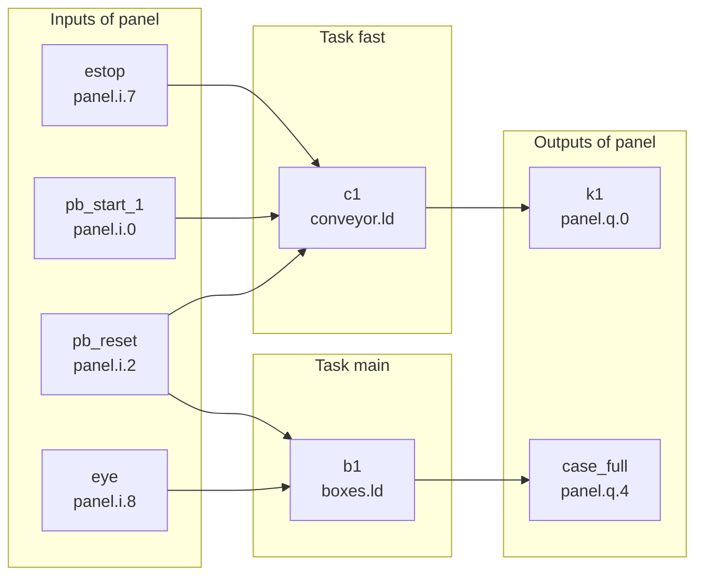
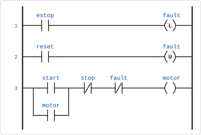
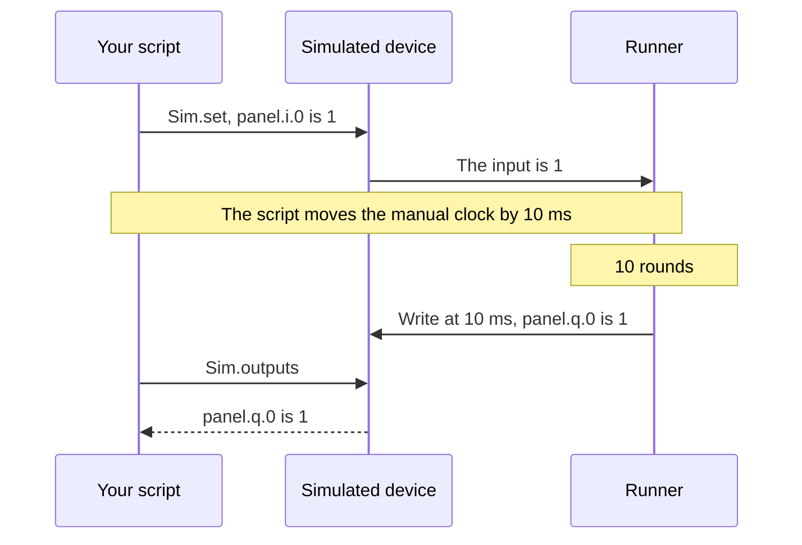

# Your first plant

This tutorial is for an Elixir developer who did the tutorials
[Your first program](first-program.md) and [A timer and a counter](timers-and-counters.md).
You put 2 [programs](../reference/glossary.md#program) into 1
[configuration](../reference/glossary.md#configuration). Then you run the configuration
on a clock, with a [simulated device](../reference/glossary.md#simulated-device) for the
buttons and the lamps.

You learn how a [task](../reference/glossary.md#task) runs a program, and how a
[global](../reference/glossary.md#global) connects a program to a
[point](../reference/glossary.md#point) of a [device](../reference/glossary.md#device).
You also learn how the [runner](../reference/glossary.md#runner) runs a
[plant](../reference/glossary.md#plant).

## What you make

You make the controls of a small packing line. A conveyor carries boxes past a photo-eye
to a case. The first program starts and stops the motor of the conveyor. The second
program counts the boxes.



Figure: the plant of this tutorial. The instance `c1` reads 3 inputs and writes `k1`.
The instance `b1` reads 2 inputs and writes `case_full`.

The device has these 6 points:

| Point | Global | What it is |
|---|---|---|
| `panel.i.0` | `pb_start_1` | The start button |
| `panel.i.2` | `pb_reset` | The reset button |
| `panel.i.7` | `estop` | A stop signal that the program reads. It is not an emergency stop. |
| `panel.i.8` | `eye` | The photo-eye. It is 1 while a box is in front of it. |
| `panel.q.0` | `k1` | The contactor, which is the switch of the motor |
| `panel.q.4` | `case_full` | The lamp for a full case of 3 boxes |

The plant has 3 files. You have `boxes.ld`, and you write `conveyor.ld` and
`packing.logex`. Then you write 2 scripts. The first script checks the plant. The second
script runs the plant and prints its outputs at 5 times.
[Step 4](#step-4-run-the-plant-on-the-manual-clock) shows these lines.

## Before you start

You must have:

- the project of [Your first program](first-program.md): the directory `first` with its
  file `mix.exs`
- the file [`boxes.ld`](timers-and-counters.md#step-3-write-the-counter-program) of the
  second tutorial, in that directory

Do each step of this tutorial in the directory `first`.

## Step 1: Write the conveyor program

> #### Warning {: .warning}
>
> Do not use logex for a safety function. logex can stop at any time, and then no part
> of logex sets an output to 0.
>
> The signal `estop` of this tutorial is an input that a program reads. It is not the
> emergency stop of a machine. Make the emergency stop of a machine with hardwired
> circuits or with a safety-rated controller.

Make the file `conveyor.ld` with this text:

<!-- file: conveyor.ld -->
```text
var_input start bool
var_input stop bool
var_input reset bool
var_output motor bool
var_external estop bool
var fault bool

xic estop otl fault
xic reset otu fault
( xic start | xic motor ) xio stop xio fault ote motor
```

This drawing shows the 3 [rungs](../reference/glossary.md#rung) of the program.

<!-- rung: conveyor.ld -->


The program has 1 new [section](../reference/glossary.md#section) and 3 rungs:

| Text | What it does |
|---|---|
| `var_external estop bool` | The program uses the global `estop`. A global is a value of the configuration that programs share by name. You declare it in Step 2. |
| `xic estop otl fault` | It [latches](../reference/glossary.md#latch) `fault` when `estop` is 1. |
| `xic reset otu fault` | It [unlatches](../reference/glossary.md#unlatch) `fault` when `reset` is 1. |
| `xio fault` in rung 3 | It stops the motor while `fault` is 1. The other parts of rung 3 are the [seal-in](../reference/glossary.md#seal-in) of the first tutorial. |

After rung 1 latches `fault`, the tag stays 1 when `estop` goes back to 0, and the motor
stays off. Only rung 2 can write 0 to `fault`.

## Step 2: Write the configuration file

The [configuration file](../reference/glossary.md#configuration-file) joins the 2
programs, the 2 tasks and the points. Make the file `packing.logex` with this text:

<!-- file: packing.logex -->
```text
// packing.logex -- a conveyor on a 10 ms task, and a box counter in the continuous task
task fast interval 10 priority 1 watchdog 50
task main continuous watchdog 200

var_global estop      bool at panel.i.7
var_global pb_start_1 bool at panel.i.0
var_global pb_reset   bool at panel.i.2
var_global eye        bool at panel.i.8
var_global k1         bool at panel.q.0
var_global case_full  bool at panel.q.4

program c1 conveyor with fast
  c1.start pb_start_1
  c1.stop  0
  c1.reset pb_reset
  c1.motor k1

program b1 boxes
  b1.eye       eye
  b1.reset_pb  pb_reset
  b1.full_lamp case_full
```

The file has 4 kinds of line: a task, a global, an instance and a connection.

| Line | What it does |
|---|---|
| `task fast interval 10 priority 1 watchdog 50` | It declares the [periodic task](../reference/glossary.md#periodic-task) `fast`, which is due each 10 ms. The [watchdog](../reference/glossary.md#watchdog) is the limit for 1 run of the task, in ms. This lesson does not use the [priority](../reference/glossary.md#priority). |
| `task main continuous watchdog 200` | It declares the [continuous task](../reference/glossary.md#continuous-task) `main`, which has no interval. |
| `var_global estop bool at panel.i.7` | It declares the global `estop` at a point of the device `panel`. A global with `at` is a [located global](../reference/glossary.md#located-global). The letter `i` is for an input point, and the letter `q` is for an output point. The number is the place of the point on the device. |
| `program c1 conveyor with fast` | It makes the [instance](../reference/glossary.md#instance) `c1`. The word `conveyor` names the program. logex reads the file `conveyor.ld` from the directory of the configuration file. The words `with fast` put `c1` in the task `fast`. |
| `program b1 boxes` | It makes the instance `b1` of the program `boxes.ld`. The line has no `with`. Thus `b1` runs in the continuous task. |
| `c1.start pb_start_1` | It is a [connection](../reference/glossary.md#connection). The [input](../reference/glossary.md#input) `start` of `c1` gets the value of the global `pb_start_1`. |
| `c1.stop 0` | It is a connection to a constant. The plant has no stop button, but each input of an instance must have a connection. Thus the input `stop` of `c1` is always 0. |
| `c1.motor k1` | It is a connection. The global `k1` gets the value of the [output](../reference/glossary.md#output) `motor` of `c1`. |

The line that starts with `//` is a comment.

The file has no line for 2 things:

- The output `count` of `b1` has no connection. An output can have none.
- The global `estop` has no connection. The program `conveyor.ld` reads it by its name,
  through `var_external`.

## Step 3: Check the plant

Make the file `first-plant-check.exs` with this text:

```elixir
report = fn
  {:ok, plant} -> Enum.map_join(plant.globals, "\n", &"#{&1.at}  #{&1.name}")
  {:error, diagnostics} -> Enum.map_join(diagnostics, "\n", &Logex.Diagnostic.format/1)
end

IO.puts(report.(Logex.Configuration.compile_file("packing.logex")))
```

Run the script:

```console
$ mix run first-plant-check.exs
panel.i.7  estop
panel.i.0  pb_start_1
panel.i.2  pb_reset
panel.i.8  eye
panel.q.0  k1
panel.q.4  case_full
```

`Logex.Configuration.compile_file/1` [compiles](../reference/glossary.md#compile) the
configuration file and its 2 programs. If you see these 6 lines, logex compiled the 3
files, and each global is at its point.

> #### If you see a different line {: .info}
>
> An error in 1 of the 3 files gives 1 or more
> [diagnostics](../reference/glossary.md#diagnostic). Each diagnostic has its file, its
> line and a message. For the name `pb_start` on line 13 of `packing.logex`, the script
> prints
> ``packing.logex: line 13: no global `pb_start` — did you mean `pb_start_1`?``.
>
> For an error in `conveyor.ld`, the first line names line 12 of `packing.logex`. The
> line after it names the line of `conveyor.ld` that has the error.
>
> Correct the line and run the script again.

## Step 4: Run the plant on the manual clock

> #### The script moves the clock {: .info}
>
> The runner reads the time from a [clock](../reference/glossary.md#clock). The manual
> clock of this script moves only when the script moves it. Thus the script does not
> wait, and it prints the same lines each time.

The runner works in [rounds](../reference/glossary.md#round). In each round, the runner
takes the newest inputs that the device gave, and runs the tasks that are due. If an
output changed, the runner writes the outputs to the device. This plant has a continuous
task. Thus the runner does 1 round for each ms of the clock, and the task `main` runs in
each round.

Make the file `first-plant-run.exs` with this text:

```elixir
alias Logex.IO.Sim
alias Logex.Runner
alias Logex.Runner.Clock.Manual

{:ok, plant} = Logex.Configuration.compile_file("packing.logex")
{:ok, clock} = Manual.start_link()
{:ok, panel} = Sim.start_link(reports: true)

{:ok, runner} =
  Runner.start_link(
    configuration: plant,
    io: %{"panel" => {Sim, sim: panel}},
    clock: {Manual, clock}
  )

pad = fn number -> String.pad_leading("#{number}", 2) end

show = fn label ->
  %{now: now, rounds: rounds} = Runner.status(runner)
  %{"panel.q.0" => k1, "panel.q.4" => case_full} = Sim.outputs(panel)
  boxes = Runner.get!(runner, "b1.count")
  values = "k1=#{k1}  case_full=#{case_full}  boxes=#{boxes}"
  IO.puts("t=#{pad.(now)}  rounds=#{pad.(rounds)}  #{values}  #{label}")
end

show.("the runner started")

Sim.set(panel, "panel.i.0", 1)
Manual.advance(clock, 10)
show.("the start button is 1")
Sim.set(panel, "panel.i.0", 0)

for _box <- 1..3 do
  Sim.set(panel, "panel.i.8", 1)
  Manual.advance(clock, 2)
  Sim.set(panel, "panel.i.8", 0)
  Manual.advance(clock, 2)
end

show.("3 boxes went past the photo-eye")

Sim.set(panel, "panel.i.7", 1)
Manual.advance(clock, 7)
show.("estop is 1 from 22 ms")
Manual.advance(clock, 1)
show.("c1 read estop")

:ok = Runner.stop(runner)
IO.inspect(Sim.outputs(panel), label: "after the stop")
IO.inspect(Sim.closed?(panel), label: "closed")
```

Run the script:

```console
$ mix run first-plant-run.exs
t= 0  rounds= 1  k1=0  case_full=0  boxes=0  the runner started
t=10  rounds=11  k1=1  case_full=0  boxes=0  the start button is 1
t=22  rounds=23  k1=1  case_full=1  boxes=3  3 boxes went past the photo-eye
t=29  rounds=30  k1=1  case_full=1  boxes=3  estop is 1 from 22 ms
t=30  rounds=31  k1=0  case_full=1  boxes=3  c1 read estop
after the stop: %{"panel.q.0" => 0, "panel.q.4" => 0}
closed: true
```

If you see these 7 lines, the plant runs.

> #### If a value is different {: .info}
>
> Compare each `Sim.set` line of your script with the page. The simulated device takes
> an input point that the plant does not use, and it gives no error. If `k1` stays 0,
> look at `"panel.i.0"`. If `boxes` stays 0, look at `"panel.i.8"`.

This diagram shows the first 10 ms of the script.



Figure: the script sets the start button and moves the clock. Then the runner does 10
rounds. The round at 10 ms runs `c1` and writes the output `panel.q.0`.

The script calls these functions:

- `Logex.Runner.Clock.Manual.start_link/0` starts the manual clock.
  `Logex.Runner.Clock.Manual.advance/2` moves it by a number of ms.
- `Logex.IO.Sim.start_link/1` starts the simulated device. With `reports: true`, the
  device tells the runner each change of an input.
- `Logex.Runner.start_link/1` starts the runner. The option `io:` makes the simulated
  device the device `panel` of the configuration file.
- `Logex.Runner.status/1` returns a map. The key `now` is the time of the plant in ms.
- `Logex.Runner.get!/2` reads 1 value of the plant by its name. `"b1.count"` is the
  [tag](../reference/glossary.md#tag) `count` of the instance `b1`.
- `Logex.IO.Sim.set/3` sets 1 input point. `Logex.IO.Sim.outputs/1` returns the newest
  value of each output point. The script names a point as the configuration file writes
  it.

## Step 5: Read the result

The first 5 lines of the output show the plant at 5 times:

| Line | What happens |
|---|---|
| `t= 0` | The runner starts and does the first round. The 2 outputs are 0. |
| `t=10` | The script sets the start button to 1 and moves the clock by 10 ms. The task `fast` runs in the round at 10 ms, and `k1` is 1. |
| `t=22` | The script sets the start button to 0 and moves 3 boxes past the photo-eye. The seal-in keeps `k1` at 1. The instance `b1` counts 3 boxes, and `case_full` is 1. |
| `t=29` | The script sets `estop` to 1 at 22 ms and moves the clock by 7 ms. The task `fast` does not run, and `k1` stays 1. |
| `t=30` | The script moves the clock by 1 ms. The task `fast` runs. The instance `c1` reads `estop` and latches `fault`, and `k1` is 0. |

The conveyor does not stop at 22 ms. An instance reads a value only when its task runs.
The task `fast` runs at 20 ms and at 30 ms. Thus `c1` reads `estop` at 30 ms, and the
motor stays on for 8 ms after the signal. If `estop` goes back to 0 before 30 ms, `c1`
never reads the 1.

The last 2 lines show the end of the script. `Logex.Runner.stop/1` writes 0 to each
output, and thus `case_full` goes from 1 to 0. The function also closes the device.
`Logex.IO.Sim.closed?/1` then returns `true`.

## What you learned

- A configuration file declares tasks, globals, instances and connections. A located
  global is at a point of a device.
- A connection joins an input or an output of an instance to a global or to a constant.
  A program reads a global by its name through `var_external`.
- A periodic task runs its instances at a fixed interval. The continuous task runs its
  instances in each round. An instance reads a value only when its task runs.
- The runner runs the plant on a clock and through devices. `Logex.Runner.stop/1`
  writes 0 to each output and closes each device.

## See also

- [Change a running program](change-a-running-program.md): the next tutorial.
- [Write a configuration file](../howto/write-a-configuration-file.md) and
  [Run a plant on the clock](../howto/run-on-the-clock.md): how to do each for your
  plant, with the clock of the machine.
- [Use an event task](../howto/use-an-event-task.md): a task that is due when a signal
  rises.
- [Configuration file](../reference/configuration-file.md), [Runner](../reference/runner.md)
  and [I/O adapters](../reference/io-adapters.md): the exact rules.
- [Tasks and the schedule](../explanation/tasks-and-scheduling.md) and
  [Safety and limits](../explanation/safety-and-limits.md): the reasons, and what logex is
  not.
