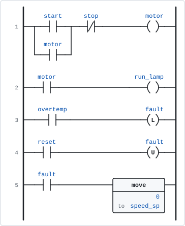

# Your first program

This tutorial is for an Elixir developer who is new to logex and to ladder logic. You
write a ladder program that starts and stops a motor. Then you compile it and run 5
scans from an Elixir script.

You learn how to read a [rung](../reference/glossary.md#rung), how to declare a [tag](../reference/glossary.md#tag) and how a
[host](../reference/glossary.md#host) runs a [scan](../reference/glossary.md#scan). The host is your Elixir code.

## What you make

You make the program `motor.ld`. This drawing shows its 5 rungs. Each rung is 1 line
between 2 [rails](../reference/glossary.md#rail). [Power flows](../reference/glossary.md#power-flow) from the left rail to the
right rail through each rung.

<!-- rung: motor.ld -->


At the end, your script prints the outputs of the program after each scan.
[Step 4](#step-4-write-the-script-and-run-it) shows these lines.

## Before you start

You must have:

- Elixir 1.20 on Erlang/OTP 28
- Git, and access to GitHub

logex has no dependencies. Mix gets logex from its repository.

## Step 1: Make a project

1. Make a directory with the name `first` and go into it.
2. Make the file `mix.exs` in that directory, with this text:

<!-- fragment: the project file that the reader writes; the suite runs the scripts in examples/ -->
```elixir
defmodule First.MixProject do
  use Mix.Project

  def project do
    [
      app: :first,
      version: "0.1.0",
      deps: [{:logex, github: "rellen/logex"}]
    ]
  end
end
```

3. Get logex and compile it:

```console
$ mix deps.get
$ mix compile
```

The first command makes the directory `deps/logex`. The last line of the second command
is `Generated first app`. If you see that line, the project is ready.

## Step 2: Write the ladder program

Make the file `motor.ld` with this text:

<!-- file: motor.ld -->
```text
var_input start bool
var_input stop bool
var_input overtemp bool
var_input reset bool
var_output motor bool
var_output run_lamp bool
var_output speed_sp dint 1200
var fault bool

( xic start | xic motor ) xio stop ote motor
xic motor ote run_lamp
xic overtemp otl fault
xic reset otu fault
xic fault move 0 speed_sp
```

The first 8 lines are [declarations](../reference/glossary.md#declaration). Each declaration gives a
[section](../reference/glossary.md#section), a name and a [type](../reference/glossary.md#type).

| Section | Where the value comes from |
|---|---|
| `var_input` | The host gives the value. An instruction cannot write to it. |
| `var_output` | The program writes the value. A scan returns it to the host. |
| `var` | The program writes the value. A scan does not return it. The host can read it in the state. |

A tag starts at 0. The tag `speed_sp` starts at 1200, because its declaration gives that
value.

The last 5 lines are rungs. logex reads the [instructions](../reference/glossary.md#instruction) of a rung
from left to right.

| Instruction | What it does |
|---|---|
| `xic start` | A [contact](../reference/glossary.md#contact). It passes power if `start` is 1. |
| `xio stop` | A contact. It passes power if `stop` is 0. |
| `( a \| b )` | A [branch](../reference/glossary.md#branch). It passes power if `a` or `b` passes power. |
| `ote motor` | A [coil](../reference/glossary.md#coil). It writes 1 to `motor` if it gets power, and 0 if it does not. |
| `otl fault` | A coil that [latches](../reference/glossary.md#latch). It writes 1 to `fault` if it gets power. If it does not, `fault` does not change. |
| `otu fault` | A coil that [unlatches](../reference/glossary.md#unlatch). It writes 0 to `fault` if it gets power. If it does not, `fault` does not change. |
| `move 0 speed_sp` | It writes 0 to `speed_sp` if it gets power. |

Rung 1 is a [seal-in](../reference/glossary.md#seal-in). The contact `xic motor` is parallel to the contact
`xic start`. Thus the motor stays on after you release the start button.

## Step 3: Check the program

logex [compiles](../reference/glossary.md#compile) the text of a program before it runs it. Make the file
`check.exs` with this text:

```elixir
report = fn
  {:ok, _program} -> "motor.ld compiles"
  {:error, diagnostics} -> Enum.map_join(diagnostics, "\n", &Logex.Diagnostic.format/1)
end

IO.puts(report.(Logex.compile_file("motor.ld")))
```

Run the script:

```console
$ mix run check.exs
motor.ld compiles
```

If you see this line, your program is correct.

> #### If you see a different line {: .info}
>
> An error in `motor.ld` gives a [diagnostic](../reference/glossary.md#diagnostic). The script prints
> each diagnostic: the file, the line and a message. For the name `run_lmap` on line 11,
> the script prints ``motor.ld: line 11: `run_lmap` is not declared — did you mean `run_lamp`?``.
> Correct the line and run the script again.

## Step 4: Write the script and run it

Make the file `scan.exs` with this text:

```elixir
{:ok, motor} = Logex.compile_file("motor.ld")

scan = fn state, label, inputs ->
  state = Logex.Runtime.put_inputs(motor, state, inputs)
  {outputs, state} = Logex.Runtime.scan(motor, state)
  IO.puts("#{label}  #{inspect(outputs)}  fault=#{state.env["fault"]}")
  state
end

Logex.Runtime.instance(motor)
|> scan.("start pressed ", %{"start" => 1})
|> scan.("start released", %{"start" => 0})
|> scan.("overtemp      ", %{"overtemp" => 1})
|> scan.("stop pressed  ", %{"stop" => 1})
|> scan.("cooled, idle  ", %{"stop" => 0, "overtemp" => 0})
```

Run the script:

```console
$ mix run scan.exs
start pressed   %{"motor" => 1, "run_lamp" => 1, "speed_sp" => 1200}  fault=0
start released  %{"motor" => 1, "run_lamp" => 1, "speed_sp" => 1200}  fault=0
overtemp        %{"motor" => 1, "run_lamp" => 1, "speed_sp" => 0}  fault=1
stop pressed    %{"motor" => 0, "run_lamp" => 0, "speed_sp" => 0}  fault=1
cooled, idle    %{"motor" => 0, "run_lamp" => 0, "speed_sp" => 0}  fault=1
```

Each line shows 1 scan: its name, the outputs and the tag `fault`.

The script calls 4 functions of logex:

| Call | What it does |
|---|---|
| `Logex.compile_file/1` | It compiles `motor.ld` into a [program type](../reference/glossary.md#program-type). The program type is data and holds no values. |
| `Logex.Runtime.instance/1` | It makes the [state](../reference/glossary.md#state) of 1 [instance](../reference/glossary.md#instance). Each tag has its initial value. |
| `Logex.Runtime.put_inputs/3` | It sets the inputs that the map names. Each other input keeps its value. |
| `Logex.Runtime.scan/2` | It runs the 5 rungs 1 time. It returns the outputs and the new state. |

The script keeps the state and gives it to the next scan. logex keeps no state between
the calls.

## Step 5: Read the result

| Scan | What changes | What the scan does |
|---|---|---|
| 1 | `start` is 1 | Rung 1 gets power through `xic start`. `motor` is 1. |
| 2 | `start` is 0 | Rung 1 gets power through `xic motor`, the seal-in. `motor` stays 1. |
| 3 | `overtemp` is 1 | Rung 3 latches `fault`. Rung 5 writes 0 to `speed_sp`. |
| 4 | `stop` is 1 | `xio stop` stops the power in rung 1. `motor` is 0. |
| 5 | `stop` is 0, `overtemp` is 0 | `fault` stays 1, because only rung 4 can write 0 to it. |

The output `run_lamp` has the same value as `motor` in each scan, because of rung 2.

A seal-in and a latch show only across scans. That is why the script runs 5 scans.

## What you learned

- A program has declarations and rungs. Each tag has a section and a type.
- A contact reads a tag. A coil writes a tag. A branch is an OR, and a series is an AND.
- `ote` writes its tag in each scan. `otl` and `otu` write only if they get power.
- The host compiles a program 1 time, makes an instance, sets the inputs and runs scans.
- The host keeps the state of the instance.

## See also

- [Glossary](../reference/glossary.md): the words of this tutorial, with the words of IEC
  61131-3 and of the conventional set.
- [README](../../README.md): the first page, and the way to each kind of page.
